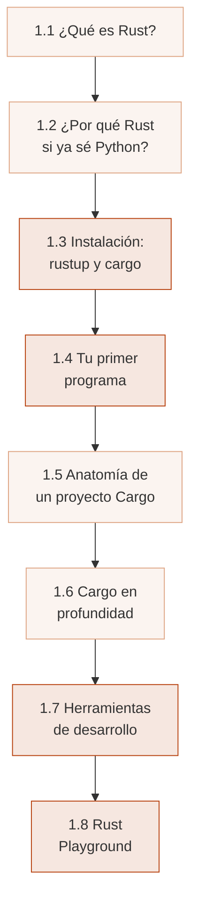
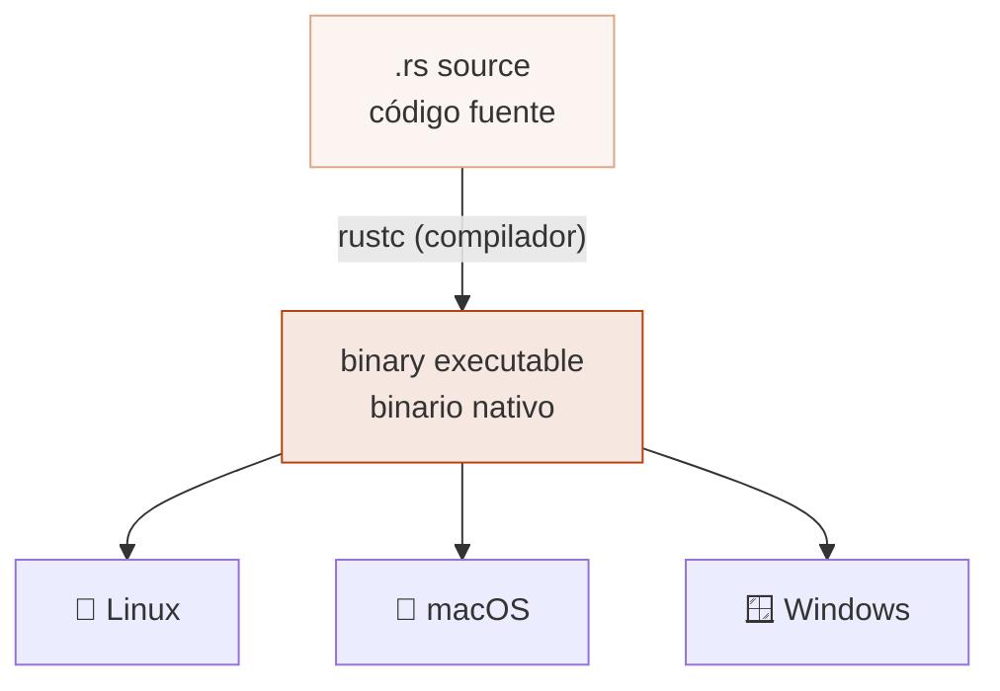
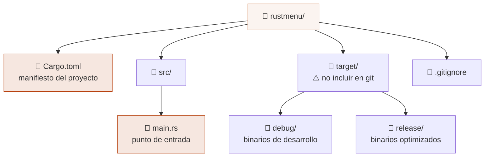

# :crab: Cap 1 — Bienvenido a Rust

<div class="chapter-meta">
  <span class="meta-item">🕐 2-3 horas</span>
  <span class="meta-item">📊 Nivel: Principiante</span>
  <span class="meta-item">🎯 Semana 1</span>
</div>

<div class="chapter-objective">
  <span class="objective-icon">📌</span>
  <span class="objective-text">Después de este capítulo serás capaz de instalar Rust, crear y ejecutar un proyecto con Cargo, y comprender por qué el sistema de ownership hace que Rust sea único frente a Python.</span>
</div>

<div class="chapter-map">
<h4>🗺️ Mapa del capítulo</h4>



</div>

!!! quote "Contexto"
    Si vienes de Python, estás acostumbrado a la comodidad de un lenguaje dinámico con garbage collector que gestiona la memoria por ti. Rust te ofrece **rendimiento de C/C++** con **seguridad de memoria garantizada en compilación**, sin necesidad de garbage collector. Imagina que Python te obligara a pensar en quién es dueño de cada dato y el compilador verificara que nunca accedes a memoria inválida: eso es Rust.

<div class="connection-box">
<span class="connection-icon">🔗</span>
<span>Si aún no has revisado la estructura general del curso, consulta la <a href='../../'>página principal</a> para ver el plan completo de aprendizaje antes de continuar.</span>
</div>

---

<div class="concept-question">
<h4>🔍 Pregunta conceptual</h4>
<p>En Python, el garbage collector se encarga de liberar la memoria que ya no usas. Si Rust no tiene garbage collector, ¿cómo evita las fugas de memoria y los accesos a memoria inválida?</p>
</div>

## 1.1 ¿Qué es Rust?

Rust es un **lenguaje de programación de sistemas** creado por Graydon Hoare en Mozilla. El desarrollo comenzó en 2010 y la primera versión estable (1.0) se publicó en **mayo de 2015**. Desde entonces, Rust ha sido consistentemente el lenguaje **más amado** en las encuestas de Stack Overflow durante varios años consecutivos.

El objetivo principal de Rust es ofrecer **seguridad de memoria sin garbage collector**. Lo consigue mediante un sistema único llamado **ownership** (propiedad), que el compilador verifica en tiempo de compilación. Si tu programa compila, tienes garantías de que no habrá data races, null pointer dereferences ni use-after-free.



<div class="comparison" markdown>
<div class="lang-box python" markdown>

#### :snake: En Python

Python es un lenguaje **interpretado** con **garbage collector**. La gestión de memoria es automática: cuando un objeto ya no tiene referencias, el GC lo libera. Esto es cómodo pero tiene un coste en rendimiento y puede causar pausas impredecibles.

</div>
<div class="lang-box rust" markdown>

#### :crab: En Rust

Rust es un lenguaje **compilado** con **sistema de ownership**. No hay garbage collector. El compilador analiza quién posee cada dato y cuándo se libera. Si las reglas de ownership no se cumplen, el código **NO compila**.

</div>
</div>

<div class="misconception-box">
<h4>⚠️ Errores comunes</h4>
<ul>
<li><span class="wrong">❌ Mito:</span> "Rust es como C/C++ y tendré que gestionar la memoria manualmente con malloc/free" → <span class="right">✅ Realidad:</span> Rust libera la memoria automáticamente cuando el dueño (owner) sale de scope. No necesitas llamar a free ni a ningún destructor manual.</li>
<li><span class="wrong">❌ Mito:</span> "Si Rust es tan estricto, programar será extremadamente lento y frustrante" → <span class="right">✅ Realidad:</span> La curva inicial es más pronunciada, pero una vez que compila, tu código tiene garantías de seguridad de memoria. Esto reduce drásticamente el tiempo de depuración.</li>
<li><span class="wrong">❌ Mito:</span> "Python y Rust compiten, así que debo elegir uno u otro" → <span class="right">✅ Realidad:</span> Son complementarios. Puedes escribir módulos de rendimiento crítico en Rust y llamarlos desde Python con PyO3/maturin, combinando lo mejor de ambos mundos.</li>
</ul>
</div>

<div class="concept-question">
<h4>🔍 Pregunta conceptual</h4>
<p>Python tiene pip, venv, setuptools, black y flake8 como herramientas separadas. ¿Qué pasaría si una sola herramienta se encargara de todas esas funciones? ¿Qué ventajas tendría?</p>
</div>

## 1.2 ¿Por qué Rust si ya sé Python?

Python es fantástico para prototipado rápido, scripting, data science y machine learning. Pero cuando necesitas **rendimiento**, **control de memoria** o **concurrencia segura**, Python se queda corto. Rust cubre exactamente esas carencias.

- **:zap: Rendimiento** — Rust puede ser hasta 100x más rápido que Python en tareas computacionales intensivas
- **:shield: Seguridad de memoria** — Sin null pointers, sin data races, sin buffer overflows, garantizado por el compilador
- **:arrows_counterclockwise: Concurrencia sin miedo** — El sistema de tipos previene data races en tiempo de compilación
- **:hourglass: Sin pausas de GC** — Rendimiento predecible, ideal para sistemas en tiempo real
- **🌐 WebAssembly** — Compila a WASM para ejecutar en el navegador a velocidad nativa
- **:package: Binarios independientes** — Distribuye un solo ejecutable sin dependencias de runtime

!!! info "Dato clave"
    Rust ha sido el lenguaje más amado en las encuestas de Stack Overflow durante múltiples años. Empresas como Mozilla, Google, Microsoft, Amazon y Meta lo usan en producción para componentes críticos de rendimiento.

| Característica | Python :snake: | Rust :crab: |
|---|---|---|
| Tipo | Interpretado, dinámico | Compilado, estático |
| Memoria | Garbage collector | Ownership (compile-time) |
| Rendimiento | Lento (CPython) | Comparable a C/C++ |
| Null safety | `None` puede estar en cualquier lado | No existe `null` (usa `Option<T>`) |
| Concurrencia | GIL limita paralelismo real | Fearless concurrency |
| Gestión de deps | pip + venv / pyproject.toml | cargo (todo integrado) |
| Curva de aprendizaje | Baja | Media-alta |
| Ideal para | Scripts, ML, prototipos | Sistemas, CLI, backend, WASM |

## 1.3 Instalación: rustup y cargo

La forma oficial de instalar Rust es mediante **rustup**, el instalador y gestor de versiones de Rust.

### Instalar Rust

```bash
curl --proto '=https' --tlsv1.2 -sSf https://sh.rustup.rs | sh
```

Después de la instalación, cierra y vuelve a abrir tu terminal, o ejecuta:

```bash
source $HOME/.cargo/env
```

### Verificar la instalación

```bash
rustc --version    # rustc 1.XX.0 (hash fecha)
cargo --version    # cargo 1.XX.0 (hash fecha)
rustup --version   # rustup 1.XX.0 (hash fecha)
```

### Componentes instalados

Al instalar Rust con rustup, obtienes varios componentes:

| Componente | Descripción |
|---|---|
| `rustc` | El compilador de Rust |
| `cargo` | Gestor de paquetes y sistema de build (como pip + setuptools en uno) |
| `clippy` | Linter avanzado con sugerencias idiomáticas |
| `rustfmt` | Formateador automático de código |
| `rustdoc` | Generador de documentación |
| `rust-std` | La librería estándar |

### Actualizar Rust

```bash
rustup update           # Actualiza a la última versión estable
rustup default stable   # Asegura que usas el canal estable
```

<div class="comparison" markdown>
<div class="lang-box python" markdown>

#### :snake: En Python

```bash
python -m venv venv
source venv/bin/activate
pip install flask
# requirements.txt o pyproject.toml para deps
```

Necesitas herramientas separadas: `pip` para paquetes, `venv` para entornos virtuales, `setuptools` para build, `black` para formateo, `flake8` para linting.

</div>
<div class="lang-box rust" markdown>

#### :crab: En Rust

```bash
cargo new mi-proyecto
cd mi-proyecto
cargo add axum
# Cargo.toml gestiona todo
```

`cargo` es **todo en uno**: gestor de paquetes, sistema de build, runner de tests, generador de documentación y más.

</div>
</div>

<div class="micro-exercise">
<h4>🧪 Micro-ejercicio (2 min)</h4>
<p>Abre tu terminal y ejecuta <code>rustc --version</code> y <code>cargo --version</code>. Si aún no tienes Rust instalado, ejecuta el comando <code>curl</code> de la sección anterior. Verifica que ambas versiones coinciden (por ejemplo, ambas 1.84.x). Si no coinciden, ejecuta <code>rustup update</code>.</p>
</div>

<div class="concept-question">
<h4>🔍 Pregunta conceptual</h4>
<p>En Python, ejecutas directamente <code>python script.py</code> y el intérprete lo procesa línea a línea. ¿Qué diferencia práctica tendrá que Rust necesite compilar todo el programa antes de poder ejecutarlo?</p>
</div>

## 1.4 Tu primer programa

Vamos a crear el proyecto **RustMenu**, que será nuestro proyecto guía a lo largo del curso. Empezamos con un simple saludo.

### Crear el proyecto

```bash
cargo new rustmenu
cd rustmenu
```

Esto crea la siguiente estructura:

```
rustmenu/
├── Cargo.toml
└── src/
    └── main.rs
```

### El código inicial

```rust title="src/main.rs"
fn main() {
    println!("Bienvenido a RustMenu!");
}
```

### Ejecutar el programa

```bash
cargo run
```

Verás la salida:

```
   Compiling rustmenu v0.1.0 (/ruta/a/rustmenu)
    Finished dev [unoptimized + debuginfo] target(s)
     Running `target/debug/rustmenu`
Bienvenido a RustMenu!
```

### Verificar sin compilar completamente

```bash
cargo check   # Solo verifica que compila, no genera binario (mucho más rápido)
```

!!! tip "Consejo de aprendizaje"
    Usa `cargo check` constantemente mientras escribes código. Es mucho más rápido que `cargo build` porque no genera el binario final. Solo verifica que tu código compila correctamente.

<div class="comparison" markdown>
<div class="lang-box python" markdown>

#### :snake: En Python

```python title="hello.py"
print("Hola, mundo!")
```

```bash
python hello.py
```

</div>
<div class="lang-box rust" markdown>

#### :crab: En Rust

```rust title="src/main.rs"
fn main() {
    println!("Hola, mundo!");
}
```

```bash
cargo run
```

</div>
</div>

Observa las diferencias clave:

- Rust necesita una función `fn main()` como punto de entrada
- `println!` lleva `!` porque es una **macro**, no una función
- Las sentencias terminan con `;` (punto y coma)
- No se ejecuta directamente: se compila primero a un binario nativo

<div class="code-evolution" markdown>
<div class="evolution-header">📈 Evolución del código</div>
<div class="evolution-step">
<span class="step-label novato">v1 — Novato</span>

```rust
// Imprimir mensajes con múltiples llamadas a println!
fn main() {
    println!("Bienvenido a RustMenu!");
    println!("Versión: 0.1.0");
    println!("Autor: Tu Nombre");
}
```

</div>
<div class="evolution-step">
<span class="step-label mejorado">v2 — Mejorado</span>

```rust
// Usar variables y format strings para más flexibilidad
fn main() {
    let nombre = "RustMenu";
    let version = "0.1.0";
    println!("Bienvenido a {nombre}!");
    println!("Versión: {version}");
}
```

</div>
<div class="evolution-step">
<span class="step-label profesional">v3 — Profesional</span>

```rust
// Usar constantes, función dedicada y formato alineado
const APP_NAME: &str = "RustMenu";
const APP_VERSION: &str = "0.1.0";

fn mostrar_bienvenida() {
    println!("╔══════════════════════════╗");
    println!("║ {:^24} ║", APP_NAME);
    println!("║ {:^24} ║", format!("v{APP_VERSION}"));
    println!("╚══════════════════════════╝");
}

fn main() {
    mostrar_bienvenida();
}
```

</div>
</div>

<div class="micro-exercise">
<h4>🧪 Micro-ejercicio (2 min)</h4>
<p>Crea un proyecto con <code>cargo new hola-rust</code>, modifica <code>src/main.rs</code> para que imprima tu nombre usando una variable con formato: <code>let nombre = "Tu Nombre"; println!("Hola, {nombre}!");</code>. Ejecútalo con <code>cargo run</code> y luego prueba <code>cargo check</code> para ver la diferencia de velocidad.</p>
</div>

<div class="pro-tip">
<h4>💡 Consejo Pro</h4>
<p>En el proyecto RustMenu, acostúmbrate a usar <code>cargo check</code> en lugar de <code>cargo build</code> mientras desarrollas. En proyectos grandes, <code>cargo check</code> puede ser 3-5x más rápido porque omite la generación de código LLVM. Combínalo con <code>cargo watch -x check</code> para que se ejecute automáticamente cada vez que guardes un archivo.</p>
</div>

## 1.5 Anatomía de un proyecto Cargo

Todo proyecto Rust gestionado con Cargo tiene una estructura definida. Entenderla es esencial.

### Cargo.toml

El archivo `Cargo.toml` es el **manifiesto** de tu proyecto. Es el equivalente a `pyproject.toml` o `package.json`:

```toml title="Cargo.toml"
[package]
name = "rustmenu"
version = "0.1.0"
edition = "2024"        # (1)!
authors = ["Tu Nombre <tu@email.com>"]
description = "Un gestor de menús de restaurante escrito en Rust"

[dependencies]
# Aquí irán las dependencias externas (crates)
```

1. La **edición** de Rust (2015, 2018, 2021, 2024) controla qué características del lenguaje están disponibles. Las ediciones son **retrocompatibles**: código de edición 2021 puede usar crates de edición 2024 y viceversa.

### Estructura del proyecto



### Archivos clave

| Archivo/Directorio | Propósito |
|---|---|
| `Cargo.toml` | Manifiesto: nombre, versión, dependencias |
| `Cargo.lock` | Versiones exactas de dependencias (como `pip freeze`) |
| `src/main.rs` | Punto de entrada para binarios |
| `src/lib.rs` | Punto de entrada para librerías |
| `target/` | Artefactos de compilación (no se sube a git) |
| `tests/` | Tests de integración |
| `benches/` | Benchmarks |
| `examples/` | Ejemplos de uso |

<div class="comparison" markdown>
<div class="lang-box python" markdown>

#### :snake: En Python

```toml title="pyproject.toml"
[project]
name = "rustmenu"
version = "0.1.0"
dependencies = [
    "flask>=3.0",
]
```

</div>
<div class="lang-box rust" markdown>

#### :crab: En Rust

```toml title="Cargo.toml"
[package]
name = "rustmenu"
version = "0.1.0"
edition = "2024"

[dependencies]
axum = "0.8"
```

</div>
</div>

## 1.6 Cargo en profundidad

Cargo es mucho más que un gestor de paquetes. Es el **centro de mando** de todo proyecto Rust.

### Comandos esenciales

| Comando | Descripción | Equivalente Python |
|---|---|---|
| `cargo new nombre` | Crea un proyecto nuevo | `mkdir` + `python -m venv` |
| `cargo build` | Compila el proyecto (modo debug) | - |
| `cargo build --release` | Compila optimizado para producción | - |
| `cargo run` | Compila y ejecuta | `python main.py` |
| `cargo check` | Verifica que compila sin generar binario | `mypy` |
| `cargo test` | Ejecuta los tests | `pytest` |
| `cargo doc --open` | Genera y abre la documentación | `sphinx` |
| `cargo clippy` | Linter con sugerencias idiomáticas | `flake8` + `pylint` |
| `cargo fmt` | Formatea el código automáticamente | `black` |
| `cargo add nombre` | Añade una dependencia | `pip install nombre` |
| `cargo update` | Actualiza dependencias | `pip install --upgrade` |
| `cargo clean` | Limpia artefactos de compilación | - |

### Perfiles de compilación: dev vs release

Cargo tiene dos perfiles principales de compilación:

```bash
cargo build             # Perfil dev: compilación rápida, binario lento
cargo build --release   # Perfil release: compilación lenta, binario rápido
```

| Aspecto | `dev` (debug) | `release` |
|---|---|---|
| Optimización | Ninguna (`opt-level = 0`) | Máxima (`opt-level = 3`) |
| Tiempo de compilación | Rápido | Lento |
| Tamaño del binario | Grande (con debug info) | Pequeño |
| Rendimiento | Para desarrollo | Para producción |
| Directorio | `target/debug/` | `target/release/` |

!!! warning "Cuidado"
    No midas el rendimiento de tu programa Rust con `cargo run`. Siempre usa `cargo run --release` para benchmarks. La diferencia puede ser de **10x o más** entre debug y release.

### Cargo.toml del proyecto RustMenu

Vamos a configurar el `Cargo.toml` de nuestro proyecto con metadata completa:

```toml title="Cargo.toml"
[package]
name = "rustmenu"
version = "0.1.0"
edition = "2024"
authors = ["Tu Nombre <tu@email.com>"]
description = "Un gestor de menús de restaurante escrito en Rust"
license = "MIT"
repository = "https://github.com/dettriva/rustmenu"

[dependencies]
# Las añadiremos en capítulos posteriores

[dev-dependencies]
# Dependencias solo para tests
```

<div class="pro-tip">
<h4>💡 Consejo Pro</h4>
<p>En producción con RustMenu, personaliza los perfiles de compilación en <code>Cargo.toml</code> para obtener el mejor balance. Por ejemplo, añade <code>[profile.release]</code> con <code>lto = true</code> (Link-Time Optimization) y <code>codegen-units = 1</code> para binarios más pequeños y rápidos a costa de mayor tiempo de compilación. Para desarrollo, <code>[profile.dev]</code> con <code>opt-level = 1</code> da mejor rendimiento sin sacrificar demasiada velocidad de compilación.</p>
</div>

## 1.7 Herramientas de desarrollo

Un buen entorno de desarrollo marca la diferencia en tu experiencia con Rust.

### rust-analyzer (imprescindible)

**rust-analyzer** es la extensión de VS Code para Rust. Proporciona:

- **Autocompletado inteligente** con información de tipos
- **Errores en tiempo real** mientras escribes
- **Hover para ver tipos** inferidos
- **Go to definition**, **find references**, **rename**
- **Inlay hints** que muestran tipos inferidos inline
- **Code actions** para imports automáticos y refactoring

### Herramientas complementarias

| Herramienta | Instalación | Propósito |
|---|---|---|
| `clippy` | Incluido con rustup | Linter avanzado con 600+ reglas |
| `rustfmt` | Incluido con rustup | Formateador automático |
| `cargo-watch` | `cargo install cargo-watch` | Recompila al guardar cambios |
| `cargo-expand` | `cargo install cargo-expand` | Muestra macros expandidas |
| `cargo-edit` | `cargo install cargo-edit` | Añade `cargo add`, `cargo rm` |

### Uso de cargo-watch

```bash
# Recompila y ejecuta cargo check cada vez que guardas un archivo
cargo watch -x check

# Recompila y ejecuta cada vez que guardas
cargo watch -x run

# Ejecuta clippy automáticamente al guardar
cargo watch -x clippy
```

!!! tip "Configuración recomendada para VS Code"
    Instala las siguientes extensiones para una experiencia óptima:

    1. **rust-analyzer** — soporte completo del lenguaje
    2. **Even Better TOML** — syntax highlighting para Cargo.toml
    3. **Error Lens** — muestra errores inline en el editor
    4. **CodeLLDB** — debugger para Rust

    Añade esto a tu `settings.json` de VS Code:
    ```json
    {
      "rust-analyzer.check.command": "clippy",
      "editor.formatOnSave": true,
      "[rust]": {
        "editor.defaultFormatter": "rust-lang.rust-analyzer"
      }
    }
    ```

## 1.8 Rust Playground

El [Rust Playground](https://play.rust-lang.org/) es un editor online que compila y ejecuta código Rust directamente en el navegador. Es perfecto para experimentar sin instalar nada.

**Características clave:**

- **Compilar y ejecutar** — ejecuta código Rust al instante
- **Modo debug y release** — prueba la diferencia de rendimiento
- **Compartir links** — cada programa genera una URL única para compartir
- **Formato automático** — botón para aplicar `rustfmt`
- **Clippy integrado** — analiza tu código con un clic
- **Versiones de Rust** — prueba con stable, beta o nightly
- **Soporte para crates populares** — algunas dependencias están disponibles

!!! tip "Truco: experimenta en el Playground"
    Cuando tengas una duda rápida sobre cómo funciona algo en Rust, no crees un proyecto nuevo. Abre el Playground, prueba tu código, y comparte el link si necesitas ayuda. Es la forma más rápida de iterar.

---

<div class="ejercicio-guiado">
<h4>🏋️ Ejercicio guiado</h4>

Vas a crear tu primer proyecto con Cargo y mostrar un menú sencillo del restaurante RustMenu usando constantes, variables y la macro `println!` con formato.

1. Crea un nuevo proyecto con `cargo new rustmenu-saludo` y abre `src/main.rs`.
2. Define tres constantes con `const`: `NOMBRE_RESTAURANTE` (`&str`), `VERSION` (`&str`) y `ANCHO` (`usize`, valor 36).
3. Crea una función `fn mostrar_cabecera()` que imprima una línea de `=` repetida `ANCHO` veces, luego el nombre centrado con `{:^ANCHO$}`, luego la versión centrada, y otra línea de `=`.
4. Crea una función `fn mostrar_platos()` que use un array de 3 tuplas `(&str, f64)` con platos y precios, y los imprima numerados con `for` y `.iter().enumerate()`.
5. En `fn main()`, llama a `mostrar_cabecera()` y `mostrar_platos()`.
6. Compila y ejecuta con `cargo run`. Verifica que no hay warnings con `cargo clippy`.

??? success "Solución completa"
    ```rust
    const NOMBRE_RESTAURANTE: &str = "RustMenu";
    const VERSION: &str = "0.1.0";
    const ANCHO: usize = 36;

    fn mostrar_cabecera() {
        println!("{}", "=".repeat(ANCHO));
        println!("{:^ANCHO$}", NOMBRE_RESTAURANTE);
        println!("{:^ANCHO$}", format!("v{VERSION}"));
        println!("{}", "=".repeat(ANCHO));
    }

    fn mostrar_platos() {
        let platos: [(&str, f64); 3] = [
            ("Paella Valenciana", 14.50),
            ("Tortilla Española", 8.00),
            ("Gazpacho Andaluz", 6.50),
        ];

        println!();
        for (i, (nombre, precio)) in platos.iter().enumerate() {
            println!("  {}. {} — {:.2}€", i + 1, nombre, precio);
        }
        println!();
    }

    fn main() {
        mostrar_cabecera();
        mostrar_platos();
    }
    ```

</div>

<div class="real-errors">
<h4>🔴 Errores reales del compilador de Rust</h4>
<p>Estos son errores que encontrarás frecuentemente como principiante. Aprende a leerlos: el compilador de Rust es tu mejor aliado.</p>

**Error 1 — E0425: variable no encontrada**

```rust
fn main() {
    println!("Hola, {nombre}!");
}
```

```
error[E0425]: cannot find value `nombre` in this scope
 --> src/main.rs:2:25
  |
2 |     println!("Hola, {nombre}!");
  |                      ^^^^^^ not found in this scope
```

**Explicación:** Estás usando la variable `nombre` dentro de `println!` con la sintaxis de captura `{nombre}`, pero esa variable no ha sido declarada previamente. En Python obtendrías un `NameError` similar en tiempo de ejecución; en Rust el compilador lo detecta **antes** de ejecutar.

**Solución:** Declara la variable antes de usarla:

```rust
fn main() {
    let nombre = "Mundo";
    println!("Hola, {nombre}!");
}
```

---

**Error 2 — E0384: no se puede asignar dos veces a una variable inmutable**

```rust
fn main() {
    let version = "0.1.0";
    version = "0.2.0";
    println!("Versión: {version}");
}
```

```
error[E0384]: cannot assign twice to immutable variable `version`
 --> src/main.rs:3:5
  |
2 |     let version = "0.1.0";
  |         ------- first assignment to `version`
3 |     version = "0.2.0";
  |     ^^^^^^^^^^^^^^^^^ cannot assign twice to immutable variable
  |
help: consider making this binding mutable
  |
2 |     let mut version = "0.1.0";
  |         +++
```

**Explicación:** En Rust, todas las variables son **inmutables por defecto** (al contrario que en Python, donde todo es mutable). Si intentas reasignar una variable declarada con `let`, el compilador te lo impide. Fíjate en que el mensaje de ayuda (`help:`) te dice exactamente cómo arreglarlo.

**Solución:** Usa `let mut` si necesitas que la variable sea mutable:

```rust
fn main() {
    let mut version = "0.1.0";
    version = "0.2.0";
    println!("Versión: {version}");
}
```

---

**Error 3 — E0308: tipos incompatibles**

```rust
fn main() {
    let precio: f64 = "14.50";
    println!("Precio: {precio}");
}
```

```
error[E0308]: mismatched types
 --> src/main.rs:2:24
  |
2 |     let precio: f64 = "14.50";
  |                 ---   ^^^^^^^ expected `f64`, found `&str`
  |                 |
  |                 expected due to this
```

**Explicación:** Rust es un lenguaje de **tipado estático estricto**. Declaraste que `precio` es de tipo `f64` (número decimal), pero le asignas un `&str` (cadena de texto). En Python esto no daría error hasta el momento de hacer una operación matemática con el string; en Rust el compilador lo detecta inmediatamente.

**Solución:** Usa un literal numérico o convierte el string con `.parse()`:

```rust
fn main() {
    let precio: f64 = 14.50;
    // O bien: let precio: f64 = "14.50".parse().unwrap();
    println!("Precio: {precio}");
}
```

---

**Error 4 — E0599: método no encontrado**

```rust
fn main() {
    let nombre = "RustMenu";
    let en_minusculas = nombre.lower();
    println!("{en_minusculas}");
}
```

```
error[E0599]: no method named `lower` found for reference `&str` in the current scope
 --> src/main.rs:3:36
  |
3 |     let en_minusculas = nombre.lower();
  |                                ^^^^^ method not found in `&str`
  |
help: there is a method `to_lowercase` with a similar name
  |
3 |     let en_minusculas = nombre.to_lowercase();
  |                                ~~~~~~~~~~~~~
```

**Explicación:** Vienes de Python y has usado `.lower()` por costumbre. En Rust, el método equivalente se llama `.to_lowercase()`. Fíjate en que el compilador no solo te dice que el método no existe, sino que te **sugiere el método correcto**. Los mensajes de error de `rustc` son famosos por ser extremadamente útiles.

**Solución:** Usa el nombre correcto del método:

```rust
fn main() {
    let nombre = "RustMenu";
    let en_minusculas = nombre.to_lowercase();
    println!("{en_minusculas}");
}
```

</div>

<div class="checkpoint">
<h4>🏁 Checkpoint</h4>
<p>Si puedes: (1) instalar Rust con <code>rustup</code> y verificar la instalación con <code>rustc --version</code>, (2) crear un proyecto con <code>cargo new</code>, ejecutarlo con <code>cargo run</code> y verificarlo con <code>cargo check</code>, y (3) explicar la diferencia entre el garbage collector de Python y el sistema de ownership de Rust — estás listo para el <a href="02-variables-tipos-propiedad.md">Capítulo 2</a>.</p>
</div>

<div class="mini-project">
<h4>🛠️ Mini-proyecto: Tarjeta de presentación de RustMenu</h4>
<p>Construye un programa que muestre una tarjeta de presentación completa del proyecto RustMenu con información formateada, constantes y una función dedicada.</p>

??? success "Solución Paso 1"
    **Paso 1 — Define las constantes del proyecto y la función `main` básica:**

    Crea un nuevo proyecto y define las constantes que usarás en toda la tarjeta de presentación.

    ```bash
    cargo new rustmenu-tarjeta
    cd rustmenu-tarjeta
    ```

    ```rust title="src/main.rs"
    const APP_NAME: &str = "RustMenu";
    const APP_VERSION: &str = "0.1.0";
    const APP_AUTHOR: &str = "Tu Nombre";
    const APP_DESCRIPTION: &str = "Un gestor de menús de restaurante";

    fn main() {
        println!("Proyecto: {APP_NAME}");
        println!("Versión: {APP_VERSION}");
        println!("Autor: {APP_AUTHOR}");
        println!("Descripción: {APP_DESCRIPTION}");
    }
    ```

    Ejecuta con `cargo run` y verifica que compila y muestra los datos.

??? success "Solución Paso 2"
    **Paso 2 — Extrae la lógica a una función y añade formato visual:**

    Mueve la lógica de impresión a una función `mostrar_tarjeta()` y añade bordes con caracteres para darle un aspecto profesional.

    ```rust title="src/main.rs"
    const APP_NAME: &str = "RustMenu";
    const APP_VERSION: &str = "0.1.0";
    const APP_AUTHOR: &str = "Tu Nombre";
    const APP_DESCRIPTION: &str = "Un gestor de menús de restaurante";
    const ANCHO: usize = 40;

    fn mostrar_tarjeta() {
        println!("{}", "=".repeat(ANCHO));
        println!("{:^ANCHO$}", APP_NAME);
        println!("{:^ANCHO$}", format!("v{APP_VERSION}"));
        println!("{}", "-".repeat(ANCHO));
        println!("  Autor:       {APP_AUTHOR}");
        println!("  Descripción: {APP_DESCRIPTION}");
        println!("{}", "=".repeat(ANCHO));
    }

    fn main() {
        mostrar_tarjeta();
    }
    ```

    Ejecuta con `cargo run`. Deberías ver la tarjeta centrada con bordes.

??? success "Solución Paso 3"
    **Paso 3 — Añade estadísticas del sistema y un mensaje de despedida:**

    Completa la tarjeta con información adicional usando variables locales, formato alineado y una segunda función para mostrar las capacidades del proyecto.

    ```rust title="src/main.rs"
    const APP_NAME: &str = "RustMenu";
    const APP_VERSION: &str = "0.1.0";
    const APP_AUTHOR: &str = "Tu Nombre";
    const APP_DESCRIPTION: &str = "Un gestor de menús de restaurante";
    const ANCHO: usize = 48;

    fn mostrar_tarjeta() {
        println!("{}", "=".repeat(ANCHO));
        println!("{:^ANCHO$}", format!("🦀 {APP_NAME}"));
        println!("{:^ANCHO$}", format!("v{APP_VERSION}"));
        println!("{}", "-".repeat(ANCHO));
        println!("  Autor:       {APP_AUTHOR}");
        println!("  Descripción: {APP_DESCRIPTION}");
        println!("{}", "-".repeat(ANCHO));
    }

    fn mostrar_funcionalidades() {
        let funcionalidades = [
            "Crear platos con nombre y precio",
            "Listar el menú completo",
            "Calcular el total de un pedido",
            "Exportar el menú a texto",
        ];

        println!("  Funcionalidades previstas:");
        for (i, func) in funcionalidades.iter().enumerate() {
            println!("    {}. {func}", i + 1);
        }
        println!("{}", "=".repeat(ANCHO));
    }

    fn main() {
        mostrar_tarjeta();
        mostrar_funcionalidades();
        println!();
        println!("  Ejecuta 'cargo check' para verificar.");
        println!("  Ejecuta 'cargo clippy' para sugerencias.");
        println!();
    }
    ```

    Ejecuta con `cargo run` y verifica la salida completa. Después ejecuta `cargo clippy` para asegurar que no hay advertencias. Finalmente, prueba `cargo fmt` para formatear el código automáticamente.

    **Salida esperada:**

    ```
    ================================================
                     🦀 RustMenu
                       v0.1.0
    ------------------------------------------------
      Autor:       Tu Nombre
      Descripción: Un gestor de menús de restaurante
    ------------------------------------------------
      Funcionalidades previstas:
        1. Crear platos con nombre y precio
        2. Listar el menú completo
        3. Calcular el total de un pedido
        4. Exportar el menú a texto
    ================================================

      Ejecuta 'cargo check' para verificar.
      Ejecuta 'cargo clippy' para sugerencias.
    ```

</div>


## :link: Recursos

| Recurso | Enlace |
|---------|--------|
| The Rust Programming Language | [doc.rust-lang.org/book](https://doc.rust-lang.org/book/) |
| Rust by Example | [doc.rust-lang.org/rust-by-example](https://doc.rust-lang.org/rust-by-example/) |
| Rustlings | [github.com/rust-lang/rustlings](https://github.com/rust-lang/rustlings) |
| Rust Playground | [play.rust-lang.org](https://play.rust-lang.org/) |

---

## 🎯 Ejercicios

??? question "Ejercicio 1: Instala Rust y verifica la instalación"
    Instala Rust usando `rustup` y verifica que todo funciona ejecutando `rustc --version` y `cargo --version`. Anota las versiones que obtienes.

    ??? success "Solución"
        ```bash
        # Instalar Rust
        curl --proto '=https' --tlsv1.2 -sSf https://sh.rustup.rs | sh

        # Recargar el entorno
        source $HOME/.cargo/env

        # Verificar
        rustc --version
        # rustc 1.84.0 (9fc6b4312 2025-01-07)

        cargo --version
        # cargo 1.84.0 (fb7c438d0 2024-12-20)

        rustup --version
        # rustup 1.27.1 (54dd3d00f 2024-04-24)
        ```

??? question "Ejercicio 2: Crea el proyecto RustMenu"
    Crea un proyecto llamado `rustmenu` con Cargo. Modifica `main.rs` para que imprima "Bienvenido a RustMenu" y ejecútalo.

    ??? success "Solución"
        ```bash
        cargo new rustmenu
        cd rustmenu
        ```

        ```rust title="src/main.rs"
        fn main() {
            println!("Bienvenido a RustMenu!");
        }
        ```

        ```bash
        cargo run
        # Salida: Bienvenido a RustMenu!
        ```

??? question "Ejercicio 3: Personaliza Cargo.toml"
    Modifica el `Cargo.toml` de tu proyecto `rustmenu` para añadir los campos `authors`, `description` y `license`. Ejecuta `cargo build` para verificar que el manifiesto es válido.

    ??? success "Solución"
        ```toml title="Cargo.toml"
        [package]
        name = "rustmenu"
        version = "0.1.0"
        edition = "2024"
        authors = ["Tu Nombre <tu@email.com>"]
        description = "Un gestor de menús de restaurante escrito en Rust"
        license = "MIT"

        [dependencies]
        ```

        ```bash
        cargo build
        # Si compila sin errores, el Cargo.toml es válido
        ```

??? question "Ejercicio 4: Usa cargo clippy"
    Escribe el siguiente código en `src/main.rs` y ejecuta `cargo clippy`. Corrige todas las sugerencias que te dé.

    ```rust
    fn main() {
        let x = 3.14;
        let y = x * 1.0;
        let mut z = 42;
        println!("y = {}", y);
        println!("z = {}", z);
    }
    ```

    !!! tip "Pista"
        Clippy detectará multiplicación por 1.0 como innecesaria y la variable `z` como `mut` innecesariamente.

    ??? success "Solución"
        ```bash
        cargo clippy
        # warning: `z` is declared as mutable but never mutated
        # warning: multiplying by 1.0 is unnecessary
        ```

        ```rust title="src/main.rs (corregido)"
        fn main() {
            let x = 3.14;
            let y = x;          // Eliminada la multiplicación por 1.0
            let z = 42;         // Eliminado mut innecesario
            println!("y = {}", y);
            println!("z = {}", z);
        }
        ```

??? question "Ejercicio 5: Menú de 3 platos"
    Crea un programa que imprima un menú de restaurante con 3 platos, usando `println!` con formato. El menú debe incluir nombre del plato y precio.

    ??? success "Solución"
        ```rust title="src/main.rs"
        fn main() {
            println!("=============================");
            println!("    🦀 RustMenu - Carta");
            println!("=============================");
            println!();
            println!("1. Paella Valenciana .... €14.50");
            println!("2. Tortilla Española .... € 8.00");
            println!("3. Gazpacho Andaluz ..... € 6.50");
            println!();
            println!("=============================");
        }
        ```

        ```bash
        cargo run
        ```

        Salida:
        ```
        =============================
            🦀 RustMenu - Carta
        =============================

        1. Paella Valenciana .... €14.50
        2. Tortilla Española .... € 8.00
        3. Gazpacho Andaluz ..... € 6.50

        =============================
        ```

---

## :brain: Flashcards de repaso

<div class="flashcard">
<div class="front">¿Qué problema resuelve Rust que Python no?</div>
<div class="back">Memory safety (seguridad de memoria) sin garbage collector, mediante el sistema de ownership verificado en tiempo de compilación.</div>
</div>

<div class="flashcard">
<div class="front">¿Cuál es la diferencia entre <code>cargo build</code> y <code>cargo check</code>?</div>
<div class="back"><code>cargo check</code> solo verifica que el código compila sin generar el binario final, por lo que es mucho más rápido. <code>cargo build</code> genera el ejecutable en <code>target/debug/</code>.</div>
</div>

<div class="flashcard">
<div class="front">¿Qué hace <code>cargo clippy</code>?</div>
<div class="back">Analiza tu código y sugiere mejoras idiomáticas. Es un linter avanzado con más de 600 reglas que te ayuda a escribir código Rust más limpio y eficiente.</div>
</div>

<div class="flashcard">
<div class="front">¿Cuál es la edición actual de Rust?</div>
<div class="back">2024. Las ediciones (2015, 2018, 2021, 2024) son retrocompatibles: un crate de edición 2021 puede depender de uno de edición 2024 y viceversa sin problemas.</div>
</div>

<div class="flashcard">
<div class="front">¿Por qué Rust usa <code>println!</code> con <code>!</code>?</div>
<div class="back">Porque <code>println!</code> es una <strong>macro</strong>, no una función. Las macros en Rust se identifican con <code>!</code>. Las macros pueden aceptar un número variable de argumentos y generan código en tiempo de compilación.</div>
</div>

---

## :video_game: Quiz interactivo

<div class="quiz" data-quiz-id="ch01-q1">
<h4>Pregunta 1: ¿Cuál comando verifica que tu código compila sin generar binario?</h4>
<button class="quiz-option" data-correct="true"><code>cargo check</code></button>
<button class="quiz-option" data-correct="false"><code>cargo build</code></button>
<button class="quiz-option" data-correct="false"><code>cargo run</code></button>
<button class="quiz-option" data-correct="false"><code>cargo test</code></button>
<div class="quiz-feedback" data-correct="¡Correcto! `cargo check` analiza tu código y verifica que compila sin generar el binario, lo que lo hace mucho más rápido que `cargo build`." data-incorrect="Incorrecto. `cargo check` es el comando que solo verifica la compilación sin generar binario. Es más rápido que `cargo build` y deberías usarlo constantemente durante el desarrollo."></div>
</div>

<div class="quiz" data-quiz-id="ch01-q2">
<h4>Pregunta 2: ¿Por qué Rust no necesita garbage collector?</h4>
<button class="quiz-option" data-correct="true">Porque usa el sistema de ownership para gestionar la memoria en tiempo de compilación</button>
<button class="quiz-option" data-correct="false">Porque usa reference counting automático</button>
<button class="quiz-option" data-correct="false">Porque el programador libera la memoria manualmente</button>
<button class="quiz-option" data-correct="false">Porque compila a WebAssembly</button>
<div class="quiz-feedback" data-correct="¡Correcto! Rust usa el sistema de ownership: cada dato tiene un único dueño, y cuando ese dueño sale de scope, la memoria se libera automáticamente. Todo esto se verifica en compilación." data-incorrect="Incorrecto. Rust usa el sistema de ownership (propiedad). Cada valor tiene un único dueño, y cuando ese dueño sale del scope, la memoria se libera. No es reference counting (eso es Swift/Python), no es manual (eso es C), y WebAssembly no tiene nada que ver con la gestión de memoria."></div>
</div>

<div class="connection-box">
<span class="connection-icon">🔗</span>
<span>En el siguiente capítulo profundizarás en el sistema de ownership con variables, tipos y propiedad. Continúa con el <a href='02-variables-tipos-propiedad.md'>Capítulo 2 — Variables, tipos y propiedad</a>.</span>
</div>

---

## :bug: Ejercicio de depuración

Encuentra los **3 errores** en este código:

```rust
// ❌ Este código tiene 3 errores. ¡Encuéntralos!

fn main() {
    let mensaje = "Bienvenido a RustMenu"  // 🤔 ¿Falta algo?
    println!(mensaje);                      // 🤔 ¿Está bien esta llamada?
    let version: str = "1.0";              // 🤔 ¿Es correcto este tipo?
}
```

??? success "Solución"
    ```rust
    // ✅ Código corregido

    fn main() {
        let mensaje = "Bienvenido a RustMenu";  // ✅ Fix 1: faltaba el ; al final de la línea
        println!("{}", mensaje);                  // ✅ Fix 2: println! necesita un format string: "{}"
        let version: &str = "1.0";               // ✅ Fix 3: str no es un tipo sized, debe ser &str
    }
    ```

    **Explicación de cada error:**

    1. **Falta `;`** — En Rust, todas las sentencias deben terminar con punto y coma. Sin él, el compilador espera que la siguiente línea sea una expresión y da un error de tipo.
    2. **`println!` necesita format string** — A diferencia de Python, no puedes pasar una variable directamente. Debes usar `println!("{}", mensaje)` con un placeholder `{}`, o bien `println!("{mensaje}")` con la sintaxis de captura.
    3. **`str` no es un tipo válido para variables** — `str` es un tipo de tamaño dinámico (DST). Para almacenar una referencia a un string literal, usa `&str`. Alternativamente, para un string con ownership, usarías `String`.

---

## ✅ Autoevaluación del capítulo

<div class="self-check" markdown>
<h4>¿Has comprendido todo? Marca lo que puedes hacer:</h4>
<label><input type="checkbox"> He instalado Rust con rustup y verificado la versión</label>
<label><input type="checkbox"> Puedo crear un proyecto con `cargo new` y ejecutarlo</label>
<label><input type="checkbox"> Conozco la diferencia entre `cargo build`, `cargo check` y `cargo run`</label>
<label><input type="checkbox"> He configurado rust-analyzer en mi editor</label>
<label><input type="checkbox"> Puedo explicar por qué Rust es diferente de Python a un compañero</label>
</div>
