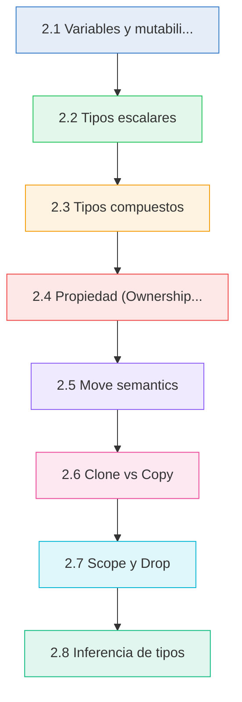
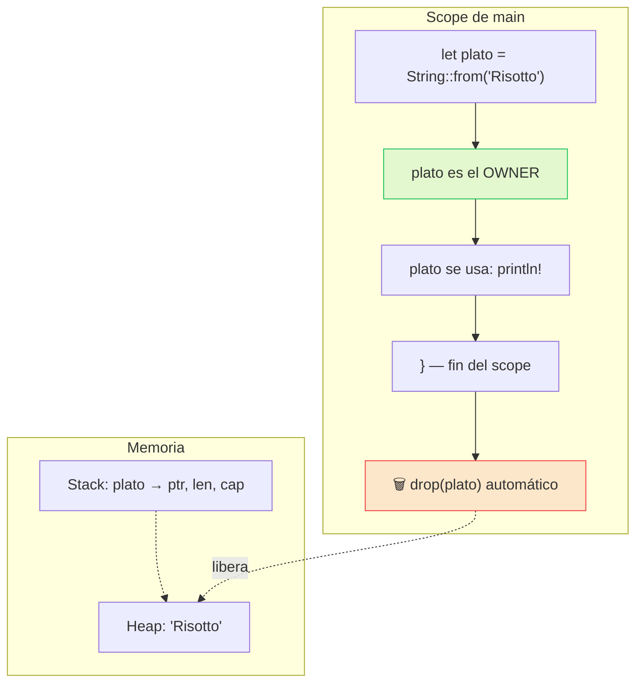
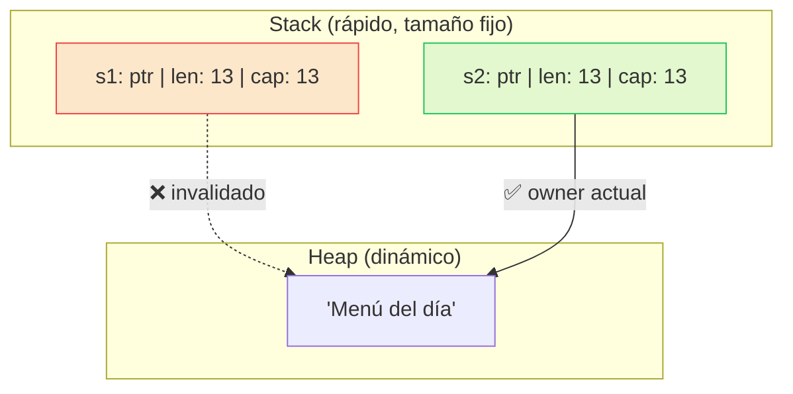
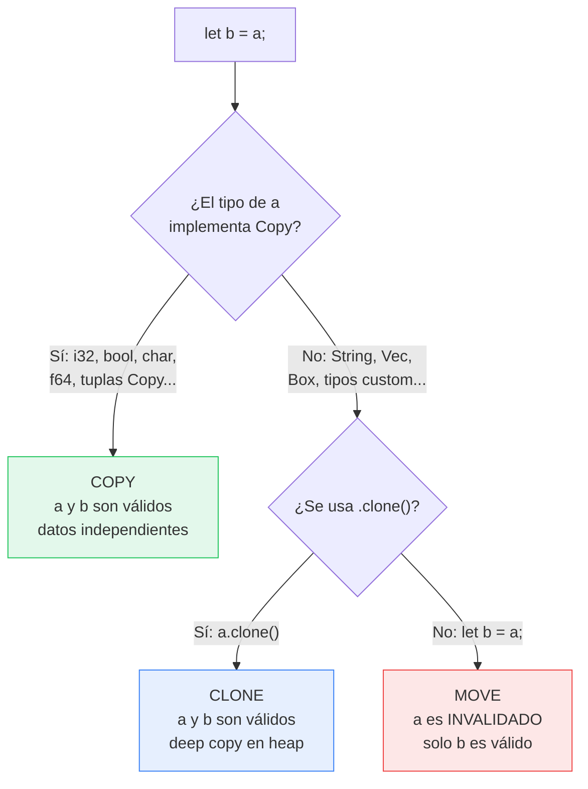

# :bricks: Cap 2 — Variables, tipos y propiedad

<div class="chapter-meta">
  <span class="meta-item">🕐 3-4 horas</span>
  <span class="meta-item">📊 Nivel: Principiante</span>
  <span class="meta-item">🎯 Semana 1</span>
</div>

<div class="chapter-objective"><span class="objective-icon">📌</span><span class="objective-text">Al terminar este capítulo serás capaz de declarar variables con control explícito de mutabilidad, elegir tipos escalares y compuestos con precisión, y aplicar las 3 reglas de ownership que hacen posible la seguridad de memoria sin garbage collector.</span></div>

<div class="chapter-map">



</div>


!!! quote "Contexto"
    En Python, todo es mutable y la memoria se gestiona sola. Rust invierte la filosofia: las variables son inmutables por defecto y cada valor tiene exactamente un dueno. Si al principio parece restrictivo, pronto verás que estas reglas eliminan categorias enteras de bugs.

<div class="connection-box"><span class="connection-icon">🔗</span><span>En el <a href="01-bienvenido.md">Capítulo 1</a> configuraste tu entorno y ejecutaste tu primer <code>cargo run</code>. Ahora vas a descubrir qué puedes poner dentro de <code>fn main()</code> y cómo Rust gestiona cada valor que creas.</span></div>

---

## 2.1 Variables y mutabilidad

<div class="concept-question"><h4>🔍 Pregunta conceptual</h4><p>En Python, puedes reasignar cualquier variable en cualquier momento (<code>x = 42</code> y luego <code>x = "hola"</code>). ¿Qué problemas crees que puede causar esa libertad total en un proyecto grande con múltiples desarrolladores?</p></div>

En Rust, las variables son **inmutables por defecto**. Debes pedir mutabilidad explicitamente con `mut`.

```rust
fn main() {
    // Inmutable por defecto
    let mesa = 5;
    // mesa = 6;  // ❌ cannot assign twice to immutable variable

    // Mutable con `mut`
    let mut ocupantes = 0;
    ocupantes = 4;           // ✅ OK, es mutable
    println!("Mesa {} con {} ocupantes", mesa, ocupantes);

    // Constantes: SIEMPRE inmutables, requieren tipo explícito
    const MAX_MESAS: u32 = 50;    // (1)!
    println!("Máximo de mesas: {}", MAX_MESAS);
}
```

1. :warning: `const` requiere tipo explícito y su valor debe ser conocido en **tiempo de compilación**. No confundir con `let` inmutable, que se evalúa en runtime.

### Shadowing

Rust permite **redeclarar** una variable con `let` en el mismo scope. Esto se llama *shadowing* y crea una variable completamente nueva:

```rust
fn main() {
    let precio = "12.50";               // &str
    let precio = precio.parse::<f64>().unwrap();  // f64 — nuevo tipo!
    let precio = precio * 1.21;          // f64 — nuevo valor con IVA
    println!("Precio final: {:.2}", precio);

    // Shadowing != mutabilidad
    // Con mut NO puedes cambiar el tipo:
    // let mut x = "hola";
    // x = 5;   // ❌ expected `&str`, found integer
}
```

<div class="micro-exercise"><h4>🧪 Micro-ejercicio (2 min)</h4><p>Declara una variable <code>let dato = "128";</code> y usa shadowing para convertirla primero a <code>u32</code> (con <code>.parse::&lt;u32&gt;().unwrap()</code>) y luego a <code>bool</code> indicando si es mayor que 100. Imprime los tres valores en cada paso. ¿Cuántas variables diferentes creaste en total?</p></div>

!!! tip "Por que inmutable por defecto es bueno"
    Si una variable no necesita cambiar, declararla inmutable permite al compilador optimizar mejor, previene bugs accidentales y hace el código más fácil de razonar. Solo usa `mut` cuando realmente lo necesites.

<div class="comparison" markdown>
<div class="lang-box python" markdown>

#### :snake: En Python

```python
x = 42
x = "ahora soy string"  # Sin problemas
# Todo es mutable y reasignable por defecto.
# No hay manera de declarar una variable
# como "inmutable" a nivel de lenguaje.
```

Python no distingue entre crear, reasignar o mutar. Todo es permisible en cualquier momento.

</div>
<div class="lang-box rust" markdown>

#### :crab: En Rust

```rust
let x: i32 = 42;
// x = 99;          // ❌ inmutable
let mut y = 42;
y = 99;             // ✅ explícitamente mutable
let x = "shadowed"; // ✅ shadowing: nueva variable
```

Rust te obliga a ser explícito: `let` = inmutable, `let mut` = mutable, `let` de nuevo = shadowing.

</div>
</div>

---

## 2.2 Tipos escalares

Rust tiene cuatro categorias de tipos escalares: **enteros**, **flotantes**, **booleanos** y **caracteres**.

### Enteros

| Longitud  | Con signo | Sin signo |
|-----------|-----------|-----------|
| 8 bits    | `i8`      | `u8`      |
| 16 bits   | `i16`     | `u16`     |
| 32 bits   | `i32`     | `u32`     |
| 64 bits   | `i64`     | `u64`     |
| 128 bits  | `i128`    | `u128`    |
| arch      | `isize`   | `usize`   |

```rust
fn main() {
    let mesa: u8 = 12;            // 0..255, suficiente para número de mesa
    let capacidad: u16 = 200;      // Capacidad del restaurante
    let balance: i64 = -50_000;    // Puede ser negativo (1)!
    let índice: usize = 0;         // Para índices de arrays

    // Literales numéricos
    let hex = 0xff;                // Hexadecimal
    let octal = 0o77;             // Octal
    let binario = 0b1111_0000;    // Binario
    let byte = b'A';              // Byte (solo u8)

    println!("Mesa: {}, Balance: {}", mesa, balance);
}
```

1. El guion bajo `_` en números es un separador visual. `50_000` es igual que `50000` pero más legible.

!!! info "Tipo entero por defecto"
    Cuando escribes `let x = 42;` sin anotar tipo, Rust infiere **`i32`**. Es el tipo entero por defecto por ser un buen balance entre rendimiento y rango.

### Flotantes

```rust
fn main() {
    let precio: f64 = 12.50;      // f64: doble precisión (por defecto)
    let descuento: f32 = 0.15;    // f32: precisión simple

    let total = precio * (1.0 - descuento as f64);
    println!("Total: {:.2}", total);
}
```

### Booleanos y caracteres

```rust
fn main() {
    let activa: bool = true;
    let reservada = false;         // Inferido como bool

    let letra: char = 'R';        // (1)!
    let emoji: char = '🦀';       // ¡Unicode completo!
    let kanji: char = '食';       // Caracteres CJK

    println!("{} {} {}", letra, emoji, kanji);
}
```

1. `char` en Rust ocupa **4 bytes** y representa un *Unicode Scalar Value*. Muy distinto al `char` de C (1 byte).

<div class="pro-tip"><h4>💡 Consejo Pro</h4><p>En el proyecto RustMenu, usa <code>u8</code> para números de mesa (rango 0-255 es más que suficiente), <code>f64</code> para precios (necesitas precisión decimal) y <code>usize</code> para índices de colecciones. Elegir el tipo más pequeño que cubra tu rango mejora el uso de memoria y la claridad del código.</p></div>

<div class="comparison" markdown>
<div class="lang-box python" markdown>

#### :snake: En Python

```python
x = 42          # int: precisión arbitraria
x = 2 ** 1000   # Sin overflow, crece lo que necesite
pi = 3.14       # float: siempre 64-bit
```

Python tiene un único tipo `int` con precisión arbitraria. No te preocupas por overflow ni por tamano.

</div>
<div class="lang-box rust" markdown>

#### :crab: En Rust

```rust
let x: i32 = 42;     // 32 bits, rango fijo
// let big: i32 = 2_147_483_648; // ❌ overflow!
let big: i64 = 2_147_483_648;    // ✅ usar tipo mayor
let pi: f64 = 3.14;
```

Rust te obliga a elegir el tamano. A cambio, obtienes rendimiento predecible y detección de overflow en debug mode.

</div>
</div>

---

## 2.3 Tipos compuestos

### Tuplas

Las tuplas agrupan valores de **diferentes tipos** con longitud fija:

```rust
fn main() {
    // Tupla con tipos mixtos
    let mesa: (u8, &str, bool) = (5, "terraza", true);

    // Acceso por índice
    println!("Número: {}", mesa.0);
    println!("Zona: {}", mesa.1);
    println!("Ocupada: {}", mesa.2);

    // Destructuring
    let (número, zona, ocupada) = mesa;
    println!("Mesa {} en {} — ocupada: {}", número, zona, ocupada);

    // Tupla unitaria
    let vacia: () = ();  // (1)!
}
```

1. La tupla vacia `()` se llama *unit type* y es el equivalente a `None` o `void` en otros lenguajes. Es lo que devuelve una función que no retorna nada.

### Arrays

Los arrays tienen longitud fija y todos los elementos del **mismo tipo**:

```rust
fn main() {
    // Array: [tipo; longitud]
    let precios: [f64; 4] = [12.50, 15.00, 8.75, 22.00];
    let primer_plato = precios[0];
    println!("Primer plato: {:.2}", primer_plato);

    // Array inicializado con el mismo valor
    let mesas_vacias = [false; 10];   // 10 elementos, todos false
    println!("Mesa 3 ocupada: {}", mesas_vacias[3]);

    // Longitud del array
    println!("Total precios: {}", precios.len());

    // ⚠️ Acceso fuera de límites → panic en runtime
    // let fuera = precios[10]; // panic: index out of bounds
}
```

### String vs &str

Esta distinción es crucial en Rust:

```rust
fn main() {
    // &str: referencia a string, tamaño fijo, generalmente en stack/binario
    let nombre_plato: &str = "Paella Valenciana";   // (1)!

    // String: owned, en heap, tamaño dinámico
    let mut pedido = String::from("Paella");
    pedido.push_str(" con marisco");
    println!("{}", pedido);  // "Paella con marisco"

    // Conversiones
    let desde_str: String = "Tortilla".to_string();
    let como_slice: &str = &desde_str;   // String → &str (barato)
}
```

1. Los string literals (`"texto"`) son de tipo `&str` y viven en el binario del programa. Son inmutables y tienen lifetime `'static`.

<div class="comparison" markdown>
<div class="lang-box python" markdown>

#### :snake: En Python

```python
platos = [1, "hola", True]  # Lista: heterogénea, dinámica
tupla = (1, "hola")         # Tupla: inmutable
nombre = "Paella"           # str: un solo tipo
```

Python tiene listas dinámicas (crecen y mezclan tipos) y un único tipo `str`.

</div>
<div class="lang-box rust" markdown>

#### :crab: En Rust

```rust
let arr: [i32; 3] = [1, 2, 3];     // Fijo, homogéneo
let tup: (i32, &str) = (1, "hola"); // Fijo, heterogéneo
let vec: Vec<i32> = vec![1, 2, 3];  // Dinámico (heap)
let s: String = String::from("hi"); // Owned, heap
let r: &str = "hi";                 // Referencia, stack
```

Rust separa tipos fijos (stack) de dinámicos (heap) y diferencia datos *owned* de *referencias*.

</div>
</div>

---

## 2.4 Propiedad (Ownership): las 3 reglas

<div class="concept-question"><h4>🔍 Pregunta conceptual</h4><p>En Python, si haces <code>b = a</code> con una lista, ambas variables apuntan al mismo objeto y modificar una afecta a la otra. ¿Qué problemas puede causar esto en un programa concurrente? ¿Y si el lenguaje garantizara que solo una variable puede "poseer" cada dato?</p></div>

!!! danger "Esta es la sección más importante del capítulo"
    Ownership es el concepto central de Rust. Es lo que hace posible la seguridad de memoria sin garbage collector. Si entiendes estas 3 reglas, entiendes Rust.

### Las 3 reglas de ownership

| # | Regla | Ejemplo |
|---|-------|---------|
| 1 | Cada valor tiene exactamente **un owner** (variable) | `let s = String::from("hola");` — `s` es el owner |
| 2 | Solo puede haber **un owner a la vez** | `let s2 = s;` — ahora `s2` es el único owner |
| 3 | Cuando el owner sale del **scope**, el valor se **libera** (drop) | Al cerrar `}`, el valor se libera automaticamente |

```rust
fn main() {
    {
        let plato = String::from("Risotto");  // plato es owner del String
        println!("{}", plato);                 // ✅ plato es válido aquí
    }   // ← plato sale del scope, String se libera automáticamente

    // println!("{}", plato); // ❌ plato ya no existe
}
```

<div class="misconception-box"><h4>⚠️ Errores comunes</h4><ul><li><span class="wrong">❌ Mito:</span> "Ownership es como el garbage collector de Python, solo que manual." → <span class="right">✅ Realidad:</span> Ownership no es manual ni es un GC. El compilador verifica las reglas en tiempo de compilación y genera código de liberación automáticamente. No escribes <code>free()</code> ni esperas a un GC.</li><li><span class="wrong">❌ Mito:</span> "Si una variable se mueve, los datos se copian a otra ubicación en memoria." → <span class="right">✅ Realidad:</span> Un move transfiere la responsabilidad (ownership) sin duplicar datos del heap. Solo se copian los metadatos del stack (puntero, longitud, capacidad) y se inválida el original.</li><li><span class="wrong">❌ Mito:</span> "Puedo usar <code>.clone()</code> siempre para evitar problemas de ownership, igual que en Python todo se comparte." → <span class="right">✅ Realidad:</span> Clonar funciona, pero tiene coste real de rendimiento. En Rust idiomático se prefiere usar referencias (<code>&T</code>) para compartir acceso sin copiar ni transferir ownership.</li></ul></div>

### Diagrama de ownership



### RustMenu: ownership en el restaurante

Piensa en ownership como la responsabilidad de una mesa en un restaurante:

```rust
fn main() {
    let nombre_restaurante = String::from("RustMenu");

    // El nombre tiene UN dueño: la variable nombre_restaurante
    // Si "pasamos" el nombre a otra función, perdemos el acceso
    imprimir_nombre(nombre_restaurante);   // ownership se mueve

    // println!("{}", nombre_restaurante); // ❌ ya no somos dueños
}

fn imprimir_nombre(nombre: String) {
    println!("Restaurante: {}", nombre);
}   // nombre se libera aquí (drop)
```

---

## 2.5 Move semantics

<div class="concept-question"><h4>🔍 Pregunta conceptual</h4><p>En Python, <code>b = a</code> con una lista crea un alias: ambas variables apuntan al mismo objeto mutable. Rust prohíbe esto con su sistema de moves. ¿Cuál crees que es la ventaja principal de invalidar la variable original tras un move, especialmente pensando en programas con múltiples hilos?</p></div>

Cuando asignas un valor que vive en el **heap** a otra variable, Rust **mueve** el ownership. La variable original queda invalidada.

```rust
fn main() {
    let s1 = String::from("Menú del día");
    let s2 = s1;     // ← s1 se MUEVE a s2

    // println!("{}", s1);  // ❌ borrow of moved value: `s1`
    println!("{}", s2);     // ✅ s2 es el nuevo owner
}
```

!!! warning "El error de move"
    ```
    error[E0382]: borrow of moved value: `s1`
     --> src/main.rs:4:20
      |
    2 |     let s1 = String::from("Menú del día");
      |         -- move occurs because `s1` has type `String`
    3 |     let s2 = s1;
      |              -- value moved here
    4 |     println!("{}", s1);
      |                    ^^ value borrowed here after move
    ```
    Este error es tu mejor amigo. Rust te dice exactamente donde se movio el valor y donde intentas usarlo despues.

### Stack vs Heap



Los tipos como `String` y `Vec` almacenan en el **stack** un puntero, longitud y capacidad, mientras que los datos reales viven en el **heap**. Cuando haces `let s2 = s1`, Rust copia los datos del stack (puntero, len, cap) pero **no** duplica los datos del heap. En su lugar, inválida `s1` para evitar un *double free*.

<div class="comparison" markdown>
<div class="lang-box python" markdown>

#### :snake: En Python

```python
a = [1, 2, 3]
b = a          # b apunta al MISMO objeto
b.append(4)
print(a)       # [1, 2, 3, 4] — ¡a también cambió!
```

Python usa **referencias compartidas**. `b = a` no copia: ambas variables apuntan al mismo objeto. Esto puede causar bugs sutiles de aliasing.

</div>
<div class="lang-box rust" markdown>

#### :crab: En Rust

```rust
let a = vec![1, 2, 3];
let b = a;        // a se MUEVE a b
// a ya no es válido — no hay aliasing posible
// println!("{:?}", a); // ❌ moved
println!("{:?}", b);    // ✅ [1, 2, 3]
```

Rust **mueve** el ownership. No hay dos variables apuntando a los mismos datos. Esto elimina bugs de aliasing y data races.

</div>
</div>

---

## 2.6 Clone vs Copy

### Copy: copia implícita para tipos del stack

Los tipos que viven completamente en el **stack** implementan el trait `Copy`. La asignación copia los bits automaticamente y el original sigue válido:

```rust
fn main() {
    // Tipos que implementan Copy
    let a: i32 = 42;
    let b = a;          // COPIA, no move
    println!("a={}, b={}", a, b);  // ✅ ambos válidos

    let x: bool = true;
    let y = x;          // COPIA
    println!("x={}, y={}", x, y);  // ✅

    let c: char = '🦀';
    let d = c;          // COPIA
    println!("c={}, d={}", c, d);  // ✅

    let tup: (i32, bool) = (10, true);
    let tup2 = tup;     // COPIA (tupla de tipos Copy)
    println!("{:?} {:?}", tup, tup2);  // ✅
}
```

**Tipos que implementan Copy:**

| Tipo | Ejemplo |
|------|---------|
| Enteros | `i8`, `i16`, `i32`, `i64`, `i128`, `u8`..`u128`, `isize`, `usize` |
| Flotantes | `f32`, `f64` |
| Booleano | `bool` |
| Caracter | `char` |
| Tuplas de Copy | `(i32, bool)`, `(f64, char)` |
| Arrays de Copy | `[i32; 5]` |
| Referencias | `&T` (cualquier referencia compartida) |

### Clone: copia explícita para tipos del heap

Los tipos del heap como `String` y `Vec` NO implementan `Copy`, pero si implementan `Clone`. Debes llamar `.clone()` explicitamente:

```rust
fn main() {
    let menu = String::from("Paella, Gazpacho, Tortilla");
    let menu_copia = menu.clone();   // Copia EXPLÍCITA (deep copy)

    println!("Original: {}", menu);        // ✅ sigue válido
    println!("Copia:    {}", menu_copia);  // ✅ copia independiente

    let platos = vec!["Paella", "Gazpacho", "Tortilla"];
    let platos_backup = platos.clone();
    println!("Platos:  {:?}", platos);         // ✅
    println!("Backup:  {:?}", platos_backup);  // ✅
}
```

<div class="micro-exercise"><h4>🧪 Micro-ejercicio (2 min)</h4><p>Crea un <code>String</code> llamado <code>plato</code> con valor <code>"Risotto"</code>. Pásalo a una función <code>fn mostrar(s: String)</code> que lo imprima. Después de la llamada, intenta imprimir <code>plato</code> en <code>main</code>. Observa el error del compilador. Ahora corrígelo de dos formas: (a) usando <code>.clone()</code> antes de la llamada, y (b) cambiando la función para que reciba <code>&str</code> en vez de <code>String</code>. ¿Cuál es más eficiente?</p></div>

!!! tip "Cuando usar Clone"
    `.clone()` hace una copia profunda en el heap — es más costoso que Copy. Usalo cuando realmente necesites dos copias independientes. En muchos casos, puedes usar **referencias** (`&`) en lugar de clonar (lo veremos en el capítulo 3).

### Diagrama de decisión: Copy vs Move



<div class="code-evolution" markdown>
<div class="evolution-header">📈 Evolución del código</div>
<div class="evolution-step"><span class="step-label novato">v1 — Novato</span>

```rust
// Clona todo para evitar errores de ownership
fn calcular_total(platos: Vec<String>, precios: Vec<f64>) -> f64 {
    let mut total = 0.0;
    for i in 0..precios.len() {
        println!("Plato: {}", platos[i]);
        total += precios[i];
    }
    total
}

fn main() {
    let platos = vec![String::from("Paella"), String::from("Flan")];
    let precios = vec![12.50, 4.00];
    let total = calcular_total(platos.clone(), precios.clone());
    println!("Platos: {:?}, Total: {:.2}", platos, total);
}
```

</div>
<div class="evolution-step"><span class="step-label mejorado">v2 — Mejorado</span>

```rust
// Usa referencias para evitar clones innecesarios
fn calcular_total(platos: &Vec<String>, precios: &Vec<f64>) -> f64 {
    let mut total = 0.0;
    for i in 0..precios.len() {
        println!("Plato: {}", platos[i]);
        total += precios[i];
    }
    total
}

fn main() {
    let platos = vec![String::from("Paella"), String::from("Flan")];
    let precios = vec![12.50, 4.00];
    let total = calcular_total(&platos, &precios);
    println!("Platos: {:?}, Total: {:.2}", platos, total);
}
```

</div>
<div class="evolution-step"><span class="step-label profesional">v3 — Profesional</span>

```rust
// Usa slices, iteradores y zip para código idiomático
fn calcular_total(platos: &[String], precios: &[f64]) -> f64 {
    platos.iter().zip(precios.iter()).fold(0.0, |total, (plato, &precio)| {
        println!("Plato: {}", plato);
        total + precio
    })
}

fn main() {
    let platos = vec![String::from("Paella"), String::from("Flan")];
    let precios = vec![12.50, 4.00];
    let total = calcular_total(&platos, &precios);
    println!("Platos: {:?}, Total: {:.2}", platos, total);
}
```

</div>
</div>

---

## 2.7 Scope y Drop

### RAII: Resource Acquisition Is Initialization

Rust sigue el patrón RAII: los recursos (memoria, archivos, conexiones) se adquieren al crear un valor y se **liberan automaticamente** cuando el valor sale del scope.

```rust
fn main() {
    {
        let pedido = String::from("Mesa 5: Paella x2");
        // pedido se usa aquí...
        println!("Procesando: {}", pedido);
    }   // ← pedido se destruye aquí (drop automático)
        // La memoria del heap se libera AHORA, no "cuando el GC quiera"

    // Ejemplo con Vec
    {
        let mut platos = Vec::new();
        platos.push(String::from("Gazpacho"));
        platos.push(String::from("Croquetas"));
        platos.push(String::from("Flan"));
        println!("Pedido: {:?}", platos);
    }   // ← Vec y TODOS sus String internos se liberan aquí
}
```

### La función `drop()`

Puedes forzar la liberación anticipada con `drop()`:

```rust
fn main() {
    let conexion = String::from("DB: connected to RustMenu");
    println!("Usando: {}", conexion);

    drop(conexion);   // Libera AHORA, antes del fin del scope

    // println!("{}", conexion);  // ❌ use of moved value
    println!("Conexión liberada, seguimos con el programa");
}
```

<div class="pro-tip"><h4>💡 Consejo Pro</h4><p>En producción, el patrón RAII es fundamental para gestionar conexiones a bases de datos, archivos abiertos y locks de mutex. En RustMenu, si abres un archivo de configuración o una conexión a la base de datos de pedidos, Rust garantiza que se cierre al salir del scope — incluso si ocurre un panic. Esto elimina una categoría completa de bugs de resource leaks que son frecuentes en Python.</p></div>

<div class="comparison" markdown>
<div class="lang-box python" markdown>

#### :snake: En Python

```python
class Conexion:
    def __del__(self):
        print("Cerrando conexión")  # ¿Cuándo se ejecuta? 🤷

c = Conexion()
del c  # __del__ podría ejecutarse... o no
# El GC decide cuándo liberar. No es determinista.
```

Python usa garbage collection. `__del__` no es fiable: puede ejecutarse tarde, en otro orden, o nunca (al salir del programa).

</div>
<div class="lang-box rust" markdown>

#### :crab: En Rust

```rust
struct Conexion { nombre: String }

impl Drop for Conexion {
    fn drop(&mut self) {
        println!("Cerrando: {}", self.nombre);
    }  // SIEMPRE se ejecuta al salir del scope
}

{
    let c = Conexion {
        nombre: String::from("DB")
    };
}   // "Cerrando: DB" — determinista y garantizado
```

Rust llama a `drop` de forma **determinista** al salir del scope. Siempre, en orden, sin excepciones.

</div>
</div>

---

## 2.8 Inferencia de tipos

Rust tiene un sistema potente de **inferencia de tipos**: el compilador deduce tipos automaticamente en muchos casos.

```rust
fn main() {
    // Rust infiere todos estos tipos
    let nombre = "RustMenu";           // &str
    let mesas = 25;                     // i32 (por defecto)
    let precio = 12.50;                 // f64 (por defecto)
    let abierto = true;                 // bool
    let platos = vec!["Paella", "Gazpacho"]; // Vec<&str>

    // Pero a veces necesitas anotar
    let parsed: u32 = "42".parse().unwrap();   // (1)!
    let números: Vec<f64> = Vec::new();        // (2)!
}
```

1. `.parse()` puede devolver muchos tipos. Rust necesita saber cual quieres.
2. `Vec::new()` esta vacio, asi que Rust no puede inferir el tipo de los elementos.

### Turbofish `::<>`

Cuando necesitas especificar un tipo genérico en una llamada a función o método, usas la sintaxis **turbofish**:

```rust
fn main() {
    // Turbofish: especificar tipo en el método
    let n = "42".parse::<i64>().unwrap();
    let pi = "3.14".parse::<f64>().unwrap();

    // También funciona con funciones genéricas
    let platos = Vec::<String>::new();
    let precios = Vec::<f64>::with_capacity(10);

    // Equivalente con anotación de tipo (más común)
    let platos2: Vec<String> = Vec::new();

    println!("n={}, pi={}", n, pi);
}
```

!!! tip "Regla de oro para anotaciones"
    Deja que Rust infiera cuando pueda. Anota tipos explicitamente en:

    1. **Parámetros de funciones** — siempre obligatorio
    2. **Cuando `.parse()` o `collect()` son ambiguos** — Rust no puede adivinar
    3. **Colecciones vacias** — `Vec::new()` sin contexto de uso
    4. **Cuando mejora la legibilidad** — tipos complejos


<div class="ejercicio-guiado">
<h4>🏋️ Ejercicio guiado</h4>

Vas a construir un pequeño registro de platos para RustMenu que demuestre variables mutables e inmutables, tipos escalares, ownership y move/clone.

1. Crea un nuevo proyecto con `cargo new rustmenu-platos` y abre `src/main.rs`.
2. Declara una constante `const IVA: f64 = 0.10;` y una variable inmutable `let nombre_restaurante = "RustMenu";`.
3. Crea un `Vec<String>` mutable llamado `platos` y añade 3 platos con `platos.push(String::from(...))`.
4. Crea un array de precios `let precios: [f64; 3] = [14.50, 8.00, 6.50];` y calcula el total iterando con `for` y una variable mutable `total`.
5. Demuestra move semantics: asigna `let menu_backup = platos.clone();`, luego añade un cuarto plato al original y verifica que el backup no cambió imprimiendo ambos con `{:?}`.
6. Usa shadowing para convertir el total (`f64`) a un `String` formateado con IVA: `let total = format!("{:.2}€", total * (1.0 + IVA));`. Imprime el resumen final.
7. Ejecuta con `cargo run` y verifica con `cargo clippy`.

??? success "Solución completa"
    ```rust
    const IVA: f64 = 0.10;

    fn main() {
        let nombre_restaurante = "RustMenu";

        let mut platos: Vec<String> = Vec::new();
        platos.push(String::from("Paella Valenciana"));
        platos.push(String::from("Tortilla Española"));
        platos.push(String::from("Gazpacho Andaluz"));

        let precios: [f64; 3] = [14.50, 8.00, 6.50];

        let mut total: f64 = 0.0;
        for precio in &precios {
            total += precio;
        }

        println!("=== {} ===", nombre_restaurante);
        for (i, plato) in platos.iter().enumerate() {
            println!("  {}. {} — {:.2}€", i + 1, plato, precios[i]);
        }

        let menu_backup = platos.clone();
        platos.push(String::from("Croquetas Caseras"));

        println!("
Menú actual:  {:?}", platos);
        println!("Backup:       {:?}", menu_backup);
        assert_eq!(platos.len(), 4);
        assert_eq!(menu_backup.len(), 3);

        let total = format!("{:.2}€", total * (1.0 + IVA));
        println!("
Total con IVA: {}", total);
    }
    ```

</div>

<div class="real-errors">
<h4>🚨 Errores que vas a encontrar</h4>

**Error 1: Tipo incompatible**

```rust
let x: i32 = "hola"; // ❌
```

```
error[E0308]: mismatched types
  expected `i32`, found `&str`
```

**¿Por qué?** Rust es estrictamente tipado — no hay conversión implícita entre tipos.

**Solución:** Usa el tipo correcto o convierte explícitamente.

---

**Error 2: Variable no mutable**

```rust
let precio = 10.0;
precio = 15.0; // ❌
```

```
error[E0384]: cannot assign twice to immutable variable `precio`
```

**Solución:** Declara con `let mut precio = 10.0;`

---

**Error 3: Valor movido**

```rust
let nombre = String::from("Paella");
let copia = nombre;
println!("{}", nombre); // ❌
```

```
error[E0382]: borrow of moved value: `nombre`
```

**Solución:** Usa `.clone()` o referencias `&nombre`.

</div>

---

<div class="checkpoint"><h4>🏁 Checkpoint</h4><p>Si puedes: (1) declarar variables inmutables, mutables y constantes explicando por qué Rust las distingue, (2) predecir si una asignación <code>let b = a;</code> será un move o un copy según el tipo, y (3) explicar las 3 reglas de ownership y qué ocurre cuando un owner sale del scope — estás listo para el <a href="03-referencias-prestamos.md">Capítulo 3</a>.</p></div>

<div class="mini-project">
<h4>🏗️ Mini-proyecto: Aplicación práctica</h4>

**Paso 1 — Define las estructuras base**

Crea las estructuras y tipos necesarios para modelar el dominio del capítulo.

??? success "Solución Paso 1"
    ```rust
    // Define tus structs y enums aquí
    #[derive(Debug)]
    struct Item {
        nombre: String,
        valor: f64,
    }

    impl Item {
        fn new(nombre: &str, valor: f64) -> Self {
            Self {
                nombre: nombre.to_string(),
                valor,
            }
        }
    }
    ```

**Paso 2 — Implementa la lógica principal**

Crea funciones que operen sobre las estructuras del paso 1.

??? success "Solución Paso 2"
    ```rust
    fn procesar(items: &[Item]) -> f64 {
        items.iter().map(|i| i.valor).sum()
    }

    fn mostrar(items: &[Item]) {
        for item in items {
            println!("  {} — {:.2}€", item.nombre, item.valor);
        }
    }
    ```

**Paso 3 — Integra todo en main**

Combina los pasos anteriores en un programa completo.

??? success "Solución Paso 3"
    ```rust
    fn main() {
        let items = vec![
            Item::new("Paella", 14.50),
            Item::new("Gazpacho", 8.00),
            Item::new("Flan", 5.50),
        ];

        println!("=== RustMenu ===");
        mostrar(&items);
        println!("Total: {:.2}€", procesar(&items));
    }
    ```

</div>


## :link: Recursos

| Recurso | Enlace |
|---------|--------|
| The Rust Book - Cap 3: Conceptos comunes | [doc.rust-lang.org/book/ch03-00-common-programming-concepts](https://doc.rust-lang.org/book/ch03-00-common-programming-concepts.html) |
| The Rust Book - Cap 4: Ownership | [doc.rust-lang.org/book/ch04-00-understanding-ownership](https://doc.rust-lang.org/book/ch04-00-understanding-ownership.html) |
| Rust by Example - Primitivas | [doc.rust-lang.org/rust-by-example/primitives](https://doc.rust-lang.org/rust-by-example/primitives.html) |

<div class="connection-box"><span class="connection-icon">🔗</span><span>En el <a href="03-referencias-prestamos.md">Capítulo 3</a> aprenderás a usar <strong>referencias</strong> (<code>&T</code> y <code>&mut T</code>) para compartir acceso a datos sin transferir ownership ni clonar — la alternativa eficiente al <code>.clone()</code> que vimos aquí.</span></div>

---

## 🎯 Ejercicios

??? question "Ejercicio 1: Variables para un restaurante"
    Declara variables inmutables y mutables para los datos de un restaurante: nombre (inmutable), número de mesas (inmutable), ocupantes actuales (mutable) y una constante para la capacidad máxima. Imprime todo y modifica los ocupantes.

    ??? success "Solución"
        ```rust
        fn main() {
            let nombre = "RustMenu";
            let numero_mesas: u8 = 12;
            let mut ocupantes: u16 = 0;
            const CAPACIDAD_MAXIMA: u16 = 200;

            println!("Restaurante: {}", nombre);
            println!("Mesas: {}", numero_mesas);
            println!("Ocupantes: {}", ocupantes);
            println!("Capacidad máxima: {}", CAPACIDAD_MAXIMA);

            // Llegan clientes
            ocupantes = 45;
            println!("Ocupantes ahora: {}", ocupantes);

            // Verificar capacidad
            if ocupantes <= CAPACIDAD_MAXIMA {
                println!("Hay espacio disponible");
            }
        }
        ```

??? question "Ejercicio 2: Shadowing con cambio de tipo"
    Usa shadowing para declarar una variable `dato` como `&str`, luego redirigirla a su longitud (`usize`), y finalmente a un booleano que indique si la longitud es mayor que 5. Imprime cada paso.

    ??? success "Solución"
        ```rust
        fn main() {
            let dato = "Paella Valenciana";
            println!("String: {}", dato);

            let dato = dato.len();
            println!("Longitud: {}", dato);

            let dato = dato > 5;
            println!("¿Mayor que 5?: {}", dato);

            // Esto demuestra que shadowing crea una variable NUEVA
            // con potencialmente un tipo diferente
        }
        ```

??? question "Ejercicio 3: Demostrar move semantics"
    Crea un `String` con el nombre de un plato. Asignalo a otra variable (move). Intenta usar el original y observa el error del compilador. Luego corrigelo usando `.clone()`.

    ??? success "Solución"
        ```rust
        fn main() {
            // Versión con move (causaría error)
            let plato = String::from("Gazpacho andaluz");
            let plato_copia = plato;  // move!
            // println!("{}", plato);  // ❌ borrow of moved value

            // Versión corregida con clone
            let plato = String::from("Gazpacho andaluz");
            let plato_copia = plato.clone();  // deep copy
            println!("Original: {}", plato);        // ✅
            println!("Copia:    {}", plato_copia);  // ✅

            // Nota: con tipos Copy no hay problema
            let precio: f64 = 8.50;
            let precio2 = precio;  // copy, no move
            println!("Precio: {} y {}", precio, precio2);  // ✅ ambos válidos
        }
        ```

??? question "Ejercicio 4: Función que toma ownership"
    Implementa una función `longitud_pedido` que tome ownership de un `String` y devuelva su longitud. Demuestra que despues de llamarla, el String original ya no es accesible.

    ??? success "Solución"
        ```rust
        fn longitud_pedido(pedido: String) -> usize {
            println!("Procesando pedido: {}", pedido);
            pedido.len()
        }   // pedido se libera aquí (drop)

        fn main() {
            let mi_pedido = String::from("2x Paella, 1x Flan, 3x Agua");
            let longitud = longitud_pedido(mi_pedido);
            // mi_pedido ya no es válido aquí (se movió a la función)

            println!("Longitud del pedido: {} caracteres", longitud);
            // println!("{}", mi_pedido); // ❌ value used after move
        }
        ```

??? question "Ejercicio 5: Clone con Vec de platos"
    Crea un `Vec<String>` con nombres de platos. Clonalo para crear un backup. Modifica el original (anade un plato) y demuestra que el backup no cambia.

    ??? success "Solución"
        ```rust
        fn main() {
            let mut menu = vec![
                String::from("Paella"),
                String::from("Gazpacho"),
                String::from("Tortilla"),
            ];

            // Clonar para backup
            let backup = menu.clone();

            // Modificar el original
            menu.push(String::from("Croquetas"));
            menu[0] = String::from("Paella Mixta");

            println!("Menú actual:  {:?}", menu);
            println!("Backup:       {:?}", backup);

            // El backup mantiene los valores originales
            assert_eq!(backup.len(), 3);
            assert_eq!(menu.len(), 4);
            println!("✅ Clone crea una copia completamente independiente");
        }
        ```

---

## :brain: Flashcards

<div class="flashcard">
<div class="front">¿Cuales son las 3 reglas de ownership?</div>
<div class="back">1) Cada valor tiene exactamente un owner. 2) Solo puede haber un owner a la vez. 3) Cuando el owner sale del scope, el valor se libera (drop).</div>
</div>

<div class="flashcard">
<div class="front">¿Cual es la diferencia entre <code>let</code> y <code>let mut</code>?</div>
<div class="back"><code>let</code> crea una variable inmutable (no se puede reasignar). <code>let mut</code> permite mutabilidad (se puede reasignar). Ambas pueden ser shadowed con un nuevo <code>let</code>.</div>
</div>

<div class="flashcard">
<div class="front">¿Que es shadowing?</div>
<div class="back">Redeclarar una variable con <code>let</code> en el mismo scope. Crea una variable nueva que puede tener un tipo diferente. No es lo mismo que mutabilidad: <code>let mut</code> no permite cambiar el tipo.</div>
</div>

<div class="flashcard">
<div class="front">¿Cuando ocurre un move?</div>
<div class="back">Cuando asignas un valor que vive en el heap (<code>String</code>, <code>Vec</code>, <code>Box</code>) a otra variable o lo pasas a una función. El owner original queda invalidado. Los tipos que implementan <code>Copy</code> (enteros, bool, char) se copian en lugar de moverse.</div>
</div>

<div class="flashcard">
<div class="front">¿Cual es la diferencia entre Copy y Clone?</div>
<div class="back"><code>Copy</code> es implícito y automático para tipos stack (i32, bool, char, tuplas de Copy). <code>Clone</code> es explícito (<code>.clone()</code>) y hace deep copy para tipos heap (String, Vec). Copy es barato; Clone puede ser costoso.</div>
</div>

<div class="flashcard">
<div class="front">¿Cual es la diferencia entre String y &str?</div>
<div class="back"><code>String</code> es un tipo owned que vive en el heap, tiene tamano dinámico y se puede modificar. <code>&str</code> es una referencia inmutable a datos string (un slice), generalmente apuntando al binario o a un String.</div>
</div>

<div class="flashcard">
<div class="front">¿Que es RAII en Rust?</div>
<div class="back">Resource Acquisition Is Initialization: los recursos (memoria, archivos, conexiones) se adquieren al crear un valor y se liberan automaticamente cuando el owner sale del scope. A diferencia del garbage collector de Python, la limpieza es <strong>determinista</strong> y garantizada.</div>
</div>

---

## :video_game: Quiz interactivo

<div class="quiz" data-quiz-id="ch02-q1">
<h4>Pregunta 1: Despues de <code>let s2 = s1;</code> (donde s1 es un String), ¿que pasa con s1?</h4>
<button class="quiz-option" data-correct="true"><code>s1</code> ya no es válido (fue movido a <code>s2</code>)</button>
<button class="quiz-option" data-correct="false"><code>s1</code> sigue siendo válido y apunta a los mismos datos</button>
<button class="quiz-option" data-correct="false"><code>s1</code> se copia automaticamente</button>
<button class="quiz-option" data-correct="false"><code>s1</code> se convierte en <code>None</code></button>
<div class="quiz-feedback" data-correct="¡Correcto! String no implementa Copy, así que `let s2 = s1` es un move. s1 queda invalidado y solo s2 puede usarse." data-incorrect="Incorrecto. String vive en el heap y no implementa Copy. La asignación `let s2 = s1` mueve el ownership a s2, invalidando s1. Rust no tiene `None` (eso es Option::None, un concepto diferente)."></div>
</div>

<div class="quiz" data-quiz-id="ch02-q2">
<h4>Pregunta 2: ¿Cual de estos tipos NO implementa Copy?</h4>
<button class="quiz-option" data-correct="false"><code>i32</code></button>
<button class="quiz-option" data-correct="false"><code>bool</code></button>
<button class="quiz-option" data-correct="true"><code>String</code></button>
<button class="quiz-option" data-correct="false"><code>(i32, bool)</code></button>
<div class="quiz-feedback" data-correct="¡Correcto! String vive en el heap y no implementa Copy. Los demás (i32, bool, tuplas de tipos Copy) son tipos stack que sí implementan Copy." data-incorrect="Incorrecto. String es el único tipo en la lista que NO implementa Copy porque contiene datos en el heap. i32, bool y tuplas de tipos Copy se copian automáticamente."></div>
</div>

<div class="quiz" data-quiz-id="ch02-q3">
<h4>Pregunta 3: ¿Cual es el tipo entero por defecto en Rust?</h4>
<button class="quiz-option" data-correct="false"><code>i64</code></button>
<button class="quiz-option" data-correct="true"><code>i32</code></button>
<button class="quiz-option" data-correct="false"><code>u32</code></button>
<button class="quiz-option" data-correct="false"><code>isize</code></button>
<div class="quiz-feedback" data-correct="¡Correcto! Cuando escribes `let x = 42;` sin anotación, Rust infiere i32. Es el tipo entero por defecto por buen balance entre rendimiento y rango." data-incorrect="Incorrecto. El tipo entero por defecto en Rust es i32. Cuando escribes `let x = 42;` sin anotar tipo, el compilador usa i32 automáticamente."></div>
</div>

---

## :bug: Ejercicio de depuración

Encuentra y corrige los **3 errores** en este código:

```rust
fn main() {
    let nombre = String::from("RustMenu");
    let copia = nombre;
    println!("Original: {}", nombre);     // Error 1: ¿qué pasó con nombre?

    let mut precio = 12.50;
    precio = "caro";                       // Error 2: ¿puedes cambiar el tipo?

    let capacidad: i32 = 4;
    capacidad = 6;                         // Error 3: ¿es mutable?
}
```

??? success "Solución"
    ```rust
    fn main() {
        // Fix 1: nombre fue movido a copia. Usar .clone() para mantener ambos
        let nombre = String::from("RustMenu");
        let copia = nombre.clone();                    // ✅ clone en vez de move
        println!("Original: {}", nombre);              // ✅ nombre sigue válido

        // Fix 2: no puedes cambiar el tipo de una variable con mut.
        // Opción A: asignar un f64
        let mut precio: f64 = 12.50;
        precio = 25.00;                                // ✅ mismo tipo
        println!("Precio: {}", precio);

        // Fix 3: capacidad no es mutable. Agregar mut
        let mut capacidad: i32 = 4;                    // ✅ agregar mut
        capacidad = 6;
        println!("Capacidad: {}", capacidad);
    }
    ```

    **Resumen de errores:**

    | # | Error | Causa | Solución |
    |---|-------|-------|----------|
    | 1 | `borrow of moved value: nombre` | `let copia = nombre` mueve el String | Usar `nombre.clone()` |
    | 2 | `expected f64, found &str` | `mut` permite reasignar, no cambiar tipo | Asignar valor del mismo tipo |
    | 3 | `cannot assign twice to immutable variable` | `capacidad` no tiene `mut` | Agregar `let mut` |

---

## ✅ Autoevaluación del capítulo

<div class="self-check" markdown>
<h4>¿Has comprendido todo? Marca lo que puedes hacer:</h4>
<label><input type="checkbox"> Puedo declarar variables mutables e inmutables y se cuando usar cada una</label>
<label><input type="checkbox"> Entiendo las 3 reglas de ownership y puedo explicarlas</label>
<label><input type="checkbox"> Se cuando ocurre un move vs un copy y puedo predecir el comportamiento</label>
<label><input type="checkbox"> Puedo usar Clone para copiar datos del heap cuando lo necesite</label>
<label><input type="checkbox"> Conozco la diferencia entre String y &str</label>
<label><input type="checkbox"> Puedo explicar shadowing a un companero y cuando es útil</label>
</div>
