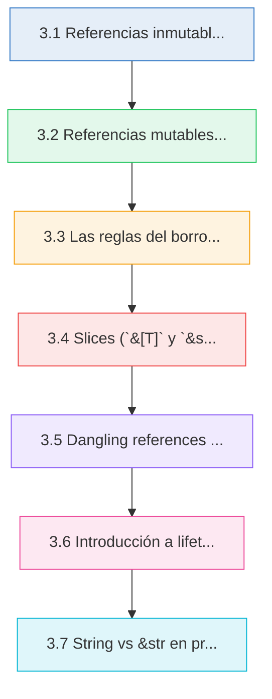
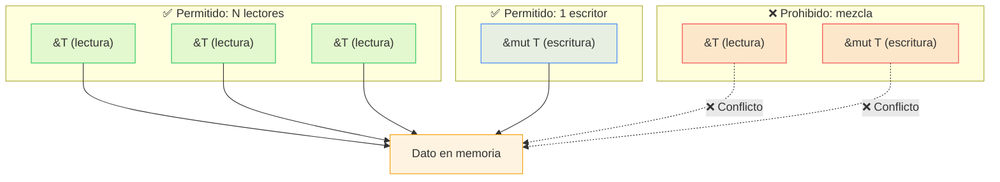
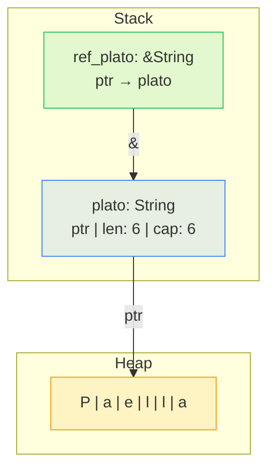

# :handshake: Cap 3 — Referencias y préstamos

<div class="chapter-meta">
  <span class="meta-item">🕐 3-4 horas</span>
  <span class="meta-item">📊 Nivel: Principiante-Intermedio</span>
  <span class="meta-item">🎯 Semana 2</span>
</div>

<div class="chapter-objective"><span class="objective-icon">📌</span><span class="objective-text">Dominar el sistema de referencias y borrowing de Rust para usar datos sin transferir ownership, entendiendo las reglas del borrow checker y cómo aplicarlas en código real.</span></div>

<div class="chapter-map">



</div>


!!! quote "Contexto"
    En el capítulo anterior aprendiste que Rust tiene ownership: cada valor tiene un solo dueño. Pero si cada función se queda con el ownership de los datos... no podrías reutilizar nada. **Borrowing** resuelve esto: permite usar datos sin tomar posesión de ellos. Es como pedir prestado un libro: lo lees, pero lo devuelves.

<div class="connection-box"><span class="connection-icon">🔗</span><span>Este capítulo extiende directamente los conceptos de ownership del <a href="02-variables-tipos-propiedad.md">Capítulo 2 — Variables, tipos y propiedad</a>. Si no tienes claro qué es ownership y move, repásalo antes de continuar.</span></div>

---

## 3.1 Referencias inmutables (`&T`)

<div class="concept-question"><h4>🔍 Pregunta conceptual</h4><p>Si cada valor en Rust tiene un único dueño, ¿cómo podemos pasar datos a una función sin perder el acceso al valor original? ¿Qué mecanismo permite "prestar" sin "regalar"?</p></div>

Una **referencia** te permite acceder a un valor **sin tomar ownership**. Se crea con el operador `&`:

```rust
fn main() {
    let nombre = String::from("Paella Valenciana");
    let ref_nombre: &String = &nombre;   // (1)!
    println!("Plato: {}", ref_nombre);
    println!("Original: {}", nombre);     // (2)!
}
```

1. `&nombre` crea una referencia que **apunta** a `nombre` sin tomar ownership.
2. `nombre` sigue siendo accesible porque no se movió — solo se prestó.

Puedes tener **tantas referencias inmutables como quieras** al mismo tiempo:

```rust
fn main() {
    let plato = String::from("Tortilla Española");
    let r1 = &plato;
    let r2 = &plato;
    let r3 = &plato;
    println!("{}, {}, {}", r1, r2, r3);   // ✅ Todas coexisten
}
```

### Funciones que toman referencias

La forma más común de usar referencias es en **parámetros de funciones**. Esto se llama **borrowing** (préstamo):

```rust
fn mostrar_longitud(s: &String) {          // (1)!
    println!("'{}' tiene {} caracteres", s, s.len());
}

fn main() {
    let plato = String::from("Gazpacho Andaluz");
    mostrar_longitud(&plato);              // (2)!
    println!("Aún tengo: {}", plato);      // ✅ plato no se movió
}
```

1. El parámetro `s: &String` recibe una referencia, no el valor. La función **toma prestado** el String.
2. Pasamos `&plato` — una referencia. El ownership se queda en `main`.

<div class="pro-tip"><h4>💡 Consejo Pro</h4><p>Cuando veas <code>&</code> en una firma de función, piensa en "solo lectura, sin transferir propiedad". Es la forma más eficiente de pasar datos grandes a funciones porque no copia ni mueve nada — solo comparte una dirección de memoria.</p></div>

<div class="comparison" markdown>
<div class="lang-box python" markdown>

#### :snake: En Python

```python
def process(data):
    print(f"Longitud: {len(data)}")
    # data es siempre una referencia implícita

data = ["Paella", "Tortilla"]
process(data)
print(data)  # Siempre accesible
```

Python pasa **todo** por referencia implícita. Nunca piensas en ownership.

</div>
<div class="lang-box rust" markdown>

#### :crab: En Rust

```rust
fn process(data: &Vec<String>) {
    println!("Longitud: {}", data.len());
}

let data = vec!["Paella".into(), "Tortilla".into()];
process(&data);       // Préstamo explícito con &
println!("{:?}", data); // ✅ Accesible
```

Rust requiere que seas **explícito**: `&` para prestar, sin `&` para mover.

</div>
</div>

<div class="micro-exercise"><h4>🧪 Micro-ejercicio (2 min)</h4><p>Sin ejecutar el código, ¿qué imprime este programa? ¿Compila?<br><code>let s = String::from("hola");</code><br><code>let r1 = &s;</code><br><code>let r2 = &s;</code><br><code>println!("{} {} {}", s, r1, r2);</code><br>Respuesta: Sí compila. Imprime <code>hola hola hola</code>. Múltiples referencias inmutables pueden coexistir con el valor original para lectura.</p></div>

---

## 3.2 Referencias mutables (`&mut T`)

<div class="concept-question"><h4>🔍 Pregunta conceptual</h4><p>Si las referencias inmutables solo permiten leer, ¿cómo podemos modificar un valor a través de una referencia? ¿Qué restricciones impone Rust para garantizar la seguridad al mutar datos prestados?</p></div>

Si necesitas **modificar** un valor prestado, usas una referencia mutable con `&mut`:

```rust
fn agregar_plato(menu: &mut Vec<String>, plato: String) {   // (1)!
    menu.push(plato);
    println!("Menú actualizado: {:?}", menu);
}

fn main() {
    let mut platos = vec![                                    // (2)!
        String::from("Paella"),
        String::from("Tortilla"),
    ];
    agregar_plato(&mut platos, String::from("Gazpacho"));    // (3)!
    println!("Desde main: {:?}", platos);
}
```

1. `&mut Vec<String>` — referencia mutable. La función puede modificar el vector.
2. La variable original **debe** ser `mut` para poder crear una referencia mutable.
3. `&mut platos` crea el préstamo mutable.

Rust solo permite **una referencia mutable** a un dato en cada momento:

```rust
fn main() {
    let mut s = String::from("hola");
    let r1 = &mut s;
    // let r2 = &mut s;   // ❌ cannot borrow `s` as mutable more than once
    r1.push_str(" mundo");
    println!("{}", r1);
}
```

!!! danger "Data races"
    Esta restricción previene **data races** en compilación. Un data race ocurre cuando dos o más punteros acceden al mismo dato simultáneamente, al menos uno escribe, y no hay sincronización. Rust elimina esta categoría de bugs. En C/C++ causan comportamiento indefinido. En Python se usa el GIL como parche. Rust los previene en compilación.

---

## 3.3 Las reglas del borrowing

El **borrow checker** es el componente del compilador que verifica estas reglas:

!!! abstract "Reglas del borrowing"
    **Regla 1** — En cualquier momento, puedes tener:

    - **N referencias inmutables** (`&T`) — lectores ilimitados, **O**
    - **1 referencia mutable** (`&mut T`) — un solo escritor

    Nunca ambas al mismo tiempo.

    **Regla 2** — Las referencias deben ser siempre **válidas** (no pueden apuntar a memoria liberada).



<div class="misconception-box"><h4>⚠️ Errores comunes</h4><ul><li><span class="wrong">❌ Mito:</span> "El borrow checker es una limitación innecesaria que solo complica el código" → <span class="right">✅ Realidad:</span> El borrow checker previene en compilación bugs que en C/C++ causan crashes y vulnerabilidades de seguridad en producción. Cada error del borrow checker es un bug real evitado.</li><li><span class="wrong">❌ Mito:</span> "No puedes tener ninguna referencia inmutable si ya existe una referencia mutable en el mismo scope" → <span class="right">✅ Realidad:</span> Gracias a NLL (Non-Lexical Lifetimes), lo que importa es que las vidas de las referencias no se solapen. Si la referencia inmutable ya no se usa, puedes crear una mutable después en el mismo scope.</li><li><span class="wrong">❌ Mito:</span> "Las referencias en Rust son como los punteros en C" → <span class="right">✅ Realidad:</span> Las referencias en Rust tienen garantías de seguridad que los punteros de C no tienen: siempre son válidas, siempre apuntan a memoria inicializada, y el borrow checker verifica su correcto uso en compilación.</li></ul></div>

Veamos las reglas en acción:

```rust
fn main() {
    let mut s = String::from("hola");

    // ✅ Caso 1: Múltiples referencias inmutables
    let r1 = &s;
    let r2 = &s;
    println!("{} y {}", r1, r2);
    // r1 y r2 ya no se usan después de aquí (NLL)

    // ✅ Caso 2: Una referencia mutable (r1 y r2 ya expiraron)
    let r3 = &mut s;
    r3.push_str(" mundo");
    println!("{}", r3);
}
```

!!! tip "NLL — Non-Lexical Lifetimes"
    Desde Rust 2018, una referencia "muere" en su **último uso**, no al final del bloque. Por eso `r1` y `r2` no conflictan con `r3` — sus vidas no se solapan.

---

## 3.4 Slices (`&[T]` y `&str`)

<div class="concept-question"><h4>🔍 Pregunta conceptual</h4><p>¿Cómo podemos referenciar solo una parte de una colección (por ejemplo, los 3 primeros elementos de un vector) sin copiar datos? ¿Qué tipo de referencia nos permite trabajar con "vistas parciales"?</p></div>

Un **slice** es una referencia a una porción contigua de una colección. No tiene ownership — es un préstamo de una vista parcial.

### Slices de arrays y vectores: `&[T]`

```rust
fn main() {
    let platos = vec!["Paella", "Tortilla", "Gazpacho", "Croquetas", "Salmorejo"];
    let selección: &[&str] = &platos[1..3];   // (1)!
    println!("Selección: {:?}", selección);     // ["Tortilla", "Gazpacho"]
    let primeros = &platos[..2];                // Desde el inicio: [0, 2)
    let ultimos = &platos[3..];                 // Hasta el final: [3, len)
    let todos = &platos[..];                    // Todo el vector como slice
    println!("{:?}, {:?}, {:?}", primeros, ultimos, todos);
}
```

1. `&platos[1..3]` crea un slice que apunta a las posiciones 1 y 2 (rango exclusivo al final, igual que Python).

### Slices de strings: `&str`

`&str` es un **string slice** — una referencia a una secuencia de bytes UTF-8:

```rust
fn main() {
    let plato = String::from("Paella Valenciana");
    let primera_palabra: &str = &plato[0..6];    // (1)!
    let segunda_palabra: &str = &plato[7..17];
    println!("{} {}", primera_palabra, segunda_palabra);

    let literal: &str = "Gazpacho";               // (2)!
}
```

1. `&plato[0..6]` toma un slice del String. Los índices son en **bytes**, no caracteres. Cuidado con UTF-8 multibyte.
2. Los string literals (`"texto"`) son de tipo `&str` — viven en el binario del programa.

!!! warning "Cuidado con índices UTF-8"
    Si cortas en medio de un carácter multibyte (como `ñ`, `é`), Rust entra en **panic**:
    ```rust
    let saludo = String::from("¡Hola!");
    // let bad = &saludo[0..1]; // 💥 panic! '¡' ocupa 2 bytes en UTF-8
    let ok = &saludo[0..2];     // ✅ "¡" — 2 bytes correctos
    ```

<div class="comparison" markdown>
<div class="lang-box python" markdown>

#### :snake: En Python

```python
platos = ["Paella", "Tortilla", "Gazpacho"]
selección = platos[1:3]  # Crea una NUEVA lista
selección.append("Croquetas")
print(platos)  # No cambia — es una copia
```

Python `lista[1:3]` crea una **copia independiente**. Modificarla no afecta al original.

</div>
<div class="lang-box rust" markdown>

#### :crab: En Rust

```rust
let platos = vec!["Paella", "Tortilla", "Gazpacho"];
let selección = &platos[1..3]; // Borrows una VISTA
// selección.push("Croquetas"); // ❌ No puedes mutar un slice
println!("{:?}", platos); // ✅ Original intacto
```

Rust `&lista[1..3]` crea una **vista prestada**. No copia datos, pero tampoco puedes mutarla.

</div>
</div>

<div class="micro-exercise"><h4>🧪 Micro-ejercicio (2 min)</h4><p>Dado <code>let texto = String::from("Rust es genial");</code>, escribe las expresiones para obtener: (a) un slice con <code>"Rust"</code>, (b) un slice con <code>"genial"</code>, (c) todo el string como slice.<br>Respuesta: (a) <code>&texto[0..4]</code>, (b) <code>&texto[8..14]</code>, (c) <code>&texto[..]</code></p></div>

---

## 3.5 Dangling references y el borrow checker

Una **dangling reference** es una referencia que apunta a memoria ya liberada. Rust lo previene en compilación:

```rust
// ❌ Esto NO compila
fn crea_saludo() -> &String {                     // (1)!
    let s = String::from("Hola desde la cocina");
    &s                                             // (2)!
}
```

1. La firma promete devolver una referencia... pero a la memoria de quién?
2. `s` se destruye al salir de la función. La referencia apuntaría a memoria liberada.

La solución es devolver el valor **owned**:

```rust
fn crea_saludo() -> String {
    let s = String::from("Hola desde la cocina");
    s   // Mueve el ownership al llamador
}

fn main() {
    let saludo = crea_saludo();
    println!("{}", saludo);     // ✅ Funciona perfectamente
}
```

!!! tip "El borrow checker es tu amigo"
    Cada error del borrow checker es un bug que en C/C++ habría sido un crash en producción, o peor, un exploit de seguridad. El compilador no te pone trabas — te está **protegiendo**.

<div class="code-evolution" markdown>
<h4 class="evolution-header">Evolución: pasar datos a una función</h4>
<div class="evolution-step">
<h5>🟡 Nivel novato — clonar todo (funciona pero ineficiente)</h5>

```rust
fn mostrar(plato: String) {
    println!("Plato: {}", plato);
}
fn main() {
    let p = String::from("Paella");
    mostrar(p.clone()); // Clona para no perder ownership
    mostrar(p.clone()); // Otra copia innecesaria
    println!("{}", p);
}
```

</div>
<div class="evolution-step">
<h5>🔵 Nivel mejorado — usar referencias &String</h5>

```rust
fn mostrar(plato: &String) {
    println!("Plato: {}", plato);
}
fn main() {
    let p = String::from("Paella");
    mostrar(&p); // Presta sin copiar
    mostrar(&p); // Puede prestar muchas veces
    println!("{}", p);
}
```

</div>
<div class="evolution-step">
<h5>🟢 Nivel profesional — usar &str para máxima flexibilidad</h5>

```rust
fn mostrar(plato: &str) {
    println!("Plato: {}", plato);
}
fn main() {
    let p = String::from("Paella");
    mostrar(&p);          // &String → &str automático
    mostrar("Tortilla");  // Literales directamente
    println!("{}", p);
}
```

</div>
</div>

---

## 3.6 Introducción a lifetimes

A veces el compilador necesita ayuda para entender **cuánto tiempo vive una referencia**. Para eso existen las anotaciones de lifetime con `'a`:

```rust
fn mas_largo<'a>(x: &'a str, y: &'a str) -> &'a str {   // (1)!
    if x.len() >= y.len() { x } else { y }
}

fn main() {
    let plato1 = String::from("Paella Valenciana");
    let resultado;
    {
        let plato2 = String::from("Gazpacho");
        resultado = mas_largo(&plato1, &plato2);
        println!("Más largo: {}", resultado);      // (2)!
    }
    // println!("{}", resultado);  // ❌ plato2 ya no existe aquí
}
```

1. `'a` le dice al compilador: "la referencia devuelta vive **al menos** tanto como la más corta de las dos referencias de entrada".
2. Dentro del bloque, ambas referencias son válidas, así que funciona.

!!! info "Lifetimes en profundidad"
    Este es solo un primer vistazo. Los lifetimes se cubren en detalle en el **Capítulo 11**. Por ahora recuerda: `'a` es una anotación que describe cómo se **relacionan** las vidas de las referencias, no cambia cuánto vive algo.

<div class="pro-tip"><h4>💡 Consejo Pro</h4><p>No te obsesiones con los lifetimes al principio. El compilador infiere la mayoría automáticamente gracias a las <strong>reglas de elisión</strong>. Solo necesitas anotarlos explícitamente cuando una función recibe múltiples referencias y devuelve una referencia, porque el compilador no puede deducir cuál es la relación entre ellas.</p></div>

---

## 3.7 String vs &str en profundidad

En Python solo hay `str`. En Rust hay dos tipos principales:

| Característica | `String` | `&str` |
|---------------|----------|--------|
| **Ownership** | Owned — dueño de los datos | Borrowed — préstamo/vista |
| **Almacenamiento** | Heap (redimensionable) | Apunta a datos existentes |
| **Mutabilidad** | Puede ser `mut` | Siempre inmutable |
| **Tamaño** | Dinámico (puede crecer) | Fijo (vista de longitud fija) |
| **Uso principal** | Poseer/modificar el string | Parámetros de funciones, literales |

### Conversiones entre String y &str

```rust
fn main() {
    // String → &str (barato: solo crea una referencia)
    let owned = String::from("Paella Valenciana");
    let slice: &str = &owned;                      // (1)!
    let slice2: &str = owned.as_str();             // (2)!
    let slice3: &str = &owned[..];                 // (3)!

    // &str → String (caro: aloca memoria en el heap y copia)
    let literal: &str = "Gazpacho";
    let owned1: String = literal.to_string();      // (4)!
    let owned2: String = String::from(literal);    // (5)!
    let owned3: String = literal.to_owned();       // (6)!
}
```

1. Deref coerción: `&String` se convierte automáticamente a `&str`.
2. Método explícito `.as_str()`.
3. Slice completo del String.
4. `.to_string()` — funciona para cualquier tipo que implemente `Display`.
5. `String::from()` — constructor explícito.
6. `.to_owned()` — convierte un tipo borrowed a su versión owned.

### Buena práctica: prefiere `&str` en parámetros

```rust
// ❌ Demasiado restrictivo: solo acepta String
fn mostrar_plato_v1(nombre: &String) {
    println!("Plato: {}", nombre);
}

// ✅ Flexible: acepta &String, &str, literales...
fn mostrar_plato_v2(nombre: &str) {                // (1)!
    println!("Plato: {}", nombre);
}

fn main() {
    let owned = String::from("Paella");
    mostrar_plato_v2(&owned);         // ✅ &String → &str automático
    mostrar_plato_v2("Tortilla");     // ✅ Literal directamente
}
```

1. `&str` es más genérico que `&String` gracias a **deref coerción**. Siempre prefiere `&str` en parámetros.

!!! tip "Regla de oro para strings"
    - **Parámetros de funciones** → usa `&str`
    - **Campos de structs que poseen datos** → usa `String`
    - **Retorno que crea datos nuevos** → devuelve `String`
    - **Literales** → son `&str` automáticamente

<div class="connection-box"><span class="connection-icon">🔗</span><span>En el <a href="04-funciones-flujo-control.md">Capítulo 4 — Funciones y flujo de control</a> verás cómo aplicar estos conceptos de borrowing en funciones más complejas, con pattern matching y múltiples parámetros por referencia.</span></div>


<div class="ejercicio-guiado">
<h4>🏋️ Ejercicio guiado</h4>

Vas a construir un sistema de gestión de pedidos para RustMenu que use referencias inmutables, referencias mutables y slices sin transferir ownership.

1. Crea un nuevo proyecto con `cargo new rustmenu-pedidos` y abre `src/main.rs`.
2. Crea un `Vec<String>` mutable llamado `menu` con 5 platos del restaurante.
3. Escribe una función `fn mostrar_menu(platos: &[String])` que reciba un slice e imprima los platos numerados. Llámala desde `main` y verifica que `menu` sigue accesible después.
4. Escribe una función `fn contar_platos(platos: &[String]) -> usize` que devuelva el número de platos sin tomar ownership. Imprime el resultado.
5. Escribe una función `fn agregar_plato(platos: &mut Vec<String>, nuevo: &str)` que añada un plato al menú usando una referencia mutable.
6. Usa slices para mostrar solo los 2 primeros platos (`&menu[..2]`) y los últimos 3 (`&menu[menu.len()-3..]`) llamando a `mostrar_menu` con cada slice.
7. Ejecuta con `cargo run` y verifica que todo compila sin warnings con `cargo clippy`.

??? success "Solución completa"
    ```rust
    fn mostrar_menu(platos: &[String]) {
        for (i, plato) in platos.iter().enumerate() {
            println!("  {}. {}", i + 1, plato);
        }
    }

    fn contar_platos(platos: &[String]) -> usize {
        platos.len()
    }

    fn agregar_plato(platos: &mut Vec<String>, nuevo: &str) {
        platos.push(String::from(nuevo));
        println!("Plato '{}' añadido al menú.", nuevo);
    }

    fn main() {
        let mut menu: Vec<String> = vec![
            String::from("Paella Valenciana"),
            String::from("Tortilla Española"),
            String::from("Gazpacho Andaluz"),
            String::from("Croquetas Caseras"),
            String::from("Flan de Huevo"),
        ];

        println!("=== Menú de RustMenu ===");
        mostrar_menu(&menu);
        println!("Total de platos: {}
", contar_platos(&menu));

        agregar_plato(&mut menu, "Salmorejo Cordobés");
        println!("
=== Menú actualizado ===");
        mostrar_menu(&menu);

        println!("
--- Primeros 2 platos ---");
        mostrar_menu(&menu[..2]);

        println!("
--- Últimos 3 platos ---");
        mostrar_menu(&menu[menu.len() - 3..]);
    }
    ```

</div>

<div class="real-errors">
<h4>🚨 Errores que vas a encontrar</h4>

**Error 1: Tipo incompatible**

```rust
let x: i32 = "hola"; // ❌
```

```
error[E0308]: mismatched types
  expected `i32`, found `&str`
```

**¿Por qué?** Rust es estrictamente tipado — no hay conversión implícita entre tipos.

**Solución:** Usa el tipo correcto o convierte explícitamente.

---

**Error 2: Variable no mutable**

```rust
let precio = 10.0;
precio = 15.0; // ❌
```

```
error[E0384]: cannot assign twice to immutable variable `precio`
```

**Solución:** Declara con `let mut precio = 10.0;`

---

**Error 3: Valor movido**

```rust
let nombre = String::from("Paella");
let copia = nombre;
println!("{}", nombre); // ❌
```

```
error[E0382]: borrow of moved value: `nombre`
```

**Solución:** Usa `.clone()` o referencias `&nombre`.

</div>

---

<div class="checkpoint"><h4>🏁 Checkpoint</h4><p>Antes de continuar, asegúrate de que puedes responder estas preguntas: (1) ¿Cuál es la diferencia entre <code>&T</code> y <code>&mut T</code>? (2) ¿Por qué Rust no permite tener <code>&T</code> y <code>&mut T</code> al mismo tiempo? (3) ¿Qué es un slice y en qué se diferencia de una copia? (4) ¿Por qué una función no puede devolver una referencia a una variable local? Si alguna te genera dudas, revisa las secciones 3.1 a 3.5 antes de pasar a los recursos y ejercicios.</p></div>

<div class="mini-project">
<h4>🏗️ Mini-proyecto: Aplicación práctica</h4>

**Paso 1 — Define las estructuras base**

Crea las estructuras y tipos necesarios para modelar el dominio del capítulo.

??? success "Solución Paso 1"
    ```rust
    // Define tus structs y enums aquí
    #[derive(Debug)]
    struct Item {
        nombre: String,
        valor: f64,
    }

    impl Item {
        fn new(nombre: &str, valor: f64) -> Self {
            Self {
                nombre: nombre.to_string(),
                valor,
            }
        }
    }
    ```

**Paso 2 — Implementa la lógica principal**

Crea funciones que operen sobre las estructuras del paso 1.

??? success "Solución Paso 2"
    ```rust
    fn procesar(items: &[Item]) -> f64 {
        items.iter().map(|i| i.valor).sum()
    }

    fn mostrar(items: &[Item]) {
        for item in items {
            println!("  {} — {:.2}€", item.nombre, item.valor);
        }
    }
    ```

**Paso 3 — Integra todo en main**

Combina los pasos anteriores en un programa completo.

??? success "Solución Paso 3"
    ```rust
    fn main() {
        let items = vec![
            Item::new("Paella", 14.50),
            Item::new("Gazpacho", 8.00),
            Item::new("Flan", 5.50),
        ];

        println!("=== RustMenu ===");
        mostrar(&items);
        println!("Total: {:.2}€", procesar(&items));
    }
    ```

</div>


## :link: Recursos

| Recurso | Enlace |
|---------|--------|
| References and Borrowing | [doc.rust-lang.org/book/ch04-02](https://doc.rust-lang.org/book/ch04-02-references-and-borrowing.html) |
| The Slice Type | [doc.rust-lang.org/book/ch04-03](https://doc.rust-lang.org/book/ch04-03-slices.html) |
| Understanding Ownership | [doc.rust-lang.org/book/ch04-01](https://doc.rust-lang.org/book/ch04-01-what-is-ownership.html) |

---

## :building_construction: RustMenu: Borrowing en acción

En RustMenu, calculamos el total de pedidos **sin tomar ownership** de la lista:

```rust
#[derive(Debug)]
struct Pedido {
    plato: String,
    cantidad: u32,
    precio_unitario: f64,
}

/// Calcula el total SIN tomar ownership.
fn calcular_total(pedidos: &Vec<Pedido>) -> f64 {          // (1)!
    pedidos.iter()
        .map(|p| p.cantidad as f64 * p.precio_unitario)
        .sum()
}

/// Muestra el resumen de un pedido (solo lectura).
fn mostrar_pedido(pedido: &Pedido) {                        // (2)!
    println!("  {} x{} — {:.2}€", pedido.plato, pedido.cantidad, pedido.precio_unitario);
}

/// Aplica un descuento (necesita mutabilidad).
fn aplicar_descuento(pedidos: &mut Vec<Pedido>, porcentaje: f64) {  // (3)!
    for pedido in pedidos.iter_mut() {
        pedido.precio_unitario *= 1.0 - (porcentaje / 100.0);
    }
}

fn main() {
    let mut mesa_5 = vec![
        Pedido { plato: String::from("Paella"), cantidad: 2, precio_unitario: 14.50 },
        Pedido { plato: String::from("Gazpacho"), cantidad: 3, precio_unitario: 8.00 },
        Pedido { plato: String::from("Croquetas"), cantidad: 1, precio_unitario: 9.50 },
    ];

    println!("Pedidos de la mesa 5:");
    for pedido in &mesa_5 { mostrar_pedido(pedido); }

    let total = calcular_total(&mesa_5);
    println!("Total: {:.2}€", total);

    aplicar_descuento(&mut mesa_5, 10.0);
    println!("Total con descuento: {:.2}€", calcular_total(&mesa_5));
}
```

1. `&Vec<Pedido>` — préstamo inmutable. Solo lectura.
2. `&Pedido` — préstamo inmutable de un solo pedido.
3. `&mut Vec<Pedido>` — préstamo mutable. Puede modificar los precios.

---

## :gear: Diagrama: referencias en memoria



- **`plato`** (String) vive en el stack con un puntero al heap, longitud y capacidad
- **`ref_plato`** (`&String`) vive en el stack y apunta a `plato` — no al heap directamente
- La referencia no posee nada: si `plato` se destruye, la referencia sería inválida (el borrow checker lo previene)

---

## 🎯 Ejercicios

??? question "Ejercicio 1: Longitud de un plato"
    Escribe una función `longitud_nombre` que reciba una referencia a un `String` y devuelva su longitud como `usize`. La función no debe tomar ownership.

    ```rust
    fn longitud_nombre(nombre: /* ??? */) -> usize {
        // tu código aquí
    }
    fn main() {
        let plato = String::from("Paella Valenciana");
        let len = longitud_nombre(/* ??? */);
        println!("{} tiene {} caracteres", plato, len); // plato sigue accesible
    }
    ```

    ??? success "Solución"
        ```rust
        fn longitud_nombre(nombre: &String) -> usize {
            nombre.len()
        }
        fn main() {
            let plato = String::from("Paella Valenciana");
            let len = longitud_nombre(&plato);
            println!("{} tiene {} caracteres", plato, len);
        }
        ```

??? question "Ejercicio 2: Agregar plato al menú"
    Escribe una función `agregar_plato` que reciba una referencia mutable a un `Vec<String>` y un `&str` con el nombre del nuevo plato.

    ```rust
    fn agregar_plato(menu: /* ??? */, plato: &str) {
        // tu código aquí
    }
    fn main() {
        let mut menu = vec![String::from("Paella"), String::from("Tortilla")];
        agregar_plato(/* ??? */, "Gazpacho");
        agregar_plato(/* ??? */, "Croquetas");
        println!("Menú: {:?}", menu);
    }
    ```

    ??? success "Solución"
        ```rust
        fn agregar_plato(menu: &mut Vec<String>, plato: &str) {
            menu.push(String::from(plato));
        }
        fn main() {
            let mut menu = vec![String::from("Paella"), String::from("Tortilla")];
            agregar_plato(&mut menu, "Gazpacho");
            agregar_plato(&mut menu, "Croquetas");
            println!("Menú: {:?}", menu);
            // Output: ["Paella", "Tortilla", "Gazpacho", "Croquetas"]
        }
        ```

??? question "Ejercicio 3: Rompiendo las reglas del borrowing"
    El siguiente código **no compila**. Explica por qué y corrígelo:

    ```rust
    fn main() {
        let mut mensaje = String::from("Bienvenido");
        let r1 = &mensaje;           // referencia inmutable
        let r2 = &mut mensaje;       // referencia mutable
        println!("{}", r1);
        r2.push_str(" al restaurante");
        println!("{}", r2);
    }
    ```

    !!! tip "Pista"
        No puedes tener `&T` y `&mut T` al mismo tiempo. Piensa en el orden de uso.

    ??? success "Solución"
        ```rust
        fn main() {
            let mut mensaje = String::from("Bienvenido");
            let r1 = &mensaje;
            println!("{}", r1);
            // r1 ya no se usa — NLL lo libera
            let r2 = &mut mensaje;
            r2.push_str(" al restaurante");
            println!("{}", r2);
        }
        ```
        La clave: las vidas de `r1` y `r2` no deben solaparse. Gracias a NLL, `r1` se libera después de su último uso.

??? question "Ejercicio 4: Primera palabra con slices"
    Escribe una función `primera_palabra` que reciba un `&str` y devuelva un `&str` con la primera palabra (hasta el primer espacio). Si no hay espacio, devuelve el string completo.

    ```rust
    fn primera_palabra(s: &str) -> &str {
        // tu código aquí
    }
    fn main() {
        let plato = String::from("Paella Valenciana");
        let primera = primera_palabra(&plato);
        println!("Primera palabra: {}", primera);  // "Paella"
    }
    ```

    ??? success "Solución"
        ```rust
        fn primera_palabra(s: &str) -> &str {
            let bytes = s.as_bytes();
            for (i, &byte) in bytes.iter().enumerate() {
                if byte == b' ' { return &s[0..i]; }
            }
            s
        }
        fn main() {
            let plato = String::from("Paella Valenciana");
            let primera = primera_palabra(&plato);
            println!("Primera palabra: {}", primera);   // "Paella"
            let simple = "Gazpacho";
            println!("Primera palabra: {}", primera_palabra(simple)); // "Gazpacho"
        }
        ```

??? question "Ejercicio 5: Corregir dangling reference"
    El siguiente código tiene un error de dangling reference. Corrígelo:

    ```rust
    fn crear_descripción() -> &str {
        let desc = String::from("Plato del día: Paella");
        &desc
    }
    fn main() {
        let descripción = crear_descripción();
        println!("{}", descripción);
    }
    ```

    ??? success "Solución"
        ```rust
        // Opción A: devolver String owned
        fn crear_descripción() -> String {
            String::from("Plato del día: Paella")
        }

        // Opción B: devolver &str estático (si es un literal)
        fn crear_descripcion_estatica() -> &'static str {
            "Plato del día: Paella"
        }

        fn main() {
            println!("{}", crear_descripción());
            println!("{}", crear_descripcion_estatica());
        }
        ```
        `desc` se destruye al salir de la función, dejando la referencia "colgando". La opción A devuelve el valor owned. La opción B usa un literal `&'static str` que vive durante toda la ejecución.

---

## :brain: Flashcards

<div class="flashcard">
<div class="front">¿Cuántas referencias inmutables puedes tener simultáneamente?</div>
<div class="back">Ilimitadas, siempre que no haya referencia mutable activa al mismo dato.</div>
</div>

<div class="flashcard">
<div class="front">¿Cuántas referencias mutables puedes tener a la vez?</div>
<div class="back">Exactamente una. Esto previene data races en compilación.</div>
</div>

<div class="flashcard">
<div class="front">¿Puedes tener <code>&T</code> y <code>&mut T</code> al mismo tiempo?</div>
<div class="back">No. Las reglas del borrowing lo prohíben: puedes tener N lectores O 1 escritor, nunca ambos.</div>
</div>

<div class="flashcard">
<div class="front">¿Cuál es la diferencia entre <code>&str</code> y <code>String</code>?</div>
<div class="back"><code>&str</code> es un borrow (vista inmutable a datos string). <code>String</code> es owned (datos en el heap, redimensionable). <code>&str</code> es barato, <code>String</code> aloca memoria.</div>
</div>

<div class="flashcard">
<div class="front">¿Qué es un dangling reference?</div>
<div class="back">Una referencia a memoria que ya fue liberada. Rust lo previene en compilación — si intentas crear una, el borrow checker te detiene con un error.</div>
</div>

<div class="flashcard">
<div class="front">¿Qué es el borrow checker?</div>
<div class="back">El componente del compilador de Rust que verifica las reglas de borrowing: que las referencias sean válidas y que no existan conflictos entre lectores y escritores.</div>
</div>

---

## :video_game: Quiz interactivo

<div class="quiz" data-quiz-id="ch03-q1">
<h4>Pregunta 1: ¿Cuál de estos códigos compila correctamente?</h4>
<button class="quiz-option" data-correct="true"><code>let r1 = &s; let r2 = &s; println!("{r1}{r2}");</code></button>
<button class="quiz-option" data-correct="false"><code>let r1 = &s; let r2 = &mut s; println!("{r1}{r2}");</code></button>
<button class="quiz-option" data-correct="false"><code>let r1 = &mut s; let r2 = &mut s;</code></button>
<button class="quiz-option" data-correct="false">Ninguno compila</button>
<div class="quiz-feedback" data-correct="¡Correcto! Múltiples referencias inmutables (&s) pueden coexistir sin problema." data-incorrect="Incorrecto. La primera opción es válida: puedes tener múltiples referencias inmutables. Las otras mezclan &T con &mut T o crean dos &mut T."></div>
</div>

<div class="quiz" data-quiz-id="ch03-q2">
<h4>Pregunta 2: ¿Qué tipo es <code>&str</code>?</h4>
<button class="quiz-option" data-correct="true">Un slice de string (referencia inmutable a datos string)</button>
<button class="quiz-option" data-correct="false">Un String almacenado en el heap</button>
<button class="quiz-option" data-correct="false">Un puntero raw sin garantías de seguridad</button>
<button class="quiz-option" data-correct="false">Un string mutable redimensionable</button>
<div class="quiz-feedback" data-correct="¡Correcto! &str es un string slice: una referencia inmutable a una secuencia de bytes UTF-8." data-incorrect="Incorrecto. &str es un string slice — una referencia inmutable (borrowed) a datos string. No es owned, no es raw, y no es mutable."></div>
</div>

<div class="quiz" data-quiz-id="ch03-q3">
<h4>Pregunta 3: ¿Qué previene el borrow checker?</h4>
<button class="quiz-option" data-correct="true">Data races y dangling references</button>
<button class="quiz-option" data-correct="false">Memory leaks</button>
<button class="quiz-option" data-correct="false">Stack overflows</button>
<button class="quiz-option" data-correct="false">Integer overflows</button>
<div class="quiz-feedback" data-correct="¡Correcto! El borrow checker previene data races y dangling references. Memory leaks, stack overflows e integer overflows se manejan por otros mecanismos." data-incorrect="Incorrecto. El borrow checker previene data races y dangling references. Los memory leaks son posibles (Rc cycles), stack overflows son runtime, integer overflows se detectan en modo debug."></div>
</div>

---

## :bug: Ejercicio de depuración

Encuentra y corrige los **3 errores** en este código:

```rust
fn main() {
    let mut platos = vec!["Paella", "Tortilla", "Gazpacho"];
    let primero = &platos[0];
    platos.push("Croquetas");         // Error 1
    println!("Primero: {}", primero);

    let r1 = &mut platos;
    let r2 = &mut platos;             // Error 2
    r1.push("Salmorejo");

    let referencia = crea_ref();      // Error 3
}

fn crea_ref() -> &String {            // Error 3 (continuación)
    let s = String::from("temporal");
    &s
}
```

??? success "Solución"
    ```rust
    fn main() {
        let mut platos = vec!["Paella", "Tortilla", "Gazpacho"];

        // ✅ Fix 1: Usar la referencia ANTES de mutar
        let primero = &platos[0];
        println!("Primero: {}", primero);
        platos.push("Croquetas");            // ✅ Ahora podemos mutar

        // ✅ Fix 2: Solo una referencia mutable
        let r1 = &mut platos;
        r1.push("Salmorejo");

        // ✅ Fix 3: Devolver String owned
        let referencia = crea_ref();
        println!("Creado: {}", referencia);
    }

    fn crea_ref() -> String {
        let s = String::from("temporal");
        s   // Mover ownership al llamador
    }
    ```

    **Errores explicados:**

    1. **`platos.push()` mientras `primero` está prestado**: `push` podría reasignar el vector, invalidando la referencia. Solución: usar `primero` antes del `push`.
    2. **Dos `&mut` simultáneos**: solo se permite una referencia mutable a la vez. Solución: usar solo `r1`.
    3. **Dangling reference**: `crea_ref` devuelve referencia a un `String` local que se destruye. Solución: devolver `String` owned.

---

## ✅ Autoevaluación del capítulo

<div class="self-check" markdown>
<h4>¿Has comprendido todo? Marca lo que puedes hacer:</h4>
<label><input type="checkbox"> Entiendo la diferencia entre `&T` (referencia inmutable) y `&mut T` (referencia mutable)</label>
<label><input type="checkbox"> Puedo explicar las reglas del borrowing a un compañero</label>
<label><input type="checkbox"> Sé usar string slices (`&str`) como parámetros de función</label>
<label><input type="checkbox"> Puedo identificar y corregir errores de borrowing del compilador</label>
<label><input type="checkbox"> Entiendo por qué Rust previene dangling references</label>
</div>
