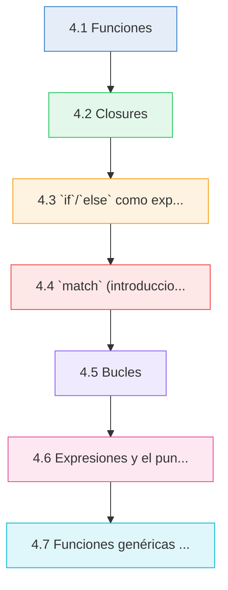
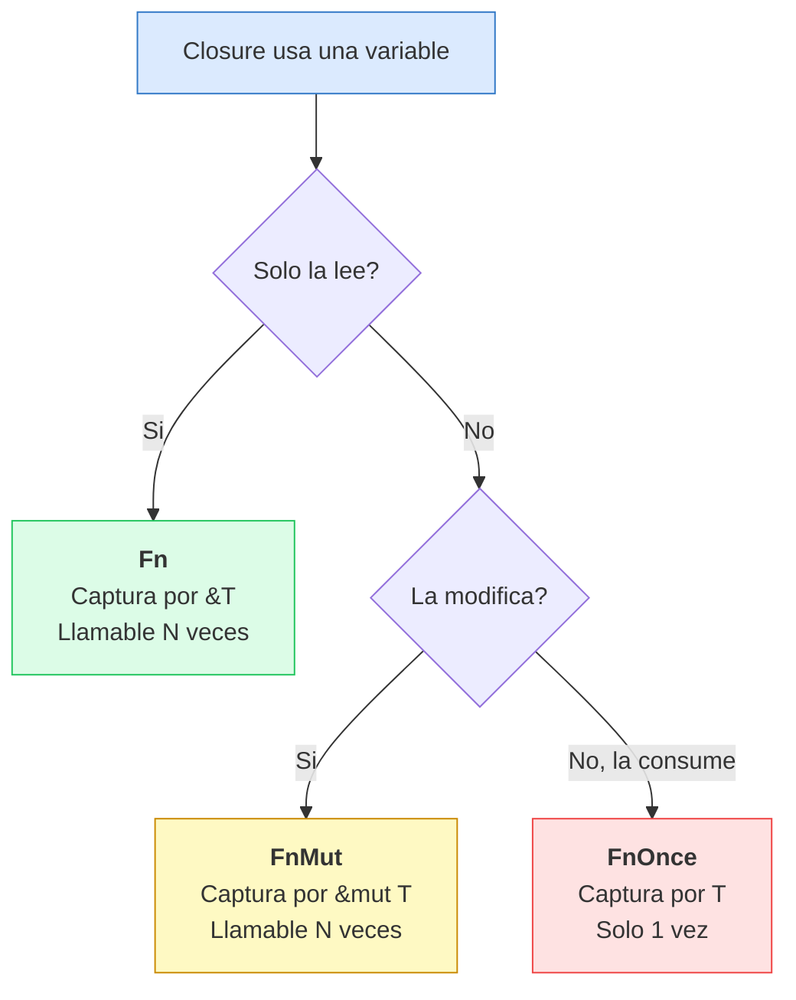

# :gear: Cap 4 — Funciones y flujo de control

<div class="chapter-meta">
  <span class="meta-item">🕐 3-4 horas</span>
  <span class="meta-item">📊 Nivel: Principiante-Intermedio</span>
  <span class="meta-item">🎯 Semana 2</span>
</div>

<div class="chapter-objective"><span class="objective-icon">📌</span><span class="objective-text">Dominar la declaración de funciones con tipos explicitos, comprender closures y sus tres traits de captura, y utilizar las construcciones de flujo de control (<code>if</code>, <code>match</code>, bucles) como expresiones que producen valores.</span></div>

<div class="chapter-map">



</div>


!!! quote "Contexto"
    En Python, las funciones son flexibles: no necesitas tipos, puedes retornar cualquier cosa y el flujo de control se basa en indentación. En Rust, las funciones son **contratos estrictos** donde todo tiene tipo explícito, el punto y coma decide si algo es expresión o statement, y construcciones como `if`, `match` y `loop` son **expresiones** que producen valores.

---

## 4.1 Funciones

En Rust, las funciones se declaran con `fn`. Todos los parámetros deben tener tipo explícito y, si la función retorna algo, debes declarar el tipo de retorno con `->`.

```rust
fn suma(a: i32, b: i32) -> i32 {
    a + b  // (1)!
}

fn saludar(nombre: &str) {  // (2)!
    println!("Hola, {}!", nombre);
}

fn main() {
    let total = suma(3, 5);
    println!("Total: {}", total);  // Total: 8
    saludar("Daniele");             // Hola, Daniele!
}
```

1. Sin `;` al final: la última expresión es el valor de retorno. Equivale a `return a + b;` pero es más idiomatico.
2. Sin `-> Tipo` significa que retorna `()` (unit), el equivalente a `None` en Python.

<div class="connection-box" markdown>
:link: **Conexion con Cap 3 — Referencias y prestamos:** En el ejemplo `fn saludar(nombre: &str)`, el parámetro toma una referencia prestada. Recuerda las reglas de borrowing del [Capítulo 3](03-referencias-prestamos.md) — pasar `&str` no transfiere ownership, solo presta acceso de lectura.
</div>

### Expresiones vs statements

- **Expresión**: produce un valor. Ej: `5 + 3`, `if x > 0 { 1 } else { 0 }`, un bloque `{ ... }`.
- **Statement**: realiza una acción, no produce valor. Ej: `let x = 5;`, expresión + `;`.

```rust
fn ejemplo() -> i32 {
    let y = { let tmp = 5 * 2; tmp + 1 };  // bloque = expresión que vale 11
    y  // última expresión = valor de retorno
}
```

<div class="concept-question"><h4>🔍 Pregunta conceptual</h4><p>Si un bloque <code>{ let a = 5; a + 1 }</code> es una expresión que vale 6, que valor tendria <code>{ let a = 5; a + 1; }</code> con el punto y coma al final? Piensa en la diferencia entre expresión y statement antes de continuar.</p></div>

### `return` explícito

Usa `return` solo para salidas anticipadas. Para el valor final, omite `return` y `;`:

```rust
fn dividir(a: f64, b: f64) -> f64 {
    if b == 0.0 { return 0.0; }  // salida anticipada
    a / b  // retorno implícito
}
```

<div class="comparison" markdown>
<div class="lang-box python" markdown>

#### :snake: En Python

```python
def suma(a, b):
    return a + b       # return explícito obligatorio
# Retorna None implicitamente sin return
```

</div>
<div class="lang-box rust" markdown>

#### :crab: En Rust

```rust
fn suma(a: i32, b: i32) -> i32 {
    a + b              // última expresión = retorno
}
// Sin -> Tipo retorna () (unit)
```

</div>
</div>

---

## 4.2 Closures

Los closures son funciones anonimas que **capturan variables de su entorno**. La sintaxis usa `|...|`:

```rust
let doble = |x| x * 2;
let sumar = |a: i32, b: i32| -> i32 { a + b };

let saludo = String::from("Hola");
let saludar = |nombre: &str| println!("{}, {}!", saludo, nombre);
saludar("Daniele");  // Hola, Daniele!
```

### Los tres traits de closures

| Trait | Captura | Descripción | Puede llamarse... |
|:------|:--------|:------------|:-------------------|
| `Fn` | `&T` (ref inmutable) | Solo lee las variables capturadas | Multiples veces |
| `FnMut` | `&mut T` (ref mutable) | Puede modificar las variables capturadas | Multiples veces |
| `FnOnce` | `T` (ownership) | Consume las variables capturadas | Solo una vez |

```rust
// Fn: solo lee `factor`
let factor = 3;
let multiplicar = |x| x * factor;
println!("{}, {}", multiplicar(10), multiplicar(20));  // 30, 60

// FnMut: modifica `contador`
let mut contador = 0;
let mut inc = || { contador += 1; };
inc(); inc();
println!("Contador: {}", contador);  // 2

// FnOnce: consume `nombre`
let nombre = String::from("RustMenu");
let consumir = || { let _s = nombre; };  // mueve `nombre` dentro
consumir();
// consumir();  // ERROR: ya fue consumido
```

<div class="misconception-box" markdown>
<h4>🚫 Mitos comunes sobre closures en Rust</h4>

<p><span class="wrong">Mito 1: "Los closures siempre toman ownership de las variables."</span><br/>
<span class="right">Realidad: Rust elige automaticamente el modo de captura menos restrictivo. Si solo lees la variable, captura por <code>&T</code> (Fn). Solo toma ownership si el closure consume el valor o si usas <code>move</code>.</span></p>

<p><span class="wrong">Mito 2: "Un closure FnOnce no puede implementar Fn."</span><br/>
<span class="right">Realidad: La jerarquia es Fn ⊂ FnMut ⊂ FnOnce. Todo closure que implementa <code>Fn</code> también implementa <code>FnMut</code> y <code>FnOnce</code>. No al reves.</span></p>

<p><span class="wrong">Mito 3: "Los closures de Rust son iguales a las lambdas de Python."</span><br/>
<span class="right">Realidad: En Python, las lambdas capturan variables por referencia al scope y no tienen restricciones de ownership. En Rust, el compilador analiza como usas cada variable capturada y asigna el trait correspondiente.</span></p>
</div>

### La palabra clave `move`

Con `move`, fuerzas al closure a tomar **ownership** de todo lo que captura:

```rust
fn crear_saludo(nombre: String) -> impl Fn() {
    move || println!("Hola, {}!", nombre)  // (1)!
}
```

1. Sin `move`, el closure tomaria `nombre` por referencia, pero se destruiria al salir de la función. Con `move`, el closure toma ownership.

<div class="comparison" markdown>
<div class="lang-box python" markdown>

#### :snake: En Python

```python
doble = lambda x: x * 2
def crear_saludo(nombre):
    return lambda: print(f"Hola, {nombre}!")
```

</div>
<div class="lang-box rust" markdown>

#### :crab: En Rust

```rust
let doble = |x| x * 2;
fn crear_saludo(n: String) -> impl Fn() {
    move || println!("Hola, {}!", n)
}
```

</div>
</div>

### Diagrama: modos de captura de closures



<div class="micro-exercise" markdown>
<h4>💡 Micro-ejercicio: Identifica el trait del closure</h4>

<p>Sin ejecutar el código, determina que trait implementa cada closure:</p>

```rust
let nombre = String::from("Rust");
let a = || println!("Hola, {}", nombre);           // Closure A
let mut vec = vec![1, 2, 3];
let b = || { vec.push(4); };                        // Closure B
let texto = String::from("consumido");
let c = || { drop(texto); };                        // Closure C
```

<details>
<summary>Ver respuesta</summary>
<p><strong>Closure A:</strong> <code>Fn</code> — solo lee <code>nombre</code> (referencia inmutable).<br/>
<strong>Closure B:</strong> <code>FnMut</code> — modifica <code>vec</code> con <code>push</code> (referencia mutable).<br/>
<strong>Closure C:</strong> <code>FnOnce</code> — consume <code>texto</code> con <code>drop</code> (toma ownership).</p>
</details>
</div>

---

## 4.3 `if`/`else` como expresión

En Rust, `if`/`else` es una **expresión** que produce un valor:

```rust
let x = 10;
let descripción = if x > 0 {
    "positivo"
} else if x == 0 {
    "cero"
} else {
    "negativo"
};
println!("{} es {}", x, descripción);  // 10 es positivo
```

!!! warning "Regla importante"
    Todas las ramas deben retornar **el mismo tipo**. `if true { 42 } else { "texto" }` no compila.

!!! tip "Comparación"
    Python ternario: `y = "pos" if x > 0 else "neg"` (solo `if/else`). Rust: `let y = if x > 0 { "pos" } else if x == 0 { "cero" } else { "neg" };` (soporta `else if`).

<div class="concept-question"><h4>🔍 Pregunta conceptual</h4><p>Si <code>if</code>/<code>else</code> es una expresión en Rust, que sucede si escribes un <code>if</code> sin <code>else</code> y tratas de asignar el resultado a una variable? Por ejemplo: <code>let x = if condición { 5 };</code>. Compila? Por que?</p></div>

---

## 4.4 `match` (introducción)

`match` es como `switch` pero **mucho más potente** y con matching **exhaustivo**:

```rust
let número = 3;

let texto = match número {
    1 => "uno",
    2 => "dos",
    3 => "tres",
    4 | 5 => "cuatro o cinco",     // (1)!
    6..=10 => "entre seis y diez", // (2)!
    _ => "otro número",            // (3)!
};
```

1. `|` permite match con multiples valores.
2. `6..=10` cubre del 6 al 10 inclusivo.
3. `_` es el **wildcard**: captura todo lo demas. Sin el, error de compilación.

### Match con enums (preview)

Los enums son el companero natural de `match` (detalle en Cap. 6):

```rust
enum EstadoPedido { Pendiente, Preparando, Listo, Entregado }

fn describir_estado(estado: EstadoPedido) -> &'static str {
    match estado {
        EstadoPedido::Pendiente  => "En cola",
        EstadoPedido::Preparando => "Cocinando...",
        EstadoPedido::Listo      => "Listo para recoger",
        EstadoPedido::Entregado  => "Completado",
        // Sin _ porque cubrimos TODAS las variantes
    }
}
```

!!! info "Exhaustividad"
    Si agregas una variante al enum y olvidas cubrir el caso en un `match`, **el compilador te avisa**.

<div class="pro-tip" markdown>
<h4>⚡ Pro tip: Usa <code>match</code> en vez de cadenas de <code>if/else if</code></h4>

<p>Cuando tienes más de 2-3 condiciones sobre el mismo valor, <code>match</code> es más legible y seguro que una cadena de <code>if/else if</code>. Ademas, el compilador verifica exhaustividad, algo que <code>if/else</code> no garantiza:</p>

```rust
// Menos legible y sin verificación de exhaustividad
let msg = if n == 1 { "uno" } else if n == 2 { "dos" } else { "otro" };

// Mas claro, exhaustivo y permite patrones complejos
let msg = match n {
    1 => "uno",
    2 => "dos",
    3..=10 => "varios",
    _ => "otro",
};
```
</div>

<div class="comparison" markdown>
<div class="lang-box python" markdown>

#### :snake: En Python

```python
match estado:                          # Python 3.10+
    case "pendiente": msg = "En cola"
    case _: msg = "Desconocido"        # No exhaustivo
```

</div>
<div class="lang-box rust" markdown>

#### :crab: En Rust

```rust
let msg = match estado {
    "pendiente" => "En cola",
    _ => "Desconocido",               // Exhaustividad garantizada
};
```

</div>
</div>

---

## 4.5 Bucles

Rust tiene tres tipos de bucles, cada uno con su propósito.

### `loop` — bucle infinito con `break` que retorna valor

```rust
let mut contador = 0;
let resultado = loop {
    contador += 1;
    if contador == 10 {
        break contador * 2;  // (1)!
    }
};
println!("Resultado: {}", resultado);  // 20
```

1. `break valor;` sale del loop Y retorna `valor`. Esto no existe en Python.

### `while` y `for`

```rust
let mut intentos = 3;
while intentos > 0 { println!("Quedan {}", intentos); intentos -= 1; }

for i in 0..5 { print!("{} ", i); }    // 0 1 2 3 4
for i in 0..=5 { print!("{} ", i); }   // 0 1 2 3 4 5

let platos = vec!["Paella", "Tortilla", "Gazpacho"];
for plato in &platos { println!("{}", plato); }  // (1)!
for (i, plato) in platos.iter().enumerate() { println!("{}. {}", i + 1, plato); }
```

1. `&platos` itera por referencia. Sin `&`, el `for` tomaria ownership del vector.

### `break`, `continue` y labels

```rust
// continue salta a la siguiente iteración
for i in 0..10 {
    if i % 2 == 0 { continue; }
    println!("{}", i);  // 1, 3, 5, 7, 9
}

// Labels para bucles anidados
'exterior: for i in 0..5 {
    for j in 0..5 {
        if i + j > 4 { break 'exterior; }
        println!("({}, {})", i, j);
    }
}
```

!!! tip "Comparación"
    Python `for x in range(10)` = Rust `for x in 0..10`. Python `range(0, 11)` = Rust `0..=10`. Python no tiene equivalente a `loop` con `break valor`.

<div class="micro-exercise" markdown>
<h4>💡 Micro-ejercicio: Reescribe con <code>loop</code></h4>

<p>Convierte este <code>while</code> en un <code>loop</code> que retorne el primer número divisible por 7 mayor que 50:</p>

```rust
// Version con while (NO retorna valor directamente)
let mut n = 51;
while n % 7 != 0 {
    n += 1;
}
println!("Encontrado: {}", n);
```

<details>
<summary>Ver respuesta</summary>

```rust
let resultado = loop {
    let mut n = 51;
    loop {
        if n % 7 == 0 {
            break n;  // loop retorna el valor directamente
        }
        n += 1;
    }
};
// resultado == 56
```

<p>La ventaja del <code>loop</code> es que el valor encontrado se asigna directamente como expresión, sin necesitar una variable mutable externa.</p>
</details>
</div>

<div class="concept-question"><h4>🔍 Pregunta conceptual</h4><p>En el ejemplo de labels, <code>break 'exterior</code> rompe el bucle externo. Si en vez de <code>break 'exterior</code> escribieras solo <code>break</code>, que bucle se romperia? Y si quisieras usar <code>continue 'exterior</code>, que efecto tendria?</p></div>

---

## 4.6 Expresiones y el punto y coma

El `;` en Rust **cambia el significado del código**: convierte una expresión en statement y eso afecta el valor de retorno.

```rust
fn cinco() -> i32 { 5 }       // retorna 5
fn nada() -> ()   { 5; }      // el ; descarta el valor, retorna ()
```

### El error más comun para principiantes

```rust
fn calcular_precio(base: f64, iva: f64) -> f64 {
    base * (1.0 + iva);  // ERROR: retorna () pero firma dice -> f64
}
```

```
error[E0308]: mismatched types — expected `f64`, found `()`
```

Solución: quitar el `;` para que sea expresión.

```rust
// En bloques
let x = { let a = 5; let b = 10; a + b };      // x = 15
let y = { let a = 5; let b = 10; a + b; };     // y = ()

// En if/else
let msg = if true { "si" } else { "no" };       // msg = "si"
```

!!! danger "Regla de oro"
    Si quieres retornar un valor, **no le pongas `;`**. Si no necesitas el valor, **pon `;`**.

<div class="code-evolution" markdown>
<h4>📈 Evolución de código: Función que clasifica un número</h4>

**Paso 1 — Novato** (estilo imperativo, verboso):

```rust
fn clasificar(n: i32) -> String {
    let resultado: String;
    if n > 0 {
        resultado = String::from("positivo");
    } else if n == 0 {
        resultado = String::from("cero");
    } else {
        resultado = String::from("negativo");
    }
    return resultado;
}
```

**Paso 2 — Mejorado** (usa `if` como expresión, elimina `return`):

```rust
fn clasificar(n: i32) -> String {
    let resultado = if n > 0 {
        String::from("positivo")
    } else if n == 0 {
        String::from("cero")
    } else {
        String::from("negativo")
    };
    resultado
}
```

**Paso 3 — Profesional** (expresión directa con `match` y `&str`):

```rust
fn clasificar(n: i32) -> &'static str {
    match n.cmp(&0) {
        std::cmp::Ordering::Greater => "positivo",
        std::cmp::Ordering::Equal   => "cero",
        std::cmp::Ordering::Less    => "negativo",
    }
}
```

<p><strong>Que mejora en cada paso:</strong> El novato usa variables mutables y <code>return</code> explícito. El mejorado aprovecha <code>if</code> como expresión. El profesional usa <code>match</code> con <code>cmp</code> para ser exhaustivo y retorna <code>&str</code> en vez de <code>String</code> (más eficiente al no hacer allocación en heap).</p>
</div>

<div class="pro-tip" markdown>
<h4>⚡ Pro tip: El punto y coma como herramienta de depuración</h4>

<p>Si una función retorna un tipo incorrecto y no entiendes por que, revisa los <code>;</code> al final de los bloques. Un truco útil: el compilador de Rust suele mostrarte el tipo esperado vs. el tipo encontrado. Si ves <code>expected X, found ()</code>, casi siempre hay un <code>;</code> de más. Puedes usar <code>cargo check</code> (más rápido que <code>cargo build</code>) para iterar rápido sobre estos errores.</p>
</div>

---

## 4.7 Funciones genéricas (intro)

Las funciones genéricas permiten escribir código para **multiples tipos**. Adelanto breve; los genéricos se cubren en profundidad en el Capítulo 7.

```rust
fn mayor<T: PartialOrd>(a: T, b: T) -> T {
    if a >= b { a } else { b }
}

fn primero<T>(lista: &[T]) -> Option<&T> {
    lista.first()
}

fn main() {
    println!("{}", mayor(10, 20));        // 20 (i32)
    println!("{}", mayor(3.14, 2.71));    // 3.14 (f64)
    println!("{}", mayor("abc", "xyz"));  // xyz (&str)
    println!("{:?}", primero(&[1, 2, 3])); // Some(1)
}
```

`T: PartialOrd` es un **trait bound**: `T` puede ser cualquier tipo que implemente `PartialOrd` (comparación con `>=`).

<div class="connection-box" markdown>
:link: **Conexion con Cap 5 — Structs y Enums:** Las funciones genéricas cobran todo su sentido cuando las combines con structs y enums. En el [Capítulo 5](05-structs-enums.md) verás como definir `struct Menu<T>` y `enum Resultado<T, E>`, permitiendo que tus tipos también sean genéricos y trabajen con estas funciones.
</div>

---

## :plate_with_cutlery: Aplicación RustMenu

Funciones helper, closures para filtrar y `match` para gestionar estados del restaurante:

```rust
struct Plato { nombre: String, precio: f64, categoria: String, disponible: bool }

fn calcular_total_con_iva(precios: &[f64], iva: f64) -> f64 {
    let subtotal: f64 = precios.iter().sum();
    subtotal * (1.0 + iva)
}

fn filtrar_platos<'a>(platos: &'a [Plato], pred: impl Fn(&Plato) -> bool) -> Vec<&'a Plato> {
    platos.iter().filter(|p| pred(p)).collect()
}

fn procesar_pedido(estado: &str) -> &str {
    match estado {
        "nuevo" => "Enviando a cocina",
        "preparando" => "El chef trabaja",
        "listo" => "Listo para servir",
        _ => "Estado no reconocido",
    }
}

fn main() {
    let menu = vec![
        Plato { nombre: "Paella".into(), precio: 18.50, categoria: "principal".into(), disponible: true },
        Plato { nombre: "Gazpacho".into(), precio: 8.00, categoria: "entrante".into(), disponible: true },
        Plato { nombre: "Croquetas".into(), precio: 9.00, categoria: "entrante".into(), disponible: true },
    ];
    // Closure para filtrar entrantes
    let entrantes = filtrar_platos(&menu, |p| p.categoria == "entrante" && p.disponible);
    let precios: Vec<f64> = entrantes.iter().map(|p| p.precio).collect();
    println!("Total con IVA: {:.2}EUR", calcular_total_con_iva(&precios, 0.10));
    // Closure FnMut para ordenar
    let mut ordenados: Vec<&Plato> = menu.iter().filter(|p| p.disponible).collect();
    ordenados.sort_by(|a, b| a.precio.partial_cmp(&b.precio).unwrap());
}
```

<div class="real-errors">
<h4>🚨 Errores que vas a encontrar</h4>

**Error 1: Punto y coma accidental en expresión de retorno**

```rust
fn calcular_total(precio: f64, cantidad: u32) -> f64 {
    precio * cantidad as f64; // ❌ el punto y coma convierte esto en statement
}
```

```
error[E0308]: mismatched types
 --> src/main.rs:2:5
  |
1 | fn calcular_total(precio: f64, cantidad: u32) -> f64 {
  |                                                   --- expected `f64`
2 |     precio * cantidad as f64;
  |                             ^ expected `f64`, found `()`
```

**¿Por qué?** En Rust, `expresión;` (con punto y coma) es un *statement* que retorna `()`. Sin el punto y coma, es una expresión cuyo valor se retorna implícitamente.

**Solución:**
```rust
fn calcular_total(precio: f64, cantidad: u32) -> f64 {
    precio * cantidad as f64 // ✅ sin punto y coma = expresión de retorno
}
```

---

**Error 2: Closure que captura referencia mutable cuando ya existe una inmutable**

```rust
let mut platos = vec!["Paella", "Tortilla"];
let primero = &platos[0];       // referencia inmutable
let agregar = |p| platos.push(p); // ❌ closure captura &mut platos
println!("{}", primero);
```

```
error[E0502]: cannot borrow `platos` as mutable because it is
also borrowed as immutable
```

**¿Por qué?** La closure necesita `&mut platos` para hacer `push`, pero `primero` ya tiene `&platos`. No pueden coexistir.

**Solución:**
```rust
let mut platos = vec!["Paella", "Tortilla"];
let primero = platos[0].to_string(); // ✅ copia el valor (owned)
let agregar = |p| platos.push(p);
agregar("Gazpacho");
println!("{}", primero);
```

---

**Error 3: Match no exhaustivo**

```rust
enum EstadoPedido { Pendiente, Preparando, Listo, Entregado }

fn mensaje(estado: EstadoPedido) -> &'static str {
    match estado {
        EstadoPedido::Pendiente => "Esperando...",
        EstadoPedido::Listo => "¡Recógelo!",
    }
}
```

```
error[E0004]: non-exhaustive patterns: `Preparando` and `Entregado`
not covered
```

**¿Por qué?** Rust exige que `match` cubra TODAS las variantes. A diferencia de Python, no puedes olvidarte de un caso.

**Solución:**
```rust
match estado {
    EstadoPedido::Pendiente => "Esperando...",
    EstadoPedido::Preparando => "En cocina",
    EstadoPedido::Listo => "¡Recógelo!",
    EstadoPedido::Entregado => "Entregado ✓",
}
```

---

**Error 4: Tipo incorrecto en if/else (ramas con tipos distintos)**

```rust
let resultado = if plato.disponible {
    plato.precio            // f64
} else {
    "No disponible"         // ❌ &str
};
```

```
error[E0308]: `if` and `else` have incompatible types
  expected `f64`, found `&str`
```

**¿Por qué?** En Rust, `if/else` es una expresión y ambas ramas deben producir el mismo tipo.

**Solución:**
```rust
let resultado: Option<f64> = if plato.disponible {
    Some(plato.precio)    // ✅ Option<f64>
} else {
    None                  // ✅ Option<f64>
};
```

</div>

---

<div class="checkpoint" markdown>
<h4>🏁 Checkpoint del capítulo</h4>

Antes de continuar al siguiente capítulo, asegurate de que puedes responder estas preguntas sin mirar las respuestas:

1. **Funciones:** Que diferencia hay entre `fn f() -> i32 { 5 }` y `fn f() -> i32 { 5; }`?
2. **Closures:** Dado un closure que modifica un `Vec` con `push`, que trait implementa: `Fn`, `FnMut` o `FnOnce`?
3. **match:** Por que el compilador rechaza un `match` si no cubres todos los casos posibles?
4. **Bucles:** Como puedes hacer que un `loop` retorne un valor a una variable?
5. **Expresiones:** Si `if/else` es una expresión, pueden tener ramas con tipos diferentes?

<details>
<summary>Verificar respuestas</summary>

1. La primera retorna `5` (expresión). La segunda tiene `;` que descarta el valor y retorna `()`, causando error de compilación porque la firma dice `-> i32`.
2. `FnMut` — necesita referencia mutable (`&mut Vec`) para modificar el vector.
3. Porque Rust garantiza **exhaustividad**: cada posible valor debe tener un brazo correspondiente. Esto previene errores en tiempo de ejecución.
4. Con `break valor;` — el valor tras `break` se convierte en el resultado de la expresión `loop`.
5. No. Todas las ramas deben retornar **el mismo tipo**. `if true { 42 } else { "texto" }` no compila.
</details>
</div>

<div class="mini-project">
<h4>🏗️ Mini-proyecto: Aplicación práctica</h4>

**Paso 1 — Define las estructuras base**

Crea las estructuras y tipos necesarios para modelar el dominio del capítulo.

??? success "Solución Paso 1"
    ```rust
    // Define tus structs y enums aquí
    #[derive(Debug)]
    struct Item {
        nombre: String,
        valor: f64,
    }

    impl Item {
        fn new(nombre: &str, valor: f64) -> Self {
            Self {
                nombre: nombre.to_string(),
                valor,
            }
        }
    }
    ```

**Paso 2 — Implementa la lógica principal**

Crea funciones que operen sobre las estructuras del paso 1.

??? success "Solución Paso 2"
    ```rust
    fn procesar(items: &[Item]) -> f64 {
        items.iter().map(|i| i.valor).sum()
    }

    fn mostrar(items: &[Item]) {
        for item in items {
            println!("  {} — {:.2}€", item.nombre, item.valor);
        }
    }
    ```

**Paso 3 — Integra todo en main**

Combina los pasos anteriores en un programa completo.

??? success "Solución Paso 3"
    ```rust
    fn main() {
        let items = vec![
            Item::new("Paella", 14.50),
            Item::new("Gazpacho", 8.00),
            Item::new("Flan", 5.50),
        ];

        println!("=== RustMenu ===");
        mostrar(&items);
        println!("Total: {:.2}€", procesar(&items));
    }
    ```

</div>


<div class="ejercicio-guiado">
<h4>🏋️ Ejercicio guiado</h4>

Vas a construir un sistema interactivo de procesamiento de pedidos para RustMenu usando funciones, closures, `match` y bucles. El programa mostrara el menu, permitira seleccionar platos mediante un bucle, calculara el total con IVA y mostrara el estado del pedido.

1. Define un enum `EstadoPedido` con variantes `Pendiente`, `Preparando`, `Listo` y `Entregado`. Escribe una funcion `describir_estado(estado: &EstadoPedido) -> &str` que use `match` para devolver un mensaje por cada estado.
2. Crea una funcion `mostrar_menu(platos: &[(&str, f64)])` que itere con `for` y `enumerate` para imprimir cada plato numerado con su precio formateado a 2 decimales.
3. Crea una funcion `calcular_total_con_iva(precios: &[f64], iva: f64) -> f64` que sume los precios y aplique el IVA. Usa una expresion sin `;` como retorno.
4. Define un closure `es_caro` que capture un umbral de precio y determine si un plato supera ese precio. Usalo con `.iter().filter()` para listar los platos caros del menu.
5. Usa un bucle `loop` con `break` para simular la seleccion de platos: en cada iteracion anade un plato al pedido, y cuando se llega a 3 platos, sal del bucle retornando el vector de indices seleccionados.
6. En `fn main()`, integra todo: muestra el menu, ejecuta el bucle de seleccion, calcula el total con IVA, avanza el estado del pedido de `Pendiente` a `Entregado` usando una funcion `avanzar_estado`, e imprime el ticket final.

??? success "Solución completa"
    ```rust
    #[derive(Debug, Clone)]
    enum EstadoPedido {
        Pendiente,
        Preparando,
        Listo,
        Entregado,
    }

    fn describir_estado(estado: &EstadoPedido) -> &str {
        match estado {
            EstadoPedido::Pendiente => "En cola, esperando...",
            EstadoPedido::Preparando => "El chef lo esta preparando",
            EstadoPedido::Listo => "Listo para servir",
            EstadoPedido::Entregado => "Entregado. Buen provecho!",
        }
    }

    fn avanzar_estado(estado: EstadoPedido) -> EstadoPedido {
        match estado {
            EstadoPedido::Pendiente => EstadoPedido::Preparando,
            EstadoPedido::Preparando => EstadoPedido::Listo,
            EstadoPedido::Listo => EstadoPedido::Entregado,
            EstadoPedido::Entregado => EstadoPedido::Entregado,
        }
    }

    fn mostrar_menu(platos: &[(&str, f64)]) {
        println!("╔══════════════════════════════════╗");
        println!("║        🦀 Menú RustMenu          ║");
        println!("╠══════════════════════════════════╣");
        for (i, (nombre, precio)) in platos.iter().enumerate() {
            println!("║  {}. {:<22} {:>5.2}€ ║", i + 1, nombre, precio);
        }
        println!("╚══════════════════════════════════╝");
    }

    fn calcular_total_con_iva(precios: &[f64], iva: f64) -> f64 {
        let subtotal: f64 = precios.iter().sum();
        subtotal * (1.0 + iva)
    }

    fn main() {
        let menu: Vec<(&str, f64)> = vec![
            ("Paella Valenciana", 14.50),
            ("Gazpacho Andaluz", 8.00),
            ("Croquetas Caseras", 9.00),
            ("Flan de Huevo", 5.50),
            ("Tinto de Verano", 3.50),
            ("Solomillo Iberico", 22.00),
        ];

        // Paso 1: Mostrar el menú
        mostrar_menu(&menu);

        // Paso 2: Closure para filtrar platos caros
        let umbral = 10.0;
        let es_caro = |precio: &f64| *precio > umbral;
        let caros: Vec<&&str> = menu
            .iter()
            .filter(|(_, p)| es_caro(p))
            .map(|(n, _)| n)
            .collect();
        println!("\n💰 Platos premium (>{:.2}€): {:?}", umbral, caros);

        // Paso 3: Bucle de selección de platos (simulado)
        let seleccion_indices = [0, 2, 3]; // Paella, Croquetas, Flan
        let seleccionados: Vec<(&str, f64)> = loop {
            let mut pedido = Vec::new();
            for &idx in &seleccion_indices {
                if idx < menu.len() {
                    pedido.push(menu[idx]);
                }
                if pedido.len() == 3 {
                    break;
                }
            }
            break pedido;
        };

        // Paso 4: Calcular total con IVA
        let precios: Vec<f64> = seleccionados.iter().map(|(_, p)| *p).collect();
        let iva = 0.10;
        let total = calcular_total_con_iva(&precios, iva);

        // Paso 5: Ticket del pedido
        println!("\n🧾 Ticket del pedido:");
        println!("─────────────────────────────");
        for (nombre, precio) in &seleccionados {
            println!("  {:<22} {:>5.2}€", nombre, precio);
        }
        let subtotal: f64 = precios.iter().sum();
        println!("─────────────────────────────");
        println!("  Subtotal:              {:>5.2}€", subtotal);
        println!("  IVA (10%):             {:>5.2}€", total - subtotal);
        println!("  TOTAL:                 {:>5.2}€", total);

        // Paso 6: Avanzar el estado del pedido
        println!("\n📋 Estado del pedido:");
        let mut estado = EstadoPedido::Pendiente;
        for _ in 0..4 {
            println!("  {:?} → {}", estado, describir_estado(&estado));
            estado = avanzar_estado(estado);
        }
    }
    ```

</div>

## :link: Recursos

| Recurso | Enlace |
|---------|--------|
| Functions - The Rust Book | [doc.rust-lang.org/book/ch03-03](https://doc.rust-lang.org/book/ch03-03-how-functions-work.html) |
| Closures - The Rust Book | [doc.rust-lang.org/book/ch13-01](https://doc.rust-lang.org/book/ch13-01-closures.html) |
| Control Flow - The Rust Book | [doc.rust-lang.org/book/ch03-05](https://doc.rust-lang.org/book/ch03-05-control-flow.html) |
| Match - Rust by Example | [doc.rust-lang.org/rust-by-example/flow_control/match](https://doc.rust-lang.org/rust-by-example/flow_control/match.html) |

---

## 🎯 Ejercicios

??? question "Ejercicio 1: `fn calcular_total(precios: &[f64]) -> f64`"
    Escribe una función que reciba un slice de precios y retorne la suma total usando iteradores.

    ??? success "Solución"
        ```rust
        fn calcular_total(precios: &[f64]) -> f64 {
            precios.iter().sum()
        }

        fn main() {
            let precios = vec![12.50, 8.00, 15.00, 22.00];
            println!("Total: {:.2}", calcular_total(&precios));  // 57.50
        }
        ```

??? question "Ejercicio 2: Closure que filtra platos por categoria"
    Crea un vector de tuplas `(nombre, precio, categoria)`. Escribe un closure que filtre por categoria y retorne los nombres.

    ??? success "Solución"
        ```rust
        fn main() {
            let platos = vec![("Paella", 18.50, "principal"), ("Gazpacho", 8.00, "entrante"),
                              ("Croquetas", 9.00, "entrante"), ("Flan", 5.00, "postre")];
            let filtrar = |cat: &str| -> Vec<&str> {
                platos.iter().filter(|(_, _, c)| *c == cat).map(|(n, _, _)| *n).collect()
            };
            println!("Entrantes: {:?}", filtrar("entrante"));  // ["Gazpacho", "Croquetas"]
        }
        ```

??? question "Ejercicio 3: `match` para convertir EstadoPedido a mensaje"
    Define un enum `EstadoPedido` con variantes `Pendiente`, `Preparando`, `Listo`, `Entregado`, `Cancelado`. Usa `match` para retornar un mensaje.

    ??? success "Solución"
        ```rust
        enum EstadoPedido { Pendiente, Preparando, Listo, Entregado, Cancelado }

        fn describir(estado: &EstadoPedido) -> &str {
            match estado {
                EstadoPedido::Pendiente   => "Pedido en cola",
                EstadoPedido::Preparando  => "El chef prepara tu pedido",
                EstadoPedido::Listo       => "Listo para recoger",
                EstadoPedido::Entregado   => "Buen provecho!",
                EstadoPedido::Cancelado   => "Pedido cancelado",
            }
        }
        ```

??? question "Ejercicio 4: `loop` con `break` para encontrar primer plato > 15EUR"
    Usa `loop` con un índice manual para encontrar el primer precio que supere 15.00. Retorna `Option<(usize, f64)>`.

    ??? success "Solución"
        ```rust
        fn primer_caro(precios: &[f64], umbral: f64) -> Option<(usize, f64)> {
            let mut i = 0;
            loop {
                if i >= precios.len() { break None; }
                if precios[i] > umbral { break Some((i, precios[i])); }
                i += 1;
            }
        }
        // primer_caro(&[8.0, 12.5, 9.0, 22.0], 15.0) => Some((3, 22.0))
        ```

??? question "Ejercicio 5: `fn mayor<T: PartialOrd>(a: T, b: T) -> T`"
    Implementa una función genérica que retorne el mayor de dos valores. Pruebala con `i32`, `f64` y `&str`.

    ??? success "Solución"
        ```rust
        fn mayor<T: PartialOrd>(a: T, b: T) -> T {
            if a >= b { a } else { b }
        }

        fn main() {
            println!("{}", mayor(10, 20));         // 20
            println!("{}", mayor(3.14, 2.71));     // 3.14
            println!("{}", mayor("hola", "mundo")); // mundo
        }
        ```

---

## :brain: Flashcards de repaso

<div class="flashcard">
<div class="front">Que pasa si pones <code>;</code> al final de la última expresión en una función?</div>
<div class="back">Se convierte en statement y la función retorna <code>()</code> (unit). Si la firma dice <code>-> i32</code>, el compilador dara error de tipos.</div>
</div>

<div class="flashcard">
<div class="front">Cual es la diferencia entre <code>Fn</code>, <code>FnMut</code> y <code>FnOnce</code>?</div>
<div class="back"><code>Fn</code>: captura por referencia inmutable (<code>&T</code>). <code>FnMut</code>: captura por referencia mutable (<code>&mut T</code>). <code>FnOnce</code>: toma ownership (<code>T</code>), solo se puede llamar una vez.</div>
</div>

<div class="flashcard">
<div class="front">Puede <code>if</code> ser una expresión en Rust?</div>
<div class="back">Si. Puedes asignar el resultado: <code>let x = if cond { a } else { b };</code>. Todas las ramas deben retornar el mismo tipo.</div>
</div>

<div class="flashcard">
<div class="front">Que hace <code>break valor;</code> dentro de un <code>loop</code>?</div>
<div class="back">Sale del loop y retorna <code>valor</code> como resultado de la expresión <code>loop</code>. Ejemplo: <code>let r = loop { break 42; };</code>.</div>
</div>

<div class="flashcard">
<div class="front">Cual es la diferencia entre <code>0..10</code> y <code>0..=10</code>?</div>
<div class="back"><code>0..10</code> es exclusivo (0 a 9). <code>0..=10</code> es inclusivo (0 a 10).</div>
</div>

---

## :video_game: Quiz interactivo

<div class="quiz" data-quiz-id="ch04-q1">
<h4>Pregunta 1: Que retorna <code>fn f() -> i32 { 42; }</code>?</h4>
<button class="quiz-option" data-correct="true">Error de compilación (<code>()</code> no es <code>i32</code>)</button>
<button class="quiz-option" data-correct="false">42</button>
<button class="quiz-option" data-correct="false"><code>()</code></button>
<button class="quiz-option" data-correct="false">None</button>
<div class="quiz-feedback" data-correct="Correcto! El ; convierte 42 en statement, la función retorna (). Pero la firma dice -> i32, error de tipos." data-incorrect="Incorrecto. El ; convierte la expresión en statement. La función retorna () pero la firma dice -> i32, causando error de compilación."></div>
</div>

<div class="quiz" data-quiz-id="ch04-q2">
<h4>Pregunta 2: Cual closure captura <code>nombre</code> por referencia mutable?</h4>
<button class="quiz-option" data-correct="false"><code>|x| nombre.len() + x</code> (usa <code>Fn</code>)</button>
<button class="quiz-option" data-correct="true"><code>|x| { nombre.push_str(x); }</code> (usa <code>FnMut</code>)</button>
<button class="quiz-option" data-correct="false"><code>move |x| nombre + x</code> (usa <code>FnOnce</code>)</button>
<button class="quiz-option" data-correct="false">Ninguna de las anteriores</button>
<div class="quiz-feedback" data-correct="Correcto! push_str modifica el String, requiere &mut String, por tanto implementa FnMut." data-incorrect="Incorrecto. push_str necesita modificar nombre, lo que requiere referencia mutable. Implementa FnMut."></div>
</div>

---

## :bug: Ejercicio de depuración

Encuentra los **3 errores** en este código:

```rust
// Este código tiene 3 errores. Encuentralos!

fn calcular_descuento(precio: f64, porcentaje: f64) -> f64 {
    let descuento = precio * porcentaje / 100.0;
    precio - descuento;    // (1)
}

fn main() {
    let platos = vec![12.5, 8.0, 15.0, 22.0];
    let caros = platos.iter().filter(|p| p > 15.0);  // (2)

    for i in 0..platos.len() {
        if platos[i] > 20 {   // (3)
            println!("Caro: {}", platos[i]);
        }
    }
}
```

1. Mira el tipo de retorno y el `;` al final.
2. Piensa en que tipo es `p` dentro del closure de `filter` con `.iter()`.
3. Piensa en el tipo de `platos[i]` y el literal `20`.

??? success "Solución"
    ```rust
    fn calcular_descuento(precio: f64, porcentaje: f64) -> f64 {
        let descuento = precio * porcentaje / 100.0;
        precio - descuento     // Fix 1: quitar ; para retornar f64
    }
    fn main() {
        let platos = vec![12.5, 8.0, 15.0, 22.0];
        let caros = platos.iter().filter(|p| **p > 15.0);  // Fix 2: **p desreferencia &&f64
        for i in 0..platos.len() {
            if platos[i] > 20.0 { println!("Caro: {}", platos[i]); }  // Fix 3: 20.0 no 20
        }
    }
    ```
    1. El `;` convierte en statement, retorna `()` en vez de `f64`. 2. `.iter()` da `&f64`, `filter` recibe `&&f64` — `**p` desreferencia. 3. Rust no convierte `i32` a `f64` — usar `20.0`.

---

## ✅ Autoevaluación del capítulo

<div class="self-check" markdown>
<h4>Has comprendido todo? Marca lo que puedes hacer:</h4>
<label><input type="checkbox"> Puedo escribir funciones con tipos explicitos de parámetros y retorno</label>
<label><input type="checkbox"> Entiendo la diferencia entre expresiones y statements (punto y coma)</label>
<label><input type="checkbox"> Se crear closures y entiendo los tres traits Fn/FnMut/FnOnce</label>
<label><input type="checkbox"> Puedo usar match para control de flujo con patrones</label>
<label><input type="checkbox"> Conozco los tres tipos de bucles (loop, while, for) y cuando usar cada uno</label>
</div>
