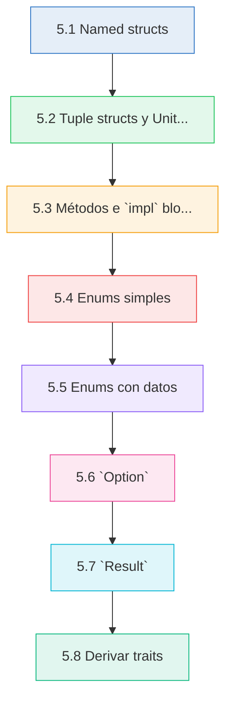
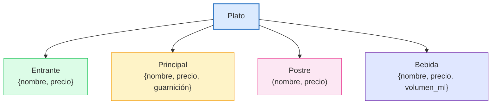
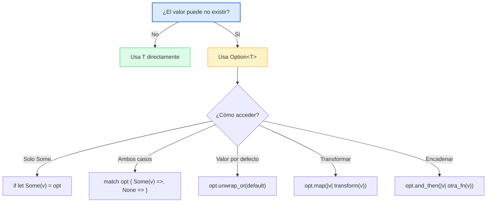
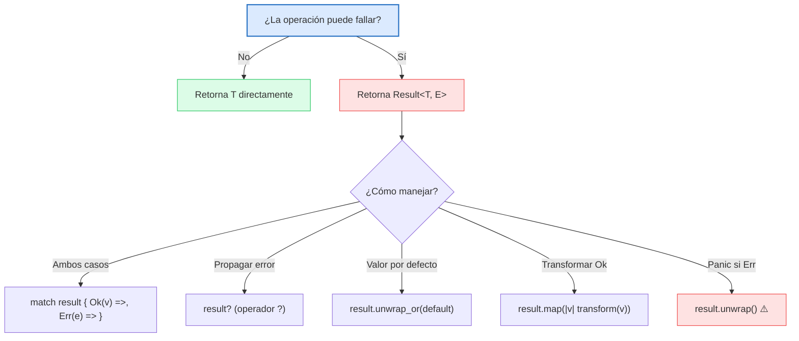

# :building_construction: Cap 5 — Structs y Enums

<div class="chapter-meta">
  <span class="meta-item">🕐 3-4 horas</span>
  <span class="meta-item">📊 Nivel: Intermedio</span>
  <span class="meta-item">🎯 Semana 3</span>
</div>

<div class="chapter-objective"><span class="objective-icon">📌</span><span class="objective-text">Dominar los tipos compuestos de Rust (structs y enums) para modelar dominios con seguridad de tipos, entender Option y Result como alternativas a null y excepciones, y aplicar derive para generar comportamiento automático.</span></div>

<div class="chapter-map">



</div>


!!! quote "Contexto"
    Los structs y enums son los ladrillos fundamentales del sistema de tipos de Rust. Si vienes de Python, piensa en structs como `@dataclass` con superpoderes y en enums como algo que **no existe** en Python: uniones etiquetadas con datos. Este capítulo cambia tu forma de modelar dominios para siempre.

---

## 5.1 Named structs

Un struct agrupa datos relacionados bajo un nombre. En Rust, los campos son privados por defecto y los tipos son explícitos.

```rust
struct Mesa {
    número: i32,
    zona: Zona,
    capacidad: i32,
    ocupada: bool,
}
```

### Instanciación

```rust
let mesa1 = Mesa {
    número: 1,
    zona: Zona::Interior,
    capacidad: 4,
    ocupada: false,
};
```

### Field init shorthand

Cuando una variable tiene el mismo nombre que un campo, puedes omitir la repetición:

```rust
fn crear_mesa(número: i32, capacidad: i32) -> Mesa {
    let zona = Zona::Interior;
    let ocupada = false;
    Mesa {
        número,      // equivale a número: número
        zona,        // equivale a zona: zona
        capacidad,   // equivale a capacidad: capacidad
        ocupada,     // equivale a ocupada: ocupada
    }
}
```

### Struct update syntax (`..`)

Crea un nuevo struct reutilizando campos de otro con `..`:

```rust
let mesa2 = Mesa {
    número: 2,
    ..mesa1  // copia zona, capacidad, ocupada de mesa1
};
```

!!! warning "Cuidado con ownership"
    Si el struct original tiene campos que no implementan `Copy` (como `String`), el `..` los **mueve**. El struct original ya no se puede usar si algún campo fue movido.

<div class="comparison" markdown>
<div class="lang-box python" markdown>

#### :snake: En Python

```python
from dataclasses import dataclass

@dataclass
class Mesa:
    número: int
    zona: str
    capacidad: int
    ocupada: bool = False
```

Python genera `__init__`, `__repr__`, `__eq__` automáticamente con `@dataclass`. Los campos son públicos y mutables por defecto.

</div>
<div class="lang-box rust" markdown>

#### :crab: En Rust

```rust
struct Mesa {
    número: i32,
    zona: Zona,
    capacidad: i32,
    ocupada: bool,
}
```

En Rust los campos son privados por defecto. No hay generación automática de nada — usas `#[derive(...)]` para elegir explícitamente qué generar.

</div>
</div>

---

## 5.2 Tuple structs y Unit structs

### Tuple structs

Un tuple struct tiene campos sin nombre. Se accede por posición (`.0`, `.1`, etc.):

```rust
struct Color(u8, u8, u8);
struct Punto(f64, f64);

let rojo = Color(255, 0, 0);
let origen = Punto(0.0, 0.0);

println!("R={}, G={}, B={}", rojo.0, rojo.1, rojo.2);
```

### Newtype pattern

El patrón más importante de los tuple structs es el **newtype**: envolver un tipo existente para darle semántica y type safety:

```rust
struct Euros(f64);
struct Dolares(f64);

fn cobrar(precio: Euros) {
    println!("Cobrando {:.2}€", precio.0);
}

let precio = Euros(12.50);
cobrar(precio);  // ✅

let precio_usd = Dolares(14.00);
// cobrar(precio_usd);  // ❌ Error: expected Euros, found Dolares
```

!!! tip "El compilador previene bugs"
    Sin newtypes, ambos serían `f64` y podrías pasar dólares donde se esperan euros. El newtype pattern convierte bugs de lógica en errores de compilación.

<div class="pro-tip">
<h4>💡 Consejo Pro — Newtypes sin coste</h4>
<p>El newtype pattern tiene <strong>coste cero en runtime</strong>. El compilador de Rust elimina la envoltura durante la compilación gracias a una optimización llamada <em>newtype elision</em>. Es decir, <code>struct Euros(f64)</code> ocupa exactamente lo mismo que un <code>f64</code> en memoria. Obtienes type safety gratis.</p>
</div>

### Unit structs

Un struct sin campos. Útil como marcador o para implementar traits:

```rust
struct Marker;
struct JsonFormat;
struct CsvFormat;

let _m = Marker;
```

<div class="concept-question"><h4>🔍 Pregunta Conceptual</h4><p>Si tienes un tuple struct <code>struct Id(u64)</code> y otro <code>struct Edad(u64)</code>, ambos envuelven <code>u64</code>. ¿Puedes pasar un <code>Id</code> donde se espera una <code>Edad</code>? ¿Por qué? Piensa en cómo esto se compara con usar <code>u64</code> directamente en ambos casos.</p></div>

---

## 5.3 Métodos e `impl` blocks

Los métodos se definen en bloques `impl` separados del struct. Esto separa datos de comportamiento:

```rust
struct Mesa {
    número: i32,
    zona: Zona,
    capacidad: i32,
    ocupada: bool,
}

impl Mesa {
    // --- Associated function (constructor, no recibe self) ---
    fn new(número: i32, zona: Zona, capacidad: i32) -> Self {
        Self {
            número,
            zona,
            capacidad,
            ocupada: false,
        }
    }

    // --- Método inmutable: lee pero no modifica ---
    fn capacidad(&self) -> i32 {
        self.capacidad
    }

    fn esta_disponible(&self) -> bool {
        !self.ocupada
    }

    fn descripción(&self) -> String {
        format!("Mesa {} ({:?}, {} personas)", self.número, self.zona, self.capacidad)
    }

    // --- Método mutable: puede modificar el struct ---
    fn ocupar(&mut self) {
        self.ocupada = true;
    }

    fn liberar(&mut self) {
        self.ocupada = false;
    }

    // --- Método que consume el struct (toma ownership) ---
    fn into_numero(self) -> i32 {
        self.número
    }
}
```

### Los tres tipos de `self`

| Firma | Significado | Cuándo usarlo |
|-------|-------------|---------------|
| `&self` | Referencia inmutable | Leer datos sin modificar |
| `&mut self` | Referencia mutable | Modificar datos del struct |
| `self` | Toma ownership | Consumir/transformar el struct |

### Associated functions (sin `self`)

Las funciones sin `self` se llaman con `::` en lugar de `.`:

```rust
let mesa = Mesa::new(1, Zona::Terraza, 6);  // :: porque no hay instancia
let cap = mesa.capacidad();                   // .  porque hay instancia (&self)
mesa.ocupar();                                // error: mesa no es mut

let mut mesa = Mesa::new(1, Zona::Terraza, 6);
mesa.ocupar();                                // ✅ ahora sí, es &mut self
```

<div class="comparison" markdown>
<div class="lang-box python" markdown>

#### :snake: En Python

```python
class Mesa:
    def __init__(self, número, zona, capacidad):
        self.número = número
        self.zona = zona
        self.capacidad = capacidad
        self.ocupada = False

    def esta_disponible(self):
        return not self.ocupada

    def ocupar(self):
        self.ocupada = True
```

Datos y métodos van juntos en `class`. `self` siempre es implícitamente mutable.

</div>
<div class="lang-box rust" markdown>

#### :crab: En Rust

```rust
struct Mesa { ... }      // Solo datos

impl Mesa {              // Comportamiento separado
    fn new(...) -> Self { ... }
    fn esta_disponible(&self) -> bool { ... }
    fn ocupar(&mut self) { ... }
}
```

Datos e `impl` están separados. El compilador **fuerza** la distinción entre lectura (`&self`) y escritura (`&mut self`).

</div>
</div>

<div class="micro-exercise">
<h4>🏋️ Micro-ejercicio — Añade un método</h4>
<p>Dado el siguiente struct, añade un método <code>resumen(&self) -> String</code> que retorne algo como <code>"Paella — 14.50€ (disponible)"</code> o <code>"Paella — 14.50€ (agotado)"</code>:</p>
<pre><code class="language-rust">struct Plato {
    nombre: String,
    precio: f64,
    disponible: bool,
}

impl Plato {
    // Tu método aquí
}
</code></pre>
<details>
<summary>Ver solución</summary>
<pre><code class="language-rust">impl Plato {
    fn resumen(&self) -> String {
        let estado = if self.disponible { "disponible" } else { "agotado" };
        format!("{} — {:.2}€ ({})", self.nombre, self.precio, estado)
    }
}
</code></pre>
</details>
</div>

<div class="connection-box">
<h4>🔗 Conexión con Cap 4 — Funciones y flujo de control</h4>
<p>En el <a href="04-funciones-flujo-control.md">Capítulo 4</a> aprendiste a definir funciones con parámetros tipados y valores de retorno. Ahora esos conceptos se aplican directamente: los métodos en <code>impl</code> son funciones que reciben <code>self</code> como primer parámetro. La diferencia entre <code>&self</code> y <code>&mut self</code> conecta directamente con las reglas de ownership y borrowing que ya practicaste con funciones.</p>
</div>

---

## 5.4 Enums simples

Un enum define un tipo que puede ser **una de varias variantes**:

```rust
#[derive(Debug, Clone, PartialEq)]
enum Zona {
    Interior,
    Terraza,
    Barra,
}

#[derive(Debug, Clone, PartialEq)]
enum Categoria {
    Entrante,
    Principal,
    Postre,
    Bebida,
}

#[derive(Debug, Clone, PartialEq)]
enum Rol {
    Camarero,
    Cocinero,
    Gerente,
    Admin,
}
```

### Uso con `match`

```rust
fn icono_zona(zona: &Zona) -> &str {
    match zona {
        Zona::Interior => "🏠",
        Zona::Terraza => "☀️",
        Zona::Barra => "🍺",
    }
}
```

!!! info "Exhaustividad"
    El `match` de Rust es **exhaustivo**: si añades una nueva variante al enum (por ejemplo `Zona::Privado`) y no actualizas el `match`, el compilador da error. En Python, un `if/elif` simplemente ignora el caso nuevo.

<div class="comparison" markdown>
<div class="lang-box python" markdown>

#### :snake: En Python

```python
from enum import Enum

class Zona(Enum):
    INTERIOR = "interior"
    TERRAZA = "terraza"
    BARRA = "barra"
```

Los enums de Python son básicamente constantes con nombre. No hay verificación de exhaustividad.

</div>
<div class="lang-box rust" markdown>

#### :crab: En Rust

```rust
enum Zona {
    Interior,
    Terraza,
    Barra,
}
```

Los enums de Rust son **tipos algebraicos**. El compilador verifica que manejes todas las variantes.

</div>
</div>

<div class="misconception-box">
<h4>⚠️ Mitos comunes sobre Structs y Enums en Rust</h4>
<table>
<tr>
<td><span class="wrong">❌ Mito: "Los enums de Rust son iguales a los de Python o C"</span></td>
<td><span class="right">✅ Realidad: Los enums de Rust son <strong>tagged unions</strong> (tipos suma). Cada variante puede contener datos diferentes, algo imposible en los enums de Python o C.</span></td>
</tr>
<tr>
<td><span class="wrong">❌ Mito: "Un struct en Rust es como una class de Python"</span></td>
<td><span class="right">✅ Realidad: Un struct solo contiene datos. No tiene herencia, no tiene métodos inline ni constructor implícito. El comportamiento va en bloques <code>impl</code> separados y no existe <code>self</code> mutable por defecto.</span></td>
</tr>
<tr>
<td><span class="wrong">❌ Mito: "Option y Result son complicaciones innecesarias; null y excepciones son más simples"</span></td>
<td><span class="right">✅ Realidad: <code>Option</code> y <code>Result</code> hacen <strong>explícito</strong> lo que en Python es implícito. El compilador te obliga a manejar la ausencia de valor y los errores, eliminando toda una categoría de bugs en producción (NullPointerException, excepciones no capturadas).</span></td>
</tr>
</table>
</div>

---

## 5.5 Enums con datos

Aqui es donde Rust se diferencia radicalmente de Python. Cada variante de un enum puede llevar **datos diferentes**:

```rust
#[derive(Debug, Clone)]
enum Plato {
    Entrante { nombre: String, precio: f64 },
    Principal { nombre: String, precio: f64, guarnición: String },
    Postre(String, f64),
    Bebida { nombre: String, precio: f64, volumen_ml: u32 },
}
```

### Tagged unions: la killer feature de Rust

Esto es una **unión etiquetada** (tagged union): un tipo que puede ser una cosa u otra, y el compilador sabe exactamente cuál es en cada momento.

```rust
fn describir_plato(plato: &Plato) -> String {
    match plato {
        Plato::Entrante { nombre, precio } => {
            format!("🥗 {} — {:.2}€", nombre, precio)
        }
        Plato::Principal { nombre, precio, guarnición } => {
            format!("🍖 {} con {} — {:.2}€", nombre, guarnición, precio)
        }
        Plato::Postre(nombre, precio) => {
            format!("🍰 {} — {:.2}€", nombre, precio)
        }
        Plato::Bebida { nombre, precio, volumen_ml } => {
            format!("🥤 {} ({}ml) — {:.2}€", nombre, volumen_ml, precio)
        }
    }
}
```

### Enum de estado con datos contextuales

```rust
#[derive(Debug, Clone)]
enum EstadoPedido {
    Pendiente,
    EnPreparación { cocinero: String, inicio: String },
    Listo { tiempo_preparacion_min: u32 },
    Entregado { camarero: String, hora: String },
    Cancelado { motivo: String },
}

fn describir_estado(estado: &EstadoPedido) -> String {
    match estado {
        EstadoPedido::Pendiente => "⏳ Esperando...".to_string(),
        EstadoPedido::EnPreparación { cocinero, .. } => {
            format!("👨‍🍳 {} lo está preparando", cocinero)
        }
        EstadoPedido::Listo { tiempo_preparacion_min } => {
            format!("✅ Listo en {} min", tiempo_preparacion_min)
        }
        EstadoPedido::Entregado { camarero, hora } => {
            format!("🍽️ Entregado por {} a las {}", camarero, hora)
        }
        EstadoPedido::Cancelado { motivo } => {
            format!("❌ Cancelado: {}", motivo)
        }
    }
}
```

!!! tip "Esto NO existe en Python"
    En Python modelarías esto con clases separadas, herencia, o diccionarios con campos opcionales. En Rust, un solo tipo `EstadoPedido` contiene **exactamente los datos necesarios para cada estado**. No hay campos `None` innecesarios ni clases dispersas.



<div class="concept-question"><h4>🔍 Pregunta Conceptual</h4><p>En el enum <code>EstadoPedido</code>, la variante <code>Pendiente</code> no lleva datos, pero <code>EnPreparación</code> lleva <code>cocinero</code> e <code>inicio</code>. ¿Qué ventaja tiene esto frente a un struct con campos <code>Option&lt;String&gt;</code> para cocinero e inicio que serían <code>None</code> cuando el estado es Pendiente?</p></div>

<div class="connection-box">
<h4>🔗 Conexión con Cap 6 — Pattern Matching</h4>
<p>Los enums con datos que acabas de ver cobran todo su potencial en el <a href="06-pattern-matching.md">Capítulo 6</a>, donde aprenderás pattern matching avanzado: desestructuración anidada, guards (<code>if</code> dentro de <code>match</code>), binding con <code>@</code>, y cómo combinar múltiples patrones. Si los enums son el "qué", el pattern matching es el "cómo" para trabajar con ellos de forma elegante.</p>
</div>

---

## 5.6 `Option<T>`

En Rust no existe `null`, `None` (al estilo Python), ni `nil`. En su lugar, Rust usa el enum `Option<T>` de la librería estándar:

```rust
enum Option<T> {
    Some(T),
    None,
}
```

Si un valor **puede no existir**, el tipo lo dice explícitamente:

```rust
struct Reserva {
    mesa: i32,
    cliente: String,
    notas: Option<String>,     // puede o no tener notas
    telefono: Option<String>,  // puede o no tener teléfono
}

let reserva = Reserva {
    mesa: 5,
    cliente: "Ana García".to_string(),
    notas: Some("Alergia a frutos secos".to_string()),
    telefono: None,
};
```

### Trabajar con `Option<T>`

```rust
// unwrap(): extrae el valor o PANIC si es None
let notas = reserva.notas.unwrap();  // ⚠️ peligroso en producción

// unwrap_or(): valor por defecto si es None
let tel = reserva.telefono.unwrap_or("No proporcionado".to_string());

// map(): transforma el valor interior si es Some
let notas_upper: Option<String> = reserva.notas.map(|n| n.to_uppercase());

// and_then(): encadena operaciones que también retornan Option
fn buscar_mesa(número: i32) -> Option<Mesa> { /* ... */ }
fn verificar_disponible(mesa: &Mesa) -> Option<&Mesa> { /* ... */ }

let mesa_disponible: Option<&Mesa> = buscar_mesa(5)
    .as_ref()
    .and_then(|m| verificar_disponible(m));
```

### Pattern matching con `Option`

```rust
// if let: cuando solo te interesa el caso Some
if let Some(notas) = &reserva.notas {
    println!("Notas: {}", notas);
}

// match: cuando necesitas manejar ambos casos
match &reserva.telefono {
    Some(tel) => println!("Llamar al {}", tel),
    None => println!("Sin teléfono de contacto"),
}
```



<div class="comparison" markdown>
<div class="lang-box python" markdown>

#### :snake: En Python

```python
plato = None

if plato is not None:
    print(plato.nombre)
# Si olvidas el check, RuntimeError en producción
```

`None` puede aparecer **en cualquier parte**. No hay forma de saber si una variable puede ser `None` mirando solo el tipo.

</div>
<div class="lang-box rust" markdown>

#### :crab: En Rust

```rust
let plato: Option<Plato> = None;

if let Some(p) = plato {
    println!("{}", p.nombre);
}
// El compilador OBLIGA a manejar el caso None
```

Si el tipo es `Plato`, **siempre tiene valor**. Si puede no tener valor, el tipo es `Option<Plato>`. No hay sorpresas.

</div>
</div>

<div class="micro-exercise">
<h4>🏋️ Micro-ejercicio — Encadenando Option</h4>
<p>Dado un <code>Vec&lt;Plato&gt;</code> llamado <code>menu</code>, escribe una sola expresión que busque el plato "Paella", y si existe, retorne su precio con IVA (10%), o <code>0.0</code> si no se encuentra:</p>
<pre><code class="language-rust">let menu: Vec&lt;Plato&gt; = vec![/* ... */];
let precio_iva: f64 = /* tu expresión aquí */;
</code></pre>
<details>
<summary>Ver solución</summary>
<pre><code class="language-rust">let precio_iva: f64 = menu.iter()
    .find(|p| p.nombre == "Paella")
    .map(|p| p.precio * 1.10)
    .unwrap_or(0.0);
</code></pre>
</details>
</div>

---

## 5.7 `Result<T, E>`

`Result<T, E>` es la forma de Rust de manejar errores. No hay excepciones (`try/except`) — los errores son **valores** que debes manejar explícitamente:

```rust
enum Result<T, E> {
    Ok(T),
    Err(E),
}
```

### Uso básico

```rust
fn buscar_mesa(mesas: &[Mesa], número: i32) -> Result<&Mesa, String> {
    mesas.iter()
        .find(|m| m.número == número)
        .ok_or(format!("Mesa {} no encontrada", número))
}

fn crear_reserva(mesa: &Mesa, cliente: &str) -> Result<Reserva, String> {
    if mesa.ocupada {
        return Err(format!("Mesa {} está ocupada", mesa.número));
    }
    Ok(Reserva {
        mesa: mesa.número,
        cliente: cliente.to_string(),
        notas: None,
        telefono: None,
    })
}
```

### Manejar el resultado

```rust
let mesas = vec![Mesa::new(1, Zona::Interior, 4)];

// match: manejar ambos casos
match buscar_mesa(&mesas, 1) {
    Ok(mesa) => println!("Encontrada: {}", mesa.descripción()),
    Err(e) => println!("Error: {}", e),
}

// El operador ? propaga el error automáticamente
fn reservar(mesas: &[Mesa], número: i32, cliente: &str) -> Result<Reserva, String> {
    let mesa = buscar_mesa(mesas, número)?;  // si Err, retorna el error
    let reserva = crear_reserva(mesa, cliente)?;  // si Err, retorna el error
    Ok(reserva)  // si todo fue Ok, retorna la reserva
}
```

!!! info "El operador `?`"
    El operador `?` es azúcar sintáctico. `buscar_mesa(mesas, 5)?` equivale a:
    ```rust
    match buscar_mesa(mesas, 5) {
        Ok(mesa) => mesa,
        Err(e) => return Err(e),
    }
    ```



<div class="comparison" markdown>
<div class="lang-box python" markdown>

#### :snake: En Python

```python
try:
    mesa = buscar_mesa(5)
    reserva = crear_reserva(mesa, "Ana")
except ValueError as e:
    print(f"Error: {e}")
```

Si olvidas el `try/except`, el programa **crashea** en producción. No hay forma de saber si una función puede lanzar una excepción mirando su firma.

</div>
<div class="lang-box rust" markdown>

#### :crab: En Rust

```rust
match buscar_mesa(&mesas, 5) {
    Ok(mesa) => { /* usar mesa */ }
    Err(e) => { /* manejar error */ }
}
```

La firma `Result<Mesa, String>` te dice **en el tipo** que esta función puede fallar. El compilador no te deja ignorar el error.

</div>
</div>

<div class="concept-question"><h4>🔍 Pregunta Conceptual</h4><p>Tanto <code>Option&lt;T&gt;</code> como <code>Result&lt;T, E&gt;</code> son enums con dos variantes. ¿Cuál es la diferencia semántica entre retornar <code>None</code> en un <code>Option</code> y retornar <code>Err(e)</code> en un <code>Result</code>? ¿Cuándo elegirías uno u otro para una función <code>buscar_por_id</code>?</p></div>

---

## 5.8 Derivar traits

`#[derive(...)]` genera implementaciones automáticas de traits estándar:

```rust
#[derive(Debug, Clone, PartialEq, Eq, Hash)]
struct Mesa {
    número: i32,
    zona: Zona,
    capacidad: i32,
    ocupada: bool,
}
```

### Traits comunes para derivar

| Trait | Qué genera | Equivalente Python |
|-------|------------|-------------------|
| `Debug` | Formato `{:?}` para imprimir | `__repr__` |
| `Clone` | Método `.clone()` para copiar | `copy.deepcopy()` |
| `PartialEq` | Comparación `==` y `!=` | `__eq__` |
| `Eq` | Igualdad total (requiere `PartialEq`) | (implícito en Python) |
| `Hash` | Para usar como clave en `HashMap` | `__hash__` |
| `Default` | Valor por defecto con `Default::default()` | `__init__` sin args |
| `PartialOrd` | Comparación `<`, `>`, `<=`, `>=` | `__lt__`, `__gt__` |
| `Ord` | Orden total (requiere `PartialOrd` + `Eq`) | `__lt__` + `__eq__` |

### Ejemplo completo con `Debug`

```rust
#[derive(Debug)]
struct Mesa {
    número: i32,
    zona: Zona,
    capacidad: i32,
}

let mesa = Mesa { número: 1, zona: Zona::Terraza, capacidad: 4 };
println!("{:?}", mesa);
// Mesa { número: 1, zona: Terraza, capacidad: 4 }

println!("{:#?}", mesa);
// Mesa {
//     número: 1,
//     zona: Terraza,
//     capacidad: 4,
// }
```

!!! warning "Regla de oro"
    **Siempre** deriva `Debug` en tus tipos. Sin `Debug`, no puedes imprimir el tipo con `{:?}`, lo cual hace imposible depurar.

<div class="comparison" markdown>
<div class="lang-box python" markdown>

#### :snake: En Python

```python
@dataclass
class Mesa:
    número: int
    zona: str
    capacidad: int
```

`@dataclass` genera `__init__`, `__repr__`, `__eq__` automáticamente. Es todo o nada (salvo configuración).

</div>
<div class="lang-box rust" markdown>

#### :crab: En Rust

```rust
#[derive(Debug, Clone, PartialEq)]
struct Mesa {
    número: i32,
    zona: Zona,
    capacidad: i32,
}
```

`#[derive(...)]` te deja elegir **exactamente** qué generar. Cada trait es opt-in.

</div>
</div>

<div class="pro-tip">
<h4>💡 Consejo Pro — Combo de derives recomendado</h4>
<p>Para la mayoría de structs de dominio, empieza siempre con este combo base:</p>
<pre><code class="language-rust">#[derive(Debug, Clone, PartialEq)]</code></pre>
<p>Añade <code>Eq</code> y <code>Hash</code> si necesitas usar el tipo como clave en un <code>HashMap</code> o <code>HashSet</code>. Añade <code>Default</code> si tiene sentido que el tipo tenga un valor "vacío". <strong>No derives lo que no necesitas</strong>: cada trait derivado impone restricciones en los tipos de los campos (por ejemplo, no puedes derivar <code>Hash</code> si un campo es <code>f64</code>).</p>
</div>

<div class="code-evolution">
<h4>🔄 Evolución de código — Modelando un menú de restaurante</h4>

<div class="evolution-step novato">
<h5>🟡 Paso 1: Novato</h5>
<pre><code class="language-rust">// Todo son Strings y tuplas sueltas. Sin seguridad de tipos.
let plato_nombre = "Paella";
let plato_precio = 14.50;
let plato_categoria = "principal";
let plato_disponible = true;

fn mostrar(nombre: &str, precio: f64, cat: &str) {
    println!("{} ({}) — {}€", nombre, cat, precio);
}
</code></pre>
<p>Datos dispersos en variables sueltas. Nada impide pasar el precio donde va el nombre. La categoría es un string que puede contener cualquier cosa.</p>
</div>

<div class="evolution-step mejorado">
<h5>🟢 Paso 2: Mejorado</h5>
<pre><code class="language-rust">#[derive(Debug, Clone)]
struct Plato {
    nombre: String,
    precio: f64,
    categoria: String,  // todavía un String libre
    disponible: bool,
}

impl Plato {
    fn new(nombre: String, precio: f64, categoria: String) -> Self {
        Self { nombre, precio, categoria, disponible: true }
    }

    fn mostrar(&self) {
        println!("{} ({}) — {:.2}€", self.nombre, self.categoria, self.precio);
    }
}
</code></pre>
<p>Mejor: los datos están agrupados y tenemos métodos. Pero la categoría sigue siendo un String libre — podrías escribir "posrte" y nadie te avisa.</p>
</div>

<div class="evolution-step profesional">
<h5>🔵 Paso 3: Profesional</h5>
<pre><code class="language-rust">#[derive(Debug, Clone, PartialEq, Eq, Hash)]
enum Categoria {
    Entrante,
    Principal,
    Postre,
    Bebida,
}

#[derive(Debug, Clone, PartialEq)]
struct Plato {
    nombre: String,
    precio: f64,
    categoria: Categoria,  // ahora es un tipo cerrado
    disponible: bool,
}

impl Plato {
    fn new(nombre: String, precio: f64, categoria: Categoria) -> Self {
        Self { nombre, precio, categoria, disponible: true }
    }

    fn precio_con_iva(&self) -> f64 {
        self.precio * 1.10
    }

    fn mostrar(&self) {
        println!("{} ({:?}) — {:.2}€", self.nombre, self.categoria, self.precio);
    }
}
</code></pre>
<p>Ahora es imposible crear un plato con una categoría inválida. El enum <code>Categoria</code> limita los valores posibles y el compilador verifica exhaustividad en cada <code>match</code>. Los derives generan el comportamiento estándar necesario.</p>
</div>
</div>

---

## :crab: Modelos de RustMenu

Ahora definimos **todos** los modelos de dominio del proyecto RustMenu usando structs, enums y derives:

```rust
// ========== ENUMS ==========

#[derive(Debug, Clone, PartialEq, Eq, Hash)]
enum Zona {
    Interior,
    Terraza,
    Barra,
}

#[derive(Debug, Clone, PartialEq, Eq, Hash)]
enum Categoria {
    Entrante,
    Principal,
    Postre,
    Bebida,
}

#[derive(Debug, Clone, PartialEq)]
enum EstadoPedido {
    Pendiente,
    EnPreparación { cocinero: String, inicio: String },
    Listo { tiempo_preparacion_min: u32 },
    Entregado { camarero: String, hora: String },
    Cancelado { motivo: String },
}

#[derive(Debug, Clone, PartialEq, Eq, Hash)]
enum Rol {
    Camarero,
    Cocinero,
    Gerente,
    Admin,
}

// ========== STRUCTS ==========

#[derive(Debug, Clone, PartialEq)]
struct Mesa {
    número: i32,
    zona: Zona,
    capacidad: i32,
    ocupada: bool,
}

#[derive(Debug, Clone, PartialEq)]
struct Plato {
    id: i32,
    nombre: String,
    categoria: Categoria,
    precio: f64,
    disponible: bool,
}

#[derive(Debug, Clone)]
struct Pedido {
    id: i32,
    mesa: i32,
    platos: Vec<Plato>,
    estado: EstadoPedido,
    notas: Option<String>,
}

#[derive(Debug, Clone)]
struct Usuario {
    id: i32,
    nombre: String,
    email: String,
    rol: Rol,
    activo: bool,
}

#[derive(Debug, Clone)]
struct Reserva {
    id: i32,
    mesa: i32,
    cliente: String,
    fecha: String,
    personas: i32,
    telefono: Option<String>,
    notas: Option<String>,
}

// ========== IMPL BLOCKS ==========

impl Mesa {
    fn new(número: i32, zona: Zona, capacidad: i32) -> Self {
        Self { número, zona, capacidad, ocupada: false }
    }

    fn esta_disponible(&self) -> bool {
        !self.ocupada
    }

    fn ocupar(&mut self) {
        self.ocupada = true;
    }

    fn liberar(&mut self) {
        self.ocupada = false;
    }
}

impl Plato {
    fn new(id: i32, nombre: String, categoria: Categoria, precio: f64) -> Self {
        Self { id, nombre, categoria, precio, disponible: true }
    }

    fn precio_con_iva(&self) -> f64 {
        self.precio * 1.10
    }
}

impl Pedido {
    fn new(id: i32, mesa: i32) -> Self {
        Self {
            id,
            mesa,
            platos: Vec::new(),
            estado: EstadoPedido::Pendiente,
            notas: None,
        }
    }

    fn total(&self) -> f64 {
        self.platos.iter().map(|p| p.precio).sum()
    }

    fn agregar_plato(&mut self, plato: Plato) {
        self.platos.push(plato);
    }
}
```


<div class="real-errors">
<h4>🚨 Errores que vas a encontrar</h4>

**Error 1: Tipo incompatible**

```rust
let x: i32 = "hola"; // ❌
```

```
error[E0308]: mismatched types
  expected `i32`, found `&str`
```

**¿Por qué?** Rust es estrictamente tipado — no hay conversión implícita entre tipos.

**Solución:** Usa el tipo correcto o convierte explícitamente.

---

**Error 2: Variable no mutable**

```rust
let precio = 10.0;
precio = 15.0; // ❌
```

```
error[E0384]: cannot assign twice to immutable variable `precio`
```

**Solución:** Declara con `let mut precio = 10.0;`

---

**Error 3: Valor movido**

```rust
let nombre = String::from("Paella");
let copia = nombre;
println!("{}", nombre); // ❌
```

```
error[E0382]: borrow of moved value: `nombre`
```

**Solución:** Usa `.clone()` o referencias `&nombre`.

</div>

---

<div class="checkpoint">
<h4>🏁 Checkpoint del capítulo</h4>
<p>Antes de continuar, verifica que puedes responder estas preguntas:</p>
<ul>
<li><strong>Structs:</strong> ¿Sabes cuándo usar un named struct, un tuple struct y un unit struct? ¿Puedes explicar la diferencia entre los tres tipos de <code>self</code> en métodos?</li>
<li><strong>Enums:</strong> ¿Puedes crear un enum donde cada variante lleve datos diferentes? ¿Entiendes por qué el <code>match</code> exhaustivo previene bugs?</li>
<li><strong>Option:</strong> ¿Puedes usar <code>if let</code>, <code>map</code>, <code>unwrap_or</code> y <code>and_then</code> para trabajar con valores opcionales sin recurrir a <code>unwrap()</code>?</li>
<li><strong>Result:</strong> ¿Entiendes cómo el operador <code>?</code> propaga errores? ¿Puedes escribir una cadena de funciones que usen <code>Result</code> y <code>?</code>?</li>
<li><strong>Derive:</strong> ¿Sabes qué traits derivar para tu caso de uso y por qué <code>Debug</code> siempre debería estar presente?</li>
</ul>
<p>Si alguna respuesta es "no", revisa la sección correspondiente antes de avanzar al <a href="06-pattern-matching.md">Capítulo 6 — Pattern Matching</a>.</p>
</div>

<div class="mini-project">
<h4>🏗️ Mini-proyecto: Aplicación práctica</h4>

**Paso 1 — Define las estructuras base**

Crea las estructuras y tipos necesarios para modelar el dominio del capítulo.

??? success "Solución Paso 1"
    ```rust
    // Define tus structs y enums aquí
    #[derive(Debug)]
    struct Item {
        nombre: String,
        valor: f64,
    }

    impl Item {
        fn new(nombre: &str, valor: f64) -> Self {
            Self {
                nombre: nombre.to_string(),
                valor,
            }
        }
    }
    ```

**Paso 2 — Implementa la lógica principal**

Crea funciones que operen sobre las estructuras del paso 1.

??? success "Solución Paso 2"
    ```rust
    fn procesar(items: &[Item]) -> f64 {
        items.iter().map(|i| i.valor).sum()
    }

    fn mostrar(items: &[Item]) {
        for item in items {
            println!("  {} — {:.2}€", item.nombre, item.valor);
        }
    }
    ```

**Paso 3 — Integra todo en main**

Combina los pasos anteriores en un programa completo.

??? success "Solución Paso 3"
    ```rust
    fn main() {
        let items = vec![
            Item::new("Paella", 14.50),
            Item::new("Gazpacho", 8.00),
            Item::new("Flan", 5.50),
        ];

        println!("=== RustMenu ===");
        mostrar(&items);
        println!("Total: {:.2}€", procesar(&items));
    }
    ```

</div>


<div class="ejercicio-guiado">
<h4>🏋️ Ejercicio guiado</h4>

Vas a modelar el dominio completo de RustMenu usando structs y enums: definir los tipos de datos del restaurante (platos, mesas, pedidos), implementar metodos para operar sobre ellos, y usar `Option` y `Result` para manejar la ausencia de valores y los errores de forma segura.

1. Define un enum `Categoria` con variantes `Entrante`, `Principal`, `Postre` y `Bebida`. Deriva `Debug`, `Clone` y `PartialEq`.
2. Define un struct `Plato` con campos `nombre: String`, `precio: f64`, `categoria: Categoria` y `disponible: bool`. Implementa un constructor `new` y un metodo `precio_con_iva(&self) -> f64` con IVA del 10%.
3. Define un enum `EstadoPedido` con variantes `Pendiente`, `EnPreparacion { cocinero: String }`, `Listo` y `Cancelado { motivo: String }`. Define un struct `Pedido` con campos `mesa: u32`, `platos: Vec<Plato>`, `estado: EstadoPedido` y `notas: Option<String>`.
4. Implementa en `Pedido` los metodos: `new(mesa: u32)`, `agregar_plato(&mut self, plato: Plato)`, `total(&self) -> f64` y `resumen(&self) -> String`.
5. Escribe una funcion `buscar_plato<'a>(menu: &'a [Plato], nombre: &str) -> Option<&'a Plato>` que busque un plato por nombre. Escribe otra funcion `crear_pedido(menu: &[Plato], mesa: u32, nombres: &[&str]) -> Result<Pedido, String>` que use `buscar_plato` y devuelva error si algun plato no se encuentra.
6. En `fn main()`, crea un menu con al menos 5 platos, crea un pedido usando `crear_pedido`, maneja el `Result` con `match`, avanza el estado del pedido y muestra el resumen final.

??? success "Solución completa"
    ```rust
    #[derive(Debug, Clone, PartialEq)]
    enum Categoria {
        Entrante,
        Principal,
        Postre,
        Bebida,
    }

    #[derive(Debug, Clone, PartialEq)]
    struct Plato {
        nombre: String,
        precio: f64,
        categoria: Categoria,
        disponible: bool,
    }

    impl Plato {
        fn new(nombre: &str, precio: f64, categoria: Categoria) -> Self {
            Self {
                nombre: nombre.to_string(),
                precio,
                categoria,
                disponible: true,
            }
        }

        fn precio_con_iva(&self) -> f64 {
            self.precio * 1.10
        }
    }

    #[derive(Debug, Clone)]
    enum EstadoPedido {
        Pendiente,
        EnPreparacion { cocinero: String },
        Listo,
        Cancelado { motivo: String },
    }

    #[derive(Debug, Clone)]
    struct Pedido {
        mesa: u32,
        platos: Vec<Plato>,
        estado: EstadoPedido,
        notas: Option<String>,
    }

    impl Pedido {
        fn new(mesa: u32) -> Self {
            Self {
                mesa,
                platos: Vec::new(),
                estado: EstadoPedido::Pendiente,
                notas: None,
            }
        }

        fn agregar_plato(&mut self, plato: Plato) {
            self.platos.push(plato);
        }

        fn total(&self) -> f64 {
            self.platos.iter().map(|p| p.precio_con_iva()).sum()
        }

        fn resumen(&self) -> String {
            let mut texto = format!(
                "🧾 Pedido Mesa {} — Estado: {:?}\n",
                self.mesa, self.estado
            );
            texto.push_str("─────────────────────────────────\n");

            for plato in &self.platos {
                texto.push_str(&format!(
                    "  {:<22} {:>5.2}€  ({:?})\n",
                    plato.nombre,
                    plato.precio_con_iva(),
                    plato.categoria
                ));
            }

            texto.push_str("─────────────────────────────────\n");
            texto.push_str(&format!("  TOTAL (IVA incl.):    {:>5.2}€\n", self.total()));

            if let Some(notas) = &self.notas {
                texto.push_str(&format!("  📝 Notas: {}\n", notas));
            }

            texto
        }
    }

    fn buscar_plato<'a>(menu: &'a [Plato], nombre: &str) -> Option<&'a Plato> {
        menu.iter().find(|p| p.nombre == nombre && p.disponible)
    }

    fn crear_pedido(
        menu: &[Plato],
        mesa: u32,
        nombres: &[&str],
    ) -> Result<Pedido, String> {
        let mut pedido = Pedido::new(mesa);

        for nombre in nombres {
            match buscar_plato(menu, nombre) {
                Some(plato) => pedido.agregar_plato(plato.clone()),
                None => return Err(format!("Plato '{}' no encontrado en el menu", nombre)),
            }
        }

        Ok(pedido)
    }

    fn main() {
        // Crear el menú
        let menu = vec![
            Plato::new("Paella Valenciana", 14.50, Categoria::Principal),
            Plato::new("Gazpacho Andaluz", 8.00, Categoria::Entrante),
            Plato::new("Croquetas Caseras", 9.00, Categoria::Entrante),
            Plato::new("Flan de Huevo", 5.50, Categoria::Postre),
            Plato::new("Tinto de Verano", 3.50, Categoria::Bebida),
            Plato::new("Solomillo Iberico", 22.00, Categoria::Principal),
        ];

        println!("=== 🦀 RustMenu ===\n");

        // Crear pedido exitoso
        let nombres_pedido = ["Paella Valenciana", "Gazpacho Andaluz", "Flan de Huevo"];
        match crear_pedido(&menu, 5, &nombres_pedido) {
            Ok(mut pedido) => {
                pedido.notas = Some("Sin cebolla en la paella".to_string());

                // Avanzar el estado
                pedido.estado = EstadoPedido::EnPreparacion {
                    cocinero: "Chef Carlos".to_string(),
                };
                println!("{}", pedido.resumen());

                pedido.estado = EstadoPedido::Listo;
                println!("Estado actualizado: {:?}\n", pedido.estado);
            }
            Err(e) => println!("❌ Error: {}", e),
        }

        // Crear pedido con error
        let nombres_fallido = ["Paella Valenciana", "Sushi"];
        match crear_pedido(&menu, 3, &nombres_fallido) {
            Ok(pedido) => println!("{}", pedido.resumen()),
            Err(e) => println!("❌ Error esperado: {}", e),
        }

        // Buscar plato con Option
        let buscado = "Solomillo Iberico";
        match buscar_plato(&menu, buscado) {
            Some(plato) => println!(
                "\n🔍 Encontrado: {} — {:.2}€ (con IVA: {:.2}€)",
                plato.nombre,
                plato.precio,
                plato.precio_con_iva()
            ),
            None => println!("\n🔍 '{}' no encontrado", buscado),
        }
    }
    ```

</div>

## :link: Recursos

| Recurso | Enlace |
|---------|--------|
| The Rust Book: Structs | [doc.rust-lang.org/.../ch05-00-structs](https://doc.rust-lang.org/book/ch05-00-structs.html) |
| The Rust Book: Enums | [doc.rust-lang.org/.../ch06-00-enums](https://doc.rust-lang.org/book/ch06-00-enums.html) |
| Rust by Example: Structs | [doc.rust-lang.org/rust-by-example/custom_types/structs](https://doc.rust-lang.org/rust-by-example/custom_types/structs.html) |
| Rust by Example: Enums | [doc.rust-lang.org/rust-by-example/custom_types/enum](https://doc.rust-lang.org/rust-by-example/custom_types/enum.html) |

---

## 🎯 Ejercicios

??? question "Ejercicio 1: Struct con métodos"
    Crea un struct `Plato` con campos `nombre: String`, `precio: f64`, `disponible: bool`. Implementa un bloque `impl` con: un constructor `new`, un método `precio_con_iva(&self) -> f64` (IVA del 10%), y un método `descontinuar(&mut self)` que ponga `disponible` a `false`.

    ??? success "Solución"
        ```rust
        #[derive(Debug, Clone)]
        struct Plato {
            nombre: String,
            precio: f64,
            disponible: bool,
        }

        impl Plato {
            fn new(nombre: String, precio: f64) -> Self {
                Self {
                    nombre,
                    precio,
                    disponible: true,
                }
            }

            fn precio_con_iva(&self) -> f64 {
                self.precio * 1.10
            }

            fn descontinuar(&mut self) {
                self.disponible = false;
            }
        }

        fn main() {
            let mut plato = Plato::new("Paella".to_string(), 14.50);
            println!("Precio con IVA: {:.2}€", plato.precio_con_iva());  // 15.95€
            plato.descontinuar();
            println!("Disponible: {}", plato.disponible);  // false
        }
        ```

??? question "Ejercicio 2: Enum con datos y match"
    Crea un enum `Evento` con las variantes: `NuevaReserva { mesa: i32, cliente: String }`, `PedidoCreado { mesa: i32, num_platos: i32 }`, `MesaLiberada(i32)`. Escribe una función `describir_evento` que use `match` para devolver un `String` describiendo cada evento.

    ??? success "Solución"
        ```rust
        #[derive(Debug)]
        enum Evento {
            NuevaReserva { mesa: i32, cliente: String },
            PedidoCreado { mesa: i32, num_platos: i32 },
            MesaLiberada(i32),
        }

        fn describir_evento(evento: &Evento) -> String {
            match evento {
                Evento::NuevaReserva { mesa, cliente } => {
                    format!("Reserva en mesa {} para {}", mesa, cliente)
                }
                Evento::PedidoCreado { mesa, num_platos } => {
                    format!("Pedido de {} platos en mesa {}", num_platos, mesa)
                }
                Evento::MesaLiberada(número) => {
                    format!("Mesa {} liberada", número)
                }
            }
        }

        fn main() {
            let ev1 = Evento::NuevaReserva { mesa: 3, cliente: "Carlos".to_string() };
            let ev2 = Evento::PedidoCreado { mesa: 3, num_platos: 4 };
            let ev3 = Evento::MesaLiberada(3);

            println!("{}", describir_evento(&ev1));
            println!("{}", describir_evento(&ev2));
            println!("{}", describir_evento(&ev3));
        }
        ```

??? question "Ejercicio 3: Option en la práctica"
    Escribe una función `buscar_plato_por_nombre(menu: &[Plato], nombre: &str) -> Option<&Plato>` que busque un plato por nombre. Luego escribe código que use `if let`, `unwrap_or`, y `map` con el resultado.

    !!! tip "Pista"
        Usa `menu.iter().find(|p| p.nombre == nombre)` para buscar.

    ??? success "Solución"
        ```rust
        fn buscar_plato_por_nombre<'a>(menu: &'a [Plato], nombre: &str) -> Option<&'a Plato> {
            menu.iter().find(|p| p.nombre == nombre)
        }

        fn main() {
            let menu = vec![
                Plato::new("Paella".to_string(), 14.50),
                Plato::new("Tortilla".to_string(), 8.00),
            ];

            // if let: solo manejar el caso Some
            if let Some(plato) = buscar_plato_por_nombre(&menu, "Paella") {
                println!("Encontrado: {} — {:.2}€", plato.nombre, plato.precio);
            }

            // map: transformar el valor interior
            let precio = buscar_plato_por_nombre(&menu, "Paella")
                .map(|p| p.precio_con_iva());
            println!("Precio con IVA: {:?}", precio);  // Some(15.95)

            // unwrap_or: valor por defecto
            let nombre = buscar_plato_por_nombre(&menu, "Sushi")
                .map(|p| p.nombre.as_str())
                .unwrap_or("No encontrado");
            println!("Resultado: {}", nombre);  // "No encontrado"
        }
        ```

??? question "Ejercicio 4: Result y operador `?`"
    Escribe dos funciones: `validar_capacidad(cap: i32) -> Result<i32, String>` (que rechace capacidades menores a 1 o mayores a 20) y `crear_mesa(número: i32, cap: i32) -> Result<Mesa, String>` (que use `?` para propagar el error de validación).

    !!! tip "Pista"
        La segunda función debe llamar a `validar_capacidad` con `?` para propagar el error automáticamente.

    ??? success "Solución"
        ```rust
        fn validar_capacidad(cap: i32) -> Result<i32, String> {
            if cap < 1 {
                return Err("La capacidad debe ser al menos 1".to_string());
            }
            if cap > 20 {
                return Err("La capacidad no puede superar 20".to_string());
            }
            Ok(cap)
        }

        fn crear_mesa(número: i32, cap: i32) -> Result<Mesa, String> {
            let capacidad = validar_capacidad(cap)?;  // propaga Err automáticamente
            Ok(Mesa::new(número, Zona::Interior, capacidad))
        }

        fn main() {
            match crear_mesa(1, 4) {
                Ok(mesa) => println!("Creada: {:?}", mesa),
                Err(e) => println!("Error: {}", e),
            }

            match crear_mesa(2, 25) {
                Ok(mesa) => println!("Creada: {:?}", mesa),
                Err(e) => println!("Error: {}", e),
                // "Error: La capacidad no puede superar 20"
            }
        }
        ```

??? question "Ejercicio 5: Máquina de estados con enum"
    Modela el flujo de vida de un `Pedido` como enum `EstadoPedido` con variantes: `Pendiente`, `EnPreparación { cocinero: String }`, `Listo`, `Entregado`, `Cancelado { motivo: String }`. Escribe una función `avanzar_estado` que implemente las transiciones válidas (Pendiente -> EnPreparación -> Listo -> Entregado) y retorne `Result<EstadoPedido, String>` con error si la transición no es válida.

    !!! tip "Pista"
        Un pedido `Entregado` o `Cancelado` no puede avanzar. Un pedido `Pendiente` solo puede pasar a `EnPreparación`.

    ??? success "Solución"
        ```rust
        #[derive(Debug, Clone)]
        enum EstadoPedido {
            Pendiente,
            EnPreparación { cocinero: String },
            Listo,
            Entregado,
            Cancelado { motivo: String },
        }

        fn avanzar_estado(estado: EstadoPedido) -> Result<EstadoPedido, String> {
            match estado {
                EstadoPedido::Pendiente => {
                    Ok(EstadoPedido::EnPreparación {
                        cocinero: "Chef Juan".to_string(),
                    })
                }
                EstadoPedido::EnPreparación { .. } => {
                    Ok(EstadoPedido::Listo)
                }
                EstadoPedido::Listo => {
                    Ok(EstadoPedido::Entregado)
                }
                EstadoPedido::Entregado => {
                    Err("Un pedido entregado no puede avanzar".to_string())
                }
                EstadoPedido::Cancelado { motivo } => {
                    Err(format!("Un pedido cancelado ({}) no puede avanzar", motivo))
                }
            }
        }

        fn main() {
            let estado = EstadoPedido::Pendiente;
            let estado = avanzar_estado(estado).unwrap();
            println!("{:?}", estado);  // EnPreparación { cocinero: "Chef Juan" }

            let estado = avanzar_estado(estado).unwrap();
            println!("{:?}", estado);  // Listo

            let estado = avanzar_estado(estado).unwrap();
            println!("{:?}", estado);  // Entregado

            let resultado = avanzar_estado(estado);
            println!("{:?}", resultado);  // Err("Un pedido entregado no puede avanzar")
        }
        ```

---

## :brain: Flashcards de repaso

<div class="flashcard">
<div class="front">¿Cuál es la diferencia entre un named struct y un tuple struct?</div>
<div class="back">Un <b>named struct</b> tiene campos con nombre: <code>struct Mesa { número: i32 }</code>. Un <b>tuple struct</b> tiene campos por posición: <code>struct Color(u8, u8, u8)</code>. El named struct es más legible; el tuple struct es útil para el newtype pattern.</div>
</div>

<div class="flashcard">
<div class="front">¿Qué diferencia hay entre <code>&self</code>, <code>&mut self</code> y <code>self</code> en un método?</div>
<div class="back"><code>&self</code> lee sin modificar (préstamo inmutable). <code>&mut self</code> puede modificar (préstamo mutable). <code>self</code> toma ownership — el struct se consume y no se puede usar después.</div>
</div>

<div class="flashcard">
<div class="front">¿Puede un enum en Rust tener datos asociados a cada variante?</div>
<div class="back">Sí. Cada variante puede tener datos diferentes: campos nombrados <code>Entrante { nombre: String }</code>, campos posicionales <code>Postre(String)</code>, o ningún dato <code>Pendiente</code>. Esto se llama <b>tagged union</b> o tipo suma.</div>
</div>

<div class="flashcard">
<div class="front">¿Cuál es el equivalente de Python <code>None</code> en Rust?</div>
<div class="back"><code>Option::None</code>. En Rust no existe <code>null</code>. Si un valor puede no existir, el tipo debe ser <code>Option&lt;T&gt;</code>, que es <code>Some(valor)</code> o <code>None</code>. El compilador obliga a manejar ambos casos.</div>
</div>

<div class="flashcard">
<div class="front">¿Qué hace el operador <code>?</code> con un <code>Result</code>?</div>
<div class="back">Si el <code>Result</code> es <code>Ok(v)</code>, extrae <code>v</code>. Si es <code>Err(e)</code>, retorna inmediatamente <code>Err(e)</code> de la función actual. Es azúcar sintáctico para propagar errores sin <code>match</code> explícito.</div>
</div>

<div class="flashcard">
<div class="front">¿Qué trait necesitas derivar para imprimir un struct con <code>{:?}</code>?</div>
<div class="back"><code>Debug</code>. Se añade con <code>#[derive(Debug)]</code> encima del struct o enum. Sin él, <code>println!("{:?}", mi_struct)</code> da error de compilación.</div>
</div>

<div class="flashcard">
<div class="front">¿Qué es el newtype pattern y para qué sirve?</div>
<div class="back">Envolver un tipo existente en un tuple struct de un solo campo: <code>struct Euros(f64)</code>. Convierte errores de lógica (confundir euros con dólares) en errores de compilación, sin coste en runtime.</div>
</div>

---

## :video_game: Quiz interactivo

<div class="quiz" data-quiz-id="ch05-q1">
<h4>Pregunta 1: ¿Cuál es el equivalente de Python <code>None</code> en Rust?</h4>
<button class="quiz-option" data-correct="false">No existe, Rust no tiene valores nulos</button>
<button class="quiz-option" data-correct="true"><code>Option::None</code></button>
<button class="quiz-option" data-correct="false"><code>Result::Err(())</code></button>
<button class="quiz-option" data-correct="false"><code>std::ptr::null()</code></button>
<div class="quiz-feedback" data-correct="¡Correcto! `Option::None` es el reemplazo de `null`/`None` en Rust. A diferencia de Python, el compilador te obliga a verificar si el valor existe antes de usarlo." data-incorrect="Incorrecto. Rust usa `Option::None` como reemplazo de `null`. El tipo `Option<T>` puede ser `Some(valor)` o `None`, y el compilador obliga a manejar ambos casos."></div>
</div>

<div class="quiz" data-quiz-id="ch05-q2">
<h4>Pregunta 2: ¿Qué trait necesitas derivar para imprimir un struct con <code>{:?}</code>?</h4>
<button class="quiz-option" data-correct="false"><code>Display</code></button>
<button class="quiz-option" data-correct="false"><code>ToString</code></button>
<button class="quiz-option" data-correct="true"><code>Debug</code></button>
<button class="quiz-option" data-correct="false"><code>Print</code></button>
<div class="quiz-feedback" data-correct="¡Correcto! `#[derive(Debug)]` genera una implementación de `Debug` que permite usar `{:?}` y `{:#?}` en macros como `println!`." data-incorrect="Incorrecto. El trait `Debug` (no `Display`) es el que habilita el formato `{:?}`. Se añade con `#[derive(Debug)]`. `Display` habilita `{}` pero no se puede derivar automáticamente."></div>
</div>

<div class="quiz" data-quiz-id="ch05-q3">
<h4>Pregunta 3: ¿Puede un enum en Rust tener datos asociados a cada variante?</h4>
<button class="quiz-option" data-correct="false">No, los enums solo pueden ser constantes simples como en Python</button>
<button class="quiz-option" data-correct="false">Sí, pero todas las variantes deben tener los mismos campos</button>
<button class="quiz-option" data-correct="true">Sí, cada variante puede tener datos diferentes (campos nombrados, posicionales, o ninguno)</button>
<button class="quiz-option" data-correct="false">Solo si usas <code>unsafe</code></button>
<div class="quiz-feedback" data-correct="¡Correcto! Los enums de Rust son tagged unions: cada variante puede llevar datos completamente diferentes. Es una de las features más potentes del lenguaje." data-incorrect="Incorrecto. Los enums de Rust permiten que cada variante tenga datos diferentes. Por ejemplo: `Entrante { nombre: String }`, `Postre(String)`, `Pendiente` (sin datos). Esto es fundamentalmente diferente de los enums de Python."></div>
</div>

---

## :bug: Ejercicio de depuración

Este código tiene 3 errores. Encuéntralos y corrígelos:

```rust
// ❌ 3 errores

#[derive(Debug)]
struct Mesa {
    número: i32,
    capacidad: i32,
    ocupada: bool,
}

impl Mesa {
    fn new(número: i32, capacidad: i32) -> Self {
        Mesa { número, capacidad, ocupada: false }
    }

    fn ocupar(self) {                           // Error 1
        self.ocupada = true;
    }
}

fn buscar_mesa(mesas: &[Mesa], número: i32) -> Mesa {  // Error 2
    mesas.iter()
        .find(|m| m.número == número)
}

fn main() {
    let mesa = Mesa::new(1, 4);
    mesa.ocupar();                              // Error 3
    println!("{:?}", mesa);
}
```

??? success "Solución"
    ```rust
    #[derive(Debug)]
    struct Mesa {
        número: i32,
        capacidad: i32,
        ocupada: bool,
    }

    impl Mesa {
        fn new(número: i32, capacidad: i32) -> Self {
            Mesa { número, capacidad, ocupada: false }
        }

        fn ocupar(&mut self) {                   // Fix 1: &mut self, no self
            self.ocupada = true;                 //   (self consume el struct)
        }
    }

    fn buscar_mesa(mesas: &[Mesa], número: i32) -> Option<&Mesa> {  // Fix 2: Option<&Mesa>
        mesas.iter()                             //   find() retorna Option, no Mesa
            .find(|m| m.número == número)
    }

    fn main() {
        let mut mesa = Mesa::new(1, 4);          // Fix 3: mut, porque ocupar necesita &mut self
        mesa.ocupar();
        println!("{:?}", mesa);
    }
    ```

    **Explicación de los 3 errores:**

    1. **`fn ocupar(self)`** toma ownership del struct en lugar de mutarlo. Al usar `self` (sin `&`), el struct se consume y no se puede asignar a `self.ocupada`. Se necesita `&mut self`.
    2. **`-> Mesa`** dice que siempre retorna una `Mesa`, pero `.find()` retorna `Option<&Mesa>` porque el elemento podría no existir. El tipo de retorno debe ser `Option<&Mesa>`.
    3. **`let mesa`** no es mutable, pero `mesa.ocupar()` necesita `&mut self`. Se necesita `let mut mesa`.

---

## ✅ Autoevaluación del capítulo

<div class="self-check" markdown>
<h4>¿Has comprendido todo? Marca lo que puedes hacer:</h4>
<label><input type="checkbox"> Puedo definir named structs, tuple structs y unit structs</label>
<label><input type="checkbox"> Sé la diferencia entre <code>&self</code>, <code>&mut self</code> y <code>self</code> en métodos</label>
<label><input type="checkbox"> Puedo crear enums con datos diferentes en cada variante</label>
<label><input type="checkbox"> Uso <code>Option&lt;T&gt;</code> en vez de valores nulos y manejo <code>Some</code>/<code>None</code></label>
<label><input type="checkbox"> Uso <code>Result&lt;T, E&gt;</code> para errores y sé propagar con <code>?</code></label>
<label><input type="checkbox"> Sé qué traits derivar con <code>#[derive(...)]</code> y cuándo usar cada uno</label>
</div>
