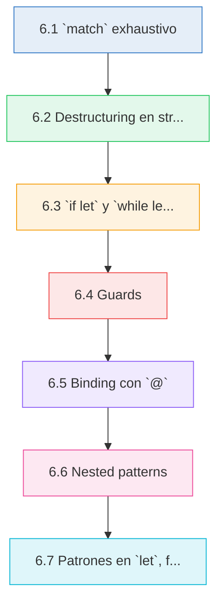
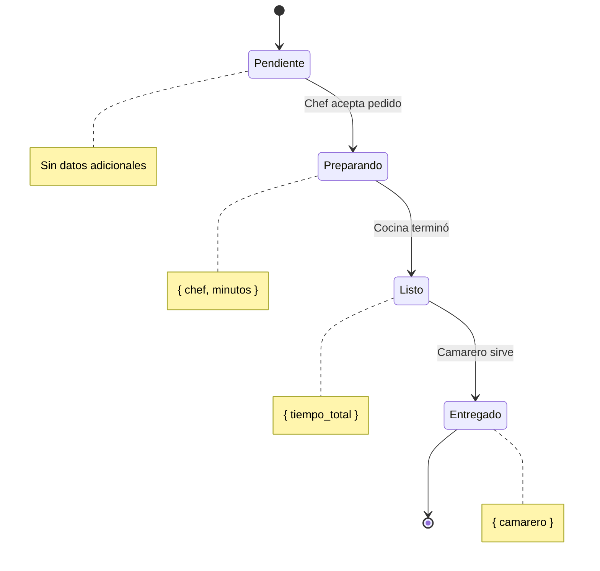

# :jigsaw: Cap 6 — Pattern Matching

<div class="chapter-meta">
  <span class="meta-item">🕐 3-4 horas</span>
  <span class="meta-item">📊 Nivel: Intermedio</span>
  <span class="meta-item">🎯 Semana 3</span>
</div>

<div class="chapter-objective"><span class="objective-icon">📌</span><span class="objective-text">Dominar el sistema de pattern matching de Rust — desde <code>match</code> exhaustivo hasta destructuring avanzado, guards y bindings — para escribir código expresivo, seguro y libre de casos olvidados.</span></div>

<div class="chapter-map">



</div>


!!! quote "Contexto"
    Pattern matching en Rust va **mucho más allá** de un simple `switch/case`. Es un sistema que combina destructuring, guards, bindings y exhaustividad forzada por el compilador. Si vienes de Python, piensa en `match/case` (3.10+) pero con esteroides: el compilador **no te deja olvidar** ningún caso.

<div class="connection-box" markdown>
<span class="connection-icon">🔗</span> **Conexión con el Cap 5 — Structs y Enums**

En el [capítulo anterior](05-structs-enums.md) definimos structs y enums como las piezas de nuestro modelo de datos. Ahora aprenderás a **descomponerlos y analizarlos** con pattern matching. Cada variante de enum que creaste en el Cap 5 se convierte aquí en un brazo de `match`. Sin structs y enums, pattern matching no tendría sobre qué operar; sin pattern matching, structs y enums serían difíciles de inspeccionar con seguridad.
</div>

---

## 6.1 `match` exhaustivo

El `match` de Rust es una expresión (devuelve un valor) que **debe cubrir todas las variantes posibles**. Si te olvidas de un caso, el compilador te lo impide.

```rust
enum EstadoPedido {
    Pendiente,
    Preparando,
    Listo,
    Entregado,
}

fn describir_estado(estado: &EstadoPedido) -> &str {
    match estado {
        EstadoPedido::Pendiente => "Esperando en cola",
        EstadoPedido::Preparando => "El chef está cocinando",
        EstadoPedido::Listo => "Listo para servir",
        EstadoPedido::Entregado => "Ya en la mesa",
    }
}
```

Si comentas uno de los brazos, el compilador te dará un error:

```rust
// ❌ ERROR: non-exhaustive patterns: `EstadoPedido::Entregado` not covered
fn describir_estado(estado: &EstadoPedido) -> &str {
    match estado {
        EstadoPedido::Pendiente => "Esperando en cola",
        EstadoPedido::Preparando => "El chef está cocinando",
        EstadoPedido::Listo => "Listo para servir",
        // falta Entregado → no compila
    }
}
```

<div class="concept-question"><h4>🔍 Pregunta conceptual</h4><p>¿Por qué Rust obliga a que un <code>match</code> sea exhaustivo en lugar de simplemente ignorar los casos no cubiertos como hace Python? Piensa en qué tipo de bugs previene esto, especialmente cuando alguien añade una nueva variante al enum meses después.</p></div>

### Match con enteros, strings y el wildcard `_`

```rust
fn categorizar_mesa(número: u32) -> &'static str {
    match número {
        1..=5 => "Zona terraza",
        6..=10 => "Zona interior",
        11..=15 => "Zona privada",
        _ => "Mesa no registrada",  // _ captura todo lo demás
    }
}

fn tipo_plato(nombre: &str) -> &'static str {
    match nombre {
        "paella" | "risotto" | "pasta" => "Plato principal",
        "tiramisu" | "flan" | "brownie" => "Postre",
        "agua" | "vino" | "cerveza" => "Bebida",
        _ => "Otro",
    }
}
```

<div class="comparison" markdown>
<div class="lang-box python" markdown>

#### :snake: En Python

`match/case` (3.10+) existe pero **NO es exhaustivo**. Si olvidas un caso, Python no se queja. Puede fallar silenciosamente en runtime.

```python
# Python: no exhaustivo, sin advertencia
match estado:
    case "pendiente":
        return "Esperando"
    case "preparando":
        return "Cocinando"
    # si llega "listo" → no hace nada, sin error
```

</div>
<div class="lang-box rust" markdown>

#### :crab: En Rust

`match` es **exhaustivo por defecto**. El compilador te obliga a cubrir TODOS los casos. Si no quieres manejar alguno explícitamente, debes usar `_`.

```rust
// Rust: no compila si falta un caso
match estado {
    EstadoPedido::Pendiente => "Esperando",
    EstadoPedido::Preparando => "Cocinando",
    // ❌ ERROR si faltan variantes
}
```

</div>
</div>

<div class="micro-exercise">
<h4>✏️ Micro-ejercicio — Wildcard obligatorio</h4>
<p>Sin ejecutar el código, ¿compilará esto? ¿Por qué?</p>

```rust
fn describir_nota(nota: u32) -> &'static str {
    match nota {
        0..=4 => "Suspenso",
        5..=6 => "Aprobado",
        7..=8 => "Notable",
        9..=10 => "Sobresaliente",
    }
}
```

<details>
<summary>Ver respuesta</summary>
<strong>No compila.</strong> Aunque lógicamente cubrimos 0-10, el tipo <code>u32</code> admite valores hasta 4.294.967.295. El compilador no puede deducir que solo pasaremos 0-10, así que exige un brazo <code>_ => ...</code> para cubrir los valores 11 en adelante. Añade <code>_ => "Fuera de rango"</code> al final.
</details>
</div>

---

## 6.2 Destructuring en structs y enums

Puedes extraer valores directamente en los brazos del `match`. Esto es especialmente poderoso con enums que tienen datos asociados.

```rust
struct Plato {
    nombre: String,
    precio: f64,
    disponible: bool,
}

enum EstadoPedido {
    Pendiente,
    Preparando { chef: String, minutos_estimados: u32 },
    Listo { tiempo_preparación: u32 },
    Entregado { camarero: String, hora: String },
    Cancelado { motivo: String },
}

fn describir_pedido(estado: &EstadoPedido) -> String {
    match estado {
        EstadoPedido::Pendiente => {
            String::from("Pedido en espera")
        }
        EstadoPedido::Preparando { chef, minutos_estimados } => {
            format!("{chef} lo prepara (~{minutos_estimados} min)")
        }
        EstadoPedido::Listo { tiempo_preparación } => {
            format!("Listo en {tiempo_preparación} min")
        }
        EstadoPedido::Entregado { camarero, hora } => {
            format!("Servido por {camarero} a las {hora}")
        }
        EstadoPedido::Cancelado { motivo } => {
            format!("Cancelado: {motivo}")
        }
    }
}
```

<div class="pro-tip">
<h4>💡 Pro-tip — Destructuring parcial vs. completo</h4>
<p>No siempre necesitas extraer <strong>todos</strong> los campos. Si solo te interesa uno, usa <code>{ campo_que_quiero, .. }</code> con los dos puntos para ignorar el resto. Esto hace tu código más resiliente: si alguien añade un campo nuevo al struct, tu función sigue compilando sin cambios.</p>
</div>

### Destructuring parcial con `..`

Si solo necesitas algunos campos de una struct, usa `..` para ignorar el resto:

```rust
fn es_caro(plato: &Plato) -> bool {
    match plato {
        Plato { precio, .. } if *precio > 25.0 => true,
        _ => false,
    }
}

fn mostrar_disponibilidad(plato: &Plato) -> String {
    match plato {
        Plato { nombre, disponible: true, .. } => {
            format!("{nombre}: disponible")
        }
        Plato { nombre, disponible: false, .. } => {
            format!("{nombre}: agotado")
        }
    }
}
```

<div class="concept-question"><h4>🔍 Pregunta conceptual</h4><p>En la función <code>mostrar_disponibilidad</code>, el <code>match</code> cubre <code>disponible: true</code> y <code>disponible: false</code>. ¿Es exhaustivo este match? ¿Necesita un brazo <code>_</code>? Razona por qué el compilador acepta (o rechaza) este código.</p></div>

---

## 6.3 `if let` y `while let`

Cuando solo te interesa **un patrón** y quieres ignorar el resto, `match` es demasiado verboso. Para eso existe `if let`.

### `if let` — match de un solo brazo

```rust
fn mostrar_primer_plato(menu: &[String]) {
    // Con match (verboso para un solo caso)
    match menu.first() {
        Some(plato) => println!("Primer plato: {plato}"),
        None => {}  // no hacemos nada
    }

    // Con if let (más limpio)
    if let Some(plato) = menu.first() {
        println!("Primer plato: {plato}");
    }
}
```

### `if let` con `else`

```rust
fn obtener_chef(estado: &EstadoPedido) -> String {
    if let EstadoPedido::Preparando { chef, .. } = estado {
        format!("Chef: {chef}")
    } else {
        String::from("Sin chef asignado")
    }
}
```

### `while let` — loop mientras el patrón coincida

```rust
fn procesar_cola(cola: &mut Vec<String>) {
    while let Some(pedido) = cola.pop() {
        println!("Procesando pedido: {pedido}");
    }
    println!("Cola vacía, todos los pedidos procesados");
}
```

<div class="comparison" markdown>
<div class="lang-box python" markdown>

#### :snake: En Python

Para verificar si un valor es `None`, se usa un simple `if`. No hay destructuring en la condición.

```python
# Python: verificación manual
valor = obtener_opcional()
if valor is not None:
    print(f"Valor: {valor}")
```

</div>
<div class="lang-box rust" markdown>

#### :crab: En Rust

`if let` combina verificación y destructuring en una sola expresión. Es más seguro porque extraes el valor y verificas el patrón al mismo tiempo.

```rust
// Rust: if let extrae y verifica a la vez
if let Some(valor) = obtener_opcional() {
    println!("Valor: {valor}");
}
```

</div>
</div>

---

## 6.4 Guards

Los guards son condiciones adicionales en los brazos del `match`. Se escriben con `if` después del patrón.

```rust
fn clasificar_precio(precio: f64) -> &'static str {
    match precio {
        p if p > 30.0 => "Premium",
        p if p > 20.0 => "Caro",
        p if p > 10.0 => "Medio",
        p if p > 0.0 => "Barato",
        _ => "Gratis o inválido",
    }
}
```

### Guards con enums destructurados

```rust
fn urgencia_pedido(estado: &EstadoPedido) -> &str {
    match estado {
        EstadoPedido::Preparando { minutos_estimados, .. }
            if *minutos_estimados > 30 => "Pedido retrasado",

        EstadoPedido::Preparando { minutos_estimados, .. }
            if *minutos_estimados > 15 => "Pedido en tiempo límite",

        EstadoPedido::Preparando { .. } => "Pedido en tiempo normal",

        _ => "No aplica",
    }
}
```

### Guards con tuplas

```rust
fn evaluar_plato(precio: f64, valoración: u32) -> &'static str {
    match (precio, valoración) {
        (p, v) if p < 15.0 && v >= 4 => "Bueno y barato",
        (p, v) if p >= 15.0 && v >= 4 => "Caro pero vale la pena",
        (p, v) if p < 15.0 && v < 3 => "Barato pero malo",
        (_, v) if v < 3 => "No recomendado",
        _ => "Normal",
    }
}
```

!!! warning "Cuidado con la exhaustividad"
    Los guards **no cuentan** para la exhaustividad del compilador. Aunque `p if p > 0` y `p if p <= 0` cubren todos los números, Rust no lo sabe. Siempre necesitarás un `_` o brazo final.

<div class="misconception-box">
<h4>⚠️ Mitos comunes sobre Pattern Matching</h4>
<ul>
<li><span class="wrong">❌ Mito:</span> «El wildcard <code>_</code> es igual que un <code>default</code> en un switch de C/Java».<br>
<span class="right">✅ Realidad:</span> <code>_</code> en Rust solo se necesita cuando el compilador no puede verificar que todos los casos están cubiertos. Si tu enum tiene 4 variantes y las cubres todas, <code>_</code> no es necesario. Además, si añades una variante nueva, el compilador te avisará en cada <code>match</code> que no la cubra — cosa que no pasa con <code>default</code>.</li>
<li><span class="wrong">❌ Mito:</span> «Los guards hacen que el match sea exhaustivo automáticamente».<br>
<span class="right">✅ Realidad:</span> El compilador <strong>ignora los guards</strong> al comprobar exhaustividad. Aunque <code>p if p > 0</code> y <code>p if p <= 0</code> cubran todo lógicamente, Rust no lo puede demostrar y exige un brazo <code>_</code> final.</li>
<li><span class="wrong">❌ Mito:</span> «<code>if let</code> es menos seguro que <code>match</code> porque no es exhaustivo».<br>
<span class="right">✅ Realidad:</span> <code>if let</code> no es menos seguro — simplemente tiene una semántica diferente. No hacer nada cuando el patrón no coincide es una decisión explícita del programador, no un descuido. Es la herramienta correcta cuando genuinamente solo te interesa un caso.</li>
</ul>
</div>

---

## 6.5 Binding con `@`

El operador `@` permite **vincular un valor a una variable** mientras verificas un patrón sobre él. Es útil cuando necesitas tanto el rango como el valor concreto.

```rust
fn clasificar_edad(edad: u32) -> String {
    match edad {
        n @ 0..=12 => format!("Niño de {n} años: menú infantil"),
        n @ 13..=17 => format!("Adolescente de {n} años: menú joven"),
        n @ 18..=64 => format!("Adulto de {n} años: menú completo"),
        n @ 65.. => format!("Senior de {n} años: menú senior con descuento"),
    }
}
```

### `@` con enums

```rust
enum Descuento {
    Porcentaje(u32),
    Fijo(f64),
    Ninguno,
}

fn aplicar_descuento(precio: f64, descuento: &Descuento) -> String {
    match descuento {
        Descuento::Porcentaje(p @ 1..=50) => {
            let nuevo = precio * (1.0 - *p as f64 / 100.0);
            format!("Descuento {p}%: {nuevo:.2}€")
        }
        Descuento::Porcentaje(p @ 51..=100) => {
            format!("Descuento excesivo ({p}%), requiere aprobación")
        }
        Descuento::Porcentaje(p) => {
            format!("Porcentaje inválido: {p}")
        }
        Descuento::Fijo(monto @ 0.0..=50.0) => {
            format!("Descuento fijo: -{monto:.2}€")
        }
        Descuento::Fijo(monto) => {
            format!("Descuento fijo excesivo: {monto:.2}€")
        }
        Descuento::Ninguno => String::from("Sin descuento"),
    }
}
```

<div class="micro-exercise">
<h4>✏️ Micro-ejercicio — Binding con @</h4>
<p>Completa el brazo que falta para que este código compile y clasifique temperaturas:</p>

```rust
fn clasificar_temp(grados: i32) -> &'static str {
    match grados {
        n @ ..=-1 => "Bajo cero",
        n @ 0..=15 => "Frío",
        // ❓ ¿Qué brazo falta para "Agradable" (16-25)?
        n @ 26..=35 => "Calor",
        _ => "Extremo",
    }
}
```

<details>
<summary>Ver respuesta</summary>
El brazo que falta es: <code>n @ 16..=25 => "Agradable",</code>. Observa que aunque no usamos la variable <code>n</code> en el cuerpo del brazo, el binding con <code>@</code> es válido. Si no necesitas el valor, podrías usar simplemente <code>16..=25 => "Agradable"</code> sin el binding.
</details>
</div>

---

## 6.6 Nested patterns

Puedes combinar patrones dentro de patrones para manejar estructuras complejas de forma elegante.

```rust
enum Pago {
    Efectivo(f64),
    Tarjeta { número: String, aprobado: bool },
    App { plataforma: String, referencia: Option<String> },
}

fn procesar_pago(pago: &Pago) -> String {
    match pago {
        Pago::Efectivo(monto) if *monto > 0.0 => {
            format!("Pago en efectivo: {monto:.2}€")
        }
        Pago::Efectivo(_) => {
            String::from("Monto inválido")
        }
        Pago::Tarjeta { aprobado: true, .. } => {
            String::from("Pago con tarjeta aprobado")
        }
        Pago::Tarjeta { aprobado: false, número } => {
            format!("Tarjeta terminada en {} rechazada", &número[número.len()-4..])
        }
        Pago::App { referencia: Some(ref_id), plataforma } => {
            format!("Pago por {plataforma}, ref: {ref_id}")
        }
        Pago::App { referencia: None, plataforma } => {
            format!("Pago por {plataforma} sin referencia — pendiente")
        }
    }
}
```

<div class="concept-question"><h4>🔍 Pregunta conceptual</h4><p>En el brazo <code>Pago::App { referencia: Some(ref_id), plataforma }</code> estamos haciendo pattern matching anidado: primero sobre la variante del enum <code>Pago</code>, y luego sobre el <code>Option&lt;String&gt;</code> dentro del campo <code>referencia</code>. ¿Qué pasaría si solo escribieras <code>Pago::App { referencia, plataforma }</code> sin distinguir <code>Some</code>/<code>None</code>? ¿Seguiría siendo exhaustivo el match?</p></div>

### Match dentro de match

```rust
struct Pedido {
    mesa: u32,
    estado: EstadoPedido,
    pago: Option<Pago>,
}

fn resumen_pedido(pedido: &Pedido) -> String {
    let estado_str = match &pedido.estado {
        EstadoPedido::Pendiente => String::from("pendiente"),
        EstadoPedido::Preparando { chef, .. } => format!("cocinando ({chef})"),
        EstadoPedido::Listo { .. } => String::from("listo"),
        EstadoPedido::Entregado { camarero, .. } => format!("servido por {camarero}"),
        EstadoPedido::Cancelado { motivo } => format!("cancelado: {motivo}"),
    };

    let pago_str = match &pedido.pago {
        Some(Pago::Efectivo(monto)) => format!("efectivo {monto:.2}€"),
        Some(Pago::Tarjeta { aprobado: true, .. }) => String::from("tarjeta OK"),
        Some(Pago::Tarjeta { aprobado: false, .. }) => String::from("tarjeta rechazada"),
        Some(Pago::App { plataforma, .. }) => format!("app ({plataforma})"),
        None => String::from("sin pago"),
    };

    format!("Mesa {} | Estado: {} | Pago: {}", pedido.mesa, estado_str, pago_str)
}
```

<div class="pro-tip">
<h4>💡 Pro-tip — Cuándo usar match anidados vs. tuplas</h4>
<p>Si necesitas cruzar dos valores independientes, considera hacer <code>match</code> sobre una tupla en lugar de anidar matches. Por ejemplo, <code>match (&pedido.estado, &pedido.pago)</code> te permite manejar combinaciones específicas en un solo brazo, como «pedido entregado sin pago» directamente: <code>(EstadoPedido::Entregado { .. }, None) => "¡Alerta: servido sin cobrar!"</code>. Esto es más expresivo y evita variables intermedias.</p>
</div>

---

## 6.7 Patrones en `let`, funciones y `for`

Los patrones no viven solo en `match`. Rust permite usar patrones en declaraciones `let`, parámetros de funciones y bucles `for`.

### Patrones en `let`

```rust
// Destructuring de tuplas
let (x, y) = (10, 20);
println!("Coordenada: ({x}, {y})");

// Destructuring de structs
struct Coordenada {
    x: f64,
    y: f64,
}

let punto = Coordenada { x: 3.0, y: 7.5 };
let Coordenada { x, y } = punto;
println!("x={x}, y={y}");

// Ignorar valores con _
let (nombre, _, precio) = ("Paella", "Plato principal", 18.50);
println!("{nombre} cuesta {precio}€");
```

### Patrones en parámetros de funciones

```rust
fn distancia(&(x1, y1): &(f64, f64), &(x2, y2): &(f64, f64)) -> f64 {
    ((x2 - x1).powi(2) + (y2 - y1).powi(2)).sqrt()
}

fn mostrar_plato(&Plato { ref nombre, precio, disponible }: &Plato) {
    let estado = if disponible { "disponible" } else { "agotado" };
    println!("{nombre}: {precio:.2}€ ({estado})");
}

fn main() {
    let a = (0.0, 0.0);
    let b = (3.0, 4.0);
    println!("Distancia: {}", distancia(&a, &b));  // 5.0
}
```

### Patrones en `for`

```rust
fn mostrar_menu(platos: &[String]) {
    for (i, plato) in platos.iter().enumerate() {
        println!("{}. {}", i + 1, plato);
    }
}

fn totales_por_mesa(pedidos: &[(u32, f64)]) {
    for &(mesa, total) in pedidos {
        println!("Mesa {mesa}: {total:.2}€");
    }
}
```

### `let-else` para el caso inverso

```rust
fn procesar_primer_pedido(cola: &[String]) {
    // Si no coincide el patrón, ejecuta el bloque else (que debe divergir)
    let Some(primero) = cola.first() else {
        println!("No hay pedidos en cola");
        return;
    };

    println!("Procesando: {primero}");
}
```

---

## 🌐 RustMenu: Pattern matching en acción

Veamos un ejemplo completo del sistema de gestión de restaurante **RustMenu** que integra todos los conceptos del capítulo:

```rust
// --- Definición de tipos ---

#[derive(Debug)]
enum TipoPlato {
    Entrante,
    Principal,
    Postre,
    Bebida,
}

#[derive(Debug)]
struct Plato {
    nombre: String,
    tipo: TipoPlato,
    precio: f64,
    disponible: bool,
}

#[derive(Debug)]
enum EstadoPedido {
    Pendiente,
    Preparando { chef: String, minutos: u32 },
    Listo { tiempo_total: u32 },
    Entregado { camarero: String },
}

#[derive(Debug)]
enum RespuestaApi {
    Ok { datos: String },
    Error { código: u32, mensaje: String },
    Timeout { intentos: u32 },
}

// --- Transiciones de estado con pattern matching ---

fn transicionar(estado: EstadoPedido) -> EstadoPedido {
    match estado {
        EstadoPedido::Pendiente => {
            println!("Pedido aceptado, enviando a cocina");
            EstadoPedido::Preparando {
                chef: String::from("Chef Carlos"),
                minutos: 0,
            }
        }
        EstadoPedido::Preparando { chef, minutos } => {
            println!("{chef} terminó en {minutos} minutos");
            EstadoPedido::Listo { tiempo_total: minutos }
        }
        EstadoPedido::Listo { tiempo_total } => {
            println!("Pedido servido (preparación: {tiempo_total} min)");
            EstadoPedido::Entregado {
                camarero: String::from("Ana"),
            }
        }
        EstadoPedido::Entregado { camarero } => {
            println!("Pedido ya entregado por {camarero} — sin cambios");
            EstadoPedido::Entregado { camarero }
        }
    }
}

// --- Filtrado de menú por tipo ---

fn filtrar_por_tipo(menu: &[Plato], tipo: &TipoPlato) -> Vec<&Plato> {
    menu.iter()
        .filter(|plato| {
            matches!(
                (&plato.tipo, tipo),
                (TipoPlato::Entrante, TipoPlato::Entrante)
                    | (TipoPlato::Principal, TipoPlato::Principal)
                    | (TipoPlato::Postre, TipoPlato::Postre)
                    | (TipoPlato::Bebida, TipoPlato::Bebida)
            )
        })
        .collect()
}

fn resumen_menu(menu: &[Plato]) {
    for plato in menu {
        match plato {
            Plato { disponible: false, nombre, .. } => {
                println!("  [AGOTADO] {nombre}");
            }
            Plato { precio, nombre, tipo, .. } if *precio > 20.0 => {
                println!("  [PREMIUM] {nombre} ({tipo:?}) — {precio:.2}€");
            }
            Plato { nombre, tipo, precio, .. } => {
                println!("  {nombre} ({tipo:?}) — {precio:.2}€");
            }
        }
    }
}

// --- Manejo de respuestas de API ---

fn manejar_respuesta(resp: RespuestaApi) -> String {
    match resp {
        RespuestaApi::Ok { datos } => {
            format!("Éxito: {datos}")
        }
        RespuestaApi::Error { código: 404, mensaje } => {
            format!("No encontrado: {mensaje}")
        }
        RespuestaApi::Error { código: c @ 500..=599, mensaje } => {
            format!("Error del servidor ({c}): {mensaje}")
        }
        RespuestaApi::Error { código, mensaje } => {
            format!("Error {código}: {mensaje}")
        }
        RespuestaApi::Timeout { intentos } if intentos >= 3 => {
            String::from("Timeout tras 3+ intentos, abortando")
        }
        RespuestaApi::Timeout { intentos } => {
            format!("Timeout, intento {intentos}/3 — reintentando")
        }
    }
}
```

### Diagrama de transiciones de estado



<div class="code-evolution">
<h4>🔄 Evolución del código — Clasificar respuesta de API</h4>
<p>Observa cómo el mismo problema se resuelve con niveles crecientes de dominio de pattern matching:</p>

<div class="evolution-step novato">
<h5>🟡 Nivel novato — if/else encadenados</h5>

```rust
fn manejar(resp: &RespuestaApi) -> String {
    if let RespuestaApi::Ok { datos } = resp {
        format!("Éxito: {datos}")
    } else if let RespuestaApi::Error { código, mensaje } = resp {
        if *código == 404 {
            format!("No encontrado: {mensaje}")
        } else if *código >= 500 {
            format!("Error servidor: {mensaje}")
        } else {
            format!("Error {código}: {mensaje}")
        }
    } else if let RespuestaApi::Timeout { intentos } = resp {
        format!("Timeout, intento {intentos}")
    } else {
        String::from("Desconocido")
    }
}
```
<p><em>Funciona, pero es difícil de leer y propenso a olvidar casos.</em></p>
</div>

<div class="evolution-step mejorado">
<h5>🟢 Nivel mejorado — match básico</h5>

```rust
fn manejar(resp: &RespuestaApi) -> String {
    match resp {
        RespuestaApi::Ok { datos } => format!("Éxito: {datos}"),
        RespuestaApi::Error { código, mensaje } => {
            format!("Error {código}: {mensaje}")
        }
        RespuestaApi::Timeout { intentos } => {
            format!("Timeout, intento {intentos}")
        }
    }
}
```
<p><em>Exhaustivo y claro, pero no distingue subcasos dentro de Error.</em></p>
</div>

<div class="evolution-step profesional">
<h5>🔵 Nivel profesional — guards, binding @ y patrones literales</h5>

```rust
fn manejar(resp: &RespuestaApi) -> String {
    match resp {
        RespuestaApi::Ok { datos } => format!("Éxito: {datos}"),
        RespuestaApi::Error { código: 404, mensaje } => {
            format!("No encontrado: {mensaje}")
        }
        RespuestaApi::Error { código: c @ 500..=599, mensaje } => {
            format!("Error servidor ({c}): {mensaje}")
        }
        RespuestaApi::Error { código, mensaje } => {
            format!("Error {código}: {mensaje}")
        }
        RespuestaApi::Timeout { intentos } if *intentos >= 3 => {
            String::from("Timeout tras 3+ intentos, abortando")
        }
        RespuestaApi::Timeout { intentos } => {
            format!("Timeout, intento {intentos}/3 — reintentando")
        }
    }
}
```
<p><em>Combina pattern literal (<code>404</code>), binding con <code>@</code> (<code>c @ 500..=599</code>) y guards (<code>if *intentos >= 3</code>) para manejar cada subcaso con precisión.</em></p>
</div>
</div>


<div class="real-errors">
<h4>🚨 Errores que vas a encontrar</h4>

**Error 1: Tipo incompatible**

```rust
let x: i32 = "hola"; // ❌
```

```
error[E0308]: mismatched types
  expected `i32`, found `&str`
```

**¿Por qué?** Rust es estrictamente tipado — no hay conversión implícita entre tipos.

**Solución:** Usa el tipo correcto o convierte explícitamente.

---

**Error 2: Variable no mutable**

```rust
let precio = 10.0;
precio = 15.0; // ❌
```

```
error[E0384]: cannot assign twice to immutable variable `precio`
```

**Solución:** Declara con `let mut precio = 10.0;`

---

**Error 3: Valor movido**

```rust
let nombre = String::from("Paella");
let copia = nombre;
println!("{}", nombre); // ❌
```

```
error[E0382]: borrow of moved value: `nombre`
```

**Solución:** Usa `.clone()` o referencias `&nombre`.

</div>

---

<div class="checkpoint">
<h4>🏁 Checkpoint — ¿Estás listo para continuar?</h4>
<p>Antes de pasar a los recursos y ejercicios finales, verifica que puedes responder estas preguntas con confianza:</p>
<ul>
<li>¿Qué significa que <code>match</code> sea una <strong>expresión</strong> y no una sentencia? (Pista: devuelve un valor.)</li>
<li>¿Cuál es la diferencia entre <code>_</code> y <code>..</code> dentro de un patrón?</li>
<li>Si un enum tiene 5 variantes y cubres las 5 en tu <code>match</code>, ¿necesitas <code>_</code>?</li>
<li>¿Puedes combinar guards (<code>if</code>) con binding (<code>@</code>) en el mismo brazo?</li>
<li>Nombra 3 lugares donde Rust permite usar patrones además de <code>match</code>.</li>
</ul>
<p>Si alguna te genera duda, revisa la sección correspondiente antes de avanzar. Es mejor consolidar ahora que arrastrar lagunas al Cap 7.</p>
</div>

<div class="mini-project">
<h4>🏗️ Mini-proyecto: Aplicación práctica</h4>

**Paso 1 — Define las estructuras base**

Crea las estructuras y tipos necesarios para modelar el dominio del capítulo.

??? success "Solución Paso 1"
    ```rust
    // Define tus structs y enums aquí
    #[derive(Debug)]
    struct Item {
        nombre: String,
        valor: f64,
    }

    impl Item {
        fn new(nombre: &str, valor: f64) -> Self {
            Self {
                nombre: nombre.to_string(),
                valor,
            }
        }
    }
    ```

**Paso 2 — Implementa la lógica principal**

Crea funciones que operen sobre las estructuras del paso 1.

??? success "Solución Paso 2"
    ```rust
    fn procesar(items: &[Item]) -> f64 {
        items.iter().map(|i| i.valor).sum()
    }

    fn mostrar(items: &[Item]) {
        for item in items {
            println!("  {} — {:.2}€", item.nombre, item.valor);
        }
    }
    ```

**Paso 3 — Integra todo en main**

Combina los pasos anteriores en un programa completo.

??? success "Solución Paso 3"
    ```rust
    fn main() {
        let items = vec![
            Item::new("Paella", 14.50),
            Item::new("Gazpacho", 8.00),
            Item::new("Flan", 5.50),
        ];

        println!("=== RustMenu ===");
        mostrar(&items);
        println!("Total: {:.2}€", procesar(&items));
    }
    ```

</div>

<div class="ejercicio-guiado">
<h4>🏋️ Ejercicio guiado</h4>

Vas a construir una maquina de estados para los pedidos de RustMenu usando pattern matching. Cada pedido pasa por varios estados (recibido, en preparacion, listo, entregado, cancelado) y tu funcion de transicion usara `match` con destructuring, guards y binding `@` para controlar las transiciones validas e imprimir mensajes descriptivos.

1. Define un enum `EstadoPedido` con las variantes: `Recibido { mesa: u32 }`, `EnPreparacion { chef: String, minutos: u32 }`, `Listo { tiempo_total: u32 }`, `Entregado { camarero: String }` y `Cancelado { motivo: String }`.
2. Crea una funcion `transicionar(estado: EstadoPedido) -> EstadoPedido` que use `match` con destructuring para avanzar cada estado al siguiente (Recibido -> EnPreparacion -> Listo -> Entregado). Si el pedido ya esta entregado o cancelado, no cambia.
3. Crea una funcion `describir(estado: &EstadoPedido) -> String` que use pattern matching con guards para anadir alertas: si `minutos > 30` en `EnPreparacion`, el mensaje debe indicar "RETRASADO".
4. Crea una funcion `urgencia(estado: &EstadoPedido) -> &str` que use binding `@` para clasificar el tiempo de preparacion en rangos: rapido (0-10 min), normal (11-25 min), lento (26+ min).
5. En `main`, crea un pedido en estado `Recibido` y transicionalo paso a paso hasta `Entregado`, imprimiendo la descripcion en cada paso.
6. Prueba tambien el caso de un pedido cancelado y verifica que `describir` muestra el motivo correctamente usando `if let`.

??? success "Solución completa"
    ```rust
    #[derive(Debug)]
    enum EstadoPedido {
        Recibido { mesa: u32 },
        EnPreparacion { chef: String, minutos: u32 },
        Listo { tiempo_total: u32 },
        Entregado { camarero: String },
        Cancelado { motivo: String },
    }

    fn transicionar(estado: EstadoPedido) -> EstadoPedido {
        match estado {
            EstadoPedido::Recibido { mesa } => {
                println!("Mesa {mesa}: pedido aceptado, enviando a cocina");
                EstadoPedido::EnPreparacion {
                    chef: String::from("Chef Carlos"),
                    minutos: 0,
                }
            }
            EstadoPedido::EnPreparacion { chef, minutos } => {
                println!("{chef} termino en {minutos} minutos");
                EstadoPedido::Listo { tiempo_total: minutos }
            }
            EstadoPedido::Listo { tiempo_total } => {
                println!("Pedido servido (preparacion: {tiempo_total} min)");
                EstadoPedido::Entregado {
                    camarero: String::from("Ana"),
                }
            }
            EstadoPedido::Entregado { camarero } => {
                println!("Pedido ya entregado por {camarero}, sin cambios");
                EstadoPedido::Entregado { camarero }
            }
            EstadoPedido::Cancelado { motivo } => {
                println!("Pedido cancelado ({motivo}), no se puede transicionar");
                EstadoPedido::Cancelado { motivo }
            }
        }
    }

    fn describir(estado: &EstadoPedido) -> String {
        match estado {
            EstadoPedido::Recibido { mesa } => {
                format!("Pedido recibido para mesa {mesa}")
            }
            EstadoPedido::EnPreparacion { chef, minutos }
                if *minutos > 30 =>
            {
                format!("RETRASADO: {chef} lleva {minutos} min")
            }
            EstadoPedido::EnPreparacion { chef, minutos } => {
                format!("{chef} preparando ({minutos} min)")
            }
            EstadoPedido::Listo { tiempo_total } => {
                format!("Listo en {tiempo_total} min, esperando camarero")
            }
            EstadoPedido::Entregado { camarero } => {
                format!("Entregado por {camarero}")
            }
            EstadoPedido::Cancelado { motivo } => {
                format!("Cancelado: {motivo}")
            }
        }
    }

    fn urgencia(estado: &EstadoPedido) -> &str {
        match estado {
            EstadoPedido::EnPreparacion {
                minutos: m @ 0..=10,
                ..
            } => "rapido",
            EstadoPedido::EnPreparacion {
                minutos: m @ 11..=25,
                ..
            } => "normal",
            EstadoPedido::EnPreparacion { minutos: m @ 26.., .. } => {
                "lento"
            }
            _ => "no aplica",
        }
    }

    fn main() {
        // Flujo completo: Recibido -> EnPreparacion -> Listo -> Entregado
        let mut estado = EstadoPedido::Recibido { mesa: 5 };
        println!(">> {}", describir(&estado));

        estado = transicionar(estado);
        // Simular que pasaron 18 minutos
        estado = EstadoPedido::EnPreparacion {
            chef: String::from("Chef Carlos"),
            minutos: 18,
        };
        println!(">> {}", describir(&estado));
        println!("   Urgencia: {}", urgencia(&estado));

        estado = transicionar(estado);
        println!(">> {}", describir(&estado));

        estado = transicionar(estado);
        println!(">> {}", describir(&estado));

        // Caso cancelado
        let cancelado = EstadoPedido::Cancelado {
            motivo: String::from("cliente se fue"),
        };
        if let EstadoPedido::Cancelado { ref motivo } = cancelado {
            println!("\nPedido cancelado detectado: {motivo}");
        }
        println!(">> {}", describir(&cancelado));
    }
    ```

</div>


## :link: Recursos

| Recurso | Enlace |
|---------|--------|
| Patterns and Matching | [doc.rust-lang.org/book/ch18-00-patterns](https://doc.rust-lang.org/book/ch18-00-patterns.html) |
| Pattern Syntax | [doc.rust-lang.org/book/ch18-03-pattern-syntax](https://doc.rust-lang.org/book/ch18-03-pattern-syntax.html) |
| `if let` | [doc.rust-lang.org/book/ch06-03-if-let](https://doc.rust-lang.org/book/ch06-03-if-let.html) |
| Rust by Example: match | [doc.rust-lang.org/rust-by-example/flow_control/match](https://doc.rust-lang.org/rust-by-example/flow_control/match.html) |

---

## 🎯 Ejercicios

??? question "Ejercicio 1: Clasificador de platos"
    Crea un enum `CategoriaPlato` con variantes `Entrante`, `Principal`, `Postre`, `Bebida`. Escribe una función `describir_categoria` que use `match` para devolver una descripción de cada categoría. Verifica que sea exhaustivo.

    ??? success "Solución"
        ```rust
        enum CategoriaPlato {
            Entrante,
            Principal,
            Postre,
            Bebida,
        }

        fn describir_categoria(cat: &CategoriaPlato) -> &str {
            match cat {
                CategoriaPlato::Entrante => "Para abrir el apetito",
                CategoriaPlato::Principal => "El plato fuerte",
                CategoriaPlato::Postre => "Para terminar dulce",
                CategoriaPlato::Bebida => "Para acompañar",
            }
        }

        fn main() {
            let categorias = [
                CategoriaPlato::Entrante,
                CategoriaPlato::Principal,
                CategoriaPlato::Postre,
                CategoriaPlato::Bebida,
            ];

            for cat in &categorias {
                println!("{}: {}", format!("{cat:?}"), describir_categoria(cat));
            }
        }
        ```

??? question "Ejercicio 2: Procesar cola con `while let`"
    Crea una función `procesar_pedidos` que reciba un `Vec<String>` mutable y use `while let` con `.pop()` para procesar cada pedido, imprimiendo un mensaje para cada uno y otro cuando la cola quede vacía.

    ??? success "Solución"
        ```rust
        fn procesar_pedidos(cola: &mut Vec<String>) {
            let total = cola.len();
            let mut procesados = 0;

            while let Some(pedido) = cola.pop() {
                procesados += 1;
                println!("[{procesados}/{total}] Procesando: {pedido}");
            }

            println!("Cola vacía. {procesados} pedidos procesados.");
        }

        fn main() {
            let mut cola = vec![
                String::from("Paella para mesa 3"),
                String::from("Ensalada para mesa 7"),
                String::from("Tarta para mesa 1"),
            ];

            procesar_pedidos(&mut cola);
            assert!(cola.is_empty());
        }
        ```

??? question "Ejercicio 3: Guards para rangos de precio"
    Escribe una función `etiquetar_precio(precio: f64) -> &'static str` que use `match` con guards para clasificar precios: `"gratis"` (0.0), `"ganga"` (0.01-5.0), `"normal"` (5.01-15.0), `"caro"` (15.01-30.0), `"premium"` (>30.0), y `"inválido"` para negativos.

    !!! tip "Pista"
        Recuerda que los guards no contribuyen a la exhaustividad. Necesitarás un brazo `_` final o cubrir todos los rangos explícitamente.

    ??? success "Solución"
        ```rust
        fn etiquetar_precio(precio: f64) -> &'static str {
            match precio {
                p if p < 0.0 => "inválido",
                p if p == 0.0 => "gratis",
                p if p <= 5.0 => "ganga",
                p if p <= 15.0 => "normal",
                p if p <= 30.0 => "caro",
                _ => "premium",
            }
        }

        fn main() {
            let precios = [-1.0, 0.0, 3.50, 12.0, 25.0, 45.0];
            for precio in precios {
                println!("{precio:.2}€ → {}", etiquetar_precio(precio));
            }
        }
        ```

??? question "Ejercicio 4: Binding `@` para reservas"
    Crea una función que reciba un número de comensales (`u32`) y use `match` con `@` para imprimir: menú infantil (0-3 comensales niños), mesa normal (4-8), salón privado (9-20), y evento especial (>20). Cada mensaje debe incluir el número exacto de comensales.

    !!! tip "Pista"
        Usa `n @ rango => ...` para capturar el valor concreto mientras verificas el rango.

    ??? success "Solución"
        ```rust
        fn asignar_espacio(comensales: u32) -> String {
            match comensales {
                0 => String::from("No hay comensales — cancelar reserva"),
                n @ 1..=3 => format!("Mesa infantil para {n} personas"),
                n @ 4..=8 => format!("Mesa normal para {n} personas"),
                n @ 9..=20 => format!("Salón privado para {n} personas"),
                n @ 21.. => format!("Evento especial para {n} personas — contactar gerente"),
            }
        }

        fn main() {
            for n in [0, 2, 6, 15, 50] {
                println!("{}", asignar_espacio(n));
            }
        }
        ```

??? question "Ejercicio 5: Destructuring completo de pedido"
    Define un `struct Pedido` con campos `mesa: u32`, `platos: Vec<String>`, y `estado: EstadoPedido` (usando el enum del capítulo). Escribe una función `resumen` que use match con destructuring para generar un resumen diferente según el estado, incluyendo información de los platos.

    !!! tip "Pista"
        Combina destructuring de struct en `let` con `match` sobre el estado. Usa `platos.join(", ")` para listar los platos.

    ??? success "Solución"
        ```rust
        #[derive(Debug)]
        enum EstadoPedido {
            Pendiente,
            Preparando { chef: String, minutos: u32 },
            Listo { tiempo_total: u32 },
            Entregado { camarero: String },
        }

        struct Pedido {
            mesa: u32,
            platos: Vec<String>,
            estado: EstadoPedido,
        }

        fn resumen(pedido: &Pedido) -> String {
            let Pedido { mesa, platos, estado } = pedido;
            let lista = platos.join(", ");

            match estado {
                EstadoPedido::Pendiente => {
                    format!("Mesa {mesa} — [{lista}] — esperando aceptación")
                }
                EstadoPedido::Preparando { chef, minutos } => {
                    format!("Mesa {mesa} — [{lista}] — {chef} cocinando ({minutos} min)")
                }
                EstadoPedido::Listo { tiempo_total } => {
                    format!("Mesa {mesa} — [{lista}] — listo (tardó {tiempo_total} min)")
                }
                EstadoPedido::Entregado { camarero } => {
                    format!("Mesa {mesa} — [{lista}] — servido por {camarero}")
                }
            }
        }

        fn main() {
            let pedido = Pedido {
                mesa: 5,
                platos: vec![
                    String::from("Paella"),
                    String::from("Ensalada"),
                ],
                estado: EstadoPedido::Preparando {
                    chef: String::from("Chef Carlos"),
                    minutos: 12,
                },
            };

            println!("{}", resumen(&pedido));
        }
        ```

---

## :brain: Flashcards de repaso

<div class="flashcard">
<div class="front">¿Qué pasa si un <code>match</code> en Rust no cubre todas las variantes de un enum?</div>
<div class="back">Error de compilación. Rust exige exhaustividad: debes cubrir todas las variantes explícitamente o usar el wildcard <code>_</code> para capturar el resto.</div>
</div>

<div class="flashcard">
<div class="front">¿Cuál es la diferencia entre <code>if let</code> y <code>match</code>?</div>
<div class="back"><code>if let</code> maneja un solo patrón (es azúcar sintáctico para un match de un brazo). <code>match</code> es exhaustivo y maneja todos los casos posibles.</div>
</div>

<div class="flashcard">
<div class="front">¿Qué hace el operador <code>@</code> en un patrón?</div>
<div class="back">Vincula el valor completo a una variable mientras verifica un patrón. Por ejemplo, <code>n @ 1..=10</code> verifica que el valor esté en el rango 1-10 y lo asigna a <code>n</code>.</div>
</div>

<div class="flashcard">
<div class="front">¿Qué es un guard en un brazo de <code>match</code>?</div>
<div class="back">Una condición <code>if</code> adicional después del patrón. Ejemplo: <code>x if x > 10 => ...</code>. Los guards NO cuentan para la exhaustividad del compilador.</div>
</div>

<div class="flashcard">
<div class="front">¿Dónde se pueden usar patrones en Rust además de <code>match</code>?</div>
<div class="back">En declaraciones <code>let</code>, parámetros de funciones, bucles <code>for</code>, <code>if let</code>, <code>while let</code> y <code>let-else</code>.</div>
</div>

---

## :video_game: Quiz interactivo

<div class="quiz" data-quiz-id="ch06-q1">
<h4>Pregunta 1: ¿Qué pasa si un <code>match</code> no cubre todas las variantes de un enum?</h4>
<button class="quiz-option" data-correct="false">Se ejecuta el primer brazo como fallback</button>
<button class="quiz-option" data-correct="false">Compila pero puede hacer panic en runtime</button>
<button class="quiz-option" data-correct="true">Error de compilación: el compilador exige exhaustividad</button>
<button class="quiz-option" data-correct="false">Devuelve <code>None</code> automáticamente</button>
<div class="quiz-feedback" data-correct="¡Correcto! Rust obliga a cubrir TODAS las variantes. Si falta una, el código no compila. Esto previene bugs silenciosos que sí ocurren en Python." data-incorrect="Incorrecto. Rust no compila si un `match` no es exhaustivo. No hay fallback ni runtime panic — el error se detecta en compilación."></div>
</div>

<div class="quiz" data-quiz-id="ch06-q2">
<h4>Pregunta 2: ¿Cuál es la diferencia entre <code>if let</code> y <code>match</code>?</h4>
<button class="quiz-option" data-correct="false"><code>if let</code> es más rápido en runtime</button>
<button class="quiz-option" data-correct="true"><code>if let</code> maneja solo un patrón, <code>match</code> es exhaustivo y cubre todos los casos</button>
<button class="quiz-option" data-correct="false"><code>match</code> solo funciona con enums, <code>if let</code> con cualquier tipo</button>
<button class="quiz-option" data-correct="false">No hay diferencia, son sinónimos</button>
<div class="quiz-feedback" data-correct="¡Correcto! `if let` es azúcar sintáctico para un `match` de un solo brazo. Es ideal cuando solo te interesa un patrón específico y quieres ignorar el resto." data-incorrect="Incorrecto. `if let` maneja solo un patrón (es un match de un brazo). `match` exige que cubras TODOS los casos posibles del tipo. Ambos funcionan con cualquier tipo."></div>
</div>

<div class="connection-box" markdown>
<span class="connection-icon">🔗</span> **Conexión con el Cap 7 — Traits y Genéricos**

En el [siguiente capítulo](07-traits-genericos.md) verás cómo los traits permiten definir comportamiento compartido entre tipos. Pattern matching y traits se complementan de forma poderosa: mientras que `match` te permite actuar según la **variante concreta** de un dato, los traits te permiten actuar según las **capacidades** de un tipo. Juntos forman el núcleo del polimorfismo en Rust: pattern matching para polimorfismo de datos (enums) y traits para polimorfismo de comportamiento.
</div>

---

## :bug: Ejercicio de depuración

Este código tiene 3 errores de pattern matching. Encuéntralos y corrígelos:

```rust
// ❌ 3 errores de pattern matching

enum EstadoPedido {
    Pendiente,
    Preparando { chef: String },
    Listo,
    Entregado { camarero: String },
}

fn describir(estado: EstadoPedido) -> String {
    match estado {
        EstadoPedido::Pendiente => {
            String::from("En espera")
        }
        EstadoPedido::Preparando => {                          // Error 1
            String::from("Cocinando")
        }
        EstadoPedido::Listo => {
            String::from("Listo para servir")
        }
        // Error 3: falta cubrir EstadoPedido::Entregado
    }
}

fn mostrar_chef(estado: &EstadoPedido) {
    if let EstadoPedido::Preparando = estado {                 // Error 2
        println!("Chef a cargo");
    }
}
```

??? success "Solución"
    ```rust
    fn describir(estado: EstadoPedido) -> String {
        match estado {
            EstadoPedido::Pendiente => {
                String::from("En espera")
            }
            EstadoPedido::Preparando { chef } => {             // Fix 1: destructurar el campo
                format!("Cocinando — chef: {chef}")
            }
            EstadoPedido::Listo => {
                String::from("Listo para servir")
            }
            EstadoPedido::Entregado { camarero } => {          // Fix 3: brazo añadido
                format!("Entregado por {camarero}")
            }
        }
    }

    fn mostrar_chef(estado: &EstadoPedido) {
        if let EstadoPedido::Preparando { chef } = estado {    // Fix 2: destructurar el campo
            println!("Chef a cargo: {chef}");
        }
    }
    ```

    **Explicación de errores:**

    1. `EstadoPedido::Preparando` tiene un campo `chef` — no puedes hacer match sin destructurar o usar `{ .. }`.
    2. Mismo problema en el `if let`: necesitas `{ chef }` o `{ .. }` para hacer match con una variante que tiene campos.
    3. El `match` no cubría `EstadoPedido::Entregado`, lo que causa error de compilación por falta de exhaustividad.

---

## ✅ Autoevaluación del capítulo

<div class="self-check" markdown>
<h4>¿Has comprendido todo? Marca lo que puedes hacer:</h4>
<label><input type="checkbox"> Puedo escribir un `match` exhaustivo que cubra todas las variantes de un enum</label>
<label><input type="checkbox"> Sé destructurar structs y enums dentro de los brazos de un `match`</label>
<label><input type="checkbox"> Entiendo cuándo usar `if let` / `while let` en lugar de `match`</label>
<label><input type="checkbox"> Puedo usar guards (`if`) y bindings (`@`) en patrones</label>
<label><input type="checkbox"> Sé aplicar patrones en `let`, parámetros de funciones y bucles `for`</label>
</div>
