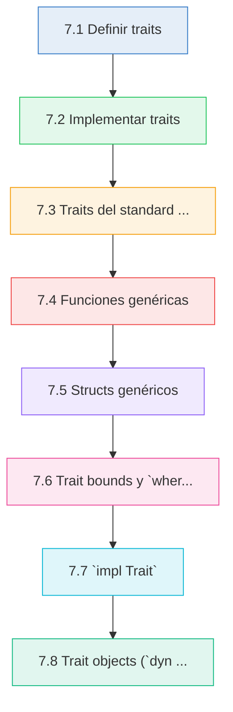
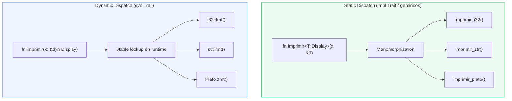

# :dna: Cap 7 — Traits y Genericos

<div class="chapter-meta">
  <span class="meta-item">🕐 4-5 horas</span>
  <span class="meta-item">📊 Nivel: Intermedio-Avanzado</span>
  <span class="meta-item">🎯 Semana 4</span>
</div>

<div class="chapter-objective"><span class="objective-icon">📌</span><span class="objective-text">Al terminar este capítulo sabrás definir traits propios, escribir funciones y structs genéricos con trait bounds, y elegir entre static dispatch y dynamic dispatch segun las necesidades de tu programa.</span></div>

<div class="chapter-map">



</div>


!!! quote "Contexto"
    En Python, el duck typing te permite pasar cualquier objeto que tenga los métodos correctos. En Rust, los **traits** definen comportamiento compartido de forma explícita, y los **genéricos** te permiten escribir código que funciona con multiples tipos **sin perder rendimiento ni seguridad de tipos**. Juntos, traits y genéricos son el sistema de abstracción más poderoso de Rust.

---

## 7.1 Definir traits

Un trait es un contrato que define un conjunto de métodos que un tipo debe implementar. Es similar a una interfaz en otros lenguajes, pero más potente porque permite implementaciones por defecto.

```rust
// Definir un trait es declarar un contrato
trait Describible {
    // Método requerido: cada tipo que implemente Describible DEBE definirlo
    fn descripción(&self) -> String;

    // Método con implementación por defecto: los tipos PUEDEN sobreescribirlo
    fn descripcion_corta(&self) -> String {
        format!("{}...", &self.descripción()[..20.min(self.descripción().len())])
    }
}
```

Los traits pueden tener:

- **Métodos requeridos** (sin cuerpo) -- el tipo que implemente el trait debe definirlos
- **Métodos con implementación por defecto** (con cuerpo) -- se heredan automaticamente pero se pueden sobreescribir
- **Constantes asociadas** y **tipos asociados** (los veremos más adelante)

<div class="comparison" markdown>
<div class="lang-box python" markdown>

#### :snake: En Python

```python
from abc import ABC, abstractmethod

class Describible(ABC):
    @abstractmethod
    def descripción(self) -> str:
        ...

    # Método con implementación por defecto
    def descripcion_corta(self) -> str:
        return f"{self.descripción()[:20]}..."
```

Python usa `ABC` + `@abstractmethod` para métodos obligatorios. También existe `Protocol` (typing) para structural typing sin herencia.

</div>
<div class="lang-box rust" markdown>

#### :crab: En Rust

```rust
trait Describible {
    fn descripción(&self) -> String;

    fn descripcion_corta(&self) -> String {
        format!("{}...", &self.descripción()[..20])
    }
}
```

Los traits no requieren herencia. Cualquier tipo puede implementar cualquier trait con `impl Trait for Type`.

</div>
</div>

<div class="concept-question"><h4>🔍 Pregunta Conceptual</h4><p>Si un trait tiene un método con implementación por defecto y un tipo lo implementa sin sobreescribirlo, ¿que version se ejecuta? ¿Y que pasa si ese método por defecto llama a otro método requerido del mismo trait?</p></div>

## 7.2 Implementar traits

Para que un tipo cumpla un trait, usamos `impl Trait for Type`:

```rust
struct Plato {
    nombre: String,
    precio: f64,
    categoria: String,
}

struct Mesa {
    número: u32,
    capacidad: u8,
    ocupada: bool,
}

impl Describible for Plato {
    fn descripción(&self) -> String {
        format!("{} ({}) - {:.2}EUR", self.nombre, self.categoria, self.precio)
    }
}

impl Describible for Mesa {
    fn descripción(&self) -> String {
        let estado = if self.ocupada { "ocupada" } else { "libre" };
        format!("Mesa {} (cap: {}) - {}", self.número, self.capacidad, estado)
    }

    // Sobreescribimos el método por defecto
    fn descripcion_corta(&self) -> String {
        format!("Mesa {}", self.número)
    }
}

fn main() {
    let plato = Plato {
        nombre: String::from("Paella"),
        precio: 14.50,
        categoria: String::from("Principal"),
    };
    let mesa = Mesa { número: 5, capacidad: 4, ocupada: true };

    println!("{}", plato.descripción());
    // Paella (Principal) - 14.50EUR

    println!("{}", mesa.descripción());
    // Mesa 5 (cap: 4) - ocupada

    println!("{}", mesa.descripcion_corta());
    // Mesa 5   (usamos la version sobreescrita)
}
```

### La orphan rule

Rust tiene una regla importante: solo puedes implementar un trait para un tipo si **al menos uno de los dos** (el trait o el tipo) esta definido en tu crate.

```rust
// ✅ Tu trait para un tipo externo
impl Describible for String { ... }

// ✅ Un trait externo para tu tipo
impl Display for Plato { ... }

// ❌ Un trait externo para un tipo externo
// impl Display for Vec<i32> { ... }  // ERROR: orphan rule
```

!!! info "Por que existe la orphan rule"
    Sin esta regla, dos crates diferentes podrian implementar el mismo trait para el mismo tipo, causando ambiguedad. La orphan rule previene este conflicto garantizando que cada implementación es única.

<div class="misconception-box" markdown>
<h4>⚠️ Mitos comunes sobre traits</h4>

| Mito | Realidad |
|------|----------|
| "Los traits son lo mismo que las interfaces de Java" | Los traits permiten implementaciones por defecto, blanket implementations y no requieren herencia. Son más flexibles que las interfaces clasicas. |
| "Si un tipo implementa un trait, sus métodos estan siempre disponibles" | Debes importar el trait con `use` para poder llamar a sus métodos. Sin el `use`, el compilador no sabe que métodos buscar. |
| "Solo puedes implementar tus propios traits" | Puedes implementar traits externos (como `Display` o `From`) para tus tipos propios. Lo único prohibido es implementar un trait externo para un tipo externo (orphan rule). |

</div>

<div class="connection-box" markdown>
<h4>🔗 Conexion con el Capítulo 6</h4>
<p>En el <a href="06-pattern-matching.md">Capítulo 6 — Pattern Matching</a> aprendiste a usar <code>match</code> para despachar lógica segun variantes de un enum. Los traits ofrecen otra forma de polimorfismo: en lugar de despachar por variante, despachas por <em>comportamiento compartido</em>. Ambos mecanismos se combinan frecuentemente — por ejemplo, puedes hacer <code>match</code> sobre un enum y luego llamar métodos de un trait en cada variante.</p>
</div>

## 7.3 Traits del standard library

Rust tiene un ecosistema rico de traits en la standard library. Estos son los más importantes:

| Trait | Proposito | Ejemplo de uso |
|---|---|---|
| `Display` | Formato amigable para humanos (`{}`) | `println!("{}", plato)` |
| `Debug` | Formato para depuración (`{:?}`) | `println!("{:?}", plato)` |
| `Clone` | Crear copia explícita (`clone()`) | `let copia = plato.clone()` |
| `Copy` | Copia implícita (tipos simples) | `let x = y;` (y sigue válido) |
| `PartialEq` / `Eq` | Comparar igualdad (`==`, `!=`) | `plato1 == plato2` |
| `PartialOrd` / `Ord` | Comparar orden (`<`, `>`, `<=`, `>=`) | `platos.sort()` |
| `Default` | Valor por defecto | `Mesa::default()` |
| `From` / `Into` | Conversiones entre tipos | `String::from("hola")` |
| `Iterator` | Iterar sobre una secuencia | `for plato in menu { ... }` |
| `Drop` | Logica al destruir un valor | Liberar recursos, cerrar conexiones |

### Implementaciones para RustMenu

```rust
use std::fmt;

#[derive(Debug, Clone, PartialEq)]
struct Plato {
    id: u32,
    nombre: String,
    precio: f64,
    categoria: Categoria,
}

#[derive(Debug, Clone, PartialEq)]
enum Categoria {
    Entrante,
    Principal,
    Postre,
    Bebida,
}

// Display: formato amigable para humanos
impl fmt::Display for Plato {
    fn fmt(&self, f: &mut fmt::Formatter<'_>) -> fmt::Result {
        write!(f, "[{}] {} - {:.2}EUR", self.id, self.nombre, self.precio)
    }
}

impl fmt::Display for Categoria {
    fn fmt(&self, f: &mut fmt::Formatter<'_>) -> fmt::Result {
        match self {
            Categoria::Entrante => write!(f, "Entrante"),
            Categoria::Principal => write!(f, "Principal"),
            Categoria::Postre => write!(f, "Postre"),
            Categoria::Bebida => write!(f, "Bebida"),
        }
    }
}

// Default: valores por defecto
impl Default for Plato {
    fn default() -> Self {
        Plato {
            id: 0,
            nombre: String::from("Sin nombre"),
            precio: 0.0,
            categoria: Categoria::Entrante,
        }
    }
}

// From: conversiones
impl From<(&str, f64)> for Plato {
    fn from((nombre, precio): (&str, f64)) -> Self {
        Plato {
            id: 0,
            nombre: String::from(nombre),
            precio,
            categoria: Categoria::Principal,
        }
    }
}

fn main() {
    // Usando Display
    let paella = Plato {
        id: 1,
        nombre: String::from("Paella"),
        precio: 14.50,
        categoria: Categoria::Principal,
    };
    println!("{}", paella);
    // [1] Paella - 14.50EUR

    // Usando Debug (derivado automaticamente)
    println!("{:?}", paella);
    // Plato { id: 1, nombre: "Paella", precio: 14.5, categoria: Principal }

    // Usando Default
    let plato_vacio = Plato::default();
    println!("{}", plato_vacio);
    // [0] Sin nombre - 0.00EUR

    // Usando From
    let gazpacho = Plato::from(("Gazpacho", 6.50));
    println!("{}", gazpacho);
    // [0] Gazpacho - 6.50EUR

    // Into funciona automaticamente si From esta implementado
    let tortilla: Plato = ("Tortilla", 8.00).into();
    println!("{}", tortilla);
    // [0] Tortilla - 8.00EUR

    // Usando Clone
    let copia = paella.clone();
    println!("Original: {}", paella);
    println!("Copia:    {}", copia);

    // Usando PartialEq
    println!("Son iguales: {}", paella == copia);
    // Son iguales: true
}
```

!!! tip "derive: implementación automática"
    `#[derive(Debug, Clone, PartialEq)]` genera implementaciones automáticas de estos traits. Funciona siempre que todos los campos del struct también implementen esos traits. Usa `derive` siempre que puedas; implementa manualmente solo cuando necesites comportamiento personalizado.

<div class="micro-exercise" markdown>
<h4>🧪 Micro-ejercicio — Implementar Display para Categoria</h4>

Sin mirar el código anterior, escribe de memoria la implementación de `fmt::Display` para el enum `Categoria` (con variantes `Entrante`, `Principal`, `Postre`, `Bebida`). Recuerda: necesitas implementar el método `fmt` que recibe `&self` y un `&mut fmt::Formatter`.

<details>
<summary>Ver solución</summary>

```rust
impl fmt::Display for Categoria {
    fn fmt(&self, f: &mut fmt::Formatter<'_>) -> fmt::Result {
        match self {
            Categoria::Entrante => write!(f, "Entrante"),
            Categoria::Principal => write!(f, "Principal"),
            Categoria::Postre => write!(f, "Postre"),
            Categoria::Bebida => write!(f, "Bebida"),
        }
    }
}
```

Lo clave es usar `match` sobre `self` y `write!` con el formatter `f`, no `println!`.

</details>
</div>

## 7.4 Funciones genéricas

Las funciones genéricas operan sobre tipos parametrizados. En lugar de escribir una función por cada tipo, escribes una sola función que funciona con cualquier tipo que cumpla ciertos requisitos.

```rust
trait HasId {
    fn id(&self) -> u32;
}

impl HasId for Plato {
    fn id(&self) -> u32 {
        self.id
    }
}

impl HasId for Mesa {
    fn id(&self) -> u32 {
        self.número
    }
}

// Función genérica: T puede ser cualquier tipo que implemente HasId
fn buscar<T: HasId>(items: &[T], id: u32) -> Option<&T> {
    items.iter().find(|item| item.id() == id)
}

fn contar_ids<T: HasId>(items: &[T]) -> Vec<u32> {
    items.iter().map(|item| item.id()).collect()
}

fn main() {
    let platos = vec![
        Plato { id: 1, nombre: String::from("Paella"), precio: 14.50, categoria: Categoria::Principal },
        Plato { id: 2, nombre: String::from("Gazpacho"), precio: 6.50, categoria: Categoria::Entrante },
    ];
    let mesas = vec![
        Mesa { número: 1, capacidad: 4, ocupada: false },
        Mesa { número: 2, capacidad: 6, ocupada: true },
    ];

    // La misma función buscar funciona con Plato y con Mesa
    if let Some(plato) = buscar(&platos, 1) {
        println!("Encontrado: {}", plato.descripción());
    }
    if let Some(mesa) = buscar(&mesas, 2) {
        println!("Encontrada: {}", mesa.descripción());
    }

    println!("IDs platos: {:?}", contar_ids(&platos));
    // IDs platos: [1, 2]
    println!("IDs mesas: {:?}", contar_ids(&mesas));
    // IDs mesas: [1, 2]
}
```

<div class="comparison" markdown>
<div class="lang-box python" markdown>

#### :snake: En Python

```python
from typing import TypeVar, Protocol

class HasId(Protocol):
    def id(self) -> int: ...

T = TypeVar("T", bound=HasId)

def buscar(items: list[T], id: int) -> T | None:
    return next((i for i in items if i.id() == id), None)
```

Python usa `TypeVar` con `bound` para restringir tipos. Las restricciones solo se verifican con herramientas externas como mypy.

</div>
<div class="lang-box rust" markdown>

#### :crab: En Rust

```rust
fn buscar<T: HasId>(items: &[T], id: u32) -> Option<&T> {
    items.iter().find(|item| item.id() == id)
}
```

`T: HasId` es un **trait bound**: T puede ser cualquier tipo que implemente `HasId`. El compilador verifica esto y genera código especializado para cada tipo concreto (monomorphization).

</div>
</div>

<div class="concept-question"><h4>🔍 Pregunta Conceptual</h4><p>Cuando escribes <code>fn buscar&lt;T: HasId&gt;(items: &amp;[T], id: u32)</code>, ¿el compilador genera una sola función que funciona con todos los tipos, o genera una función separada para cada tipo concreto? ¿Que implicaciones tiene esto para el rendimiento y el tamanio del binario?</p></div>

## 7.5 Structs genéricos

Los structs también pueden ser genéricos. Esto permite crear contenedores y wrappers reutilizables.

```rust
// Struct genérico: T puede ser cualquier tipo
#[derive(Debug)]
struct Respuesta<T> {
    datos: T,
    status: u16,
    mensaje: String,
}

// Métodos que funcionan con cualquier T
impl<T> Respuesta<T> {
    fn new(datos: T, status: u16, mensaje: &str) -> Self {
        Respuesta {
            datos,
            status,
            mensaje: String::from(mensaje),
        }
    }

    fn es_exitosa(&self) -> bool {
        self.status >= 200 && self.status < 300
    }

    // Transformar los datos internos sin cambiar status/mensaje
    fn map<U>(self, f: impl FnOnce(T) -> U) -> Respuesta<U> {
        Respuesta {
            datos: f(self.datos),
            status: self.status,
            mensaje: self.mensaje,
        }
    }
}

// Métodos solo cuando T implementa Display
impl<T: fmt::Display> Respuesta<T> {
    fn imprimir(&self) {
        if self.es_exitosa() {
            println!("[{}] OK: {}", self.status, self.datos);
        } else {
            println!("[{}] ERROR: {}", self.status, self.mensaje);
        }
    }
}

fn main() {
    // Respuesta con un Plato
    let resp_plato = Respuesta::new(
        Plato::from(("Paella", 14.50)),
        200,
        "Plato encontrado",
    );

    // Respuesta con un Vec<String>
    let resp_lista: Respuesta<Vec<String>> = Respuesta::new(
        vec![String::from("Paella"), String::from("Gazpacho")],
        200,
        "Lista de platos",
    );

    // Respuesta con un simple número
    let resp_count: Respuesta<u32> = Respuesta::new(42, 200, "Total de platos");

    println!("Exitosa: {}", resp_plato.es_exitosa());
    // Exitosa: true

    // map: transformar datos
    let resp_nombre = resp_count.map(|n| format!("{} platos en total", n));
    resp_nombre.imprimir();
    // [200] OK: 42 platos en total
}
```

<div class="comparison" markdown>
<div class="lang-box python" markdown>

#### :snake: En Python

```python
from typing import Generic, TypeVar

T = TypeVar("T")

class Respuesta(Generic[T]):
    def __init__(self, datos: T, status: int, mensaje: str):
        self.datos = datos
        self.status = status
        self.mensaje = mensaje
```

Python usa `Generic[T]` para clases genéricas. El tipo genérico solo se verifica con type checkers externos (mypy), no en runtime.

</div>
<div class="lang-box rust" markdown>

#### :crab: En Rust

```rust
struct Respuesta<T> {
    datos: T,
    status: u16,
    mensaje: String,
}
```

Rust verifica los tipos genéricos en compilación. Ademas, puedes tener métodos condicionados a que `T` implemente ciertos traits con `impl<T: Display> Respuesta<T>`.

</div>
</div>

<div class="pro-tip" markdown>
<h4>💡 Pro-tip — Métodos condicionales en structs genéricos</h4>
<p>Puedes definir multiples bloques <code>impl</code> para el mismo struct genérico con distintos trait bounds. Esto te permite que ciertos métodos solo existan cuando <code>T</code> cumple requisitos adicionales. Por ejemplo, <code>Respuesta&lt;T&gt;</code> siempre tiene <code>es_exitosa()</code>, pero solo tiene <code>imprimir()</code> cuando <code>T: Display</code>. Este patrón es muy comun en la standard library — <code>Vec&lt;T&gt;</code> tiene métodos extra cuando <code>T: Ord</code> o <code>T: Clone</code>.</p>
</div>

## 7.6 Trait bounds y `where`

Cuando una función necesita que el tipo genérico cumpla multiples traits, tienes dos sintaxis equivalentes:

```rust
// Sintaxis inline: para bounds simples
fn imprimir_y_clonar<T: Display + Clone>(item: &T) -> T {
    println!("{}", item);
    item.clone()
}

// Sintaxis where: para bounds complejos o multiples parámetros
fn procesar<T, U>(input: &T, transformador: &U) -> String
where
    T: Display + Clone + HasId,
    U: Fn(&T) -> String,
{
    let clon = input.clone();
    let resultado = transformador(&clon);
    format!("[{}] {} -> {}", input.id(), input, resultado)
}
```

### Cuando usar `where`

- Cuando tienes **más de dos trait bounds** en un parámetro
- Cuando tienes **multiples parámetros genéricos** con bounds
- Cuando la firma de la función se hace **difícil de leer** con bounds inline
- Cuando los bounds son **complejos** (funciones, lifetimes, etc.)

```rust
// ❌ Difícil de leer inline
fn combinar<T: Display + Clone + PartialEq + Default, U: Into<String> + Debug>(a: T, b: U) -> String {
    todo!()
}

// ✅ Mucho más legible con where
fn combinar<T, U>(a: T, b: U) -> String
where
    T: Display + Clone + PartialEq + Default,
    U: Into<String> + Debug,
{
    todo!()
}
```

### Bounds en implementaciones

También puedes usar bounds en bloques `impl`:

```rust
use std::fmt;

#[derive(Debug)]
struct Wrapper<T> {
    valor: T,
}

// Estos métodos solo existen cuando T implementa Display
impl<T: fmt::Display> Wrapper<T> {
    fn mostrar(&self) {
        println!("Wrapper contiene: {}", self.valor);
    }
}

// Estos métodos solo existen cuando T implementa Display + PartialOrd
impl<T: fmt::Display + PartialOrd> Wrapper<T> {
    fn mayor_que(&self, otro: &T) -> bool {
        self.valor > *otro
    }
}

fn main() {
    let w = Wrapper { valor: 42 };
    w.mostrar();              // ✅ i32 implementa Display
    w.mayor_que(&10);         // ✅ i32 implementa Display + PartialOrd

    let w2 = Wrapper { valor: vec![1, 2, 3] };
    // w2.mostrar();          // ❌ Vec<i32> no implementa Display
    println!("{:?}", w2);     // ✅ Debug si funciona (derivado)
}
```

<div class="micro-exercise" markdown>
<h4>🧪 Micro-ejercicio — Reescribir con where</h4>

Reescribe esta firma usando la clausula `where` para que sea más legible:

```rust
fn filtrar_y_mostrar<T: Display + Clone + PartialOrd, F: Fn(&T) -> bool>(items: &[T], filtro: F) -> Vec<T> {
    todo!()
}
```

<details>
<summary>Ver solución</summary>

```rust
fn filtrar_y_mostrar<T, F>(items: &[T], filtro: F) -> Vec<T>
where
    T: Display + Clone + PartialOrd,
    F: Fn(&T) -> bool,
{
    items.iter()
        .filter(|item| filtro(item))
        .cloned()
        .collect()
}
```

La clausula `where` separa los bounds de la lista de parámetros, haciendo que la firma sea mucho más fácil de leer de un vistazo.

</details>
</div>

## 7.7 `impl Trait`

La sintaxis `impl Trait` es una forma más ergonomica de usar genéricos en ciertos contextos.

### En parámetros (azucar sintáctico)

```rust
// Estas dos firmas son EQUIVALENTES:

// Con impl Trait (más conciso)
fn imprimir(item: &impl Display) {
    println!("{}", item);
}

// Con genéricos explicitos (más flexible)
fn imprimir<T: Display>(item: &T) {
    println!("{}", item);
}
```

!!! info "Cuando usar cada forma"
    `impl Trait` en parámetros es azucar sintáctico para genéricos. Usa `impl Trait` cuando la función es simple y no necesitas referirte al tipo `T` en multiples sitios. Usa genéricos explicitos `<T>` cuando necesitas que varios parámetros compartan el mismo tipo o cuando necesitas la clausula `where`.

### En retorno (tipo opaco)

En posición de retorno, `impl Trait` oculta el tipo concreto. El compilador sabe el tipo real, pero el llamador solo ve la interfaz del trait.

```rust
// El tipo de retorno es "algo que implementa Iterator<Item = i32>"
fn numeros_pares(hasta: i32) -> impl Iterator<Item = i32> {
    (0..hasta).filter(|n| n % 2 == 0)
}

// Útil para closures y tipos complejos que no quieres nombrar
fn crear_saludo(nombre: &str) -> impl Fn() -> String + '_ {
    move || format!("Hola, {}!", nombre)
}

fn main() {
    // No necesitamos saber el tipo concreto del iterador
    let pares: Vec<i32> = numeros_pares(10).collect();
    println!("{:?}", pares);
    // [0, 2, 4, 6, 8]

    let saludo = crear_saludo("RustMenu");
    println!("{}", saludo());
    // Hola, RustMenu!
}
```

!!! warning "Limitación de `impl Trait` en retorno"
    Una función que retorna `impl Trait` solo puede retornar **un tipo concreto**. No puedes retornar tipos diferentes segun una condición:

    ```rust
    // ❌ ERROR: los dos brazos retornan tipos diferentes
    fn crear_iterador(vacio: bool) -> impl Iterator<Item = i32> {
        if vacio {
            std::iter::empty()       // tipo: Empty<i32>
        } else {
            vec![1, 2, 3].into_iter() // tipo: IntoIter<i32>
        }
    }
    ```

    Para retornar tipos diferentes, necesitas `Box<dyn Trait>` (sección 7.8).

<div class="pro-tip" markdown>
<h4>💡 Pro-tip — impl Trait en retorno para ocultar complejidad</h4>
<p>Cuando una función retorna un iterador encadenado como <code>(0..n).filter(...).map(...).take(...)</code>, el tipo real es extremadamente largo y difícil de escribir. Usar <code>-> impl Iterator&lt;Item = T&gt;</code> te libera de nombrar ese tipo. Esto es especialmente útil en APIs publicas: puedes cambiar la implementación interna (por ejemplo, reordenar los adaptadores de iterador) sin romper la firma publica de la función.</p>
</div>

## 7.8 Trait objects (`dyn Trait`)

Los trait objects permiten **dynamic dispatch**: decidir en runtime que implementación de un método llamar.

```rust
// Box<dyn Describible> puede contener CUALQUIER tipo que implemente Describible
fn imprimir_describible(item: &dyn Describible) {
    println!("{}", item.descripción());
}

fn obtener_elementos() -> Vec<Box<dyn Describible>> {
    vec![
        Box::new(Plato {
            id: 1,
            nombre: String::from("Paella"),
            precio: 14.50,
            categoria: Categoria::Principal,
        }),
        Box::new(Mesa {
            número: 5,
            capacidad: 4,
            ocupada: true,
        }),
    ]
}

fn main() {
    let elementos = obtener_elementos();
    for elem in &elementos {
        imprimir_describible(elem.as_ref());
    }
    // Paella (Principal) - 14.50EUR
    // Mesa 5 (cap: 4) - ocupada
}
```

### Static dispatch vs dynamic dispatch



| Aspecto | Static (`impl Trait` / `<T>`) | Dynamic (`dyn Trait`) |
|---|---|---|
| Resolución | Compilación (monomorphization) | Runtime (vtable) |
| Rendimiento | Mas rápido (inlining posible) | Pequeno overhead por indireccción |
| Tamanio binario | Mayor (una copia por tipo) | Menor (una sola función) |
| Flexibilidad | Un solo tipo por llamada | Multiples tipos en una colección |
| Uso típico | Funciones genéricas | Colecciones heterogeneas |

<div class="comparison" markdown>
<div class="lang-box python" markdown>

#### :snake: En Python

```python
# Python SIEMPRE usa dynamic dispatch
def imprimir(item):
    print(item.descripción())  # duck typing

# Cualquier objeto con .descripción() funciona
elementos = [Plato(...), Mesa(...)]
for elem in elementos:
    imprimir(elem)
```

Python siempre resuelve los métodos en runtime (duck typing). No existe la opción de static dispatch.

</div>
<div class="lang-box rust" markdown>

#### :crab: En Rust

```rust
// Static: el compilador genera una version por tipo
fn imprimir(item: &impl Describible) { ... }

// Dynamic: resolución en runtime via vtable
fn imprimir(item: &dyn Describible) { ... }
```

Rust te da la **elección**: static dispatch (máximo rendimiento) o dynamic dispatch (máxima flexibilidad). Python siempre usa dynamic dispatch.

</div>
</div>

<div class="concept-question"><h4>🔍 Pregunta Conceptual</h4><p>¿Por que <code>dyn Trait</code> siempre necesita estar detras de un puntero (<code>&dyn Trait</code> o <code>Box&lt;dyn Trait&gt;</code>)? Piensa en como el compilador calcula el tamanio de los tipos en la pila.</p></div>

### Cuando usar `dyn Trait`

Usa `dyn Trait` cuando necesites:

- **Colecciones heterogeneas** -- un `Vec` con diferentes tipos
- **Retorno de tipos diferentes** segun condiciones runtime
- **Reducir el tamanio del binario** evitando monomorphization
- **Plugin systems** donde los tipos concretos no se conocen en compilación

```rust
// Colección heterogenea de elementos del restaurante
struct Restaurante {
    elementos: Vec<Box<dyn Describible>>,
}

impl Restaurante {
    fn new() -> Self {
        Restaurante { elementos: vec![] }
    }

    fn agregar(&mut self, elem: impl Describible + 'static) {
        self.elementos.push(Box::new(elem));
    }

    fn listar(&self) {
        for (i, elem) in self.elementos.iter().enumerate() {
            println!("{}. {}", i + 1, elem.descripción());
        }
    }
}
```

<div class="code-evolution" markdown>
<h4>📐 Evolución del código — De función concreta a genérica a dinámica</h4>

**Paso 1: Función concreta** — Solo funciona con un tipo específico.

```rust
fn imprimir_plato(plato: &Plato) {
    println!("{}", plato.descripción());
}
// Limitación: necesitas una función por cada tipo
```

**Paso 2: Función genérica (static dispatch)** — Funciona con cualquier tipo que implemente el trait, pero el compilador genera una copia por tipo.

```rust
fn imprimir_item<T: Describible>(item: &T) {
    println!("{}", item.descripción());
}
// El compilador genera imprimir_item_plato, imprimir_item_mesa, etc.
```

**Paso 3: Trait object (dynamic dispatch)** — Una sola función en el binario, resolución en runtime. Permite colecciones heterogeneas.

```rust
fn imprimir_item(item: &dyn Describible) {
    println!("{}", item.descripción());
}
// Una sola función. Puede recibir &Plato, &Mesa, o cualquier &dyn Describible.
// Permite: Vec<Box<dyn Describible>> con tipos mezclados.
```

</div>

## 7.9 Supertraits y blanket implementations

### Supertraits

Un supertrait establece que implementar un trait **requiere** implementar otro:

```rust
use std::fmt;

// Para implementar Describible, el tipo DEBE implementar también Display y Debug
trait Describible: fmt::Display + fmt::Debug {
    fn descripcion_detallada(&self) -> String {
        format!("Display: {} | Debug: {:?}", self, self)
    }
}

// Al implementar Describible para Plato, Plato DEBE tener Display y Debug
// (Display lo implementamos manualmente, Debug lo derivamos)

#[derive(Debug)]
struct Empleado {
    nombre: String,
    rol: String,
}

impl fmt::Display for Empleado {
    fn fmt(&self, f: &mut fmt::Formatter<'_>) -> fmt::Result {
        write!(f, "{} ({})", self.nombre, self.rol)
    }
}

impl Describible for Empleado {
    // descripcion_detallada() se hereda del trait con su implementación por defecto
}

fn main() {
    let chef = Empleado {
        nombre: String::from("Carlos"),
        rol: String::from("Chef"),
    };
    println!("{}", chef.descripcion_detallada());
    // Display: Carlos (Chef) | Debug: Empleado { nombre: "Carlos", rol: "Chef" }
}
```

### Blanket implementations

Una blanket implementation implementa un trait para **todos los tipos** que cumplan cierta condición:

```rust
// La std library hace esto:
// impl<T: Display> ToString for T { ... }
//
// Esto significa: CUALQUIER tipo que implemente Display
// automaticamente obtiene el método .to_string()

fn main() {
    let n: i32 = 42;
    let s: String = n.to_string();  // i32 implementa Display, asi que tiene .to_string()
    println!("{}", s);

    // Nuestro Plato tiene Display, asi que también tiene .to_string()
    let plato = Plato::from(("Paella", 14.50));
    let texto: String = plato.to_string();
    println!("{}", texto);
}
```

Puedes crear tus propias blanket implementations:

```rust
trait Resumen {
    fn resumen(&self) -> String;
}

// Blanket impl: cualquier tipo con Display + HasId obtiene Resumen gratis
impl<T: fmt::Display + HasId> Resumen for T {
    fn resumen(&self) -> String {
        format!("[ID:{}] {}", self.id(), self)
    }
}

fn main() {
    let plato = Plato {
        id: 1,
        nombre: String::from("Paella"),
        precio: 14.50,
        categoria: Categoria::Principal,
    };

    // Plato implementa Display y HasId, asi que automaticamente tiene .resumen()
    println!("{}", plato.resumen());
    // [ID:1] [1] Paella - 14.50EUR
}
```

!!! tip "Patrones comunes de blanket implementations en la std"
    - `impl<T: Display> ToString for T` -- todo lo que se puede mostrar se puede convertir a String
    - `impl<T> From<T> for T` -- todo tipo se puede convertir a si mismo
    - `impl<T: Into<U>> From<T> for U` (inversa) -- si T se convierte Into U, entonces U se puede crear From T
    - `impl<T> Borrow<T> for T` -- todo tipo se puede prestar a si mismo

<div class="connection-box" markdown>
<h4>🔗 Conexion con el Capítulo 8</h4>
<p>En el <a href="08-manejo-errores.md">Capítulo 8 — Manejo de Errores</a> verás como los traits <code>From</code> y <code>Into</code> que aprendiste aqui son fundamentales para la conversion automática de errores. Cuando implementas <code>From&lt;io::Error&gt; for MiError</code>, el operador <code>?</code> puede convertir errores automaticamente. También verás como <code>Display</code> y <code>Debug</code> se usan para formatear mensajes de error de forma legible.</p>
</div>

<div class="real-errors">
<h4>🚨 Errores que vas a encontrar</h4>

**Error 1: Trait bound no satisfecho**

```rust
fn mostrar_plato<T>(plato: T) {
    println!("{}", plato); // ❌ T no implementa Display
}
```

```
error[E0277]: `T` doesn't implement `std::fmt::Display`
 --> src/main.rs:2:20
  |
2 |     println!("{}", plato);
  |                    ^^^^^ `T` cannot be formatted with the default formatter
  |
  = help: the trait `std::fmt::Display` is not implemented for `T`
  = help: consider adding a `where T: std::fmt::Display` bound
```

**¿Por qué?** Las funciones genéricas no saben nada sobre `T` a menos que le pongas trait bounds explícitos.

**Solución:**
```rust
fn mostrar_plato<T: std::fmt::Display>(plato: T) { // ✅ trait bound
    println!("{}", plato);
}
```

---

**Error 2: Conflicto entre implementaciones (orphan rule)**

```rust
use std::fmt;

impl fmt::Display for Vec<String> { // ❌ ni Display ni Vec son nuestros
    fn fmt(&self, f: &mut fmt::Formatter) -> fmt::Result {
        write!(f, "{:?}", self)
    }
}
```

```
error[E0117]: only traits defined in the current crate can be
implemented for types defined outside of the crate
```

**¿Por qué?** La *orphan rule*: solo puedes implementar un trait para un tipo si al menos uno de los dos (trait o tipo) está definido en tu crate.

**Solución:**
```rust
struct Menu(Vec<String>); // ✅ newtype wrapper

impl fmt::Display for Menu {
    fn fmt(&self, f: &mut fmt::Formatter) -> fmt::Result {
        for plato in &self.0 {
            writeln!(f, "- {}", plato)?;
        }
        Ok(())
    }
}
```

---

**Error 3: Usar `dyn Trait` sin `Box` en retorno**

```rust
fn crear_item(vegetariano: bool) -> dyn MenuItem { // ❌ tamaño desconocido
    if vegetariano { Ensalada::new() } else { Hamburguesa::new() }
}
```

```
error[E0746]: return type cannot have an unboxed trait object
 --> src/main.rs:1:38
  |
1 | fn crear_item(vegetariano: bool) -> dyn MenuItem {
  |                                     ^^^^^^^^^^^^ doesn't have a size known at compile-time
```

**¿Por qué?** El compilador necesita conocer el tamaño exacto del retorno en compilación. `dyn Trait` tiene tamaño variable, así que necesita ir detrás de un puntero.

**Solución:**
```rust
fn crear_item(vegetariano: bool) -> Box<dyn MenuItem> { // ✅ Box tiene tamaño fijo
    if vegetariano {
        Box::new(Ensalada::new())
    } else {
        Box::new(Hamburguesa::new())
    }
}
```

---

**Error 4: Trait con método que consume `self` llamado desde referencia**

```rust
trait Consumible {
    fn consumir(self); // toma ownership
}

fn procesar(items: &Vec<Box<dyn Consumible>>) {
    for item in items {
        item.consumir(); // ❌ item es &Box<dyn Consumible>, no owned
    }
}
```

```
error[E0507]: cannot move out of `*item` which is behind a shared reference
```

**¿Por qué?** `consumir(self)` necesita ownership, pero iteramos con `&` (referencia). No puedes mover un valor detrás de una referencia compartida.

**Solución:** Cambia el trait para usar `&self` si no necesitas consumir:
```rust
trait Consumible {
    fn consumir(&self); // ✅ solo necesita referencia
}
```

</div>

---

<div class="checkpoint" markdown>
<h4>🏁 Checkpoint — Autoverificación antes de continuar</h4>

Antes de pasar a los recursos y ejercicios, asegurate de que puedes responder estas preguntas:

- [ ] ¿Puedes explicar la diferencia entre un método requerido y un método con implementación por defecto en un trait?
- [ ] ¿Sabes cuando usar `impl Trait` (static dispatch) y cuando `dyn Trait` (dynamic dispatch)?
- [ ] ¿Puedes escribir una función genérica con multiples trait bounds usando la clausula `where`?
- [ ] ¿Entiendes por que la orphan rule existe y que restricciones impone?
- [ ] ¿Puedes explicar que es monomorphization y como afecta al rendimiento y tamanio del binario?
- [ ] ¿Sabes crear una blanket implementation y entiendes cuando es apropiado usarla?

Si alguno de estos puntos no esta claro, revisa la sección correspondiente antes de continuar.

</div>

<div class="mini-project">
<h4>🏗️ Mini-proyecto: Aplicación práctica</h4>

**Paso 1 — Define las estructuras base**

Crea las estructuras y tipos necesarios para modelar el dominio del capítulo.

??? success "Solución Paso 1"
    ```rust
    // Define tus structs y enums aquí
    #[derive(Debug)]
    struct Item {
        nombre: String,
        valor: f64,
    }

    impl Item {
        fn new(nombre: &str, valor: f64) -> Self {
            Self {
                nombre: nombre.to_string(),
                valor,
            }
        }
    }
    ```

**Paso 2 — Implementa la lógica principal**

Crea funciones que operen sobre las estructuras del paso 1.

??? success "Solución Paso 2"
    ```rust
    fn procesar(items: &[Item]) -> f64 {
        items.iter().map(|i| i.valor).sum()
    }

    fn mostrar(items: &[Item]) {
        for item in items {
            println!("  {} — {:.2}€", item.nombre, item.valor);
        }
    }
    ```

**Paso 3 — Integra todo en main**

Combina los pasos anteriores en un programa completo.

??? success "Solución Paso 3"
    ```rust
    fn main() {
        let items = vec![
            Item::new("Paella", 14.50),
            Item::new("Gazpacho", 8.00),
            Item::new("Flan", 5.50),
        ];

        println!("=== RustMenu ===");
        mostrar(&items);
        println!("Total: {:.2}€", procesar(&items));
    }
    ```

</div>

<div class="ejercicio-guiado">
<h4>🏋️ Ejercicio guiado</h4>

Vas a crear un trait `Imprimible` para los elementos del menu de RustMenu. Cada tipo de elemento (plato, bebida, postre) implementara el trait de forma diferente, y escribiras una funcion generica que pueda mostrar cualquier elemento imprimible. Tambien usaras trait objects para crear un ticket heterogeneo con distintos tipos de items.

1. Define un trait `Imprimible` con dos metodos: `linea_ticket(&self) -> String` (requerido) y `etiqueta(&self) -> &str` (con implementacion por defecto que devuelve `"Item"`).
2. Crea tres structs: `Plato { nombre: String, precio: f64, categoria: String }`, `Bebida { nombre: String, precio: f64, alcoholica: bool }` y `Postre { nombre: String, precio: f64, calorias: u32 }`.
3. Implementa `Imprimible` para los tres structs. Cada uno debe formatear `linea_ticket` de forma diferente (el plato muestra la categoria, la bebida indica si es alcoholica, el postre muestra las calorias). Sobreescribe `etiqueta` en cada uno para devolver `"Plato"`, `"Bebida"` o `"Postre"`.
4. Escribe una funcion generica `mostrar_item<T: Imprimible>(item: &T)` que imprima la etiqueta y la linea de ticket de cualquier item.
5. Crea una funcion `imprimir_ticket(items: &[Box<dyn Imprimible>])` que use trait objects para recorrer una coleccion heterogenea, imprima cada linea y calcule el total. Para el total, anade un metodo `precio(&self) -> f64` al trait `Imprimible` con implementacion requerida.
6. En `main`, crea varios items de distintos tipos, guardalos en un `Vec<Box<dyn Imprimible>>` y llama a `imprimir_ticket` para generar el ticket completo.

??? success "Solución completa"
    ```rust
    use std::fmt;

    trait Imprimible {
        fn linea_ticket(&self) -> String;
        fn precio(&self) -> f64;

        fn etiqueta(&self) -> &str {
            "Item"
        }
    }

    #[derive(Debug)]
    struct Plato {
        nombre: String,
        precio: f64,
        categoria: String,
    }

    #[derive(Debug)]
    struct Bebida {
        nombre: String,
        precio: f64,
        alcoholica: bool,
    }

    #[derive(Debug)]
    struct Postre {
        nombre: String,
        precio: f64,
        calorias: u32,
    }

    impl Imprimible for Plato {
        fn linea_ticket(&self) -> String {
            format!(
                "{:<20} ({:<10}) {:>7.2}EUR",
                self.nombre, self.categoria, self.precio
            )
        }

        fn precio(&self) -> f64 {
            self.precio
        }

        fn etiqueta(&self) -> &str {
            "Plato"
        }
    }

    impl Imprimible for Bebida {
        fn linea_ticket(&self) -> String {
            let tipo = if self.alcoholica { "alc." } else { "s/a" };
            format!(
                "{:<20} ({:<10}) {:>7.2}EUR",
                self.nombre, tipo, self.precio
            )
        }

        fn precio(&self) -> f64 {
            self.precio
        }

        fn etiqueta(&self) -> &str {
            "Bebida"
        }
    }

    impl Imprimible for Postre {
        fn linea_ticket(&self) -> String {
            format!(
                "{:<20} ({:>4} kcal) {:>7.2}EUR",
                self.nombre, self.calorias, self.precio
            )
        }

        fn precio(&self) -> f64 {
            self.precio
        }

        fn etiqueta(&self) -> &str {
            "Postre"
        }
    }

    fn mostrar_item<T: Imprimible>(item: &T) {
        println!("[{}] {}", item.etiqueta(), item.linea_ticket());
    }

    fn imprimir_ticket(items: &[Box<dyn Imprimible>]) {
        println!("========== TICKET RustMenu ==========");
        for item in items {
            println!("  {}", item.linea_ticket());
        }
        let total: f64 = items.iter().map(|i| i.precio()).sum();
        println!("--------------------------------------");
        println!("  {:<33} {:>7.2}EUR", "TOTAL", total);
        println!("======================================");
    }

    fn main() {
        // Mostrar items individuales con funcion generica
        let paella = Plato {
            nombre: String::from("Paella"),
            precio: 14.50,
            categoria: String::from("Principal"),
        };
        let vino = Bebida {
            nombre: String::from("Vino tinto"),
            precio: 8.00,
            alcoholica: true,
        };
        let flan = Postre {
            nombre: String::from("Flan casero"),
            precio: 5.50,
            calorias: 280,
        };

        mostrar_item(&paella);
        mostrar_item(&vino);
        mostrar_item(&flan);

        println!();

        // Coleccion heterogenea con trait objects
        let pedido: Vec<Box<dyn Imprimible>> = vec![
            Box::new(Plato {
                nombre: String::from("Paella"),
                precio: 14.50,
                categoria: String::from("Principal"),
            }),
            Box::new(Plato {
                nombre: String::from("Ensalada Cesar"),
                precio: 9.00,
                categoria: String::from("Entrante"),
            }),
            Box::new(Bebida {
                nombre: String::from("Vino tinto"),
                precio: 8.00,
                alcoholica: true,
            }),
            Box::new(Bebida {
                nombre: String::from("Agua mineral"),
                precio: 2.50,
                alcoholica: false,
            }),
            Box::new(Postre {
                nombre: String::from("Flan casero"),
                precio: 5.50,
                calorias: 280,
            }),
        ];

        imprimir_ticket(&pedido);
    }
    ```

</div>


## :link: Recursos

| Recurso | Enlace |
|---------|--------|
| The Rust Book: Traits | [doc.rust-lang.org/book/ch10-02-traits](https://doc.rust-lang.org/book/ch10-02-traits.html) |
| The Rust Book: Generics | [doc.rust-lang.org/book/ch10-01-syntax](https://doc.rust-lang.org/book/ch10-01-syntax.html) |
| Rust by Example: Traits | [doc.rust-lang.org/rust-by-example/trait](https://doc.rust-lang.org/rust-by-example/trait.html) |
| Trait Objects (dyn Trait) | [doc.rust-lang.org/book/ch17-02-trait-objects](https://doc.rust-lang.org/book/ch17-02-trait-objects.html) |

---

## 🎯 Ejercicios

??? question "Ejercicio 1: Trait `Precio` con implementación por defecto"
    Crea un trait `Precio` con un método `precio_base(&self) -> f64` (requerido) y un método `precio_con_iva(&self) -> f64` (con implementación por defecto que aplica 21% IVA). Implementalo para `Plato` y para un nuevo struct `Bebida`.

    ??? success "Solución"
        ```rust
        trait Precio {
            fn precio_base(&self) -> f64;

            fn precio_con_iva(&self) -> f64 {
                self.precio_base() * 1.21
            }
        }

        struct Plato {
            nombre: String,
            precio: f64,
        }

        struct Bebida {
            nombre: String,
            precio: f64,
            alcoholica: bool,
        }

        impl Precio for Plato {
            fn precio_base(&self) -> f64 {
                self.precio
            }
        }

        impl Precio for Bebida {
            fn precio_base(&self) -> f64 {
                self.precio
            }

            // Sobreescribimos: las bebidas alcoholicas tienen IVA diferente
            fn precio_con_iva(&self) -> f64 {
                if self.alcoholica {
                    self.precio * 1.21
                } else {
                    self.precio * 1.10
                }
            }
        }

        fn main() {
            let paella = Plato { nombre: String::from("Paella"), precio: 14.50 };
            let agua = Bebida { nombre: String::from("Agua"), precio: 2.00, alcoholica: false };
            let vino = Bebida { nombre: String::from("Vino"), precio: 8.00, alcoholica: true };

            println!("{}: {:.2}EUR", paella.nombre, paella.precio_con_iva());
            // Paella: 17.55EUR
            println!("{}: {:.2}EUR", agua.nombre, agua.precio_con_iva());
            // Agua: 2.20EUR (IVA reducido)
            println!("{}: {:.2}EUR", vino.nombre, vino.precio_con_iva());
            // Vino: 9.68EUR (IVA normal)
        }
        ```

??? question "Ejercicio 2: Función genérica `max_por`"
    Escribe una función genérica `max_por` que reciba un slice de elementos y una función de extracción, y retorne una referencia al elemento con el valor máximo. La función de extracción convierte cada elemento en un valor comparable.

    !!! tip "Pista"
        Necesitaras los bounds `Fn(&T) -> K` y `K: PartialOrd`. Usa `iter().max_by()` o un fold manual.

    ??? success "Solución"
        ```rust
        fn max_por<T, K, F>(items: &[T], f: F) -> Option<&T>
        where
            F: Fn(&T) -> K,
            K: PartialOrd,
        {
            items.iter().max_by(|a, b| {
                f(a).partial_cmp(&f(b)).unwrap_or(std::cmp::Ordering::Equal)
            })
        }

        #[derive(Debug)]
        struct Plato {
            nombre: String,
            precio: f64,
        }

        fn main() {
            let platos = vec![
                Plato { nombre: String::from("Paella"), precio: 14.50 },
                Plato { nombre: String::from("Gazpacho"), precio: 6.50 },
                Plato { nombre: String::from("Chuleton"), precio: 22.00 },
            ];

            if let Some(caro) = max_por(&platos, |p| p.precio) {
                println!("Mas caro: {} ({:.2}EUR)", caro.nombre, caro.precio);
            }
            // Mas caro: Chuleton (22.00EUR)

            if let Some(largo) = max_por(&platos, |p| p.nombre.len()) {
                println!("Nombre más largo: {}", largo.nombre);
            }
            // Nombre más largo: Gazpacho
        }
        ```

??? question "Ejercicio 3: Trait genérico `Repository<T>`"
    Crea un trait `Repository<T>` con operaciones CRUD genéricas: `all`, `find_by_id`, `add`, `remove`. Implementalo para un `InMemoryRepo<T>` que almacene elementos en un `Vec<T>`.

    !!! tip "Pista"
        `T` necesitara bounds como `Clone + HasId`. El método `find_by_id` debe retornar `Option<&T>`.

    ??? success "Solución"
        ```rust
        trait HasId {
            fn id(&self) -> u32;
        }

        trait Repository<T: Clone + HasId> {
            fn all(&self) -> &[T];
            fn find_by_id(&self, id: u32) -> Option<&T>;
            fn add(&mut self, item: T);
            fn remove(&mut self, id: u32) -> Option<T>;
        }

        struct InMemoryRepo<T> {
            items: Vec<T>,
        }

        impl<T> InMemoryRepo<T> {
            fn new() -> Self {
                InMemoryRepo { items: vec![] }
            }
        }

        impl<T: Clone + HasId> Repository<T> for InMemoryRepo<T> {
            fn all(&self) -> &[T] {
                &self.items
            }

            fn find_by_id(&self, id: u32) -> Option<&T> {
                self.items.iter().find(|item| item.id() == id)
            }

            fn add(&mut self, item: T) {
                self.items.push(item);
            }

            fn remove(&mut self, id: u32) -> Option<T> {
                if let Some(pos) = self.items.iter().position(|item| item.id() == id) {
                    Some(self.items.remove(pos))
                } else {
                    None
                }
            }
        }

        #[derive(Debug, Clone)]
        struct Plato {
            id: u32,
            nombre: String,
            precio: f64,
        }

        impl HasId for Plato {
            fn id(&self) -> u32 {
                self.id
            }
        }

        fn main() {
            let mut repo = InMemoryRepo::new();
            repo.add(Plato { id: 1, nombre: String::from("Paella"), precio: 14.50 });
            repo.add(Plato { id: 2, nombre: String::from("Gazpacho"), precio: 6.50 });

            println!("Total platos: {}", repo.all().len());
            // Total platos: 2

            if let Some(plato) = repo.find_by_id(1) {
                println!("Encontrado: {:?}", plato);
            }
            // Encontrado: Plato { id: 1, nombre: "Paella", precio: 14.5 }

            let eliminado = repo.remove(2);
            println!("Eliminado: {:?}", eliminado);
            // Eliminado: Some(Plato { id: 2, nombre: "Gazpacho", precio: 6.5 })

            println!("Total platos: {}", repo.all().len());
            // Total platos: 1
        }
        ```

??? question "Ejercicio 4: `dyn Trait` con colección heterogenea"
    Crea un trait `ElementoMenu` con métodos `nombre(&self) -> &str` y `precio(&self) -> f64`. Implementalo para `Plato`, `Bebida` y `Postre`. Crea una función que reciba `Vec<Box<dyn ElementoMenu>>` y calcule el total.

    !!! tip "Pista"
        Usa `Box<dyn ElementoMenu>` para guardar tipos diferentes en el mismo `Vec`. Itera con `.iter()` y suma los precios.

    ??? success "Solución"
        ```rust
        trait ElementoMenu {
            fn nombre(&self) -> &str;
            fn precio(&self) -> f64;
        }

        struct Plato { nombre: String, precio: f64 }
        struct Bebida { nombre: String, precio: f64 }
        struct Postre { nombre: String, precio: f64 }

        impl ElementoMenu for Plato {
            fn nombre(&self) -> &str { &self.nombre }
            fn precio(&self) -> f64 { self.precio }
        }
        impl ElementoMenu for Bebida {
            fn nombre(&self) -> &str { &self.nombre }
            fn precio(&self) -> f64 { self.precio }
        }
        impl ElementoMenu for Postre {
            fn nombre(&self) -> &str { &self.nombre }
            fn precio(&self) -> f64 { self.precio }
        }

        fn calcular_total(pedido: &[Box<dyn ElementoMenu>]) -> f64 {
            pedido.iter().map(|item| item.precio()).sum()
        }

        fn imprimir_ticket(pedido: &[Box<dyn ElementoMenu>]) {
            println!("--- TICKET ---");
            for item in pedido {
                println!("  {:<20} {:>6.2}EUR", item.nombre(), item.precio());
            }
            println!("  {:-<28}", "");
            println!("  {:<20} {:>6.2}EUR", "TOTAL", calcular_total(pedido));
        }

        fn main() {
            let pedido: Vec<Box<dyn ElementoMenu>> = vec![
                Box::new(Plato { nombre: String::from("Paella"), precio: 14.50 }),
                Box::new(Bebida { nombre: String::from("Vino tinto"), precio: 8.00 }),
                Box::new(Postre { nombre: String::from("Flan"), precio: 5.50 }),
            ];

            imprimir_ticket(&pedido);
            // --- TICKET ---
            //   Paella               14.50EUR
            //   Vino tinto            8.00EUR
            //   Flan                  5.50EUR
            //   ----------------------------
            //   TOTAL                28.00EUR
        }
        ```

??? question "Ejercicio 5: Blanket implementation para formateo"
    Crea un trait `FormatoTicket` con un método `linea_ticket(&self) -> String`. Implementa una blanket implementation para todos los tipos que implementen `Display` y `Precio`. La linea debe mostrar el nombre (via Display) y el precio con IVA.

    !!! tip "Pista"
        La firma de la blanket impl sera `impl<T: Display + Precio> FormatoTicket for T`.

    ??? success "Solución"
        ```rust
        use std::fmt;

        trait Precio {
            fn precio_base(&self) -> f64;
            fn precio_con_iva(&self) -> f64 {
                self.precio_base() * 1.21
            }
        }

        trait FormatoTicket {
            fn linea_ticket(&self) -> String;
        }

        // Blanket implementation: todo lo que tenga Display + Precio
        // obtiene FormatoTicket gratis
        impl<T: fmt::Display + Precio> FormatoTicket for T {
            fn linea_ticket(&self) -> String {
                format!("{:<25} {:>7.2}EUR", self, self.precio_con_iva())
            }
        }

        #[derive(Debug)]
        struct Plato { nombre: String, precio: f64 }

        impl fmt::Display for Plato {
            fn fmt(&self, f: &mut fmt::Formatter<'_>) -> fmt::Result {
                write!(f, "{}", self.nombre)
            }
        }

        impl Precio for Plato {
            fn precio_base(&self) -> f64 { self.precio }
        }

        fn main() {
            let plato = Plato { nombre: String::from("Paella"), precio: 14.50 };
            println!("{}", plato.linea_ticket());
            // Paella                     17.55EUR
        }
        ```

---

## :brain: Flashcards de repaso

<div class="flashcard">
<div class="front">Que es un trait en Rust?</div>
<div class="back">Un trait define un conjunto de métodos que un tipo debe implementar. Es similar a una interfaz pero permite implementaciones por defecto. Se define con <code>trait NombreTrait { ... }</code> y se implementa con <code>impl NombreTrait for MiTipo { ... }</code>.</div>
</div>

<div class="flashcard">
<div class="front">Que es la orphan rule?</div>
<div class="back">La regla que dice que solo puedes implementar un trait para un tipo si al menos uno de los dos (el trait o el tipo) esta definido en tu crate. Esto evita conflictos cuando dos crates intentan implementar el mismo trait para el mismo tipo externo.</div>
</div>

<div class="flashcard">
<div class="front">Cual es la diferencia entre <code>impl Trait</code> y <code>dyn Trait</code>?</div>
<div class="back"><code>impl Trait</code> usa <strong>static dispatch</strong>: el compilador genera una version de la función para cada tipo concreto (monomorphization). <code>dyn Trait</code> usa <strong>dynamic dispatch</strong>: la resolución del método ocurre en runtime via vtable. Static es más rápido; dynamic es más flexible.</div>
</div>

<div class="flashcard">
<div class="front">Que trait necesitas para poder usar <code>{}</code> en <code>println!</code>?</div>
<div class="back">El trait <code>Display</code> (<code>std::fmt::Display</code>). Para <code>{:?}</code> necesitas <code>Debug</code>. <code>Debug</code> se puede derivar automaticamente con <code>#[derive(Debug)]</code>, pero <code>Display</code> siempre se implementa manualmente.</div>
</div>

<div class="flashcard">
<div class="front">Que es una blanket implementation?</div>
<div class="back">Una implementación de un trait para <strong>todos los tipos</strong> que cumplan cierta condición. Ejemplo clasico: <code>impl&lt;T: Display&gt; ToString for T</code> hace que todo tipo con Display obtenga automaticamente <code>.to_string()</code>.</div>
</div>

<div class="flashcard">
<div class="front">Cuando usas <code>where</code> en vez de trait bounds inline?</div>
<div class="back">Cuando los bounds son complejos o hay multiples parámetros genéricos. <code>fn f&lt;T, U&gt;(a: T, b: U) where T: Display + Clone, U: Into&lt;String&gt;</code> es más legible que poner todos los bounds en <code>&lt;T: Display + Clone, U: Into&lt;String&gt;&gt;</code>.</div>
</div>

<div class="flashcard">
<div class="front">Que es monomorphization?</div>
<div class="back">El proceso por el cual el compilador genera una copia especializada de una función genérica para cada tipo concreto con el que se usa. <code>fn foo&lt;T&gt;(x: T)</code> llamada con <code>i32</code> y <code>String</code> genera <code>foo_i32</code> y <code>foo_string</code>. Resultado: zero-cost abstraction, como si hubieras escrito cada version a mano.</div>
</div>

---

## :video_game: Quiz interactivo

<div class="quiz" data-quiz-id="ch07-q1">
<h4>Pregunta 1: Cual es la diferencia entre <code>impl Trait</code> y <code>dyn Trait</code>?</h4>
<button class="quiz-option" data-correct="true"><code>impl Trait</code> es static dispatch (resuelto en compilación), <code>dyn Trait</code> es dynamic dispatch (resuelto en runtime)</button>
<button class="quiz-option" data-correct="false"><code>impl Trait</code> es para structs, <code>dyn Trait</code> es para enums</button>
<button class="quiz-option" data-correct="false">Son exactamente lo mismo, solo cambia la sintaxis</button>
<button class="quiz-option" data-correct="false"><code>dyn Trait</code> es más rápido porque no necesita compilar multiples versiones</button>
<div class="quiz-feedback" data-correct="Correcto! `impl Trait` usa monomorphization (el compilador genera código especializado para cada tipo), mientras que `dyn Trait` usa vtable lookup en runtime. Static dispatch es más rápido pero genera binarios más grandes." data-incorrect="Incorrecto. `impl Trait` resuelve los métodos en compilación (static dispatch via monomorphization), mientras que `dyn Trait` los resuelve en runtime (dynamic dispatch via vtable). No tienen que ver con structs vs enums."></div>
</div>

<div class="quiz" data-quiz-id="ch07-q2">
<h4>Pregunta 2: Que es la orphan rule?</h4>
<button class="quiz-option" data-correct="false">No puedes implementar más de un trait para el mismo tipo</button>
<button class="quiz-option" data-correct="false">No puedes tener traits sin métodos</button>
<button class="quiz-option" data-correct="true">No puedes implementar un trait externo para un tipo externo: al menos uno debe estar definido en tu crate</button>
<button class="quiz-option" data-correct="false">No puedes usar genéricos con traits</button>
<div class="quiz-feedback" data-correct="Correcto! La orphan rule garantiza coherencia: si dos crates pudieran implementar el mismo trait externo para el mismo tipo externo, habria ambiguedad. Al menos uno de los dos (trait o tipo) debe ser local a tu crate." data-incorrect="Incorrecto. La orphan rule dice que para `impl Trait for Type`, al menos uno de `Trait` o `Type` debe estar definido en tu crate. Esto previene conflictos entre crates que intentan implementar lo mismo."></div>
</div>

<div class="quiz" data-quiz-id="ch07-q3">
<h4>Pregunta 3: Que trait necesitas para poder usar <code>{}</code> en <code>println!</code>?</h4>
<button class="quiz-option" data-correct="false"><code>Debug</code></button>
<button class="quiz-option" data-correct="true"><code>Display</code></button>
<button class="quiz-option" data-correct="false"><code>ToString</code></button>
<button class="quiz-option" data-correct="false"><code>Describible</code></button>
<div class="quiz-feedback" data-correct="Correcto! `{}` usa el trait `Display` (std::fmt::Display). `{:?}` usa `Debug`. Implementar `Display` te da `ToString` gratis gracias a la blanket implementation `impl<T: Display> ToString for T`." data-incorrect="Incorrecto. El placeholder `{}` en println! requiere el trait `Display`. `{:?}` usa `Debug`. `ToString` se obtiene automaticamente si implementas `Display`. `Describible` es un trait personalizado, no del std."></div>
</div>

---

## :bug: Ejercicio de depuración

Encuentra y corrige los **3 errores** en este código:

```rust
// ❌ Este código tiene 3 errores. Encuentralos!

use std::fmt;

trait Resumen {
    fn resumen(&self) -> String;
}

struct Articulo {
    titulo: String,
    contenido: String,
}

impl Resumen for Articulo {
    fn resumen(&self) -> String {
        format!("{}: {}", self.titulo, &self.contenido[..50])
    }
}

// Error 1: falta algo en el trait bound
fn imprimir_resumen(item: dyn Resumen) {
    println!("{}", item.resumen());
}

// Error 2: el retorno genérico tiene un problema
fn crear_articulo() -> impl Resumen {
    if true {
        Articulo {
            titulo: String::from("Rust"),
            contenido: String::from("Un articulo sobre Rust..."),
        }
    } else {
        String::from("Texto suelto")  // String no implementa Resumen
    }
}

// Error 3: trait bound incompleto
fn clonar_y_mostrar<T: Clone>(item: &T) {
    let copia = item.clone();
    println!("{}", copia);
}
```

??? success "Solución"
    ```rust
    // ✅ Código corregido

    use std::fmt;

    trait Resumen {
        fn resumen(&self) -> String;
    }

    struct Articulo {
        titulo: String,
        contenido: String,
    }

    impl Resumen for Articulo {
        fn resumen(&self) -> String {
            format!("{}: {}", self.titulo, &self.contenido[..50.min(self.contenido.len())])
        }
    }

    // Fix 1: dyn Trait debe usarse detras de una referencia o Box
    fn imprimir_resumen(item: &dyn Resumen) {
        //                     ^ Anadido &: dyn Trait no tiene tamanio conocido
        println!("{}", item.resumen());
    }

    // Fix 2: impl Trait en retorno solo permite UN tipo concreto
    // Eliminamos el branch que retorna un tipo diferente
    fn crear_articulo() -> impl Resumen {
        Articulo {
            titulo: String::from("Rust"),
            contenido: String::from("Un articulo sobre Rust que es suficientemente largo para el slice"),
        }
        // Si necesitaras retornar tipos diferentes, usa Box<dyn Resumen>
    }

    // Fix 3: para usar println!("{}"), necesitamos Display ademas de Clone
    fn clonar_y_mostrar<T: Clone + fmt::Display>(item: &T) {
        //                        ^^^^^^^^^^^^^^ Anadido Display
        let copia = item.clone();
        println!("{}", copia);
    }
    ```

    **Explicación de cada error:**

    1. **`dyn Resumen` sin referencia** -- `dyn Trait` es un tipo de tamanio desconocido (DST). No puede usarse directamente como parámetro. Debe estar detras de `&dyn Resumen`, `Box<dyn Resumen>` u otro smart pointer.
    2. **`impl Trait` con multiples tipos** -- `impl Trait` en retorno solo puede devolver un único tipo concreto. Los dos brazos del `if` retornaban tipos diferentes (`Articulo` vs `String`). Si necesitas retornar tipos diferentes, usa `Box<dyn Trait>`.
    3. **Falta `Display` en el bound** -- `println!("{}", copia)` requiere que `T` implemente `Display`. El bound `T: Clone` no es suficiente; hay que anadir `T: Clone + Display`.

---

## ✅ Autoevaluación del capítulo

<div class="self-check" markdown>
<h4>Has comprendido todo? Marca lo que puedes hacer:</h4>
<label><input type="checkbox"> Puedo definir un trait con métodos requeridos y métodos con implementación por defecto</label>
<label><input type="checkbox"> Entiendo la orphan rule y cuando puedo implementar un trait para un tipo</label>
<label><input type="checkbox"> Se implementar `Display`, `Debug`, `Clone`, `From` y otros traits del std</label>
<label><input type="checkbox"> Puedo escribir funciones y structs genéricos con trait bounds</label>
<label><input type="checkbox"> Entiendo la diferencia entre static dispatch (`impl Trait`) y dynamic dispatch (`dyn Trait`)</label>
<label><input type="checkbox"> Puedo crear blanket implementations y usar supertraits</label>
</div>
