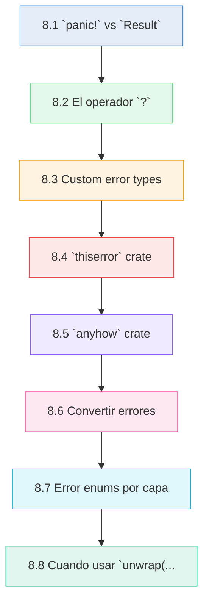
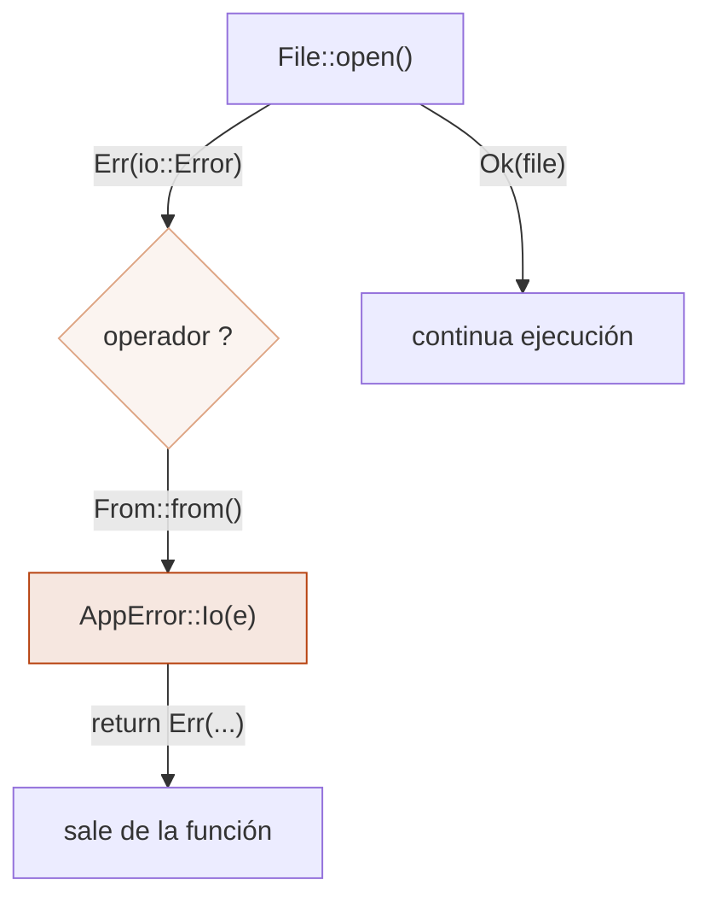
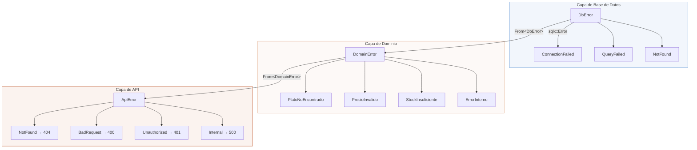
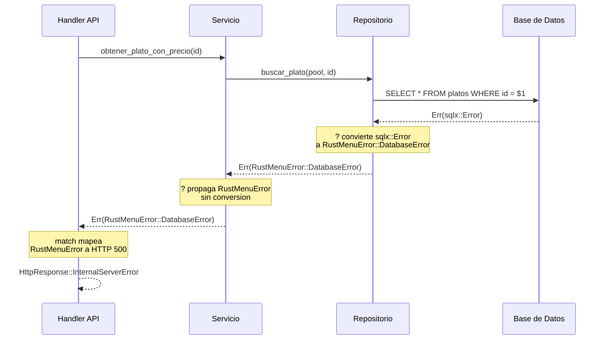

# :shield: Cap 8 — Manejo de errores

<div class="chapter-meta">
  <span class="meta-item">🕐 3-4 horas</span>
  <span class="meta-item">📊 Nivel: Intermedio</span>
  <span class="meta-item">🎯 Semana 4</span>
</div>

<div class="chapter-objective" markdown>
**Objetivo del capítulo:** Al finalizar este capítulo seras capaz de distinguir entre errores recuperables e irrecuperables, propagar errores con el operador `?`, crear tipos de error personalizados con `thiserror`, manejar errores genéricos con `anyhow`, y disenar arquitecturas de errores por capas. Dejaras de usar `unwrap()` en código de producción y pensaras en los errores como **valores tipados** que el compilador te obliga a manejar.
</div>

<div class="chapter-map">



</div>


!!! quote "Contexto"
    En Python, cualquier función puede lanzar cualquier excepción en cualquier momento y nada te obliga a manejarla. En Rust, los errores son **valores** que forman parte del sistema de tipos: si una función puede fallar, su firma lo dice explicitamente con `Result<T, E>`. El compilador te obliga a manejar cada error. Esto elimina los crashes inesperados y hace que el flujo de errores sea visible en el código.

---

<div class="concept-question" markdown>
**Pregunta para reflexionar:** En Python, si una función lanza una excepción que no capturas, tu programa se cae en tiempo de ejecución. Que pasaria si el compilador te obligara a manejar **todos** los posibles errores antes de ejecutar el programa? Que ventajas y desventajas tendria ese enfoque?
</div>

## 8.1 `panic!` vs `Result`

Rust divide los errores en dos categorias:

- **Irrecuperables** — el programa no puede continuar. Se usa `panic!`.
- **Recuperables** — el programa puede manejar el error. Se usa `Result<T, E>`.

### `panic!` — errores irrecuperables

```rust
fn main() {
    // panic! termina el programa inmediatamente
    panic!("Algo salio terriblemente mal");
}
```

`panic!` desenrolla el stack (por defecto) e imprime un backtrace. Usalo solo cuando el programa esta en un estado inconsistente y no tiene sentido continuar.

### `unwrap()` y `expect()` — panic disfrazado

```rust
fn main() {
    // unwrap(): si es Err, hace panic! con mensaje genérico
    let archivo = std::fs::read_to_string("config.toml").unwrap();

    // expect(): si es Err, hace panic! con tu mensaje personalizado
    let archivo = std::fs::read_to_string("config.toml")
        .expect("No se pudo leer config.toml");
}
```

### `Result<T, E>` — errores recuperables

```rust
use std::fs;
use std::io;

fn leer_config() -> Result<String, io::Error> {
    let contenido = fs::read_to_string("config.toml")?;
    Ok(contenido)
}

fn main() {
    match leer_config() {
        Ok(config) => println!("Config: {}", config),
        Err(e) => eprintln!("Error leyendo config: {}", e),
    }
}
```

<div class="comparison" markdown>
<div class="lang-box python" markdown>

#### :snake: En Python

```python
# Cualquier función puede lanzar cualquier excepción
# No hay obligación de manejarla
try:
    with open("config.toml") as f:
        config = f.read()
except FileNotFoundError:
    print("No se encontro el archivo")
except Exception as e:
    print(f"Error: {e}")
```

Las excepciones son **invisibles** en la firma de la función. Nada te obliga a capturarlas.

</div>
<div class="lang-box rust" markdown>

#### :crab: En Rust

```rust
fn leer_config() -> Result<String, io::Error> {
    fs::read_to_string("config.toml")
}
```

El tipo `Result<String, io::Error>` **declara explicitamente** que esta función puede fallar con un `io::Error`. El compilador te obliga a manejar ambos casos.

</div>
</div>

<div class="misconception-box" markdown>
### Mitos comunes viniendo de Python

<div class="wrong" markdown>
**Mito 1: "Result y Option son como try/except pero más verboso"**
En Python, `try/except` es un mecanismo de flujo de control que interrumpe la ejecución. En Rust, `Result` y `Option` son **tipos de datos** que el compilador verifica. No puedes olvidarte de manejar un error porque el compilador simplemente no compila tu código.
</div>

<div class="wrong" markdown>
**Mito 2: "Si no uso unwrap(), no necesito manejar errores"**
En Python puedes ignorar excepciones y dejar que se propaguen solas. En Rust, si una función devuelve `Result<T, E>`, **debes** hacer algo con ese `Result`: usar `match`, `?`, `unwrap_or`, etc. El compilador emite un warning si ignoras un `Result`.
</div>

<div class="wrong" markdown>
**Mito 3: "Option es lo mismo que devolver None en Python"**
En Python, cualquier función puede devolver `None` sin declararlo, y el error aparece en runtime como `AttributeError: NoneType has no attribute...`. En Rust, `Option<T>` esta en la firma de la función y el compilador te obliga a manejar el caso `None` explicitamente. No existen errores de `NoneType` en runtime.
</div>

<div class="right" markdown>
**La realidad:** El sistema de errores de Rust no es más verboso por capricho. Cada `Result` y `Option` es una **garantia del compilador** de que el error ha sido considerado. El operador `?` hace la propagación tan concisa como dejar que una excepción suba en Python, pero con la ventaja de que es **explícita y visible** en la firma de la función.
</div>
</div>

### Cuando usar cada uno

| Situación | Usa |
|---|---|
| Índice fuera de rango en lógica interna | `panic!` |
| Invariante del programa violada | `panic!` |
| Archivo no encontrado | `Result` |
| Error de red o base de datos | `Result` |
| Input de usuario inválido | `Result` |
| Prototipos y tests rapidos | `unwrap()` / `expect()` |

!!! warning "Regla general"
    Si el error puede ocurrir por causas externas (input del usuario, red, filesystem), usa `Result`. Si el error indica un bug en tu código, usa `panic!`.

<div class="micro-exercise" markdown>
**Micro-ejercicio:** Clasifica cada situación como `panic!` o `Result`:

1. Un usuario envia un JSON malformado en un request HTTP.
2. Un `Vec` interno que siempre deberia tener al menos un elemento esta vacio.
3. La conexion a una base de datos externa falla por timeout.
4. Un `match` sobre un enum no cubre una variante que nunca deberia existir.

??? success "Respuesta"
    1. **`Result`** — es input externo, el usuario puede enviar cualquier cosa.
    2. **`panic!`** — es una invariante del programa, si se viola hay un bug en tu código.
    3. **`Result`** — es una causa externa, la red puede fallar en cualquier momento.
    4. **`panic!`** (o `unreachable!()`) — si llegas a ese caso, tu lógica interna tiene un bug.
</div>

---

<div class="concept-question" markdown>
**Pregunta para reflexionar:** En Python, las excepciones se propagan automaticamente sin que escribas nada. En Rust necesitas `?` para propagar. Cual crees que es la ventaja de hacer la propagación **explícita**? Piensa en un proyecto con 50 archivos donde alguien cambia el tipo de error de una función interna.
</div>

## 8.2 El operador `?`

El operador `?` es azucar sintáctico para propagar errores. Si el valor es `Ok(v)`, desenvuelve `v`. Si es `Err(e)`, retorna el error inmediatamente de la función actual.

### Sin el operador `?`

```rust
use std::fs::File;
use std::io::{self, Read};

fn leer_config() -> Result<String, io::Error> {
    let archivo = match File::open("config.toml") {
        Ok(f) => f,
        Err(e) => return Err(e),  // propagación manual
    };

    let mut contenido = String::new();
    match archivo.read_to_string(&mut contenido) {
        Ok(_) => Ok(contenido),
        Err(e) => Err(e),  // propagación manual
    }
}
```

### Con el operador `?`

```rust
use std::fs::File;
use std::io::{self, Read};

fn leer_config() -> Result<String, io::Error> {
    let mut archivo = File::open("config.toml")?;  // propaga si Err
    let mut contenido = String::new();
    archivo.read_to_string(&mut contenido)?;        // propaga si Err
    Ok(contenido)
}
```

### Encadenamiento con `?`

```rust
use std::fs;

fn load_config() -> Result<Config, Box<dyn std::error::Error>> {
    let texto = fs::read_to_string("config.toml")?;
    let config: Config = toml::from_str(&texto)?;
    Ok(config)
}
```

!!! info "Requisito"
    El operador `?` solo se puede usar en funciones que devuelven `Result<T, E>` (o `Option<T>`). El tipo de error debe ser compatible (convertible via `From`) con el tipo de error de la función.

<div class="pro-tip" markdown>
**Pro tip:** El operador `?` también funciona con `Option<T>`. Si el valor es `None`, retorna `None` de la función. Esto es muy útil para encadenar operaciones que pueden no tener valor:

```rust
fn primer_caracter_mayuscula(texto: &str) -> Option<char> {
    let primer = texto.chars().next()?;       // None si el string esta vacio
    let mayuscula = primer.to_uppercase().next()?;  // None si la conversion falla
    Some(mayuscula)
}
```

No mezcles `?` para `Result` y `?` para `Option` en la misma función. Si necesitas ambos, usa `.ok_or("mensaje")` para convertir un `Option` en `Result`.
</div>

<div class="comparison" markdown>
<div class="lang-box python" markdown>

#### :snake: En Python

```python
# No existe equivalente directo
# Lo más cercano es no capturar y dejar que suba
def load_config():
    texto = open("config.toml").read()  # puede lanzar IOError
    config = toml.loads(texto)          # puede lanzar TomlError
    return config
    # Las excepciones se propagan automaticamente
```

Python propaga excepciones automaticamente. No necesitas hacer nada explicitamente, pero tampoco ves que errores pueden ocurrir.

</div>
<div class="lang-box rust" markdown>

#### :crab: En Rust

```rust
fn load_config() -> Result<Config, Error> {
    let texto = fs::read_to_string("config.toml")?;
    let config: Config = toml::from_str(&texto)?;
    Ok(config)
}
```

El `?` hace la propagación explícita. La firma `-> Result<Config, Error>` documenta que la función puede fallar.

</div>
</div>

---

<div class="concept-question" markdown>
**Pregunta para reflexionar:** Cuando defines tus propios tipos de error, por que Rust prefiere **enums** en vez de una jerarquia de clases con herencia como en Python? Piensa en como `match` te obliga a cubrir todos los casos y que pasa cuando agregas una nueva variante al enum.
</div>

## 8.3 Custom error types

Cuando tu aplicación necesita errores más específicos que los de la libreria estandar, creas tus propios tipos de error.

### Definir un error personalizado

```rust
use std::fmt;

#[derive(Debug)]
struct AppError {
    message: String,
    code: u16,
}

impl fmt::Display for AppError {
    fn fmt(&self, f: &mut fmt::Formatter<'_>) -> fmt::Result {
        write!(f, "Error {}: {}", self.code, self.message)
    }
}

impl std::error::Error for AppError {}
```

### Usar el error personalizado

```rust
fn buscar_plato(id: u32) -> Result<String, AppError> {
    if id == 0 {
        return Err(AppError {
            message: "ID de plato no puede ser 0".to_string(),
            code: 400,
        });
    }
    Ok(format!("Plato #{}", id))
}

fn main() {
    match buscar_plato(0) {
        Ok(plato) => println!("{}", plato),
        Err(e) => eprintln!("{}", e),  // "Error 400: ID de plato no puede ser 0"
    }
}
```

<div class="connection-box" markdown>
<span class="connection-icon">🔗</span> **Conexion con Cap 7 — Traits y Genericos:** Para crear un tipo de error personalizado necesitas implementar los traits `Display` y `Error`. Si no recuerdas como implementar traits manualmente, revisa la sección 7.1 en [Cap 7 — Traits y Genericos](07-traits-genericos.md). El patrón `impl fmt::Display for MiTipo` que usamos aqui es exactamente el mismo que aprendiste alli. Ademas, el trait `From<T>` que usamos para la conversion de errores es otro ejemplo práctico de implementación de traits.
</div>

### Error como enum — el patrón idiomatico

```rust
use std::fmt;

#[derive(Debug)]
enum AppError {
    NotFound(u32),
    Unauthorized,
    ValidationError(String),
    DatabaseError(String),
}

impl fmt::Display for AppError {
    fn fmt(&self, f: &mut fmt::Formatter<'_>) -> fmt::Result {
        match self {
            AppError::NotFound(id) => write!(f, "Recurso con id {} no encontrado", id),
            AppError::Unauthorized => write!(f, "No autorizado"),
            AppError::ValidationError(msg) => write!(f, "Error de validación: {}", msg),
            AppError::DatabaseError(msg) => write!(f, "Error de base de datos: {}", msg),
        }
    }
}

impl std::error::Error for AppError {}
```

<div class="comparison" markdown>
<div class="lang-box python" markdown>

#### :snake: En Python

```python
class AppError(Exception):
    pass

class NotFoundError(AppError):
    def __init__(self, id: int):
        super().__init__(f"Recurso {id} no encontrado")
        self.id = id

raise NotFoundError(42)
```

Python usa herencia de clases para jerarquias de excepciones.

</div>
<div class="lang-box rust" markdown>

#### :crab: En Rust

```rust
enum AppError {
    NotFound(u32),
    Unauthorized,
}

return Err(AppError::NotFound(42));
```

Rust usa enums. Cada variante es un caso de error con sus datos. El compilador verifica que manejes todos los casos con `match`.

</div>
</div>

---

## 8.4 `thiserror` crate

Escribir `Display` y `Error` a mano para cada tipo de error es tedioso. El crate `thiserror` genera todo el boilerplate con macros derive.

```toml title="Cargo.toml"
[dependencies]
thiserror = "2"
```

### Antes (manual) vs despues (thiserror)

```rust
// ❌ Sin thiserror: mucho boilerplate
#[derive(Debug)]
enum MenuError {
    NotFound(u32),
    Unauthorized,
    Validation(String),
    Database(String),
}

impl fmt::Display for MenuError {
    fn fmt(&self, f: &mut fmt::Formatter<'_>) -> fmt::Result {
        match self {
            MenuError::NotFound(id) => write!(f, "Plato {} no encontrado", id),
            MenuError::Unauthorized => write!(f, "No autorizado"),
            MenuError::Validation(msg) => write!(f, "Validación: {}", msg),
            MenuError::Database(msg) => write!(f, "DB: {}", msg),
        }
    }
}

impl std::error::Error for MenuError {}
```

```rust
// ✅ Con thiserror: limpio y conciso
use thiserror::Error;

#[derive(Debug, Error)]
enum MenuError {
    #[error("Plato {0} no encontrado")]
    NotFound(u32),

    #[error("No autorizado")]
    Unauthorized,

    #[error("Validación: {0}")]
    Validation(String),

    #[error("Error de base de datos: {0}")]
    Database(#[from] sqlx::Error),  // conversion automática desde sqlx::Error
}
```

### Atributos clave de thiserror

| Atributo | Función |
|---|---|
| `#[error("...")]` | Genera `Display` con el mensaje indicado |
| `#[from]` | Genera `impl From<TipoOriginal> for TuError` |
| `#[source]` | Marca el campo como fuente del error (para encadenamiento) |
| `{0}`, `{field}` | Interpola campos en el mensaje de error |

!!! tip "Cuando usar thiserror"
    Usa `thiserror` cuando escribes **librerias** o modulos que exponen tipos de error específicos. Los consumidores de tu libreria pueden hacer `match` sobre las variantes del enum.

---

## 8.5 `anyhow` crate

`anyhow` toma el enfoque opuesto a `thiserror`: en vez de definir tipos de error específicos, envuelve **cualquier** error en un tipo genérico `anyhow::Error`.

```toml title="Cargo.toml"
[dependencies]
anyhow = "1"
```

### Uso básico

```rust
use anyhow::{Result, Context};
use std::fs;

fn cargar_config() -> Result<Config> {
    let texto = fs::read_to_string("config.toml")
        .context("No se pudo leer el archivo de configuración")?;

    let config: Config = toml::from_str(&texto)
        .context("El archivo de configuración tiene formato inválido")?;

    Ok(config)
}

fn main() -> Result<()> {
    let config = cargar_config()?;
    println!("Puerto: {}", config.puerto);
    Ok(())
}
```

### `anyhow!` y `bail!`

```rust
use anyhow::{anyhow, bail, Result};

fn validar_precio(precio: f64) -> Result<()> {
    if precio < 0.0 {
        bail!("El precio no puede ser negativo: {}", precio);
        // equivalente a: return Err(anyhow!("El precio no puede ser negativo: {}", precio));
    }
    if precio > 1000.0 {
        return Err(anyhow!("Precio demasiado alto: {}", precio));
    }
    Ok(())
}
```

### `context()` para mensajes descriptivos

```rust
use anyhow::{Result, Context};
use std::fs;

fn procesar_pedido(id: u32) -> Result<String> {
    let datos = fs::read_to_string(format!("pedidos/{}.json", id))
        .with_context(|| format!("No se pudo leer el pedido {}", id))?;

    let pedido: Pedido = serde_json::from_str(&datos)
        .with_context(|| format!("Pedido {} tiene JSON inválido", id))?;

    Ok(pedido.resumen())
}
```

Cuando el error se imprime, muestra toda la cadena de contexto:

```
Error: No se pudo leer el pedido 42

Caused by:
    No such file or directory (os error 2)
```

<div class="pro-tip" markdown>
**Pro tip:** Cuando usar `.context()` vs `.with_context()`: usa `.context("mensaje fijo")` cuando el mensaje es un string estático. Usa `.with_context(|| format!(...))` cuando necesitas interpolar variables en el mensaje. La diferencia es que `.with_context()` solo construye el string si realmente hay un error (evaluación perezosa), lo cual es más eficiente en el camino feliz.

```rust
// ✅ Mensaje fijo: usa context()
fs::read_to_string("config.toml")
    .context("No se pudo leer la configuración")?;

// ✅ Mensaje dinámico: usa with_context()
fs::read_to_string(&path)
    .with_context(|| format!("No se pudo leer {}", path))?;
```
</div>

### thiserror vs anyhow — cuando usar cada uno

| Caracteristica | thiserror | anyhow |
|---|---|---|
| Proposito | Errores **tipados** y específicos | Errores **flexibles** y genéricos |
| Ideal para | Librerias | Aplicaciones |
| Patrón | `enum MiError { ... }` | `anyhow::Result<T>` |
| Match en errores | Si, los consumidores hacen `match` | No facilmente |
| Contexto | Manual (tu escribes los mensajes) | `.context("...")` automático |
| Conversion | `#[from]` genera `From` | Acepta cualquier `Error` |

!!! info "Regla práctica"
    **Librerias** usan `thiserror` porque los usuarios necesitan inspeccionar errores específicos. **Aplicaciones** usan `anyhow` porque solo necesitan reportar errores al usuario final.

---

## 8.6 Convertir errores

El trait `From` es el mecanismo que permite al operador `?` convertir entre tipos de error automaticamente.

### Conversion manual con `From`

```rust
use std::io;
use std::num::ParseIntError;

#[derive(Debug)]
enum AppError {
    Io(io::Error),
    Parse(ParseIntError),
}

impl From<io::Error> for AppError {
    fn from(error: io::Error) -> Self {
        AppError::Io(error)
    }
}

impl From<ParseIntError> for AppError {
    fn from(error: ParseIntError) -> Self {
        AppError::Parse(error)
    }
}

// Ahora ? convierte automaticamente
fn leer_puerto() -> Result<u16, AppError> {
    let texto = std::fs::read_to_string("puerto.txt")?;  // io::Error -> AppError
    let puerto: u16 = texto.trim().parse()?;              // ParseIntError -> AppError
    Ok(puerto)
}
```

### Como funciona `?` con `From`



El operador `?` hace esto internamente:

```rust
// Esto:
let archivo = File::open("datos.txt")?;

// Se expande a esto:
let archivo = match File::open("datos.txt") {
    Ok(f) => f,
    Err(e) => return Err(From::from(e)),  // conversion automática
};
```

<div class="code-evolution" markdown>
<div class="evolution-header">Evolución: de principiante a profesional en manejo de errores</div>

<div class="evolution-step" markdown>
<div class="step-label novato">Nivel 1: Novato — unwrap() por todas partes</div>

```rust
fn leer_puerto() -> u16 {
    let texto = std::fs::read_to_string("config.txt").unwrap();
    let puerto: u16 = texto.trim().parse().unwrap();
    puerto
}
// Problema: panic! si el archivo no existe o el contenido no es un número.
// Imposible de recuperar. El programa se cae sin contexto útil.
```
</div>

<div class="evolution-step" markdown>
<div class="step-label mejorado">Nivel 2: Mejorado — Result con match manual</div>

```rust
fn leer_puerto() -> Result<u16, String> {
    let texto = match std::fs::read_to_string("config.txt") {
        Ok(t) => t,
        Err(e) => return Err(format!("Error leyendo archivo: {}", e)),
    };
    let puerto: u16 = match texto.trim().parse() {
        Ok(p) => p,
        Err(e) => return Err(format!("Error parseando puerto: {}", e)),
    };
    Ok(puerto)
}
// Mejor: ya no hace panic!, pero es verboso y usa String como error genérico.
// El llamador no puede distinguir entre tipos de error.
```
</div>

<div class="evolution-step" markdown>
<div class="step-label profesional">Nivel 3: Profesional — enum tipado + thiserror + operador ?</div>

```rust
use thiserror::Error;

#[derive(Debug, Error)]
enum ConfigError {
    #[error("No se pudo leer el archivo de configuración: {0}")]
    Io(#[from] std::io::Error),

    #[error("Puerto inválido en configuración: {0}")]
    Parse(#[from] std::num::ParseIntError),
}

fn leer_puerto() -> Result<u16, ConfigError> {
    let texto = std::fs::read_to_string("config.txt")?;
    let puerto: u16 = texto.trim().parse()?;
    Ok(puerto)
}
// Profesional: conciso, tipado, el llamador puede hacer match
// sobre las variantes, y el operador ? convierte errores automaticamente.
```
</div>
</div>

### Con thiserror la conversion es automática

```rust
use thiserror::Error;

#[derive(Debug, Error)]
enum AppError {
    #[error("Error de I/O: {0}")]
    Io(#[from] std::io::Error),        // genera impl From<io::Error>

    #[error("Error de parseo: {0}")]
    Parse(#[from] std::num::ParseIntError),  // genera impl From<ParseIntError>
}

// ? funciona directamente, sin implementar From a mano
fn leer_puerto() -> Result<u16, AppError> {
    let texto = std::fs::read_to_string("puerto.txt")?;
    let puerto: u16 = texto.trim().parse()?;
    Ok(puerto)
}
```

---

## 8.7 Error enums por capa

En aplicaciones grandes, cada capa de la arquitectura define su propio tipo de error. Los errores se convierten al pasar de una capa a otra.

### Arquitectura de errores por capa



### Implementación completa

```rust
use thiserror::Error;

// === Capa de Base de Datos ===
#[derive(Debug, Error)]
enum DbError {
    #[error("Conexion a la base de datos fallida: {0}")]
    ConnectionFailed(String),

    #[error("Query fallida: {0}")]
    QueryFailed(String),

    #[error("Registro no encontrado")]
    NotFound,
}

// === Capa de Dominio ===
#[derive(Debug, Error)]
enum DomainError {
    #[error("Plato con id {0} no encontrado")]
    PlatoNoEncontrado(u32),

    #[error("Precio inválido: {0}")]
    PrecioInvalido(String),

    #[error("Stock insuficiente para el plato {0}")]
    StockInsuficiente(u32),

    #[error("Error interno: {0}")]
    Interno(#[from] DbError),  // convierte DbError -> DomainError automaticamente
}

// === Capa de API ===
#[derive(Debug, Error)]
enum ApiError {
    #[error("No encontrado: {0}")]
    NotFound(String),

    #[error("Solicitud inválida: {0}")]
    BadRequest(String),

    #[error("No autorizado")]
    Unauthorized,

    #[error("Error interno del servidor")]
    Internal(String),
}

// Conversion manual de DomainError a ApiError
impl From<DomainError> for ApiError {
    fn from(error: DomainError) -> Self {
        match error {
            DomainError::PlatoNoEncontrado(id) => {
                ApiError::NotFound(format!("Plato {} no encontrado", id))
            }
            DomainError::PrecioInvalido(msg) => {
                ApiError::BadRequest(msg)
            }
            DomainError::StockInsuficiente(id) => {
                ApiError::BadRequest(format!("Stock insuficiente para plato {}", id))
            }
            DomainError::Interno(db_err) => {
                ApiError::Internal(db_err.to_string())
            }
        }
    }
}
```

### Uso en funciones de cada capa

```rust
// Capa DB
fn buscar_plato_db(id: u32) -> Result<PlatoDB, DbError> {
    // simular consulta a la base de datos
    if id == 0 {
        return Err(DbError::NotFound);
    }
    Ok(PlatoDB { id, nombre: "Paella".to_string(), precio: 14.50 })
}

// Capa Dominio — DbError se convierte a DomainError con ?
fn obtener_plato(id: u32) -> Result<Plato, DomainError> {
    let plato_db = buscar_plato_db(id)
        .map_err(|_| DomainError::PlatoNoEncontrado(id))?;

    if plato_db.precio <= 0.0 {
        return Err(DomainError::PrecioInvalido(
            format!("Precio {} no válido", plato_db.precio)
        ));
    }

    Ok(Plato::from(plato_db))
}

// Capa API — DomainError se convierte a ApiError con ?
fn handler_obtener_plato(id: u32) -> Result<String, ApiError> {
    let plato = obtener_plato(id)?;  // DomainError -> ApiError via From
    Ok(format!("{{\"nombre\": \"{}\"}}", plato.nombre))
}
```

<div class="connection-box" markdown>
<span class="connection-icon">🔗</span> **Conexion con Cap 9 — Colecciones e Iteradores:** Los patrones de manejo de errores que aprendiste aqui se combinan perfectamente con los iteradores del próximo capítulo. En [Cap 9 — Colecciones e Iteradores](09-colecciones-iteradores.md) verás como `.collect::<Result<Vec<_>, _>>()` puede transformar un iterador de `Result`s en un solo `Result<Vec<_>, _>`, deteniendo la iteración al primer error. También aprenderas a usar `.filter_map(|x| x.ok())` para descartar errores y quedarte solo con los valores exitosos — una combinación poderosa entre iteradores y el manejo de errores tipado.
</div>

---

## 8.8 Cuando usar `unwrap()` y cuando no

`unwrap()` y `expect()` causan `panic!` si el valor es `Err` o `None`. Son útiles en ciertos contextos, pero peligrosos en otros.

### Cuando SI es aceptable

```rust
// 1. En tests — si falla, el test debe fallar
#[test]
fn test_parsear_precio() {
    let precio: f64 = "14.50".parse().unwrap();
    assert_eq!(precio, 14.50);
}

// 2. En prototipos rapidos — cuando exploras una idea
fn main() {
    let datos = std::fs::read_to_string("datos.json").unwrap();
    println!("{}", datos);
}

// 3. Cuando es logicamente imposible que falle
fn main() {
    let número: i32 = "42".parse().unwrap();  // "42" siempre es un entero válido
    // Mejor aun: documenta POR QUE es seguro
    let número: i32 = "42".parse().expect("literal '42' siempre es parseable");
}
```

### Cuando NO usarlo

```rust
// ❌ NUNCA en código de producción con datos externos
fn procesar_input(input: &str) -> String {
    let valor: i32 = input.parse().unwrap();  // BOOM si el usuario mete "abc"
    format!("Valor: {}", valor)
}

// ✅ Maneja el error correctamente
fn procesar_input(input: &str) -> Result<String, std::num::ParseIntError> {
    let valor: i32 = input.parse()?;
    Ok(format!("Valor: {}", valor))
}
```

### Clippy lint: `unwrap_used`

Puedes configurar Clippy para que **prohiba** `unwrap()` en tu proyecto:

```toml title="clippy.toml"
avoid-breaking-exported-api = false
```

```rust title="src/main.rs"
#![deny(clippy::unwrap_used)]    // error de compilación si usas unwrap()
#![deny(clippy::expect_used)]    // también para expect()
```

```bash
cargo clippy -- -D clippy::unwrap_used
```

### Alternativas seguras a `unwrap()`

| En vez de... | Usa... | Cuando |
|---|---|---|
| `.unwrap()` | `.unwrap_or(default)` | Tienes un valor por defecto |
| `.unwrap()` | `.unwrap_or_else(\|\| calc())` | El default requiere cálculo |
| `.unwrap()` | `.unwrap_or_default()` | El tipo implementa `Default` |
| `.unwrap()` | `?` | Quieres propagar el error |
| `.unwrap()` | `if let Ok(v) = ...` | Solo te interesa el caso exitoso |

```rust
// Alternativas en acción
let puerto: u16 = env::var("PORT")
    .unwrap_or_else(|_| "8080".to_string())
    .parse()
    .unwrap_or(8080);

let nombre = obtener_nombre().unwrap_or_default();  // String::default() = ""

if let Ok(config) = cargar_config() {
    println!("Config cargada: {:?}", config);
} else {
    println!("Usando configuración por defecto");
}
```

<div class="micro-exercise" markdown>
**Micro-ejercicio:** Reescribe el siguiente código eliminando **todos** los `unwrap()`. Usa las alternativas seguras que acabas de aprender:

```rust
fn obtener_puerto() -> u16 {
    let texto = std::fs::read_to_string("puerto.txt").unwrap();
    let puerto: u16 = texto.trim().parse().unwrap();
    puerto
}
```

??? success "Respuesta"
    ```rust
    // Opción A: propagar errores con ?
    fn obtener_puerto() -> Result<u16, Box<dyn std::error::Error>> {
        let texto = std::fs::read_to_string("puerto.txt")?;
        let puerto: u16 = texto.trim().parse()?;
        Ok(puerto)
    }

    // Opción B: usar valores por defecto
    fn obtener_puerto() -> u16 {
        std::fs::read_to_string("puerto.txt")
            .ok()
            .and_then(|t| t.trim().parse().ok())
            .unwrap_or(8080)  // valor por defecto si algo falla
    }
    ```
    La opción A es preferible en librerias (el llamador decide que hacer). La opción B es útil en `main()` o cuando hay un default razonable.
</div>

---

## 8.9 RustMenu: sistema de errores completo

Apliquemos todo lo aprendido al proyecto RustMenu. Definimos un `RustMenuError` que cubre todos los casos del sistema.

### Definición del error

```rust
use thiserror::Error;

#[derive(Debug, Error)]
pub enum RustMenuError {
    #[error("Plato con id {0} no encontrado")]
    NotFound(u32),

    #[error("No autorizado: {0}")]
    Unauthorized(String),

    #[error("Error de validación: {0}")]
    ValidationError(String),

    #[error("Error de base de datos: {0}")]
    DatabaseError(#[from] sqlx::Error),

    #[error("Error de I/O: {0}")]
    IoError(#[from] std::io::Error),

    #[error("Error de configuración: {0}")]
    ConfigError(String),
}

// Type alias para conveniencia
pub type RustMenuResult<T> = Result<T, RustMenuError>;
```

### Propagación desde DB hasta API

```rust
// Capa de repositorio
pub fn buscar_plato(pool: &Pool, id: u32) -> RustMenuResult<Plato> {
    let row = sqlx::query_as::<_, PlatoRow>("SELECT * FROM platos WHERE id = $1")
        .bind(id as i32)
        .fetch_optional(pool)
        .await?;  // sqlx::Error -> RustMenuError::DatabaseError

    let row = row.ok_or(RustMenuError::NotFound(id))?;
    Ok(Plato::from(row))
}

// Capa de servicio
pub fn obtener_plato_con_precio(pool: &Pool, id: u32) -> RustMenuResult<PlatoDTO> {
    let plato = buscar_plato(pool, id)?;  // propaga RustMenuError

    if plato.precio <= 0.0 {
        return Err(RustMenuError::ValidationError(
            format!("Plato {} tiene precio inválido: {}", id, plato.precio)
        ));
    }

    Ok(PlatoDTO::from(plato))
}

// Capa de handler API
pub fn handler_plato(pool: &Pool, id: u32) -> HttpResponse {
    match obtener_plato_con_precio(pool, id) {
        Ok(plato) => HttpResponse::Ok().json(plato),
        Err(RustMenuError::NotFound(_)) => HttpResponse::NotFound().finish(),
        Err(RustMenuError::Unauthorized(_)) => HttpResponse::Unauthorized().finish(),
        Err(RustMenuError::ValidationError(msg)) => {
            HttpResponse::BadRequest().body(msg)
        }
        Err(e) => {
            eprintln!("Error interno: {}", e);
            HttpResponse::InternalServerError().finish()
        }
    }
}
```

### Flujo completo de propagación



<div class="real-errors">
<h4>🚨 Errores que vas a encontrar</h4>

**Error 1: Usar `?` en `main()` sin retorno Result**

```rust
fn main() {
    let archivo = std::fs::read_to_string("menu.json")?; // ❌
    println!("{}", archivo);
}
```

```
error[E0277]: the `?` operator can only be used in a function
that returns `Result` or `Option`
 --> src/main.rs:2:52
  |
1 | fn main() {
  | --------- this function should return `Result` or `Option`
```

**¿Por qué?** El operador `?` propaga el error al caller, pero `main()` por defecto retorna `()`. Necesitas declarar que `main` retorna `Result`.

**Solución:**
```rust
fn main() -> Result<(), Box<dyn std::error::Error>> { // ✅
    let archivo = std::fs::read_to_string("menu.json")?;
    println!("{}", archivo);
    Ok(())
}
```

---

**Error 2: `?` con tipos de error incompatibles**

```rust
fn cargar_menu() -> Result<Menu, std::io::Error> {
    let contenido = std::fs::read_to_string("menu.json")?; // Ok: io::Error
    let menu: Menu = serde_json::from_str(&contenido)?;     // ❌ serde::Error ≠ io::Error
    Ok(menu)
}
```

```
error[E0277]: `?` couldn't convert the error to `std::io::Error`
 --> src/main.rs:3:56
  |
3 |     let menu: Menu = serde_json::from_str(&contenido)?;
  |                                                       ^ the trait `From<serde_json::Error>`
  |                                                         is not implemented for `std::io::Error`
```

**¿Por qué?** El `?` intenta convertir `serde_json::Error` a `io::Error` usando `From`, pero esa conversión no existe.

**Solución con `thiserror`:**
```rust
#[derive(thiserror::Error, Debug)]
enum MenuError {
    #[error("Error de lectura: {0}")]
    Io(#[from] std::io::Error),         // ✅ From<io::Error>
    #[error("Error de parsing: {0}")]
    Parse(#[from] serde_json::Error),   // ✅ From<serde_json::Error>
}

fn cargar_menu() -> Result<Menu, MenuError> { // ✅ ambos errores se convierten
    let contenido = std::fs::read_to_string("menu.json")?;
    let menu: Menu = serde_json::from_str(&contenido)?;
    Ok(menu)
}
```

---

**Error 3: `unwrap()` en None produce panic en runtime**

```rust
let platos = vec!["Paella", "Tortilla"];
let tercero = platos.get(5).unwrap(); // 💥 panic en runtime
```

```
thread 'main' panicked at 'called `Option::unwrap()` on a `None` value',
src/main.rs:2:33
```

**¿Por qué?** `get(5)` retorna `None` porque el índice no existe. `unwrap()` convierte `None` en panic. Esto compila sin errores pero explota en runtime.

**Solución:**
```rust
match platos.get(5) {
    Some(plato) => println!("Encontrado: {}", plato),
    None => println!("Ese plato no existe"),   // ✅ manejo explícito
}
// O con unwrap_or:
let tercero = platos.get(5).unwrap_or(&"Sin plato"); // ✅ valor por defecto
```

---

**Error 4: Olvidar manejar el Result (warning que se vuelve bug)**

```rust
fn guardar_pedido(pedido: &Pedido) {
    std::fs::write("pedido.json", serde_json::to_string(pedido).unwrap());
    // ⚠️ warning: unused `Result` that must be used
}
```

```
warning: unused `Result` that must be used
 --> src/main.rs:2:5
  |
  = note: this `Result` may be an `Err` variant, which should be handled
```

**¿Por qué?** `fs::write` retorna `Result<(), io::Error>`. Si no lo manejas, el error se ignora silenciosamente. El disco podría estar lleno y nunca lo sabrías.

**Solución:**
```rust
fn guardar_pedido(pedido: &Pedido) -> Result<(), Box<dyn std::error::Error>> {
    std::fs::write("pedido.json", serde_json::to_string(pedido)?)?; // ✅ propaga
    Ok(())
}
```

</div>

---

<div class="checkpoint" markdown>
### Checkpoint — Verifica tu comprensión

Antes de continuar, asegurate de que puedes responder estas preguntas:

1. Cual es la diferencia fundamental entre `panic!` y `Result`? Cuando usarias cada uno?
2. Que hace el operador `?` internamente y en que tipo de funciones se puede usar?
3. Por que se prefieren enums sobre structs para tipos de error personalizados?
4. Cuando usarias `thiserror` y cuando `anyhow`? Da un ejemplo concreto de cada uno.
5. Explica como el trait `From` permite que `?` convierta errores entre capas automaticamente.
6. Nombra 3 alternativas seguras a `unwrap()` y cuando usar cada una.

Si alguna respuesta no te sale con fluidez, vuelve a la sección correspondiente antes de avanzar. El manejo de errores es una de las habilidades más importantes en Rust y lo usaras en **cada programa** que escribas.
</div>

<div class="mini-project">
<h4>🏗️ Mini-proyecto: Aplicación práctica</h4>

**Paso 1 — Define las estructuras base**

Crea las estructuras y tipos necesarios para modelar el dominio del capítulo.

??? success "Solución Paso 1"
    ```rust
    // Define tus structs y enums aquí
    #[derive(Debug)]
    struct Item {
        nombre: String,
        valor: f64,
    }

    impl Item {
        fn new(nombre: &str, valor: f64) -> Self {
            Self {
                nombre: nombre.to_string(),
                valor,
            }
        }
    }
    ```

**Paso 2 — Implementa la lógica principal**

Crea funciones que operen sobre las estructuras del paso 1.

??? success "Solución Paso 2"
    ```rust
    fn procesar(items: &[Item]) -> f64 {
        items.iter().map(|i| i.valor).sum()
    }

    fn mostrar(items: &[Item]) {
        for item in items {
            println!("  {} — {:.2}€", item.nombre, item.valor);
        }
    }
    ```

**Paso 3 — Integra todo en main**

Combina los pasos anteriores en un programa completo.

??? success "Solución Paso 3"
    ```rust
    fn main() {
        let items = vec![
            Item::new("Paella", 14.50),
            Item::new("Gazpacho", 8.00),
            Item::new("Flan", 5.50),
        ];

        println!("=== RustMenu ===");
        mostrar(&items);
        println!("Total: {:.2}€", procesar(&items));
    }
    ```

</div>

<div class="ejercicio-guiado">
<h4>🏋️ Ejercicio guiado</h4>

Vas a construir un sistema de validacion de pedidos para RustMenu con tipos de error personalizados. Cada pedido debe pasar por varias validaciones (plato existe, mesa valida, precio correcto, stock disponible), y cada una puede fallar con un error especifico. Usaras un enum de error, el operador `?` para propagar, y `From` para convertir errores entre capas.

1. Define un enum `PedidoError` con las variantes: `PlatoNoEncontrado { id: u32 }`, `MesaInvalida { mesa: u32, motivo: String }`, `PrecioInvalido { plato: String, precio: f64 }`, `SinStock { plato: String }` y `ErrorInterno(String)`. Implementa `Display` y `Error` manualmente (sin thiserror, para practicar).
2. Crea una struct `Plato { id: u32, nombre: String, precio: f64, stock: u32 }` y una funcion `buscar_plato(id: u32) -> Result<Plato, PedidoError>` que simule una busqueda en memoria con un `Vec` de platos. Si el id no existe, devuelve `PedidoError::PlatoNoEncontrado`.
3. Crea una funcion `validar_mesa(mesa: u32) -> Result<(), PedidoError>` que valide que la mesa esta entre 1 y 20. Si no, devuelve `MesaInvalida`.
4. Crea una funcion `validar_pedido(plato_id: u32, mesa: u32, cantidad: u32) -> Result<String, PedidoError>` que use `?` para encadenar: buscar el plato, validar la mesa, verificar que el precio sea positivo y que haya stock suficiente. Si todo pasa, devuelve un `String` con el resumen del pedido.
5. Implementa `From<std::num::ParseIntError>` para `PedidoError` (convirtiendo a `ErrorInterno`), y crea una funcion `procesar_input(plato_id: &str, mesa: &str) -> Result<String, PedidoError>` que parsee strings a numeros usando `?` y luego llame a `validar_pedido`.
6. En `main`, prueba varios casos: pedido valido, plato inexistente, mesa fuera de rango, sin stock, e input no numerico. Usa `match` sobre el `Result` para mostrar mensajes descriptivos para cada tipo de error.

??? success "Solución completa"
    ```rust
    use std::fmt;
    use std::num::ParseIntError;

    // --- Tipos de error ---

    #[derive(Debug)]
    enum PedidoError {
        PlatoNoEncontrado { id: u32 },
        MesaInvalida { mesa: u32, motivo: String },
        PrecioInvalido { plato: String, precio: f64 },
        SinStock { plato: String },
        ErrorInterno(String),
    }

    impl fmt::Display for PedidoError {
        fn fmt(&self, f: &mut fmt::Formatter<'_>) -> fmt::Result {
            match self {
                PedidoError::PlatoNoEncontrado { id } => {
                    write!(f, "Plato con id {} no encontrado en el menu", id)
                }
                PedidoError::MesaInvalida { mesa, motivo } => {
                    write!(f, "Mesa {} invalida: {}", mesa, motivo)
                }
                PedidoError::PrecioInvalido { plato, precio } => {
                    write!(f, "Precio invalido para {}: {:.2}", plato, precio)
                }
                PedidoError::SinStock { plato } => {
                    write!(f, "Sin stock disponible para: {}", plato)
                }
                PedidoError::ErrorInterno(msg) => {
                    write!(f, "Error interno: {}", msg)
                }
            }
        }
    }

    impl std::error::Error for PedidoError {}

    impl From<ParseIntError> for PedidoError {
        fn from(e: ParseIntError) -> Self {
            PedidoError::ErrorInterno(format!("Error parseando numero: {}", e))
        }
    }

    // --- Modelo ---

    #[derive(Debug, Clone)]
    struct Plato {
        id: u32,
        nombre: String,
        precio: f64,
        stock: u32,
    }

    // --- Funciones de validacion ---

    fn menu_disponible() -> Vec<Plato> {
        vec![
            Plato { id: 1, nombre: String::from("Paella"), precio: 14.50, stock: 5 },
            Plato { id: 2, nombre: String::from("Gazpacho"), precio: 8.00, stock: 0 },
            Plato { id: 3, nombre: String::from("Tortilla"), precio: 10.00, stock: 3 },
            Plato { id: 4, nombre: String::from("Error Plato"), precio: -5.00, stock: 2 },
        ]
    }

    fn buscar_plato(id: u32) -> Result<Plato, PedidoError> {
        menu_disponible()
            .into_iter()
            .find(|p| p.id == id)
            .ok_or(PedidoError::PlatoNoEncontrado { id })
    }

    fn validar_mesa(mesa: u32) -> Result<(), PedidoError> {
        if mesa < 1 || mesa > 20 {
            return Err(PedidoError::MesaInvalida {
                mesa,
                motivo: String::from("debe estar entre 1 y 20"),
            });
        }
        Ok(())
    }

    fn validar_pedido(
        plato_id: u32,
        mesa: u32,
        cantidad: u32,
    ) -> Result<String, PedidoError> {
        let plato = buscar_plato(plato_id)?;
        validar_mesa(mesa)?;

        if plato.precio <= 0.0 {
            return Err(PedidoError::PrecioInvalido {
                plato: plato.nombre.clone(),
                precio: plato.precio,
            });
        }

        if plato.stock < cantidad {
            return Err(PedidoError::SinStock {
                plato: plato.nombre.clone(),
            });
        }

        let total = plato.precio * cantidad as f64;
        Ok(format!(
            "Pedido OK: {}x {} para mesa {} — Total: {:.2}EUR",
            cantidad, plato.nombre, mesa, total
        ))
    }

    fn procesar_input(
        plato_id: &str,
        mesa: &str,
    ) -> Result<String, PedidoError> {
        let id: u32 = plato_id.parse()?;
        let mesa_num: u32 = mesa.parse()?;
        validar_pedido(id, mesa_num, 1)
    }

    fn main() {
        let casos = vec![
            ("Pedido valido", validar_pedido(1, 5, 2)),
            ("Plato inexistente", validar_pedido(99, 5, 1)),
            ("Mesa fuera de rango", validar_pedido(1, 25, 1)),
            ("Sin stock", validar_pedido(2, 5, 1)),
            ("Precio invalido", validar_pedido(4, 5, 1)),
        ];

        for (descripcion, resultado) in casos {
            match resultado {
                Ok(resumen) => println!("[OK]    {}: {}", descripcion, resumen),
                Err(e) => println!("[ERROR] {}: {}", descripcion, e),
            }
        }

        println!("\n--- Procesando input de usuario ---");
        let input_casos = vec![
            ("1", "5"),
            ("abc", "5"),
            ("1", "xyz"),
        ];

        for (plato_input, mesa_input) in input_casos {
            match procesar_input(plato_input, mesa_input) {
                Ok(resumen) => println!("[OK]    {}", resumen),
                Err(e) => println!("[ERROR] Input ({}, {}): {}", plato_input, mesa_input, e),
            }
        }
    }
    ```

</div>


## 🔗 Recursos

| Recurso | Enlace |
|---------|--------|
| The Rust Book: Error Handling | [doc.rust-lang.org/book/ch09-00-error-handling](https://doc.rust-lang.org/book/ch09-00-error-handling.html) |
| thiserror crate | [docs.rs/thiserror](https://docs.rs/thiserror/latest/thiserror/) |
| anyhow crate | [docs.rs/anyhow](https://docs.rs/anyhow/latest/anyhow/) |
| Rust by Example: Error handling | [doc.rust-lang.org/rust-by-example/error](https://doc.rust-lang.org/rust-by-example/error.html) |

---

## 🎯 Ejercicios

??? question "Ejercicio 1: Result básico"
    Escribe una función `dividir(a: f64, b: f64) -> Result<f64, String>` que devuelva `Err` si `b` es cero.

    ??? success "Solución"
        ```rust
        fn dividir(a: f64, b: f64) -> Result<f64, String> {
            if b == 0.0 {
                return Err("Division por cero".to_string());
            }
            Ok(a / b)
        }

        fn main() {
            match dividir(10.0, 3.0) {
                Ok(resultado) => println!("10 / 3 = {:.2}", resultado),
                Err(e) => eprintln!("Error: {}", e),
            }

            match dividir(10.0, 0.0) {
                Ok(resultado) => println!("10 / 0 = {:.2}", resultado),
                Err(e) => eprintln!("Error: {}", e),
            }
        }
        ```

??? question "Ejercicio 2: Propagar con `?`"
    Escribe una función `leer_edad(path: &str) -> Result<u8, Box<dyn std::error::Error>>` que lea un archivo, parsee su contenido como `u8` y lo devuelva. Usa `?` para propagar errores.

    ??? success "Solución"
        ```rust
        use std::fs;

        fn leer_edad(path: &str) -> Result<u8, Box<dyn std::error::Error>> {
            let contenido = fs::read_to_string(path)?;
            let edad: u8 = contenido.trim().parse()?;
            Ok(edad)
        }

        fn main() {
            match leer_edad("edad.txt") {
                Ok(edad) => println!("Edad: {}", edad),
                Err(e) => eprintln!("Error: {}", e),
            }
        }
        ```

??? question "Ejercicio 3: Custom error con thiserror"
    Crea un enum `PedidoError` con variantes `PlatoNoExiste(u32)`, `MesaOcupada(u32)` y `PrecioNegativo(f64)`. Usa `thiserror` para derivar `Error` y `Display`.

    !!! tip "Pista"
        Cada variante necesita su atributo `#[error("...")]` con interpolación de campos usando `{0}`.

    ??? success "Solución"
        ```rust
        use thiserror::Error;

        #[derive(Debug, Error)]
        enum PedidoError {
            #[error("El plato con id {0} no existe en el menu")]
            PlatoNoExiste(u32),

            #[error("La mesa {0} ya esta ocupada")]
            MesaOcupada(u32),

            #[error("El precio no puede ser negativo: {0}")]
            PrecioNegativo(f64),
        }

        fn crear_pedido(plato_id: u32, mesa: u32, precio: f64) -> Result<String, PedidoError> {
            if plato_id > 100 {
                return Err(PedidoError::PlatoNoExiste(plato_id));
            }
            if mesa == 5 {
                return Err(PedidoError::MesaOcupada(mesa));
            }
            if precio < 0.0 {
                return Err(PedidoError::PrecioNegativo(precio));
            }
            Ok(format!("Pedido: plato {} en mesa {} por {:.2}€", plato_id, mesa, precio))
        }

        fn main() {
            println!("{:?}", crear_pedido(1, 3, 14.50));    // Ok(...)
            println!("{:?}", crear_pedido(999, 3, 14.50));   // Err(PlatoNoExiste(999))
            println!("{:?}", crear_pedido(1, 5, 14.50));     // Err(MesaOcupada(5))
            println!("{:?}", crear_pedido(1, 3, -5.0));      // Err(PrecioNegativo(-5.0))
        }
        ```

??? question "Ejercicio 4: anyhow con context"
    Reescribe una función que lee un archivo JSON de configuración usando `anyhow::Result` y `context()` para dar mensajes descriptivos en cada paso.

    !!! tip "Pista"
        Usa `.context("mensaje")` despues de cada operación que puede fallar con `?`.

    ??? success "Solución"
        ```rust
        use anyhow::{Result, Context};
        use serde::Deserialize;
        use std::fs;

        #[derive(Debug, Deserialize)]
        struct Config {
            puerto: u16,
            host: String,
        }

        fn cargar_config(path: &str) -> Result<Config> {
            let contenido = fs::read_to_string(path)
                .with_context(|| format!("No se pudo leer el archivo '{}'", path))?;

            let config: Config = serde_json::from_str(&contenido)
                .with_context(|| format!("El archivo '{}' no tiene JSON válido", path))?;

            if config.puerto == 0 {
                anyhow::bail!("El puerto no puede ser 0");
            }

            Ok(config)
        }

        fn main() -> Result<()> {
            let config = cargar_config("config.json")?;
            println!("Servidor en {}:{}", config.host, config.puerto);
            Ok(())
        }
        ```

??? question "Ejercicio 5: Conversion de errores entre capas"
    Crea dos enums de error: `StorageError` (con `FileNotFound` y `PermissionDenied`) y `ServiceError` (con `DataUnavailable` y `AccessDenied`). Implementa `From<StorageError> for ServiceError` para que `?` convierta automaticamente.

    ??? success "Solución"
        ```rust
        use thiserror::Error;

        #[derive(Debug, Error)]
        enum StorageError {
            #[error("Archivo no encontrado: {0}")]
            FileNotFound(String),

            #[error("Permiso denegado: {0}")]
            PermissionDenied(String),
        }

        #[derive(Debug, Error)]
        enum ServiceError {
            #[error("Datos no disponibles: {0}")]
            DataUnavailable(String),

            #[error("Acceso denegado: {0}")]
            AccessDenied(String),
        }

        impl From<StorageError> for ServiceError {
            fn from(error: StorageError) -> Self {
                match error {
                    StorageError::FileNotFound(path) => {
                        ServiceError::DataUnavailable(
                            format!("Archivo {} no disponible", path)
                        )
                    }
                    StorageError::PermissionDenied(path) => {
                        ServiceError::AccessDenied(
                            format!("Sin permisos para {}", path)
                        )
                    }
                }
            }
        }

        fn leer_datos(path: &str) -> Result<String, StorageError> {
            Err(StorageError::FileNotFound(path.to_string()))
        }

        fn obtener_datos() -> Result<String, ServiceError> {
            let datos = leer_datos("menu.json")?;  // StorageError -> ServiceError
            Ok(datos)
        }

        fn main() {
            match obtener_datos() {
                Ok(datos) => println!("{}", datos),
                Err(e) => eprintln!("Error: {}", e),
                // "Error: Datos no disponibles: Archivo menu.json no disponible"
            }
        }
        ```

---

## :brain: Flashcards de repaso

<div class="flashcard">
<div class="front">Cual es la diferencia entre <code>panic!</code> y <code>Result</code>?</div>
<div class="back"><code>panic!</code> es para errores <strong>irrecuperables</strong> (termina el programa). <code>Result&lt;T, E&gt;</code> es para errores <strong>recuperables</strong> que el llamador puede manejar. Usa <code>Result</code> para todo lo que pueda fallar por causas externas.</div>
</div>

<div class="flashcard">
<div class="front">Que hace el operador <code>?</code> en Rust?</div>
<div class="back">Si el valor es <code>Ok(v)</code>, desenvuelve <code>v</code>. Si es <code>Err(e)</code>, convierte el error con <code>From::from(e)</code> y lo retorna de la función. Solo se puede usar en funciones que devuelven <code>Result</code> o <code>Option</code>.</div>
</div>

<div class="flashcard">
<div class="front">Cual es la diferencia entre <code>thiserror</code> y <code>anyhow</code>?</div>
<div class="back"><code>thiserror</code> genera errores <strong>tipados</strong> (enums con variantes específicas) — ideal para <strong>librerias</strong>. <code>anyhow</code> envuelve cualquier error en un tipo genérico con contexto — ideal para <strong>aplicaciones</strong>.</div>
</div>

<div class="flashcard">
<div class="front">Que hace el atributo <code>#[from]</code> en thiserror?</div>
<div class="back">Genera automaticamente <code>impl From&lt;TipoOriginal&gt; for TuError</code>. Esto permite que el operador <code>?</code> convierta el error original a tu tipo de error sin escribir la implementación manual.</div>
</div>

<div class="flashcard">
<div class="front">Cuando es aceptable usar <code>unwrap()</code>?</div>
<div class="back">En tests, en prototipos, y cuando es <strong>logicamente imposible</strong> que el valor sea <code>Err</code>/<code>None</code> (como <code>"42".parse::&lt;i32&gt;().unwrap()</code>). Nunca en código de producción que procesa datos externos.</div>
</div>

<div class="flashcard">
<div class="front">Que alternativas seguras existen a <code>unwrap()</code>?</div>
<div class="back"><code>unwrap_or(default)</code>, <code>unwrap_or_else(|| ...)</code>, <code>unwrap_or_default()</code>, el operador <code>?</code> para propagar, e <code>if let Ok(v) = ...</code> para manejar solo el caso exitoso.</div>
</div>

---

## :video_game: Quiz interactivo

<div class="quiz" data-quiz-id="ch08-q1">
<h4>Pregunta 1: Que hace el operador <code>?</code>?</h4>
<button class="quiz-option" data-correct="false">Siempre hace <code>panic!</code> si hay un error</button>
<button class="quiz-option" data-correct="true">Retorna el error si es <code>Err</code>, desenvuelve el <code>Ok</code> si es <code>Ok</code></button>
<button class="quiz-option" data-correct="false">Convierte cualquier tipo a <code>Result</code></button>
<button class="quiz-option" data-correct="false">Ignora el error y devuelve un valor por defecto</button>
<div class="quiz-feedback" data-correct="Correcto! El operador ? desenvuelve Ok(v) para continuar la ejecución, o convierte y retorna Err(e) de la función actual. Es azucar sintáctico para match con propagación." data-incorrect="Incorrecto. El operador ? hace dos cosas: si el valor es Ok(v), desenvuelve v y continua. Si es Err(e), llama a From::from(e) para convertir el error y lo retorna de la función. No hace panic! ni ignora errores."></div>
</div>

<div class="quiz" data-quiz-id="ch08-q2">
<h4>Pregunta 2: Cuando usar <code>thiserror</code> vs <code>anyhow</code>?</h4>
<button class="quiz-option" data-correct="false"><code>thiserror</code> para aplicaciones, <code>anyhow</code> para librerias</button>
<button class="quiz-option" data-correct="false">Son intercambiables, usa el que prefieras</button>
<button class="quiz-option" data-correct="true"><code>thiserror</code> para librerias (errores tipados), <code>anyhow</code> para aplicaciones (errores flexibles)</button>
<button class="quiz-option" data-correct="false"><code>anyhow</code> reemplaza a <code>thiserror</code> en todos los casos</button>
<div class="quiz-feedback" data-correct="Correcto! thiserror genera enums de error tipados que los usuarios de tu libreria pueden inspeccionar con match. anyhow envuelve cualquier error con contexto, ideal para aplicaciones donde solo necesitas reportar errores al usuario final." data-incorrect="Incorrecto. thiserror es para librerias porque genera tipos de error específicos que los consumidores pueden match-ear. anyhow es para aplicaciones porque simplifica el manejo con un tipo genérico y context(). No son intercambiables."></div>
</div>

---

## :bug: Ejercicio de depuración

Encuentra los **3 errores** en este código:

```rust
// ❌ Este código tiene 3 errores. Encuentralos!

use std::fs;
use std::num::ParseIntError;

enum ConfigError {
    IoError(std::io::Error),
    ParseError(ParseIntError),
}

fn leer_puerto(path: &str) -> Result<u16, ConfigError> {
    let contenido = fs::read_to_string(path)?;           // 🤔 Funciona el ? aqui?
    let puerto: u16 = contenido.trim().parse().unwrap();  // 🤔 Es seguro esto?
    Ok(puerto)
}

fn main() {
    let puerto = leer_puerto("config.txt")?;              // 🤔 Puede usar ? en main?
    println!("Puerto: {}", puerto);
}
```

??? success "Solución"
    ```rust
    // ✅ Código corregido

    use std::fs;
    use std::num::ParseIntError;

    #[derive(Debug)]  // necesario para depuración
    enum ConfigError {
        IoError(std::io::Error),
        ParseError(ParseIntError),
    }

    // ✅ Fix 1: implementar From para que ? pueda convertir errores
    impl From<std::io::Error> for ConfigError {
        fn from(e: std::io::Error) -> Self {
            ConfigError::IoError(e)
        }
    }

    impl From<ParseIntError> for ConfigError {
        fn from(e: ParseIntError) -> Self {
            ConfigError::ParseError(e)
        }
    }

    // Necesario para imprimir el error
    impl std::fmt::Display for ConfigError {
        fn fmt(&self, f: &mut std::fmt::Formatter<'_>) -> std::fmt::Result {
            match self {
                ConfigError::IoError(e) => write!(f, "Error de I/O: {}", e),
                ConfigError::ParseError(e) => write!(f, "Error de parseo: {}", e),
            }
        }
    }

    fn leer_puerto(path: &str) -> Result<u16, ConfigError> {
        let contenido = fs::read_to_string(path)?;             // ✅ Ahora funciona con From
        let puerto: u16 = contenido.trim().parse()?;           // ✅ Fix 2: usar ? en vez de unwrap()
        Ok(puerto)
    }

    fn main() {
        // ✅ Fix 3: main no devuelve Result, usar match en vez de ?
        match leer_puerto("config.txt") {
            Ok(puerto) => println!("Puerto: {}", puerto),
            Err(e) => eprintln!("Error: {}", e),
        }
    }
    ```

    **Explicación de cada error:**

    1. **`?` sin `From` implementado** — El operador `?` necesita que exista `impl From<io::Error> for ConfigError` para convertir el error automaticamente. Sin esa implementación, el compilador da error.
    2. **`unwrap()` en dato externo** — El contenido del archivo es input externo que puede no ser un número válido. Usar `unwrap()` aqui causa `panic!` si el archivo contiene texto no numerico. Debe usarse `?` para propagar el error.
    3. **`?` en `main()` sin `Result`** — La función `main()` por defecto devuelve `()`, no `Result`. No se puede usar `?` sin cambiar la firma a `fn main() -> Result<(), ConfigError>` o usar `match`.

---

## ✅ Autoevaluación del capítulo

<div class="self-check" markdown>
<h4>Has comprendido todo? Marca lo que puedes hacer:</h4>
<label><input type="checkbox"> Se la diferencia entre `panic!` y `Result` y cuando usar cada uno</label>
<label><input type="checkbox"> Puedo usar el operador `?` para propagar errores y se sus requisitos</label>
<label><input type="checkbox"> Puedo crear custom error types con enums y `thiserror`</label>
<label><input type="checkbox"> Entiendo cuando usar `thiserror` vs `anyhow`</label>
<label><input type="checkbox"> Puedo disenar errores por capa con conversion automática via `From`</label>
</div>
