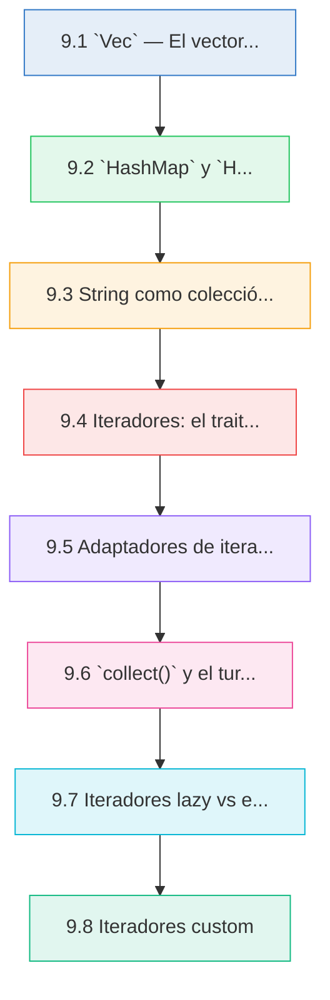
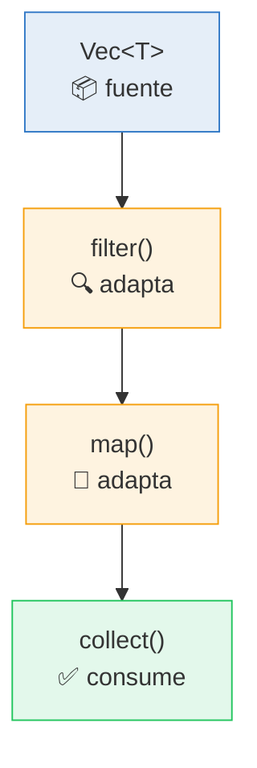

# 📚 Cap 9 — Colecciones e Iteradores

<div class="chapter-meta">
  <span class="meta-item">🕐 3-4 horas</span>
  <span class="meta-item">📊 Nivel: Avanzado</span>
  <span class="meta-item">🎯 Semana 5</span>
</div>

<div class="chapter-objective"><span class="objective-icon">📌</span><span class="objective-text">Al finalizar este capítulo serás capaz de almacenar datos en colecciones dinámicas (<code>Vec</code>, <code>HashMap</code>, <code>HashSet</code>), procesarlos con cadenas de iteradores lazy y construir pipelines funcionales que el compilador optimiza a coste cero.</span></div>

<div class="chapter-map">



</div>


!!! quote "Contexto"
    En Python tienes listas, diccionarios y generadores que hacen todo el trabajo pesado. Rust ofrece las mismas capacidades con `Vec`, `HashMap` e iteradores, pero con control total sobre la memoria y evaluación lazy por defecto. Este capítulo conecta tu intuición de Python con el poder de las colecciones e iteradores de Rust.

<div class="connection-box" markdown>
<span class="connection-icon">🔗</span> **Conexión con el capítulo anterior** — En el [Cap 8: Manejo de errores](08-manejo-errores.md) aprendiste a usar `Result<T, E>` y `Option<T>`. Aquí los reencontrarás constantemente: `Vec::get()` retorna `Option<&T>`, `HashMap::get()` retorna `Option<&V>`, e incluso puedes hacer `collect()` sobre un iterador de `Result` para cortocircuitar en el primer error. Dominar el manejo de errores es la base para trabajar con colecciones de forma segura.
</div>

---

## 9.1 `Vec<T>` — El vector dinámico

`Vec<T>` es la colección más usada en Rust. Es un array dinámico que crece en el heap, equivalente a `list` en Python.

```rust
// Crear vectores
let mut platos: Vec<String> = Vec::new();         // Vector vacío con tipo explícito
let precios = vec![12.5, 15.0, 18.0, 22.0];      // vec![] macro con valores iniciales
let ceros = vec![0; 10];                           // 10 elementos con valor 0

// Agregar elementos
platos.push(String::from("Bruschetta"));
platos.push(String::from("Risotto"));
platos.push(String::from("Tiramisú"));

// Eliminar el último elemento
let último = platos.pop();  // Option<String> → Some("Tiramisú")

// Acceder por índice
let primero = &platos[0];               // &String — panics si el índice no existe
let segundo = platos.get(1);            // Option<&String> — seguro, retorna None

// Iterar
for plato in &platos {
    println!("Plato: {plato}");
}

// Capacidad vs longitud
let mut v: Vec<i32> = Vec::with_capacity(10);  // (1)!
println!("len: {}, capacity: {}", v.len(), v.capacity());
// len: 0, capacity: 10
```

1. :warning: `with_capacity` pre-reserva memoria sin inicializar elementos. Evita realocaciones cuando sabes cuántos elementos tendrás.

!!! tip "Regla de oro"
    Usa `get()` en lugar de indexar directamente con `[]` cuando no estés seguro de que el índice existe. `get()` retorna `Option<&T>` y te obliga a manejar el caso `None`.

<div class="concept-question"><h4>🔍 Pregunta conceptual</h4><p>Si <code>Vec::with_capacity(100)</code> crea un vector con capacidad para 100 elementos pero <code>len()</code> devuelve 0, ¿qué ocurre si intentas acceder a <code>v[50]</code>? ¿El compilador lo previene o es un error en tiempo de ejecución? Reflexiona sobre la diferencia entre capacidad (memoria reservada) y longitud (elementos inicializados).</p></div>

<div class="comparison" markdown>
<div class="lang-box python" markdown>

#### :snake: En Python

```python
platos = []
platos.append("Bruschetta")
platos.append("Risotto")
último = platos.pop()
primero = platos[0]       # IndexError si está vacío
```

Las listas de Python aceptan cualquier tipo mezclado: `[1, "hola", True]`. Crecen automáticamente sin preocuparte por la capacidad.

</div>
<div class="lang-box rust" markdown>

#### :crab: En Rust

```rust
let mut platos: Vec<String> = Vec::new();
platos.push(String::from("Bruschetta"));
let último = platos.pop();    // Option<String>
let primero = platos.get(0);  // Option<&String>
```

`Vec<T>` es homogéneo: todos los elementos deben ser del mismo tipo `T`. El acceso seguro con `get()` retorna `Option` en lugar de lanzar excepciones.

</div>
</div>

---

## 9.2 `HashMap<K, V>` y `HashSet<T>`

### HashMap: el diccionario de Rust

```rust
use std::collections::HashMap;

// Crear y poblar
let mut menu: HashMap<String, f64> = HashMap::new();
menu.insert(String::from("Bruschetta"), 8.50);
menu.insert(String::from("Risotto"), 16.00);
menu.insert(String::from("Tiramisú"), 7.50);

// Acceder
let precio = menu.get("Risotto");  // Option<&f64> → Some(&16.0)
let missing = menu.get("Pizza");   // None

// Entry API: insertar solo si no existe
menu.entry(String::from("Pizza")).or_insert(14.00);    // Inserta "Pizza"
menu.entry(String::from("Risotto")).or_insert(99.99);  // NO sobreescribe

// Entry API: modificar valor existente
let contador = menu.entry(String::from("Bruschetta")).or_insert(0.0);
*contador += 1.0;  // (1)!

// Iterar
for (plato, precio) in &menu {
    println!("{plato}: €{precio:.2}");
}
```

1. `or_insert()` retorna `&mut V`, así que puedes modificar el valor in-place con `*contador += 1.0`.

<div class="micro-exercise" markdown>
<h4>🏋️ Micro-ejercicio — Entry API</h4>

Dado el siguiente vector de pedidos, usa la Entry API para contar cuántas veces se pidió cada plato:

```rust
let pedidos = vec!["Risotto", "Bruschetta", "Risotto", "Pasta", "Risotto", "Pasta"];
// Tu código: crea un HashMap<&str, usize> con el conteo de cada plato
```

<details>
<summary>Ver solución</summary>

```rust
use std::collections::HashMap;

let pedidos = vec!["Risotto", "Bruschetta", "Risotto", "Pasta", "Risotto", "Pasta"];
let mut conteo: HashMap<&str, usize> = HashMap::new();

for plato in &pedidos {
    *conteo.entry(plato).or_insert(0) += 1;
}

println!("{:?}", conteo);
// {"Risotto": 3, "Pasta": 2, "Bruschetta": 1}
```

</details>
</div>

### HashSet: conjunto sin duplicados

```rust
use std::collections::HashSet;

let mut alergenos: HashSet<String> = HashSet::new();
alergenos.insert(String::from("gluten"));
alergenos.insert(String::from("lactosa"));
alergenos.insert(String::from("gluten"));  // No se inserta: ya existe

println!("Total: {}", alergenos.len());  // 2

// Operaciones de conjuntos
let grupo_a: HashSet<i32> = [1, 2, 3, 4].iter().cloned().collect();
let grupo_b: HashSet<i32> = [3, 4, 5, 6].iter().cloned().collect();

let union: HashSet<_> = grupo_a.union(&grupo_b).collect();
let inter: HashSet<_> = grupo_a.intersection(&grupo_b).collect();
let diff: HashSet<_> = grupo_a.difference(&grupo_b).collect();
```

<div class="comparison" markdown>
<div class="lang-box python" markdown>

#### :snake: En Python

```python
menu = {"Bruschetta": 8.50, "Risotto": 16.00}
menu.setdefault("Pizza", 14.00)
alergenos = {"gluten", "lactosa"}
```

Python usa `dict` y `set` con sintaxis literal `{}`. `setdefault()` es el equivalente a `.entry().or_insert()`.

</div>
<div class="lang-box rust" markdown>

#### :crab: En Rust

```rust
let mut menu: HashMap<String, f64> = HashMap::new();
menu.entry(String::from("Pizza")).or_insert(14.00);
let alergenos: HashSet<String> = HashSet::new();
```

Rust usa `HashMap` y `HashSet` de `std::collections`. No hay sintaxis literal, pero la Entry API es más potente que `setdefault()`.

</div>
</div>

!!! pro-tip "Pro-tip: `HashMap` con claves `&str` vs `String`"
    Si las claves de tu `HashMap` vienen de strings literales o slices que viven lo suficiente, usa `HashMap<&str, V>` en lugar de `HashMap<String, V>`. Ahorras allocaciones innecesarias en el heap. Pero cuidado: el lifetime de las claves debe ser al menos tan largo como el del `HashMap`. En caso de duda, usa `String` como clave.

---

## 9.3 String como colección

En Rust, `String` no es un simple array de caracteres. Es una secuencia de bytes UTF-8, y esto tiene consecuencias importantes:

```rust
let saludo = String::from("Hola, mundo! 🌍");

// ❌ NO puedes indexar un String directamente
// let c = saludo[0];  // ERROR: `String` cannot be indexed by `{integer}`

// ✅ Iterar por caracteres
for c in saludo.chars() {
    print!("{c} ");
}
// H o l a ,   m u n d o !   🌍

// ✅ Iterar por bytes
for b in saludo.bytes() {
    print!("{b} ");
}
// 72 111 108 97 44 32 109 117 110 100 111 33 32 240 159 140 141

// ✅ Slices de bytes (con cuidado)
let hola = &saludo[0..4];  // "Hola" — funciona porque son 4 bytes ASCII
// let emoji = &saludo[13..14];  // ❌ PANIC: no es un límite válido de char UTF-8

// Longitud: bytes vs caracteres
println!("Bytes: {}", saludo.len());          // 18
println!("Chars: {}", saludo.chars().count()); // 15
```

!!! danger "Por qué no puedes indexar strings"
    Un `char` en Rust es un Unicode Scalar Value (4 bytes), pero `String` almacena UTF-8 donde los caracteres tienen longitud variable (1-4 bytes). Indexar por posición de byte podría cortar un carácter a la mitad. Por eso Rust te obliga a ser explícito: usa `.chars()`, `.bytes()` o slices con rangos que respeten los límites de caracteres.

```rust
// Grafemas con la crate `unicode-segmentation`
// Cargo.toml: unicode-segmentation = "1.10"
use unicode_segmentation::UnicodeSegmentation;

let hindi = "नमस्ते";
let grafemas: Vec<&str> = hindi.graphemes(true).collect();
println!("{:?}", grafemas);
// ["न", "म", "स्", "ते"]
```

<div class="concept-question"><h4>🔍 Pregunta conceptual</h4><p>Si <code>"नमस्ते".len()</code> devuelve 18 bytes y <code>"नमस्ते".chars().count()</code> devuelve 6 caracteres, pero los grafemas son solo 4, ¿cuál es la unidad correcta para contar "letras visibles" en una interfaz de usuario? ¿Por qué Rust no elige una por defecto?</p></div>

---

## 9.4 Iteradores: el trait `Iterator`

Los iteradores son el corazón del procesamiento de datos en Rust. Todo iterador implementa un solo trait:

```rust
pub trait Iterator {
    type Item;                              // Tipo asociado: qué produce el iterador
    fn next(&mut self) -> Option<Self::Item>; // Siguiente elemento o None
}
```

### Tres formas de iterar sobre una colección

```rust
let platos = vec!["Bruschetta", "Risotto", "Tiramisú"];

// .iter() — borrow inmutable (&T)
for plato in platos.iter() {
    println!("{plato}");  // plato es &&str
}
// platos sigue disponible aquí ✅

// .iter_mut() — borrow mutable (&mut T)
let mut precios = vec![10.0, 15.0, 20.0];
for precio in precios.iter_mut() {
    *precio *= 1.10;  // Subir precios un 10%
}

// .into_iter() — toma ownership (T)
let nombres = vec![String::from("Ana"), String::from("Luis")];
for nombre in nombres.into_iter() {
    println!("Hola, {nombre}");  // nombre es String (owned)
}
// nombres ya NO está disponible aquí ❌ — se movió
```

!!! tip "El `for` usa `into_iter()` por defecto"
    Cuando escribes `for x in colección`, Rust llama a `colección.into_iter()` implícitamente. Si quieres solo borrowear, escribe `for x in &colección` (equivale a `.iter()`) o `for x in &mut colección` (equivale a `.iter_mut()`).

<div class="misconception-box" markdown>
<h4>⚠️ Mitos comunes sobre iteradores en Rust</h4>

| Mito | Realidad |
|------|----------|
| <span class="wrong">❌ "Los iteradores son lentos porque son abstracciones funcionales"</span> | <span class="right">✅ Los iteradores en Rust son **zero-cost abstractions**: el compilador los optimiza a código máquina equivalente a un bucle `for` manual. En benchmarks, los iteradores suelen ser igual o más rápidos que los bucles con índice.</span> |
| <span class="wrong">❌ "<code>.iter()</code> e <code>.into_iter()</code> son lo mismo; da igual cuál uses"</span> | <span class="right">✅ Son fundamentalmente diferentes. <code>.iter()</code> presta referencias (<code>&T</code>) y la colección sigue disponible. <code>.into_iter()</code> toma ownership (<code>T</code>) y **consume** la colección — ya no puedes usarla después.</span> |
| <span class="wrong">❌ "Puedo usar <code>.map()</code> para ejecutar side-effects como <code>println!</code>"</span> | <span class="right">✅ Los iteradores son **lazy**: si no llamas a un consumidor (<code>collect</code>, <code>for_each</code>, etc.), el <code>.map()</code> nunca se ejecuta. Para side-effects sin transformar datos, usa <code>.for_each()</code> o un bucle <code>for</code>.</span> |

</div>

### Evaluación lazy

Los iteradores en Rust son **lazy**: no hacen nada hasta que se consumen.

```rust
let números = vec![1, 2, 3, 4, 5];

// Esto NO ejecuta nada — solo crea un iterador
let iter = números.iter().map(|x| {
    println!("Procesando {x}");  // Nunca se imprime
    x * 2
});

// Solo al consumir se ejecuta
let resultado: Vec<_> = iter.collect();  // Ahora sí se imprime y se procesa
```

---

## 9.5 Adaptadores de iteradores

Los adaptadores transforman un iterador en otro sin consumirlo. Se pueden encadenar:

```rust
let platos = vec![
    ("Bruschetta", 8.50),
    ("Risotto", 16.00),
    ("Ensalada", 6.00),
    ("Tiramisú", 7.50),
    ("Pasta", 12.00),
    ("Sopa", 5.50),
];

// map — transformar cada elemento
let nombres: Vec<&str> = platos.iter().map(|(nombre, _)| *nombre).collect();

// filter — quedarse con los que cumplen la condición
let caros: Vec<_> = platos.iter()
    .filter(|(_, precio)| *precio > 10.0)
    .collect();

// enumerate — agregar índice
for (i, (nombre, precio)) in platos.iter().enumerate() {
    println!("{i}: {nombre} — €{precio:.2}");
}

// fold — acumular un valor (como reduce en Python)
let total: f64 = platos.iter()
    .map(|(_, precio)| precio)
    .fold(0.0, |acc, precio| acc + precio);
println!("Total del menú: €{total:.2}");

// zip — combinar dos iteradores en paralelo
let nombres = vec!["Bruschetta", "Risotto", "Tiramisú"];
let precios = vec![8.50, 16.00, 7.50];
let menu: Vec<_> = nombres.iter().zip(precios.iter()).collect();
// [("Bruschetta", 8.50), ("Risotto", 16.00), ("Tiramisú", 7.50)]

// chain — concatenar dos iteradores
let entrantes = vec!["Bruschetta", "Ensalada"];
let postres = vec!["Tiramisú", "Panna Cotta"];
let todos: Vec<_> = entrantes.iter().chain(postres.iter()).collect();

// flat_map — map que aplana resultados
let pedidos = vec![vec![1, 2], vec![3, 4, 5], vec![6]];
let todos_items: Vec<_> = pedidos.iter().flat_map(|p| p.iter()).collect();
// [1, 2, 3, 4, 5, 6]

// take y skip — tomar o saltar N elementos
let top_3: Vec<_> = platos.iter().take(3).collect();
let sin_primeros: Vec<_> = platos.iter().skip(2).collect();

// peekable — mirar el siguiente sin consumirlo
let mut iter = platos.iter().peekable();
if let Some(&&(nombre, _)) = iter.peek().as_ref() {
    println!("Siguiente plato sin consumirlo: {}", nombre);
}
let primero = iter.next();  // Ahora sí lo consume
```

### Encadenamiento: la potencia real

```rust
let platos = vec![
    ("Bruschetta", 8.50, "entrante"),
    ("Risotto", 16.00, "principal"),
    ("Ensalada", 6.00, "entrante"),
    ("Tiramisú", 7.50, "postre"),
    ("Pasta", 12.00, "principal"),
];

// Encontrar los nombres de los platos principales que cuestan más de €10,
// en mayúsculas, ordenados
let principales_caros: Vec<String> = platos.iter()
    .filter(|(_, _, tipo)| *tipo == "principal")
    .filter(|(_, precio, _)| *precio > 10.0)
    .map(|(nombre, _, _)| nombre.to_uppercase())
    .collect();

println!("{:?}", principales_caros);
// ["RISOTTO", "PASTA"]
```

<div class="concept-question"><h4>🔍 Pregunta conceptual</h4><p>En el pipeline anterior se usan dos <code>.filter()</code> encadenados. ¿Sería equivalente combinarlos en un solo <code>.filter()</code> con <code>&&</code>? ¿Hay alguna diferencia de rendimiento entre las dos formas, considerando que los iteradores son lazy y el compilador aplica zero-cost abstractions?</p></div>

<div class="comparison" markdown>
<div class="lang-box python" markdown>

#### :snake: En Python

```python
lista = [1, 2, 3, 4, 5, 6, 7, 8, 9, 10]
resultado = [x * 2 for x in lista if x > 5]
# [12, 14, 16, 18, 20]
```

Python usa list comprehensions, que son eager (se ejecutan al instante y crean la lista completa en memoria).

</div>
<div class="lang-box rust" markdown>

#### :crab: En Rust

```rust
let lista = vec![1, 2, 3, 4, 5, 6, 7, 8, 9, 10];
let resultado: Vec<i32> = lista.iter()
    .filter(|&&x| x > 5)
    .map(|&x| x * 2)
    .collect();
// [12, 14, 16, 18, 20]
```

Rust usa adaptadores de iteradores encadenados. Son lazy: solo se ejecutan al llamar a `.collect()`. Más verboso, pero con zero-cost abstraction.

</div>
</div>

<div class="comparison" markdown>
<div class="lang-box python" markdown>

#### :snake: En Python

```python
keys = ["Bruschetta", "Risotto", "Tiramisú"]
values = [8.50, 16.00, 7.50]
menu = dict(zip(keys, values))
```

`zip()` + `dict()` es el patrón estándar para construir diccionarios a partir de dos listas.

</div>
<div class="lang-box rust" markdown>

#### :crab: En Rust

```rust
let keys = vec!["Bruschetta", "Risotto", "Tiramisú"];
let values = vec![8.50, 16.00, 7.50];
let menu: HashMap<_, _> = keys.iter()
    .zip(values.iter())
    .collect();
```

`.zip().collect()` con turbofish `HashMap<_, _>` es el equivalente idiomático en Rust.

</div>
</div>

---

## 9.6 `collect()` y el turbofish `::<>`

`collect()` es el consumidor más versátil: transforma un iterador en casi cualquier colección. Pero necesita saber **qué tipo** crear:

```rust
use std::collections::HashMap;

let números = vec![1, 2, 3, 4, 5];

// Opción 1: Anotar la variable
let dobles: Vec<i32> = números.iter().map(|x| x * 2).collect();

// Opción 2: Turbofish en collect — especificar tipo inline
let dobles = números.iter().map(|x| x * 2).collect::<Vec<i32>>();

// Opción 3: Turbofish con inferencia parcial (_)
let dobles = números.iter().map(|x| x * 2).collect::<Vec<_>>();

// Collect a HashMap
let nombres = vec!["Bruschetta", "Risotto"];
let precios = vec![8.50, 16.00];
let menu = nombres.iter()
    .zip(precios.iter())
    .collect::<HashMap<_, _>>();  // (1)!

// Collect a String
let letras = vec!['R', 'u', 's', 't'];
let palabra = letras.iter().collect::<String>();  // "Rust"

// Collect a Result — cortocircuitar en el primer error
let strings = vec!["1", "2", "tres", "4"];
let números: Result<Vec<i32>, _> = strings.iter()
    .map(|s| s.parse::<i32>())
    .collect();  // Err(ParseIntError) — falla en "tres"
```

1. :bulb: El turbofish `::<>` se llama así porque parece un pez: `::<>`. Permite especificar tipos genéricos en la llamada a una función sin anotar la variable.

!!! tip "Cuándo usar turbofish"
    Usa turbofish cuando quieras encadenar más operaciones después de `collect()`, o cuando no hay variable para anotar el tipo. Si tienes una variable con tipo explícito (`let x: Vec<i32> = ...`), el turbofish es redundante.

<div class="code-evolution" markdown>
<h4>🔄 Evolución de código — De bucle imperativo a pipeline funcional</h4>

**Paso 1: Bucle imperativo con acumulador manual** (estilo principiante)

```rust
let precios = vec![3.50, 8.00, 12.50, 4.99, 15.00, 6.75];
let mut caros_con_iva: Vec<f64> = Vec::new();

for precio in &precios {
    if *precio > 5.0 {
        let con_iva = precio * 1.21;
        let redondeado = (con_iva * 100.0).round() / 100.0;
        caros_con_iva.push(redondeado);
    }
}
println!("{:?}", caros_con_iva);
```

**Paso 2: Iteradores con variables intermedias** (transición)

```rust
let precios = vec![3.50, 8.00, 12.50, 4.99, 15.00, 6.75];

let filtrados = precios.iter().filter(|&&p| p > 5.0);
let con_iva = filtrados.map(|&p| (p * 1.21 * 100.0).round() / 100.0);
let caros_con_iva: Vec<f64> = con_iva.collect();

println!("{:?}", caros_con_iva);
```

**Paso 3: Pipeline encadenado idiomático** (estilo Rust)

```rust
let precios = vec![3.50, 8.00, 12.50, 4.99, 15.00, 6.75];

let caros_con_iva: Vec<f64> = precios.iter()
    .filter(|&&p| p > 5.0)
    .map(|&p| (p * 1.21 * 100.0).round() / 100.0)
    .collect();

println!("{:?}", caros_con_iva);
// [9.68, 15.13, 18.15, 8.17]
```

> Cada paso produce el mismo resultado. El compilador optimiza el paso 3 a código máquina equivalente al paso 1, pero el código es más declarativo, conciso y libre de estado mutable intermedio.

</div>

---

## 9.7 Iteradores lazy vs eager

Los iteradores de Rust son **lazy por defecto**: los adaptadores (`map`, `filter`, etc.) no ejecutan nada hasta que un **consumidor** los procesa.

```rust
let números = vec![1, 2, 3, 4, 5, 6, 7, 8, 9, 10];

// ⚠️ Solo el adaptador — no ejecuta nada
let _sin_efecto = números.iter()
    .filter(|&&x| x > 5)
    .map(|&x| x * 2);
// warning: unused `Map` that must be used — iterators are lazy

// ✅ Con consumidor — ahora sí se ejecuta
let resultado: Vec<_> = números.iter()
    .filter(|&&x| x > 5)
    .map(|&x| x * 2)
    .collect();  // [12, 14, 16, 18, 20]
```

!!! pro-tip "Pro-tip: `inspect()` para depurar pipelines de iteradores"
    Cuando un pipeline de iteradores no produce el resultado esperado, inserta `.inspect(|x| println!("debug: {:?}", x))` entre los adaptadores para ver qué elemento pasa por cada etapa. Como `inspect` no transforma el elemento, puedes añadirlo y quitarlo sin cambiar la lógica. Recuerda que solo se ejecuta si hay un consumidor al final.

### Consumidores principales

```rust
let nums = vec![1, 2, 3, 4, 5, 6, 7, 8, 9, 10];

// collect — recoger en una colección
let todos: Vec<_> = nums.iter().collect();

// sum — sumar todos los elementos
let total: i32 = nums.iter().sum();                  // 55

// count — contar elementos
let cuantos = nums.iter().filter(|&&x| x > 5).count(); // 5

// for_each — ejecutar efecto por cada elemento
nums.iter().for_each(|x| print!("{x} "));             // 1 2 3 4 5 6 7 8 9 10

// any — ¿alguno cumple la condición?
let hay_pares = nums.iter().any(|&x| x % 2 == 0);     // true

// all — ¿todos cumplen la condición?
let todos_positivos = nums.iter().all(|&x| x > 0);    // true

// find — primer elemento que cumple
let primer_par = nums.iter().find(|&&x| x % 2 == 0);  // Some(&2)

// position — índice del primer elemento que cumple
let pos = nums.iter().position(|&x| x > 7);           // Some(7) — índice del 8

// min / max
let mínimo = nums.iter().min();  // Some(&1)
let máximo = nums.iter().max();  // Some(&10)

// product — multiplicar todos
let factorial: i32 = (1..=5).product();  // 120
```



> **Fuente** produce items, **adaptadores** los transforman (lazy), **consumidor** los materializa.

<div class="micro-exercise" markdown>
<h4>🏋️ Micro-ejercicio — Consumidores</h4>

Sin ejecutar el código, predice qué devuelve cada expresión:

```rust
let nums = vec![10, 20, 30, 40, 50];

// 1. ¿Qué valor tiene `resultado`?
let resultado: i32 = nums.iter().filter(|&&x| x > 25).sum();

// 2. ¿Qué devuelve `find`?
let encontrado = nums.iter().find(|&&x| x % 15 == 0);

// 3. ¿Qué devuelve `position`?
let posición = nums.iter().position(|&x| x >= 30);
```

<details>
<summary>Ver solución</summary>

1. `resultado` = **120** (30 + 40 + 50, los elementos mayores que 25)
2. `encontrado` = **Some(&30)** (30 es el primer valor divisible entre 15)
3. `posición` = **Some(2)** (30 es el primer valor >= 30, y esta en el índice 2)

</details>
</div>

---

## 9.8 Iteradores custom

Puedes implementar `Iterator` para tus propios tipos:

```rust
// Definimos un plato del menú
#[derive(Debug, Clone)]
struct Plato {
    nombre: String,
    precio: f64,
    categoria: String,
}

// Nuestro iterador custom para recorrer el menú
struct MenuIterator {
    platos: Vec<Plato>,
    posición: usize,
}

impl MenuIterator {
    fn new(platos: Vec<Plato>) -> Self {
        MenuIterator { platos, posición: 0 }
    }
}

impl Iterator for MenuIterator {
    type Item = Plato;  // (1)!

    fn next(&mut self) -> Option<Self::Item> {
        if self.posición < self.platos.len() {
            let plato = self.platos[self.posición].clone();
            self.posición += 1;
            Some(plato)
        } else {
            None
        }
    }
}

// Uso del iterador custom
fn main() {
    let platos = vec![
        Plato { nombre: "Bruschetta".into(), precio: 8.50, categoria: "entrante".into() },
        Plato { nombre: "Risotto".into(), precio: 16.00, categoria: "principal".into() },
        Plato { nombre: "Tiramisú".into(), precio: 7.50, categoria: "postre".into() },
    ];

    let menu_iter = MenuIterator::new(platos);

    // Usamos adaptadores estándar sobre nuestro iterador custom
    let caros: Vec<_> = menu_iter
        .filter(|p| p.precio > 8.0)
        .map(|p| format!("{}: €{:.2}", p.nombre, p.precio))
        .collect();

    println!("{:?}", caros);
    // ["Bruschetta: €8.50", "Risotto: €16.00"]
}
```

1. `type Item = Plato` define qué tipo produce este iterador. Cada llamada a `.next()` retorna un `Option<Plato>`.

---

## :plate_with_cutlery: Proyecto RustMenu: Filtrado y estadísticas

Aplica colecciones e iteradores a un sistema de menú de restaurante:

```rust
use std::collections::HashMap;

#[derive(Debug, Clone)]
struct Plato {
    nombre: String,
    precio: f64,
    categoria: String,
    alergenos: Vec<String>,
}

struct Menu {
    platos: Vec<Plato>,
}

impl Menu {
    fn new() -> Self {
        Menu { platos: Vec::new() }
    }

    fn agregar(&mut self, plato: Plato) {
        self.platos.push(plato);
    }

    // Filtrar por categoría
    fn por_categoria(&self, cat: &str) -> Vec<&Plato> {
        self.platos.iter()
            .filter(|p| p.categoria == cat)
            .collect()
    }

    // Precio promedio
    fn precio_promedio(&self) -> f64 {
        let total: f64 = self.platos.iter().map(|p| p.precio).sum();
        total / self.platos.len() as f64
    }

    // Plato más caro
    fn mas_caro(&self) -> Option<&Plato> {
        self.platos.iter()
            .max_by(|a, b| a.precio.partial_cmp(&b.precio).unwrap())
    }

    // Conteo por categoría
    fn conteo_por_categoria(&self) -> HashMap<&str, usize> {
        let mut conteo: HashMap<&str, usize> = HashMap::new();
        for plato in &self.platos {
            *conteo.entry(&plato.categoria).or_insert(0) += 1;
        }
        conteo
    }

    // Platos sin un alérgeno específico
    fn sin_alergeno(&self, alergeno: &str) -> Vec<&Plato> {
        self.platos.iter()
            .filter(|p| !p.alergenos.iter().any(|a| a == alergeno))
            .collect()
    }

    // Resumen del pedido
    fn resumen_pedido(&self, nombres: &[&str]) -> (Vec<&Plato>, f64) {
        let pedido: Vec<&Plato> = self.platos.iter()
            .filter(|p| nombres.contains(&p.nombre.as_str()))
            .collect();
        let total: f64 = pedido.iter().map(|p| p.precio).sum();
        (pedido, total)
    }
}

fn main() {
    let mut menu = Menu::new();

    menu.agregar(Plato {
        nombre: "Bruschetta".into(),
        precio: 8.50,
        categoria: "entrante".into(),
        alergenos: vec!["gluten".into()],
    });
    menu.agregar(Plato {
        nombre: "Risotto".into(),
        precio: 16.00,
        categoria: "principal".into(),
        alergenos: vec!["lactosa".into()],
    });
    menu.agregar(Plato {
        nombre: "Ensalada César".into(),
        precio: 9.00,
        categoria: "entrante".into(),
        alergenos: vec!["lactosa".into(), "gluten".into()],
    });
    menu.agregar(Plato {
        nombre: "Tiramisú".into(),
        precio: 7.50,
        categoria: "postre".into(),
        alergenos: vec!["lactosa".into(), "gluten".into(), "huevo".into()],
    });

    // Estadísticas
    println!("Precio promedio: €{:.2}", menu.precio_promedio());
    println!("Más caro: {:?}", menu.mas_caro().unwrap().nombre);
    println!("Conteo: {:?}", menu.conteo_por_categoria());
    println!("Sin gluten: {:?}",
        menu.sin_alergeno("gluten").iter().map(|p| &p.nombre).collect::<Vec<_>>());

    let (pedido, total) = menu.resumen_pedido(&["Bruschetta", "Tiramisú"]);
    println!("Pedido: {:?} — Total: €{:.2}",
        pedido.iter().map(|p| &p.nombre).collect::<Vec<_>>(), total);
}
```

<div class="real-errors">
<h4>🚨 Errores que vas a encontrar</h4>

**Error 1: Modificar un Vec mientras se itera**

```rust
let mut platos = vec!["Paella", "Tortilla", "Gazpacho"];
for plato in &platos {
    if *plato == "Tortilla" {
        platos.push("Tortilla Especial"); // ❌ borrow mutable durante iteración
    }
}
```

```
error[E0502]: cannot borrow `platos` as mutable because it is
also borrowed as immutable
 --> src/main.rs:4:9
  |
2 | for plato in &platos {
  |              ------- immutable borrow occurs here
4 |         platos.push("Tortilla Especial");
  |         ^^^^^^ mutable borrow occurs here
```

**¿Por qué?** El `for` mantiene una referencia inmutable a `platos` durante toda la iteración. No puedes hacer `push` (mutable) mientras iteras (inmutable).

**Solución:**
```rust
let mut platos = vec!["Paella", "Tortilla", "Gazpacho"];
let nuevos: Vec<&str> = platos.iter()
    .filter(|p| **p == "Tortilla")
    .map(|_| "Tortilla Especial")
    .collect(); // ✅ recoge en un Vec separado
platos.extend(nuevos); // ✅ modifica después de iterar
```

---

**Error 2: `into_iter()` consume el vector y no puedes usarlo después**

```rust
let precios = vec![12.5, 8.0, 15.0];
let total: f64 = precios.into_iter().sum();
println!("Hay {} platos", precios.len()); // ❌ precios fue consumido
```

```
error[E0382]: borrow of moved value: `precios`
 --> src/main.rs:3:28
  |
2 | let total: f64 = precios.into_iter().sum();
  |                  ------- value moved here
3 | println!("Hay {} platos", precios.len());
  |                           ^^^^^^^ value borrowed here after move
```

**¿Por qué?** `into_iter()` toma ownership del vector. Después de consumirlo, ya no existe.

**Solución:**
```rust
let precios = vec![12.5, 8.0, 15.0];
let total: f64 = precios.iter().sum(); // ✅ .iter() toma prestado, no consume
println!("Hay {} platos", precios.len()); // ✅ precios sigue vivo
```

---

**Error 3: HashMap `get` retorna `Option<&V>`, no `V`**

```rust
use std::collections::HashMap;
let mut menu: HashMap<String, f64> = HashMap::new();
menu.insert("Paella".to_string(), 12.5);

let precio: f64 = menu.get("Paella"); // ❌ get retorna Option<&f64>
```

```
error[E0308]: mismatched types
  expected `f64`, found `Option<&f64>`
```

**¿Por qué?** `get` retorna `Option<&V>` porque la clave podría no existir. Además retorna una *referencia* al valor, no una copia.

**Solución:**
```rust
let precio: f64 = *menu.get("Paella").unwrap_or(&0.0); // ✅ desreferencia + default
// O más idiomático:
if let Some(&precio) = menu.get("Paella") {
    println!("Precio: {}", precio); // ✅ pattern matching con desref
}
```

---

**Error 4: Cadena de iteradores sin `collect()` no hace nada**

```rust
let platos = vec!["Paella", "Tortilla", "Gazpacho"];
platos.iter().filter(|p| p.len() > 6).map(|p| p.to_uppercase());
// ⚠️ warning: unused `Map` that must be used
// iterators are lazy and do nothing unless consumed
```

```
warning: unused `Map` that must be used
 --> src/main.rs:2:1
  |
  = note: iterators are lazy and do nothing unless consumed
```

**¿Por qué?** Los iteradores en Rust son *lazy*: `filter` y `map` solo construyen una cadena de transformaciones. Nada se ejecuta hasta que un *consumidor* (como `collect()`, `for_each()`, `sum()`) los consume.

**Solución:**
```rust
let largos: Vec<String> = platos.iter()
    .filter(|p| p.len() > 6)
    .map(|p| p.to_uppercase())
    .collect(); // ✅ consume el iterador y materializa resultados
```

</div>

---

<div class="checkpoint" markdown>
<h4>📋 Checkpoint de autoevaluación — ¿Estás listo para continuar?</h4>

Antes de pasar a los recursos y ejercicios, asegúrate de que puedes responder a estas preguntas con confianza:

- [ ] **Colecciones**: ¿Puedes crear un `Vec<T>`, acceder a elementos con `get()` vs `[]`, y explicar cuándo usar `with_capacity`?
- [ ] **HashMap**: ¿Sabes usar la Entry API (`entry().or_insert()`) para insertar condicionalmente y modificar valores in-place?
- [ ] **Strings como colección**: ¿Entiendes por qué `String` no permite indexar con `[0]` y cuándo usar `.chars()` vs `.bytes()` vs `.graphemes()`?
- [ ] **Iteradores**: ¿Distingues claramente entre `.iter()` (borrow), `.iter_mut()` (mutable) e `.into_iter()` (ownership)?
- [ ] **Lazy vs eager**: ¿Puedes explicar por qué `.map().filter()` sin consumidor no ejecuta nada, y nombrar al menos 5 consumidores?
- [ ] **Pipelines**: ¿Te sientes capaz de encadenar `filter`, `map`, `fold`, `zip` y `flat_map` para transformar datos?
- [ ] **Iteradores custom**: ¿Podrías implementar el trait `Iterator` para un tipo propio definiendo `type Item` y `fn next()`?

Si alguno de estos puntos no te queda claro, repasa la sección correspondiente antes de continuar.

</div>

<div class="connection-box" markdown>
<span class="connection-icon">🔗</span> **Conexion con el siguiente capítulo** — En el [Cap 10: Modulos y Crates](10-modulos-crates.md) aprenderas a organizar todo el código de colecciones e iteradores que has escrito en modulos reutilizables. Podras separar tu `struct Menu` y su `impl` en archivos independientes, publicar crates con tus iteradores custom, y usar `use std::collections::HashMap` de forma más estructurada con el sistema de modulos de Rust.
</div>

<div class="mini-project">
<h4>🏗️ Mini-proyecto: Aplicación práctica</h4>

**Paso 1 — Define las estructuras base**

Crea las estructuras y tipos necesarios para modelar el dominio del capítulo.

??? success "Solución Paso 1"
    ```rust
    // Define tus structs y enums aquí
    #[derive(Debug)]
    struct Item {
        nombre: String,
        valor: f64,
    }

    impl Item {
        fn new(nombre: &str, valor: f64) -> Self {
            Self {
                nombre: nombre.to_string(),
                valor,
            }
        }
    }
    ```

**Paso 2 — Implementa la lógica principal**

Crea funciones que operen sobre las estructuras del paso 1.

??? success "Solución Paso 2"
    ```rust
    fn procesar(items: &[Item]) -> f64 {
        items.iter().map(|i| i.valor).sum()
    }

    fn mostrar(items: &[Item]) {
        for item in items {
            println!("  {} — {:.2}€", item.nombre, item.valor);
        }
    }
    ```

**Paso 3 — Integra todo en main**

Combina los pasos anteriores en un programa completo.

??? success "Solución Paso 3"
    ```rust
    fn main() {
        let items = vec![
            Item::new("Paella", 14.50),
            Item::new("Gazpacho", 8.00),
            Item::new("Flan", 5.50),
        ];

        println!("=== RustMenu ===");
        mostrar(&items);
        println!("Total: {:.2}€", procesar(&items));
    }
    ```

</div>

<div class="ejercicio-guiado">
<h4>🏋️ Ejercicio guiado</h4>

Vas a construir un sistema de analisis del menu de RustMenu usando `Vec`, `HashMap` e iteradores encadenados. Procesaras una lista de platos para filtrar por categoria, calcular estadisticas de precios, agrupar por rango de precio y generar un resumen de pedido con totales, todo usando pipelines funcionales de iteradores.

1. Define una struct `Plato { nombre: String, precio: f64, categoria: String, disponible: bool }` y crea un `Vec<Plato>` con al menos 8 platos de diferentes categorias ("entrante", "principal", "postre", "bebida") con precios variados y algunos no disponibles.
2. Usa `.iter().filter().map().collect()` para obtener un `Vec<String>` con los nombres de los platos disponibles de la categoria "principal", en mayusculas.
3. Usa `.iter().filter().map().sum()` y `.count()` para calcular el precio promedio de todos los platos disponibles. Usa tambien `.max_by()` para encontrar el plato mas caro.
4. Usa iteradores con un `HashMap<String, Vec<&Plato>>` para agrupar los platos disponibles por categoria. Luego, para cada categoria, muestra la cantidad de platos y el precio promedio.
5. Crea una funcion `generar_pedido(menu: &[Plato], nombres: &[&str]) -> (Vec<&Plato>, f64)` que use `.iter().filter().collect()` para encontrar los platos pedidos y `.iter().map().sum()` para el total. Los platos no disponibles deben excluirse.
6. En `main`, ejecuta todas las operaciones anteriores e imprime un ticket formateado con el resumen del pedido, mostrando cada plato con su precio y el total final.

??? success "Solución completa"
    ```rust
    use std::collections::HashMap;

    #[derive(Debug, Clone)]
    struct Plato {
        nombre: String,
        precio: f64,
        categoria: String,
        disponible: bool,
    }

    impl Plato {
        fn new(nombre: &str, precio: f64, categoria: &str, disponible: bool) -> Self {
            Plato {
                nombre: nombre.to_string(),
                precio,
                categoria: categoria.to_string(),
                disponible,
            }
        }
    }

    fn generar_pedido<'a>(
        menu: &'a [Plato],
        nombres: &[&str],
    ) -> (Vec<&'a Plato>, f64) {
        let platos: Vec<&Plato> = menu
            .iter()
            .filter(|p| p.disponible && nombres.contains(&p.nombre.as_str()))
            .collect();
        let total: f64 = platos.iter().map(|p| p.precio).sum();
        (platos, total)
    }

    fn main() {
        let menu = vec![
            Plato::new("Bruschetta", 8.50, "entrante", true),
            Plato::new("Ensalada Cesar", 9.00, "entrante", true),
            Plato::new("Sopa del dia", 6.50, "entrante", false),
            Plato::new("Paella", 14.50, "principal", true),
            Plato::new("Risotto", 16.00, "principal", true),
            Plato::new("Chuleton", 22.00, "principal", true),
            Plato::new("Pasta Carbonara", 12.00, "principal", false),
            Plato::new("Tiramisu", 7.50, "postre", true),
            Plato::new("Flan casero", 5.50, "postre", true),
            Plato::new("Agua mineral", 2.50, "bebida", true),
            Plato::new("Vino tinto", 8.00, "bebida", true),
        ];

        // --- Paso 2: Principales disponibles en mayusculas ---
        let principales: Vec<String> = menu
            .iter()
            .filter(|p| p.disponible && p.categoria == "principal")
            .map(|p| p.nombre.to_uppercase())
            .collect();
        println!("Principales disponibles: {:?}", principales);

        // --- Paso 3: Precio promedio y plato mas caro ---
        let disponibles: Vec<&Plato> = menu
            .iter()
            .filter(|p| p.disponible)
            .collect();

        let total_precios: f64 = disponibles.iter().map(|p| p.precio).sum();
        let promedio = total_precios / disponibles.len() as f64;
        println!("Precio promedio (disponibles): {:.2}EUR", promedio);

        let mas_caro = disponibles
            .iter()
            .max_by(|a, b| a.precio.partial_cmp(&b.precio).unwrap());
        if let Some(plato) = mas_caro {
            println!("Mas caro: {} ({:.2}EUR)", plato.nombre, plato.precio);
        }

        // --- Paso 4: Agrupar por categoria ---
        let mut por_categoria: HashMap<&str, Vec<&Plato>> = HashMap::new();
        for plato in menu.iter().filter(|p| p.disponible) {
            por_categoria
                .entry(&plato.categoria)
                .or_insert_with(Vec::new)
                .push(plato);
        }

        println!("\n--- Resumen por categoria ---");
        for (cat, platos) in &por_categoria {
            let promedio_cat: f64 =
                platos.iter().map(|p| p.precio).sum::<f64>() / platos.len() as f64;
            println!(
                "  {:<12} {} platos, promedio {:.2}EUR",
                cat,
                platos.len(),
                promedio_cat
            );
        }

        // --- Paso 5 y 6: Generar pedido y ticket ---
        let pedido_nombres = &[
            "Bruschetta",
            "Paella",
            "Vino tinto",
            "Tiramisu",
            "Pasta Carbonara", // no disponible, se excluye
        ];

        let (pedido, total) = generar_pedido(&menu, pedido_nombres);

        println!("\n========== TICKET RustMenu ==========");
        for plato in &pedido {
            println!("  {:<22} {:>7.2}EUR", plato.nombre, plato.precio);
        }
        println!("--------------------------------------");
        println!("  {:<22} {:>7.2}EUR", "TOTAL", total);
        println!("======================================");

        if !pedido_nombres
            .iter()
            .all(|n| pedido.iter().any(|p| p.nombre == *n))
        {
            let no_disponibles: Vec<&&str> = pedido_nombres
                .iter()
                .filter(|n| !pedido.iter().any(|p| p.nombre == **n))
                .collect();
            println!(
                "Nota: no disponibles: {:?}",
                no_disponibles
            );
        }
    }
    ```

</div>


## :link: Recursos

| Recurso | Enlace |
|---------|--------|
| Vec (std::vec) | [doc.rust-lang.org/std/vec](https://doc.rust-lang.org/std/vec/struct.Vec.html) |
| HashMap (std::collections) | [doc.rust-lang.org/std/collections/struct.HashMap](https://doc.rust-lang.org/std/collections/struct.HashMap.html) |
| Iterator trait | [doc.rust-lang.org/std/iter/trait.Iterator](https://doc.rust-lang.org/std/iter/trait.Iterator.html) |
| Rust by Example: Iterators | [doc.rust-lang.org/rust-by-example/trait/iter](https://doc.rust-lang.org/rust-by-example/trait/iter.html) |

---

## 🎯 Ejercicios

??? question "Ejercicio 1: Inventario con Vec"
    Crea un `Vec<(String, u32, f64)>` que represente un inventario de ingredientes `(nombre, cantidad, precio_unitario)`. Implementa funciones para: agregar ingredientes, calcular el valor total del inventario, y encontrar los ingredientes con stock bajo (cantidad < 5).

    ??? success "Solución"
        ```rust
        fn main() {
            let mut inventario: Vec<(String, u32, f64)> = vec![
                ("Tomate".into(), 20, 1.50),
                ("Mozzarella".into(), 3, 4.00),
                ("Albahaca".into(), 50, 0.30),
                ("Aceite".into(), 2, 8.00),
            ];

            // Agregar ingrediente
            inventario.push(("Harina".into(), 10, 1.20));

            // Valor total del inventario
            let valor_total: f64 = inventario.iter()
                .map(|(_, cant, precio)| *cant as f64 * precio)
                .sum();
            println!("Valor total: €{valor_total:.2}");

            // Stock bajo
            let stock_bajo: Vec<_> = inventario.iter()
                .filter(|(_, cant, _)| *cant < 5)
                .map(|(nombre, cant, _)| format!("{nombre}: {cant} uds"))
                .collect();
            println!("Stock bajo: {:?}", stock_bajo);
        }
        ```

??? question "Ejercicio 2: Contador de palabras con HashMap"
    Dada una cadena de texto, crea un `HashMap<String, usize>` que cuente la frecuencia de cada palabra. Usa la Entry API.

    ??? success "Solución"
        ```rust
        use std::collections::HashMap;

        fn contar_palabras(texto: &str) -> HashMap<String, usize> {
            let mut conteo: HashMap<String, usize> = HashMap::new();
            for palabra in texto.split_whitespace() {
                let limpia = palabra.to_lowercase()
                    .trim_matches(|c: char| !c.is_alphanumeric())
                    .to_string();
                *conteo.entry(limpia).or_insert(0) += 1;
            }
            conteo
        }

        fn main() {
            let texto = "el risotto es bueno y el tiramisú es excelente";
            let conteo = contar_palabras(texto);
            for (palabra, n) in &conteo {
                println!("{palabra}: {n}");
            }
            // "el": 2, "es": 2, "risotto": 1, etc.
        }
        ```

??? question "Ejercicio 3: Pipeline de transformación"
    Dada una lista de precios, crea un pipeline de iteradores que: filtre los precios mayores a €5, aplique un 21% de IVA, redondee a 2 decimales, y ordene de mayor a menor. Usa solo adaptadores de iteradores.

    ??? success "Solución"
        ```rust
        fn main() {
            let precios = vec![3.50, 8.00, 12.50, 4.99, 15.00, 6.75, 2.00];

            let mut con_iva: Vec<f64> = precios.iter()
                .filter(|&&p| p > 5.0)
                .map(|&p| (p * 1.21 * 100.0).round() / 100.0)
                .collect();

            con_iva.sort_by(|a, b| b.partial_cmp(a).unwrap());

            println!("Precios con IVA (> €5): {:?}", con_iva);
            // [18.15, 15.13, 9.68, 8.17]
        }
        ```

??? question "Ejercicio 4: Iterador de Fibonacci"
    Implementa un iterador custom que genere la secuencia de Fibonacci infinitamente. Luego usa `.take()` y `.collect()` para obtener los primeros 10 números.

    ??? success "Solución"
        ```rust
        struct Fibonacci {
            actual: u64,
            siguiente: u64,
        }

        impl Fibonacci {
            fn new() -> Self {
                Fibonacci { actual: 0, siguiente: 1 }
            }
        }

        impl Iterator for Fibonacci {
            type Item = u64;

            fn next(&mut self) -> Option<Self::Item> {
                let resultado = self.actual;
                self.actual = self.siguiente;
                self.siguiente = resultado + self.siguiente;
                Some(resultado)
            }
        }

        fn main() {
            let fib_10: Vec<u64> = Fibonacci::new().take(10).collect();
            println!("{:?}", fib_10);
            // [0, 1, 1, 2, 3, 5, 8, 13, 21, 34]

            let suma_20: u64 = Fibonacci::new().take(20).sum();
            println!("Suma de los primeros 20: {suma_20}");
        }
        ```

??? question "Ejercicio 5: Análisis de pedidos con flat_map y grouping"
    Dado un vector de pedidos (cada pedido es un vector de `(plato, precio)`), usa `flat_map` para aplanar todos los items, calcula el gasto total, encuentra el plato más pedido, y agrupa por rangos de precio (barato <€10, medio €10-20, caro >€20).

    ??? success "Solución"
        ```rust
        use std::collections::HashMap;

        fn main() {
            let pedidos: Vec<Vec<(&str, f64)>> = vec![
                vec![("Bruschetta", 8.50), ("Risotto", 16.00), ("Tiramisú", 7.50)],
                vec![("Ensalada", 6.00), ("Risotto", 16.00)],
                vec![("Bruschetta", 8.50), ("Pasta", 14.00), ("Tiramisú", 7.50)],
            ];

            // Aplanar todos los items
            let todos_items: Vec<_> = pedidos.iter()
                .flat_map(|pedido| pedido.iter())
                .collect();

            // Gasto total
            let total: f64 = todos_items.iter().map(|(_, p)| p).sum();
            println!("Gasto total: €{total:.2}");

            // Plato más pedido
            let mut frecuencia: HashMap<&str, usize> = HashMap::new();
            for (nombre, _) in &todos_items {
                *frecuencia.entry(nombre).or_insert(0) += 1;
            }
            let mas_pedido = frecuencia.iter()
                .max_by_key(|(_, &count)| count);
            println!("Más pedido: {:?}", mas_pedido);

            // Agrupar por rango de precio
            let (baratos, medios, caros): (Vec<_>, (Vec<_>, Vec<_>)) = {
                let baratos: Vec<_> = todos_items.iter()
                    .filter(|(_, p)| *p < 10.0).collect();
                let medios: Vec<_> = todos_items.iter()
                    .filter(|(_, p)| *p >= 10.0 && *p <= 20.0).collect();
                let caros: Vec<_> = todos_items.iter()
                    .filter(|(_, p)| *p > 20.0).collect();
                (baratos, (medios, caros))
            };
            println!("Baratos (<€10): {}", baratos.len());
            println!("Medios (€10-20): {}", medios.len());
            println!("Caros (>€20): {}", caros.len());
        }
        ```

---

## :brain: Flashcards

<div class="flashcard">
<div class="front">¿Cuál es la diferencia entre <code>Vec::new()</code> y <code>vec![]</code>?</div>
<div class="back"><code>Vec::new()</code> crea un vector vacío sin especificar valores. <code>vec![1, 2, 3]</code> es una macro que crea un vector con valores iniciales. <code>vec![0; 10]</code> crea 10 elementos con valor 0.</div>
</div>

<div class="flashcard">
<div class="front">¿Qué retorna <code>.entry().or_insert()</code> en un HashMap?</div>
<div class="back">Retorna <code>&mut V</code> — una referencia mutable al valor. Si la clave no existía, inserta el valor por defecto y retorna la referencia. Si ya existía, retorna la referencia al valor existente sin sobreescribirlo.</div>
</div>

<div class="flashcard">
<div class="front">¿Por qué no se puede indexar un <code>String</code> con <code>s[0]</code> en Rust?</div>
<div class="back">Porque <code>String</code> almacena UTF-8 donde los caracteres tienen longitud variable (1-4 bytes). Indexar por byte podría cortar un carácter multibyte a la mitad. Usa <code>.chars()</code>, <code>.bytes()</code> o slices con rangos válidos.</div>
</div>

<div class="flashcard">
<div class="front">¿Cuál es la diferencia entre <code>.iter()</code>, <code>.iter_mut()</code> e <code>.into_iter()</code>?</div>
<div class="back"><code>.iter()</code> borrow inmutable (<code>&T</code>), <code>.iter_mut()</code> borrow mutable (<code>&mut T</code>), <code>.into_iter()</code> toma ownership (<code>T</code>) y consume la colección.</div>
</div>

<div class="flashcard">
<div class="front">¿Qué es el turbofish <code>::&lt;&gt;</code> y cuándo se usa?</div>
<div class="back">Es la sintaxis para especificar tipos genéricos en la llamada a una función: <code>.collect::&lt;Vec&lt;_&gt;&gt;()</code>. Se usa cuando el compilador no puede inferir el tipo de retorno, por ejemplo con <code>collect()</code>.</div>
</div>

<div class="flashcard">
<div class="front">¿Qué pasa si llamas a <code>.map()</code> y <code>.filter()</code> sin un consumidor?</div>
<div class="back">No pasa nada: los iteradores en Rust son <strong>lazy</strong>. Los adaptadores solo crean un nuevo iterador sin ejecutar nada. Necesitas un consumidor como <code>collect()</code>, <code>sum()</code>, <code>for_each()</code>, etc. para materializar los resultados.</div>
</div>

---

## :video_game: Quiz interactivo

<div class="quiz" data-quiz-id="ch09-q1">
<h4>Pregunta 1: ¿Los iteradores en Rust son lazy o eager?</h4>
<button class="quiz-option" data-correct="true">Lazy — no se ejecutan hasta que un consumidor los procesa</button>
<button class="quiz-option" data-correct="false">Eager — se ejecutan inmediatamente al crear el iterador</button>
<button class="quiz-option" data-correct="false">Depende del tipo de adaptador usado</button>
<button class="quiz-option" data-correct="false">Son eager como las list comprehensions de Python</button>
<div class="quiz-feedback" data-correct="¡Correcto! Los iteradores en Rust son lazy: los adaptadores como map y filter no ejecutan nada hasta que un consumidor (collect, sum, for_each, etc.) los procesa." data-incorrect="Incorrecto. Los iteradores en Rust son lazy por defecto. Los adaptadores (map, filter, etc.) solo crean un nuevo iterador sin ejecutar nada. Necesitas un consumidor como collect() o sum() para que se procesen."></div>
</div>

<div class="quiz" data-quiz-id="ch09-q2">
<h4>Pregunta 2: ¿Cuál es la diferencia entre <code>.iter()</code> y <code>.into_iter()</code>?</h4>
<button class="quiz-option" data-correct="false">No hay diferencia, son alias</button>
<button class="quiz-option" data-correct="false"><code>.iter()</code> es para vectores y <code>.into_iter()</code> para HashMap</button>
<button class="quiz-option" data-correct="true"><code>.iter()</code> borrow inmutable (<code>&T</code>), <code>.into_iter()</code> toma ownership (<code>T</code>) y consume la colección</button>
<button class="quiz-option" data-correct="false"><code>.into_iter()</code> es la versión mutable de <code>.iter()</code></button>
<div class="quiz-feedback" data-correct="¡Correcto! .iter() presta los elementos como &T (la colección sigue disponible después), mientras que .into_iter() mueve los elementos como T (la colección se consume y ya no es accesible)." data-incorrect="Incorrecto. .iter() hace borrow inmutable (&T) y la colección sigue disponible después. .into_iter() toma ownership (T), consumiendo la colección. La versión mutable es .iter_mut()."></div>
</div>

<div class="quiz" data-quiz-id="ch09-q3">
<h4>Pregunta 3: ¿Qué hace el turbofish <code>::&lt;&gt;</code> en <code>.collect::&lt;Vec&lt;_&gt;&gt;()</code>?</h4>
<button class="quiz-option" data-correct="false">Convierte el iterador en un tipo primitivo</button>
<button class="quiz-option" data-correct="true">Especifica el tipo de retorno explícitamente para que el compilador sepa a qué colección transformar</button>
<button class="quiz-option" data-correct="false">Activa el modo turbo para procesamiento más rápido</button>
<button class="quiz-option" data-correct="false">Es un operador de comparación especial para genéricos</button>
<div class="quiz-feedback" data-correct="¡Correcto! El turbofish ::<> específica tipos genéricos en la llamada a una función. Con collect(), le dice al compilador qué tipo de colección crear (Vec, HashMap, String, etc.)." data-incorrect="Incorrecto. El turbofish ::<> es la sintaxis para especificar tipos genéricos explícitamente en la llamada a una función. En collect::<Vec<_>>(), le indica al compilador que debe recoger los elementos en un Vec."></div>
</div>

---

## :bug: Ejercicio de depuración

Encuentra y corrige los 3 errores en este código:

```rust
// ❌ Este código tiene 3 errores. ¡Encuéntralos!

use std::collections::HashMap;

fn main() {
    let platos = vec!["Bruschetta", "Risotto", "Tiramisú", "Pasta"];
    let precios = vec![8.50, 16.00, 7.50, 12.00];

    // Error 1: construir HashMap
    let menu: HashMap<&str, f64> = platos.iter()
        .zip(precios.iter())
        .collect();

    // Error 2: filtrar platos caros
    let caros: Vec<&str> = platos.iter()
        .filter(|p| menu[p] > 10.0)
        .collect();

    // Error 3: calcular total con iteradores
    let total: f64 = precios.iter().sum::<i32>();

    println!("Menú: {:?}", menu);
    println!("Caros: {:?}", caros);
    println!("Total: €{:.2}", total);
}
```

??? success "Solución"
    ```rust
    // ✅ Código corregido

    use std::collections::HashMap;

    fn main() {
        let platos = vec!["Bruschetta", "Risotto", "Tiramisú", "Pasta"];
        let precios = vec![8.50, 16.00, 7.50, 12.00];

        // Fix 1: zip produce (&&str, &f64), necesitamos desreferenciar
        // o usar .copied() para que collect funcione con HashMap<&str, f64>
        let menu: HashMap<&str, f64> = platos.iter()
            .zip(precios.iter())
            .map(|(&k, &v)| (k, v))
            .collect();

        // Fix 2: .iter() produce &&str, filter no cambia el tipo,
        // necesitamos desreferenciar para obtener Vec<&str>
        let caros: Vec<&str> = platos.iter()
            .filter(|p| menu[**p] > 10.0)
            .copied()
            .collect();

        // Fix 3: precios es Vec<f64>, sum debe ser f64, no i32
        let total: f64 = precios.iter().sum::<f64>();

        println!("Menú: {:?}", menu);
        println!("Caros: {:?}", caros);
        println!("Total: €{:.2}", total);
    }
    ```

    **Errores:**

    1. **`collect` no coincide con los tipos**: `zip` produce `(&&str, &f64)` pero `HashMap<&str, f64>` necesita `(&str, f64)`. Se resuelve con `.map(|(&k, &v)| (k, v))` para desreferenciar.
    2. **Tipo de `filter` vs `collect`**: `platos.iter()` produce `&&str`, y `filter` no cambia el tipo. Necesitamos `.copied()` antes de `collect` para obtener `&str`.
    3. **Tipo incorrecto en `sum`**: `precios` es `Vec<f64>`, pero `sum::<i32>()` intenta sumar como `i32`. Debe ser `sum::<f64>()`.

---

## ✅ Autoevaluación del capítulo

<div class="self-check" markdown>
<h4>¿Has comprendido todo? Marca lo que puedes hacer:</h4>
<label><input type="checkbox"> Puedo crear, modificar y recorrer un `Vec<T>` con push, pop, get e iteración</label>
<label><input type="checkbox"> Sé usar `HashMap` con la Entry API (`entry().or_insert()`) y `HashSet` para conjuntos</label>
<label><input type="checkbox"> Entiendo por qué no se puede indexar un `String` y sé usar `.chars()`, `.bytes()` y `.graphemes()`</label>
<label><input type="checkbox"> Puedo encadenar adaptadores de iteradores (map, filter, fold, zip, flat_map) y consumirlos con collect, sum, etc.</label>
<label><input type="checkbox"> Sé implementar el trait `Iterator` para un tipo custom con `type Item` y `fn next()`</label>
</div>
