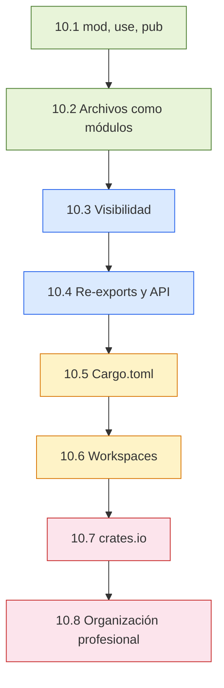

# :package: Cap 10 — Módulos y Crates

<div class="chapter-meta">
  <span class="meta-item">🕐 3-4 horas</span>
  <span class="meta-item">📊 Nivel: Avanzado</span>
  <span class="meta-item">🎯 Semana 5</span>
</div>

<div class="chapter-objective"><span class="objective-icon">📌</span><span class="objective-text">Dominar el sistema de módulos de Rust (mod, use, pub), configurar Cargo.toml con dependencias y features, y organizar proyectos profesionales con workspaces y re-exports.</span></div>

<div class="chapter-map">



</div>


!!! quote "Contexto"
    En Python, organizas código en paquetes con `__init__.py` y gestionas dependencias con pip. Rust tiene un sistema de módulos más explícito y potente: `mod`, `use`, `pub` controlan qué se expone, y Cargo maneja dependencias, compilación, testing y publicación en un solo tool. Si vienes de Python, Cargo te parecerá pip + setuptools + tox + make combinados.

---

## 10.1 El sistema `mod`, `use`, `pub`

En Rust, cada archivo es implícitamente un módulo. Usas `mod` para declarar submódulos, `use` para importar items al scope actual y `pub` para hacerlos públicos.

```rust title="src/main.rs"
mod cocina {                          // (1)!
    pub struct Plato {
        pub nombre: String,
        pub precio: f64,
        receta_secreta: String,       // privado por defecto
    }

    impl Plato {
        pub fn nuevo(nombre: &str, precio: f64) -> Self {
            Plato {
                nombre: nombre.to_string(),
                precio,
                receta_secreta: String::from("Clasificada"),
            }
        }

        pub fn descripción(&self) -> String {
            format!("{} — {:.2}€", self.nombre, self.precio)
        }

        fn revelar_receta(&self) -> &str {   // privado
            &self.receta_secreta
        }
    }
}

use cocina::Plato;                    // (2)!

fn main() {
    let paella = Plato::nuevo("Paella Valenciana", 14.50);
    println!("{}", paella.descripción());
    // println!("{}", paella.receta_secreta);   // ❌ field is private
    // paella.revelar_receta();                 // ❌ method is private
}
```

1. `mod cocina { ... }` define un módulo inline. Todo dentro es privado por defecto.
2. `use cocina::Plato` trae `Plato` al scope de `main`. Sin esto, tendrías que escribir `cocina::Plato` cada vez.

<div class="concept-question"><h4>🔍 Pregunta conceptual</h4><p>Si una struct tiene <code>pub</code> pero uno de sus campos no, ¿puedes construir esa struct directamente desde fuera del módulo con <code>Plato { nombre: ..., receta_secreta: ... }</code>? ¿Por qué sí o por qué no? Piensa en cómo esto se relaciona con el patrón constructor (<code>fn nuevo()</code>) que acabas de ver.</p></div>

### Múltiples imports con `use`

```rust
// Importar varios items del mismo módulo
use std::collections::{HashMap, HashSet, BTreeMap};

// Importar el módulo entero con alias
use std::collections as col;
let mapa: col::HashMap<String, i32> = col::HashMap::new();

// Importar todo (glob import — evitar en producción)
use std::collections::*;   // ⚠️ Contamina el namespace

// Self: importar el módulo Y un item
use std::io::{self, Read, Write};
// Equivale a: use std::io; use std::io::Read; use std::io::Write;
```

!!! warning "Evita glob imports en código de producción"
    `use modulo::*` importa todo y puede causar colisiones de nombres. Úsalo solo en tests o preludes diseñados para ello.

---

## 10.2 Archivos como módulos

En un proyecto real, no defines módulos inline. Cada módulo vive en su propio archivo o directorio.

### Estilo moderno (Rust 2018+): archivo plano

```
src/
├── main.rs
├── cocina.rs          ← módulo cocina
├── servicio.rs        ← módulo servicio
└── facturación.rs     ← módulo facturación
```

```rust title="src/main.rs"
mod cocina;          // Busca src/cocina.rs
mod servicio;        // Busca src/servicio.rs
mod facturación;     // Busca src/facturación.rs

fn main() {
    let plato = cocina::Plato::nuevo("Paella", 14.50);
    servicio::atender_mesa(1, &plato);
}
```

```rust title="src/cocina.rs"
pub struct Plato {
    pub nombre: String,
    pub precio: f64,
}

impl Plato {
    pub fn nuevo(nombre: &str, precio: f64) -> Self {
        Plato {
            nombre: nombre.to_string(),
            precio,
        }
    }
}
```

### Submódulos con directorio

Cuando un módulo necesita submódulos, creas un directorio:

```
src/
├── main.rs
└── cocina/
    ├── mod.rs           ← punto de entrada del módulo cocina (estilo clásico)
    ├── platos.rs        ← submódulo cocina::platos
    └── recetas.rs       ← submódulo cocina::recetas
```

```rust title="src/cocina/mod.rs"
pub mod platos;      // Busca src/cocina/platos.rs
pub mod recetas;     // Busca src/cocina/recetas.rs

// Re-exportar items clave para acceso más limpio
pub use platos::Plato;
```

### Estilo moderno alternativo (sin `mod.rs`)

Rust 2018+ permite un estilo alternativo donde el archivo del módulo padre está junto al directorio:

```
src/
├── main.rs
├── cocina.rs            ← declara submódulos de cocina/
└── cocina/
    ├── platos.rs
    └── recetas.rs
```

```rust title="src/cocina.rs"
pub mod platos;      // Busca src/cocina/platos.rs
pub mod recetas;     // Busca src/cocina/recetas.rs

pub use platos::Plato;
```

!!! tip "¿Cuál estilo elegir?"
    El estilo moderno (sin `mod.rs`) es el recomendado. Es más fácil de navegar porque el nombre del archivo coincide con el módulo. El estilo `mod.rs` sigue siendo válido y lo verás en proyectos más antiguos.

<div class="comparison" markdown>
<div class="lang-box python" markdown>

#### :snake: En Python

```python
# Paquete Python: directorio + __init__.py
cocina/
├── __init__.py      # Punto de entrada del paquete
├── platos.py
└── recetas.py

# __init__.py
from .platos import Plato
from .recetas import Receta

# Uso
from cocina import Plato
```

Python usa `__init__.py` como punto de entrada de un paquete. Todo es público por defecto a menos que uses `_prefijo` por convención.

</div>
<div class="lang-box rust" markdown>

#### :crab: En Rust

```rust
// Módulo Rust: archivo o directorio
cocina/
├── mod.rs           // Punto de entrada (como __init__.py)
├── platos.rs
└── recetas.rs

// mod.rs
pub mod platos;
pub use platos::Plato;

// Uso
use cocina::Plato;
```

Rust usa `mod.rs` (o `cocina.rs` + directorio) como punto de entrada. Todo es **privado** por defecto — debes marcar con `pub` explícitamente.

</div>
</div>

<div class="connection-box" markdown>
<h4>🔗 Conexión con el Capítulo 9 — Colecciones e Iteradores</h4>
<p>En el <a href="09-colecciones-iteradores.md">Capítulo 9</a> trabajaste con <code>HashMap</code>, <code>Vec</code> y otros tipos de <code>std::collections</code>. Fíjate que accedías a ellos con <code>use std::collections::HashMap</code>: ese <code>std::collections</code> es un <strong>módulo</strong> de la biblioteca estándar. Ahora entiendes la mecánica completa detrás de esos <code>use</code>: Rust organiza toda su stdlib en módulos con las mismas reglas de <code>mod</code>, <code>pub</code> y re-exports que estás aprendiendo aquí.</p>
</div>

---

## 10.3 Visibilidad: `pub`, `pub(crate)`, `pub(super)`, privado

Rust tiene un sistema de visibilidad granular. Por defecto, todo es privado al módulo donde se define.

```rust
mod restaurante {
    pub mod cocina {
        // Público: accesible desde cualquier parte
        pub fn preparar_plato() -> String {
            let ingredientes = obtener_ingredientes();  // ✅ mismo módulo
            format!("Plato con {}", ingredientes)
        }

        // Privado al módulo cocina: solo cocina puede usarlo
        fn obtener_ingredientes() -> String {
            String::from("tomate, arroz, azafrán")
        }

        // Público solo dentro del crate (no se expone a dependientes)
        pub(crate) fn stock_disponible() -> bool {
            true
        }

        // Público solo para el módulo padre (restaurante)
        pub(super) fn limpiar_cocina() {
            println!("Cocina limpia");
        }
    }

    pub mod servicio {
        pub fn atender() {
            // ✅ pub — accesible
            let plato = super::cocina::preparar_plato();

            // ✅ pub(crate) — estamos en el mismo crate
            let hay_stock = super::cocina::stock_disponible();

            // ❌ pub(super) — servicio no es padre de cocina
            // super::cocina::limpiar_cocina();  // error: private

            // ❌ privado — solo accesible dentro de cocina
            // super::cocina::obtener_ingredientes();  // error: private

            println!("Plato: {} (stock: {})", plato, hay_stock);
        }
    }

    pub fn cerrar() {
        cocina::limpiar_cocina();  // ✅ pub(super) — restaurante es padre
    }
}
```

| Visibilidad | Accesible desde | Uso típico |
|:---|:---|:---|
| (ninguna) — privado | Solo el módulo actual | Detalles de implementación |
| `pub` | Cualquier parte (incluido fuera del crate) | API pública |
| `pub(crate)` | Cualquier módulo dentro del crate | Helpers internos compartidos |
| `pub(super)` | El módulo padre | Funciones auxiliares del padre |
| `pub(in path)` | Un módulo ancestro específico | Casos muy específicos |

!!! tip "Regla de oro de visibilidad"
    Empieza con todo privado. Solo marca `pub` lo que necesita ser parte de tu API pública. Usa `pub(crate)` para funcionalidad compartida internamente. Esto te da la libertad de refactorizar internos sin romper la API.

<div class="concept-question"><h4>🔍 Pregunta conceptual</h4><p>En el ejemplo anterior, <code>servicio</code> no puede llamar a <code>limpiar_cocina()</code> que es <code>pub(super)</code>, pero <code>restaurante::cerrar()</code> sí puede. ¿Cuál es la relación jerárquica que lo explica? Dibuja mentalmente el árbol de módulos: <code>restaurante</code> > <code>cocina</code> y <code>restaurante</code> > <code>servicio</code>. ¿Quién es el "super" de <code>cocina</code>?</p></div>

<div class="misconception-box" markdown>
<h4>⚠️ Mitos comunes sobre módulos y visibilidad en Rust</h4>
<div class="myth">
  <p class="wrong">❌ Mito 1: "Si una struct es <code>pub</code>, todos sus campos también lo son."</p>
  <p class="right">✅ Realidad: La visibilidad de la struct y la de sus campos son independientes. Una struct puede ser <code>pub</code> y tener campos privados. Esto obliga a usar constructores (<code>fn nuevo()</code>) y es una herramienta clave de encapsulación.</p>
</div>
<div class="myth">
  <p class="wrong">❌ Mito 2: "<code>pub(crate)</code> y <code>pub</code> son lo mismo si solo tengo un crate."</p>
  <p class="right">✅ Realidad: En un proyecto de un solo crate binario, su comportamiento práctico es similar. Pero la diferencia importa cuando publicas una librería: <code>pub</code> expone el item a todos los dependientes, mientras que <code>pub(crate)</code> lo mantiene interno. Usar <code>pub(crate)</code> desde el inicio te protege cuando tu proyecto crezca.</p>
</div>
<div class="myth">
  <p class="wrong">❌ Mito 3: "<code>use</code> hace que un item sea público automáticamente."</p>
  <p class="right">✅ Realidad: <code>use</code> solo trae un item a tu scope local; no cambia su visibilidad. Para re-exportarlo necesitas <code>pub use</code>. Un <code>use cocina::Plato;</code> privado solo lo hace disponible en ese módulo, no para sus usuarios.</p>
</div>
</div>

<div class="micro-exercise" markdown>
<h4>🏋️ Micro-ejercicio 1: Predice la visibilidad</h4>

Sin ejecutar el código, determina cuáles de estas líneas compilarían y cuáles darían error:

```rust
mod biblioteca {
    pub(crate) struct Libro {
        pub titulo: String,
        isbn: String,          // privado
    }

    pub(super) fn contar_libros() -> usize { 42 }
}

mod tienda {
    fn mostrar() {
        // Línea A: ¿compila?
        let n = super::biblioteca::contar_libros();

        // Línea B: ¿compila?
        let libro = super::biblioteca::Libro {
            titulo: "Rust".into(),
            isbn: "123".into(),
        };
    }
}
```

??? success "Solución"
    - **Línea A**: ❌ No compila. `contar_libros()` es `pub(super)`, y el `super` de `biblioteca` es el módulo raíz, no `tienda`. Desde `tienda` no se puede acceder porque `tienda` es hermana, no padre.
    - **Línea B**: ❌ No compila por dos razones: (1) `Libro` es `pub(crate)` así que sí es accesible, pero (2) el campo `isbn` es privado, así que no puedes construir la struct con sintaxis literal. Necesitarías un constructor `pub fn nuevo()`.

</div>

---

## 10.4 Re-exports y diseño de API pública

Los re-exports (`pub use`) permiten exponer items desde un path más conveniente sin revelar la estructura interna del módulo:

```rust title="src/lib.rs"
// Estructura interna compleja
mod domain {
    pub mod entities {
        pub struct Plato { pub nombre: String, pub precio: f64 }
        pub struct Mesa  { pub número: u8, pub capacidad: u8 }
    }
    pub mod value_objects {
        pub enum Zona { Interior, Terraza, Barra }
        pub enum EstadoMesa { Libre, Ocupada, Reservada }
    }
}

mod services {
    pub mod pedidos {
        use crate::domain::entities::*;
        pub fn crear_pedido(mesa: &Mesa, platos: Vec<Plato>) -> String {
            format!("Pedido para mesa {}: {} platos", mesa.número, platos.len())
        }
    }
}

// Re-exportar API pública — los usuarios no necesitan saber la estructura interna
pub use domain::entities::{Plato, Mesa};
pub use domain::value_objects::{Zona, EstadoMesa};
pub use services::pedidos::crear_pedido;
```

```rust title="Uso desde otro crate"
// Sin re-exports: ruta larga y acoplada a la estructura interna
// use rustmenu::domain::entities::Plato;
// use rustmenu::domain::value_objects::Zona;

// Con re-exports: API limpia y desacoplada
use rustmenu::{Plato, Mesa, Zona, crear_pedido};
```

<div class="pro-tip" markdown>
<h4>💡 Pro-tip: Re-exports como contrato de API</h4>
<p>Los <code>pub use</code> en tu <code>lib.rs</code> definen el <strong>contrato público</strong> de tu crate. Puedes reorganizar toda la estructura interna de módulos (mover archivos, renombrar módulos privados) sin romper a tus usuarios, siempre que los re-exports sigan apuntando a los mismos tipos. Piensa en <code>pub use</code> como la "fachada" de tu librería.</p>
</div>

### Prelude pattern

Algunos crates exponen un módulo `prelude` con los items más comunes:

```rust title="src/lib.rs"
pub mod prelude {
    pub use crate::Plato;
    pub use crate::Mesa;
    pub use crate::Zona;
    pub use crate::EstadoMesa;
    pub use crate::crear_pedido;
}
```

```rust title="Uso con prelude"
use rustmenu::prelude::*;   // Importar todo lo esencial de una vez
```

<div class="code-evolution" markdown>
<h4>🔄 Evolución del código: de módulo plano a API profesional</h4>

<div class="evolution-step" markdown>
<h5>Paso 1 — Todo en un archivo (principiante)</h5>

```rust
// src/main.rs — TODO junto, sin módulos
struct Plato { nombre: String, precio: f64 }
struct Mesa { número: u8 }
enum Zona { Interior, Terraza }

fn crear_pedido(mesa: &Mesa, platos: &[Plato]) -> String {
    format!("Mesa {}: {} platos", mesa.número, platos.len())
}

fn main() {
    let p = Plato { nombre: "Paella".into(), precio: 14.50 };
    println!("{}", crear_pedido(&Mesa { número: 1 }, &[p]));
}
```
</div>

<div class="evolution-step" markdown>
<h5>Paso 2 — Módulos separados (intermedio)</h5>

```rust
// src/main.rs
mod domain;
mod services;

use domain::{Plato, Mesa};
use services::crear_pedido;

fn main() {
    let p = Plato::nuevo("Paella", 14.50);
    let mesa = Mesa { número: 1, capacidad: 4 };
    println!("{}", crear_pedido(&mesa, &[p]));
}
```
</div>

<div class="evolution-step" markdown>
<h5>Paso 3 — Workspace con re-exports (profesional)</h5>

```rust
// crates/domain/src/lib.rs
pub mod entities;
pub mod value_objects;
pub use entities::{Plato, Mesa, Pedido};
pub use value_objects::{Zona, Precio};

// crates/server/src/main.rs
use rustmenu_domain::{Plato, Mesa, Zona};  // API limpia
use rustmenu_api::routes::create_router;

#[tokio::main]
async fn main() {
    let router = create_router(db_pool);
    axum::serve(listener, router).await.unwrap();
}
```
</div>
</div>

---

## 10.5 Cargo.toml: dependencias, features, dev-dependencies

`Cargo.toml` es el manifiesto del proyecto. Equivale a `pyproject.toml` en Python, pero con capacidades integradas de build, test y publish.

```toml title="Cargo.toml"
[package]
name = "rustmenu"
version = "0.1.0"
edition = "2021"                    # (1)!
authors = ["Tu Nombre <tu@email.com>"]
description = "Sistema de gestión para restaurantes"
license = "MIT"

[dependencies]
serde = { version = "1.0", features = ["derive"] }   # (2)!
serde_json = "1.0"
tokio = { version = "1", features = ["full"] }
sqlx = { version = "0.7", features = ["postgres", "runtime-tokio"] }
thiserror = "1.0"

[dev-dependencies]                  # (3)!
pretty_assertions = "1.4"
mockall = "0.12"
criterion = { version = "0.5", features = ["html_reports"] }

[features]                          # (4)!
default = ["json"]
json = ["serde", "serde_json"]
full = ["json", "sqlx"]

[[bin]]                             # (5)!
name = "rustmenu-server"
path = "src/bin/server.rs"
```

1. `edition` define qué edición de Rust usar. `2021` es la actual. Afecta cómo se resuelven módulos y otras ergonomías.
2. `features` activa funcionalidad condicional dentro del crate. `serde` con `["derive"]` habilita `#[derive(Serialize)]`.
3. `[dev-dependencies]` solo se compilan para tests y benchmarks. No afectan el binario final.
4. `[features]` define features opcionales de tu crate. Los usuarios eligen qué activar.
5. `[[bin]]` permite múltiples binarios en un mismo crate.

<div class="concept-question"><h4>🔍 Pregunta conceptual</h4><p>¿Cuál es la diferencia práctica entre poner un crate en <code>[dependencies]</code> vs en <code>[dev-dependencies]</code>? Piensa en qué ocurre cuando alguien agrega tu crate como dependencia en su propio proyecto: ¿se descargan también tus dev-dependencies?</p></div>

### Especificación de versiones

```toml
[dependencies]
# Semver: ^1.0 (por defecto) — compatible con 1.x
serde = "1.0"           # >= 1.0.0 y < 2.0.0

# Exacto
serde = "=1.0.193"      # Solo esta versión

# Rango
serde = ">=1.0, <1.5"   # Rango explícito

# Wildcard
serde = "1.*"            # Cualquier 1.x

# Git
mi_crate = { git = "https://github.com/user/repo", branch = "main" }

# Path local (para desarrollo)
mi_crate = { path = "../mi-crate" }
```

<div class="comparison" markdown>
<div class="lang-box python" markdown>

#### :snake: En Python

```toml
# pyproject.toml
[project]
name = "rustmenu"
version = "0.1.0"
dependencies = [
    "fastapi>=0.100",
    "sqlalchemy>=2.0",
    "pydantic>=2.0",
]

[project.optional-dependencies]
dev = ["pytest", "black", "mypy"]
```

Python usa `pyproject.toml` + pip/poetry/uv. Las dependencias de desarrollo se manejan con extras opcionales. No hay sistema de features condicional.

</div>
<div class="lang-box rust" markdown>

#### :crab: En Rust

```toml
# Cargo.toml
[package]
name = "rustmenu"
version = "0.1.0"
edition = "2021"

[dependencies]
serde = { version = "1.0", features = ["derive"] }

[dev-dependencies]
pretty_assertions = "1.4"

[features]
default = ["json"]
json = ["serde"]
```

Cargo combina build + deps + test + publish. Las features permiten compilación condicional. `dev-dependencies` se separan limpiamente.

</div>
</div>

<div class="pro-tip" markdown>
<h4>💡 Pro-tip: Usa <code>cargo add</code> en vez de editar Cargo.toml a mano</h4>
<p>Desde Rust 1.62, <code>cargo add</code> es un subcomando integrado. Escribir <code>cargo add serde --features derive</code> agrega la dependencia con la versión más reciente y las features correctas, evitando errores de tipeo en el TOML. Para dev-dependencies usa <code>cargo add --dev pretty_assertions</code>. Si necesitas quitar una dependencia: <code>cargo remove serde</code>.</p>
</div>

---

## 10.6 Workspaces (Cargo monorepo)

Un workspace permite manejar múltiples crates relacionados en un solo repositorio, compartiendo dependencias y `Cargo.lock`:

```
rustmenu-workspace/
├── Cargo.toml               ← workspace root
├── Cargo.lock               ← compartido por todos los crates
├── crates/
│   ├── domain/
│   │   ├── Cargo.toml
│   │   └── src/lib.rs       ← entidades, value objects
│   ├── api/
│   │   ├── Cargo.toml
│   │   └── src/lib.rs       ← handlers HTTP
│   ├── db/
│   │   ├── Cargo.toml
│   │   └── src/lib.rs       ← acceso a base de datos
│   └── server/
│       ├── Cargo.toml
│       └── src/main.rs      ← binario principal
```

```toml title="Cargo.toml (workspace root)"
[workspace]
members = [
    "crates/domain",
    "crates/api",
    "crates/db",
    "crates/server",
]

# Dependencias compartidas — evita duplicación
[workspace.dependencies]
serde = { version = "1.0", features = ["derive"] }
tokio = { version = "1", features = ["full"] }
thiserror = "1.0"
```

```toml title="crates/domain/Cargo.toml"
[package]
name = "rustmenu-domain"
version = "0.1.0"
edition = "2021"

[dependencies]
serde.workspace = true          # Usa la versión del workspace
thiserror.workspace = true
```

```toml title="crates/api/Cargo.toml"
[package]
name = "rustmenu-api"
version = "0.1.0"
edition = "2021"

[dependencies]
rustmenu-domain = { path = "../domain" }   # Dependencia local
serde.workspace = true
tokio.workspace = true
axum = "0.7"
```

### Comandos de workspace

```bash
# Compilar todo el workspace
cargo build

# Compilar solo un crate
cargo build -p rustmenu-api

# Tests de todo el workspace
cargo test

# Tests de un crate específico
cargo test -p rustmenu-domain

# Ejecutar el binario
cargo run -p rustmenu-server
```

<div class="micro-exercise" markdown>
<h4>🏋️ Micro-ejercicio 2: Diseña un workspace</h4>

Tienes un proyecto de e-commerce con estas responsabilidades: modelos de datos (Product, Order, User), una API REST, un worker de background para emails, y acceso a base de datos. Escribe la sección `[workspace]` del `Cargo.toml` raíz y lista las dependencias entre crates (quién depende de quién).

??? success "Solución"
    ```toml
    [workspace]
    members = [
        "crates/domain",      # Product, Order, User
        "crates/db",          # Repositorios (depende de domain)
        "crates/api",         # REST handlers (depende de domain + db)
        "crates/worker",      # Background jobs (depende de domain + db)
        "crates/server",      # Binario principal (depende de api + worker)
    ]

    [workspace.dependencies]
    serde = { version = "1.0", features = ["derive"] }
    tokio = { version = "1", features = ["full"] }
    ```

    **Grafo de dependencias:**

    - `domain` -> (sin dependencias internas)
    - `db` -> `domain`
    - `api` -> `domain`, `db`
    - `worker` -> `domain`, `db`
    - `server` -> `api`, `worker`

</div>

---

## 10.7 crates.io: encontrar, evaluar y agregar crates

[crates.io](https://crates.io) es el registro oficial de crates de Rust. Equivale a PyPI para Python.

### Buscar y evaluar crates

```bash
# Buscar en la terminal
cargo search serialización

# Agregar dependencia (Cargo la descarga automáticamente)
cargo add serde --features derive
cargo add tokio --features full
cargo add sqlx --features postgres,runtime-tokio

# Actualizar dependencias
cargo update              # Actualizar dentro de semver
cargo update -p serde     # Actualizar un crate específico

# Ver árbol de dependencias
cargo tree
cargo tree -d             # Solo duplicados
```

### Criterios para evaluar un crate

| Criterio | Qué buscar |
|:---|:---|
| Descargas | Más de 100K descargas indica adopción sólida |
| Última actualización | Activo en los últimos 6 meses |
| Documentación | docs.rs tiene docs generados automáticamente |
| Dependencias | Pocas dependencias transitivas es mejor |
| Licencia | MIT/Apache-2.0 son las más comunes en Rust |
| Issues/PRs | Respuestas activas del maintainer |

### Crates esenciales del ecosistema Rust

| Categoría | Crate | Descripción |
|:---|:---|:---|
| Serialización | `serde` + `serde_json` | El estándar de serialización |
| Async runtime | `tokio` | Runtime async más usado |
| HTTP server | `axum` / `actix-web` | Frameworks web |
| Base de datos | `sqlx` / `diesel` | ORMs y query builders |
| Errores | `thiserror` / `anyhow` | Manejo de errores ergonómico |
| CLI | `clap` | Parser de argumentos |
| Logging | `tracing` | Logging estructurado y spans |
| Testing | `pretty_assertions` | Diffs legibles en tests |

<div class="connection-box" markdown>
<h4>🔗 Conexión con el Capítulo 11 — Lifetimes</h4>
<p>Cuando empieces a diseñar APIs públicas de tus propios crates en el <a href="11-lifetimes.md">Capítulo 11</a>, descubrirás que los <strong>lifetimes</strong> son parte esencial de las firmas públicas. Una función como <code>pub fn buscar(&self, query: &str) -> &Plato</code> necesita anotaciones de lifetime para que el compilador (y tus usuarios) entiendan la relación entre las referencias. La visibilidad (<code>pub</code>) y los lifetimes trabajan juntos para definir un contrato de API robusto.</p>
</div>

---

## 10.8 Organización profesional de proyectos

### RustMenu: estructura con módulos `domain/`, `api/`, `db/`

Una estructura profesional para el proyecto RustMenu como monorepo:

```
rustmenu/
├── Cargo.toml                      ← workspace root
├── Cargo.lock
├── .github/
│   └── workflows/ci.yml
├── crates/
│   ├── domain/                     ← entidades y lógica de negocio
│   │   ├── Cargo.toml
│   │   └── src/
│   │       ├── lib.rs
│   │       ├── entities/
│   │       │   ├── mod.rs
│   │       │   ├── plato.rs
│   │       │   ├── mesa.rs
│   │       │   └── pedido.rs
│   │       ├── value_objects/
│   │       │   ├── mod.rs
│   │       │   ├── zona.rs
│   │       │   └── precio.rs
│   │       └── services/
│   │           ├── mod.rs
│   │           └── menu_service.rs
│   ├── db/                         ← persistencia
│   │   ├── Cargo.toml
│   │   └── src/
│   │       ├── lib.rs
│   │       ├── repositories/
│   │       │   ├── mod.rs
│   │       │   ├── plato_repo.rs
│   │       │   └── mesa_repo.rs
│   │       └── migrations/
│   ├── api/                        ← handlers HTTP
│   │   ├── Cargo.toml
│   │   └── src/
│   │       ├── lib.rs
│   │       ├── handlers/
│   │       │   ├── mod.rs
│   │       │   ├── platos.rs
│   │       │   └── mesas.rs
│   │       ├── middleware/
│   │       │   ├── mod.rs
│   │       │   └── auth.rs
│   │       └── routes.rs
│   └── server/                     ← binario
│       ├── Cargo.toml
│       └── src/
│           └── main.rs
└── tests/                          ← tests de integración
    └── api_tests.rs
```

```rust title="crates/domain/src/lib.rs"
pub mod entities;
pub mod value_objects;
pub mod services;

// Re-exports: API pública limpia del crate domain
pub use entities::{Plato, Mesa, Pedido};
pub use value_objects::{Zona, Precio};
pub use services::MenuService;
```

```rust title="crates/domain/src/entities/plato.rs"
use serde::{Serialize, Deserialize};
use crate::value_objects::Precio;

#[derive(Debug, Clone, Serialize, Deserialize)]
pub struct Plato {
    pub id: u64,
    pub nombre: String,
    pub precio: Precio,
    pub categoria: String,
    pub(crate) receta: String,       // Solo visible dentro del crate domain
}

impl Plato {
    pub fn nuevo(nombre: &str, precio: f64, categoria: &str) -> Self {
        Plato {
            id: 0,
            nombre: nombre.to_string(),
            precio: Precio::new(precio),
            categoria: categoria.to_string(),
            receta: String::new(),
        }
    }

    pub fn con_receta(mut self, receta: &str) -> Self {
        self.receta = receta.to_string();
        self
    }
}
```

```rust title="crates/server/src/main.rs"
use rustmenu_domain::{Plato, Mesa, Zona};
use rustmenu_api::routes::create_router;
use rustmenu_db::repositories::PlatoRepo;

#[tokio::main]
async fn main() {
    tracing_subscriber::init();

    let db_pool = rustmenu_db::create_pool().await;
    let router = create_router(db_pool);

    println!("RustMenu server en http://localhost:3000");
    let listener = tokio::net::TcpListener::bind("0.0.0.0:3000").await.unwrap();
    axum::serve(listener, router).await.unwrap();
}
```

---

<div class="real-errors">
<h4>🔥 Errores reales del compilador sobre módulos y crates</h4>

<p>Estos son errores que encontrarás frecuentemente al trabajar con el sistema de módulos de Rust. Aprende a reconocerlos y solucionarlos:</p>

<h5>Error E0432: importación no resuelta (<code>unresolved import</code>)</h5>

```rust
// ❌ Error: unresolved import `cocina::Plato`
mod cocina {
    struct Plato {  // Falta `pub`
        pub nombre: String,
    }
}

use cocina::Plato;  // E0432: `Plato` is private
```

```
error[E0432]: unresolved import `cocina::Plato`
 --> src/main.rs:7:5
  |
7 | use cocina::Plato;
  |     ^^^^^^^^^^^^^ no `Plato` in `cocina`
  |
  = note: the struct `Plato` exists but is inaccessible
```

```rust
// ✅ Solución: hacer la struct pública
mod cocina {
    pub struct Plato {
        pub nombre: String,
    }
}

use cocina::Plato;  // Ahora funciona
```

<h5>Error E0603: item privado (<code>private</code>)</h5>

```rust
// ❌ Error: function `helper` is private
mod utils {
    pub fn publica() -> String {
        helper()
    }

    fn helper() -> String {  // privada por defecto
        String::from("interno")
    }
}

fn main() {
    utils::publica();   // ✅ OK
    utils::helper();    // ❌ E0603
}
```

```
error[E0603]: function `helper` is private
  --> src/main.rs:12:12
   |
12 |     utils::helper();
   |            ^^^^^^ private function
   |
note: the function `helper` is defined here
  --> src/main.rs:6:5
   |
6  |     fn helper() -> String {
   |     ^^^^^^^^^^^^^^^^^^^^^^
```

```rust
// ✅ Solución: marcar como pub, pub(crate), o acceder solo desde el módulo
fn main() {
    utils::publica();  // Usa la función pública que internamente llama a helper
}
```

<h5>Error E0583: módulo no encontrado (<code>file not found for module</code>)</h5>

```rust
// ❌ Error: file not found for module `pedidos`
// src/main.rs
mod cocina;
mod pedidos;  // No existe src/pedidos.rs ni src/pedidos/mod.rs
```

```
error[E0583]: file not found for module `pedidos`
 --> src/main.rs:3:1
  |
3 | mod pedidos;
  | ^^^^^^^^^^^^
  |
  = help: to create the module `pedidos`, create file "src/pedidos.rs" or
          "src/pedidos/mod.rs"
```

```rust
// ✅ Solución: crear el archivo correspondiente
// Opción 1: crear src/pedidos.rs
// Opción 2: crear src/pedidos/mod.rs

// src/pedidos.rs
pub struct Pedido {
    pub id: u64,
    pub mesa: u8,
}
```

<h5>Error E0432: importación de crate no declarado</h5>

```rust
// ❌ Error: no existe el crate en Cargo.toml
use serde::Serialize;  // serde no está en [dependencies]
```

```
error[E0432]: unresolved import `serde`
 --> src/main.rs:1:5
  |
1 | use serde::Serialize;
  |     ^^^^^ use of undeclared crate or module `serde`
  |
  = help: maybe you need to add `serde` to your Cargo.toml dependencies?
```

```rust
// ✅ Solución: agregar la dependencia
// Ejecutar: cargo add serde --features derive
// O añadir manualmente en Cargo.toml:
// [dependencies]
// serde = { version = "1.0", features = ["derive"] }
```

</div>

<div class="checkpoint" markdown>
<h4>🎯 Checkpoint — ¿Estás listo para continuar?</h4>

Antes de pasar a los recursos y ejercicios, verifica que puedes responder estas preguntas:

1. **mod vs use vs pub**: ¿Puedes explicar en una frase qué hace cada uno?
2. **Archivos como módulos**: ¿Si tienes `mod cocina;` en `main.rs`, dónde busca Rust el código?
3. **Visibilidad**: ¿Cuál es la diferencia entre `pub`, `pub(crate)` y `pub(super)`?
4. **Re-exports**: ¿Qué ventaja da `pub use` en `lib.rs` frente a exponer la jerarquía interna?
5. **Cargo.toml**: ¿Puedes configurar dependencias con features y dev-dependencies?
6. **Workspaces**: ¿Cuándo usarías un workspace en vez de un solo crate?

Si alguna pregunta te genera dudas, revisa la sección correspondiente antes de continuar. Este capítulo es la base de cómo se organizan proyectos Rust en el mundo real.
</div>

<div class="mini-project">
<h4>🛠️ Mini-proyecto: Biblioteca de módulos para un restaurante</h4>

<p>Construye paso a paso un sistema modular para gestionar un restaurante, aplicando <code>mod</code>, <code>pub</code>, <code>use</code>, visibilidad granular y re-exports.</p>

<h5>Paso 1 — Define los módulos con visibilidad correcta</h5>

<p>Crea un módulo <code>cocina</code> con una struct <code>Plato</code> (campos: <code>nombre</code> público, <code>precio</code> público, <code>receta</code> privado) y un módulo <code>servicio</code> con una función pública <code>tomar_pedido()</code> que reciba un <code>&Plato</code> y devuelva un <code>String</code> con el resumen del pedido. El módulo <code>cocina</code> debe tener también una función <code>pub(crate)</code> llamada <code>stock_disponible()</code> que devuelva <code>bool</code>.</p>

??? success "Solución Paso 1"
    ```rust
    mod cocina {
        pub struct Plato {
            pub nombre: String,
            pub precio: f64,
            receta: String,  // privado: solo cocina puede acceder
        }

        impl Plato {
            pub fn nuevo(nombre: &str, precio: f64, receta: &str) -> Self {
                Plato {
                    nombre: nombre.to_string(),
                    precio,
                    receta: receta.to_string(),
                }
            }

            pub fn descripción(&self) -> String {
                format!("{} — {:.2}€", self.nombre, self.precio)
            }
        }

        pub(crate) fn stock_disponible(plato: &str) -> bool {
            // Simula verificación de stock
            match plato {
                "Paella" => true,
                "Gazpacho" => true,
                "Cochinillo" => false,
                _ => false,
            }
        }
    }

    mod servicio {
        use super::cocina::{self, Plato};

        pub fn tomar_pedido(plato: &Plato) -> String {
            // ✅ pub(crate) es accesible desde otro módulo del mismo crate
            if cocina::stock_disponible(&plato.nombre) {
                format!("Pedido confirmado: {}", plato.descripción())
            } else {
                format!("Lo sentimos, {} no está disponible", plato.nombre)
            }
        }
    }
    ```

<h5>Paso 2 — Añade re-exports y un módulo de facturación</h5>

<p>Agrega un módulo <code>facturación</code> con una struct <code>Factura</code> que contenga un <code>Vec&lt;String&gt;</code> de líneas y un total <code>f64</code>. Implementa un método <code>agregar_plato(&mut self, plato: &Plato)</code> y <code>imprimir(&self) -> String</code>. Luego, crea re-exports en el módulo raíz para que el usuario final pueda usar <code>use restaurante::{Plato, Factura, tomar_pedido}</code> sin conocer la estructura interna.</p>

??? success "Solución Paso 2"
    ```rust
    mod cocina {
        pub struct Plato {
            pub nombre: String,
            pub precio: f64,
            receta: String,
        }

        impl Plato {
            pub fn nuevo(nombre: &str, precio: f64, receta: &str) -> Self {
                Plato {
                    nombre: nombre.to_string(),
                    precio,
                    receta: receta.to_string(),
                }
            }

            pub fn descripción(&self) -> String {
                format!("{} — {:.2}€", self.nombre, self.precio)
            }
        }

        pub(crate) fn stock_disponible(plato: &str) -> bool {
            match plato {
                "Paella" | "Gazpacho" => true,
                _ => false,
            }
        }
    }

    mod servicio {
        use super::cocina::{self, Plato};

        pub fn tomar_pedido(plato: &Plato) -> String {
            if cocina::stock_disponible(&plato.nombre) {
                format!("Pedido confirmado: {}", plato.descripción())
            } else {
                format!("Lo sentimos, {} no está disponible", plato.nombre)
            }
        }
    }

    mod facturación {
        use super::cocina::Plato;

        pub struct Factura {
            lineas: Vec<String>,
            pub total: f64,
        }

        impl Factura {
            pub fn nueva() -> Self {
                Factura {
                    lineas: Vec::new(),
                    total: 0.0,
                }
            }

            pub fn agregar_plato(&mut self, plato: &Plato) {
                self.lineas.push(plato.descripción());
                self.total += plato.precio;
            }

            pub fn imprimir(&self) -> String {
                let mut resultado = String::from("=== FACTURA ===
");
                for linea in &self.lineas {
                    resultado.push_str(&format!("  {}
", linea));
                }
                resultado.push_str(&format!("---------------
  TOTAL: {:.2}€
", self.total));
                resultado
            }
        }
    }

    // Re-exports: API pública limpia
    pub use cocina::Plato;
    pub use facturación::Factura;
    pub use servicio::tomar_pedido;
    ```

<h5>Paso 3 — Integra todo en <code>main</code> con manejo completo</h5>

<p>Escribe una función <code>main()</code> que: (1) cree varios platos usando el constructor, (2) tome pedidos para cada uno verificando disponibilidad, (3) agregue los platos disponibles a una factura, y (4) imprima la factura final. Usa solo los re-exports (no accedas a los módulos internos directamente).</p>

??? success "Solución Paso 3"
    ```rust
    // Usar solo los re-exports — no accedemos a cocina::, servicio::, etc.
    use crate::{Plato, Factura, tomar_pedido};

    fn main() {
        // 1. Crear platos
        let platos = vec![
            Plato::nuevo("Paella Valenciana", 14.50, "Arroz, azafrán, marisco"),
            Plato::nuevo("Gazpacho Andaluz", 8.00, "Tomate, pepino, pimiento"),
            Plato::nuevo("Cochinillo Segoviano", 22.00, "Cochinillo, horno de leña"),
        ];

        // 2. Tomar pedidos y verificar disponibilidad
        let mut factura = Factura::nueva();
        println!("--- Tomando pedidos ---");

        for plato in &platos {
            let resultado = tomar_pedido(plato);
            println!("{}", resultado);

            // Solo agregar a la factura si el pedido fue confirmado
            if resultado.starts_with("Pedido confirmado") {
                factura.agregar_plato(plato);
            }
        }

        // 3. Imprimir factura
        println!("
{}", factura.imprimir());
        println!("Platos facturados. Total: {:.2}€", factura.total);

        // Esto NO compila — receta es privado:
        // println!("{}", platos[0].receta);  // ❌ field `receta` is private

        // Esto NO compila — stock_disponible es pub(crate), no pub:
        // cocina::stock_disponible("Paella");  // ❌ acceso directo al módulo interno
    }
    ```

    **Salida esperada:**

    ```
    --- Tomando pedidos ---
    Pedido confirmado: Paella Valenciana — 14.50€
    Pedido confirmado: Gazpacho Andaluz — 8.00€
    Lo sentimos, Cochinillo Segoviano no está disponible

    === FACTURA ===
      Paella Valenciana — 14.50€
      Gazpacho Andaluz — 8.00€
    ---------------
      TOTAL: 22.50€

    Platos facturados. Total: 22.50€
    ```

</div>

<div class="ejercicio-guiado">
<h4>🏋️ Ejercicio guiado</h4>

Vas a organizar el codigo de RustMenu en modulos bien estructurados: `models` para las structs de datos, `menu` para la logica del menu, y `pedidos` para la gestion de pedidos. Practicaras visibilidad (`pub`, `pub(crate)`, privado), re-exports para una API limpia, y la relacion entre modulos con `use` y `super`.

1. Crea un modulo `models` con una struct `Plato` (campos publicos: `id: u32`, `nombre: String`, `precio: f64`, `categoria: String`; campo `pub(crate)`: `activo: bool`) y un constructor `pub fn nuevo()`. Tambien define un enum publico `Categoria` con variantes `Entrante`, `Principal`, `Postre`, `Bebida` e implementa `Display` para el enum.
2. Crea un modulo `menu` que importe `Plato` y `Categoria` desde `models` usando `super`. Define una struct `Menu` con un campo privado `platos: Vec<Plato>` y metodos publicos: `nuevo() -> Menu`, `agregar(&mut self, plato: Plato)`, `por_categoria(&self, cat: &str) -> Vec<&Plato>` y `disponibles(&self) -> Vec<&Plato>` (que filtre los platos activos).
3. Crea un modulo `pedidos` que importe de `models` y `menu`. Define una struct `Pedido` con campos publicos `mesa: u32` y `items: Vec<String>`, un campo privado `total: f64`, y metodos: `nuevo(mesa: u32) -> Pedido`, `agregar_plato(&mut self, plato: &Plato)` y `resumen(&self) -> String`.
4. En el modulo raiz, crea re-exports con `pub use` para que el usuario final pueda acceder a `Plato`, `Categoria`, `Menu` y `Pedido` sin conocer la estructura interna de modulos.
5. Anade una funcion privada `aplicar_descuento(precio: f64, porcentaje: f64) -> f64` dentro del modulo `pedidos` y una funcion `pub(crate) fn calcular_iva(precio: f64) -> f64` en `models`. Verifica que `pedidos` puede usar `calcular_iva` (pub(crate)) pero el codigo externo no puede acceder a `aplicar_descuento` (privada).
6. En `main`, usa solo los re-exports del modulo raiz para: crear un menu con varios platos, listar los disponibles por categoria, crear un pedido con varios platos y mostrar el resumen final.

??? success "Solución completa"
    ```rust
    mod models {
        use std::fmt;

        #[derive(Debug, Clone)]
        pub enum Categoria {
            Entrante,
            Principal,
            Postre,
            Bebida,
        }

        impl fmt::Display for Categoria {
            fn fmt(&self, f: &mut fmt::Formatter<'_>) -> fmt::Result {
                match self {
                    Categoria::Entrante => write!(f, "Entrante"),
                    Categoria::Principal => write!(f, "Principal"),
                    Categoria::Postre => write!(f, "Postre"),
                    Categoria::Bebida => write!(f, "Bebida"),
                }
            }
        }

        #[derive(Debug, Clone)]
        pub struct Plato {
            pub id: u32,
            pub nombre: String,
            pub precio: f64,
            pub categoria: Categoria,
            pub(crate) activo: bool,
        }

        impl Plato {
            pub fn nuevo(
                id: u32,
                nombre: &str,
                precio: f64,
                categoria: Categoria,
            ) -> Self {
                Plato {
                    id,
                    nombre: nombre.to_string(),
                    precio,
                    categoria,
                    activo: true,
                }
            }

            pub fn desactivar(&mut self) {
                self.activo = false;
            }
        }

        pub(crate) fn calcular_iva(precio: f64) -> f64 {
            precio * 1.21
        }
    }

    mod menu {
        use super::models::{Plato, Categoria};

        pub struct Menu {
            platos: Vec<Plato>,
        }

        impl Menu {
            pub fn nuevo() -> Self {
                Menu { platos: Vec::new() }
            }

            pub fn agregar(&mut self, plato: Plato) {
                self.platos.push(plato);
            }

            pub fn por_categoria(&self, cat: &str) -> Vec<&Plato> {
                self.platos
                    .iter()
                    .filter(|p| p.activo && p.categoria.to_string() == cat)
                    .collect()
            }

            pub fn disponibles(&self) -> Vec<&Plato> {
                self.platos.iter().filter(|p| p.activo).collect()
            }

            pub fn buscar(&self, nombre: &str) -> Option<&Plato> {
                self.platos
                    .iter()
                    .find(|p| p.activo && p.nombre == nombre)
            }
        }
    }

    mod pedidos {
        use super::models::{self, Plato};

        pub struct Pedido {
            pub mesa: u32,
            pub items: Vec<String>,
            total: f64,
        }

        impl Pedido {
            pub fn nuevo(mesa: u32) -> Self {
                Pedido {
                    mesa,
                    items: Vec::new(),
                    total: 0.0,
                }
            }

            pub fn agregar_plato(&mut self, plato: &Plato) {
                self.items.push(format!(
                    "{} — {:.2}EUR",
                    plato.nombre, plato.precio
                ));
                self.total += plato.precio;
            }

            pub fn resumen(&self) -> String {
                let total_con_iva = models::calcular_iva(self.total);
                let mut resultado = format!(
                    "=== Pedido Mesa {} ===\n",
                    self.mesa
                );
                for item in &self.items {
                    resultado.push_str(&format!("  {}\n", item));
                }
                resultado.push_str(&format!(
                    "---------------------\n"
                ));
                resultado.push_str(&format!(
                    "  Subtotal: {:.2}EUR\n",
                    self.total
                ));
                resultado.push_str(&format!(
                    "  IVA 21%:  {:.2}EUR\n",
                    total_con_iva - self.total
                ));
                resultado.push_str(&format!(
                    "  TOTAL:    {:.2}EUR\n",
                    total_con_iva
                ));
                resultado
            }
        }

        fn aplicar_descuento(precio: f64, porcentaje: f64) -> f64 {
            precio * (1.0 - porcentaje / 100.0)
        }

        #[cfg(test)]
        mod tests {
            use super::*;

            #[test]
            fn test_descuento() {
                assert_eq!(aplicar_descuento(100.0, 10.0), 90.0);
                assert_eq!(aplicar_descuento(50.0, 50.0), 25.0);
            }
        }
    }

    // Re-exports: API publica limpia
    pub use models::{Plato, Categoria};
    pub use menu::Menu;
    pub use pedidos::Pedido;

    fn main() {
        // Usar solo los re-exports
        let mut menu = Menu::nuevo();

        menu.agregar(Plato::nuevo(1, "Bruschetta", 8.50, Categoria::Entrante));
        menu.agregar(Plato::nuevo(2, "Ensalada Cesar", 9.00, Categoria::Entrante));
        menu.agregar(Plato::nuevo(3, "Paella", 14.50, Categoria::Principal));
        menu.agregar(Plato::nuevo(4, "Chuleton", 22.00, Categoria::Principal));
        menu.agregar(Plato::nuevo(5, "Tiramisu", 7.50, Categoria::Postre));
        menu.agregar(Plato::nuevo(6, "Vino tinto", 8.00, Categoria::Bebida));

        // Un plato desactivado para probar filtrado
        let mut sopa = Plato::nuevo(7, "Sopa del dia", 6.50, Categoria::Entrante);
        sopa.desactivar();
        menu.agregar(sopa);

        // Listar disponibles por categoria
        println!("--- Platos disponibles ---");
        for cat in &["Entrante", "Principal", "Postre", "Bebida"] {
            let platos = menu.por_categoria(cat);
            println!("{}:", cat);
            for p in &platos {
                println!("  [{}] {} — {:.2}EUR", p.id, p.nombre, p.precio);
            }
        }

        // Crear un pedido
        let mut pedido = Pedido::nuevo(5);
        if let Some(p) = menu.buscar("Paella") {
            pedido.agregar_plato(p);
        }
        if let Some(p) = menu.buscar("Bruschetta") {
            pedido.agregar_plato(p);
        }
        if let Some(p) = menu.buscar("Vino tinto") {
            pedido.agregar_plato(p);
        }
        if let Some(p) = menu.buscar("Tiramisu") {
            pedido.agregar_plato(p);
        }

        // Plato no disponible: no aparece
        if let Some(p) = menu.buscar("Sopa del dia") {
            pedido.agregar_plato(p);
        } else {
            println!("\nNota: 'Sopa del dia' no disponible");
        }

        println!("\n{}", pedido.resumen());

        // Esto NO compila: activo es pub(crate)
        // Desde fuera del crate no se podria acceder:
        // let x = plato.activo;  // solo accesible dentro del crate

        // Esto NO compila: aplicar_descuento es privada
        // pedidos::aplicar_descuento(100.0, 10.0);  // error: private
    }
    ```

</div>


## :link: Recursos

| Recurso | Enlace |
|---------|--------|
| The Rust Book - Cap 7: Módulos | [doc.rust-lang.org/book/ch07-00-managing-growing-projects](https://doc.rust-lang.org/book/ch07-00-managing-growing-projects-with-packages-crates-and-modules.html) |
| The Rust Book - Cap 14: Cargo y crates.io | [doc.rust-lang.org/book/ch14-00-more-about-cargo](https://doc.rust-lang.org/book/ch14-00-more-about-cargo.html) |
| Cargo Book - Workspaces | [doc.rust-lang.org/cargo/reference/workspaces](https://doc.rust-lang.org/cargo/reference/workspaces.html) |
| API Guidelines (convenciones de API) | [rust-lang.github.io/api-guidelines](https://rust-lang.github.io/api-guidelines/) |

---

## 🎯 Ejercicios

??? question "Ejercicio 1: Módulos básicos con visibilidad"
    Crea un módulo `inventario` con una struct `Ingrediente` (nombre, cantidad, unidad). Haz que `nombre` y `unidad` sean públicos, pero `cantidad` sea privado. Proporciona un método público `disponible()` que devuelva `true` si cantidad > 0, y un método `usar(cantidad: u32)` que reduzca el stock.

    !!! tip "Pista"
        Usa `pub` solo en los campos que quieres exponer. El método `disponible()` puede acceder a campos privados porque está en el mismo módulo.

    ??? success "Solución"
        ```rust
        mod inventario {
            pub struct Ingrediente {
                pub nombre: String,
                pub unidad: String,
                cantidad: u32,           // privado
            }

            impl Ingrediente {
                pub fn nuevo(nombre: &str, cantidad: u32, unidad: &str) -> Self {
                    Ingrediente {
                        nombre: nombre.to_string(),
                        cantidad,
                        unidad: unidad.to_string(),
                    }
                }

                pub fn disponible(&self) -> bool {
                    self.cantidad > 0
                }

                pub fn usar(&mut self, cant: u32) {
                    if cant <= self.cantidad {
                        self.cantidad -= cant;
                        println!("Usado {} {} de {}", cant, self.unidad, self.nombre);
                    } else {
                        println!("Stock insuficiente de {}", self.nombre);
                    }
                }

                pub fn stock(&self) -> u32 {
                    self.cantidad
                }
            }
        }

        fn main() {
            let mut arroz = inventario::Ingrediente::nuevo("Arroz", 50, "kg");
            println!("{} disponible: {}", arroz.nombre, arroz.disponible());
            arroz.usar(10);
            println!("Stock restante: {} {}", arroz.stock(), arroz.unidad);
            // arroz.cantidad;  // ❌ field is private
        }
        ```

??? question "Ejercicio 2: Re-exports para API limpia"
    Tienes módulos `domain::entities` y `domain::value_objects` con structs `Plato`, `Mesa`, `Zona` y `EstadoMesa`. Crea un archivo `lib.rs` que re-exporte todo para que el usuario solo necesite `use mi_crate::{Plato, Mesa, Zona}`.

    !!! tip "Pista"
        Usa `pub use` en `lib.rs` para aplanar la jerarquía de módulos.

    ??? success "Solución"
        ```rust
        // src/domain/entities.rs
        pub struct Plato {
            pub nombre: String,
            pub precio: f64,
        }

        pub struct Mesa {
            pub número: u8,
            pub capacidad: u8,
        }

        // src/domain/value_objects.rs
        #[derive(Debug, Clone)]
        pub enum Zona { Interior, Terraza, Barra }

        #[derive(Debug, Clone)]
        pub enum EstadoMesa { Libre, Ocupada, Reservada }

        // src/domain/mod.rs (o src/domain.rs)
        pub mod entities;
        pub mod value_objects;

        // src/lib.rs — API pública limpia
        mod domain;

        pub use domain::entities::{Plato, Mesa};
        pub use domain::value_objects::{Zona, EstadoMesa};

        // Ahora los usuarios hacen:
        // use mi_crate::{Plato, Mesa, Zona, EstadoMesa};
        // en vez de:
        // use mi_crate::domain::entities::Plato;
        ```

??? question "Ejercicio 3: Cargo.toml con features"
    Escribe un `Cargo.toml` para RustMenu con: dependencias de serde con derive, tokio con full, una feature `postgres` que active sqlx, y dev-dependencies para testing.

    !!! tip "Pista"
        Usa `[features]` con dependencias opcionales y `optional = true` en las dependencias.

    ??? success "Solución"
        ```toml
        [package]
        name = "rustmenu"
        version = "0.1.0"
        edition = "2021"
        description = "Sistema de gestión para restaurantes"

        [dependencies]
        serde = { version = "1.0", features = ["derive"] }
        serde_json = "1.0"
        tokio = { version = "1", features = ["full"] }
        thiserror = "1.0"
        tracing = "0.1"

        # Opcional: solo se compila si el usuario activa la feature "postgres"
        sqlx = { version = "0.7", features = ["postgres", "runtime-tokio"], optional = true }

        [dev-dependencies]
        pretty_assertions = "1.4"
        mockall = "0.12"
        tokio = { version = "1", features = ["test-útil", "macros"] }

        [features]
        default = []
        postgres = ["dep:sqlx"]
        full = ["postgres"]
        ```

        ```rust
        // En el código, usa cfg para compilación condicional:
        #[cfg(feature = "postgres")]
        pub mod db {
            use sqlx::PgPool;
            // ...
        }
        ```

??? question "Ejercicio 4: Workspace con tres crates"
    Configura un workspace con tres crates: `domain` (lib), `api` (lib) y `server` (bin). El `api` depende de `domain`, y `server` depende de ambos. Define dependencias compartidas con `workspace.dependencies`.

    !!! tip "Pista"
        Cada crate tiene su propio `Cargo.toml`. Usa `path = "../domain"` para dependencias locales y `.workspace = true` para compartidas.

    ??? success "Solución"
        ```toml
        # Cargo.toml (raíz del workspace)
        [workspace]
        members = ["crates/domain", "crates/api", "crates/server"]

        [workspace.dependencies]
        serde = { version = "1.0", features = ["derive"] }
        tokio = { version = "1", features = ["full"] }
        ```

        ```toml
        # crates/domain/Cargo.toml
        [package]
        name = "rustmenu-domain"
        version = "0.1.0"
        edition = "2021"

        [dependencies]
        serde.workspace = true
        ```

        ```toml
        # crates/api/Cargo.toml
        [package]
        name = "rustmenu-api"
        version = "0.1.0"
        edition = "2021"

        [dependencies]
        rustmenu-domain = { path = "../domain" }
        serde.workspace = true
        axum = "0.7"
        ```

        ```toml
        # crates/server/Cargo.toml
        [package]
        name = "rustmenu-server"
        version = "0.1.0"
        edition = "2021"

        [dependencies]
        rustmenu-domain = { path = "../domain" }
        rustmenu-api = { path = "../api" }
        tokio.workspace = true
        ```

??? question "Ejercicio 5: pub(crate) vs pub vs privado"
    Crea un módulo `auth` con tres funciones: `verificar_token()` (pública), `generar_hash()` (solo visible en el crate) y `clave_secreta()` (privada). Demuestra qué se puede acceder desde otro módulo dentro del mismo crate y qué no.

    !!! tip "Pista"
        Usa `pub`, `pub(crate)` y ningún modificador para controlar los tres niveles de visibilidad.

    ??? success "Solución"
        ```rust
        mod auth {
            /// Pública: accesible desde cualquier parte, incluso otros crates
            pub fn verificar_token(token: &str) -> bool {
                let hash = generar_hash(token);
                let clave = clave_secreta();
                hash.len() > 0 && clave.len() > 0
            }

            /// pub(crate): accesible desde otros módulos dentro del mismo crate
            pub(crate) fn generar_hash(input: &str) -> String {
                format!("hash_{}", input)
            }

            /// Privada: solo accesible dentro del módulo auth
            fn clave_secreta() -> String {
                String::from("super_secreta_123")
            }
        }

        mod servicio {
            pub fn procesar() {
                // ✅ pub — accesible
                let válido = super::auth::verificar_token("abc123");

                // ✅ pub(crate) — estamos en el mismo crate
                let hash = super::auth::generar_hash("datos");

                // ❌ privado — solo auth puede acceder
                // let clave = super::auth::clave_secreta();

                println!("Token válido: {}, Hash: {}", válido, hash);
            }
        }

        fn main() {
            servicio::procesar();
        }
        ```

---

## :brain: Flashcards de repaso

<div class="flashcard">
<div class="front">¿Cuál es la visibilidad por defecto en Rust?</div>
<div class="back">Todo es <strong>privado</strong> por defecto. Solo el módulo donde se define puede acceder al item. Debes marcar explícitamente con <code>pub</code>, <code>pub(crate)</code> o <code>pub(super)</code> para ampliar la visibilidad.</div>
</div>

<div class="flashcard">
<div class="front">¿Qué hace <code>pub use</code> (re-export)?</div>
<div class="back">Expone un item desde un path diferente al original. Permite aplanar la jerarquía de módulos: los usuarios importan desde una ruta limpia sin conocer la estructura interna. Ejemplo: <code>pub use domain::entities::Plato;</code> permite <code>use mi_crate::Plato;</code>.</div>
</div>

<div class="flashcard">
<div class="front">¿Diferencia entre <code>mod.rs</code> y el estilo moderno de módulos?</div>
<div class="back">Estilo clásico: <code>cocina/mod.rs</code>. Estilo moderno (Rust 2018+): <code>cocina.rs</code> + directorio <code>cocina/</code>. Ambos son equivalentes. El moderno es preferido porque el nombre del archivo coincide con el módulo y es más fácil de navegar.</div>
</div>

<div class="flashcard">
<div class="front">¿Qué es un workspace en Cargo?</div>
<div class="back">Un monorepo con múltiples crates que comparten un <code>Cargo.lock</code> y un directorio <code>target/</code>. Se define en el <code>Cargo.toml</code> raíz con <code>[workspace] members = [...]</code>. Permite compartir dependencias con <code>[workspace.dependencies]</code>.</div>
</div>

<div class="flashcard">
<div class="front">¿Diferencia entre <code>pub(crate)</code> y <code>pub</code>?</div>
<div class="back"><code>pub</code> hace un item accesible desde cualquier parte, incluyendo otros crates que dependan del tuyo. <code>pub(crate)</code> limita la visibilidad al crate actual — otros crates no pueden acceder al item. Ideal para helpers internos compartidos entre módulos.</div>
</div>

---

## :video_game: Quiz interactivo

<div class="quiz" data-quiz-id="ch10-q1">
<h4>Pregunta 1: ¿Cómo declara Rust un módulo que vive en un archivo separado?</h4>
<button class="quiz-option" data-correct="false"><code>import cocina;</code></button>
<button class="quiz-option" data-correct="true"><code>mod cocina;</code> en el archivo padre, que busca <code>cocina.rs</code> o <code>cocina/mod.rs</code></button>
<button class="quiz-option" data-correct="false"><code>use cocina;</code> que automáticamente busca el archivo</button>
<button class="quiz-option" data-correct="false"><code>extern crate cocina;</code></button>
<div class="quiz-feedback" data-correct="¡Correcto! `mod cocina;` declara el módulo y le dice al compilador que busque `cocina.rs` o `cocina/mod.rs`. Luego usas `use cocina::Item` para traer items al scope." data-incorrect="Incorrecto. En Rust se usa `mod cocina;` para declarar un módulo externo. Esto le dice al compilador que busque el archivo `cocina.rs` o `cocina/mod.rs`. `use` sirve para importar items al scope, no para declarar módulos."></div>
</div>

<div class="quiz" data-quiz-id="ch10-q2">
<h4>Pregunta 2: ¿Cuál es el equivalente de <code>pyproject.toml</code> + <code>pip</code> en Rust?</h4>
<button class="quiz-option" data-correct="false"><code>rustup</code></button>
<button class="quiz-option" data-correct="false"><code>Makefile</code> y <code>rustc</code></button>
<button class="quiz-option" data-correct="true"><code>Cargo.toml</code> y <code>cargo</code> — maneja dependencias, build, test y publicación</button>
<button class="quiz-option" data-correct="false"><code>build.rs</code> y <code>crates.io</code></button>
<div class="quiz-feedback" data-correct="¡Correcto! Cargo es la herramienta todo-en-uno de Rust: gestiona dependencias (como pip), compila (como setuptools), ejecuta tests (como pytest) y publica en crates.io (como twine). Cargo.toml es el manifiesto equivalente a pyproject.toml." data-incorrect="Incorrecto. `Cargo.toml` + `cargo` es la respuesta. Cargo combina las funciones de pip (dependencias), setuptools (build), pytest (test) y twine (publish) en una sola herramienta. `rustup` gestiona versiones del compilador, no proyectos."></div>
</div>

---

## :bug: Ejercicio de depuración

Encuentra los **3 errores** en este código:

```rust
// ❌ Este código tiene 3 errores. ¡Encuéntralos!

// src/lib.rs
mod cocina {
    struct Plato {                         // 🤔 ¿Visibilidad?
        pub nombre: String,
        pub precio: f64,
    }

    impl Plato {
        pub fn nuevo(nombre: &str, precio: f64) -> Self {
            Plato {
                nombre: nombre.to_string(),
                precio,
            }
        }
    }
}

mod servicio {
    use super::cocina::Plato;              // 🤔 ¿Se puede acceder?

    pub fn crear_menu() -> Vec<Plato> {
        vec![
            Plato::nuevo("Paella", 14.50),
            Plato::nuevo("Gazpacho", 8.00),
        ]
    }
}

use servicio::crear_menu;
use cocina::Plato;                         // 🤔 ¿Es público?

fn main() {
    let menu = crear_menu();
    for plato in &menu {
        println!("{}: {:.2}€", plato.nombre, plato.precio);
    }
}
```

??? success "Solución"
    ```rust
    // ✅ Código corregido

    mod cocina {
        pub struct Plato {                     // ✅ Fix 1: agregar pub a la struct
            pub nombre: String,
            pub precio: f64,
        }

        impl Plato {
            pub fn nuevo(nombre: &str, precio: f64) -> Self {
                Plato {
                    nombre: nombre.to_string(),
                    precio,
                }
            }
        }
    }

    mod servicio {
        use super::cocina::Plato;              // ✅ Ahora funciona porque Plato es pub

        pub fn crear_menu() -> Vec<Plato> {    // ✅ Fix 2: Plato debe ser pub para usarse en tipo de retorno público
            vec![
                Plato::nuevo("Paella", 14.50),
                Plato::nuevo("Gazpacho", 8.00),
            ]
        }
    }

    use servicio::crear_menu;
    use cocina::Plato;                         // ✅ Fix 3: funciona porque Plato ahora es pub

    fn main() {
        let menu = crear_menu();
        for plato in &menu {
            println!("{}: {:.2}€", plato.nombre, plato.precio);
        }
    }
    ```

    **Resumen de errores:**

    | # | Error | Causa | Solución |
    |---|-------|-------|----------|
    | 1 | `struct Plato is private` | La struct no tiene `pub` | Agregar `pub` a `struct Plato` |
    | 2 | `Plato is private` en `use super::cocina::Plato` | No se puede importar un tipo privado desde otro módulo | Se resuelve con Fix 1: `pub struct` |
    | 3 | `Plato is private` en `use cocina::Plato` | `main` tampoco puede acceder a Plato privado | Se resuelve con Fix 1: `pub struct` |

---

## ✅ Autoevaluación del capítulo

<div class="self-check" markdown>
<h4>📋 Verifica tu comprensión</h4>
<label><input type="checkbox"> Sé la diferencia entre <code>mod</code>, <code>use</code> y <code>pub</code></label>
<label><input type="checkbox"> Puedo organizar archivos como módulos (estilo moderno vs <code>mod.rs</code>)</label>
<label><input type="checkbox"> Entiendo los niveles de visibilidad: privado, <code>pub</code>, <code>pub(crate)</code>, <code>pub(super)</code></label>
<label><input type="checkbox"> Sé usar re-exports (<code>pub use</code>) para diseñar una API pública limpia</label>
<label><input type="checkbox"> Puedo configurar <code>Cargo.toml</code> con dependencias, features y workspaces</label>
</div>
