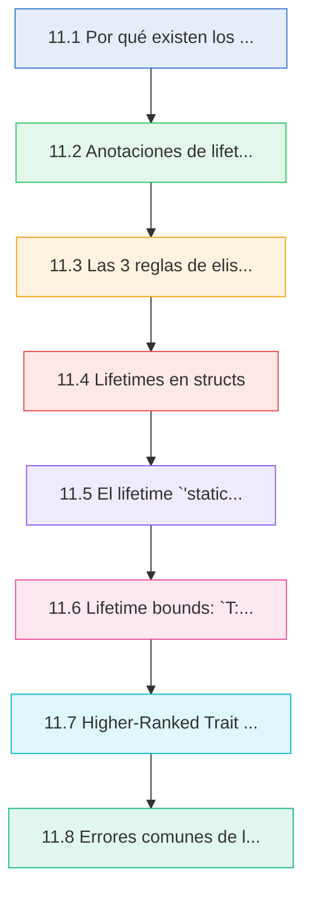
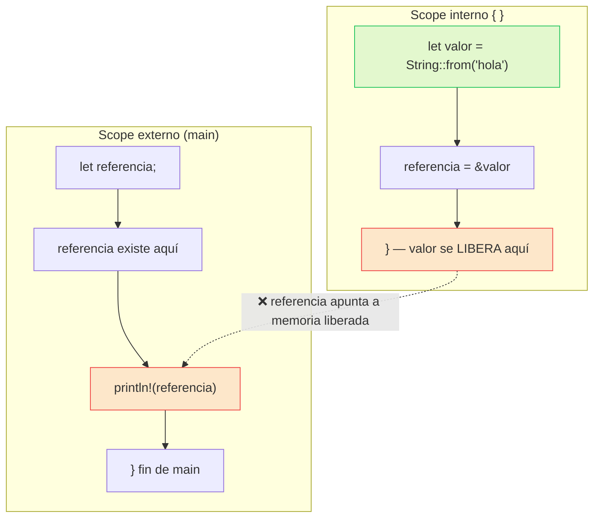
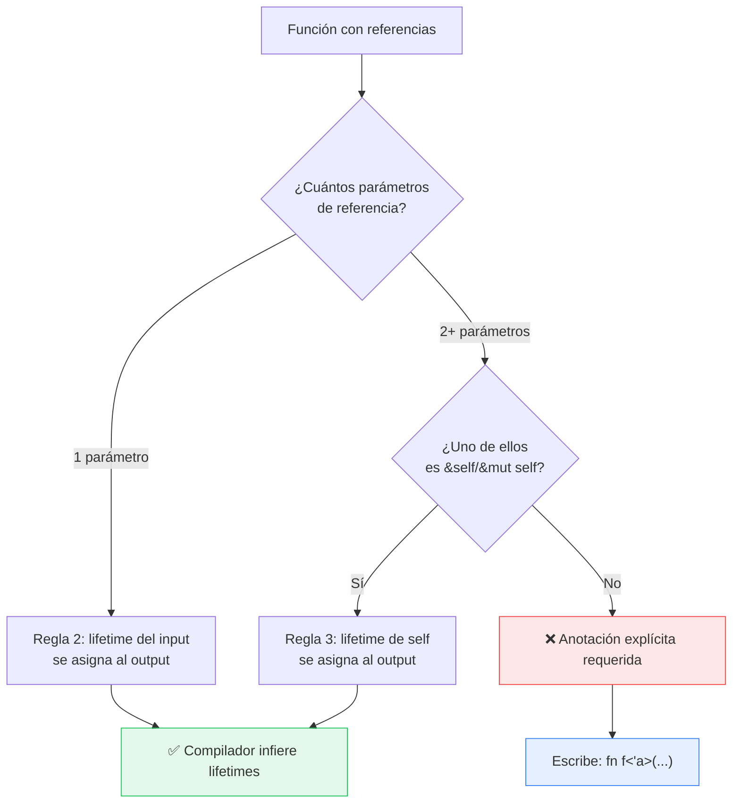

# :hourglass: Cap 11 — Lifetimes en profundidad

<div class="chapter-meta">
  <span class="meta-item">🕐 4-5 horas</span>
  <span class="meta-item">📊 Nivel: Avanzado</span>
  <span class="meta-item">🎯 Semana 6</span>
</div>

<div class="chapter-objective"><span class="objective-icon">📌</span><span class="objective-text">Al terminar este capítulo serás capaz de anotar lifetimes en funciones y structs, aplicar las reglas de elisión, resolver errores del borrow checker relacionados con lifetimes y decidir cuándo usar referencias frente a datos owned.</span></div>

<div class="chapter-map">



</div>


!!! quote "Contexto"
    En Python, el garbage collector se encarga de la memoria y nunca piensas en cuánto tiempo vive una referencia. En Rust no hay GC: el compilador verifica en tiempo de compilación que todas las referencias sean válidas. Los lifetimes son el mecanismo que usa para hacer esa verificación. Si ownership (cap 2) responde "¿quién es dueño?", los lifetimes responden "¿cuánto tiempo vive esta referencia?".

<div class="connection-box" markdown>
🔗 **Conexión con Cap 10 — Módulos y Crates:**
Los lifetimes interactúan con la visibilidad de módulos: cuando exportas funciones públicas que devuelven referencias, las anotaciones de lifetime forman parte de la API pública. Comprender la organización en módulos (Cap 10) te ayudará a diseñar interfaces limpias con lifetimes explícitos.
👉 [Revisar Cap 10: Módulos y Crates](10-modulos-crates.md)
</div>

---

## 11.1 Por qué existen los lifetimes

Los lifetimes existen para prevenir **referencias colgantes** (dangling references): punteros que apuntan a memoria que ya fue liberada.

```rust
fn main() {
    let referencia;                      // (1)!
    {
        let valor = String::from("hola");
        referencia = &valor;             // ❌ valor se libera al cerrar este scope
    }
    // println!("{}", referencia);       // ❌ dangling reference!
}
```

1. `referencia` vive en el scope externo, pero `valor` se libera al final del bloque interno. Si Rust permitiera esto, `referencia` apuntaría a memoria liberada.

El compilador detecta esto y produce un error claro:

```
error[E0597]: `valor` does not live long enough
 --> src/main.rs:4:23
  |
3 |         let valor = String::from("hola");
  |             ----- binding `valor` declared here
4 |         referencia = &valor;
  |                       ^^^^^ borrowed value does not live long enough
5 |     }
  |     - `valor` dropped here while still borrowed
6 |     println!("{}", referencia);
  |                    ---------- borrow later used here
```

### Diagrama: scopes y lifetimes



<div class="comparison" markdown>
<div class="lang-box python" markdown>

#### :snake: En Python

```python
def obtener_referencia():
    valor = "hola"
    return valor   # Python copia/referencia con GC
# El GC mantiene "hola" vivo mientras alguien lo use

ref = obtener_referencia()
print(ref)  # ✅ Funciona — el GC no ha liberado "hola"
```

Python usa un garbage collector con conteo de referencias. El GC mantiene los objetos vivos mientras exista alguna referencia. Nunca tienes dangling references, pero pagas el costo del GC en runtime (pausas, memoria extra, overhead).

</div>
<div class="lang-box rust" markdown>

#### :crab: En Rust

```rust
// Rust verifica en COMPILACIÓN que las
// referencias sean válidas. No hay GC.
fn main() {
    let s = String::from("hola");
    let r = &s;        // r vive menos que s ✅
    println!("{}", r); // referencia válida
}   // s se libera — r ya no existe
```

Rust verifica lifetimes en **tiempo de compilación**. Cero costo en runtime, cero pausas de GC, cero overhead de memoria. El precio es que debes satisfacer al borrow checker.

</div>
</div>

<div class="concept-question"><h4>🔍 Pregunta conceptual</h4><p>En Python, ¿qué ocurre internamente cuando devuelves una variable local desde una función? ¿Por qué en Rust no puedes devolver una <em>referencia</em> a una variable local, pero sí puedes devolver el <em>valor</em> (ownership)? Piensa en quién se encarga de decidir cuándo liberar la memoria en cada lenguaje.</p></div>

!!! info "¿Por qué importa esto?"
    Las dangling references causan **use-after-free**, uno de los bugs más peligrosos en C/C++. Pueden provocar crashes, corrupción de datos y vulnerabilidades de seguridad. Rust las elimina por completo en tiempo de compilación, sin coste en runtime.

---

## 11.2 Anotaciones de lifetime `'a`

Cuando una función recibe referencias y devuelve una referencia, el compilador necesita saber cómo se relacionan los lifetimes. Las anotaciones de lifetime le dan esa información.

```rust
// ❌ No compila: Rust no sabe si el retorno viene de x o de y
// fn longest(x: &str, y: &str) -> &str {
//     if x.len() > y.len() { x } else { y }
// }

// ✅ Con anotación de lifetime: el retorno vive al menos tanto como 'a
fn longest<'a>(x: &'a str, y: &'a str) -> &'a str {   // (1)!
    if x.len() > y.len() { x } else { y }
}

fn main() {
    let string1 = String::from("paella valenciana");

    {
        let string2 = String::from("gazpacho");
        let result = longest(string1.as_str(), string2.as_str());
        println!("El más largo es: {}", result);  // ✅ ambos vivos aquí
    }
}
```

1. `'a` es un parámetro de lifetime genérico. Dice: "el valor de retorno vivirá al menos tanto como la vida más corta entre `x` e `y`". No cambia cuánto viven los valores — solo describe la relación.

### Qué significan las anotaciones

Las anotaciones de lifetime **no cambian** cuánto viven los valores. Son **descriptivas**, no prescriptivas: le dicen al compilador cómo se relacionan los lifetimes para que pueda verificar la corrección.

```rust
fn longest<'a>(x: &'a str, y: &'a str) -> &'a str {
    // 'a será la INTERSECCIÓN de los lifetimes de x e y
    // Es decir, el más corto de los dos
    if x.len() > y.len() { x } else { y }
}

fn main() {
    let string1 = String::from("menú del día");      // vive hasta el final de main

    let result;
    {
        let string2 = String::from("carta");          // vive solo en este bloque
        result = longest(string1.as_str(), string2.as_str());
        // 'a = lifetime de string2 (el más corto)
        println!("{}", result);                        // ✅ ambos vivos
    }
    // println!("{}", result);   // ❌ string2 ya no existe
    // El compilador sabe que result podría ser string2
}
```

<div class="micro-exercise"><h4>🧪 Micro-ejercicio (2 min)</h4><p>Sin ejecutar el código, determina: si cambias la función <code>longest</code> para que <strong>siempre</strong> devuelva <code>x</code> (ignorando <code>y</code>), ¿seguirías necesitando que <code>y</code> tenga el lifetime <code>'a</code>? ¿Por qué sí o por qué no? Pista: piensa en qué sabe el compilador al analizar la <em>firma</em> vs. el <em>cuerpo</em> de la función.</p></div>

### Diferentes lifetimes para diferentes parámetros

No siempre necesitas el mismo lifetime para todos los parámetros:

```rust
// El retorno solo depende de x, no de y
fn first_word<'a>(x: &'a str, _y: &str) -> &'a str {
    let bytes = x.as_bytes();
    for (i, &byte) in bytes.iter().enumerate() {
        if byte == b' ' {
            return &x[..i];
        }
    }
    x
}

fn main() {
    let texto = String::from("Paella Valenciana");
    let primera;
    {
        let otro = String::from("Gazpacho");
        primera = first_word(&texto, &otro);
        // ✅ primera solo depende de texto, no de otro
    }
    println!("Primera palabra: {}", primera);  // ✅ texto sigue vivo
}
```

<div class="pro-tip"><h4>💡 Consejo Pro</h4><p>Si tu función devuelve una referencia que solo proviene de <strong>uno</strong> de los parámetros, no le asignes el mismo lifetime a todos. Dale lifetime explícito solo al parámetro relevante. Así el compilador no restringe innecesariamente el uso de los otros argumentos y tu API será más flexible.</p></div>

---

## 11.3 Las 3 reglas de elisión de lifetimes

Rust no te obliga a escribir lifetimes en todas partes. El compilador aplica tres reglas de **elisión** (omisión) que infieren lifetimes automáticamente. Si las tres reglas no son suficientes para determinar todos los lifetimes, el compilador pide anotaciones explícitas.

### Las reglas

| # | Regla | Descripción |
|---|-------|-------------|
| 1 | **Input** | Cada parámetro que es una referencia recibe su propio lifetime: `fn f(x: &str, y: &str)` se convierte en `fn f<'a, 'b>(x: &'a str, y: &'b str)` |
| 2 | **Output (un input)** | Si hay exactamente un parámetro de referencia, su lifetime se asigna a todas las referencias de salida: `fn f(x: &str) -> &str` se convierte en `fn f<'a>(x: &'a str) -> &'a str` |
| 3 | **Output (&self)** | Si uno de los parámetros es `&self` o `&mut self`, el lifetime de `self` se asigna a todas las referencias de salida |

### Diagrama: árbol de decisión de elisión



### Ejemplos de elisión

```rust
// Regla 2: un input → lifetime se asigna al output
fn primera_palabra(s: &str) -> &str {              // ✅ elisión
    // El compilador lo lee como:
    // fn primera_palabra<'a>(s: &'a str) -> &'a str
    let bytes = s.as_bytes();
    for (i, &b) in bytes.iter().enumerate() {
        if b == b' ' { return &s[..i]; }
    }
    s
}

// Regla 3: &self → lifetime de self se asigna al output
struct Menu {
    platos: Vec<String>,
}

impl Menu {
    fn primer_plato(&self) -> &str {               // ✅ elisión (regla 3)
        // El compilador lo lee como:
        // fn primer_plato<'a>(&'a self) -> &'a str
        &self.platos[0]
    }

    fn plato_por_indice(&self, idx: usize) -> &str {   // ✅ elisión (regla 3)
        &self.platos[idx]
    }
}

// ❌ Sin elisión posible: dos inputs, ninguno es &self
// El compilador NO puede saber de cuál input viene el output
fn longest<'a>(x: &'a str, y: &'a str) -> &'a str {   // Anotación requerida
    if x.len() > y.len() { x } else { y }
}
```

<div class="concept-question"><h4>🔍 Pregunta conceptual</h4><p>En Python, las funciones no necesitan declarar nada sobre la "vida" de sus argumentos. ¿Por qué crees que Rust necesita las reglas de elisión? ¿Qué información pierde el compilador cuando una función recibe dos <code>&str</code> y devuelve un <code>&str</code> sin anotaciones de lifetime?</p></div>

!!! tip "Regla práctica"
    Si el compilador te pide anotaciones de lifetime, es porque las reglas de elisión no fueron suficientes. Generalmente ocurre cuando tienes **múltiples referencias de entrada** y devuelves una referencia. Pregúntate: "¿de cuál input viene mi output?" y anota ese lifetime.

---

## 11.4 Lifetimes en structs

Cuando una struct contiene referencias (en vez de datos owned), necesitas anotaciones de lifetime. Esto le dice al compilador que la struct no puede vivir más que los datos a los que referencia.

```rust
#[derive(Debug)]
struct Extracto<'a> {                     // (1)!
    texto: &'a str,
    pagina: u32,
}

impl<'a> Extracto<'a> {
    fn nuevo(texto: &'a str, pagina: u32) -> Self {
        Extracto { texto, pagina }
    }

    fn resumen(&self) -> String {
        let preview = if self.texto.len() > 20 {
            &self.texto[..20]
        } else {
            self.texto
        };
        format!("p.{}: {}...", self.pagina, preview)
    }
}

fn main() {
    let libro = String::from(
        "Rust garantiza seguridad de memoria sin garbage collector"
    );

    let extracto = Extracto::nuevo(&libro, 42);
    println!("{:?}", extracto);
    println!("{}", extracto.resumen());

    // extracto NO puede vivir más que libro
    // Si libro se libera, extracto sería una dangling reference
}
```

1. `Extracto<'a>` significa: "esta struct contiene una referencia que vive al menos `'a`". La instancia de `Extracto` no puede vivir más que `'a`.

### RustMenu: structs con datos prestados

```rust
/// Un pedido que referencia platos del menú (no los copia)
#[derive(Debug)]
struct Pedido<'menu> {
    mesa: u8,
    platos: Vec<&'menu str>,          // Referencias al menú, no copias
    notas: Option<&'menu str>,
}

impl<'menu> Pedido<'menu> {
    fn nuevo(mesa: u8) -> Self {
        Pedido {
            mesa,
            platos: Vec::new(),
            notas: None,
        }
    }

    fn agregar_plato(&mut self, plato: &'menu str) {
        self.platos.push(plato);
    }

    fn con_notas(mut self, notas: &'menu str) -> Self {
        self.notas = Some(notas);
        self
    }

    fn total_items(&self) -> usize {
        self.platos.len()
    }
}

fn main() {
    let menu = vec![                   // El menú es el owner de los datos
        String::from("Paella"),
        String::from("Gazpacho"),
        String::from("Croquetas"),
        String::from("Flan"),
    ];
    let nota = String::from("Sin gluten");

    let mut pedido = Pedido::nuevo(5);
    pedido.agregar_plato(&menu[0]);    // Referencia al menú
    pedido.agregar_plato(&menu[2]);
    let pedido = pedido.con_notas(&nota);

    println!("Pedido: {:?}", pedido);
    println!("Items: {}", pedido.total_items());

    // pedido no puede vivir más que menu ni nota
    // El compilador lo garantiza
}
```

<div class="misconception-box"><h4>⚠️ Errores comunes</h4><ul><li><span class="wrong">❌ Mito:</span> "Las anotaciones de lifetime cambian cuánto tiempo vive un valor" → <span class="right">✅ Realidad:</span> Las anotaciones son descriptivas, no prescriptivas. Solo informan al compilador sobre la relación entre lifetimes; no alargan ni acortan la vida de ningún dato.</li><li><span class="wrong">❌ Mito:</span> "Si mi struct tiene un lifetime <code>'a</code>, necesito escribir <code>'a</code> en todos los métodos" → <span class="right">✅ Realidad:</span> Las reglas de elisión (especialmente la regla 3 con <code>&self</code>) se aplican normalmente. Solo necesitas anotaciones explícitas cuando el compilador no puede inferir la relación.</li><li><span class="wrong">❌ Mito:</span> "<code>'static</code> significa que el dato se almacena en el stack o es inmutable" → <span class="right">✅ Realidad:</span> <code>'static</code> significa que la referencia es válida durante toda la ejecución del programa. Los string literals son <code>&'static str</code> porque viven en el binario, y como trait bound (<code>T: 'static</code>) simplemente exige que <code>T</code> no contenga referencias no-estáticas.</li></ul></div>

### Cuándo usar referencias vs datos owned en structs

| Criterio | Referencia (`&'a str`) | Owned (`String`) |
|:---|:---|:---|
| La struct es temporal / efímera | Referencia | - |
| La struct necesita vivir independiente | - | Owned |
| Rendimiento (evitar copias) | Referencia | - |
| Simplicidad (evitar lifetimes) | - | Owned |
| La struct se envía entre threads | - | Owned |
| La struct se almacena en colecciones | - | Owned (generalmente) |

!!! tip "Regla práctica"
    Si estás empezando, usa datos **owned** (`String`, `Vec<T>`) en tus structs. Solo usa referencias cuando tengas una buena razón (rendimiento, datos temporales). Añadir lifetimes a una struct añade complejidad en cascada a todo el código que la usa.

---

## 11.5 El lifetime `'static`

`'static` es un lifetime especial: significa que la referencia es válida durante **toda la ejecución del programa**.

```rust
fn main() {
    // String literals son &'static str
    let s: &'static str = "Esto vive en el binario del programa";   // (1)!

    // Constantes también son 'static
    const VERSION: &str = "1.0.0";   // Implícitamente &'static str

    // 'static con datos leaked (caso avanzado)
    let leaked: &'static str = Box::leak(Box::new(String::from("dato permanente")));   // (2)!

    println!("{}, {}, {}", s, VERSION, leaked);
}
```

1. Los string literals se almacenan directamente en el binario compilado. Existen durante toda la vida del programa, por eso tienen lifetime `'static`.
2. `Box::leak` "filtra" intencionalmente la memoria, convirtiendo datos del heap en `'static`. Útil para configuración global, pero la memoria nunca se libera.

### `'static` en trait bounds

`'static` como trait bound no significa "la referencia debe ser estática". Significa "el tipo no contiene referencias no-estáticas":

```rust
use std::fmt::Display;

// T: Display + 'static significa:
// T puede ser String, i32, bool... (owned types)
// T NO puede ser &str con lifetime limitado (a menos que sea &'static str)
fn almacenar_global<T: Display + 'static>(valor: T) {
    println!("Almacenado: {}", valor);
}

fn main() {
    almacenar_global(String::from("Paella"));    // ✅ String es 'static (owned)
    almacenar_global(42_i32);                     // ✅ i32 es 'static (Copy)
    almacenar_global("literal");                  // ✅ &'static str

    let local = String::from("temporal");
    // almacenar_global(&local);                  // ❌ &String no es 'static
    almacenar_global(local);                      // ✅ mueve el ownership
}
```

<div class="pro-tip"><h4>💡 Consejo Pro</h4><p>Si ves <code>T: 'static</code> en un trait bound y te confunde, recuerda esta regla simple: no significa "el dato debe ser un literal estático", sino "el tipo <code>T</code> es dueño de todos sus datos (no contiene referencias prestadas)". <code>String</code>, <code>Vec&lt;i32&gt;</code> y <code>i32</code> cumplen <code>'static</code> porque son tipos owned. Es el bound más común en APIs async y threads.</p></div>

!!! warning "No abuses de `'static`"
    Si te encuentras añadiendo `'static` a muchos bounds, probablemente estés luchando contra el borrow checker en vez de trabajar con él. Usa datos owned (`String` en vez de `&str`) como primera opción, y reserva `'static` para datos que realmente deben vivir todo el programa.

---

## 11.6 Lifetime bounds: `T: 'a`

Los lifetime bounds establecen relaciones entre lifetimes y tipos genéricos. `T: 'a` significa "todas las referencias dentro de `T` deben vivir al menos tanto como `'a`".

```rust
use std::fmt::Display;

// T: Display + 'a significa:
// T implementa Display Y todas sus referencias (si tiene) viven al menos 'a
fn imprimir_con_contexto<'a, T: Display + 'a>(contexto: &'a str, valor: T) {
    println!("[{}] {}", contexto, valor);
}

// Struct genérica con lifetime bound
#[derive(Debug)]
struct Cache<'a, T: 'a> {             // (1)!
    datos: &'a [T],
    nombre: &'a str,
}

impl<'a, T: Display + 'a> Cache<'a, T> {
    fn nuevo(nombre: &'a str, datos: &'a [T]) -> Self {
        Cache { datos, nombre }
    }

    fn mostrar(&self) {
        println!("Cache '{}': {:?} items", self.nombre, self.datos.len());
        for item in self.datos {
            println!("  - {}", item);
        }
    }
}

fn main() {
    let platos = vec!["Paella", "Gazpacho", "Tortilla"];
    let cache = Cache::nuevo("menú", &platos);
    cache.mostrar();

    let precios = [14.50_f64, 8.00, 6.50];
    let cache_precios = Cache::nuevo("precios", &precios);
    cache_precios.mostrar();
}
```

1. `T: 'a` asegura que los datos de tipo `T` dentro del slice no contienen referencias que caduquen antes que `'a`. Para tipos sin referencias (`i32`, `String`), esta constraint se cumple automáticamente.

### `where` clause para bounds complejos

Cuando los bounds se vuelven complejos, la cláusula `where` mejora la legibilidad:

```rust
use std::fmt::{Display, Debug};

// Inline (difícil de leer con muchos bounds)
// fn procesar<'a, 'b, T: Display + Debug + 'a, U: Clone + 'b>(x: &'a T, y: &'b U) { ... }

// Con where (mucho más legible)
fn procesar<'a, 'b, T, U>(x: &'a T, y: &'b U)
where
    T: Display + Debug + 'a,
    U: Clone + 'b,
{
    println!("x = {:?}, y clonado", x);
    let _y_clone = y.clone();
}

// RustMenu: query builder con lifetimes
struct QueryResult<'conn, T>
where
    T: Debug + 'conn,
{
    data: Vec<T>,
    query: &'conn str,
}

impl<'conn, T> QueryResult<'conn, T>
where
    T: Debug + Display + 'conn,
{
    fn mostrar(&self) {
        println!("Query: {}", self.query);
        for item in &self.data {
            println!("  -> {}", item);
        }
    }
}
```

<div class="micro-exercise"><h4>🧪 Micro-ejercicio (2 min)</h4><p>Dada la struct <code>Cache&lt;'a, T: 'a&gt;</code> definida arriba, ¿compilaría el siguiente código? Razona sobre los lifetimes antes de comprobarlo mentalmente:<br><code>let cache; { let datos = vec![1, 2, 3]; cache = Cache::nuevo("nums", &datos); } println!("{}", cache.nombre);</code><br>Si no compila, ¿qué lifetime se viola y cuál sería la solución más sencilla?</p></div>

---

## 11.7 Higher-Ranked Trait Bounds (HRTB)

Los HRTB son una característica avanzada que aparece cuando trabajas con closures que aceptan referencias. La sintaxis `for<'a>` significa "para cualquier lifetime `'a`".

```rust
// HRTB: F funciona con CUALQUIER lifetime, no uno específico
fn aplicar_a_cada<F>(platos: &[String], f: F)
where
    F: for<'a> Fn(&'a str) -> String,        // (1)!
{
    for plato in platos {
        let resultado = f(plato);
        println!("{}", resultado);
    }
}

fn main() {
    let menu = vec![
        String::from("paella"),
        String::from("gazpacho"),
        String::from("tortilla"),
    ];

    // El closure funciona con cualquier lifetime de la referencia
    aplicar_a_cada(&menu, |plato| {
        format!("🍽️ {}", plato.to_uppercase())
    });
}
```

1. `for<'a> Fn(&'a str) -> String` dice: "F es una función que acepta `&str` con **cualquier** lifetime". Sin HRTB, tendrías que atar el closure a un lifetime específico, lo cual es demasiado restrictivo.

!!! info "¿Cuándo encuentras HRTB?"
    En la práctica, Rust infiere HRTB automáticamente en la mayoría de casos con closures. Solo necesitas escribirlo explícitamente en código genérico avanzado (frameworks, macros, trait objects complejos). Si estás empezando, es suficiente saber que existe.

```rust
// En la práctica, Rust infiere el HRTB automáticamente:
fn aplicar_simple<F>(platos: &[String], f: F)
where
    F: Fn(&str) -> String,    // Rust infiere for<'a> Fn(&'a str) -> String
{
    for plato in platos {
        println!("{}", f(plato));
    }
}
```

---

## 11.8 Errores comunes de lifetimes y cómo solucionarlos

### Error 1: Retornar referencia a dato local

```rust
// ❌ ERROR: retorna referencia a variable local
fn crear_saludo(nombre: &str) -> &str {
    let saludo = format!("Hola, {}!", nombre);
    &saludo    // ❌ saludo se libera al final de la función
}

// ✅ SOLUCIÓN: devolver dato owned
fn crear_saludo(nombre: &str) -> String {
    format!("Hola, {}!", nombre)    // Devuelve String (owned)
}
```

### Error 2: Lifetimes que no coinciden

```rust
// ❌ ERROR: el retorno podría vivir menos de lo esperado
fn elegir_plato<'a>(menu: &'a [String], favorito: &str) -> &'a str {
    for plato in menu {
        if plato.contains(favorito) {
            return plato;       // ✅ viene de menu, lifetime 'a
        }
    }
    favorito                    // ❌ viene de favorito, que tiene lifetime diferente
}

// ✅ SOLUCIÓN A: hacer que favorito tenga el mismo lifetime
fn elegir_plato<'a>(menu: &'a [String], favorito: &'a str) -> &'a str {
    for plato in menu {
        if plato.contains(favorito) {
            return plato;
        }
    }
    favorito                    // ✅ ambos tienen lifetime 'a
}

// ✅ SOLUCIÓN B: devolver String (owned) para evitar lifetimes
fn elegir_plato(menu: &[String], favorito: &str) -> String {
    for plato in menu {
        if plato.contains(favorito) {
            return plato.clone();
        }
    }
    favorito.to_string()
}
```

<div class="concept-question"><h4>🔍 Pregunta conceptual</h4><p>En Python, una función puede devolver cualquier objeto sin preocuparse de su origen. En Rust, el Error 2 muestra que el compilador rastrea <em>de dónde viene</em> cada referencia. ¿Por qué crees que unificar lifetimes con <code>'a</code> (Solución A) puede ser más restrictivo que devolver <code>String</code> (Solución B)? ¿En qué situaciones preferirías cada enfoque?</p></div>

### Error 3: Struct que vive más que sus datos

```rust
// ❌ ERROR: extracto vive más que el texto que referencia
struct Extracto<'a> {
    texto: &'a str,
}

fn crear_extracto() -> Extracto<'static> {   // 'static es demasiado restrictivo
    let libro = String::from("contenido del libro");
    Extracto { texto: &libro }   // ❌ libro es local, no 'static
}

// ✅ SOLUCIÓN A: devolver con el dato owned
struct ExtractoOwned {
    texto: String,          // Owned, sin lifetime
}

fn crear_extracto() -> ExtractoOwned {
    let libro = String::from("contenido del libro");
    ExtractoOwned { texto: libro }   // ✅ mueve el ownership
}

// ✅ SOLUCIÓN B: recibir la referencia del exterior
fn crear_extracto<'a>(libro: &'a str) -> Extracto<'a> {
    Extracto { texto: libro }   // ✅ el lifetime viene del caller
}
```

### Error 4: Múltiples borrows mutables con lifetimes

```rust
// ❌ ERROR: dos borrows mutables simultáneos
fn modificar_ambos<'a>(a: &'a mut String, b: &'a mut String) {
    a.push_str(" modificado");
    b.push_str(" modificado");
}

fn main() {
    let mut texto = String::from("hola");
    // modificar_ambos(&mut texto, &mut texto);  // ❌ dos &mut al mismo dato
}

// ✅ SOLUCIÓN: usar datos diferentes o lifetimes diferentes
fn modificar_ambos<'a, 'b>(a: &'a mut String, b: &'b mut String) {
    a.push_str(" modificado");
    b.push_str(" modificado");
}

fn main() {
    let mut texto_a = String::from("hola");
    let mut texto_b = String::from("mundo");
    modificar_ambos(&mut texto_a, &mut texto_b);  // ✅ datos diferentes
    println!("{}, {}", texto_a, texto_b);
}
```

<div class="code-evolution" markdown>

<div class="evolution-header">
<span class="evolution-title">Evolución: función que devuelve la palabra más frecuente de un texto</span>
</div>

<div class="evolution-step">
<div class="step-label novato">🌱 Nivel novato — todo owned, sin lifetimes</div>

```rust
fn palabra_frecuente(texto: &str) -> String {
    let mut conteo = std::collections::HashMap::new();
    for palabra in texto.split_whitespace() {
        *conteo.entry(palabra.to_string()).or_insert(0) += 1;
    }
    conteo.into_iter()
        .max_by_key(|(_, c)| *c)
        .map(|(p, _)| p)
        .unwrap_or_default()
}
// Funciona, pero clona cada palabra en un String nuevo.
// Devuelve String owned — simple pero con allocaciones innecesarias.
```

</div>

<div class="evolution-step">
<div class="step-label mejorado">🌿 Nivel mejorado — lifetime explícito, cero allocaciones</div>

```rust
fn palabra_frecuente<'a>(texto: &'a str) -> &'a str {
    let mut conteo = std::collections::HashMap::new();
    for palabra in texto.split_whitespace() {
        *conteo.entry(palabra).or_insert(0) += 1;
    }
    conteo.into_iter()
        .max_by_key(|(_, c)| *c)
        .map(|(p, _)| p)
        .unwrap_or("")
}
// Devuelve &'a str: referencia directa al texto original.
// Cero allocaciones, pero el resultado no puede vivir más que `texto`.
```

</div>

<div class="evolution-step">
<div class="step-label profesional">🌳 Nivel profesional — genérico con Cow para flexibilidad</div>

```rust
use std::borrow::Cow;

fn palabra_frecuente<'a>(texto: &'a str, default: &'a str) -> Cow<'a, str> {
    let mut conteo = std::collections::HashMap::new();
    for palabra in texto.split_whitespace() {
        *conteo.entry(palabra).or_insert(0) += 1;
    }
    match conteo.into_iter().max_by_key(|(_, c)| *c) {
        Some((p, _)) => Cow::Borrowed(p),
        None => Cow::Owned(format!("[sin datos: {}]", default)),
    }
}
// Cow<'a, str> devuelve referencia prestada cuando puede (Borrowed)
// y solo alloca (Owned) cuando necesita construir un nuevo String.
// Máxima flexibilidad con mínimas allocaciones.
```

</div>

</div>

### Resumen: estrategias para resolver errores de lifetime

| Problema | Estrategia |
|:---|:---|
| "does not live long enough" | Ampliar el scope del dato, o usar datos owned |
| "lifetime mismatch" | Unificar lifetimes (`'a` para ambos) o devolver owned |
| Struct con referencias complejas | Usar `String`/`Vec` en vez de `&str`/`&[T]` |
| Closures con lifetimes | Dejar que el compilador infiera, o usar HRTB |
| "cannot return reference to local" | Devolver dato owned en vez de referencia |

!!! tip "Estrategia general"
    Cuando el borrow checker te bloquea, pregúntate: "¿Realmente necesito una referencia aquí, o puedo usar un dato owned?" El 80% de los problemas de lifetimes se resuelven usando `String` en vez de `&str` o `Vec<T>` en vez de `&[T]`. Optimiza con referencias después, cuando el código funcione.

<div class="real-errors">
<h4>🚨 Errores que vas a encontrar</h4>

**Error 1: Retornar referencia a variable local**

```rust
fn plato_del_dia() -> &str { // ❌ ¿referencia a qué?
    let plato = String::from("Paella Valenciana");
    &plato // ❌ plato se destruye al salir de la función
}
```

```
error[E0106]: missing lifetime specifier
 --> src/main.rs:1:23
  |
1 | fn plato_del_dia() -> &str {
  |                       ^ expected named lifetime parameter

error[E0515]: cannot return reference to local variable `plato`
 --> src/main.rs:3:5
  |
3 |     &plato
  |     ^^^^^^ returns a reference to data owned by the current function
```

**¿Por qué?** `plato` vive en el stack de la función. Al retornar, se destruye. La referencia apuntaría a memoria inválida (*dangling reference*).

**Solución:**
```rust
fn plato_del_dia() -> String { // ✅ retorna un String owned
    String::from("Paella Valenciana")
}
// O si es un literal fijo:
fn plato_del_dia() -> &'static str { // ✅ 'static vive para siempre
    "Paella Valenciana"
}
```

---

**Error 2: Lifetimes conflictivos en struct**

```rust
struct Pedido {
    cliente: &str,  // ❌ falta lifetime
    plato: &str,    // ❌ falta lifetime
}
```

```
error[E0106]: missing lifetime specifier
 --> src/main.rs:2:15
  |
2 |     cliente: &str,
  |              ^ expected named lifetime parameter
```

**¿Por qué?** Si un struct contiene referencias, Rust necesita saber cuánto tiempo viven esas referencias para garantizar que el struct no las sobreviva.

**Solución:**
```rust
struct Pedido<'a> {           // ✅ lifetime genérico
    cliente: &'a str,         // ✅ ambas referencias viven al menos 'a
    plato: &'a str,
}

// Uso:
let nombre = String::from("Ana");
let pedido = Pedido { cliente: &nombre, plato: "Paella" };
// pedido no puede sobrevivir a nombre
```

---

**Error 3: Referencia inmutable y mutable coexistiendo**

```rust
fn actualizar_menu(menu: &mut Vec<String>) -> &str {
    menu.push("Gazpacho".to_string());
    &menu[menu.len() - 1] // ❌ lifetime ambiguo
}

fn main() {
    let mut menu = vec!["Paella".to_string()];
    let nuevo = actualizar_menu(&mut menu);
    menu.push("Tortilla".to_string()); // ❌ menu está prestado
    println!("{}", nuevo);
}
```

```
error[E0499]: cannot borrow `menu` as mutable more than once at a time
```

**¿Por qué?** `nuevo` mantiene una referencia al interior de `menu`. El segundo `push` podría reasignar el Vec en memoria, invalidando `nuevo`.

**Solución:**
```rust
fn main() {
    let mut menu = vec!["Paella".to_string()];
    actualizar_menu(&mut menu);           // ✅ borrow termina aquí
    let nuevo = menu.last().unwrap();     // ✅ nuevo borrow independiente
    println!("{}", nuevo);
    menu.push("Tortilla".to_string());    // ✅ ya no hay borrow activo
}
```

---

**Error 4: Lifetime elision que no aplica (dos parámetros de referencia)**

```rust
fn mas_caro(a: &str, b: &str) -> &str { // ❌ ¿cuál lifetime tiene el retorno?
    if a.len() > b.len() { a } else { b }
}
```

```
error[E0106]: missing lifetime specifier
 --> src/main.rs:1:34
  |
1 | fn mas_caro(a: &str, b: &str) -> &str {
  |                ----     ----      ^ expected named lifetime parameter
  |
  = help: this function's return type contains a borrowed value, but the
          signature does not say whether it is borrowed from `a` or `b`
```

**¿Por qué?** Con dos parámetros de referencia, las reglas de elisión no pueden inferir de cuál viene el retorno. Tienes que ser explícito.

**Solución:**
```rust
fn mas_caro<'a>(a: &'a str, b: &'a str) -> &'a str { // ✅ explícito
    if a.len() > b.len() { a } else { b }
}
```

</div>

---

<div class="checkpoint" markdown>

<h4>🏁 Checkpoint — ¿Estás listo para continuar?</h4>

Antes de pasar a los recursos y ejercicios, verifica que puedes responder estas preguntas:

- [ ] ¿Puedes explicar por qué `fn longest(x: &str, y: &str) -> &str` no compila sin anotaciones de lifetime?
- [ ] ¿Sabes cuál de las 3 reglas de elisión aplica a un método con `&self`?
- [ ] ¿Puedes decidir cuándo usar `&'a str` vs `String` en una struct?
- [ ] ¿Entiendes la diferencia entre `'static` como lifetime de referencia y como trait bound?
- [ ] ¿Puedes corregir el error "does not live long enough" de al menos dos formas diferentes?

Si respondiste "sí" a 4 de 5, estás listo para los ejercicios. Si no, revisa las secciones 11.2 a 11.5.

</div>

<div class="mini-project">
<h4>🏗️ Mini-proyecto: Aplicación práctica</h4>

**Paso 1 — Define las estructuras base**

Crea las estructuras y tipos necesarios para modelar el dominio del capítulo.

??? success "Solución Paso 1"
    ```rust
    // Define tus structs y enums aquí
    #[derive(Debug)]
    struct Item {
        nombre: String,
        valor: f64,
    }

    impl Item {
        fn new(nombre: &str, valor: f64) -> Self {
            Self {
                nombre: nombre.to_string(),
                valor,
            }
        }
    }
    ```

**Paso 2 — Implementa la lógica principal**

Crea funciones que operen sobre las estructuras del paso 1.

??? success "Solución Paso 2"
    ```rust
    fn procesar(items: &[Item]) -> f64 {
        items.iter().map(|i| i.valor).sum()
    }

    fn mostrar(items: &[Item]) {
        for item in items {
            println!("  {} — {:.2}€", item.nombre, item.valor);
        }
    }
    ```

**Paso 3 — Integra todo en main**

Combina los pasos anteriores en un programa completo.

??? success "Solución Paso 3"
    ```rust
    fn main() {
        let items = vec![
            Item::new("Paella", 14.50),
            Item::new("Gazpacho", 8.00),
            Item::new("Flan", 5.50),
        ];

        println!("=== RustMenu ===");
        mostrar(&items);
        println!("Total: {:.2}€", procesar(&items));
    }
    ```

</div>


<div class="ejercicio-guiado">
<h4>🏋️ Ejercicio guiado</h4>

Vas a construir una función `mostrar_menu` para RustMenu que reciba referencias al nombre del restaurante y a una lista de platos, y devuelva un resumen formateado. Practicarás anotaciones de lifetime para garantizar que las referencias sean válidas y que el compilador verifique las relaciones entre los datos prestados.

1. Define una struct `MenuDisplay<'a>` con campos `restaurante: &'a str` y `platos: &'a [String]`.
2. Implementa un método `resumen(&self) -> String` que devuelva un String con el formato `"Restaurante: X | Platos: N"`.
3. Implementa una función libre `plato_destacado<'a>(platos: &'a [String], criterio: &str) -> Option<&'a str>` que busque el primer plato que contenga el criterio y devuelva una referencia al plato del slice original.
4. En `main`, crea un `Vec<String>` con al menos 4 platos del menú y un `String` con el nombre del restaurante.
5. Construye un `MenuDisplay` con referencias a esos datos y llama a `resumen()`. Usa `plato_destacado` para buscar un plato por criterio e imprimir el resultado.
6. Verifica que el compilador impide usar `MenuDisplay` fuera del scope donde viven los datos originales (comenta código que violaría los lifetimes para confirmar).

??? success "Solución completa"
    ```rust
    #[derive(Debug)]
    struct MenuDisplay<'a> {
        restaurante: &'a str,
        platos: &'a [String],
    }

    impl<'a> MenuDisplay<'a> {
        fn new(restaurante: &'a str, platos: &'a [String]) -> Self {
            MenuDisplay { restaurante, platos }
        }

        fn resumen(&self) -> String {
            format!(
                "Restaurante: {} | Platos: {}",
                self.restaurante,
                self.platos.len()
            )
        }

        fn listar(&self) {
            println!("=== {} ===", self.restaurante);
            for (i, plato) in self.platos.iter().enumerate() {
                println!("  {}. {}", i + 1, plato);
            }
        }
    }

    fn plato_destacado<'a>(platos: &'a [String], criterio: &str) -> Option<&'a str> {
        platos
            .iter()
            .find(|p| p.to_lowercase().contains(&criterio.to_lowercase()))
            .map(|s| s.as_str())
    }

    fn main() {
        let nombre = String::from("RustMenu");
        let platos = vec![
            String::from("Paella Valenciana"),
            String::from("Gazpacho Andaluz"),
            String::from("Croquetas de Jamón"),
            String::from("Flan de Huevo"),
        ];

        let display = MenuDisplay::new(&nombre, &platos);
        println!("{}", display.resumen());
        display.listar();

        match plato_destacado(&platos, "paella") {
            Some(plato) => println!("\nDestacado: {}", plato),
            None => println!("\nNo se encontró plato destacado"),
        }

        // Verificación de lifetimes: si descomentamos las líneas
        // siguientes, el compilador impide usar display fuera del
        // scope donde viven nombre y platos.
        // drop(nombre);
        // println!("{}", display.resumen()); // ❌ no compila
    }
    ```

</div>

## :link: Recursos

| Recurso | Enlace |
|---------|--------|
| The Rust Book - Cap 10.3: Lifetimes | [doc.rust-lang.org/book/ch10-03-lifetime-syntax](https://doc.rust-lang.org/book/ch10-03-lifetime-syntax.html) |
| Rust By Example - Lifetimes | [doc.rust-lang.org/rust-by-example/scope/lifetime](https://doc.rust-lang.org/rust-by-example/scope/lifetime.html) |
| Common Rust Lifetime Misconceptions | [github.com/pretzelhammer/rust-blog](https://github.com/pretzelhammer/rust-blog/blob/master/posts/common-rust-lifetime-misconceptions.md) |
| Rustonomicon - Lifetimes | [doc.rust-lang.org/nomicon/lifetimes](https://doc.rust-lang.org/nomicon/lifetimes.html) |

---

## 🎯 Ejercicios

??? question "Ejercicio 1: Función con lifetime explícito"
    Implementa una función `mas_corto<'a>` que reciba dos `&'a str` y devuelva el más corto. Si tienen la misma longitud, devuelve el primero. Demuestra su uso con strings de diferentes scopes.

    !!! tip "Pista"
        La firma es similar a `longest`, pero comparas `len()` con `<=` en vez de `>`.

    ??? success "Solución"
        ```rust
        fn mas_corto<'a>(x: &'a str, y: &'a str) -> &'a str {
            if x.len() <= y.len() { x } else { y }
        }

        fn main() {
            let plato1 = String::from("Paella Valenciana");

            {
                let plato2 = String::from("Flan");
                let corto = mas_corto(&plato1, &plato2);
                println!("Más corto: '{}'", corto);   // "Flan"
            }

            // Misma longitud: devuelve el primero
            let a = "abc";
            let b = "xyz";
            let resultado = mas_corto(a, b);
            println!("Misma longitud: '{}'", resultado);   // "abc"
        }
        ```

??? question "Ejercicio 2: Struct con lifetime"
    Crea una struct `Resena<'a>` que contenga `autor: &'a str`, `texto: &'a str` y `puntuación: u8`. Implementa un método `resumen()` que devuelva un `String` con formato "⭐ X/5 — Texto (por Autor)". Demuestra que la struct no puede vivir más que los datos que referencia.

    !!! tip "Pista"
        Usa `impl<'a> Resena<'a>` para los métodos. El método `resumen` devuelve `String` (owned), no `&str`.

    ??? success "Solución"
        ```rust
        #[derive(Debug)]
        struct Resena<'a> {
            autor: &'a str,
            texto: &'a str,
            puntuación: u8,
        }

        impl<'a> Resena<'a> {
            fn nueva(autor: &'a str, texto: &'a str, puntuación: u8) -> Self {
                let puntuación = puntuación.min(5);   // Máximo 5
                Resena { autor, texto, puntuación }
            }

            fn resumen(&self) -> String {
                let estrellas = "⭐".repeat(self.puntuación as usize);
                format!("{} {}/5 — {} (por {})",
                    estrellas, self.puntuación, self.texto, self.autor)
            }
        }

        fn main() {
            let autor = String::from("Carlos");
            let texto = String::from("Excelente paella, muy auténtica");

            let resena = Resena::nueva(&autor, &texto, 5);
            println!("{}", resena.resumen());
            println!("{:?}", resena);

            // resena no puede vivir más que autor y texto
            // drop(autor);              // ❌ si descomentamos esto,
            // println!("{:?}", resena); // ❌ el compilador da error
        }
        ```

??? question "Ejercicio 3: Identificar qué regla de elisión aplica"
    Para cada una de estas funciones, indica qué regla de elisión aplica y cuáles serían los lifetimes completos. Luego escribe la versión con lifetimes explícitos para verificar.

    ```rust
    fn a(s: &str) -> &str { s }
    fn b(s: &str, t: &str) -> usize { s.len() + t.len() }
    fn c(datos: &[i32]) -> &i32 { &datos[0] }
    ```

    ??? success "Solución"
        ```rust
        // a: Regla 2 — un input de referencia, su lifetime se asigna al output
        fn a<'a>(s: &'a str) -> &'a str { s }

        // b: No necesita elisión de output — el retorno es usize (no referencia)
        // Regla 1 aplica a los inputs: cada uno recibe su propio lifetime
        fn b<'a, 'b>(s: &'a str, t: &'b str) -> usize { s.len() + t.len() }

        // c: Regla 2 — un input de referencia, su lifetime se asigna al output
        fn c<'a>(datos: &'a [i32]) -> &'a i32 { &datos[0] }

        fn main() {
            let s = "hola";
            println!("{}", a(s));

            println!("{}", b("hola", "mundo"));

            let nums = vec![10, 20, 30];
            println!("{}", c(&nums));
        }
        ```

??? question "Ejercicio 4: Resolver un error de lifetime"
    El siguiente código no compila. Identifica el error y corrígelo de **dos formas diferentes**: una con lifetimes y otra con datos owned.

    ```rust
    struct Config {
        nombre: &str,
        version: &str,
    }

    fn crear_config() -> Config {
        let n = String::from("RustMenu");
        let v = String::from("1.0.0");
        Config { nombre: &n, version: &v }
    }
    ```

    !!! tip "Pista"
        El problema es que `n` y `v` son locales a la función. Puedes usar lifetimes con `'static` si los datos son constantes, o cambiar a `String` si son dinámicos.

    ??? success "Solución"
        ```rust
        // ✅ SOLUCIÓN A: con datos owned (preferida para datos dinámicos)
        struct ConfigOwned {
            nombre: String,
            version: String,
        }

        fn crear_config_owned() -> ConfigOwned {
            ConfigOwned {
                nombre: String::from("RustMenu"),
                version: String::from("1.0.0"),
            }
        }

        // ✅ SOLUCIÓN B: con 'static (solo si los datos son constantes)
        struct ConfigStatic {
            nombre: &'static str,
            version: &'static str,
        }

        fn crear_config_static() -> ConfigStatic {
            ConfigStatic {
                nombre: "RustMenu",      // string literal → &'static str
                version: "1.0.0",
            }
        }

        // ✅ SOLUCIÓN C: con lifetime del caller
        struct Config<'a> {
            nombre: &'a str,
            version: &'a str,
        }

        fn crear_config<'a>(nombre: &'a str, version: &'a str) -> Config<'a> {
            Config { nombre, version }
        }

        fn main() {
            let c1 = crear_config_owned();
            println!("{} v{}", c1.nombre, c1.version);

            let c2 = crear_config_static();
            println!("{} v{}", c2.nombre, c2.version);

            let n = String::from("RustMenu");
            let v = String::from("2.0.0");
            let c3 = crear_config(&n, &v);
            println!("{} v{}", c3.nombre, c3.version);
        }
        ```

??? question "Ejercicio 5: Lifetime en método de struct con query results"
    Crea una struct `Restaurante` con un `Vec<String>` de platos. Implementa un método `buscar_plato(&self, criterio: &str) -> Option<&str>` que busque un plato que contenga el criterio. Verifica que la elisión de lifetimes funciona (regla 3) y no necesitas anotaciones explícitas.

    !!! tip "Pista"
        La regla 3 de elisión se aplica porque `&self` es uno de los parámetros. El lifetime del retorno se asocia a `&self`.

    ??? success "Solución"
        ```rust
        struct Restaurante {
            nombre: String,
            platos: Vec<String>,
        }

        impl Restaurante {
            fn nuevo(nombre: &str) -> Self {
                Restaurante {
                    nombre: nombre.to_string(),
                    platos: Vec::new(),
                }
            }

            fn agregar_plato(&mut self, plato: &str) {
                self.platos.push(plato.to_string());
            }

            // Regla 3: &self → lifetime de self se asigna al Option<&str>
            // Equivale a: fn buscar_plato<'a>(&'a self, criterio: &str) -> Option<&'a str>
            fn buscar_plato(&self, criterio: &str) -> Option<&str> {
                self.platos
                    .iter()
                    .find(|p| p.to_lowercase().contains(&criterio.to_lowercase()))
                    .map(|s| s.as_str())
            }

            fn platos_con_precio(&self, precios: &[(String, f64)]) -> Vec<(&str, f64)> {
                // El retorno referencia self.platos (lifetime de &self)
                self.platos.iter().filter_map(|plato| {
                    precios.iter()
                        .find(|(nombre, _)| nombre == plato)
                        .map(|(_, precio)| (plato.as_str(), *precio))
                }).collect()
            }
        }

        fn main() {
            let mut rest = Restaurante::nuevo("RustMenu");
            rest.agregar_plato("Paella Valenciana");
            rest.agregar_plato("Gazpacho Andaluz");
            rest.agregar_plato("Croquetas de Jamón");

            // buscar_plato: regla 3 de elisión
            if let Some(plato) = rest.buscar_plato("paella") {
                println!("Encontrado: {}", plato);
            }

            if rest.buscar_plato("sushi").is_none() {
                println!("No tenemos sushi en el menú");
            }
        }
        ```

---

## :brain: Flashcards de repaso

<div class="flashcard">
<div class="front">¿Qué es un lifetime en Rust?</div>
<div class="back">Un lifetime es el scope durante el cual una referencia es válida. El compilador los usa para garantizar en tiempo de compilación que ninguna referencia apunte a datos liberados (dangling reference). Se anotan con <code>'a</code>, <code>'b</code>, etc.</div>
</div>

<div class="flashcard">
<div class="front">¿Qué significa <code>fn longest&lt;'a&gt;(x: &'a str, y: &'a str) -> &'a str</code>?</div>
<div class="back">El valor de retorno vivirá al menos tanto como el más corto entre <code>x</code> e <code>y</code>. El lifetime <code>'a</code> será la intersección (el más corto) de los lifetimes de ambos inputs. No cambia cuánto viven los datos — solo describe la relación.</div>
</div>

<div class="flashcard">
<div class="front">¿Cuáles son las 3 reglas de elisión de lifetimes?</div>
<div class="back">1) Cada parámetro de referencia recibe su propio lifetime. 2) Si hay exactamente un input de referencia, su lifetime se asigna al output. 3) Si uno de los inputs es <code>&self</code>/<code>&mut self</code>, el lifetime de self se asigna al output.</div>
</div>

<div class="flashcard">
<div class="front">¿Qué significa <code>'static</code>?</div>
<div class="back"><code>'static</code> significa que la referencia es válida durante toda la ejecución del programa. Los string literals (<code>"hola"</code>) son <code>&'static str</code> porque viven en el binario. Como trait bound (<code>T: 'static</code>), significa que <code>T</code> no contiene referencias no-estáticas.</div>
</div>

<div class="flashcard">
<div class="front">¿Cuándo necesito lifetimes explícitos en una struct?</div>
<div class="back">Cuando la struct contiene <strong>referencias</strong> (<code>&str</code>, <code>&[T]</code>). Debes declarar el lifetime: <code>struct Foo&lt;'a&gt; { data: &'a str }</code>. Esto garantiza que la struct no puede vivir más que los datos que referencia. Si usas datos owned (<code>String</code>), no necesitas lifetimes.</div>
</div>

<div class="flashcard">
<div class="front">¿Cuál es la estrategia más simple para resolver errores de lifetimes?</div>
<div class="back">Usar datos <strong>owned</strong> en vez de referencias: <code>String</code> en vez de <code>&str</code>, <code>Vec&lt;T&gt;</code> en vez de <code>&[T]</code>. El 80% de los problemas de lifetimes se resuelven así. Optimiza con referencias después, cuando el código funcione correctamente.</div>
</div>

---

## :video_game: Quiz interactivo

<div class="quiz" data-quiz-id="ch11-q1">
<h4>Pregunta 1: ¿Qué evitan los lifetimes en Rust?</h4>
<button class="quiz-option" data-correct="false">Memory leaks (fugas de memoria)</button>
<button class="quiz-option" data-correct="true">Dangling references (referencias a memoria liberada)</button>
<button class="quiz-option" data-correct="false">Stack overflow</button>
<button class="quiz-option" data-correct="false">Integer overflow</button>
<div class="quiz-feedback" data-correct="¡Correcto! Los lifetimes garantizan en tiempo de compilación que ninguna referencia apunte a datos que ya fueron liberados. Esto previene use-after-free, uno de los bugs más peligrosos en C/C++." data-incorrect="Incorrecto. Los lifetimes previenen dangling references: referencias que apuntan a memoria ya liberada. Los memory leaks (fugas) son un problema diferente que Rust reduce con RAII pero no elimina completamente (Box::leak, Rc cycles)."></div>
</div>

<div class="quiz" data-quiz-id="ch11-q2">
<h4>Pregunta 2: ¿Cuándo aplica la regla 3 de elisión de lifetimes?</h4>
<button class="quiz-option" data-correct="false">Cuando la función tiene exactamente un parámetro de referencia</button>
<button class="quiz-option" data-correct="true">Cuando uno de los parámetros es <code>&self</code> o <code>&mut self</code></button>
<button class="quiz-option" data-correct="false">Cuando el retorno es <code>'static</code></button>
<button class="quiz-option" data-correct="false">Cuando la función no devuelve referencias</button>
<div class="quiz-feedback" data-correct="¡Correcto! La regla 3 aplica en métodos: si uno de los parámetros es &self o &mut self, el lifetime de self se asigna a todas las referencias de salida. Por eso rara vez necesitas anotaciones en métodos." data-incorrect="Incorrecto. La regla 3 aplica cuando uno de los parámetros es &self o &mut self (es decir, en métodos). El lifetime de self se asigna automáticamente al output. La regla 2 (no la 3) aplica cuando hay exactamente un input de referencia."></div>
</div>

<div class="connection-box" markdown>
🔗 **Conexión con Cap 12 — Smart Pointers:**
Los lifetimes te enseñan a gestionar referencias prestadas, pero a veces necesitas ownership compartido o contado. En el Cap 12 verás cómo `Box<T>`, `Rc<T>` y `RefCell<T>` ofrecen alternativas a las referencias con lifetimes, permitiendo patrones como ownership compartido y mutabilidad interior.
👉 [Continuar a Cap 12: Smart Pointers](12-smart-pointers.md)
</div>

---

## :bug: Ejercicio de depuración

Encuentra los **3 errores** en este código:

```rust
// ❌ Este código tiene 3 errores. ¡Encuéntralos!

struct Receta<'a> {
    nombre: &'a str,
    ingredientes: Vec<&'a str>,
}

impl Receta {                                    // 🤔 ¿Falta algo?
    fn nueva(nombre: &str) -> Receta {           // 🤔 ¿Lifetimes?
        Receta {
            nombre,
            ingredientes: Vec::new(),
        }
    }

    fn agregar(&mut self, ingrediente: &str) {   // 🤔 ¿Lifetime correcto?
        self.ingredientes.push(ingrediente);
    }

    fn descripción(&self) -> String {
        format!("{}: {} ingredientes", self.nombre, self.ingredientes.len())
    }
}

fn crear_receta() -> Receta<'static> {
    let nombre = String::from("Paella");
    Receta::nueva(&nombre)                        // 🤔 ¿Lifetime de nombre?
}

fn main() {
    let receta = crear_receta();
    println!("{}", receta.descripción());
}
```

??? success "Solución"
    ```rust
    // ✅ Código corregido

    struct Receta<'a> {
        nombre: &'a str,
        ingredientes: Vec<&'a str>,
    }

    impl<'a> Receta<'a> {                           // ✅ Fix 1: agregar <'a> al impl
        fn nueva(nombre: &'a str) -> Receta<'a> {   // ✅ Fix 1b: lifetimes en firma
            Receta {
                nombre,
                ingredientes: Vec::new(),
            }
        }

        fn agregar(&mut self, ingrediente: &'a str) {   // ✅ Fix 2: lifetime 'a para ingrediente
            self.ingredientes.push(ingrediente);          // Debe vivir tanto como la struct
        }

        fn descripción(&self) -> String {
            format!("{}: {} ingredientes", self.nombre, self.ingredientes.len())
        }
    }

    // ✅ Fix 3: no intentar devolver referencia a dato local
    // Opción A: usar string literal ('static)
    fn crear_receta() -> Receta<'static> {
        Receta::nueva("Paella")              // ✅ "Paella" es &'static str
    }

    // Opción B: usar struct con datos owned (más flexible)
    // struct RecetaOwned { nombre: String, ingredientes: Vec<String> }

    fn main() {
        let receta = crear_receta();
        println!("{}", receta.descripción());
    }
    ```

    **Resumen de errores:**

    | # | Error | Causa | Solución |
    |---|-------|-------|----------|
    | 1 | `impl Receta` sin lifetimes | La struct tiene `<'a>`, el `impl` debe tenerlo también | Usar `impl<'a> Receta<'a>` |
    | 2 | `ingrediente: &str` sin lifetime `'a` | El ingrediente se almacena en `Vec<&'a str>`, debe vivir `'a` | Anotar `ingrediente: &'a str` |
    | 3 | Retornar `Receta<'static>` con referencia a local | `String::from("Paella")` es local, no `'static` | Usar string literal `"Paella"` o datos owned |

---

## ✅ Autoevaluación del capítulo

<div class="self-check" markdown>
<h4>📋 Verifica tu comprensión</h4>
<label><input type="checkbox"> Entiendo por qué existen los lifetimes (prevenir dangling references)</label>
<label><input type="checkbox"> Puedo escribir funciones con anotaciones de lifetime <code>'a</code></label>
<label><input type="checkbox"> Conozco las 3 reglas de elisión y sé cuándo el compilador infiere lifetimes</label>
<label><input type="checkbox"> Puedo crear structs con lifetimes y entiendo la restricción de scope</label>
<label><input type="checkbox"> Sé cuándo usar <code>'static</code> y cuándo preferir datos owned sobre referencias</label>
</div>
