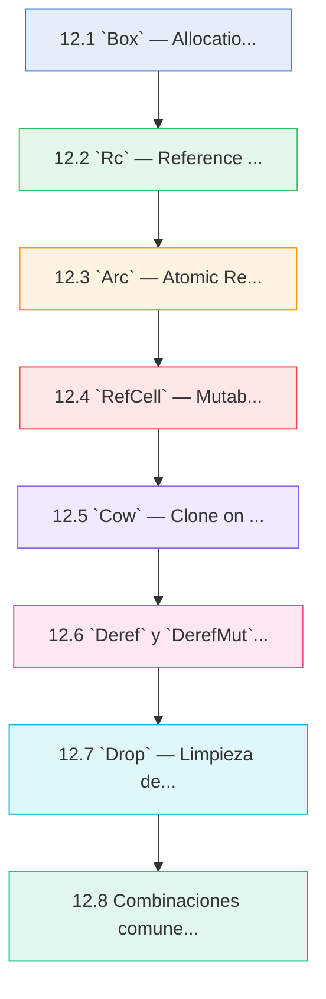
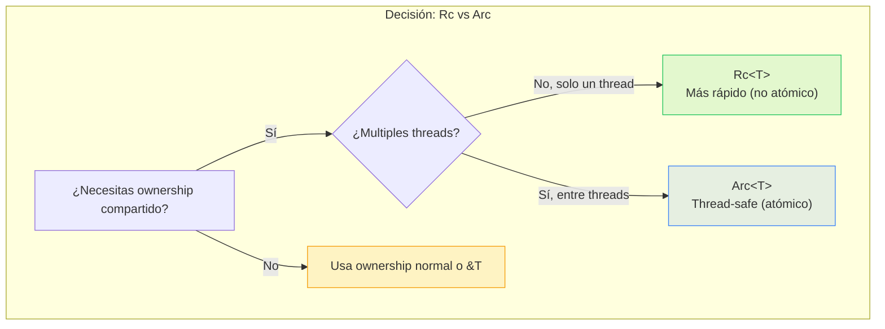
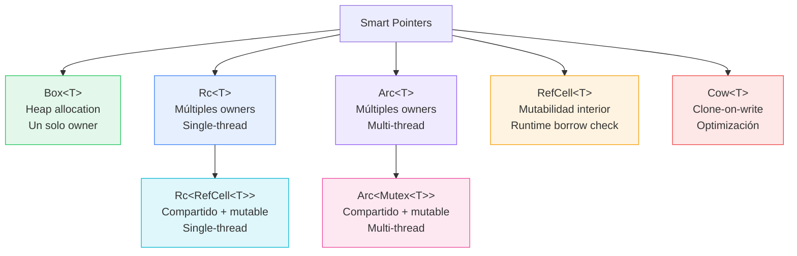

# :point_right: Cap 12 — Smart Pointers

<div class="chapter-meta">
  <span class="meta-item">🕐 4-5 horas</span>
  <span class="meta-item">📊 Nivel: Avanzado</span>
  <span class="meta-item">🎯 Semana 6</span>
</div>

<div class="chapter-objective">
  <span class="objective-icon">📌</span>
  <span class="objective-text">Al terminar este capítulo, dominarás los smart pointers de Rust (<code>Box</code>, <code>Rc</code>, <code>Arc</code>, <code>RefCell</code>, <code>Cow</code>) y los traits <code>Deref</code> y <code>Drop</code>. Sabrás elegir el puntero adecuado para cada situación: heap allocation, ownership compartido, mutabilidad interior y optimización copy-on-write, entendiendo cómo Rust te da control explícito frente al garbage collector implícito de Python.</span>
</div>

<div class="connection-box back" markdown>
:link: **Conexión con el Capítulo 11** — Recuerda del <a href='11-lifetimes.md'>Capítulo 11 (Lifetimes)</a> que aprendiste cómo Rust rastrea la duración de las referencias para garantizar seguridad de memoria. Los smart pointers extienden ese modelo: `Box` da ownership en el heap con lifetime ligado al scope, `Rc`/`Arc` permiten múltiples owners con liberación automática, y `RefCell` relaja las reglas de borrowing al runtime. Todo lo que aprendiste sobre lifetimes sigue aplicando aquí.
</div>

<div class="chapter-map">



</div>


!!! quote "Contexto"
    En Python, todo vive en el heap y la memoria se gestiona con reference counting automático (CPython). En Rust, los datos viven en el stack por defecto y el ownership gestiona la memoria. Pero a veces necesitas heap allocation, conteo de referencias compartido o mutabilidad interior. Para eso existen los **smart pointers**: structs que actuan como punteros pero con comportamientos extra.

---

## 12.1 `Box<T>` — Allocation en el heap

<div class="concept-question">
<h4>🔍 Pregunta conceptual</h4>
<p>En Python todos los objetos viven en el heap sin que tú decidas. En Rust, los datos van al stack por defecto. ¿Cuándo crees que tendría sentido pedir explícitamente que un dato viva en el heap? ¿Qué ventaja tendría eso sobre dejarlo siempre en el stack?</p>
</div>

`Box<T>` es el smart pointer más simple: almacena un valor en el **heap** y mantiene un puntero en el stack.

```rust
fn main() {
    // Valor en el stack
    let precio_stack: f64 = 12.50;

    // Valor en el heap con Box
    let precio_heap: Box<f64> = Box::new(12.50);

    // Se usa igual gracias a Deref
    println!("Stack: {}", precio_stack);
    println!("Heap: {}", *precio_heap);    // (1)!
    println!("Heap: {}", precio_heap);      // Deref automático
}
```

1. El operador `*` desreferencia el `Box` para acceder al valor interno. Pero gracias al trait `Deref`, Rust lo hace automaticamente en la mayoria de contextos.

### Tipos recursivos con Box

El caso de uso principal de `Box` es permitir **tipos recursivos** cuyo tamano el compilador no puede calcular en tiempo de compilación:

```rust
// ❌ Error: recursive type has infinite size
// enum Lista {
//     Nodo(i32, Lista),
//     Fin,
// }

// ✅ Box rompe la recursión: tamaño conocido (puntero = usize)
enum Lista {
    Nodo(i32, Box<Lista>),
    Fin,
}

fn main() {
    // Lista enlazada: 1 → 2 → 3 → Fin
    let lista = Lista::Nodo(1,
        Box::new(Lista::Nodo(2,
            Box::new(Lista::Nodo(3,
                Box::new(Lista::Fin)
            ))
        ))
    );

    // Recorrer la lista
    imprimir_lista(&lista);
}

fn imprimir_lista(lista: &Lista) {
    match lista {
        Lista::Nodo(valor, siguiente) => {
            print!("{} → ", valor);
            imprimir_lista(siguiente);
        }
        Lista::Fin => println!("Fin"),
    }
}
```

### RustMenu: arbol de categorias con Box

```rust
struct Categoria {
    nombre: String,
    subcategorias: Vec<Box<Categoria>>,    // (1)!
    platos: Vec<String>,
}

impl Categoria {
    fn new(nombre: &str) -> Self {
        Categoria {
            nombre: nombre.to_string(),
            subcategorias: Vec::new(),
            platos: Vec::new(),
        }
    }

    fn agregar_sub(&mut self, sub: Categoria) {
        self.subcategorias.push(Box::new(sub));
    }

    fn agregar_plato(&mut self, plato: &str) {
        self.platos.push(plato.to_string());
    }

    fn imprimir(&self, nivel: usize) {
        let indent = "  ".repeat(nivel);
        println!("{}📂 {}", indent, self.nombre);
        for plato in &self.platos {
            println!("{}  🍽️ {}", indent, plato);
        }
        for sub in &self.subcategorias {
            sub.imprimir(nivel + 1);
        }
    }
}

fn main() {
    let mut menu = Categoria::new("Menu Principal");

    let mut entrantes = Categoria::new("Entrantes");
    entrantes.agregar_plato("Gazpacho");
    entrantes.agregar_plato("Croquetas");

    let mut postres = Categoria::new("Postres");
    let mut postres_frios = Categoria::new("Postres Frios");
    postres_frios.agregar_plato("Helado");
    postres_frios.agregar_plato("Flan");
    postres.agregar_sub(postres_frios);

    menu.agregar_sub(entrantes);
    menu.agregar_sub(postres);

    menu.imprimir(0);
}
```

1. `Vec<Box<Categoria>>` permite tener subcategorias recursivas. Sin `Box`, el compilador no puede calcular el tamano de `Categoria`.

<div class="micro-exercise">
<h4>🧪 Micro-ejercicio (3 min)</h4>
<p>Sin ejecutar el código, dibuja en papel la memoria de esta línea: <code>let x = Box::new(Box::new(42));</code>. ¿Cuántos punteros hay en el stack? ¿Cuántas allocations en el heap? ¿Qué tamaño tiene cada una? (Pista: un puntero ocupa 8 bytes en arquitectura 64-bit y un <code>i32</code> ocupa 4 bytes.)</p>
</div>

<div class="comparison" markdown>
<div class="lang-box python" markdown>

#### :snake: En Python

```python
precio = 12.50   # TODO va al heap
lista = [1, 2, 3] # Heap
# Python: SIEMPRE heap. No eliges.
# El GC se encarga de la memoria.
# No hay concepto de stack vs heap
# para el programador.
```

En Python todo objeto vive en el heap. No hay forma de elegir donde se almacenan los datos.

</div>
<div class="lang-box rust" markdown>

#### :crab: En Rust

```rust
let x = 42;              // Stack (por defecto)
let y = Box::new(42);    // Heap (explícito)
let z = vec![1, 2, 3];   // Vec: datos en heap

// Rust: stack por defecto. Heap solo cuando
// lo pides explícitamente (Box, Vec, String...)
```

Rust pone datos en el stack por defecto. Usas `Box` para pedir heap allocation de forma explícita, tipicamente para tipos recursivos o datos grandes.

</div>
</div>

---

## 12.2 `Rc<T>` — Reference Counting

<div class="concept-question">
<h4>🔍 Pregunta conceptual</h4>
<p>En Python, cuando haces <code>b = a</code> con una lista, ambas variables apuntan al mismo objeto y Python lleva un conteo de referencias internamente. En Rust, <code>let b = a;</code> <strong>mueve</strong> el ownership y <code>a</code> deja de ser válido. ¿Cómo crees que Rust podría permitir que múltiples variables sean "dueñas" del mismo dato sin violar sus reglas de ownership?</p>
</div>

`Rc<T>` (Reference Counted) permite **ownership compartido**: multiples variables pueden ser duenas del mismo dato. Rust cuenta cuantas referencias existen y libera el dato cuando el conteo llega a cero.

```rust
use std::rc::Rc;

fn main() {
    let plato = Rc::new(String::from("Paella Valenciana"));

    println!("Conteo inicial: {}", Rc::strong_count(&plato)); // 1

    let ref1 = Rc::clone(&plato);   // (1)!
    println!("Tras ref1: {}", Rc::strong_count(&plato));       // 2

    let ref2 = Rc::clone(&plato);
    println!("Tras ref2: {}", Rc::strong_count(&plato));       // 3

    // Todos acceden al mismo String
    println!("{}", plato);
    println!("{}", ref1);
    println!("{}", ref2);

    drop(ref2);
    println!("Tras drop ref2: {}", Rc::strong_count(&plato));  // 2

    drop(ref1);
    println!("Tras drop ref1: {}", Rc::strong_count(&plato));  // 1
}   // plato sale del scope → conteo 0 → String se libera
```

1. `Rc::clone()` no hace deep copy: solo incrementa el contador de referencias. Es barato (O(1)). Usar `Rc::clone(&x)` en lugar de `x.clone()` es una convención para dejar claro que es un clone de Rc (barato), no un clone de datos (costoso).

!!! warning "Rc no es thread-safe"
    `Rc<T>` usa contadores no atomicos. Si necesitas compartir datos entre threads, usa `Arc<T>` (sección 12.3). Intentar enviar un `Rc` a otro thread da error de compilación:

    ```
    error[E0277]: `Rc<String>` cannot be sent between threads safely
    ```

<div class="pro-tip">
<h4>💡 Consejo Pro</h4>
<p>Siempre usa <code>Rc::clone(&x)</code> en vez de <code>x.clone()</code> para clonar un <code>Rc</code>. Ambos hacen lo mismo, pero la convención <code>Rc::clone</code> comunica a quien lee el código que es una operación barata (solo incrementa un contador), no una copia profunda de datos. Esta convención es especialmente importante en code reviews: si ves <code>x.clone()</code> en un <code>Rc</code>, podrías pensar erróneamente que se están duplicando los datos.</p>
</div>

### Grafo con Rc: multiples owners

```rust
use std::rc::Rc;

struct Ingrediente {
    nombre: String,
    alergeno: Option<String>,
}

fn main() {
    // Un ingrediente compartido por varios platos
    let tomate = Rc::new(Ingrediente {
        nombre: "Tomate".to_string(),
        alergeno: None,
    });

    let gazpacho_tomate = Rc::clone(&tomate);
    let ensalada_tomate = Rc::clone(&tomate);
    let salsa_tomate = Rc::clone(&tomate);

    println!("'{}' usado en {} platos",
        tomate.nombre,
        Rc::strong_count(&tomate)  - 1  // -1 por el original
    );
}
```

---

## 12.3 `Arc<T>` — Atomic Reference Counting

`Arc<T>` es la version **thread-safe** de `Rc<T>`. Usa contadores atomicos (más costosos pero seguros entre hilos).

```rust
use std::sync::Arc;
use std::thread;

fn main() {
    let menu = Arc::new(vec![
        "Paella".to_string(),
        "Gazpacho".to_string(),
        "Tortilla".to_string(),
    ]);

    let mut handles = vec![];

    for i in 0..3 {
        let menu_ref = Arc::clone(&menu);    // (1)!
        let handle = thread::spawn(move || {
            println!("Hilo {} ve el menú: {:?}", i, menu_ref);
        });
        handles.push(handle);
    }

    for handle in handles {
        handle.join().unwrap();
    }

    println!("Conteo final: {}", Arc::strong_count(&menu));  // 1
}
```

1. `Arc::clone()` es igual de barato que `Rc::clone()`: solo incrementa un contador atomico. No copia los datos del Vec.



---

## 12.4 `RefCell<T>` — Mutabilidad interior

<div class="concept-question">
<h4>🔍 Pregunta conceptual</h4>
<p>Las reglas de borrowing de Rust son estrictas: o múltiples lectores, o un solo escritor. Pero ¿qué pasa si tienes una estructura compartida con <code>Rc</code> (que solo da acceso inmutable) y necesitas modificar su contenido? ¿Es posible "esquivar" las reglas del compilador de forma segura?</p>
</div>

Normalmente, Rust verifica las reglas de borrowing en **compilación**. `RefCell<T>` mueve esa verificación al **runtime**, permitiendo **mutabilidad interior**: mutar un dato incluso cuando solo tienes una referencia inmutable.

```rust
use std::cell::RefCell;

fn main() {
    let datos = RefCell::new(vec![1, 2, 3]);

    // Lectura: borrow() retorna Ref<T>
    {
        let lectura = datos.borrow();       // (1)!
        println!("Datos: {:?}", *lectura);
    }   // Ref se libera aquí

    // Escritura: borrow_mut() retorna RefMut<T>
    {
        let mut escritura = datos.borrow_mut();   // (2)!
        escritura.push(4);
        escritura.push(5);
    }   // RefMut se libera aquí

    println!("Datos actualizados: {:?}", datos.borrow());
}
```

1. `borrow()` verifica en **runtime** que no haya un `borrow_mut()` activo. Si lo hay, hace **panic**.
2. `borrow_mut()` verifica que no haya ningun otro borrow (ni `borrow()` ni `borrow_mut()`) activo.

!!! danger "Panic en runtime"
    A diferencia de las reglas de borrowing normales (error de compilación), `RefCell` hace **panic** si violas las reglas en runtime:

    ```rust
    let datos = RefCell::new(42);
    let r1 = datos.borrow();
    let r2 = datos.borrow_mut();  // 💥 panic: already borrowed
    ```

    Reglas (identicas a las del compilador, pero verificadas en runtime):

    - Multiples `borrow()` simultaneos: OK
    - Un `borrow_mut()` sin otros borrows: OK
    - `borrow_mut()` + cualquier otro borrow: **PANIC**

<div class="misconception-box">
<h4>⚠️ Errores comunes</h4>
<ul>
<li><span class="wrong">❌ Mito:</span> "Los smart pointers de Rust son como los punteros de C/C++" → <span class="right">✅ Realidad:</span> Los smart pointers de Rust son <strong>seguros por defecto</strong>. No puedes tener dangling pointers, double free ni buffer overflow. <code>Box</code>, <code>Rc</code> y <code>Arc</code> garantizan liberación correcta. No son punteros raw: son structs con semántica de ownership.</li>
<li><span class="wrong">❌ Mito:</span> "<code>RefCell</code> permite saltarse las reglas de borrowing" → <span class="right">✅ Realidad:</span> <code>RefCell</code> aplica las <strong>mismas reglas exactas</strong> que el compilador, pero las verifica en runtime en vez de en compilación. Si las violas, tu programa hace panic. No es un "escape hatch" para ignorar la seguridad: es mover la verificación al runtime cuando el compilador no puede razonar estáticamente.</li>
<li><span class="wrong">❌ Mito:</span> "Siempre debería usar <code>Arc</code> en vez de <code>Rc</code> por si acaso necesito threads después" → <span class="right">✅ Realidad:</span> <code>Arc</code> tiene un coste real: los contadores atómicos son más lentos que los no atómicos de <code>Rc</code>. Usa <code>Rc</code> cuando estés seguro de que es single-threaded. Si luego necesitas threads, el compilador te <strong>obligará</strong> a cambiar a <code>Arc</code> — no compilará con <code>Rc</code>.</li>
</ul>
</div>

### Patrón `Rc<RefCell<T>>`: ownership compartido + mutabilidad

Esta combinación es muy comun: `Rc` da ownership compartido, `RefCell` da mutabilidad interior.

```rust
use std::rc::Rc;
use std::cell::RefCell;

#[derive(Debug)]
struct Plato {
    nombre: String,
    disponible: bool,
}

fn main() {
    let plato = Rc::new(RefCell::new(Plato {
        nombre: "Paella".to_string(),
        disponible: true,
    }));

    // Multiples owners
    let cocina = Rc::clone(&plato);
    let camarero = Rc::clone(&plato);

    // La cocina marca como no disponible
    cocina.borrow_mut().disponible = false;

    // El camarero ve el cambio
    println!("Camarero ve: {:?}", camarero.borrow());
    // Plato { nombre: "Paella", disponible: false }
}
```

---

## 12.5 `Cow<T>` — Clone on Write

`Cow<T>` (Clone on Write) es un smart pointer que puede contener datos **prestados** (`Borrowed`) o **propios** (`Owned`). Solo clona cuando necesitas mutar.

```rust
use std::borrow::Cow;

fn normalizar_nombre(nombre: &str) -> Cow<str> {
    if nombre.contains(' ') {
        // Necesitamos modificar: creamos un String owned
        let limpio = nombre.trim().to_lowercase();
        Cow::Owned(limpio)             // (1)!
    } else {
        // No necesitamos modificar: devolvemos la referencia original
        Cow::Borrowed(nombre)          // (2)!
    }
}

fn main() {
    let nombre1 = normalizar_nombre("paella");
    let nombre2 = normalizar_nombre("  Gazpacho Andaluz  ");

    println!("{}", nombre1);  // "paella" (sin copia, Borrowed)
    println!("{}", nombre2);  // "gazpacho andaluz" (copia necesaria, Owned)

    // Verificar si se hizo copia
    match &nombre1 {
        Cow::Borrowed(_) => println!("nombre1: sin copia (eficiente)"),
        Cow::Owned(_) => println!("nombre1: se creó copia"),
    }
}
```

1. `Cow::Owned` contiene un `String` propio. Se uso cuando fue necesario transformar los datos.
2. `Cow::Borrowed` contiene un `&str` prestado. Cero allocations: máximo rendimiento.

!!! tip "Cuando usar Cow"
    `Cow` es ideal para funciones que **a veces** necesitan modificar datos y a veces no. Evita clones innecesarios. Caso típico: parseo de texto, normalización de strings, procesamiento condicional.

---

## 12.6 `Deref` y `DerefMut` — Coerción automática

Los traits `Deref` y `DerefMut` permiten que un smart pointer se comporte como una referencia al tipo interno. Rust aplica **deref coerción** automaticamente.

```rust
use std::ops::Deref;

struct MenuWrapper {
    platos: Vec<String>,
}

impl Deref for MenuWrapper {
    type Target = Vec<String>;

    fn deref(&self) -> &Vec<String> {
        &self.platos
    }
}

fn imprimir_platos(platos: &Vec<String>) {
    for plato in platos {
        println!("  - {}", plato);
    }
}

fn main() {
    let menu = MenuWrapper {
        platos: vec![
            "Paella".to_string(),
            "Gazpacho".to_string(),
        ],
    };

    // Deref coerción: &MenuWrapper → &Vec<String>
    imprimir_platos(&menu);       // (1)!

    // También funciona el operador *
    println!("Total platos: {}", (*menu).len());

    // Y los métodos de Vec directamente
    println!("Primer plato: {}", menu[0]);
}
```

1. Rust convierte `&MenuWrapper` a `&Vec<String>` automaticamente gracias a `Deref`. No necesitas escribir `&menu.platos`.

### Cadenas de deref coerción

Rust aplica deref coerción en cadena. Este es un ejemplo clave:

```rust
fn saludar(nombre: &str) {
    println!("Bienvenido, {}", nombre);
}

fn main() {
    let nombre = Box::new(String::from("Carlos"));

    // Cadena de coerción:
    // &Box<String> → &String → &str
    saludar(&nombre);    // (1)!

    // Equivalente explícito (innecesario):
    // saludar(&(*(*nombre)));
}
```

1. Rust aplica: `&Box<String>` --Deref de Box--> `&String` --Deref de String--> `&str`. Todo automático.

| Coerción | De | A |
|:---------|:---|:--|
| `Deref` | `&T` | `&U` (donde `T: Deref<Target=U>`) |
| `DerefMut` | `&mut T` | `&mut U` (donde `T: DerefMut<Target=U>`) |
| Mut a inmut | `&mut T` | `&T` (siempre válido) |

---

## 12.7 `Drop` — Limpieza determinista (RAII)

El trait `Drop` permite ejecutar código personalizado cuando un valor sale del scope. Rust garantiza que `drop()` se ejecuta **siempre** y en **orden determinista** (LIFO).

```rust
struct Conexion {
    nombre: String,
}

impl Drop for Conexion {
    fn drop(&mut self) {
        println!("🔌 Cerrando conexión: {}", self.nombre);
    }
}

fn main() {
    let db = Conexion { nombre: "PostgreSQL".to_string() };
    let cache = Conexion { nombre: "Redis".to_string() };
    let api = Conexion { nombre: "API externa".to_string() };

    println!("Conexiones creadas");

    // Drop anticipado
    drop(api);    // (1)!
    println!("API liberada manualmente");

}   // cache y db se liberan aquí (orden LIFO: cache primero, luego db)
```

1. `std::mem::drop()` permite liberar un recurso antes del fin del scope. Útil para liberar locks o conexiones cuanto antes.

<div class="pro-tip">
<h4>💡 Consejo Pro</h4>
<p>No puedes llamar <code>valor.drop()</code> directamente — Rust lo prohíbe para evitar un double-free (el compilador llamaría <code>drop</code> de nuevo al final del scope). Usa <code>std::mem::drop(valor)</code> o <code>drop(valor)</code>, que es una función que toma ownership del valor, lo que provoca que Rust ejecute el <code>Drop</code> implícitamente y el valor ya no existe al final del scope. Es un patrón elegante: "mover el valor a la nada" para destruirlo anticipadamente.</p>
</div>

<div class="comparison" markdown>
<div class="lang-box python" markdown>

#### :snake: En Python

```python
class Conexion:
    def __init__(self, nombre):
        self.nombre = nombre

    def __del__(self):
        print(f"Cerrando {self.nombre}")
        # ⚠️ NO determinista!
        # Podría ejecutarse tarde, en otro
        # orden, o NUNCA al salir del programa.

# Alternativa fiable: context managers
with open("datos.txt") as f:
    pass  # __exit__ SÍ es determinista
```

`__del__` de Python NO es fiable. Se usa `with` (context managers) para limpieza determinista, pero solo para recursos que lo implementen.

</div>
<div class="lang-box rust" markdown>

#### :crab: En Rust

```rust
impl Drop for Conexion {
    fn drop(&mut self) {
        println!("Cerrando: {}", self.nombre);
    }
    // ✅ SIEMPRE se ejecuta
    // ✅ Orden determinista (LIFO)
    // ✅ Funciona para CUALQUIER tipo
}
// No necesitas "with" ni context managers.
// Drop + ownership = RAII automático.
```

`Drop` en Rust es **siempre determinista**. Se ejecuta al salir del scope, sin excepciones. Esto es RAII: no necesitas context managers.

</div>
</div>

---

## 12.8 Combinaciones comunes

### `Rc<RefCell<T>>` — Ownership compartido + mutabilidad (single-threaded)

```rust
use std::rc::Rc;
use std::cell::RefCell;

type MenuCompartido = Rc<RefCell<Vec<String>>>;

fn agregar_plato(menu: &MenuCompartido, plato: &str) {
    menu.borrow_mut().push(plato.to_string());
}

fn imprimir_menu(menu: &MenuCompartido) {
    let platos = menu.borrow();
    println!("Menú ({} platos):", platos.len());
    for plato in platos.iter() {
        println!("  - {}", plato);
    }
}

fn main() {
    let menu: MenuCompartido = Rc::new(RefCell::new(Vec::new()));

    let cocina = Rc::clone(&menu);
    let camarero = Rc::clone(&menu);

    agregar_plato(&cocina, "Paella");
    agregar_plato(&cocina, "Gazpacho");

    // El camarero ve los cambios
    imprimir_menu(&camarero);
}
```

### `Arc<Mutex<T>>` — Ownership compartido + mutabilidad (multi-threaded)

```rust
use std::sync::{Arc, Mutex};
use std::thread;

fn main() {
    let pedidos = Arc::new(Mutex::new(Vec::<String>::new()));

    let mut handles = vec![];

    for i in 0..4 {
        let pedidos_ref = Arc::clone(&pedidos);
        let handle = thread::spawn(move || {
            let mut lista = pedidos_ref.lock().unwrap();   // (1)!
            lista.push(format!("Pedido mesa {}", i + 1));
        });   // MutexGuard se libera aquí → unlock automático
        handles.push(handle);
    }

    for handle in handles {
        handle.join().unwrap();
    }

    let lista = pedidos.lock().unwrap();
    println!("Pedidos recibidos: {:?}", *lista);
}
```

1. `.lock()` bloquea el Mutex y retorna un `MutexGuard`. Cuando el guard sale del scope, el Mutex se desbloquea automaticamente (RAII). `.unwrap()` porque `.lock()` retorna `Result` (puede fallar si otro hilo hizo panic con el lock tomado).

<div class="micro-exercise">
<h4>🧪 Micro-ejercicio (5 min)</h4>
<p>Dado este código, ¿qué smart pointer(s) usarías para cada situación? Escribe solo el tipo, no el código completo:</p>
<ol>
<li>Un árbol binario donde cada nodo tiene dos hijos → <code>___&lt;Nodo&gt;</code></li>
<li>Un caché de configuración leído por múltiples módulos en el mismo hilo → <code>___&lt;Config&gt;</code></li>
<li>Un contador compartido entre 4 threads que todos incrementan → <code>___&lt;___&lt;u64&gt;&gt;</code></li>
<li>Una función que a veces transforma un string y a veces lo devuelve tal cual → <code>___&lt;str&gt;</code></li>
</ol>
<p><em>Respuestas: (1) <code>Box</code>, (2) <code>Rc</code>, (3) <code>Arc&lt;Mutex&gt;</code>, (4) <code>Cow</code></em></p>
</div>

<div class="code-evolution" markdown>
<div class="evolution-header">📈 Evolución del código</div>
<div class="evolution-step">
<span class="step-label novato">v1 — Python: todo implícito</span>

```python
# Python: reference counting automático, todo en el heap
# No decides nada sobre memoria

class Menu:
    def __init__(self):
        self.platos = []

menu = Menu()
copia = menu  # Referencia compartida (implícita)
copia.platos.append("Paella")
print(menu.platos)  # ["Paella"] — mutación compartida "mágica"
# ¿Quién es dueño? ¿Cuándo se libera? No lo sabes.
```

</div>
<div class="evolution-step">
<span class="step-label mejorado">v2 — Rust naive: ownership estricto, una sola referencia</span>

```rust
// Rust: ownership explícito, pero inflexible
struct Menu {
    platos: Vec<String>,
}

fn main() {
    let mut menu = Menu { platos: vec![] };
    menu.platos.push("Paella".to_string());

    // Solo una función puede usar menu a la vez
    imprimir(&menu);
    agregar(&mut menu, "Gazpacho");
    // Funciona, pero no puedes tener "cocina" y
    // "camarero" como owners simultáneos
}
```

</div>
<div class="evolution-step">
<span class="step-label profesional">v3 — Rust idiomático: Rc + RefCell para ownership compartido + mutabilidad</span>

```rust
use std::rc::Rc;
use std::cell::RefCell;

type MenuCompartido = Rc<RefCell<Vec<String>>>;

fn main() {
    let menu: MenuCompartido = Rc::new(RefCell::new(vec![]));

    let cocina = Rc::clone(&menu);
    let camarero = Rc::clone(&menu);

    // Cocina agrega platos
    cocina.borrow_mut().push("Paella".to_string());
    cocina.borrow_mut().push("Gazpacho".to_string());

    // Camarero lee el menú — ve los cambios
    println!("Disponibles: {:?}", camarero.borrow());
    // ✅ Ownership compartido explícito
    // ✅ Mutabilidad controlada en runtime
    // ✅ Se libera cuando el último Rc sale del scope
}
```

</div>
</div>

### Resumen: Jerarquia de smart pointers



<div class="comparison" markdown>
<div class="lang-box python" markdown>

#### :snake: En Python

```python
import sys

a = [1, 2, 3]
b = a                # Referencia compartida
sys.getrefcount(a)   # Reference counting implícito

# Python: reference counting automático +
# garbage collector para ciclos.
# No eliges: siempre es ref counting.
# Todo es mutable por defecto.
```

Python usa reference counting implícito (CPython) + GC ciclico. Todo es heap, todo es compartido por referencia.

</div>
<div class="lang-box rust" markdown>

#### :crab: En Rust

```rust
use std::rc::Rc;
use std::cell::RefCell;

let a = vec![1, 2, 3];      // Un solo owner
let b = Rc::new(vec![1]);    // Owners compartidos
let c = Rc::new(RefCell::new(vec![1]));
// Compartido + mutable

// Rust: ownership explícito.
// Tú eliges: Box, Rc, Arc, RefCell.
// Cada uno tiene su propósito claro.
```

Rust te da smart pointers explicitos. Cada tipo comunica tu intención: `Box` (heap), `Rc` (compartido), `RefCell` (mutable), `Arc` (threads).

</div>
</div>


<div class="real-errors">
<h4>🚨 Errores que vas a encontrar</h4>

**Error 1: Tipo incompatible**

```rust
let x: i32 = "hola"; // ❌
```

```
error[E0308]: mismatched types
  expected `i32`, found `&str`
```

**¿Por qué?** Rust es estrictamente tipado — no hay conversión implícita entre tipos.

**Solución:** Usa el tipo correcto o convierte explícitamente.

---

**Error 2: Variable no mutable**

```rust
let precio = 10.0;
precio = 15.0; // ❌
```

```
error[E0384]: cannot assign twice to immutable variable `precio`
```

**Solución:** Declara con `let mut precio = 10.0;`

---

**Error 3: Valor movido**

```rust
let nombre = String::from("Paella");
let copia = nombre;
println!("{}", nombre); // ❌
```

```
error[E0382]: borrow of moved value: `nombre`
```

**Solución:** Usa `.clone()` o referencias `&nombre`.

</div>

---

<div class="checkpoint">
<h4>🏁 Checkpoint</h4>
<p>Si puedes: (1) explicar cuándo usar <code>Box</code> vs <code>Rc</code> vs <code>Arc</code> y por qué, (2) describir qué hace <code>RefCell</code> y cuándo causa panic, (3) combinar <code>Rc&lt;RefCell&lt;T&gt;&gt;</code> para ownership compartido + mutable, y (4) implementar <code>Drop</code> para limpieza determinista tipo RAII — dominas los smart pointers de Rust y estás listo para aplicarlos en concurrencia.</p>
</div>

<div class="mini-project">
<h4>🏗️ Mini-proyecto: Aplicación práctica</h4>

**Paso 1 — Define las estructuras base**

Crea las estructuras y tipos necesarios para modelar el dominio del capítulo.

??? success "Solución Paso 1"
    ```rust
    // Define tus structs y enums aquí
    #[derive(Debug)]
    struct Item {
        nombre: String,
        valor: f64,
    }

    impl Item {
        fn new(nombre: &str, valor: f64) -> Self {
            Self {
                nombre: nombre.to_string(),
                valor,
            }
        }
    }
    ```

**Paso 2 — Implementa la lógica principal**

Crea funciones que operen sobre las estructuras del paso 1.

??? success "Solución Paso 2"
    ```rust
    fn procesar(items: &[Item]) -> f64 {
        items.iter().map(|i| i.valor).sum()
    }

    fn mostrar(items: &[Item]) {
        for item in items {
            println!("  {} — {:.2}€", item.nombre, item.valor);
        }
    }
    ```

**Paso 3 — Integra todo en main**

Combina los pasos anteriores en un programa completo.

??? success "Solución Paso 3"
    ```rust
    fn main() {
        let items = vec![
            Item::new("Paella", 14.50),
            Item::new("Gazpacho", 8.00),
            Item::new("Flan", 5.50),
        ];

        println!("=== RustMenu ===");
        mostrar(&items);
        println!("Total: {:.2}€", procesar(&items));
    }
    ```

</div>


<div class="connection-box forward" markdown>
:link: **Hacia el Capítulo 13** — En el <a href='13-concurrencia.md'>Capítulo 13 (Concurrencia)</a> pondrás en práctica <code>Arc&lt;Mutex&lt;T&gt;&gt;</code> y <code>Arc&lt;RwLock&lt;T&gt;&gt;</code> para compartir datos entre threads de forma segura. Todo lo que aprendiste sobre smart pointers es la base: <code>Arc</code> reemplaza a <code>Rc</code> y <code>Mutex</code> reemplaza a <code>RefCell</code> en el mundo multi-hilo. También verás cómo los traits <code>Send</code> y <code>Sync</code> determinan qué tipos pueden cruzar la frontera entre threads.
</div>

---

<div class="ejercicio-guiado">
<h4>🏋️ Ejercicio guiado</h4>

Vas a construir un sistema de configuracion compartida para RustMenu usando `Rc<RefCell<T>>`. Varios componentes del restaurante (cocina, barra, sala) comparten y modifican la misma configuracion del menu en tiempo de ejecucion, simulando un escenario donde multiples partes del sistema necesitan ownership compartido con mutabilidad interior.

1. Define una struct `ConfigMenu` con campos `nombre_restaurante: String`, `iva: f64`, `platos_disponibles: Vec<String>` y `abierto: bool`.
2. Crea un type alias `type ConfigCompartida = Rc<RefCell<ConfigMenu>>;` e implementa una funcion `nueva_config(nombre: &str) -> ConfigCompartida` que inicialice la configuracion.
3. Define una struct `Cocina` que contenga un campo `config: ConfigCompartida`. Implementa un metodo `agregar_plato(&self, plato: &str)` que modifique la lista de platos usando `borrow_mut()`.
4. Define una struct `Sala` con el mismo tipo de campo. Implementa un metodo `mostrar_menu(&self)` que lea la configuracion con `borrow()` e imprima los platos disponibles y el IVA.
5. En `main`, crea una configuracion compartida, pasala a `Cocina` y `Sala` usando `Rc::clone`, y demuestra que los cambios hechos por la cocina son visibles para la sala.
6. Imprime el `Rc::strong_count` en cada paso para mostrar cuantas referencias existen.

??? success "Solución completa"
    ```rust
    use std::rc::Rc;
    use std::cell::RefCell;

    #[derive(Debug)]
    struct ConfigMenu {
        nombre_restaurante: String,
        iva: f64,
        platos_disponibles: Vec<String>,
        abierto: bool,
    }

    type ConfigCompartida = Rc<RefCell<ConfigMenu>>;

    fn nueva_config(nombre: &str) -> ConfigCompartida {
        Rc::new(RefCell::new(ConfigMenu {
            nombre_restaurante: nombre.to_string(),
            iva: 0.21,
            platos_disponibles: Vec::new(),
            abierto: false,
        }))
    }

    struct Cocina {
        config: ConfigCompartida,
    }

    impl Cocina {
        fn new(config: &ConfigCompartida) -> Self {
            Cocina {
                config: Rc::clone(config),
            }
        }

        fn agregar_plato(&self, plato: &str) {
            self.config
                .borrow_mut()
                .platos_disponibles
                .push(plato.to_string());
            println!("[Cocina] Plato agregado: {}", plato);
        }

        fn abrir_restaurante(&self) {
            self.config.borrow_mut().abierto = true;
            println!("[Cocina] Restaurante abierto");
        }
    }

    struct Sala {
        config: ConfigCompartida,
    }

    impl Sala {
        fn new(config: &ConfigCompartida) -> Self {
            Sala {
                config: Rc::clone(config),
            }
        }

        fn mostrar_menu(&self) {
            let cfg = self.config.borrow();
            println!("\n=== {} ===", cfg.nombre_restaurante);
            println!("Estado: {}", if cfg.abierto { "Abierto" } else { "Cerrado" });
            println!("IVA: {}%", cfg.iva * 100.0);
            println!("Platos disponibles:");
            for (i, plato) in cfg.platos_disponibles.iter().enumerate() {
                println!("  {}. {}", i + 1, plato);
            }
            if cfg.platos_disponibles.is_empty() {
                println!("  (sin platos)");
            }
        }
    }

    fn main() {
        let config = nueva_config("RustMenu");
        println!("Referencias iniciales: {}", Rc::strong_count(&config));

        let cocina = Cocina::new(&config);
        println!("Tras crear cocina: {}", Rc::strong_count(&config));

        let sala = Sala::new(&config);
        println!("Tras crear sala: {}", Rc::strong_count(&config));

        // La sala ve el menu vacio
        sala.mostrar_menu();

        // La cocina agrega platos
        cocina.agregar_plato("Paella Valenciana");
        cocina.agregar_plato("Gazpacho Andaluz");
        cocina.agregar_plato("Croquetas de Jamon");
        cocina.abrir_restaurante();

        // La sala ve los cambios inmediatamente
        sala.mostrar_menu();

        println!("\nReferencias finales: {}", Rc::strong_count(&config));
    }
    ```

</div>

## :link: Recursos

| Recurso | Enlace |
|---------|--------|
| The Rust Book - Smart Pointers | [doc.rust-lang.org/book/ch15-00-smart-pointers](https://doc.rust-lang.org/book/ch15-00-smart-pointers.html) |
| Rust by Example - Box | [doc.rust-lang.org/rust-by-example/std/box](https://doc.rust-lang.org/rust-by-example/std/box.html) |
| Rust by Example - Rc | [doc.rust-lang.org/rust-by-example/std/rc](https://doc.rust-lang.org/rust-by-example/std/rc.html) |
| std::cell - RefCell docs | [doc.rust-lang.org/std/cell](https://doc.rust-lang.org/std/cell/index.html) |

---

## 🎯 Ejercicios

??? question "Ejercicio 1: Lista enlazada con Box"
    Implementa una lista enlazada genérica `Lista<T>` usando `Box`. Debe tener métodos `push` (agregar al frente), `to_vec` (convertir a Vec) y `len` (contar elementos).

    !!! tip "Pista"
        Usa un enum `enum Lista<T> { Nodo(T, Box<Lista<T>>), Fin }`. Para `push`, crea un nuevo nodo que apunte a la lista actual.

    ??? success "Solución"
        ```rust
        enum Lista<T> {
            Nodo(T, Box<Lista<T>>),
            Fin,
        }

        impl<T: Clone> Lista<T> {
            fn new() -> Self {
                Lista::Fin
            }

            fn push(self, valor: T) -> Self {
                Lista::Nodo(valor, Box::new(self))
            }

            fn len(&self) -> usize {
                match self {
                    Lista::Fin => 0,
                    Lista::Nodo(_, siguiente) => 1 + siguiente.len(),
                }
            }

            fn to_vec(&self) -> Vec<T> {
                let mut resultado = Vec::new();
                let mut actual = self;
                loop {
                    match actual {
                        Lista::Nodo(valor, siguiente) => {
                            resultado.push(valor.clone());
                            actual = siguiente;
                        }
                        Lista::Fin => break,
                    }
                }
                resultado
            }
        }

        fn main() {
            let lista = Lista::new()
                .push("Paella")
                .push("Gazpacho")
                .push("Tortilla");

            println!("Longitud: {}", lista.len());          // 3
            println!("Platos: {:?}", lista.to_vec());       // ["Tortilla", "Gazpacho", "Paella"]
        }
        ```

??? question "Ejercicio 2: Grafo de ingredientes con Rc"
    Crea un sistema donde varios platos comparten ingredientes usando `Rc`. Cada plato tiene un `Vec<Rc<Ingrediente>>`. Demuestra que multiples platos pueden referenciar el mismo ingrediente y muestra el `strong_count`.

    !!! tip "Pista"
        Define `struct Ingrediente { nombre: String, alergeno: Option<String> }`. Usa `Rc::clone()` para compartir entre platos.

    ??? success "Solución"
        ```rust
        use std::rc::Rc;

        #[derive(Debug)]
        struct Ingrediente {
            nombre: String,
            alergeno: Option<String>,
        }

        struct Plato {
            nombre: String,
            ingredientes: Vec<Rc<Ingrediente>>,
        }

        fn main() {
            let tomate = Rc::new(Ingrediente {
                nombre: "Tomate".to_string(),
                alergeno: None,
            });
            let queso = Rc::new(Ingrediente {
                nombre: "Queso".to_string(),
                alergeno: Some("Lactosa".to_string()),
            });
            let harina = Rc::new(Ingrediente {
                nombre: "Harina".to_string(),
                alergeno: Some("Gluten".to_string()),
            });

            let pizza = Plato {
                nombre: "Pizza".to_string(),
                ingredientes: vec![
                    Rc::clone(&tomate),
                    Rc::clone(&queso),
                    Rc::clone(&harina),
                ],
            };

            let ensalada = Plato {
                nombre: "Ensalada".to_string(),
                ingredientes: vec![
                    Rc::clone(&tomate),
                    Rc::clone(&queso),
                ],
            };

            println!("Tomate usado en {} platos (refs: {})",
                Rc::strong_count(&tomate) - 1,
                Rc::strong_count(&tomate));
            println!("Queso usado en {} platos (refs: {})",
                Rc::strong_count(&queso) - 1,
                Rc::strong_count(&queso));
            println!("Harina usado en {} platos (refs: {})",
                Rc::strong_count(&harina) - 1,
                Rc::strong_count(&harina));
        }
        ```

??? question "Ejercicio 3: Estado compartido con Rc<RefCell<T>>"
    Implementa un `EstadoMenu` compartido entre `Cocina` y `Camarero`. Ambos pueden modificar la lista de platos disponibles. La cocina agrega y el camarero elimina platos.

    !!! tip "Pista"
        Usa `type EstadoMenu = Rc<RefCell<Vec<String>>>`. Cada struct guarda un `Rc` al mismo estado.

    ??? success "Solución"
        ```rust
        use std::rc::Rc;
        use std::cell::RefCell;

        type EstadoMenu = Rc<RefCell<Vec<String>>>;

        struct Cocina {
            menu: EstadoMenu,
        }

        impl Cocina {
            fn preparar_plato(&self, plato: &str) {
                self.menu.borrow_mut().push(plato.to_string());
                println!("🍳 Cocina preparó: {}", plato);
            }
        }

        struct Camarero {
            menu: EstadoMenu,
        }

        impl Camarero {
            fn servir_plato(&self, plato: &str) -> bool {
                let mut lista = self.menu.borrow_mut();
                if let Some(pos) = lista.iter().position(|p| p == plato) {
                    lista.remove(pos);
                    println!("🍽️ Camarero sirvió: {}", plato);
                    true
                } else {
                    println!("❌ {} no disponible", plato);
                    false
                }
            }

            fn ver_disponibles(&self) {
                let lista = self.menu.borrow();
                println!("Disponibles: {:?}", *lista);
            }
        }

        fn main() {
            let estado: EstadoMenu = Rc::new(RefCell::new(Vec::new()));

            let cocina = Cocina { menu: Rc::clone(&estado) };
            let camarero = Camarero { menu: Rc::clone(&estado) };

            cocina.preparar_plato("Paella");
            cocina.preparar_plato("Gazpacho");
            cocina.preparar_plato("Flan");
            camarero.ver_disponibles();

            camarero.servir_plato("Gazpacho");
            camarero.ver_disponibles();
        }
        ```

??? question "Ejercicio 4: Cow para procesamiento de nombres"
    Crea una función `limpiar_nombre` que reciba un `&str` y retorne `Cow<str>`. Si el nombre ya esta limpio (sin espacios extra, primera letra mayuscula), retorna `Borrowed`. Si necesita limpieza, retorna `Owned`.

    !!! tip "Pista"
        Verifica si `nombre.trim() == nombre` y si la primera letra ya es mayuscula. Solo crea un `String` nuevo si necesitas transformar.

    ??? success "Solución"
        ```rust
        use std::borrow::Cow;

        fn limpiar_nombre(nombre: &str) -> Cow<str> {
            let trimmed = nombre.trim();
            let primera_mayuscula = trimmed.chars().next()
                .map(|c| c.is_uppercase())
                .unwrap_or(true);

            if trimmed == nombre && primera_mayuscula {
                Cow::Borrowed(nombre)
            } else {
                let mut limpio = trimmed.to_string();
                if let Some(primera) = limpio.get_mut(..1) {
                    primera.make_ascii_uppercase();
                }
                Cow::Owned(limpio)
            }
        }

        fn main() {
            let nombres = vec![
                "Paella",            // Ya limpio → Borrowed
                "  gazpacho  ",      // Necesita limpieza → Owned
                "Tortilla",          // Ya limpio → Borrowed
                "  flan ",           // Necesita limpieza → Owned
            ];

            for nombre in &nombres {
                let resultado = limpiar_nombre(nombre);
                let tipo = match &resultado {
                    Cow::Borrowed(_) => "Borrowed (sin copia)",
                    Cow::Owned(_) => "Owned (con copia)",
                };
                println!("{:20} → {:20} [{}]", nombre, resultado.as_ref(), tipo);
            }
        }
        ```

??? question "Ejercicio 5: Implementar Drop para un pool de conexiones"
    Crea un `PoolConexiones` que contenga un `Vec<Conexion>`. Implementa `Drop` para `Conexion` (imprime un mensaje al cerrar) y para `PoolConexiones` (imprime cuantas conexiones se cierran). Demuestra el orden LIFO de drop.

    !!! tip "Pista"
        Implementa `Drop` para ambos structs. Rust llama `drop` del pool primero, luego de cada conexion individual en orden inverso.

    ??? success "Solución"
        ```rust
        struct Conexion {
            id: u32,
            destino: String,
        }

        impl Drop for Conexion {
            fn drop(&mut self) {
                println!("  🔌 Cerrando conexión #{} a {}", self.id, self.destino);
            }
        }

        struct PoolConexiones {
            nombre: String,
            conexiones: Vec<Conexion>,
        }

        impl PoolConexiones {
            fn new(nombre: &str) -> Self {
                println!("Pool '{}' creado", nombre);
                PoolConexiones {
                    nombre: nombre.to_string(),
                    conexiones: Vec::new(),
                }
            }

            fn agregar(&mut self, destino: &str) -> u32 {
                let id = self.conexiones.len() as u32 + 1;
                self.conexiones.push(Conexion {
                    id,
                    destino: destino.to_string(),
                });
                println!("  ➕ Conexión #{} a {} agregada", id, destino);
                id
            }
        }

        impl Drop for PoolConexiones {
            fn drop(&mut self) {
                println!(
                    "🏊 Cerrando pool '{}' con {} conexiones...",
                    self.nombre,
                    self.conexiones.len()
                );
            }
        }

        fn main() {
            let mut pool = PoolConexiones::new("RustMenu-DB");
            pool.agregar("PostgreSQL");
            pool.agregar("Redis");
            pool.agregar("Elasticsearch");

            println!("\n--- Fin del scope ---");
        }   // Drop del pool, luego drop de cada conexión (LIFO)
        ```

---

## :brain: Flashcards de repaso

<div class="flashcard">
<div class="front">¿Para que sirve <code>Box&lt;T&gt;</code>?</div>
<div class="back">Almacena un valor en el heap con un único owner. Casos de uso principales: tipos recursivos (listas, arboles), datos grandes que no quieres mover en el stack, y trait objects (<code>Box&lt;dyn Trait&gt;</code>).</div>
</div>

<div class="flashcard">
<div class="front">¿Cual es la diferencia entre <code>Rc&lt;T&gt;</code> y <code>Arc&lt;T&gt;</code>?</div>
<div class="back"><code>Rc</code> usa contadores no atomicos (más rápido, solo single-thread). <code>Arc</code> usa contadores atomicos (más lento, thread-safe). Mismo propósito: ownership compartido. Regla: usa <code>Rc</code> si no necesitas threads, <code>Arc</code> si los necesitas.</div>
</div>

<div class="flashcard">
<div class="front">¿Que es la mutabilidad interior (<code>RefCell&lt;T&gt;</code>)?</div>
<div class="back"><code>RefCell</code> mueve las reglas de borrowing del compilador al runtime. Permite mutar datos detras de una referencia inmutable. <code>borrow()</code> para leer, <code>borrow_mut()</code> para escribir. Viola las reglas → panic en runtime.</div>
</div>

<div class="flashcard">
<div class="front">¿Cuando usar <code>Cow&lt;T&gt;</code>?</div>
<div class="back">Cuando una función a veces necesita modificar datos y a veces no. <code>Cow::Borrowed</code> evita copias cuando no hay modificación. <code>Cow::Owned</code> permite devolver datos modificados. Optimización: evita clones innecesarios.</div>
</div>

<div class="flashcard">
<div class="front">¿Que es deref coerción?</div>
<div class="back">Rust convierte automaticamente <code>&T</code> a <code>&U</code> cuando <code>T: Deref&lt;Target=U&gt;</code>. Ejemplo: <code>&String</code> → <code>&str</code>, <code>&Box&lt;T&gt;</code> → <code>&T</code>. Funciona en cadena y hace que los smart pointers sean transparentes.</div>
</div>

<div class="flashcard">
<div class="front">¿Como se compara <code>Drop</code> de Rust con <code>__del__</code> de Python?</div>
<div class="back">Rust: <code>Drop</code> es determinista (siempre se ejecuta al salir del scope, orden LIFO). Python: <code>__del__</code> NO es fiable (el GC decide cuando, puede no ejecutarse). Rust no necesita context managers (<code>with</code>).</div>
</div>

<div class="flashcard">
<div class="front">¿Para que sirve <code>Rc&lt;RefCell&lt;T&gt;&gt;</code>?</div>
<div class="back">Combina ownership compartido (<code>Rc</code>) con mutabilidad interior (<code>RefCell</code>). Multiples variables pueden ser duenas del dato Y modificarlo. Solo single-threaded. Version multi-thread: <code>Arc&lt;Mutex&lt;T&gt;&gt;</code>.</div>
</div>

---

## :video_game: Quiz interactivo

<div class="quiz" data-quiz-id="ch12-q1">
<h4>Pregunta 1: ¿Cuando necesitas <code>Box&lt;T&gt;</code>?</h4>
<button class="quiz-option" data-correct="false">Siempre que quieras almacenar datos</button>
<button class="quiz-option" data-correct="true">Para tipos recursivos, datos grandes en heap, o trait objects</button>
<button class="quiz-option" data-correct="false">Solo para tipos primitivos como <code>i32</code></button>
<button class="quiz-option" data-correct="false">Solo cuando necesitas multiples owners</button>
<div class="quiz-feedback" data-correct="¡Correcto! Box se usa principalmente para tipos recursivos (el compilador necesita un tamaño conocido), datos grandes que no quieres copiar en el stack, y trait objects (Box<dyn Trait>)." data-incorrect="Incorrecto. Box no es para todos los datos (la mayoría va en el stack) ni para tipos primitivos (ya son Copy). Tampoco da múltiples owners (eso es Rc/Arc). Box da heap allocation con un solo owner."></div>
</div>

<div class="quiz" data-quiz-id="ch12-q2">
<h4>Pregunta 2: ¿Que pasa si llamas <code>borrow_mut()</code> en un <code>RefCell</code> que ya tiene un <code>borrow()</code> activo?</h4>
<button class="quiz-option" data-correct="false">Error de compilación</button>
<button class="quiz-option" data-correct="false">Se ignora el borrow anterior</button>
<button class="quiz-option" data-correct="true">Panic en runtime</button>
<button class="quiz-option" data-correct="false">Se bloquea hasta que el borrow termine</button>
<div class="quiz-feedback" data-correct="¡Correcto! RefCell verifica las reglas de borrowing en runtime. Si ya hay un borrow() activo y llamas borrow_mut(), hace panic con 'already borrowed'. Las reglas son las mismas que el compilador, pero se verifican en runtime." data-incorrect="Incorrecto. RefCell NO da error de compilación (esa es la gracia: mueve la verificación al runtime). NO se bloquea (eso es Mutex). Hace panic en runtime si se violan las reglas de borrowing."></div>
</div>

<div class="quiz" data-quiz-id="ch12-q3">
<h4>Pregunta 3: ¿Cual es la version thread-safe de <code>Rc&lt;RefCell&lt;T&gt;&gt;</code>?</h4>
<button class="quiz-option" data-correct="false"><code>Rc&lt;Mutex&lt;T&gt;&gt;</code></button>
<button class="quiz-option" data-correct="true"><code>Arc&lt;Mutex&lt;T&gt;&gt;</code></button>
<button class="quiz-option" data-correct="false"><code>Arc&lt;RefCell&lt;T&gt;&gt;</code></button>
<button class="quiz-option" data-correct="false"><code>Box&lt;Mutex&lt;T&gt;&gt;</code></button>
<div class="quiz-feedback" data-correct="¡Correcto! Arc reemplaza a Rc (contadores atómicos para threads) y Mutex reemplaza a RefCell (bloqueo thread-safe en vez de borrow checking). Arc<RefCell<T>> no compila porque RefCell no es Sync." data-incorrect="Incorrecto. Rc no es thread-safe (necesitas Arc). RefCell no es thread-safe (necesitas Mutex). Y Box solo tiene un owner. La combinación correcta es Arc<Mutex<T>>."></div>
</div>

---

## :bug: Ejercicio de depuración

Encuentra los **3 errores** en este código:

```rust
// ❌ Este código tiene 3 errores. ¡Encuéntralos!

use std::rc::Rc;
use std::cell::RefCell;

fn main() {
    let datos = Rc::new(RefCell::new(vec![1, 2, 3]));

    let ref1 = Rc::clone(&datos);
    let ref2 = Rc::clone(&datos);

    // Error 1: 🤔 ¿Se pueden tener dos borrow_mut al mismo tiempo?
    let mut writer1 = ref1.borrow_mut();
    let mut writer2 = ref2.borrow_mut();
    writer1.push(4);
    writer2.push(5);

    // Error 2: 🤔 ¿Se puede enviar Rc a un thread?
    let ref3 = Rc::clone(&datos);
    std::thread::spawn(move || {
        println!("{:?}", ref3.borrow());
    });

    // Error 3: 🤔 ¿El tipo recursivo compila?
    enum Arbol {
        Hoja(i32),
        Nodo(i32, Arbol, Arbol),
    }
}
```

??? success "Solución"
    ```rust
    // ✅ Código corregido

    use std::rc::Rc;
    use std::cell::RefCell;
    use std::sync::Arc;

    fn main() {
        let datos = Rc::new(RefCell::new(vec![1, 2, 3]));

        let ref1 = Rc::clone(&datos);
        let ref2 = Rc::clone(&datos);

        // ✅ Fix 1: No puedes tener dos borrow_mut simultáneos.
        // Solución: liberar el primero antes de crear el segundo.
        {
            let mut writer1 = ref1.borrow_mut();
            writer1.push(4);
        }   // writer1 se libera aquí
        {
            let mut writer2 = ref2.borrow_mut();
            writer2.push(5);
        }

        // ✅ Fix 2: Rc no es Send. Usar Arc para threads.
        let datos_thread = Arc::new(RefCell::new(vec![1, 2, 3]));
        // Nota: en la práctica usarías Arc<Mutex<T>>, no Arc<RefCell<T>>
        // porque RefCell no es Sync. Este es un ejemplo simplificado.
        // La corrección real sería:
        let datos_thread = Arc::new(std::sync::Mutex::new(vec![1, 2, 3]));
        let ref3 = Arc::clone(&datos_thread);
        std::thread::spawn(move || {
            println!("{:?}", ref3.lock().unwrap());
        }).join().unwrap();

        // ✅ Fix 3: Tipos recursivos necesitan Box para tamaño conocido.
        enum Arbol {
            Hoja(i32),
            Nodo(i32, Box<Arbol>, Box<Arbol>),
        }
    }
    ```

    **Resumen de errores:**

    | # | Error | Causa | Solución |
    |---|-------|-------|----------|
    | 1 | Doble `borrow_mut()` | RefCell hace panic si hay dos borrows mutables simultaneos | Liberar el primer borrow antes de crear el segundo |
    | 2 | `Rc` en thread | `Rc` no implementa `Send` | Usar `Arc<Mutex<T>>` en vez de `Rc<RefCell<T>>` |
    | 3 | Tipo recursivo sin `Box` | El compilador no puede calcular el tamano de `Arbol` | Usar `Box<Arbol>` en las ramas recursivas |

---

## ✅ Autoevaluación del capítulo

<div class="self-check" markdown>
<h4>📋 Verifica tu comprensión</h4>
<label><input type="checkbox"> Entiendo cuando usar <code>Box&lt;T&gt;</code> y puedo crear tipos recursivos</label>
<label><input type="checkbox"> Se la diferencia entre <code>Rc&lt;T&gt;</code> y <code>Arc&lt;T&gt;</code> y cuando usar cada uno</label>
<label><input type="checkbox"> Puedo usar <code>RefCell&lt;T&gt;</code> para mutabilidad interior y se cuando hace panic</label>
<label><input type="checkbox"> Entiendo el patrón <code>Rc&lt;RefCell&lt;T&gt;&gt;</code> y su equivalente thread-safe <code>Arc&lt;Mutex&lt;T&gt;&gt;</code></label>
<label><input type="checkbox"> Puedo explicar deref coerción y como el trait <code>Drop</code> proporciona RAII determinista</label>
</div>
