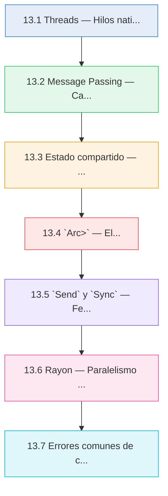
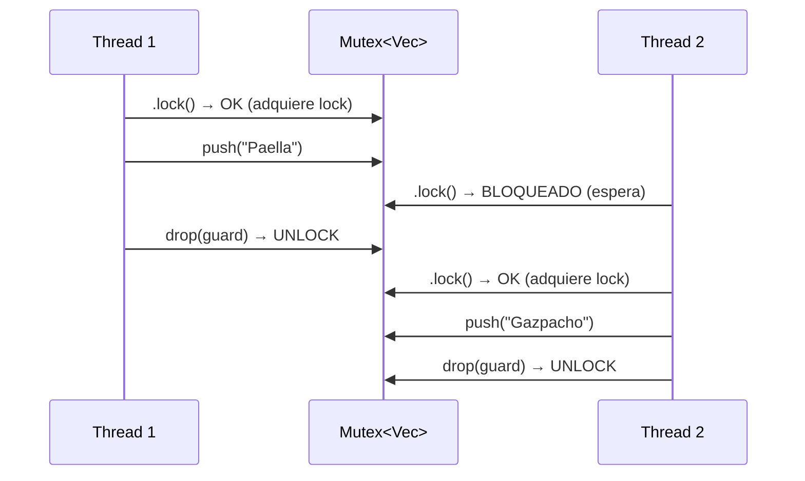

# :thread: Cap 13 — Concurrencia

<div class="chapter-meta">
  <span class="meta-item">🕐 4-5 horas</span>
  <span class="meta-item">📊 Nivel: Avanzado</span>
  <span class="meta-item">🎯 Semana 7</span>
</div>

<div class="chapter-objective">
<h4>Objetivo del capítulo</h4>
Al completar este capítulo seras capaz de crear programas concurrentes seguros en Rust utilizando threads nativos, canales <code>mpsc</code>, <code>Mutex</code>, <code>RwLock</code> y el patrón <code>Arc&lt;Mutex&lt;T&gt;&gt;</code>. Comprenderas como los traits <code>Send</code> y <code>Sync</code> permiten que el compilador prevenga data races en tiempo de compilación (fearless concurrency), y podrás aplicar paralelismo de datos con Rayon para acelerar operaciones sobre colecciones.
</div>

<div class="chapter-map">



</div>


!!! quote "Contexto"
    Python tiene el GIL (Global Interpreter Lock) que impide el verdadero paralelismo con threads. Para CPU-bound usas `multiprocessing`, que crea procesos separados con su propia memoria. Rust no tiene GIL: los threads son reales, comparten memoria y el compilador garantiza en tiempo de compilación que no hay data races. Esto es lo que Rust llama **fearless concurrency**.

---

## 13.1 Threads — Hilos nativos del sistema

Rust usa threads del sistema operativo (1:1). Cada thread tiene su propio stack y se ejecuta realmente en paralelo en multiples cores.

```rust
use std::thread;
use std::time::Duration;

fn main() {
    // Crear un thread
    let handle = thread::spawn(|| {           // (1)!
        for i in 1..=5 {
            println!("  🧵 Hilo secundario: iteración {}", i);
            thread::sleep(Duration::from_millis(100));
        }
        42  // Valor de retorno del thread
    });

    // El hilo principal sigue ejecutándose
    for i in 1..=3 {
        println!("🏠 Hilo principal: iteración {}", i);
        thread::sleep(Duration::from_millis(150));
    }

    // Esperar a que el thread termine y obtener su resultado
    let resultado = handle.join().unwrap();    // (2)!
    println!("El hilo secundario retornó: {}", resultado);
}
```

1. `thread::spawn` recibe un closure y retorna un `JoinHandle<T>` donde `T` es el tipo de retorno del closure.
2. `.join()` bloquea el hilo actual hasta que el thread termine. Retorna `Result<T>`: `Ok(valor)` si el thread término bien, `Err` si hizo panic.

### `move` closures para threads

Cuando un thread necesita datos del scope padre, el closure debe tomar **ownership** con `move`:

```rust
use std::thread;

fn main() {
    let nombre = String::from("RustMenu");
    let mesas = vec![1, 2, 3, 4, 5];

    // ❌ Sin move: error de lifetime
    // thread::spawn(|| {
    //     println!("{}", nombre);  // ¿cuánto vive nombre?
    // });

    // ✅ Con move: el thread toma ownership
    let handle = thread::spawn(move || {       // (1)!
        println!("Restaurante: {}", nombre);
        println!("Mesas: {:?}", mesas);
        mesas.len()
    });

    // nombre y mesas ya no son accesibles aquí (moved)
    // println!("{}", nombre);  // ❌ value used after move

    let total_mesas = handle.join().unwrap();
    println!("Total mesas: {}", total_mesas);
}
```

1. `move` transfiere el ownership de `nombre` y `mesas` al closure del thread. Esto garantiza que los datos vivan tanto como el thread.

<div class="concept-question">
<h4>Pregunta conceptual</h4>
Si <code>thread::spawn</code> necesita <code>move</code> para transferir ownership al thread, ¿que sucede si necesitas que tanto el hilo principal como el hilo secundario accedan al mismo dato? ¿Que mecanismo de Rust resuelve esto? (Pista: lo verás en la sección 13.4)
</div>

### Multiples threads

```rust
use std::thread;

fn main() {
    let mut handles = vec![];

    for id in 0..5 {
        let handle = thread::spawn(move || {
            println!("Hilo {} — procesando pedido mesa {}", id, id + 1);
            thread::sleep(std::time::Duration::from_millis(100));
            id * 10  // resultado
        });
        handles.push(handle);
    }

    // Recoger resultados
    let resultados: Vec<i32> = handles
        .into_iter()
        .map(|h| h.join().unwrap())
        .collect();

    println!("Resultados: {:?}", resultados);
}
```

<div class="micro-exercise">
<h4>Micro-ejercicio 1</h4>
Modifica el ejemplo de "Multiples threads" para que cada thread retorne una <code>String</code> con el formato <code>"Mesa {id}: pedido listo"</code> en lugar de un <code>i32</code>. Recoge los resultados en un <code>Vec&lt;String&gt;</code> e imprimelos. ¿Necesitas cambiar algo en el tipo de <code>resultados</code>?

<details>
<summary>Solución</summary>

```rust
use std::thread;

fn main() {
    let mut handles = vec![];

    for id in 0..5 {
        let handle = thread::spawn(move || {
            thread::sleep(std::time::Duration::from_millis(100));
            format!("Mesa {}: pedido listo", id + 1)
        });
        handles.push(handle);
    }

    let resultados: Vec<String> = handles
        .into_iter()
        .map(|h| h.join().unwrap())
        .collect();

    for r in &resultados {
        println!("{}", r);
    }
}
```

Si, debes cambiar `Vec<i32>` por `Vec<String>` (o dejar que el compilador lo infiera eliminando la anotación de tipo).
</details>
</div>

---

## 13.2 Message Passing — Canales

Los canales permiten comunicación entre threads enviando mensajes. Rust implementa canales **mpsc** (multiple producer, single consumer).

> "Do not communicate by sharing memory; share memory by communicating."

```rust
use std::sync::mpsc;
use std::thread;

fn main() {
    // Crear canal: tx (transmisor), rx (receptor)
    let (tx, rx) = mpsc::channel();         // (1)!

    // Thread productor
    thread::spawn(move || {
        let pedidos = vec![
            "Paella x2".to_string(),
            "Gazpacho x1".to_string(),
            "Flan x3".to_string(),
        ];

        for pedido in pedidos {
            println!("📤 Enviando: {}", pedido);
            tx.send(pedido).unwrap();       // (2)!
            thread::sleep(std::time::Duration::from_millis(200));
        }
        // tx se destruye aquí → el canal se cierra
    });

    // Hilo principal como consumidor
    for recibido in rx {                    // (3)!
        println!("📥 Recibido: {}", recibido);
    }

    println!("Canal cerrado, todos los pedidos procesados");
}
```

1. `mpsc::channel()` retorna una tupla `(Sender<T>, Receiver<T>)`. Es genérico: el tipo se infiere del primer `send()`.
2. `tx.send()` envia un valor por el canal. Retorna `Result`: `Err` si el receptor ya fue destruido.
3. `rx` implementa `Iterator`. El `for` bloquea esperando mensajes y termina cuando todos los `Sender` han sido destruidos.

<div class="concept-question">
<h4>Pregunta conceptual</h4>
<code>tx.send(pedido)</code> transfiere el ownership del valor al canal. ¿Que implicación tiene esto sobre el valor enviado en el thread productor? ¿Podrias seguir usando <code>pedido</code> despues de llamar a <code>send()</code>? Relacionalo con las reglas de ownership del Cap 5.
</div>

### Multiples productores

```rust
use std::sync::mpsc;
use std::thread;

fn main() {
    let (tx, rx) = mpsc::channel();

    // Múltiples productores clonando tx
    for id_mesa in 1..=4 {
        let tx_clone = tx.clone();         // (1)!
        thread::spawn(move || {
            let pedido = format!("Mesa {} pide plato del día", id_mesa);
            tx_clone.send(pedido).unwrap();
        });
    }

    drop(tx);                               // (2)!

    // Recibir todos los pedidos
    for pedido in rx {
        println!("🍽️ Cocina recibe: {}", pedido);
    }
}
```

1. `tx.clone()` crea otro `Sender` para el mismo canal. Cada thread tiene su propio transmisor.
2. `drop(tx)` es necesario: el `for` sobre `rx` solo termina cuando **todos** los `Sender` han sido destruidos. Si no hacemos `drop(tx)`, el original sigue vivo y el `for` nunca termina.

```mermaid
graph TD
    subgraph "Productores (múltiples)"
        TX1["tx_mesa1<br/>Mesa 1"] -->|send()| CH["Canal<br/>(buffer)"]
        TX2["tx_mesa2<br/>Mesa 2"] -->|send()| CH
        TX3["tx_mesa3<br/>Mesa 3"] -->|send()| CH
    end

    subgraph "Consumidor (uno)"
        CH -->|recv()| RX["rx<br/>Cocina"]
    end

    style CH fill:#3b82f620,stroke:#3b82f6
    style RX fill:#22c55e20,stroke:#22c55e
```

### Canal sincrono vs asíncrono

```rust
use std::sync::mpsc;

fn main() {
    // Canal asíncrono (buffer ilimitado) — por defecto
    let (_tx, _rx) = mpsc::channel::<String>();

    // Canal síncrono (buffer limitado)
    let (tx, rx) = mpsc::sync_channel::<String>(2);  // (1)!

    tx.send("Pedido 1".to_string()).unwrap();
    tx.send("Pedido 2".to_string()).unwrap();
    // tx.send("Pedido 3".to_string()).unwrap();
    // ↑ Se bloquearía: buffer lleno (capacidad 2)

    println!("{}", rx.recv().unwrap());
    println!("{}", rx.recv().unwrap());
}
```

1. `sync_channel(n)` crea un canal con buffer de tamano `n`. `send()` se bloquea si el buffer esta lleno. Útil para controlar presion de memoria (backpressure).

<div class="micro-exercise">
<h4>Micro-ejercicio 2</h4>
En el ejemplo de "Multiples productores", ¿que sucede si eliminas la linea <code>drop(tx)</code>? Razona sobre por que el programa se quedaria bloqueado y luego verificalo ejecutando el código sin esa linea.

<details>
<summary>Solución</summary>

Sin <code>drop(tx)</code>, el <code>Sender</code> original (<code>tx</code>) sigue vivo despues de que los threads terminan. El <code>for pedido in rx</code> espera indefinidamente a que lleguen más mensajes porque el canal no se cierra hasta que <strong>todos</strong> los <code>Sender</code> son destruidos. El programa se quedaria colgado esperando en el bucle <code>for</code>. La linea <code>drop(tx)</code> destruye explicitamente el transmisor original para que, cuando los clones de los threads se destruyan al terminar, el canal se cierre correctamente.
</details>
</div>

---

## 13.3 Estado compartido — Mutex y RwLock

<div class="connection-box">
<h4>Conexion con Cap 12 — Smart Pointers</h4>
En el <a href="12-smart-pointers.md">Capítulo 12</a> aprendiste que <code>Rc&lt;T&gt;</code> permite ownership compartido y <code>RefCell&lt;T&gt;</code> da mutabilidad interior. Sin embargo, ninguno de los dos es thread-safe (<code>Rc</code> no implementa <code>Send</code>, <code>RefCell</code> no implementa <code>Sync</code>). En concurrencia necesitas sus equivalentes thread-safe: <code>Arc&lt;T&gt;</code> reemplaza a <code>Rc&lt;T&gt;</code> (usa contadores atomicos) y <code>Mutex&lt;T&gt;</code> reemplaza a <code>RefCell&lt;T&gt;</code> (con exclusión mutua real). El patrón <code>Arc&lt;Mutex&lt;T&gt;&gt;</code> es la version concurrente de <code>Rc&lt;RefCell&lt;T&gt;&gt;</code>.
</div>

### `Mutex<T>` — Exclusión mutua

`Mutex` (Mutual Exclusión) protege datos compartidos permitiendo acceso a **un solo thread a la vez**.

```rust
use std::sync::Mutex;

fn main() {
    let contador = Mutex::new(0);

    // Adquirir el lock
    {
        let mut num = contador.lock().unwrap();  // (1)!
        *num += 1;
        println!("Dentro del lock: {}", *num);
    }   // MutexGuard se destruye → unlock automático (RAII)

    // Otro acceso
    {
        let mut num = contador.lock().unwrap();
        *num += 1;
    }

    println!("Valor final: {}", *contador.lock().unwrap());
}
```

1. `.lock()` retorna `Result<MutexGuard<T>>`. El `MutexGuard` es un smart pointer que da acceso a los datos. Cuando sale del scope, libera el lock automaticamente. `.unwrap()` porque `lock()` falla si otro thread hizo panic con el lock tomado (*poisoned mutex*).

<div class="pro-tip">
<h4>Pro tip</h4>
Minimiza el tiempo que mantienes un lock adquirido. Usa bloques <code>{ ... }</code> para que el <code>MutexGuard</code> se destruya lo antes posible. Un patrón comun es extraer los datos que necesitas dentro del bloque y trabajar con ellos fuera:
<pre><code>let valor = {
    let guard = datos.lock().unwrap();
    guard.clone()  // clonar dentro del lock
};
// Trabajar con `valor` sin mantener el lock
procesar(valor);</code></pre>
Esto reduce la contención entre threads y evita deadlocks accidentales.
</div>



### `RwLock<T>` — Multiples lectores o un escritor

`RwLock` permite **multiples lectores simultaneos** o **un único escritor**. Ideal para datos que se leen mucho más de lo que se escriben.

```rust
use std::sync::RwLock;

fn main() {
    let menu = RwLock::new(vec![
        "Paella".to_string(),
        "Gazpacho".to_string(),
    ]);

    // Múltiples lecturas simultáneas: OK
    {
        let lectura1 = menu.read().unwrap();    // (1)!
        let lectura2 = menu.read().unwrap();
        println!("Lector 1: {:?}", *lectura1);
        println!("Lector 2: {:?}", *lectura2);
    }

    // Escritura exclusiva
    {
        let mut escritura = menu.write().unwrap();  // (2)!
        escritura.push("Tortilla".to_string());
    }

    println!("Menú actualizado: {:?}", menu.read().unwrap());
}
```

1. `.read()` adquiere un lock de lectura. Multiples lectores pueden tener el lock simultaneamente.
2. `.write()` adquiere un lock de escritura exclusivo. Se bloquea hasta que todos los lectores liberen sus locks.

| Caracteristica | `Mutex<T>` | `RwLock<T>` |
|:---------------|:-----------|:------------|
| Lecturas simultaneas | No | Si |
| Escritura exclusiva | Si | Si |
| Overhead | Menor | Mayor (gestiona lectores/escritores) |
| Mejor para | Accesos mixtos lectura/escritura | Muchas lecturas, pocas escrituras |

---

## 13.4 `Arc<Mutex<T>>` — El patrón estandar

Para compartir estado mutable entre threads necesitas: `Arc` (ownership compartido thread-safe) + `Mutex` (exclusión mutua).

<div class="code-evolution">
<h4>Evolución del código: de datos no compartidos a Arc&lt;Mutex&lt;T&gt;&gt;</h4>

<div class="step" data-step="1">
<h5>Paso 1: Intento ingenuo — mover datos al thread</h5>

```rust
use std::sync::Mutex;
use std::thread;

fn main() {
    let datos = Mutex::new(vec![]);

    // move transfiere ownership de datos al thread
    let handle = thread::spawn(move || {
        datos.lock().unwrap().push(1);
    });

    // ERROR: datos fue movido al thread, ya no podemos usarlo
    // datos.lock().unwrap().push(2);  // value used after move

    handle.join().unwrap();
}
```

El problema: <code>move</code> transfiere el ownership completo. Solo un thread puede ser dueno del <code>Mutex</code>.
</div>

<div class="step" data-step="2">
<h5>Paso 2: Intento con Rc — ownership compartido (no compila)</h5>

```rust
use std::sync::Mutex;
use std::rc::Rc;
use std::thread;

fn main() {
    let datos = Rc::new(Mutex::new(vec![]));
    let datos2 = Rc::clone(&datos);

    // ERROR: Rc<Mutex<Vec<i32>>> cannot be sent between threads safely
    // Rc no implementa Send — su contador de referencias no es atomico
    let handle = thread::spawn(move || {
        datos2.lock().unwrap().push(1);
    });

    datos.lock().unwrap().push(2);
    handle.join().unwrap();
}
```

El problema: <code>Rc</code> no es thread-safe. Su contador de referencias no usa operaciones atomicas, lo que causaria data races.
</div>

<div class="step" data-step="3">
<h5>Paso 3: Solución correcta — Arc&lt;Mutex&lt;T&gt;&gt;</h5>

```rust
use std::sync::{Arc, Mutex};
use std::thread;

fn main() {
    let datos = Arc::new(Mutex::new(vec![]));
    let datos2 = Arc::clone(&datos);  // contador atomico +1

    let handle = thread::spawn(move || {
        datos2.lock().unwrap().push(1);  // lock, push, unlock
    });

    datos.lock().unwrap().push(2);  // lock, push, unlock
    handle.join().unwrap();

    println!("{:?}", datos.lock().unwrap());  // [2, 1] o [1, 2]
}
```

<code>Arc</code> (Atomic Reference Counting) usa contadores atomicos para ser thread-safe. Combinado con <code>Mutex</code> para exclusión mutua, es el patrón estandar para estado mutable compartido entre threads.
</div>
</div>

```rust
use std::sync::{Arc, Mutex};
use std::thread;

fn main() {
    let pedidos = Arc::new(Mutex::new(Vec::<String>::new()));
    let mut handles = vec![];

    for mesa in 1..=5 {
        let pedidos_ref = Arc::clone(&pedidos);   // (1)!

        let handle = thread::spawn(move || {
            // Simular preparación del pedido
            thread::sleep(std::time::Duration::from_millis(50));

            let mut lista = pedidos_ref.lock().unwrap();
            lista.push(format!("Pedido mesa {}", mesa));
            println!("Mesa {} agregó su pedido (total: {})", mesa, lista.len());
        });   // MutexGuard se libera → otros threads pueden acceder

        handles.push(handle);
    }

    for handle in handles {
        handle.join().unwrap();
    }

    let lista_final = pedidos.lock().unwrap();
    println!("\n📋 Pedidos recibidos ({}):", lista_final.len());
    for pedido in lista_final.iter() {
        println!("  - {}", pedido);
    }
}
```

1. `Arc::clone()` incrementa el contador atomico. Cada thread tiene su propia referencia al mismo `Mutex<Vec>`.

### RustMenu: sistema de pedidos concurrente

```rust
use std::sync::{Arc, Mutex};
use std::thread;
use std::time::Duration;

#[derive(Debug, Clone)]
struct Pedido {
    mesa: u32,
    plato: String,
    estado: String,
}

struct Restaurante {
    pedidos: Arc<Mutex<Vec<Pedido>>>,
}

impl Restaurante {
    fn new() -> Self {
        Restaurante {
            pedidos: Arc::new(Mutex::new(Vec::new())),
        }
    }

    fn tomar_pedido(&self, mesa: u32, plato: &str) {
        let mut lista = self.pedidos.lock().unwrap();
        lista.push(Pedido {
            mesa,
            plato: plato.to_string(),
            estado: "pendiente".to_string(),
        });
    }

    fn pedidos_ref(&self) -> Arc<Mutex<Vec<Pedido>>> {
        Arc::clone(&self.pedidos)
    }
}

fn main() {
    let restaurante = Restaurante::new();

    // Tomar pedidos
    restaurante.tomar_pedido(1, "Paella");
    restaurante.tomar_pedido(2, "Gazpacho");
    restaurante.tomar_pedido(3, "Tortilla");

    // La cocina procesa pedidos en paralelo
    let pedidos = restaurante.pedidos_ref();
    let mut cocineros = vec![];

    for id_cocinero in 0..2 {
        let pedidos_ref = Arc::clone(&pedidos);
        let handle = thread::spawn(move || {
            loop {
                let pedido_pendiente = {
                    let mut lista = pedidos_ref.lock().unwrap();
                    lista.iter_mut()
                        .find(|p| p.estado == "pendiente")
                        .map(|p| {
                            p.estado = format!("cocinero_{}", id_cocinero);
                            p.clone()
                        })
                };

                match pedido_pendiente {
                    Some(pedido) => {
                        println!("👨‍🍳 Cocinero {} preparando: {} (mesa {})",
                            id_cocinero, pedido.plato, pedido.mesa);
                        thread::sleep(Duration::from_millis(200));

                        let mut lista = pedidos_ref.lock().unwrap();
                        if let Some(p) = lista.iter_mut()
                            .find(|p| p.mesa == pedido.mesa && p.plato == pedido.plato) {
                            p.estado = "listo".to_string();
                        }
                    }
                    None => break,
                }
            }
        });
        cocineros.push(handle);
    }

    for handle in cocineros {
        handle.join().unwrap();
    }

    let lista = pedidos.lock().unwrap();
    println!("\n📋 Estado final:");
    for pedido in lista.iter() {
        println!("  Mesa {} — {} — {}", pedido.mesa, pedido.plato, pedido.estado);
    }
}
```

---

## 13.5 `Send` y `Sync` — Fearless Concurrency

Rust previene data races en **tiempo de compilación** con dos traits marcadores:

| Trait | Significado | Ejemplo |
|:------|:-----------|:--------|
| `Send` | El tipo se puede **transferir** entre threads | `String`, `Vec<T>`, `Arc<T>` |
| `Sync` | El tipo se puede **referenciar** desde multiples threads | `Mutex<T>`, `RwLock<T>`, `Arc<T>` |

```rust
use std::rc::Rc;
use std::sync::Arc;

fn main() {
    // String: Send + Sync ✅
    let s = String::from("hola");
    std::thread::spawn(move || println!("{}", s)).join().unwrap();

    // Arc<T>: Send + Sync ✅
    let a = Arc::new(42);
    let a2 = Arc::clone(&a);
    std::thread::spawn(move || println!("{}", a2)).join().unwrap();

    // Rc<T>: ❌ NO es Send ni Sync
    // let r = Rc::new(42);
    // std::thread::spawn(move || println!("{}", r));
    // error: `Rc<i32>` cannot be sent between threads safely
}
```

!!! info "Auto-derivación"
    `Send` y `Sync` se derivan **automaticamente** para la mayoria de tipos:

    - Si todos los campos de un struct son `Send`, el struct es `Send`
    - Si todos los campos son `Sync`, el struct es `Sync`
    - Tipos como `Rc`, `RefCell`, `*mut T` no son `Send`/`Sync`

    No necesitas implementar estos traits manualmente (casi nunca). El compilador los infiere.

<div class="misconception-box">
<h4>Mitos y conceptos erroneos</h4>
<ul>
<li><strong>Mito 1: "Rust previene todos los bugs de concurrencia."</strong> — Falso. Rust previene <em>data races</em> (accesos simultaneos no sincronizados a datos) en tiempo de compilación, pero <strong>no</strong> previene deadlocks ni race conditions logicas. Un deadlock (dos threads esperando mutuamente por el lock del otro) compila perfectamente. Las race conditions logicas (el orden de operaciones no es el esperado) también son posibles. Rust elimina la categoria más peligrosa de bugs, pero la concurrencia correcta sigue requiriendo diseno cuidadoso.</li>
<li><strong>Mito 2: "<code>Mutex</code> en Rust es como <code>threading.Lock</code> en Python."</strong> — Hay una diferencia fundamental: en Python, un <code>Lock</code> es un objeto separado de los datos que protege; nada te obliga a adquirir el lock antes de acceder a los datos. En Rust, <code>Mutex&lt;T&gt;</code> <em>envuelve</em> los datos: la única forma de acceder a <code>T</code> es llamando a <code>.lock()</code>. Es imposible olvidar tomar el lock porque el compilador no te da acceso al contenido de otra forma.</li>
<li><strong>Mito 3: "Siempre necesitas <code>Arc&lt;Mutex&lt;T&gt;&gt;</code> para concurrencia."</strong> — No siempre. Si los threads solo necesitan comunicarse sin compartir estado, los canales (<code>mpsc</code>) son más simples y evitan problemas de locks. Si solo necesitas lecturas paralelas sin escritura, <code>Arc&lt;T&gt;</code> sin <code>Mutex</code> es suficiente (ya que <code>&amp;T</code> es <code>Sync</code> para la mayoria de tipos). Y con Rayon, puedes hacer paralelismo de datos sin ningun tipo de lock explícito. Elige la herramienta correcta para cada situación.</li>
</ul>
</div>

<div class="concept-question">
<h4>Pregunta conceptual</h4>
<code>Send</code> y <code>Sync</code> son traits <em>marcadores</em> (marker traits) que no tienen métodos. ¿Por que son útiles si no definen comportamiento? Piensa en como el compilador los usa como <em>restricciones</em> en las firmas de funciones como <code>thread::spawn</code>. ¿Que sucede cuando intentas enviar un tipo que no es <code>Send</code> a un thread?
</div>

### Por que Rust previene data races

Un data race ocurre cuando:

1. Dos threads acceden al mismo dato simultaneamente
2. Al menos uno escribe
3. No hay sincronización

Rust previene esto **en compilación**:

```rust
fn main() {
    let mut datos = vec![1, 2, 3];

    // ❌ No compila: dos threads no pueden tener &mut al mismo dato
    // let handle = std::thread::spawn(|| {
    //     datos.push(4);  // necesita &mut datos
    // });
    // datos.push(5);      // también necesita &mut datos

    // ✅ Solución: usar Arc<Mutex<T>>
    use std::sync::{Arc, Mutex};
    let datos = Arc::new(Mutex::new(vec![1, 2, 3]));
    let datos2 = Arc::clone(&datos);

    let handle = std::thread::spawn(move || {
        datos2.lock().unwrap().push(4);  // lock garantiza exclusión
    });

    datos.lock().unwrap().push(5);
    handle.join().unwrap();

    println!("{:?}", datos.lock().unwrap()); // [1, 2, 3, 4, 5] o [1, 2, 3, 5, 4]
}
```


<div class="real-errors">
<h4>🚨 Errores que vas a encontrar</h4>

**Error 1: Tipo incompatible**

```rust
let x: i32 = "hola"; // ❌
```

```
error[E0308]: mismatched types
  expected `i32`, found `&str`
```

**¿Por qué?** Rust es estrictamente tipado — no hay conversión implícita entre tipos.

**Solución:** Usa el tipo correcto o convierte explícitamente.

---

**Error 2: Variable no mutable**

```rust
let precio = 10.0;
precio = 15.0; // ❌
```

```
error[E0384]: cannot assign twice to immutable variable `precio`
```

**Solución:** Declara con `let mut precio = 10.0;`

---

**Error 3: Valor movido**

```rust
let nombre = String::from("Paella");
let copia = nombre;
println!("{}", nombre); // ❌
```

```
error[E0382]: borrow of moved value: `nombre`
```

**Solución:** Usa `.clone()` o referencias `&nombre`.

</div>

<div class="checkpoint">
<h4>Checkpoint — Secciones 13.1 a 13.5</h4>
Antes de continuar con Rayon, asegurate de que puedes responder estas preguntas:
<ol>
<li>¿Cual es la diferencia entre <code>thread::spawn(|| {...})</code> y <code>thread::spawn(move || {...})</code>?</li>
<li>¿Por que es necesario hacer <code>drop(tx)</code> del transmisor original cuando usas multiples productores con <code>mpsc</code>?</li>
<li>¿Cual es la diferencia práctica entre <code>Mutex&lt;T&gt;</code> y <code>RwLock&lt;T&gt;</code>? ¿Cuando elegir cada uno?</li>
<li>¿Por que <code>Rc&lt;T&gt;</code> no puede usarse entre threads pero <code>Arc&lt;T&gt;</code> si?</li>
<li>¿Que son <code>Send</code> y <code>Sync</code> y que garantia dan en tiempo de compilación?</li>
</ol>
Si alguna respuesta no te resulta clara, revisa la sección correspondiente antes de avanzar. Estas bases son esenciales para entender el paralelismo con Rayon y la programación asíncrona del próximo capítulo.
</div>

<div class="mini-project">
<h4>🏗️ Mini-proyecto: Aplicación práctica</h4>

**Paso 1 — Define las estructuras base**

Crea las estructuras y tipos necesarios para modelar el dominio del capítulo.

??? success "Solución Paso 1"
    ```rust
    // Define tus structs y enums aquí
    #[derive(Debug)]
    struct Item {
        nombre: String,
        valor: f64,
    }

    impl Item {
        fn new(nombre: &str, valor: f64) -> Self {
            Self {
                nombre: nombre.to_string(),
                valor,
            }
        }
    }
    ```

**Paso 2 — Implementa la lógica principal**

Crea funciones que operen sobre las estructuras del paso 1.

??? success "Solución Paso 2"
    ```rust
    fn procesar(items: &[Item]) -> f64 {
        items.iter().map(|i| i.valor).sum()
    }

    fn mostrar(items: &[Item]) {
        for item in items {
            println!("  {} — {:.2}€", item.nombre, item.valor);
        }
    }
    ```

**Paso 3 — Integra todo en main**

Combina los pasos anteriores en un programa completo.

??? success "Solución Paso 3"
    ```rust
    fn main() {
        let items = vec![
            Item::new("Paella", 14.50),
            Item::new("Gazpacho", 8.00),
            Item::new("Flan", 5.50),
        ];

        println!("=== RustMenu ===");
        mostrar(&items);
        println!("Total: {:.2}€", procesar(&items));
    }
    ```

</div>


---

## 13.6 Rayon — Paralelismo de datos

Rayon es una libreria que convierte iteradores secuenciales en **paralelos** con un cambio mínimo de código.

!!! info "Dependencia"
    Agrega Rayon a tu `Cargo.toml`:

    ```toml
    [dependencies]
    rayon = "1.10"
    ```

### Iteradores paralelos

```rust
use rayon::prelude::*;

fn main() {
    let precios = vec![12.50, 15.00, 8.75, 22.00, 9.50, 18.00, 14.25];

    // Secuencial
    let total_seq: f64 = precios.iter()
        .map(|p| p * 1.21)    // Aplicar IVA
        .sum();

    // Paralelo — ¡solo cambia .iter() por .par_iter()!
    let total_par: f64 = precios.par_iter()     // (1)!
        .map(|p| p * 1.21)
        .sum();

    println!("Secuencial: {:.2}", total_seq);
    println!("Paralelo:   {:.2}", total_par);
    assert!((total_seq - total_par).abs() < f64::EPSILON);
}
```

1. `.par_iter()` divide el trabajo entre los cores disponibles automaticamente. Rayon usa un **work-stealing thread pool**: los threads ociosos roban trabajo de los threads ocupados.

<div class="pro-tip">
<h4>Pro tip</h4>
No todo se beneficia de paralelismo. Rayon tiene un overhead de coordinación entre threads, asi que para colecciones pequenas (menos de ~1000 elementos) o operaciones muy rapidas por elemento, la version secuencial puede ser más rápida. Usa <code>std::time::Instant</code> para medir y comparar antes de decidir. Una buena regla: si la operación total tarda menos de 1ms en secuencial, probablemente no vale la pena paralelizarla.
</div>

### `par_iter_mut()` — Mutación en paralelo

```rust
use rayon::prelude::*;

fn main() {
    let mut platos = vec![
        ("Paella".to_string(), 12.50),
        ("Gazpacho".to_string(), 8.75),
        ("Tortilla".to_string(), 9.50),
        ("Flan".to_string(), 5.00),
    ];

    // Aplicar descuento del 10% en paralelo
    platos.par_iter_mut().for_each(|(nombre, precio)| {
        *precio *= 0.90;
        println!("Descuento aplicado a {}: {:.2}", nombre, precio);
    });

    println!("\nPrecios actualizados:");
    for (nombre, precio) in &platos {
        println!("  {} — {:.2}€", nombre, precio);
    }
}
```

### RustMenu: busqueda paralela en el menu

```rust
use rayon::prelude::*;

#[derive(Debug, Clone)]
struct Plato {
    nombre: String,
    categoria: String,
    precio: f64,
    disponible: bool,
}

fn main() {
    // Simular un menú grande
    let menu: Vec<Plato> = (0..10_000)
        .map(|i| Plato {
            nombre: format!("Plato #{}", i),
            categoria: match i % 4 {
                0 => "entrante",
                1 => "principal",
                2 => "postre",
                _ => "bebida",
            }.to_string(),
            precio: 5.0 + (i as f64 * 0.5) % 30.0,
            disponible: i % 3 != 0,
        })
        .collect();

    // Búsqueda paralela: platos disponibles con precio < 15€
    let baratos: Vec<&Plato> = menu.par_iter()
        .filter(|p| p.disponible && p.precio < 15.0)
        .collect();

    println!("Platos baratos disponibles: {}", baratos.len());

    // Estadísticas paralelas
    let (total_precio, count): (f64, usize) = menu.par_iter()
        .filter(|p| p.disponible)
        .map(|p| (p.precio, 1))
        .reduce(|| (0.0, 0), |(sum_a, count_a), (sum_b, count_b)| {
            (sum_a + sum_b, count_a + count_b)
        });

    println!("Precio promedio (disponibles): {:.2}€",
        total_precio / count as f64);
}
```

<div class="connection-box">
<h4>Conexion con Cap 14 — Async/Await con Tokio</h4>
En este capítulo aprendiste concurrencia basada en threads (paralelismo real en multiples cores). En el <a href="14-async-tokio.md">Capítulo 14</a> exploraras un modelo diferente: la programación <strong>asíncrona</strong> con <code>async</code>/<code>await</code> y Tokio. Mientras que los threads son ideales para tareas <em>CPU-bound</em> (cálculos intensivos), async es ideal para tareas <em>I/O-bound</em> (red, disco, bases de datos) donde muchas tareas esperan simultaneamente sin bloquear un thread por cada una. Ambos modelos se complementan: Tokio internamente usa un pool de threads para ejecutar tareas async, y puedes combinar <code>spawn_blocking</code> con async para lo mejor de ambos mundos.
</div>

---

## 13.7 Errores comunes de concurrencia

### Deadlocks

Un deadlock ocurre cuando dos threads esperan mutuamente por el lock del otro:

```rust
use std::sync::{Arc, Mutex};
use std::thread;

fn main() {
    let recurso_a = Arc::new(Mutex::new("A".to_string()));
    let recurso_b = Arc::new(Mutex::new("B".to_string()));

    // ⚠️ DEADLOCK: cada thread necesita el lock del otro
    // Thread 1: lock(A) → espera lock(B)
    // Thread 2: lock(B) → espera lock(A)

    // ✅ Solución: adquirir locks siempre en el MISMO ORDEN
    let a1 = Arc::clone(&recurso_a);
    let b1 = Arc::clone(&recurso_b);
    let handle1 = thread::spawn(move || {
        let _lock_a = a1.lock().unwrap();   // Siempre A primero
        let _lock_b = b1.lock().unwrap();   // Luego B
        println!("Thread 1: tiene A y B");
    });

    let a2 = Arc::clone(&recurso_a);
    let b2 = Arc::clone(&recurso_b);
    let handle2 = thread::spawn(move || {
        let _lock_a = a2.lock().unwrap();   // Siempre A primero
        let _lock_b = b2.lock().unwrap();   // Luego B
        println!("Thread 2: tiene A y B");
    });

    handle1.join().unwrap();
    handle2.join().unwrap();
}
```

### Poisoned mutexes

Un mutex queda "envenenado" cuando un thread hace panic mientras tiene el lock:

```rust
use std::sync::{Arc, Mutex};
use std::thread;

fn main() {
    let datos = Arc::new(Mutex::new(vec![1, 2, 3]));

    let datos_ref = Arc::clone(&datos);
    let handle = thread::spawn(move || {
        let mut guard = datos_ref.lock().unwrap();
        guard.push(4);
        panic!("¡Algo salió mal!");  // Panic con el lock tomado
    });

    let _ = handle.join();  // El thread hizo panic

    // El mutex está envenenado
    match datos.lock() {
        Ok(guard) => println!("Datos: {:?}", *guard),
        Err(envenenado) => {
            println!("⚠️ Mutex envenenado, recuperando datos...");
            let guard = envenenado.into_inner();   // (1)!
            println!("Datos recuperados: {:?}", *guard);
        }
    }
}
```

1. `.into_inner()` extrae los datos de un mutex envenenado. Los datos pueden estar en un estado inconsistente, asi que usalo con cuidado.

### Resumen: como Rust previene errores de concurrencia

| Error | Python | Rust |
|:------|:-------|:-----|
| Data race | Posible (pese al GIL, con extensiones C o multiprocessing+shared memory) | **Imposible** en compilación (ownership + Send/Sync) |
| Deadlock | Posible | Posible (Rust no los previene automaticamente) |
| Race condition | Posible | Posible (lógica, no de datos) |
| Use-after-free | Posible (C extensions) | **Imposible** (ownership) |

!!! tip "Reglas para evitar deadlocks"
    1. **Orden consistente**: adquiere locks siempre en el mismo orden global
    2. **Locks granulares**: minimiza la duración de cada lock
    3. **Evita locks anidados**: si puedes, reestructura para usar un solo Mutex
    4. **Considera canales**: message passing evita muchos deadlocks

<div class="comparison" markdown>
<div class="lang-box python" markdown>

#### :snake: En Python

```python
import threading

# GIL: solo 1 thread ejecuta Python a la vez
# → No hay verdadero paralelismo CPU
t = threading.Thread(target=worker)
t.start()  # Threads reales pero con GIL

# Para CPU-bound: multiprocessing
from multiprocessing import Process
p = Process(target=worker)
p.start()  # Proceso separado, sin GIL
# Pero: memoria NO compartida (IPC costoso)
```

Python GIL impide paralelismo real con threads. `multiprocessing` crea procesos separados con su propia memoria, haciendo costoso compartir estado.

</div>
<div class="lang-box rust" markdown>

#### :crab: En Rust

```rust
use std::thread;
use std::sync::{Arc, Mutex};

// Threads reales, sin GIL, verdadero paralelismo
let datos = Arc::new(Mutex::new(vec![]));
let d = Arc::clone(&datos);
thread::spawn(move || {
    d.lock().unwrap().push(1);
});
// Memoria compartida + segura
// El compilador previene data races
```

Rust tiene threads nativos del OS sin restricciones. Memoria compartida entre threads con seguridad garantizada en compilación.

</div>
</div>

---

<div class="ejercicio-guiado">
<h4>🏋️ Ejercicio guiado</h4>

Vas a construir un sistema de procesamiento concurrente de pedidos para RustMenu usando canales `mpsc`. Varios camareros (threads productores) envian pedidos por un canal, y la cocina (thread consumidor) los procesa uno a uno, simulando tiempo de preparacion. Al final se muestra un resumen con todos los pedidos completados.

1. Define una struct `Pedido` con campos `id: u32`, `mesa: u32`, `plato: String` y `precio: f64`. Deriva `Debug` y `Clone`.
2. Define una struct `PedidoCompletado` que extienda `Pedido` anadiendo `cocinero: u32` y `tiempo_ms: u64`.
3. Crea un canal `mpsc::channel()` para enviar `Pedido` y otro canal para devolver `PedidoCompletado` desde la cocina.
4. Lanza 3 threads camarero que cada uno envie 2 pedidos por el canal de pedidos. Usa `tx.clone()` para cada thread y recuerda hacer `drop(tx)` del transmisor original.
5. Lanza 2 threads cocinero que lean del canal de pedidos, simulen preparacion con `thread::sleep` (100-200ms), y envien `PedidoCompletado` por el canal de vuelta.
6. En el hilo principal, recoge todos los `PedidoCompletado` e imprime un resumen con el total de pedidos, la suma de precios y que cocinero preparo cada plato.

??? success "Solución completa"
    ```rust
    use std::sync::mpsc;
    use std::thread;
    use std::time::Duration;

    #[derive(Debug, Clone)]
    struct Pedido {
        id: u32,
        mesa: u32,
        plato: String,
        precio: f64,
    }

    #[derive(Debug)]
    struct PedidoCompletado {
        pedido: Pedido,
        cocinero: u32,
        tiempo_ms: u64,
    }

    fn main() {
        // Canal de pedidos: camareros -> cocina
        let (pedidos_tx, pedidos_rx) = mpsc::channel::<Pedido>();
        // Canal de resultados: cocina -> main
        let (resultados_tx, resultados_rx) = mpsc::channel::<PedidoCompletado>();

        let platos = vec![
            ("Paella Valenciana", 14.50),
            ("Gazpacho Andaluz", 8.00),
            ("Croquetas de Jamon", 9.50),
            ("Tortilla Espanola", 7.00),
            ("Flan de Huevo", 5.50),
            ("Churros con Chocolate", 6.00),
        ];

        // Lanzar 3 camareros (productores)
        let mut contador_pedido = 1u32;
        for camarero_id in 1..=3 {
            let tx = pedidos_tx.clone();
            let platos_camarero = platos.clone();
            let id_base = contador_pedido;
            contador_pedido += 2;

            thread::spawn(move || {
                for i in 0..2 {
                    let idx = ((camarero_id as usize - 1) * 2 + i) % platos_camarero.len();
                    let (nombre, precio) = &platos_camarero[idx];
                    let pedido = Pedido {
                        id: id_base + i as u32,
                        mesa: camarero_id * 10 + i as u32,
                        plato: nombre.to_string(),
                        precio: *precio,
                    };
                    println!(
                        "[Camarero {}] Enviando pedido #{}: {} (mesa {})",
                        camarero_id, pedido.id, pedido.plato, pedido.mesa
                    );
                    tx.send(pedido).unwrap();
                    thread::sleep(Duration::from_millis(50));
                }
            });
        }

        // Importante: cerrar el transmisor original
        drop(pedidos_tx);

        // Lanzar 2 cocineros (consumidores del canal de pedidos)
        for cocinero_id in 1..=2 {
            let rx = pedidos_rx; // mpsc: solo un receptor
            let tx = resultados_tx.clone();

            // Solo el primer cocinero toma el receptor real;
            // usamos Arc<Mutex> para compartirlo
            // Alternativa mas simple: un solo cocinero
            break; // Salimos del loop, usamos un enfoque diferente
        }

        // Enfoque con Arc<Mutex> para compartir el receptor entre cocineros
        let pedidos_rx = std::sync::Arc::new(std::sync::Mutex::new(pedidos_rx));
        let mut cocineros = vec![];

        for cocinero_id in 1..=2 {
            let rx = std::sync::Arc::clone(&pedidos_rx);
            let tx = resultados_tx.clone();

            let handle = thread::spawn(move || {
                loop {
                    let pedido = {
                        let lock = rx.lock().unwrap();
                        lock.try_recv()
                    };

                    match pedido {
                        Ok(pedido) => {
                            let tiempo = 100 + (pedido.id as u64 * 30) % 150;
                            println!(
                                "  [Cocinero {}] Preparando: {} ({}ms)",
                                cocinero_id, pedido.plato, tiempo
                            );
                            thread::sleep(Duration::from_millis(tiempo));

                            tx.send(PedidoCompletado {
                                pedido,
                                cocinero: cocinero_id,
                                tiempo_ms: tiempo,
                            }).unwrap();
                        }
                        Err(mpsc::TryRecvError::Empty) => {
                            thread::sleep(Duration::from_millis(10));
                        }
                        Err(mpsc::TryRecvError::Disconnected) => break,
                    }
                }
            });
            cocineros.push(handle);
        }

        // Cerrar el transmisor de resultados original
        drop(resultados_tx);

        // Esperar a los cocineros
        for handle in cocineros {
            handle.join().unwrap();
        }

        // Recoger resultados
        let mut completados = vec![];
        for resultado in resultados_rx {
            completados.push(resultado);
        }

        // Resumen
        println!("\n========== RESUMEN ==========");
        let total_precio: f64 = completados.iter().map(|c| c.pedido.precio).sum();
        println!("Pedidos completados: {}", completados.len());
        for c in &completados {
            println!(
                "  Pedido #{}: {} (mesa {}) - Cocinero {} - {}ms - {:.2} EUR",
                c.pedido.id, c.pedido.plato, c.pedido.mesa,
                c.cocinero, c.tiempo_ms, c.pedido.precio
            );
        }
        println!("Total facturado: {:.2} EUR", total_precio);
    }
    ```

</div>

## :link: Recursos

| Recurso | Enlace |
|---------|--------|
| The Rust Book - Concurrencia | [doc.rust-lang.org/book/ch16-00-concurrency](https://doc.rust-lang.org/book/ch16-00-concurrency.html) |
| Rust by Example - Threads | [doc.rust-lang.org/rust-by-example/std_misc/threads](https://doc.rust-lang.org/rust-by-example/std_misc/threads.html) |
| Rayon (paralelismo de datos) | [docs.rs/rayon](https://docs.rs/rayon/latest/rayon/) |
| Rustonomicon - Send y Sync | [doc.rust-lang.org/nomicon/send-and-sync](https://doc.rust-lang.org/nomicon/send-and-sync.html) |

---

## 🎯 Ejercicios

??? question "Ejercicio 1: Contador concurrente con Arc<Mutex>"
    Crea 10 threads que incrementen un contador compartido 100 veces cada uno. Al final, el contador debe valer 1000. Usa `Arc<Mutex<u32>>`.

    ??? success "Solución"
        ```rust
        use std::sync::{Arc, Mutex};
        use std::thread;

        fn main() {
            let contador = Arc::new(Mutex::new(0u32));
            let mut handles = vec![];

            for _ in 0..10 {
                let contador_ref = Arc::clone(&contador);
                let handle = thread::spawn(move || {
                    for _ in 0..100 {
                        let mut num = contador_ref.lock().unwrap();
                        *num += 1;
                    }
                });
                handles.push(handle);
            }

            for handle in handles {
                handle.join().unwrap();
            }

            let valor_final = *contador.lock().unwrap();
            println!("Contador final: {}", valor_final);
            assert_eq!(valor_final, 1000);
            println!("✅ Correcto: 10 threads × 100 incrementos = 1000");
        }
        ```

??? question "Ejercicio 2: Pipeline con canales"
    Crea un pipeline de 3 etapas con canales: (1) Generador produce números 1-10, (2) Procesador los multiplica por 2, (3) Consumidor los imprime. Cada etapa corre en su propio thread.

    !!! tip "Pista"
        Necesitas dos canales: uno entre generador y procesador, otro entre procesador y consumidor. Usa `for valor in rx { ... }`.

    ??? success "Solución"
        ```rust
        use std::sync::mpsc;
        use std::thread;

        fn main() {
            // Canal 1: generador → procesador
            let (tx1, rx1) = mpsc::channel::<i32>();
            // Canal 2: procesador → consumidor
            let (tx2, rx2) = mpsc::channel::<i32>();

            // Etapa 1: Generador
            let generador = thread::spawn(move || {
                for i in 1..=10 {
                    println!("📤 Generando: {}", i);
                    tx1.send(i).unwrap();
                }
            });

            // Etapa 2: Procesador (multiplica por 2)
            let procesador = thread::spawn(move || {
                for valor in rx1 {
                    let resultado = valor * 2;
                    println!("  ⚙️ Procesando: {} → {}", valor, resultado);
                    tx2.send(resultado).unwrap();
                }
            });

            // Etapa 3: Consumidor
            let consumidor = thread::spawn(move || {
                let mut suma = 0;
                for valor in rx2 {
                    println!("    📥 Consumido: {}", valor);
                    suma += valor;
                }
                println!("\n✅ Suma total: {}", suma);
                suma
            });

            generador.join().unwrap();
            procesador.join().unwrap();
            let total = consumidor.join().unwrap();
            assert_eq!(total, 110);  // 2*(1+2+...+10) = 2*55 = 110
        }
        ```

??? question "Ejercicio 3: Lector/escritor con RwLock"
    Crea un `Arc<RwLock<Vec<String>>>` que simule un menu. Lanza 3 threads lectores (que imprimen el menu) y 1 thread escritor (que agrega platos cada 200ms). Demuestra que multiples lectores acceden simultaneamente.

    !!! tip "Pista"
        Los lectores usan `.read().unwrap()`, el escritor usa `.write().unwrap()`. Agrega `thread::sleep` para ver la concurrencia.

    ??? success "Solución"
        ```rust
        use std::sync::{Arc, RwLock};
        use std::thread;
        use std::time::Duration;

        fn main() {
            let menu = Arc::new(RwLock::new(vec![
                "Paella".to_string(),
                "Gazpacho".to_string(),
            ]));

            let mut handles = vec![];

            // Thread escritor
            let menu_escritor = Arc::clone(&menu);
            let escritor = thread::spawn(move || {
                let platos_nuevos = ["Tortilla", "Flan", "Croquetas"];
                for plato in platos_nuevos {
                    thread::sleep(Duration::from_millis(200));
                    let mut m = menu_escritor.write().unwrap();
                    m.push(plato.to_string());
                    println!("✍️  Escritor agregó: {} (total: {})", plato, m.len());
                }
            });
            handles.push(escritor);

            // 3 threads lectores
            for id in 1..=3 {
                let menu_lector = Arc::clone(&menu);
                let lector = thread::spawn(move || {
                    for _ in 0..4 {
                        thread::sleep(Duration::from_millis(100));
                        let m = menu_lector.read().unwrap();
                        println!("📖 Lector {} ve {} platos: {:?}", id, m.len(), *m);
                    }
                });
                handles.push(lector);
            }

            for handle in handles {
                handle.join().unwrap();
            }

            println!("\n📋 Menú final: {:?}", menu.read().unwrap());
        }
        ```

??? question "Ejercicio 4: Notificaciones por canal (patrón cocina)"
    Simula un sistema de cocina: los camareros envian pedidos por un canal. La cocina (thread receptor) los procesa uno a uno, tarda un tiempo aleatorio, y envia notificaciones de "listo" por otro canal de vuelta.

    !!! tip "Pista"
        Necesitas dos canales: `pedidos_tx/rx` y `notificaciones_tx/rx`. La cocina recibe de `pedidos_rx` y envia por `notificaciones_tx`.

    ??? success "Solución"
        ```rust
        use std::sync::mpsc;
        use std::thread;
        use std::time::Duration;

        #[derive(Debug)]
        struct Pedido {
            mesa: u32,
            plato: String,
        }

        #[derive(Debug)]
        struct Notificación {
            mesa: u32,
            plato: String,
            mensaje: String,
        }

        fn main() {
            let (pedidos_tx, pedidos_rx) = mpsc::channel::<Pedido>();
            let (notif_tx, notif_rx) = mpsc::channel::<Notificación>();

            // Cocina: procesa pedidos y envía notificaciones
            let cocina = thread::spawn(move || {
                for pedido in pedidos_rx {
                    println!("👨‍🍳 Cocina preparando: {} (mesa {})",
                        pedido.plato, pedido.mesa);
                    // Simular tiempo de cocción
                    let tiempo = 100 + (pedido.mesa as u64 * 50);
                    thread::sleep(Duration::from_millis(tiempo));

                    notif_tx.send(Notificación {
                        mesa: pedido.mesa,
                        plato: pedido.plato.clone(),
                        mensaje: format!("{} lista para servir", pedido.plato),
                    }).unwrap();
                }
            });

            // Camareros envían pedidos
            let pedidos = vec![
                Pedido { mesa: 1, plato: "Paella".to_string() },
                Pedido { mesa: 2, plato: "Gazpacho".to_string() },
                Pedido { mesa: 3, plato: "Flan".to_string() },
            ];

            for pedido in pedidos {
                println!("🍽️ Mesa {} pidió: {}", pedido.mesa, pedido.plato);
                pedidos_tx.send(pedido).unwrap();
            }
            drop(pedidos_tx);  // Cerrar canal de pedidos

            // Recibir notificaciones
            cocina.join().unwrap();
            for notif in notif_rx {
                println!("🔔 Notificación mesa {}: {}", notif.mesa, notif.mensaje);
            }
        }
        ```

??? question "Ejercicio 5: Busqueda paralela con Rayon"
    Crea un `Vec` de 100_000 structs `Plato` con nombre, precio y categoria. Usa Rayon para: (1) encontrar el plato más caro, (2) calcular el precio promedio por categoria, (3) filtrar platos disponibles con precio < 20. Compara tiempos con la version secuencial.

    !!! tip "Pista"
        Usa `.par_iter()` con `.max_by()`, `.filter()` y `.fold()`. Para medir tiempo usa `std::time::Instant::now()` y `.elapsed()`.

    ??? success "Solución"
        ```rust
        use rayon::prelude::*;
        use std::time::Instant;

        #[derive(Debug, Clone)]
        struct Plato {
            nombre: String,
            precio: f64,
            categoria: String,
            disponible: bool,
        }

        fn main() {
            // Generar datos
            let categorias = ["entrante", "principal", "postre", "bebida"];
            let menu: Vec<Plato> = (0..100_000)
                .map(|i| Plato {
                    nombre: format!("Plato #{}", i),
                    precio: 3.0 + (i as f64 * 7.3) % 45.0,
                    categoria: categorias[i % 4].to_string(),
                    disponible: i % 5 != 0,
                })
                .collect();

            // 1. Plato más caro (paralelo)
            let inicio = Instant::now();
            let mas_caro = menu.par_iter()
                .max_by(|a, b| a.precio.partial_cmp(&b.precio).unwrap())
                .unwrap();
            let t_par = inicio.elapsed();

            let inicio = Instant::now();
            let mas_caro_seq = menu.iter()
                .max_by(|a, b| a.precio.partial_cmp(&b.precio).unwrap())
                .unwrap();
            let t_seq = inicio.elapsed();

            println!("Más caro: {} — {:.2}€", mas_caro.nombre, mas_caro.precio);
            println!("  Paralelo: {:?} | Secuencial: {:?}", t_par, t_seq);

            // 2. Platos baratos disponibles
            let inicio = Instant::now();
            let baratos: Vec<&Plato> = menu.par_iter()
                .filter(|p| p.disponible && p.precio < 20.0)
                .collect();
            let t_filtro = inicio.elapsed();

            println!("\nPlatos disponibles < 20€: {}", baratos.len());
            println!("  Tiempo: {:?}", t_filtro);

            // 3. Precio promedio por categoría
            for cat in &categorias {
                let (suma, count): (f64, usize) = menu.par_iter()
                    .filter(|p| p.categoria == *cat)
                    .map(|p| (p.precio, 1usize))
                    .reduce(|| (0.0, 0), |(s1, c1), (s2, c2)| (s1 + s2, c1 + c2));

                println!("{}: promedio {:.2}€ ({} platos)",
                    cat, suma / count as f64, count);
            }
        }
        ```

---

## :brain: Flashcards de repaso

<div class="flashcard">
<div class="front">¿Como se crea un thread en Rust?</div>
<div class="back"><code>thread::spawn(|| { ... })</code> crea un thread con un closure. Retorna un <code>JoinHandle&lt;T&gt;</code>. Usa <code>move</code> si el closure necesita datos del scope padre. <code>handle.join().unwrap()</code> espera a que termine.</div>
</div>

<div class="flashcard">
<div class="front">¿Que es un canal <code>mpsc</code>?</div>
<div class="back">Multiple Producer, Single Consumer. <code>mpsc::channel()</code> crea un par <code>(Sender, Receiver)</code>. Multiples threads pueden enviar (<code>tx.send()</code>) pero solo uno recibe (<code>rx.recv()</code>). El canal se cierra cuando todos los Sender se destruyen.</div>
</div>

<div class="flashcard">
<div class="front">¿Que es <code>Arc&lt;Mutex&lt;T&gt;&gt;</code>?</div>
<div class="back">El patrón estandar para estado mutable compartido entre threads. <code>Arc</code> da ownership compartido thread-safe. <code>Mutex</code> da exclusión mutua (solo un thread accede a la vez). <code>.lock().unwrap()</code> adquiere el lock; se libera automaticamente al salir del scope (RAII).</div>
</div>

<div class="flashcard">
<div class="front">¿Que son <code>Send</code> y <code>Sync</code>?</div>
<div class="back"><code>Send</code>: el tipo puede transferirse entre threads. <code>Sync</code>: el tipo puede ser referenciado desde multiples threads. Se derivan automaticamente. <code>Rc</code> y <code>RefCell</code> no los implementan. El compilador usa estos traits para prevenir data races en compilación.</div>
</div>

<div class="flashcard">
<div class="front">¿Que es el GIL y por que Rust no lo tiene?</div>
<div class="back">El GIL (Global Interpreter Lock) de Python impide que multiples threads ejecuten código Python simultaneamente. Rust no necesita GIL porque su sistema de ownership previene data races en compilación. Los threads de Rust son verdaderamente paralelos.</div>
</div>

<div class="flashcard">
<div class="front">¿Como funciona Rayon para paralelismo?</div>
<div class="back">Rayon convierte iteradores secuenciales en paralelos: cambia <code>.iter()</code> por <code>.par_iter()</code>. Usa un work-stealing thread pool. Divide el trabajo entre cores automaticamente. No requiere <code>Arc</code> ni <code>Mutex</code> para lecturas paralelas.</div>
</div>

---

## :video_game: Quiz interactivo

<div class="quiz" data-quiz-id="ch13-q1">
<h4>Pregunta 1: ¿Por que necesitas <code>move</code> en el closure de <code>thread::spawn</code>?</h4>
<button class="quiz-option" data-correct="false">Es sintaxis obligatoria para todos los closures</button>
<button class="quiz-option" data-correct="true">Para transferir ownership de los datos capturados al thread, garantizando que vivan lo suficiente</button>
<button class="quiz-option" data-correct="false">Para hacer el closure mutable</button>
<button class="quiz-option" data-correct="false">Para permitir multiples threads</button>
<div class="quiz-feedback" data-correct="¡Correcto! Un thread puede vivir más que el scope que lo creó. Sin `move`, el closure capturaría referencias que podrían ser inválidas. `move` transfiere el ownership al closure, garantizando que los datos vivan tanto como el thread." data-incorrect="Incorrecto. `move` no es obligatorio ni hace el closure mutable. Su propósito es transferir ownership de variables capturadas al closure del thread, evitando problemas de lifetime."></div>
</div>

<div class="quiz" data-quiz-id="ch13-q2">
<h4>Pregunta 2: ¿Cual es la principal ventaja de Rust sobre Python para concurrencia?</h4>
<button class="quiz-option" data-correct="false">Rust tiene más librerias de concurrencia</button>
<button class="quiz-option" data-correct="false">Rust tiene threads más rapidos</button>
<button class="quiz-option" data-correct="true">Rust previene data races en tiempo de compilación y permite verdadero paralelismo sin GIL</button>
<button class="quiz-option" data-correct="false">Rust no permite concurrencia, asi que es más seguro</button>
<div class="quiz-feedback" data-correct="¡Correcto! Rust tiene dos ventajas fundamentales: (1) no tiene GIL, así que los threads ejecutan código realmente en paralelo, y (2) el sistema de ownership + Send/Sync previene data races en tiempo de compilación, no en runtime." data-incorrect="Incorrecto. La ventaja clave de Rust es doble: verdadero paralelismo (sin GIL) y prevención de data races en compilación (ownership + Send/Sync). Rust sí permite concurrencia, y es segura por diseño."></div>
</div>

---

## :bug: Ejercicio de depuración

Encuentra los **3 errores** en este código:

```rust
// ❌ Este código tiene 3 errores. ¡Encuéntralos!

use std::sync::Mutex;
use std::thread;

fn main() {
    // Error 1: 🤔 ¿Se puede compartir Mutex entre threads así?
    let datos = Mutex::new(vec![1, 2, 3]);

    let handle = thread::spawn(move || {
        let mut guard = datos.lock().unwrap();
        guard.push(4);
    });

    // Queremos usar datos después del spawn
    let guard = datos.lock().unwrap();
    println!("{:?}", *guard);
    drop(guard);

    handle.join().unwrap();

    // Error 2: 🤔 ¿Qué pasa con el canal?
    let (tx, rx) = std::sync::mpsc::channel::<i32>();

    thread::spawn(move || {
        tx.send(42).unwrap();
    });

    // Intentamos recibir múltiples valores
    for valor in rx {
        println!("{}", valor);
    }

    println!("Recibido: {}", rx.recv().unwrap());

    // Error 3: 🤔 ¿Se puede enviar Rc entre threads?
    let compartido = std::rc::Rc::new(42);
    let compartido2 = std::rc::Rc::clone(&compartido);

    thread::spawn(move || {
        println!("{}", compartido2);
    });
}
```

??? success "Solución"
    ```rust
    // ✅ Código corregido

    use std::sync::{Arc, Mutex};
    use std::thread;

    fn main() {
        // ✅ Fix 1: Usar Arc para compartir Mutex entre threads
        let datos = Arc::new(Mutex::new(vec![1, 2, 3]));
        let datos_clone = Arc::clone(&datos);

        let handle = thread::spawn(move || {
            let mut guard = datos_clone.lock().unwrap();
            guard.push(4);
        });

        // Ahora podemos usar datos después del spawn
        handle.join().unwrap();
        let guard = datos.lock().unwrap();
        println!("{:?}", *guard);
        drop(guard);

        // ✅ Fix 2: No usar rx después del for (el for consume rx)
        let (tx, rx) = std::sync::mpsc::channel::<i32>();

        thread::spawn(move || {
            tx.send(42).unwrap();
        });

        for valor in rx {
            println!("Recibido: {}", valor);
        }
        // rx ya fue consumido por el for — no se puede usar de nuevo

        // ✅ Fix 3: Usar Arc en lugar de Rc para threads
        let compartido = Arc::new(42);
        let compartido2 = Arc::clone(&compartido);

        thread::spawn(move || {
            println!("{}", compartido2);
        }).join().unwrap();
    }
    ```

    **Resumen de errores:**

    | # | Error | Causa | Solución |
    |---|-------|-------|----------|
    | 1 | `move` mueve `datos` al thread | No puedes usar `datos` despues de moverlo con `move` | Usar `Arc::new(Mutex::new(...))` y `Arc::clone` |
    | 2 | `rx` usado despues de `for` | El `for valor in rx` consume el `Receiver`; no puedes llamar `.recv()` despues | Eliminar el `rx.recv()` despues del `for` |
    | 3 | `Rc` no es `Send` | `Rc` no implementa `Send`, no puede enviarse a otro thread | Usar `Arc` en lugar de `Rc` |

---

## ✅ Autoevaluación del capítulo

<div class="self-check" markdown>
<h4>📋 Verifica tu comprensión</h4>
<label><input type="checkbox"> Puedo crear threads con <code>thread::spawn</code> y entiendo cuando usar <code>move</code></label>
<label><input type="checkbox"> Se usar canales <code>mpsc</code> para comunicación entre threads</label>
<label><input type="checkbox"> Entiendo <code>Mutex&lt;T&gt;</code>, <code>RwLock&lt;T&gt;</code> y cuando usar cada uno</label>
<label><input type="checkbox"> Puedo aplicar el patrón <code>Arc&lt;Mutex&lt;T&gt;&gt;</code> para estado compartido entre threads</label>
<label><input type="checkbox"> Comprendo <code>Send</code> y <code>Sync</code> y como Rust previene data races en compilación</label>
</div>
