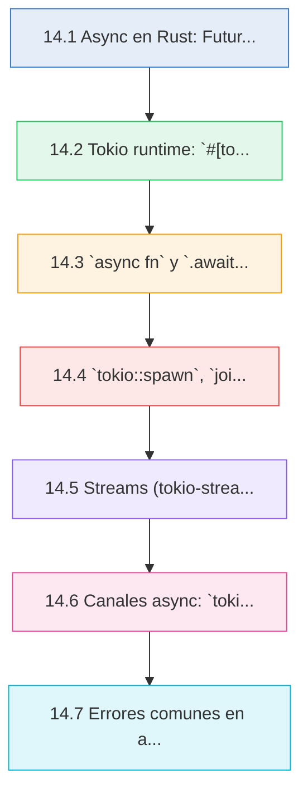
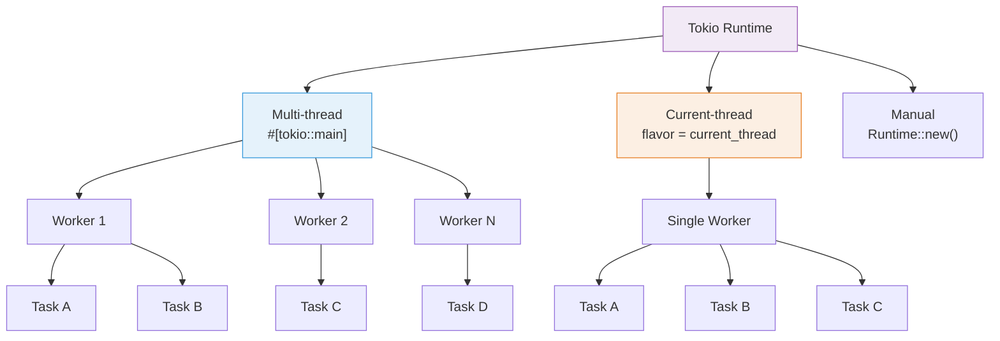

# :zap: Cap 14 — Async/Await con Tokio

<div class="chapter-meta">
  <span class="meta-item">🕐 4-5 horas</span>
  <span class="meta-item">📊 Nivel: Avanzado</span>
  <span class="meta-item">🎯 Semana 8</span>
</div>

<div class="chapter-objective">
  <span class="objective-icon">📌</span>
  <span class="objective-text">Al terminar este capítulo, comprenderás el modelo de Futures de Rust, sabrás configurar el runtime de Tokio, dominarás <code>async fn</code>, <code>.await</code>, <code>spawn</code>, <code>join!</code> y <code>select!</code>, y podrás usar Streams y canales async para construir sistemas concurrentes no bloqueantes en tu proyecto MakeMenu.</span>
</div>

<div class="chapter-map">



</div>


!!! quote "Contexto"
    La programación asíncrona en Rust es diferente a Python. No hay un event loop global implícito: necesitas un **runtime** como Tokio. Este capítulo conecta tu experiencia con `asyncio` de Python con el modelo de Futures de Rust y Tokio como runtime de producción para tu proyecto **MakeMenu**.

<div class="connection-box">
<span class="connection-icon">🔗</span>
<span>Recuerda del <a href='13-concurrencia.md'>Capítulo 13 — Concurrencia</a> que ya viste threads con <code>std::thread::spawn</code> y canales con <code>std::sync::mpsc</code>. Async/await es el siguiente nivel: en lugar de un thread por tarea (costoso en memoria), un solo thread puede gestionar miles de tareas async. Tokio es el puente entre la concurrencia de bajo nivel del Cap 13 y la programación de servidores web real.</span>
</div>

---

## 14.1 Async en Rust: Futures y el trait `Future`

En Rust, una función `async` no ejecuta nada al llamarla. Devuelve un **Future** — un valor que representa un computo que se completara en el futuro.

<div class="concept-question">
<h4>🔍 Pregunta conceptual</h4>
<p>Si llamar una función <code>async fn</code> no ejecuta nada, ¿quién se encarga de ejecutar el código realmente? ¿Qué pasaría si creas un Future y nunca haces <code>.await</code>?</p>
</div>

```rust title="src/conceptos/future_basico.rs"
use std::future::Future;
use std::pin::Pin;
use std::task::{Context, Poll};

// El trait Future simplificado
// trait Future {
//     type Output;
//     fn poll(self: Pin<&mut Self>, cx: &mut Context<'_>) -> Poll<Self::Output>;
// }

// Poll tiene dos variantes:
// Poll::Ready(valor)   -> el Future término, aqui esta el resultado
// Poll::Pending        -> todavia no esta listo, despiertame luego

// Cuando escribes `async fn`, el compilador genera una maquina de estados
// que implementa Future automaticamente.

async fn obtener_mesa(id: i64) -> String {
    // Esta función retorna impl Future<Output = String>
    // No se ejecuta hasta que alguien haga .await
    format!("Mesa {}", id)
}

// Equivalente conceptual (simplificado):
// fn obtener_mesa(id: i64) -> impl Future<Output = String> {
//     async move {
//         format!("Mesa {}", id)
//     }
// }
```

### Modelo mental: Future como maquina de estados

```rust
// Cada .await dentro de un async fn crea un "punto de suspension"
// El compilador transforma tu código en una maquina de estados:

async fn procesar_pedido(mesa_id: i64) -> Result<String, Box<dyn std::error::Error>> {
    let mesa = obtener_mesa(mesa_id).await;       // Estado 0 -> 1
    let menu = cargar_menu().await;                // Estado 1 -> 2
    let pedido = crear_pedido(&mesa, &menu).await; // Estado 2 -> 3 (Ready)
    Ok(pedido)
}

async fn cargar_menu() -> String {
    "Menu del dia".to_string()
}

async fn crear_pedido(mesa: &str, menu: &str) -> String {
    format!("Pedido para {} con {}", mesa, menu)
}
```

```mermaid
stateDiagram-v2
    [*] --> Pending: Future creado
    Pending --> Pending: poll() -> Poll::Pending
    Pending --> Ready: poll() -> Poll::Ready(T)
    Ready --> [*]: Valor disponible

    note right of Pending
        El runtime (Tokio) llama a poll()
        cuando el waker notifica que
        hay progreso posible
    end note
```

<div class="comparison" markdown>
<div class="lang-box python" markdown>

#### :snake: En Python

```python
import asyncio

# Python tiene un event loop global implícito
# async def retorna una coroutine directamente
async def obtener_mesa(id: int) -> str:
    await asyncio.sleep(0.1)  # simula I/O
    return f"Mesa {id}"

# Se ejecuta con asyncio.run()
asyncio.run(obtener_mesa(1))
```

</div>
<div class="lang-box rust" markdown>

#### :crab: En Rust

```rust
// Rust NO tiene runtime incluido en el lenguaje.
// async fn retorna un Future (maquina de estados).
// Necesitas un runtime externo: Tokio, async-std, smol.
// El runtime hace poll() del Future hasta Poll::Ready.
async fn obtener_mesa(id: i64) -> String {
    tokio::time::sleep(
        std::time::Duration::from_millis(100)
    ).await;
    format!("Mesa {}", id)
}
```

</div>
</div>

---

## 14.2 Tokio runtime: `#[tokio::main]` y configuración

Tokio es el runtime async más usado en Rust. Proporciona el event loop, scheduler, I/O async y timers.

```rust title="src/main.rs"
// La forma más comun: macro #[tokio::main]
// Crea un runtime multi-threaded y ejecuta la función async
#[tokio::main]
async fn main() {
    println!("Servidor iniciando...");
    let mesa = obtener_mesa(1).await;
    println!("Obtenida: {}", mesa);
}

async fn obtener_mesa(id: i64) -> String {
    format!("Mesa {}", id)
}
```

### Tipos de runtime

```rust title="src/runtime_config.rs"
use tokio::runtime::Runtime;

// 1. Multi-threaded (por defecto con #[tokio::main])
// Usa todos los cores disponibles
#[tokio::main]
async fn main_multi() {
    // N worker threads (por defecto = num CPUs)
    println!("Multi-threaded runtime");
}

// 2. Current-thread: todo en un solo hilo
// Útil para tests o aplicaciones ligeras
#[tokio::main(flavor = "current_thread")]
async fn main_single() {
    println!("Single-threaded runtime");
}

// 3. Configuración manual del runtime
fn main_manual() {
    let rt = Runtime::new().unwrap(); // multi-threaded

    rt.block_on(async {
        println!("Ejecutando en runtime manual");
        let resultado = hacer_algo().await;
        println!("Resultado: {}", resultado);
    });
}

// 4. Runtime con configuración personalizada
fn main_custom() {
    let rt = tokio::runtime::Builder::new_multi_thread()
        .worker_threads(4)
        .enable_all()       // habilita I/O y timers
        .build()
        .unwrap();

    rt.block_on(async {
        println!("Runtime con 4 worker threads");
    });
}

async fn hacer_algo() -> String {
    "hecho".to_string()
}
```



<div class="pro-tip">
<h4>💡 Consejo Pro</h4>
<p>Para tests unitarios, usa <code>#[tokio::test]</code> en lugar de configurar el runtime manualmente. Por defecto usa <code>current_thread</code>, lo cual es más rápido y determinista para testing. Si necesitas multi-thread en tests, usa <code>#[tokio::test(flavor = "multi_thread", worker_threads = 2)]</code>.</p>
</div>

---

## 14.3 `async fn` y `.await`

Cada `async fn` retorna un `impl Future<Output = T>`. El `.await` suspende la ejecución actual hasta que el Future este listo, sin bloquear el thread.

```rust title="src/async_await.rs"
use std::time::Duration;
use tokio::time::sleep;

// async fn básica
async fn obtener_mesa_db(id: i64) -> Result<Mesa, String> {
    // .await suspende aqui — el thread puede ejecutar otras tareas
    sleep(Duration::from_millis(50)).await;

    if id > 0 {
        Ok(Mesa {
            id,
            número: id as i32,
            zona: "terraza".to_string(),
            capacidad: 4,
            ocupada: false,
        })
    } else {
        Err("ID inválido".to_string())
    }
}

struct Mesa {
    id: i64,
    número: i32,
    zona: String,
    capacidad: i32,
    ocupada: bool,
}

// Encadenar .await — ejecución secuencial
async fn flujo_reserva(mesa_id: i64) -> Result<String, String> {
    // Cada .await se ejecuta secuencialmente
    let mesa = obtener_mesa_db(mesa_id).await?;
    let disponible = verificar_disponibilidad(&mesa).await?;

    if disponible {
        let confirmación = crear_reserva(&mesa).await?;
        Ok(confirmación)
    } else {
        Err("Mesa no disponible".to_string())
    }
}

async fn verificar_disponibilidad(mesa: &Mesa) -> Result<bool, String> {
    sleep(Duration::from_millis(20)).await;
    Ok(!mesa.ocupada)
}

async fn crear_reserva(mesa: &Mesa) -> Result<String, String> {
    sleep(Duration::from_millis(30)).await;
    Ok(format!("Reserva confirmada para mesa {}", mesa.número))
}
```

<div class="concept-question">
<h4>🔍 Pregunta conceptual</h4>
<p>En el ejemplo de <code>flujo_reserva</code>, los tres <code>.await</code> se ejecutan secuencialmente. ¿Cómo lo cambiarías para que <code>obtener_mesa_db</code> y <code>verificar_disponibilidad</code> corrieran en paralelo? ¿Tendría sentido hacerlo en este caso? ¿Por qué sí o por qué no?</p>
</div>

### Closures async y bloques async

```rust title="src/closures_async.rs"
use tokio::time::{sleep, Duration};

#[tokio::main]
async fn main() {
    // Bloque async: como un closure async anonimo
    let resultado = async {
        sleep(Duration::from_millis(10)).await;
        42
    }.await;
    println!("Resultado: {}", resultado); // 42

    // async move: captura por valor (necesario para spawn)
    let nombre = String::from("Mesa VIP");
    let future = async move {
        sleep(Duration::from_millis(10)).await;
        format!("Procesando: {}", nombre) // nombre movido aqui
    };
    // println!("{}", nombre); // Error: nombre fue movido
    let msg = future.await;
    println!("{}", msg);
}
```

<div class="micro-exercise">
<h4>🧪 Micro-ejercicio (3 min)</h4>
<p>Escribe una función <code>async fn saludar(nombre: String) -> String</code> que espere 100ms con <code>tokio::time::sleep</code> y retorne <code>"Hola, {nombre}"</code>. Llámala desde un <code>#[tokio::main] async fn main()</code> e imprime el resultado. ¿Qué pasa si olvidas el <code>.await</code> después de <code>saludar("Rust".into())</code>?</p>
</div>

---

## 14.4 `tokio::spawn`, `join!`, `select!`

### `tokio::spawn` — tareas concurrentes

```rust title="src/spawn_tasks.rs"
use tokio::time::{sleep, Duration};

#[tokio::main]
async fn main() {
    // spawn lanza una tarea concurrente en el runtime
    // Retorna un JoinHandle<T>
    let handle = tokio::spawn(async {
        sleep(Duration::from_millis(100)).await;
        "tarea completada"
    });

    // Hacer otro trabajo mientras la tarea corre...
    println!("Haciendo trabajo principal...");

    // Esperar el resultado
    let resultado = handle.await.unwrap(); // JoinError si la tarea panicea
    println!("{}", resultado);
}

// Patrón: lanzar multiples tareas
async fn cargar_datos_restaurante() -> Result<(), Box<dyn std::error::Error>> {
    let mesas_handle = tokio::spawn(async {
        sleep(Duration::from_millis(50)).await;
        vec!["Mesa 1", "Mesa 2", "Mesa 3"]
    });

    let platos_handle = tokio::spawn(async {
        sleep(Duration::from_millis(80)).await;
        vec!["Paella", "Gazpacho", "Tortilla"]
    });

    let reservas_handle = tokio::spawn(async {
        sleep(Duration::from_millis(60)).await;
        vec!["Reserva A", "Reserva B"]
    });

    // Esperar todas (corren en paralelo)
    let mesas = mesas_handle.await?;
    let platos = platos_handle.await?;
    let reservas = reservas_handle.await?;

    println!("Mesas: {:?}", mesas);
    println!("Platos: {:?}", platos);
    println!("Reservas: {:?}", reservas);
    Ok(())
}
```

### `tokio::join!` — esperar multiples futures

```rust title="src/join_macro.rs"
use tokio::time::{sleep, Duration};

async fn obtener_mesas() -> Vec<String> {
    sleep(Duration::from_millis(50)).await;
    vec!["Mesa 1".into(), "Mesa 2".into()]
}

async fn obtener_platos() -> Vec<String> {
    sleep(Duration::from_millis(80)).await;
    vec!["Paella".into(), "Gazpacho".into()]
}

async fn obtener_reservas() -> Vec<String> {
    sleep(Duration::from_millis(60)).await;
    vec!["Reserva A".into()]
}

#[tokio::main]
async fn main() {
    // join! ejecuta todos los futures concurrentemente
    // y espera a que TODOS terminen
    let (mesas, platos, reservas) = tokio::join!(
        obtener_mesas(),
        obtener_platos(),
        obtener_reservas()
    );
    // Tiempo total: ~80ms (el más lento), no 190ms (suma)

    println!("Mesas: {:?}", mesas);
    println!("Platos: {:?}", platos);
    println!("Reservas: {:?}", reservas);

    // try_join! para Results — cancela si alguno falla
    let resultado = tokio::try_join!(
        obtener_mesas_db(),
        obtener_platos_db()
    );
    match resultado {
        Ok((mesas, platos)) => println!("OK: {:?}, {:?}", mesas, platos),
        Err(e) => println!("Error: {}", e),
    }
}

async fn obtener_mesas_db() -> Result<Vec<String>, String> {
    Ok(vec!["Mesa 1".into()])
}

async fn obtener_platos_db() -> Result<Vec<String>, String> {
    Ok(vec!["Paella".into()])
}
```

### `tokio::select!` — el primero que termine

```rust title="src/select_macro.rs"
use tokio::time::{sleep, Duration};

#[tokio::main]
async fn main() {
    // select! espera al PRIMER future que se complete
    // Los demas se cancelan
    tokio::select! {
        val = obtener_de_cache() => {
            println!("Cache respondio primero: {}", val);
        }
        val = obtener_de_db() => {
            println!("DB respondio primero: {}", val);
        }
    }
}

async fn obtener_de_cache() -> String {
    sleep(Duration::from_millis(10)).await;
    "dato del cache".to_string()
}

async fn obtener_de_db() -> String {
    sleep(Duration::from_millis(100)).await;
    "dato de la DB".to_string()
}

// Patrón: timeout con select!
async fn con_timeout() -> Result<String, String> {
    tokio::select! {
        resultado = operacion_lenta() => {
            Ok(resultado)
        }
        _ = sleep(Duration::from_secs(5)) => {
            Err("Timeout: la operación tardo más de 5 segundos".to_string())
        }
    }
}

async fn operacion_lenta() -> String {
    sleep(Duration::from_secs(10)).await;
    "completado".to_string()
}
```

<div class="misconception-box">
<h4>⚠️ Errores comunes</h4>
<ul>
<li><span class="wrong">❌ Mito:</span> "<code>tokio::spawn</code> crea un thread nuevo por cada tarea" → <span class="right">✅ Realidad:</span> <code>spawn</code> lanza una tarea <strong>green task</strong> dentro del pool de workers de Tokio. Miles de tareas comparten unos pocos threads del OS. No confundas <code>tokio::spawn</code> con <code>std::thread::spawn</code>.</li>
<li><span class="wrong">❌ Mito:</span> "<code>join!</code> y <code>spawn</code> hacen lo mismo" → <span class="right">✅ Realidad:</span> <code>join!</code> ejecuta futures concurrentemente en la <strong>misma tarea</strong> (cooperative multitasking). <code>spawn</code> crea tareas independientes que pueden correr en <strong>diferentes threads</strong>. Usa <code>join!</code> para I/O paralelo simple; <code>spawn</code> cuando necesitas independencia real.</li>
<li><span class="wrong">❌ Mito:</span> "Async siempre es más rápido que threads" → <span class="right">✅ Realidad:</span> Async brilla con miles de tareas I/O-bound (servidores web, conexiones de red). Para trabajo CPU-bound, threads reales (<code>std::thread</code> o <code>tokio::task::spawn_blocking</code>) son más apropiados. Elegir mal puede <strong>empeorar</strong> el rendimiento.</li>
</ul>
</div>

<div class="code-evolution">
<div class="evolution-header">📈 Evolución del código</div>
<div class="evolution-step">
<span class="step-label novato">v1 — Secuencial bloqueante</span>

```rust
// Versión síncrona: cada query bloquea el thread
fn cargar_dashboard() {
    let mesas = query_mesas_sync();       // 50ms bloqueando
    let platos = query_platos_sync();     // 80ms bloqueando
    let reservas = query_reservas_sync(); // 60ms bloqueando
    // Total: ~190ms (suma de todo)
    println!("{:?}, {:?}, {:?}", mesas, platos, reservas);
}
```

</div>
<div class="evolution-step">
<span class="step-label mejorado">v2 — Async secuencial</span>

```rust
// Async pero secuencial: no aprovecha la concurrencia
async fn cargar_dashboard() {
    let mesas = query_mesas().await;       // 50ms (thread libre)
    let platos = query_platos().await;     // 80ms (thread libre)
    let reservas = query_reservas().await; // 60ms (thread libre)
    // Total: ~190ms — el thread no bloquea, pero sigue siendo secuencial
    println!("{:?}, {:?}, {:?}", mesas, platos, reservas);
}
```

</div>
<div class="evolution-step">
<span class="step-label profesional">v3 — Async concurrente con join!</span>

```rust
// Versión profesional: queries en paralelo con join!
async fn cargar_dashboard() {
    let (mesas, platos, reservas) = tokio::join!(
        query_mesas(),     // Las tres queries corren
        query_platos(),    // concurrentemente —
        query_reservas()   // el runtime las intercala
    );
    // Total: ~80ms (solo el más lento)
    println!("{:?}, {:?}, {:?}", mesas, platos, reservas);
}
```

</div>
</div>

---

## 14.5 Streams (tokio-stream): iteradores async

Un **Stream** es el equivalente async de un `Iterator`. Produce valores de forma asíncrona, uno a la vez.

```rust title="src/streams.rs"
use tokio_stream::{self as stream, StreamExt};
use tokio::time::{sleep, Duration};

#[tokio::main]
async fn main() {
    // Crear un stream desde un iterador
    let mut números = stream::iter(vec![1, 2, 3, 4, 5]);

    // next().await — obtener el siguiente elemento
    while let Some(n) = números.next().await {
        println!("Número: {}", n);
    }

    // StreamExt proporciona adaptadores como Iterator
    let pares: Vec<i32> = stream::iter(1..=10)
        .filter(|n| n % 2 == 0)
        .collect()
        .await;
    println!("Pares: {:?}", pares); // [2, 4, 6, 8, 10]

    // map async
    let resultados: Vec<String> = stream::iter(vec![1, 2, 3])
        .then(|id| async move {
            sleep(Duration::from_millis(10)).await;
            format!("Mesa {} cargada", id)
        })
        .collect()
        .await;
    println!("{:?}", resultados);

    // take, skip, chunks
    let primeros_tres: Vec<i32> = stream::iter(1..=100)
        .take(3)
        .collect()
        .await;
    println!("Primeros 3: {:?}", primeros_tres); // [1, 2, 3]
}
```

<div class="concept-question">
<h4>🔍 Pregunta conceptual</h4>
<p>Un <code>Iterator</code> produce valores síncronamente con <code>next() -> Option&lt;T&gt;</code>. Un <code>Stream</code> produce valores asíncronamente con <code>next().await -> Option&lt;T&gt;</code>. ¿En qué escenarios concretos necesitas un Stream en lugar de un Iterator? Piensa en conexiones WebSocket, filas de una base de datos, o eventos de un sistema.</p>
</div>

### Stream personalizado para eventos del restaurante

```rust title="src/stream_eventos.rs"
use tokio_stream::{self as stream, StreamExt};
use tokio::time::{interval, Duration};

#[derive(Debug)]
enum EventoRestaurante {
    NuevoPedido(i64),
    MesaLiberada(i32),
    ReservaConfirmada(String),
}

// Crear un stream que emite eventos periodicamente
fn eventos_stream() -> impl tokio_stream::Stream<Item = EventoRestaurante> {
    let mut counter = 0;
    stream::unfold(counter, |mut state| async move {
        tokio::time::sleep(Duration::from_millis(100)).await;
        state += 1;
        let evento = match state % 3 {
            0 => EventoRestaurante::NuevoPedido(state as i64),
            1 => EventoRestaurante::MesaLiberada(state as i32),
            _ => EventoRestaurante::ReservaConfirmada(
                format!("Reserva-{}", state)
            ),
        };
        Some((evento, state))
    })
}

#[tokio::main]
async fn main() {
    // Procesar los primeros 6 eventos
    let mut eventos = eventos_stream().take(6);

    while let Some(evento) = eventos.next().await {
        match evento {
            EventoRestaurante::NuevoPedido(id) => {
                println!("[PEDIDO] Nuevo pedido #{}", id);
            }
            EventoRestaurante::MesaLiberada(num) => {
                println!("[MESA] Mesa {} liberada", num);
            }
            EventoRestaurante::ReservaConfirmada(ref_id) => {
                println!("[RESERVA] {}", ref_id);
            }
        }
    }
}
```

<div class="comparison" markdown>
<div class="lang-box python" markdown>

#### :snake: En Python

```python
# Python tiene async generators y async for
async def eventos():
    for i in range(6):
        await asyncio.sleep(0.1)
        yield f"evento_{i}"

async def main():
    async for evento in eventos():
        print(evento)
```

</div>
<div class="lang-box rust" markdown>

#### :crab: En Rust

```rust
// Rust usa el trait Stream (de futures/tokio-stream)
// con StreamExt para adaptadores.
// next().await en lugar de async for.
// No hay async generators estables todavia.
let mut stream = eventos_stream().take(6);
while let Some(evento) = stream.next().await {
    println!("{:?}", evento);
}
```

</div>
</div>

---

## 14.6 Canales async: `tokio::sync`

Tokio proporciona canales async para comunicación entre tareas, similares a los de `std::sync::mpsc` pero con soporte `.await`.

### `mpsc` — multiple producer, single consumer

```rust title="src/canales/mpsc.rs"
use tokio::sync::mpsc;

#[derive(Debug)]
struct Pedido {
    mesa_id: i64,
    plato: String,
}

#[tokio::main]
async fn main() {
    // Crear canal con buffer de 32 mensajes
    let (tx, mut rx) = mpsc::channel::<Pedido>(32);

    // Clonar el sender para multiples productores
    let tx1 = tx.clone();
    let tx2 = tx.clone();

    // Productor 1: camarero mesa 1
    tokio::spawn(async move {
        tx1.send(Pedido {
            mesa_id: 1,
            plato: "Paella".to_string(),
        }).await.unwrap();
    });

    // Productor 2: camarero mesa 2
    tokio::spawn(async move {
        tx2.send(Pedido {
            mesa_id: 2,
            plato: "Gazpacho".to_string(),
        }).await.unwrap();
    });

    // Importante: dropear el tx original para que rx.recv() retorne None
    drop(tx);

    // Consumidor: cocina
    while let Some(pedido) = rx.recv().await {
        println!("Cocina recibio: Mesa {} -> {}", pedido.mesa_id, pedido.plato);
    }
    println!("Todos los pedidos procesados");
}
```

<div class="pro-tip">
<h4>💡 Consejo Pro</h4>
<p>El tamaño del buffer en <code>mpsc::channel(N)</code> es crítico en producción. Si <code>N</code> es muy pequeño, los productores se bloquean esperando espacio (backpressure). Si es muy grande, consumes memoria innecesariamente. Empieza con 32-128, monitorea en producción, y ajusta. Para casos donde no quieres backpressure, considera <code>mpsc::unbounded_channel()</code>, pero con cuidado: puede consumir memoria infinita si el consumidor es más lento que los productores.</p>
</div>

### `broadcast` — multiples consumidores reciben todos los mensajes

```rust title="src/canales/broadcast.rs"
use tokio::sync::broadcast;

#[tokio::main]
async fn main() {
    // broadcast: cada suscriptor recibe una copia de cada mensaje
    let (tx, _) = broadcast::channel::<String>(16);

    let mut rx1 = tx.subscribe();
    let mut rx2 = tx.subscribe();

    // Suscriptor 1: pantalla cocina
    let cocina = tokio::spawn(async move {
        while let Ok(msg) = rx1.recv().await {
            println!("[COCINA] {}", msg);
        }
    });

    // Suscriptor 2: pantalla barra
    let barra = tokio::spawn(async move {
        while let Ok(msg) = rx2.recv().await {
            println!("[BARRA] {}", msg);
        }
    });

    // Enviar notificaciones
    tx.send("Mesa 3: nuevo pedido de Paella".to_string()).unwrap();
    tx.send("Mesa 1: pedido listo para servir".to_string()).unwrap();

    drop(tx); // Cerrar canal
    let _ = tokio::join!(cocina, barra);
}
```

### `watch` — valor observable, solo el último valor importa

```rust title="src/canales/watch.rs"
use tokio::sync::watch;
use tokio::time::{sleep, Duration};

#[derive(Debug, Clone)]
struct EstadoRestaurante {
    mesas_ocupadas: u32,
    pedidos_pendientes: u32,
}

#[tokio::main]
async fn main() {
    let (tx, mut rx) = watch::channel(EstadoRestaurante {
        mesas_ocupadas: 0,
        pedidos_pendientes: 0,
    });

    // Observador: dashboard
    tokio::spawn(async move {
        while rx.changed().await.is_ok() {
            let estado = rx.borrow();
            println!(
                "Dashboard: {} mesas ocupadas, {} pedidos",
                estado.mesas_ocupadas, estado.pedidos_pendientes
            );
        }
    });

    // Actualizar estado
    sleep(Duration::from_millis(50)).await;
    tx.send(EstadoRestaurante { mesas_ocupadas: 3, pedidos_pendientes: 5 }).unwrap();

    sleep(Duration::from_millis(50)).await;
    tx.send(EstadoRestaurante { mesas_ocupadas: 4, pedidos_pendientes: 2 }).unwrap();

    sleep(Duration::from_millis(100)).await;
}
```

### `oneshot` — un único valor, una sola vez

```rust title="src/canales/oneshot.rs"
use tokio::sync::oneshot;

#[tokio::main]
async fn main() {
    // oneshot: enviar un único valor
    let (tx, rx) = oneshot::channel::<String>();

    tokio::spawn(async move {
        // Simular trabajo
        tokio::time::sleep(std::time::Duration::from_millis(50)).await;
        tx.send("Pedido #42 completado".to_string()).unwrap();
    });

    // Esperar la respuesta
    let resultado = rx.await.unwrap();
    println!("{}", resultado);
}
```

<div class="micro-exercise">
<h4>🧪 Micro-ejercicio (5 min)</h4>
<p>Usando <code>tokio::sync::mpsc</code>, crea un canal donde dos tareas <code>spawn</code> envían cada una un mensaje <code>"Hola desde tarea N"</code>. Una tercera parte (el <code>main</code>) recibe e imprime ambos mensajes. Recuerda: clona el <code>tx</code> para cada tarea y dropea el original antes de recibir.</p>
</div>

---

## 14.7 Errores comunes en async Rust

### Error 1: Lifetimes con async

```rust title="src/errores_async/lifetimes.rs"
// ❌ Error: referencia no vive lo suficiente para spawn
// async fn procesar(datos: &str) -> String {
//     format!("Procesado: {}", datos)
// }
// tokio::spawn(procesar(&mi_string)); // Error: &str no es 'static

// ✅ Solución: usar datos owned (String, no &str)
async fn procesar(datos: String) -> String {
    format!("Procesado: {}", datos)
}

#[tokio::main]
async fn main() {
    let mi_string = String::from("Pedido VIP");
    // spawn requiere 'static: el Future debe ser dueño de sus datos
    let handle = tokio::spawn(procesar(mi_string));
    let resultado = handle.await.unwrap();
    println!("{}", resultado);
}
```

### Error 2: `Send` bounds — tareas deben ser Send

```rust title="src/errores_async/send_bound.rs"
use std::rc::Rc;

// ❌ Error: Rc no es Send, no se puede usar con tokio::spawn
// async fn tarea_mala() {
//     let datos = Rc::new(vec![1, 2, 3]);
//     tokio::time::sleep(std::time::Duration::from_millis(10)).await;
//     println!("{:?}", datos);
// }
// tokio::spawn(tarea_mala()); // Error: Rc<Vec<i32>> cannot be sent between threads

// ✅ Solución: usar Arc en lugar de Rc
use std::sync::Arc;

async fn tarea_buena() {
    let datos = Arc::new(vec![1, 2, 3]);
    tokio::time::sleep(std::time::Duration::from_millis(10)).await;
    println!("{:?}", datos);
}

#[tokio::main]
async fn main() {
    tokio::spawn(tarea_buena()).await.unwrap();
}
```

### Error 3: `std::sync::Mutex` vs `tokio::sync::Mutex`

```rust title="src/errores_async/mutex_async.rs"
use std::sync::Arc;

// ❌ Problema: std::sync::Mutex mantenido durante .await
// async fn malo() {
//     let datos = Arc::new(std::sync::Mutex::new(vec![]));
//     let guard = datos.lock().unwrap();
//     // Si hacemos .await mientras tenemos el guard...
//     tokio::time::sleep(std::time::Duration::from_millis(10)).await;
//     // ...el MutexGuard NO es Send -> error de compilación
//     drop(guard);
// }

// ✅ Solución 1: tokio::sync::Mutex (permite .await dentro del lock)
async fn con_tokio_mutex() {
    let datos = Arc::new(tokio::sync::Mutex::new(vec![1, 2, 3]));
    let mut guard = datos.lock().await; // .await para adquirir el lock
    guard.push(4);
    // Es seguro hacer .await aqui porque tokio::sync::Mutex lo permite
    tokio::time::sleep(std::time::Duration::from_millis(10)).await;
    println!("{:?}", *guard);
}

// ✅ Solución 2: dropear el std::Mutex ANTES del .await
async fn con_std_mutex_correcto() {
    let datos = Arc::new(std::sync::Mutex::new(vec![1, 2, 3]));
    {
        let mut guard = datos.lock().unwrap();
        guard.push(4);
    } // guard se dropea aqui
    // Ahora es seguro hacer .await
    tokio::time::sleep(std::time::Duration::from_millis(10)).await;
    println!("{:?}", datos.lock().unwrap());
}

#[tokio::main]
async fn main() {
    con_tokio_mutex().await;
    con_std_mutex_correcto().await;
}
```

<div class="comparison" markdown>
<div class="lang-box python" markdown>

#### :snake: En Python asyncio

```python
# Python es single-threaded por defecto.
# asyncio.Lock() funciona sin problemas.
# No hay Send/Sync bounds.
# No hay problemas de lifetimes.
lock = asyncio.Lock()
async with lock:
    await asyncio.sleep(0.1)  # OK
```

</div>
<div class="lang-box rust" markdown>

#### :crab: En Rust + Tokio

```rust
// Tokio es multi-threaded por defecto.
// tokio::spawn requiere Future: Send + 'static
// std::sync::Mutex NO se puede mantener durante .await
// Usar tokio::sync::Mutex si necesitas lock + await
// O dropear std::Mutex antes del .await
let mutex = tokio::sync::Mutex::new(datos);
let guard = mutex.lock().await;
// Seguro hacer .await aqui
```

</div>
</div>

---

## :plate_with_cutlery: MakeMenu: Async HTTP handlers y queries concurrentes

```rust title="src/makemenu/async_handlers.rs"
use std::sync::Arc;
use tokio::sync::RwLock;

#[derive(Debug, Clone)]
struct Mesa {
    id: i64,
    número: i32,
    zona: String,
    capacidad: i32,
    ocupada: bool,
}

#[derive(Debug, Clone)]
struct Plato {
    id: i64,
    nombre: String,
    precio: f64,
    disponible: bool,
}

struct AppState {
    mesas: RwLock<Vec<Mesa>>,
    platos: RwLock<Vec<Plato>>,
}

// Simular queries de base de datos
async fn query_mesas(state: &AppState) -> Vec<Mesa> {
    tokio::time::sleep(std::time::Duration::from_millis(50)).await;
    state.mesas.read().await.clone()
}

async fn query_platos(state: &AppState) -> Vec<Plato> {
    tokio::time::sleep(std::time::Duration::from_millis(50)).await;
    state.platos.read().await.clone()
}

async fn query_reservas_hoy() -> Vec<String> {
    tokio::time::sleep(std::time::Duration::from_millis(30)).await;
    vec!["Reserva 20:00 Mesa 3".into(), "Reserva 21:00 Mesa 5".into()]
}

// Handler que usa join! para queries concurrentes
async fn dashboard(state: Arc<AppState>) {
    // Tres queries ejecutandose en paralelo
    let (mesas, platos, reservas) = tokio::join!(
        query_mesas(&state),
        query_platos(&state),
        query_reservas_hoy()
    );

    println!("=== Dashboard MakeMenu ===");
    println!("Mesas: {} (ocupadas: {})",
        mesas.len(),
        mesas.iter().filter(|m| m.ocupada).count()
    );
    println!("Platos disponibles: {}",
        platos.iter().filter(|p| p.disponible).count()
    );
    println!("Reservas hoy: {}", reservas.len());
}

#[tokio::main]
async fn main() {
    let state = Arc::new(AppState {
        mesas: RwLock::new(vec![
            Mesa { id: 1, número: 1, zona: "terraza".into(), capacidad: 4, ocupada: false },
            Mesa { id: 2, número: 2, zona: "interior".into(), capacidad: 2, ocupada: true },
            Mesa { id: 3, número: 3, zona: "terraza".into(), capacidad: 6, ocupada: false },
        ]),
        platos: RwLock::new(vec![
            Plato { id: 1, nombre: "Paella".into(), precio: 15.50, disponible: true },
            Plato { id: 2, nombre: "Gazpacho".into(), precio: 8.00, disponible: true },
            Plato { id: 3, nombre: "Crema catalana".into(), precio: 6.50, disponible: false },
        ]),
    });

    dashboard(state).await;
}
```

<div class="connection-box">
<span class="connection-icon">🔗</span>
<span>Los handlers async y el estado compartido con <code>Arc&lt;AppState&gt;</code> que ves aquí son exactamente el patrón que usarás en el <a href='15-web-axum.md'>Capítulo 15 — Web con Axum</a>. Axum está construido sobre Tokio, y cada handler HTTP es una función <code>async fn</code>. Todo lo que has aprendido en este capítulo — <code>spawn</code>, <code>join!</code>, canales, estado compartido — se aplica directamente a tu servidor web de MakeMenu.</span>
</div>

---

<div class="ejercicio-guiado">
<h4>🏋️ Ejercicio guiado</h4>

Vas a construir un pipeline asincrono de procesamiento de pedidos para RustMenu usando Tokio. El sistema recibe pedidos por un canal `mpsc` async, los valida concurrentemente, simula la preparacion con delays, y envia notificaciones de completado por un canal `oneshot`. Esto te permite practicar `tokio::spawn`, canales async y `tokio::join!` en un escenario realista.

1. Define una struct `Pedido` con campos `id: u64`, `mesa: u32`, `plato: String` y `precio: f64`. Deriva `Debug` y `Clone`.
2. Define una funcion `async fn validar_pedido(pedido: &Pedido) -> Result<(), String>` que simule una validacion con `tokio::time::sleep` de 50ms y rechace pedidos con precio menor o igual a 0.
3. Define una funcion `async fn preparar_pedido(pedido: &Pedido) -> String` que simule la preparacion con `sleep` proporcional al precio (10ms por euro) y devuelva un mensaje de confirmacion.
4. Crea un canal `tokio::sync::mpsc` con buffer de 10. Lanza 3 tareas con `tokio::spawn` que actuen como camareros, cada una enviando 2 pedidos al canal.
5. Lanza una tarea cocina que reciba pedidos del canal, los valide y prepare usando `tokio::join!` para ejecutar la validacion y la preparacion de forma que primero valide y despues prepare. Imprime el resultado de cada pedido.
6. Recoge los resultados en el hilo principal y muestra un resumen con el total de pedidos procesados y la suma de precios.

??? success "Solución completa"
    ```rust
    use tokio::sync::mpsc;
    use tokio::time::{sleep, Duration};

    #[derive(Debug, Clone)]
    struct Pedido {
        id: u64,
        mesa: u32,
        plato: String,
        precio: f64,
    }

    async fn validar_pedido(pedido: &Pedido) -> Result<(), String> {
        sleep(Duration::from_millis(50)).await;
        if pedido.precio <= 0.0 {
            Err(format!("Pedido #{}: precio invalido ({:.2})", pedido.id, pedido.precio))
        } else if pedido.plato.trim().is_empty() {
            Err(format!("Pedido #{}: nombre de plato vacio", pedido.id))
        } else {
            Ok(())
        }
    }

    async fn preparar_pedido(pedido: &Pedido) -> String {
        let tiempo_ms = (pedido.precio * 10.0) as u64;
        sleep(Duration::from_millis(tiempo_ms)).await;
        format!(
            "Pedido #{} listo: {} para mesa {} ({}ms)",
            pedido.id, pedido.plato, pedido.mesa, tiempo_ms
        )
    }

    #[tokio::main]
    async fn main() {
        let (tx, mut rx) = mpsc::channel::<Pedido>(10);

        let platos = vec![
            ("Paella Valenciana", 14.50),
            ("Gazpacho Andaluz", 8.00),
            ("Croquetas de Jamon", 9.50),
            ("Tortilla Espanola", 7.00),
            ("Flan de Huevo", 5.50),
            ("Churros con Chocolate", 6.00),
        ];

        // Lanzar 3 camareros async
        let mut id_counter = 1u64;
        for camarero in 1..=3u32 {
            let tx = tx.clone();
            let platos = platos.clone();
            let base_id = id_counter;
            id_counter += 2;

            tokio::spawn(async move {
                for i in 0..2 {
                    let idx = ((camarero as usize - 1) * 2 + i) % platos.len();
                    let (nombre, precio) = &platos[idx];
                    let pedido = Pedido {
                        id: base_id + i as u64,
                        mesa: camarero * 10 + i as u32,
                        plato: nombre.to_string(),
                        precio: *precio,
                    };
                    println!(
                        "[Camarero {}] Enviando pedido #{}: {}",
                        camarero, pedido.id, pedido.plato
                    );
                    tx.send(pedido).await.unwrap();
                    sleep(Duration::from_millis(30)).await;
                }
            });
        }

        // Cerrar el transmisor original
        drop(tx);

        // Cocina: procesar pedidos
        let mut completados: Vec<String> = Vec::new();
        let mut total_precio = 0.0_f64;
        let mut total_pedidos = 0u32;

        while let Some(pedido) = rx.recv().await {
            // Primero validar
            match validar_pedido(&pedido).await {
                Ok(()) => {
                    // Luego preparar
                    let resultado = preparar_pedido(&pedido).await;
                    println!("  [Cocina] {}", resultado);
                    total_precio += pedido.precio;
                    total_pedidos += 1;
                    completados.push(resultado);
                }
                Err(error) => {
                    println!("  [Cocina] RECHAZADO: {}", error);
                }
            }
        }

        // Resumen
        println!("\n========== RESUMEN ==========");
        println!("Pedidos completados: {}", total_pedidos);
        for msg in &completados {
            println!("  {}", msg);
        }
        println!("Total facturado: {:.2} EUR", total_precio);
    }
    ```

</div>

## :link: Recursos

| Recurso | Enlace |
|---------|--------|
| Tokio Tutorial | [tokio.rs/tokio/tutorial](https://tokio.rs/tokio/tutorial) |
| Async Book (oficial) | [rust-lang.github.io/async-book](https://rust-lang.github.io/async-book/) |
| Tokio API docs | [docs.rs/tokio](https://docs.rs/tokio/latest/tokio/) |
| tokio-stream | [docs.rs/tokio-stream](https://docs.rs/tokio-stream/latest/tokio_stream/) |
| Pin and Suffering | [fasterthanli.me/articles/pin-and-suffering](https://fasterthanli.me/articles/pin-and-suffering) |

---

## 🎯 Ejercicios

??? question "Ejercicio 1: Cargar datos con join!"
    Crea tres funciones async que simulen llamadas a base de datos (`cargar_mesas`, `cargar_platos`, `cargar_reservas`) cada una con un `sleep` distinto. Usa `tokio::join!` para ejecutarlas en paralelo y mide el tiempo total con `tokio::time::Instant`.

    ??? success "Solución"
        ```rust
        use tokio::time::{sleep, Duration, Instant};

        async fn cargar_mesas() -> Vec<String> {
            sleep(Duration::from_millis(200)).await;
            vec!["Mesa 1".into(), "Mesa 2".into(), "Mesa 3".into()]
        }

        async fn cargar_platos() -> Vec<String> {
            sleep(Duration::from_millis(300)).await;
            vec!["Paella".into(), "Gazpacho".into()]
        }

        async fn cargar_reservas() -> Vec<String> {
            sleep(Duration::from_millis(150)).await;
            vec!["Reserva A".into()]
        }

        #[tokio::main]
        async fn main() {
            let inicio = Instant::now();

            let (mesas, platos, reservas) = tokio::join!(
                cargar_mesas(),
                cargar_platos(),
                cargar_reservas()
            );

            let duración = inicio.elapsed();
            println!("Mesas: {:?}", mesas);
            println!("Platos: {:?}", platos);
            println!("Reservas: {:?}", reservas);
            println!("Tiempo total: {:?}", duración);
            // ~300ms (el más lento), no ~650ms (suma)
        }
        ```

??? question "Ejercicio 2: Sistema de pedidos con mpsc"
    Implementa un sistema donde 3 camareros (tareas spawn) envian pedidos por un canal `mpsc` y una tarea cocina los recibe y procesa. Cada camarero envia 2 pedidos.

    !!! tip "Pista"
        Clona el `tx` para cada camarero y recuerda dropear el `tx` original para que el receiver termine.

    ??? success "Solución"
        ```rust
        use tokio::sync::mpsc;
        use tokio::time::{sleep, Duration};

        #[derive(Debug)]
        struct Pedido {
            camarero: u32,
            mesa: u32,
            plato: String,
        }

        #[tokio::main]
        async fn main() {
            let (tx, mut rx) = mpsc::channel::<Pedido>(32);

            // Lanzar 3 camareros
            for camarero_id in 1..=3 {
                let tx = tx.clone();
                tokio::spawn(async move {
                    for i in 0..2 {
                        let pedido = Pedido {
                            camarero: camarero_id,
                            mesa: camarero_id * 10 + i,
                            plato: format!("Plato-{}-{}", camarero_id, i),
                        };
                        sleep(Duration::from_millis(50 * camarero_id as u64)).await;
                        tx.send(pedido).await.unwrap();
                    }
                });
            }

            // Dropear el tx original
            drop(tx);

            // Cocina recibe pedidos
            let mut total = 0;
            while let Some(pedido) = rx.recv().await {
                total += 1;
                println!(
                    "[Cocina] Pedido #{}: Camarero {} -> Mesa {} -> {}",
                    total, pedido.camarero, pedido.mesa, pedido.plato
                );
            }
            println!("Total pedidos procesados: {}", total);
        }
        ```

??? question "Ejercicio 3: Timeout con select!"
    Crea una función `buscar_mesa_con_timeout` que intente buscar una mesa disponible (simula con sleep de 2 segundos) pero cancele despues de 500ms usando `tokio::select!`. Retorna un `Result<Mesa, String>`.

    ??? success "Solución"
        ```rust
        use tokio::time::{sleep, Duration};

        #[derive(Debug)]
        struct Mesa {
            id: i64,
            número: i32,
        }

        async fn buscar_mesa_lenta() -> Mesa {
            sleep(Duration::from_secs(2)).await;
            Mesa { id: 1, número: 5 }
        }

        async fn buscar_mesa_con_timeout() -> Result<Mesa, String> {
            tokio::select! {
                mesa = buscar_mesa_lenta() => {
                    Ok(mesa)
                }
                _ = sleep(Duration::from_millis(500)) => {
                    Err("Timeout: busqueda de mesa excedio 500ms".to_string())
                }
            }
        }

        #[tokio::main]
        async fn main() {
            match buscar_mesa_con_timeout().await {
                Ok(mesa) => println!("Mesa encontrada: {:?}", mesa),
                Err(e) => println!("Error: {}", e),
            }
            // Output: Error: Timeout: busqueda de mesa excedio 500ms
        }
        ```

??? question "Ejercicio 4: Stream de eventos con filtro"
    Crea un stream que genere 20 números aleatorios (usa un contador como seed). Filtra solo los pares, toma los primeros 5 y recogelos en un `Vec`. Usa `StreamExt` con `filter`, `take` y `collect`.

    ??? success "Solución"
        ```rust
        use tokio_stream::{self as stream, StreamExt};

        #[tokio::main]
        async fn main() {
            // Generar números pseudo-aleatorios simples
            let números: Vec<i32> = stream::iter(0..20)
                .map(|i| (i * 7 + 3) % 20) // pseudo-aleatorio simple
                .filter(|n| n % 2 == 0)      // solo pares
                .take(5)                       // primeros 5
                .collect()
                .await;

            println!("Números pares: {:?}", números);
            assert!(números.len() == 5);
            assert!(números.iter().all(|n| n % 2 == 0));
        }
        ```

??? question "Ejercicio 5: Dashboard con watch channel"
    Implementa un sistema donde una tarea actualiza el estado del restaurante (mesas ocupadas, pedidos pendientes) cada 100ms via `watch` channel. Otra tarea observa los cambios y los imprime. Despues de 5 actualizaciones, termina.

    ??? success "Solución"
        ```rust
        use tokio::sync::watch;
        use tokio::time::{sleep, Duration};

        #[derive(Debug, Clone)]
        struct Estado {
            mesas_ocupadas: u32,
            pedidos_pendientes: u32,
        }

        #[tokio::main]
        async fn main() {
            let (tx, mut rx) = watch::channel(Estado {
                mesas_ocupadas: 0,
                pedidos_pendientes: 0,
            });

            // Tarea: observador (dashboard)
            let observador = tokio::spawn(async move {
                let mut cambios = 0;
                while rx.changed().await.is_ok() {
                    let estado = rx.borrow().clone();
                    cambios += 1;
                    println!(
                        "[Dashboard #{cambios}] Mesas: {}, Pedidos: {}",
                        estado.mesas_ocupadas, estado.pedidos_pendientes
                    );
                    if cambios >= 5 {
                        break;
                    }
                }
            });

            // Tarea: actualizar estado
            for i in 1..=5 {
                sleep(Duration::from_millis(100)).await;
                tx.send(Estado {
                    mesas_ocupadas: i,
                    pedidos_pendientes: 10 - i,
                }).unwrap();
            }

            observador.await.unwrap();
            println!("Dashboard finalizado");
        }
        ```

---

## :brain: Flashcards de repaso

<div class="flashcard">
<div class="front">Que retorna una función <code>async fn</code> en Rust?</div>
<div class="back">Retorna un <code>impl Future&lt;Output = T&gt;</code>. No ejecuta nada al llamarla — solo produce un Future (maquina de estados). El código se ejecuta cuando alguien hace <code>.await</code> o el runtime hace <code>poll()</code>.</div>
</div>

<div class="flashcard">
<div class="front">Cual es la diferencia entre <code>Poll::Ready(T)</code> y <code>Poll::Pending</code>?</div>
<div class="back"><code>Poll::Ready(T)</code> significa que el Future término y el valor <code>T</code> esta disponible. <code>Poll::Pending</code> significa que aun no esta listo — el runtime debe esperar a que el waker notifique antes de hacer <code>poll()</code> de nuevo.</div>
</div>

<div class="flashcard">
<div class="front">Que diferencia hay entre <code>tokio::join!</code> y <code>tokio::select!</code>?</div>
<div class="back"><code>join!</code> ejecuta multiples futures concurrentemente y espera a que <strong>todos</strong> terminen. <code>select!</code> espera al <strong>primero</strong> que termine y cancela los demas. <code>join!</code> para paralelismo, <code>select!</code> para carreras/timeouts.</div>
</div>

<div class="flashcard">
<div class="front">Por que <code>tokio::spawn</code> requiere que el Future sea <code>Send + 'static</code>?</div>
<div class="back">Porque Tokio es multi-threaded: la tarea puede ejecutarse en cualquier worker thread. <code>Send</code> permite mover el Future entre threads. <code>'static</code> significa que no contiene referencias prestadas — debe ser dueno de todos sus datos (usar <code>String</code> en vez de <code>&amp;str</code>, <code>Arc</code> en vez de <code>Rc</code>).</div>
</div>

<div class="flashcard">
<div class="front">Cuando usar <code>tokio::sync::Mutex</code> en lugar de <code>std::sync::Mutex</code>?</div>
<div class="back">Usa <code>tokio::sync::Mutex</code> cuando necesites mantener el lock <strong>a traves de un <code>.await</code></strong>. <code>std::sync::Mutex</code> no es Send cuando el guard se mantiene durante un <code>.await</code>. Si puedes dropear el guard antes del <code>.await</code>, <code>std::sync::Mutex</code> es más eficiente (no requiere .await para adquirir).</div>
</div>

<div class="flashcard">
<div class="front">Que es un Stream en Rust async y como se consume?</div>
<div class="back">Un <code>Stream</code> es el equivalente async de <code>Iterator</code>: produce valores de forma asíncrona. Se consume con <code>while let Some(item) = stream.next().await</code>. <code>StreamExt</code> proporciona adaptadores como <code>filter</code>, <code>map</code>, <code>take</code> y <code>collect</code>.</div>
</div>

---

## :video_game: Quiz interactivo

<div class="quiz" data-quiz-id="ch14-q1">
<h4>Pregunta 1: Que pasa cuando llamas una función <code>async fn obtener() -> String</code> sin <code>.await</code>?</h4>
<button class="quiz-option" data-correct="false">Se ejecuta inmediatamente y retorna un <code>String</code></button>
<button class="quiz-option" data-correct="false">Lanza un error en runtime</button>
<button class="quiz-option" data-correct="true">No ejecuta nada — retorna un <code>impl Future&lt;Output = String&gt;</code> sin ejecutar</button>
<button class="quiz-option" data-correct="false">Se ejecuta en un thread separado</button>
<div class="quiz-feedback" data-correct="Correcto! En Rust, llamar una async fn solo construye el Future (maquina de estados). No se ejecuta nada hasta que alguien haga .await o el runtime haga poll(). Esto es diferente a Python donde la coroutine se programa inmediatamente." data-incorrect="Incorrecto. Una async fn en Rust NO ejecuta nada al llamarla. Solo retorna un Future. El código se ejecuta cuando alguien hace .await o el runtime hace poll()."></div>
</div>

<div class="quiz" data-quiz-id="ch14-q2">
<h4>Pregunta 2: Cual de estas opciones describe correctamente por que no se puede usar <code>Rc</code> con <code>tokio::spawn</code>?</h4>
<button class="quiz-option" data-correct="false"><code>Rc</code> no implementa <code>Clone</code></button>
<button class="quiz-option" data-correct="true"><code>Rc</code> no implementa <code>Send</code>, y <code>tokio::spawn</code> requiere que el Future sea <code>Send</code> para poder ejecutarse en cualquier worker thread</button>
<button class="quiz-option" data-correct="false"><code>Rc</code> no funciona con async/await</button>
<button class="quiz-option" data-correct="false"><code>Rc</code> tiene un bug conocido con Tokio</button>
<div class="quiz-feedback" data-correct="Correcto! Rc usa contadores no-atomicos, por lo que no es seguro compartir entre threads (no implementa Send). tokio::spawn puede mover la tarea entre worker threads, asi que necesita Send. La solución es usar Arc, que usa contadores atomicos." data-incorrect="Incorrecto. El problema es que Rc no implementa Send. tokio::spawn ejecuta tareas en un pool de threads y necesita poder mover el Future entre threads. Usa Arc en su lugar."></div>
</div>

---

## :bug: Ejercicio de depuración

Encuentra los **3 errores** en este código async:

```rust
// ❌ Este código tiene 3 errores. Encuentralos!
use tokio::sync::mpsc;
use std::rc::Rc;                        // 🤔

#[tokio::main]
async fn main() {
    let (tx, mut rx) = mpsc::channel(32);
    let datos = Rc::new(vec![1, 2, 3]);  // 🤔

    tokio::spawn(async move {
        let suma: i32 = datos.iter().sum();
        tx.send(suma).await.unwrap();
    });

    let resultado = rx.recv().await;
    println!("Suma: {}", resultado);      // 🤔
}
```

??? success "Solución"
    ```rust
    // ✅ Código corregido
    use tokio::sync::mpsc;
    use std::sync::Arc;                      // Fix 1: Arc en lugar de Rc (Send)

    #[tokio::main]
    async fn main() {
        let (tx, mut rx) = mpsc::channel(32);
        let datos = Arc::new(vec![1, 2, 3]); // Fix 2: Arc es Send, Rc no

        tokio::spawn(async move {
            let suma: i32 = datos.iter().sum();
            tx.send(suma).await.unwrap();
        });

        let resultado = rx.recv().await;
        // Fix 3: recv() retorna Option<T>, necesita unwrap o match
        println!("Suma: {}", resultado.unwrap());
    }
    ```

    **Errores encontrados:**

    1. **`use std::rc::Rc`** → Debe ser `use std::sync::Arc`. `Rc` no es `Send` y `tokio::spawn` requiere `Send`.
    2. **`Rc::new(...)`** → Debe ser `Arc::new(...)`. Mismo motivo: el Future se mueve entre threads.
    3. **`println!("Suma: {}", resultado)`** → `recv()` retorna `Option<i32>`, no `i32`. Necesita `resultado.unwrap()` o un `match`/`if let`.

---

## ✅ Autoevaluación del capítulo

<div class="self-check" markdown>
<h4>📋 Verifica tu comprensión</h4>
<label><input type="checkbox"> Entiendo que <code>async fn</code> retorna un Future y no ejecuta nada hasta <code>.await</code></label>
<label><input type="checkbox"> Se configurar el runtime de Tokio (multi-thread vs current_thread)</label>
<label><input type="checkbox"> Puedo usar <code>tokio::spawn</code>, <code>join!</code> y <code>select!</code> para concurrencia</label>
<label><input type="checkbox"> Entiendo Streams y como consumirlos con <code>next().await</code></label>
<label><input type="checkbox"> Conozco los canales async: <code>mpsc</code>, <code>broadcast</code>, <code>watch</code>, <code>oneshot</code></label>
</div>


<div class="real-errors">
<h4>🚨 Errores que vas a encontrar</h4>

**Error 1: Tipo incompatible**

```rust
let x: i32 = "hola"; // ❌
```

```
error[E0308]: mismatched types
  expected `i32`, found `&str`
```

**¿Por qué?** Rust es estrictamente tipado — no hay conversión implícita entre tipos.

**Solución:** Usa el tipo correcto o convierte explícitamente.

---

**Error 2: Variable no mutable**

```rust
let precio = 10.0;
precio = 15.0; // ❌
```

```
error[E0384]: cannot assign twice to immutable variable `precio`
```

**Solución:** Declara con `let mut precio = 10.0;`

---

**Error 3: Valor movido**

```rust
let nombre = String::from("Paella");
let copia = nombre;
println!("{}", nombre); // ❌
```

```
error[E0382]: borrow of moved value: `nombre`
```

**Solución:** Usa `.clone()` o referencias `&nombre`.

</div>

<div class="checkpoint">
<h4>🏁 Checkpoint</h4>
<p>Si puedes: (1) explicar por qué <code>async fn</code> retorna un Future y no ejecuta nada sin <code>.await</code>, (2) usar <code>tokio::join!</code> para ejecutar queries en paralelo y <code>select!</code> para implementar timeouts, (3) elegir el canal async correcto (<code>mpsc</code>, <code>broadcast</code>, <code>watch</code>, <code>oneshot</code>) según el patrón de comunicación, y (4) resolver errores de <code>Send + 'static</code> usando <code>Arc</code> en lugar de <code>Rc</code> y datos owned en lugar de referencias — estás listo para el <a href='15-web-axum.md'>Capítulo 15</a>, donde construirás un servidor web async con Axum sobre todo lo aprendido aquí.</p>
</div>

<div class="mini-project">
<h4>🏗️ Mini-proyecto: Aplicación práctica</h4>

**Paso 1 — Define las estructuras base**

Crea las estructuras y tipos necesarios para modelar el dominio del capítulo.

??? success "Solución Paso 1"
    ```rust
    // Define tus structs y enums aquí
    #[derive(Debug)]
    struct Item {
        nombre: String,
        valor: f64,
    }

    impl Item {
        fn new(nombre: &str, valor: f64) -> Self {
            Self {
                nombre: nombre.to_string(),
                valor,
            }
        }
    }
    ```

**Paso 2 — Implementa la lógica principal**

Crea funciones que operen sobre las estructuras del paso 1.

??? success "Solución Paso 2"
    ```rust
    fn procesar(items: &[Item]) -> f64 {
        items.iter().map(|i| i.valor).sum()
    }

    fn mostrar(items: &[Item]) {
        for item in items {
            println!("  {} — {:.2}€", item.nombre, item.valor);
        }
    }
    ```

**Paso 3 — Integra todo en main**

Combina los pasos anteriores en un programa completo.

??? success "Solución Paso 3"
    ```rust
    fn main() {
        let items = vec![
            Item::new("Paella", 14.50),
            Item::new("Gazpacho", 8.00),
            Item::new("Flan", 5.50),
        ];

        println!("=== RustMenu ===");
        mostrar(&items);
        println!("Total: {:.2}€", procesar(&items));
    }
    ```

</div>


