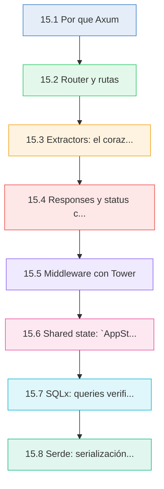
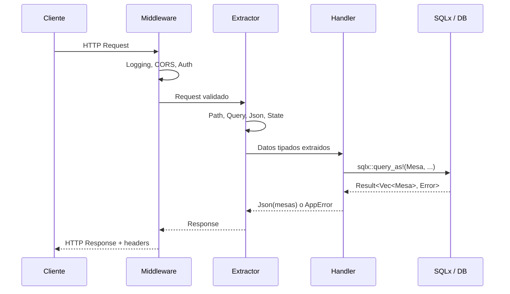
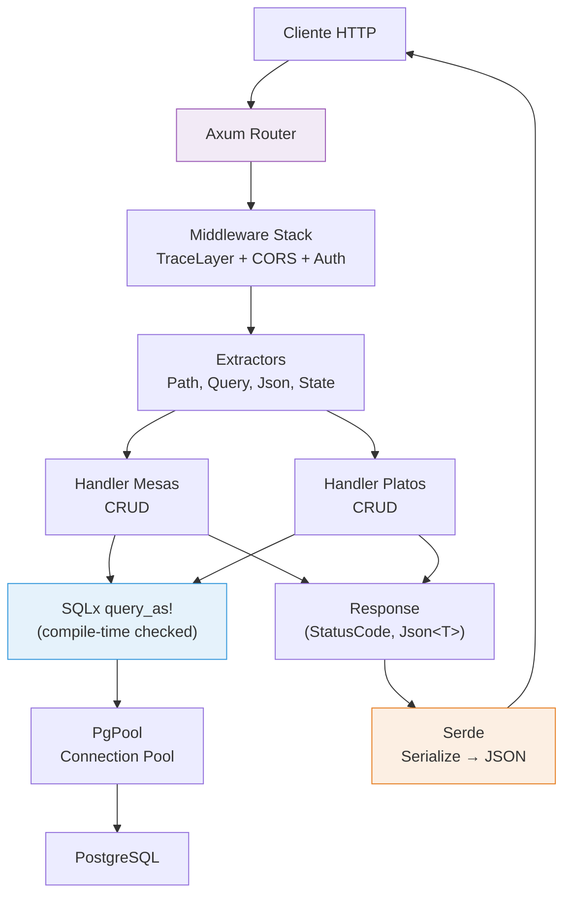

# 🌐 Cap 15 — Web con Axum

<div class="chapter-meta">
  <span class="meta-item">🕐 4-5 horas</span>
  <span class="meta-item">📊 Nivel: Avanzado</span>
  <span class="meta-item">🎯 Semana 8</span>
</div>

<div class="chapter-objective" markdown>
<span class="objective-icon">🎯</span>
**Objetivo del capítulo:** Al finalizar este capítulo seras capaz de construir una API REST completa en Rust usando Axum, con rutas type-safe, extractors que validan requests en compilación, middleware Tower para logging/CORS/auth, base de datos PostgreSQL con queries verificadas por SQLx, y serialización JSON con Serde — todo integrado en el proyecto MakeMenu.
</div>

<div class="chapter-map">



</div>


!!! quote "Contexto"
    Axum es el framework web de referencia en el ecosistema Tokio. Usa el sistema de tipos de Rust para validar requests en compilación, sin macros magicas. Este capítulo construye la API REST de **MakeMenu** paso a paso: rutas, extractors, middleware, base de datos con SQLx y serialización con Serde.

<div class="connection-box" markdown>
:link: **Conexion con Cap 14 — Async con Tokio:**
Este capítulo depende directamente de lo que aprendiste en [Cap 14: Async con Tokio](14-async-tokio.md). Axum esta construido **sobre** Tokio: cada handler es una función `async`, el servidor usa `tokio::net::TcpListener`, y el pool de conexiones de SQLx ejecuta queries como futures sobre el runtime de Tokio. Sin entender `async/await`, `.await`, y el modelo de concurrencia de Tokio, el código de este capítulo no tendria sentido. Si no te sientes seguro con futures y el runtime async, repasa el Cap 14 antes de continuar.
</div>

---

## 15.1 Por que Axum

Axum se diferencia de otros frameworks web de Rust (Actix Web, Rocket) por tres razones:

1. **Ecosystem Tower** — Usa `tower::Service` como base. Todo el middleware de Tower funciona directamente: logging, rate limiting, CORS, auth.
2. **Extractors type-safe** — Los argumentos de tus handlers son el contrato: `Path<i64>`, `Json<T>`, `State<S>`. Si el request no coincide, Axum responde 400 automaticamente.
3. **Sin macros magicas** — No necesitas `#[get("/")]` ni `#[derive(FromRequest)]`. Los handlers son funciones async normales.

```rust title="Cargo.toml"
[dependencies]
axum = "0.7"
tokio = { version = "1", features = ["full"] }
serde = { version = "1", features = ["derive"] }
serde_json = "1"
sqlx = { version = "0.7", features = ["runtime-tokio", "postgres"] }
tower-http = { version = "0.5", features = ["trace", "cors"] }
tracing = "0.1"
tracing-subscriber = "0.3"
```

```rust title="src/main.rs — servidor mínimo"
use axum::{routing::get, Router};

#[tokio::main]
async fn main() {
    // Servidor mínimo: una ruta, un handler
    let app = Router::new()
        .route("/", get(|| async { "Bienvenido a MakeMenu API" }));

    let listener = tokio::net::TcpListener::bind("0.0.0.0:3000")
        .await
        .unwrap();

    println!("Servidor corriendo en http://localhost:3000");
    axum::serve(listener, app).await.unwrap();
}
```

<div class="concept-question" markdown>
🤔 **Pregunta para reflexionar:** Si Axum no usa macros como `#[get("/")]`, entonces como sabe que función corresponde a que ruta HTTP? Piensa en como `Router::new().route("/", get(handler))` conecta la ruta con el handler usando solo funciones normales — que ventaja tiene esto frente a la magia de macros en términos de legibilidad y depuración?
</div>

<div class="comparison" markdown>
<div class="lang-box python" markdown>

#### :snake: En Django

```python
# Django requiere configuración en urls.py, views.py,
# settings.py, apps.py, etc.
# El routing usa expresiones regulares o path()
# Los tipos se verifican en runtime (o no se verifican)
# urlpatterns = [path('api/mesas/', views.MesaList.as_view())]
```

</div>
<div class="lang-box rust" markdown>

#### :crab: En Axum

```rust
// Axum: todo en un archivo si quieres.
// Routing type-safe. Handlers son funciones async.
// Extractors validan en compilación.
// Un solo binario, sin archivos de configuración.
let app = Router::new()
    .route("/api/mesas", get(list_mesas).post(create_mesa));
```

</div>
</div>

---

## 15.2 Router y rutas

```rust title="src/routes.rs"
use axum::{
    routing::{get, post, put, delete},
    Router,
};

// Crear el router con todas las rutas de la API
pub fn create_router() -> Router {
    Router::new()
        // Rutas de mesas
        .route("/api/mesas", get(list_mesas).post(create_mesa))
        .route("/api/mesas/:id",
            get(get_mesa).put(update_mesa).delete(delete_mesa)
        )
        // Rutas de platos
        .route("/api/platos", get(list_platos).post(create_plato))
        .route("/api/platos/:id",
            get(get_plato).put(update_plato).delete(delete_plato)
        )
        // Rutas de pedidos
        .route("/api/pedidos", get(list_pedidos).post(create_pedido))
        .route("/api/pedidos/:id/estado", put(update_estado_pedido))
        // Health check
        .route("/health", get(health_check))
}

async fn health_check() -> &'static str {
    "OK"
}

// Handlers placeholder — los implementaremos con extractors
async fn list_mesas() -> &'static str { "[]" }
async fn create_mesa() -> &'static str { "created" }
async fn get_mesa() -> &'static str { "{}" }
async fn update_mesa() -> &'static str { "updated" }
async fn delete_mesa() -> &'static str { "deleted" }
async fn list_platos() -> &'static str { "[]" }
async fn create_plato() -> &'static str { "created" }
async fn get_plato() -> &'static str { "{}" }
async fn update_plato() -> &'static str { "updated" }
async fn delete_plato() -> &'static str { "deleted" }
async fn list_pedidos() -> &'static str { "[]" }
async fn create_pedido() -> &'static str { "created" }
async fn update_estado_pedido() -> &'static str { "updated" }
```

### Nested routers y prefijos

```rust title="src/routes_nested.rs"
use axum::{routing::get, Router};

// Agrupar rutas por recurso
fn mesas_router() -> Router {
    Router::new()
        .route("/", get(list_mesas).post(create_mesa))
        .route("/:id", get(get_mesa).put(update_mesa).delete(delete_mesa))
}

fn platos_router() -> Router {
    Router::new()
        .route("/", get(list_platos).post(create_plato))
        .route("/:id", get(get_plato).put(update_plato))
}

pub fn api_router() -> Router {
    Router::new()
        .nest("/api/mesas", mesas_router())
        .nest("/api/platos", platos_router())
        .route("/health", get(|| async { "OK" }))
}

// Handlers placeholder
async fn list_mesas() -> &'static str { "[]" }
async fn create_mesa() -> &'static str { "created" }
async fn get_mesa() -> &'static str { "{}" }
async fn update_mesa() -> &'static str { "updated" }
async fn delete_mesa() -> &'static str { "deleted" }
async fn list_platos() -> &'static str { "[]" }
async fn create_plato() -> &'static str { "created" }
async fn get_plato() -> &'static str { "{}" }
async fn update_plato() -> &'static str { "updated" }
```

<div class="micro-exercise" markdown>
:pencil: **Micro-ejercicio — Nested router para pedidos:**
Usando el patrón de `mesas_router()` como modelo, crea una función `pedidos_router() -> Router` que agrupe las rutas: `GET /` para listar pedidos, `POST /` para crear pedido, y `PUT /:id/estado` para actualizar estado. Luego anadela al `api_router()` con `.nest("/api/pedidos", pedidos_router())`.

??? success "Solución rápida"
    ```rust
    fn pedidos_router() -> Router {
        Router::new()
            .route("/", get(list_pedidos).post(create_pedido))
            .route("/:id/estado", put(update_estado_pedido))
    }

    pub fn api_router() -> Router {
        Router::new()
            .nest("/api/mesas", mesas_router())
            .nest("/api/platos", platos_router())
            .nest("/api/pedidos", pedidos_router())
            .route("/health", get(|| async { "OK" }))
    }
    ```
</div>

---

## 15.3 Extractors: el corazon de Axum

Los extractors extraen datos del request HTTP y los convierten a tipos Rust. Si la extracción falla, Axum responde con un error automaticamente.

```rust title="src/extractors.rs"
use axum::{
    extract::{Path, Query, State, Json},
    http::StatusCode,
};
use serde::{Deserialize, Serialize};

// --- Modelos ---
#[derive(Debug, Serialize, Deserialize, Clone)]
struct Mesa {
    id: i64,
    número: i32,
    zona: String,
    capacidad: i32,
    ocupada: bool,
}

#[derive(Debug, Deserialize)]
struct CreateMesa {
    número: i32,
    zona: String,
    capacidad: i32,
}

#[derive(Debug, Deserialize)]
struct MesaQuery {
    zona: Option<String>,
    disponible: Option<bool>,
    limit: Option<i64>,
}

// --- Path<T>: extraer parámetros de ruta ---
// GET /api/mesas/42
async fn get_mesa(Path(id): Path<i64>) -> String {
    format!("Buscando mesa con id: {}", id)
}

// GET /api/mesas/42/platos/7
async fn get_plato_de_mesa(
    Path((mesa_id, plato_id)): Path<(i64, i64)>,
) -> String {
    format!("Mesa {}, plato {}", mesa_id, plato_id)
}

// --- Query<T>: extraer query params ---
// GET /api/mesas?zona=terraza&disponible=true&limit=10
async fn list_mesas(Query(params): Query<MesaQuery>) -> String {
    format!(
        "Filtro: zona={:?}, disponible={:?}, limit={:?}",
        params.zona, params.disponible, params.limit
    )
}

// --- Json<T>: extraer body JSON ---
// POST /api/mesas con body: {"número": 5, "zona": "terraza", "capacidad": 4}
async fn create_mesa(Json(payload): Json<CreateMesa>) -> (StatusCode, String) {
    // payload ya es CreateMesa validado
    // Si el JSON es inválido, Axum responde 422 automaticamente
    (
        StatusCode::CREATED,
        format!("Mesa {} creada en zona {}", payload.número, payload.zona),
    )
}

// --- State<T>: acceder al estado compartido ---
// Se configura con .with_state() en el Router
#[derive(Clone)]
struct AppState {
    db_url: String,
}

async fn list_mesas_con_state(
    State(state): State<AppState>,
) -> String {
    format!("Conectado a: {}", state.db_url)
}

// --- Combinar multiples extractors ---
// El orden importa: State y otros extractors SIN body van primero,
// Json (que consume el body) va último
async fn update_mesa(
    State(_state): State<AppState>,
    Path(id): Path<i64>,
    Json(payload): Json<CreateMesa>,
) -> (StatusCode, String) {
    (
        StatusCode::OK,
        format!("Mesa {} actualizada: número={}, zona={}", id, payload.número, payload.zona),
    )
}
```

<div class="concept-question" markdown>
🤔 **Pregunta para reflexionar:** Cuando combinas extractors como `State`, `Path` y `Json` en un mismo handler, Axum exige un orden específico. Que propiedad del protocolo HTTP hace que `Json<T>` (que lee el body) deba ir siempre al final? Piensa en que pasa con el body de un request HTTP una vez que se lee — se puede leer dos veces?
</div>

<div class="pro-tip" markdown>
🏅 **Pro tip — Extractor custom para validación:**
Puedes crear tus propios extractors implementando `FromRequest` o `FromRequestParts`. Esto es útil para validaciones reutilizables. Por ejemplo, si muchos handlers necesitan validar que un ID sea positivo, en vez de repetir `if id <= 0 { return Err(...) }` en cada handler, puedes crear un `ValidId(i64)` extractor que haga esa validación automaticamente. Los extractors custom son el patrón idiomatico de Axum para la lógica de validación reutilizable — prefierelos sobre validaciones manuales repetidas en cada handler.
</div>

<div class="comparison" markdown>
<div class="lang-box python" markdown>

#### :snake: Django views/viewsets

```python
# Django válida en RUNTIME con serializers
class MesaViewSet(viewsets.ModelViewSet):
    def create(self, request):
        serializer = MesaSerializer(data=request.data)
        serializer.is_valid(raise_exception=True)
        # Si los datos son invalidos -> 400 en runtime
```

</div>
<div class="lang-box rust" markdown>

#### :crab: Axum extractors

```rust
// Axum válida en COMPILACION con el sistema de tipos
// Si CreateMesa no implementa Deserialize -> error
// Si el JSON no coincide con CreateMesa -> 422 automático
async fn create_mesa(
    Json(payload): Json<CreateMesa>,
) -> (StatusCode, Json<Mesa>) {
    // payload ya es CreateMesa válido
    // No necesitas validar manualmente
}
```

</div>
</div>

---

## 15.4 Responses y status codes

```rust title="src/responses.rs"
use axum::{
    http::StatusCode,
    response::{IntoResponse, Response, Json},
};
use serde::Serialize;

#[derive(Serialize)]
struct Mesa {
    id: i64,
    número: i32,
    zona: String,
}

#[derive(Serialize)]
struct ApiError {
    error: String,
    code: u16,
}

// Respuesta simple: &str o String -> 200 text/plain
async fn hello() -> &'static str {
    "Hola MakeMenu"
}

// Respuesta JSON: Json<T> -> 200 application/json
async fn get_mesa() -> Json<Mesa> {
    Json(Mesa {
        id: 1,
        número: 5,
        zona: "terraza".to_string(),
    })
}

// Tuple: (StatusCode, Json<T>) para controlar el status
async fn create_mesa() -> (StatusCode, Json<Mesa>) {
    let mesa = Mesa {
        id: 42,
        número: 10,
        zona: "interior".to_string(),
    };
    (StatusCode::CREATED, Json(mesa))
}

// impl IntoResponse para respuestas custom
async fn delete_mesa() -> impl IntoResponse {
    StatusCode::NO_CONTENT // 204 sin body
}

// Respuesta de error custom
async fn get_mesa_o_error(id: i64) -> Result<Json<Mesa>, (StatusCode, Json<ApiError>)> {
    if id <= 0 {
        return Err((
            StatusCode::BAD_REQUEST,
            Json(ApiError {
                error: "ID debe ser positivo".to_string(),
                code: 400,
            }),
        ));
    }

    if id > 100 {
        return Err((
            StatusCode::NOT_FOUND,
            Json(ApiError {
                error: format!("Mesa {} no encontrada", id),
                code: 404,
            }),
        ));
    }

    Ok(Json(Mesa {
        id,
        número: id as i32,
        zona: "terraza".to_string(),
    }))
}

// Tipo de error centralizado con IntoResponse
enum AppError {
    NotFound(String),
    BadRequest(String),
    Internal(String),
}

impl IntoResponse for AppError {
    fn into_response(self) -> Response {
        let (status, message) = match self {
            AppError::NotFound(msg) => (StatusCode::NOT_FOUND, msg),
            AppError::BadRequest(msg) => (StatusCode::BAD_REQUEST, msg),
            AppError::Internal(msg) => (StatusCode::INTERNAL_SERVER_ERROR, msg),
        };

        let body = Json(ApiError {
            error: message,
            code: status.as_u16(),
        });

        (status, body).into_response()
    }
}

// Ahora los handlers pueden retornar Result<T, AppError>
async fn get_mesa_clean(
    axum::extract::Path(id): axum::extract::Path<i64>,
) -> Result<Json<Mesa>, AppError> {
    if id <= 0 {
        return Err(AppError::BadRequest("ID inválido".to_string()));
    }

    // Simular busqueda en DB
    Ok(Json(Mesa {
        id,
        número: id as i32,
        zona: "terraza".to_string(),
    }))
}
```

<div class="code-evolution" markdown>
:seedling: **Evolución del código — De respuestas simples a manejo de errores profesional:**

**Paso 1: Respuesta directa sin control de errores**
```rust
// Nivel básico: devolver un string. Sin status code, sin JSON,
// sin manejo de errores. Si algo falla, panic.
async fn get_mesa(Path(id): Path<i64>) -> String {
    format!("Mesa {}", id)  // Siempre 200 OK, siempre text/plain
}
```

**Paso 2: Tuplas con StatusCode y JSON**
```rust
// Nivel intermedio: control del status code y formato JSON.
// Pero el manejo de errores es manual y repetitivo en cada handler.
async fn get_mesa(
    Path(id): Path<i64>,
) -> Result<Json<Mesa>, (StatusCode, Json<ApiError>)> {
    if id <= 0 {
        return Err((StatusCode::BAD_REQUEST, Json(ApiError {
            error: "ID inválido".into(), code: 400,
        })));
    }
    Ok(Json(Mesa { id, número: id as i32, zona: "terraza".into() }))
}
```

**Paso 3: Error centralizado con `IntoResponse` y conversion automática**
```rust
// Nivel profesional: un enum AppError centraliza todos los errores.
// impl IntoResponse convierte errores a HTTP automaticamente.
// impl From<sqlx::Error> permite usar ? con queries de DB.
// Cada handler es limpio: Result<Json<T>, AppError>.
async fn get_mesa(
    State(state): State<AppState>,
    Path(id): Path<i64>,
) -> Result<Json<Mesa>, AppError> {
    if id <= 0 {
        return Err(AppError::BadRequest("ID inválido".into()));
    }
    let mesa = sqlx::query_as!(Mesa, "SELECT ... WHERE id = $1", id)
        .fetch_optional(&state.db).await?  // ? convierte sqlx::Error -> AppError
        .ok_or_else(|| AppError::NotFound(format!("Mesa {id} no existe")))?;
    Ok(Json(mesa))
}
```
</div>

---

## 15.5 Middleware con Tower

```rust title="src/middleware.rs"
use axum::{
    Router,
    routing::get,
    middleware::{self, Next},
    extract::Request,
    response::Response,
    http::{StatusCode, HeaderMap},
};
use tower_http::{
    trace::TraceLayer,
    cors::{CorsLayer, Any},
};
use std::time::Instant;

// --- TraceLayer: logging automático de requests ---
fn app_con_logging() -> Router {
    Router::new()
        .route("/api/mesas", get(|| async { "mesas" }))
        .layer(TraceLayer::new_for_http())
    // Logs automáticos: method, uri, status, duration
}

// --- CORS ---
fn app_con_cors() -> Router {
    let cors = CorsLayer::new()
        .allow_origin(Any)
        .allow_methods(Any)
        .allow_headers(Any);

    Router::new()
        .route("/api/mesas", get(|| async { "mesas" }))
        .layer(cors)
}

// --- Middleware custom con from_fn ---
async fn auth_middleware(
    headers: HeaderMap,
    request: Request,
    next: Next,
) -> Result<Response, StatusCode> {
    // Verificar header de autorización
    let token = headers
        .get("Authorization")
        .and_then(|v| v.to_str().ok())
        .and_then(|v| v.strip_prefix("Bearer "));

    match token {
        Some(t) if validar_token(t) => {
            // Token válido: continuar con el request
            Ok(next.run(request).await)
        }
        _ => {
            // Sin token o token inválido: 401
            Err(StatusCode::UNAUTHORIZED)
        }
    }
}

fn validar_token(token: &str) -> bool {
    // Simplificado: en producción usa JWT
    !token.is_empty()
}

// --- Middleware de timing ---
async fn timing_middleware(
    request: Request,
    next: Next,
) -> Response {
    let start = Instant::now();
    let method = request.method().clone();
    let uri = request.uri().clone();

    let response = next.run(request).await;

    let duration = start.elapsed();
    tracing::info!(
        "{} {} -> {} en {:?}",
        method, uri, response.status(), duration
    );

    response
}

// --- Aplicar middleware a rutas específicas ---
fn app_con_auth() -> Router {
    // Rutas publicas (sin auth)
    let public_routes = Router::new()
        .route("/health", get(|| async { "OK" }))
        .route("/api/login", get(|| async { "login" }));

    // Rutas protegidas (con auth)
    let protected_routes = Router::new()
        .route("/api/mesas", get(|| async { "mesas" }))
        .route("/api/platos", get(|| async { "platos" }))
        .layer(middleware::from_fn(auth_middleware));

    // Combinar
    Router::new()
        .merge(public_routes)
        .merge(protected_routes)
        .layer(middleware::from_fn(timing_middleware))
        .layer(TraceLayer::new_for_http())
}
```

<div class="misconception-box" markdown>
:warning: **Mitos comunes sobre Axum y desarrollo web en Rust:**

| Mito | Realidad |
|------|----------|
| **"Los `.layer()` se ejecutan en el orden en que los escribes"** | Falso. El orden es **inverso**: el último `.layer()` que escribes es el **primero** en ejecutarse. Si escribes `.layer(auth).layer(trace)`, la traza ocurre primero y luego la autenticación. Piensa en capas de cebolla: la última capa anadida es la más externa. |
| **"Axum es más lento que frameworks como Express o Django porque Rust es más complicado"** | Falso. Axum con Tokio es ordenes de magnitud más rápido. En benchmarks como TechEmpower, frameworks Rust consistentemente ocupan los primeros puestos. La complejidad esta en el desarrollo, no en el rendimiento. El binario resultante no tiene garbage collector ni overhead de interprete. |
| **"Necesitas un ORM como Diesel para trabajar con bases de datos en Rust"** | Falso. SQLx te permite escribir SQL puro y lo verifica en compilación contra tu base de datos real. Muchos equipos prefieren SQLx sobre un ORM porque tienes control total del SQL, la verificación en compilación atrapa errores de columnas y tipos, y no hay magia de generación de queries. Un ORM no es requisito. |
</div>

<div class="comparison" markdown>
<div class="lang-box python" markdown>

#### :snake: Django middleware

```python
# Django middleware son clases con __call__
# Se registran en settings.py (orden importa)
# MIDDLEWARE = ['django.middleware.security.SecurityMiddleware', ...]
class TimingMiddleware:
    def __call__(self, request):
        start = time.time()
        response = self.get_response(request)
        print(f"{time.time() - start:.3f}s")
        return response
```

</div>
<div class="lang-box rust" markdown>

#### :crab: Tower middleware

```rust
// Tower middleware: funciones async o layers
// Se aplican con .layer() — composables
// Orden: el último .layer() se ejecuta primero
Router::new()
    .route("/api/mesas", get(handler))
    .layer(middleware::from_fn(auth_middleware))
    .layer(TraceLayer::new_for_http())
    .layer(CorsLayer::new().allow_origin(Any))
```

</div>
</div>

---

## 15.6 Shared state: `AppState` con `Arc`

```rust title="src/state.rs"
use axum::{
    extract::State,
    routing::get,
    Json, Router,
};
use sqlx::PgPool;
use std::sync::Arc;

// Estado compartido de la aplicación
#[derive(Clone)]
struct AppState {
    db: PgPool,
    config: AppConfig,
}

#[derive(Clone)]
struct AppConfig {
    nombre_restaurante: String,
    max_mesas: i32,
}

// Los handlers acceden al state via extractor
async fn info(State(state): State<AppState>) -> String {
    format!(
        "Restaurante: {} (max {} mesas)",
        state.config.nombre_restaurante,
        state.config.max_mesas
    )
}

// Estado mutable compartido: usa Arc<Mutex<T>> o Arc<RwLock<T>>
// Para estado de solo lectura (como config o pool), Clone basta
async fn crear_app(db_url: &str) -> Router {
    // Crear pool de conexiones
    let pool = PgPool::connect(db_url)
        .await
        .expect("No se pudo conectar a la base de datos");

    let state = AppState {
        db: pool,
        config: AppConfig {
            nombre_restaurante: "MakeMenu".to_string(),
            max_mesas: 50,
        },
    };

    Router::new()
        .route("/info", get(info))
        .with_state(state)
}

// Alternativa: Arc para estado con interior mutability
use tokio::sync::RwLock;

#[derive(Clone)]
struct AppStateConCache {
    db: PgPool,
    cache: Arc<RwLock<std::collections::HashMap<String, String>>>,
}

async fn get_con_cache(
    State(state): State<AppStateConCache>,
) -> String {
    // Leer del cache (multiple readers simultaneos)
    let cache = state.cache.read().await;
    if let Some(valor) = cache.get("mesas_total") {
        return valor.clone();
    }
    drop(cache); // Liberar el read lock

    // Cache miss: consultar DB y guardar en cache
    let total = "42".to_string(); // Simular query
    let mut cache = state.cache.write().await;
    cache.insert("mesas_total".to_string(), total.clone());
    total
}
```

<div class="concept-question" markdown>
🤔 **Pregunta para reflexionar:** En el ejemplo de `AppStateConCache`, se usa `drop(cache)` explicitamente para liberar el read lock antes de adquirir el write lock. Que pasaria si no llamaras `drop(cache)` y directamente intentaras `state.cache.write().await`? Piensa en términos de deadlock: el mismo task tendria un read lock y estaria esperando un write lock sobre el mismo `RwLock`.
</div>

---

## 15.7 SQLx: queries verificadas en compilación

SQLx es un toolkit async de base de datos que verifica tus queries SQL **en tiempo de compilación** contra la base de datos real.

```rust title="src/db/models.rs"
use serde::{Deserialize, Serialize};
use sqlx::FromRow;

#[derive(Debug, Serialize, Deserialize, FromRow, Clone)]
pub struct Mesa {
    pub id: i64,
    pub número: i32,
    pub zona: String,
    pub capacidad: i32,
    pub ocupada: bool,
}

#[derive(Debug, Deserialize)]
pub struct CreateMesa {
    pub número: i32,
    pub zona: String,
    pub capacidad: i32,
}

#[derive(Debug, Serialize, Deserialize, FromRow, Clone)]
pub struct Plato {
    pub id: i64,
    pub nombre: String,
    pub descripción: Option<String>,
    pub precio: f64,
    pub disponible: bool,
    pub categoria: String,
}
```

```rust title="src/db/queries.rs"
use sqlx::PgPool;
use super::models::{Mesa, CreateMesa, Plato};

// --- sqlx::query! — verificado en compilación ---
// El compilador verifica contra la DB real que:
// 1. La tabla existe
// 2. Las columnas existen
// 3. Los tipos coinciden
pub async fn listar_mesas(pool: &PgPool) -> Result<Vec<Mesa>, sqlx::Error> {
    let mesas = sqlx::query_as!(
        Mesa,
        r#"SELECT id, número, zona, capacidad, ocupada FROM mesas ORDER BY número"#
    )
    .fetch_all(pool)
    .await?;

    Ok(mesas)
}

pub async fn obtener_mesa(pool: &PgPool, id: i64) -> Result<Option<Mesa>, sqlx::Error> {
    let mesa = sqlx::query_as!(
        Mesa,
        r#"SELECT id, número, zona, capacidad, ocupada FROM mesas WHERE id = $1"#,
        id
    )
    .fetch_optional(pool)
    .await?;

    Ok(mesa)
}

pub async fn crear_mesa(pool: &PgPool, datos: &CreateMesa) -> Result<Mesa, sqlx::Error> {
    let mesa = sqlx::query_as!(
        Mesa,
        r#"
        INSERT INTO mesas (número, zona, capacidad, ocupada)
        VALUES ($1, $2, $3, false)
        RETURNING id, número, zona, capacidad, ocupada
        "#,
        datos.número,
        datos.zona,
        datos.capacidad
    )
    .fetch_one(pool)
    .await?;

    Ok(mesa)
}

pub async fn actualizar_mesa(
    pool: &PgPool,
    id: i64,
    datos: &CreateMesa,
) -> Result<Option<Mesa>, sqlx::Error> {
    let mesa = sqlx::query_as!(
        Mesa,
        r#"
        UPDATE mesas
        SET número = $2, zona = $3, capacidad = $4
        WHERE id = $1
        RETURNING id, número, zona, capacidad, ocupada
        "#,
        id,
        datos.número,
        datos.zona,
        datos.capacidad
    )
    .fetch_optional(pool)
    .await?;

    Ok(mesa)
}

pub async fn eliminar_mesa(pool: &PgPool, id: i64) -> Result<bool, sqlx::Error> {
    let result = sqlx::query!(
        r#"DELETE FROM mesas WHERE id = $1"#,
        id
    )
    .execute(pool)
    .await?;

    Ok(result.rows_affected() > 0)
}

// --- Queries con filtros dinámicos ---
pub async fn buscar_mesas(
    pool: &PgPool,
    zona: Option<&str>,
    disponible: Option<bool>,
) -> Result<Vec<Mesa>, sqlx::Error> {
    // Para queries dinámicas, usa query_as en vez de query_as!
    let mut query = String::from(
        "SELECT id, número, zona, capacidad, ocupada FROM mesas WHERE 1=1"
    );
    let mut args: Vec<String> = vec![];

    if let Some(z) = zona {
        args.push(z.to_string());
        query.push_str(&format!(" AND zona = ${}", args.len()));
    }

    if let Some(d) = disponible {
        query.push_str(&format!(" AND ocupada = {}", !d));
    }

    query.push_str(" ORDER BY número");

    // Para queries dinámicas complejas, sqlx::query_as (sin !)
    // no verifica en compilación pero es más flexible
    sqlx::query_as::<_, Mesa>(&query)
        .fetch_all(pool)
        .await
}
```

<div class="pro-tip" markdown>
🏅 **Pro tip — `sqlx::query_as!` vs `sqlx::query_as` (con y sin `!`):**
Usa la version con macro (`query_as!`) siempre que puedas: verifica tu SQL en compilación contra la base de datos real. Sin embargo, para queries dinámicas donde los filtros cambian segun los parámetros del usuario (como `buscar_mesas` arriba), necesitas la version sin macro (`query_as::<_, T>`), que es más flexible pero no verifica en compilación. Un patrón intermedio es usar `sqlx::query_file_as!` que lee el SQL de un archivo `.sql`, permitiendo verificación en compilación con queries más complejas y legibles. Reserva la version dinámica solo para filtros que realmente varian en runtime.
</div>

### Migraciones con SQLx

```sql title="migrations/001_create_tables.sql"
-- Las migraciones se ejecutan con: sqlx migrate run
CREATE TABLE IF NOT EXISTS mesas (
    id BIGSERIAL PRIMARY KEY,
    número INTEGER NOT NULL UNIQUE,
    zona VARCHAR(50) NOT NULL,
    capacidad INTEGER NOT NULL CHECK (capacidad > 0),
    ocupada BOOLEAN NOT NULL DEFAULT false
);

CREATE TABLE IF NOT EXISTS platos (
    id BIGSERIAL PRIMARY KEY,
    nombre VARCHAR(100) NOT NULL,
    descripción TEXT,
    precio DOUBLE PRECISION NOT NULL CHECK (precio >= 0),
    disponible BOOLEAN NOT NULL DEFAULT true,
    categoria VARCHAR(50) NOT NULL
);
```



<div class="comparison" markdown>
<div class="lang-box python" markdown>

#### :snake: Django ORM

```python
# Django ORM genera SQL automaticamente
# No verifica queries en compilación
# Errores de campo aparecen en RUNTIME
mesas = Mesa.objects.filter(
    zona="terraza",
    ocupada=False
).order_by("número")
# Mesa.objects.filter(zonna="terraza")  # Typo -> runtime error
```

</div>
<div class="lang-box rust" markdown>

#### :crab: SQLx

```rust
// sqlx::query_as! verifica contra la DB real
// en COMPILACION. Un typo -> error de compilación.
let mesas = sqlx::query_as!(Mesa,
    "SELECT id, número, zona FROM mesas
     WHERE zona = $1 AND ocupada = false",
    "terraza"
).fetch_all(&pool).await?;
// "zonna" -> error de compilación!
```

</div>
</div>

---

## 15.8 Serde: serialización y deserialización

Serde es el framework de serialización de Rust. Convierte entre structs Rust y formatos como JSON, YAML, TOML, etc.

```rust title="src/serde_ejemplos.rs"
use serde::{Deserialize, Serialize};

// --- Derive básico ---
#[derive(Debug, Serialize, Deserialize)]
struct Mesa {
    id: i64,
    número: i32,
    zona: String,
    capacidad: i32,
    ocupada: bool,
}
// Serializa a: {"id":1,"número":5,"zona":"terraza","capacidad":4,"ocupada":false}

// --- rename_all: convertir a camelCase para el frontend ---
#[derive(Debug, Serialize, Deserialize)]
#[serde(rename_all = "camelCase")]
struct Plato {
    id: i64,
    nombre_plato: String,      // -> "nombrePlato" en JSON
    precio_base: f64,           // -> "precioBase" en JSON
    esta_disponible: bool,      // -> "estaDisponible" en JSON
}

// --- Campos opcionales y valores por defecto ---
#[derive(Debug, Serialize, Deserialize)]
#[serde(rename_all = "camelCase")]
struct CreatePedido {
    mesa_id: i64,
    platos: Vec<i64>,
    #[serde(default)]           // Si no viene en JSON -> String::default() ("")
    notas: String,
    #[serde(skip_serializing_if = "Option::is_none")]
    descuento: Option<f64>,     // No aparece en JSON si es None
}

// --- Renombrar campos individuales ---
#[derive(Debug, Serialize, Deserialize)]
struct Reserva {
    id: i64,
    #[serde(rename = "tableNumber")]
    numero_mesa: i32,
    #[serde(rename = "guestCount")]
    num_personas: i32,
    #[serde(rename = "dateTime")]
    fecha_hora: String,
}

// --- Enums con Serde ---
#[derive(Debug, Serialize, Deserialize)]
#[serde(rename_all = "snake_case")]
enum EstadoPedido {
    Pendiente,          // -> "pendiente"
    EnPreparación,      // -> "en_preparación"
    Listo,              // -> "listo"
    Entregado,          // -> "entregado"
    Cancelado,          // -> "cancelado"
}

#[derive(Debug, Serialize, Deserialize)]
#[serde(tag = "type", content = "data")]
enum Evento {
    NuevoPedido { mesa_id: i64, platos: Vec<String> },
    MesaLiberada { mesa_id: i64 },
    ReservaCreada { id: i64, fecha: String },
}
// Serializa a: {"type":"NuevoPedido","data":{"mesa_id":1,"platos":["Paella"]}}

// --- Serialización custom ---
use serde::Serializer;

#[derive(Debug, Deserialize)]
struct Precio {
    #[serde(serialize_with = "serializar_precio")]
    cantidad: f64,
    moneda: String,
}

// Implementar Serialize manualmente solo para este campo
impl Serialize for Precio {
    fn serialize<S: Serializer>(&self, serializer: S) -> Result<S::Ok, S::Error> {
        use serde::ser::SerializeStruct;
        let mut state = serializer.serialize_struct("Precio", 2)?;
        // Redondear a 2 decimales
        state.serialize_field("cantidad", &format!("{:.2}", self.cantidad))?;
        state.serialize_field("moneda", &self.moneda)?;
        state.end()
    }
}

fn serializar_precio<S: Serializer>(precio: &f64, serializer: S) -> Result<S::Ok, S::Error> {
    serializer.serialize_str(&format!("{:.2}", precio))
}

fn main() {
    // Serializar a JSON
    let mesa = Mesa {
        id: 1,
        número: 5,
        zona: "terraza".to_string(),
        capacidad: 4,
        ocupada: false,
    };
    let json = serde_json::to_string(&mesa).unwrap();
    println!("{}", json);

    // Deserializar desde JSON
    let json_str = r#"{"id":1,"nombrePlato":"Paella","precioBase":15.50,"estaDisponible":true}"#;
    let plato: Plato = serde_json::from_str(json_str).unwrap();
    println!("{:?}", plato);
}
```

<div class="micro-exercise" markdown>
:pencil: **Micro-ejercicio — Enum con representación Serde personalizada:**
Crea un enum `MetodoPago` con variantes `Efectivo`, `Tarjeta { ultimos_4: String }`, y `Transferencia { referencia: String }`. Usa `#[serde(tag = "método", content = "detalle")]` para que se serialice como `{"método": "Tarjeta", "detalle": {"ultimos_4": "1234"}}`. Prueba que `Efectivo` se serializa como `{"método": "Efectivo"}` (sin campo `detalle`).

??? success "Solución rápida"
    ```rust
    use serde::{Serialize, Deserialize};

    #[derive(Debug, Serialize, Deserialize)]
    #[serde(tag = "método", content = "detalle")]
    enum MetodoPago {
        Efectivo,
        Tarjeta { ultimos_4: String },
        Transferencia { referencia: String },
    }

    fn main() {
        let pago1 = MetodoPago::Efectivo;
        let pago2 = MetodoPago::Tarjeta { ultimos_4: "1234".into() };
        let pago3 = MetodoPago::Transferencia { referencia: "TRF-001".into() };

        println!("{}", serde_json::to_string(&pago1).unwrap());
        // {"método":"Efectivo"}
        println!("{}", serde_json::to_string(&pago2).unwrap());
        // {"método":"Tarjeta","detalle":{"ultimos_4":"1234"}}
        println!("{}", serde_json::to_string(&pago3).unwrap());
        // {"método":"Transferencia","detalle":{"referencia":"TRF-001"}}
    }
    ```
</div>

<div class="comparison" markdown>
<div class="lang-box python" markdown>

#### :snake: Django serializers

```python
# Django REST Framework: serializers en runtime
class MesaSerializer(serializers.ModelSerializer):
    class Meta:
        model = Mesa
        fields = ['id', 'número', 'zona']
# La validación ocurre en runtime
# No hay verificación de tipos en compilación
```

</div>
<div class="lang-box rust" markdown>

#### :crab: Serde

```rust
// Serde: derive en compilación, zero-cost
#[derive(Serialize, Deserialize)]
#[serde(rename_all = "camelCase")]
struct Mesa {
    id: i64,
    numero_mesa: i32, // -> "numeroMesa" en JSON
    zona: String,
}
// Tipos verificados en compilación
// Serialización ~10x más rápida que Python
```

</div>
</div>

---

## :plate_with_cutlery: MakeMenu: API skeleton con CRUD

```rust title="src/main.rs — API completa"
use axum::{
    extract::{Path, Query, State, Json},
    http::StatusCode,
    response::IntoResponse,
    routing::{get, put, delete},
    Router,
};
use serde::{Deserialize, Serialize};
use sqlx::PgPool;
use tower_http::trace::TraceLayer;

// --- Modelos ---
#[derive(Debug, Serialize, Deserialize, sqlx::FromRow, Clone)]
#[serde(rename_all = "camelCase")]
struct Mesa {
    id: i64,
    número: i32,
    zona: String,
    capacidad: i32,
    ocupada: bool,
}

#[derive(Debug, Deserialize)]
#[serde(rename_all = "camelCase")]
struct CreateMesa {
    número: i32,
    zona: String,
    capacidad: i32,
}

#[derive(Debug, Serialize, Deserialize, sqlx::FromRow, Clone)]
#[serde(rename_all = "camelCase")]
struct Plato {
    id: i64,
    nombre: String,
    precio: f64,
    disponible: bool,
    categoria: String,
}

#[derive(Debug, Deserialize)]
#[serde(rename_all = "camelCase")]
struct CreatePlato {
    nombre: String,
    precio: f64,
    categoria: String,
}

// --- Error centralizado ---
#[derive(Debug, Serialize)]
struct ApiError {
    error: String,
    code: u16,
}

enum AppError {
    NotFound(String),
    BadRequest(String),
    Internal(String),
}

impl IntoResponse for AppError {
    fn into_response(self) -> axum::response::Response {
        let (status, message) = match self {
            AppError::NotFound(msg) => (StatusCode::NOT_FOUND, msg),
            AppError::BadRequest(msg) => (StatusCode::BAD_REQUEST, msg),
            AppError::Internal(msg) => (StatusCode::INTERNAL_SERVER_ERROR, msg),
        };
        (status, Json(ApiError { error: message, code: status.as_u16() })).into_response()
    }
}

impl From<sqlx::Error> for AppError {
    fn from(e: sqlx::Error) -> Self {
        AppError::Internal(e.to_string())
    }
}

// --- State ---
#[derive(Clone)]
struct AppState {
    db: PgPool,
}

// --- Handlers Mesas ---
async fn list_mesas(State(state): State<AppState>) -> Result<Json<Vec<Mesa>>, AppError> {
    let mesas = sqlx::query_as!(Mesa, "SELECT id, número, zona, capacidad, ocupada FROM mesas ORDER BY número")
        .fetch_all(&state.db)
        .await?;
    Ok(Json(mesas))
}

async fn get_mesa(
    State(state): State<AppState>,
    Path(id): Path<i64>,
) -> Result<Json<Mesa>, AppError> {
    let mesa = sqlx::query_as!(Mesa, "SELECT id, número, zona, capacidad, ocupada FROM mesas WHERE id = $1", id)
        .fetch_optional(&state.db)
        .await?
        .ok_or_else(|| AppError::NotFound(format!("Mesa {} no encontrada", id)))?;
    Ok(Json(mesa))
}

async fn create_mesa(
    State(state): State<AppState>,
    Json(payload): Json<CreateMesa>,
) -> Result<(StatusCode, Json<Mesa>), AppError> {
    if payload.capacidad <= 0 {
        return Err(AppError::BadRequest("Capacidad debe ser positiva".into()));
    }
    let mesa = sqlx::query_as!(Mesa,
        "INSERT INTO mesas (número, zona, capacidad, ocupada) VALUES ($1, $2, $3, false) RETURNING id, número, zona, capacidad, ocupada",
        payload.número, payload.zona, payload.capacidad
    )
    .fetch_one(&state.db)
    .await?;
    Ok((StatusCode::CREATED, Json(mesa)))
}

async fn update_mesa(
    State(state): State<AppState>,
    Path(id): Path<i64>,
    Json(payload): Json<CreateMesa>,
) -> Result<Json<Mesa>, AppError> {
    let mesa = sqlx::query_as!(Mesa,
        "UPDATE mesas SET número=$2, zona=$3, capacidad=$4 WHERE id=$1 RETURNING id, número, zona, capacidad, ocupada",
        id, payload.número, payload.zona, payload.capacidad
    )
    .fetch_optional(&state.db)
    .await?
    .ok_or_else(|| AppError::NotFound(format!("Mesa {} no encontrada", id)))?;
    Ok(Json(mesa))
}

async fn delete_mesa(
    State(state): State<AppState>,
    Path(id): Path<i64>,
) -> Result<StatusCode, AppError> {
    let result = sqlx::query!("DELETE FROM mesas WHERE id = $1", id)
        .execute(&state.db)
        .await?;
    if result.rows_affected() == 0 {
        return Err(AppError::NotFound(format!("Mesa {} no encontrada", id)));
    }
    Ok(StatusCode::NO_CONTENT)
}

// --- Handlers Platos ---
async fn list_platos(State(state): State<AppState>) -> Result<Json<Vec<Plato>>, AppError> {
    let platos = sqlx::query_as!(Plato,
        "SELECT id, nombre, precio, disponible, categoria FROM platos ORDER BY categoria, nombre"
    )
    .fetch_all(&state.db)
    .await?;
    Ok(Json(platos))
}

async fn create_plato(
    State(state): State<AppState>,
    Json(payload): Json<CreatePlato>,
) -> Result<(StatusCode, Json<Plato>), AppError> {
    if payload.precio < 0.0 {
        return Err(AppError::BadRequest("Precio no puede ser negativo".into()));
    }
    let plato = sqlx::query_as!(Plato,
        "INSERT INTO platos (nombre, precio, disponible, categoria) VALUES ($1, $2, true, $3) RETURNING id, nombre, precio, disponible, categoria",
        payload.nombre, payload.precio, payload.categoria
    )
    .fetch_one(&state.db)
    .await?;
    Ok((StatusCode::CREATED, Json(plato)))
}

// --- Router ---
fn create_router(state: AppState) -> Router {
    Router::new()
        .route("/api/mesas", get(list_mesas).post(create_mesa))
        .route("/api/mesas/:id", get(get_mesa).put(update_mesa).delete(delete_mesa))
        .route("/api/platos", get(list_platos).post(create_plato))
        .route("/health", get(|| async { "OK" }))
        .layer(TraceLayer::new_for_http())
        .with_state(state)
}

#[tokio::main]
async fn main() {
    tracing_subscriber::init();

    let database_url = std::env::var("DATABASE_URL")
        .unwrap_or_else(|_| "postgres://localhost/makemenu".to_string());

    let pool = PgPool::connect(&database_url)
        .await
        .expect("No se pudo conectar a la base de datos");

    sqlx::migrate!().run(&pool).await.expect("Error en migraciones");

    let state = AppState { db: pool };
    let app = create_router(state);

    let listener = tokio::net::TcpListener::bind("0.0.0.0:3000")
        .await
        .unwrap();

    println!("MakeMenu API corriendo en http://localhost:3000");
    axum::serve(listener, app).await.unwrap();
}
```



<div class="connection-box" markdown>
:link: **Conexion con Cap 16 — Proyecto final:**
Todo lo que construiste en este capítulo — el router, los extractors, el AppState con PgPool, los handlers CRUD, el middleware Tower, y la serialización Serde — es exactamente la base que usaras en el [Cap 16: Proyecto final](16-proyecto-final.md). En el proyecto final extenderas esta API de MakeMenu anadiendo WebSockets para notificaciones en tiempo real, autenticación JWT completa, tests de integración con `axum::test`, y despliegue con Docker. Dominar este capítulo es el requisito directo para que el proyecto final sea un exito.
</div>

---

<div class="ejercicio-guiado">
<h4>🏋️ Ejercicio guiado</h4>

Vas a construir una API REST minima para RustMenu con Axum. La API tendra dos endpoints: `GET /menu` para listar los platos disponibles y `POST /pedido` para crear un nuevo pedido. Usaras estado compartido en memoria con `Arc<Mutex<T>>`, extractors de Axum (`State`, `Json`) y serialization con Serde.

1. Define las structs `Plato` (con `id`, `nombre`, `precio`, `disponible`) y `NuevoPedido` (con `mesa` y `platos: Vec<String>`). Deriva `Serialize`/`Deserialize` segun corresponda.
2. Define una struct `AppState` con campos `menu: Vec<Plato>` y `pedidos: Mutex<Vec<PedidoRegistrado>>`, donde `PedidoRegistrado` incluye `id`, `mesa`, `platos`, `total` y `estado`.
3. Implementa el handler `async fn listar_menu(State(state): State<Arc<AppState>>) -> Json<Vec<Plato>>` que devuelva los platos disponibles filtrados por `disponible == true`.
4. Implementa el handler `async fn crear_pedido(State(state): State<Arc<AppState>>, Json(nuevo): Json<NuevoPedido>) -> (StatusCode, Json<PedidoRegistrado>)` que calcule el total buscando los precios en el menu, registre el pedido y devuelva 201.
5. Construye el `Router` con ambas rutas, inyecta el `AppState` con `.with_state(Arc::new(state))` y arranca el servidor con `tokio::net::TcpListener` en el puerto 3000.
6. Anade un handler `GET /pedidos` que liste todos los pedidos registrados. Prueba la API mentalmente o con `curl`.

??? success "Solución completa"
    ```rust
    use axum::{
        extract::{Json, State},
        http::StatusCode,
        routing::{get, post},
        Router,
    };
    use serde::{Deserialize, Serialize};
    use std::sync::{Arc, Mutex};

    #[derive(Debug, Clone, Serialize)]
    struct Plato {
        id: u64,
        nombre: String,
        precio: f64,
        disponible: bool,
    }

    #[derive(Debug, Deserialize)]
    struct NuevoPedido {
        mesa: u32,
        platos: Vec<String>,
    }

    #[derive(Debug, Clone, Serialize)]
    struct PedidoRegistrado {
        id: u64,
        mesa: u32,
        platos: Vec<String>,
        total: f64,
        estado: String,
    }

    struct AppState {
        menu: Vec<Plato>,
        pedidos: Mutex<Vec<PedidoRegistrado>>,
        next_id: Mutex<u64>,
    }

    async fn listar_menu(
        State(state): State<Arc<AppState>>,
    ) -> Json<Vec<Plato>> {
        let disponibles: Vec<Plato> = state
            .menu
            .iter()
            .filter(|p| p.disponible)
            .cloned()
            .collect();
        Json(disponibles)
    }

    async fn crear_pedido(
        State(state): State<Arc<AppState>>,
        Json(nuevo): Json<NuevoPedido>,
    ) -> (StatusCode, Json<PedidoRegistrado>) {
        // Calcular el total buscando precios en el menu
        let total: f64 = nuevo
            .platos
            .iter()
            .filter_map(|nombre| {
                state
                    .menu
                    .iter()
                    .find(|p| p.nombre.to_lowercase() == nombre.to_lowercase())
                    .map(|p| p.precio)
            })
            .sum();

        // Generar ID
        let id = {
            let mut counter = state.next_id.lock().unwrap();
            let id = *counter;
            *counter += 1;
            id
        };

        let pedido = PedidoRegistrado {
            id,
            mesa: nuevo.mesa,
            platos: nuevo.platos,
            total,
            estado: "pendiente".to_string(),
        };

        // Registrar el pedido
        state.pedidos.lock().unwrap().push(pedido.clone());

        (StatusCode::CREATED, Json(pedido))
    }

    async fn listar_pedidos(
        State(state): State<Arc<AppState>>,
    ) -> Json<Vec<PedidoRegistrado>> {
        let pedidos = state.pedidos.lock().unwrap().clone();
        Json(pedidos)
    }

    #[tokio::main]
    async fn main() {
        let state = Arc::new(AppState {
            menu: vec![
                Plato { id: 1, nombre: "Paella Valenciana".into(), precio: 14.50, disponible: true },
                Plato { id: 2, nombre: "Gazpacho Andaluz".into(), precio: 8.00, disponible: true },
                Plato { id: 3, nombre: "Croquetas de Jamon".into(), precio: 9.50, disponible: true },
                Plato { id: 4, nombre: "Tortilla Espanola".into(), precio: 7.00, disponible: false },
                Plato { id: 5, nombre: "Flan de Huevo".into(), precio: 5.50, disponible: true },
            ],
            pedidos: Mutex::new(Vec::new()),
            next_id: Mutex::new(1),
        });

        let app = Router::new()
            .route("/menu", get(listar_menu))
            .route("/pedido", post(crear_pedido))
            .route("/pedidos", get(listar_pedidos))
            .with_state(state);

        let listener = tokio::net::TcpListener::bind("0.0.0.0:3000")
            .await
            .unwrap();

        println!("RustMenu API corriendo en http://localhost:3000");
        println!("  GET  /menu    - Listar platos disponibles");
        println!("  POST /pedido  - Crear pedido");
        println!("  GET  /pedidos - Listar pedidos");
        axum::serve(listener, app).await.unwrap();
    }

    // Ejemplo de uso con curl:
    // curl http://localhost:3000/menu
    // curl -X POST http://localhost:3000/pedido \
    //   -H "Content-Type: application/json" \
    //   -d '{"mesa": 5, "platos": ["Paella Valenciana", "Flan de Huevo"]}'
    // curl http://localhost:3000/pedidos
    ```

</div>

## :link: Recursos

| Recurso | Enlace |
|---------|--------|
| Axum docs | [docs.rs/axum](https://docs.rs/axum/latest/axum/) |
| Axum examples | [github.com/tokio-rs/axum/tree/main/examples](https://github.com/tokio-rs/axum/tree/main/examples) |
| SQLx docs | [docs.rs/sqlx](https://docs.rs/sqlx/latest/sqlx/) |
| Serde docs | [serde.rs](https://serde.rs/) |
| Tower middleware | [docs.rs/tower-http](https://docs.rs/tower-http/latest/tower_http/) |
| Axum tutorial (zero2prod) | [zero2prod.com](https://www.zero2prod.com/) |

---

## 🎯 Ejercicios

??? question "Ejercicio 1: Router con nested routes"
    Crea un router con `nest` que organice las rutas de MakeMenu: `/api/mesas` (CRUD), `/api/platos` (CRUD), `/api/pedidos` (list, create). Cada grupo en su propio `Router`. Anade un middleware de logging con `TraceLayer`.

    ??? success "Solución"
        ```rust
        use axum::{routing::{get, post, put, delete}, Router};
        use tower_http::trace::TraceLayer;

        fn mesas_router() -> Router {
            Router::new()
                .route("/", get(list_mesas).post(create_mesa))
                .route("/:id", get(get_mesa).put(update_mesa).delete(delete_mesa))
        }

        fn platos_router() -> Router {
            Router::new()
                .route("/", get(list_platos).post(create_plato))
                .route("/:id", get(get_plato).put(update_plato))
        }

        fn pedidos_router() -> Router {
            Router::new()
                .route("/", get(list_pedidos).post(create_pedido))
        }

        fn app() -> Router {
            Router::new()
                .nest("/api/mesas", mesas_router())
                .nest("/api/platos", platos_router())
                .nest("/api/pedidos", pedidos_router())
                .route("/health", get(|| async { "OK" }))
                .layer(TraceLayer::new_for_http())
        }

        // Handlers placeholder
        async fn list_mesas() -> &'static str { "[]" }
        async fn create_mesa() -> &'static str { "created" }
        async fn get_mesa() -> &'static str { "{}" }
        async fn update_mesa() -> &'static str { "updated" }
        async fn delete_mesa() -> &'static str { "deleted" }
        async fn list_platos() -> &'static str { "[]" }
        async fn create_plato() -> &'static str { "created" }
        async fn get_plato() -> &'static str { "{}" }
        async fn update_plato() -> &'static str { "updated" }
        async fn list_pedidos() -> &'static str { "[]" }
        async fn create_pedido() -> &'static str { "created" }
        ```

??? question "Ejercicio 2: Extractors combinados"
    Crea un handler `buscar_platos` que acepte `State<AppState>`, `Query<BuscarPlatosQuery>` (con campos `categoria`, `precio_max`, `disponible`) y retorne `Json<Vec<Plato>>`. Implementa la lógica de filtrado en memoria (sin DB).

    !!! tip "Pista"
        Usa `Option<T>` para cada campo del query para que sean opcionales. Filtra con `iter().filter()`.

    ??? success "Solución"
        ```rust
        use axum::{extract::{Query, State}, Json};
        use serde::{Deserialize, Serialize};

        #[derive(Clone)]
        struct AppState {
            platos: Vec<Plato>,
        }

        #[derive(Debug, Serialize, Clone)]
        struct Plato {
            id: i64,
            nombre: String,
            precio: f64,
            disponible: bool,
            categoria: String,
        }

        #[derive(Debug, Deserialize)]
        struct BuscarPlatosQuery {
            categoria: Option<String>,
            precio_max: Option<f64>,
            disponible: Option<bool>,
        }

        async fn buscar_platos(
            State(state): State<AppState>,
            Query(params): Query<BuscarPlatosQuery>,
        ) -> Json<Vec<Plato>> {
            let resultado: Vec<Plato> = state.platos.iter()
                .filter(|p| {
                    if let Some(ref cat) = params.categoria {
                        if &p.categoria != cat { return false; }
                    }
                    if let Some(max) = params.precio_max {
                        if p.precio > max { return false; }
                    }
                    if let Some(disp) = params.disponible {
                        if p.disponible != disp { return false; }
                    }
                    true
                })
                .cloned()
                .collect();

            Json(resultado)
        }
        // GET /api/platos?categoria=entrante&precio_max=12.0&disponible=true
        ```

??? question "Ejercicio 3: Error tipo centralizado con IntoResponse"
    Crea un enum `AppError` con variantes `NotFound`, `BadRequest`, `Unauthorized` e `Internal`. Implementa `IntoResponse` para cada variante con su StatusCode y cuerpo JSON. Usa este tipo en un handler que busca una mesa por ID.

    ??? success "Solución"
        ```rust
        use axum::{
            extract::Path,
            http::StatusCode,
            response::{IntoResponse, Response, Json},
        };
        use serde::Serialize;

        #[derive(Serialize)]
        struct ErrorBody {
            error: String,
            code: u16,
        }

        enum AppError {
            NotFound(String),
            BadRequest(String),
            Unauthorized(String),
            Internal(String),
        }

        impl IntoResponse for AppError {
            fn into_response(self) -> Response {
                let (status, message) = match self {
                    AppError::NotFound(m) => (StatusCode::NOT_FOUND, m),
                    AppError::BadRequest(m) => (StatusCode::BAD_REQUEST, m),
                    AppError::Unauthorized(m) => (StatusCode::UNAUTHORIZED, m),
                    AppError::Internal(m) => (StatusCode::INTERNAL_SERVER_ERROR, m),
                };
                let body = ErrorBody { error: message, code: status.as_u16() };
                (status, Json(body)).into_response()
            }
        }

        // Handler que usa AppError
        async fn get_mesa(Path(id): Path<i64>) -> Result<Json<String>, AppError> {
            if id <= 0 {
                return Err(AppError::BadRequest("ID debe ser positivo".into()));
            }
            if id > 50 {
                return Err(AppError::NotFound(format!("Mesa {} no existe", id)));
            }
            Ok(Json(format!("Mesa {}", id)))
        }
        ```

??? question "Ejercicio 4: Middleware de autenticación"
    Crea un middleware `require_auth` con `middleware::from_fn` que verifique el header `Authorization: Bearer <token>`. Si el token es válido, anade el `user_id` al request extensions. Si no, retorna 401. Aplica el middleware solo a las rutas `/api/`.

    !!! tip "Pista"
        Usa `request.extensions_mut().insert(user_id)` para pasar datos al handler. En el handler, usa `Extension<UserId>` para recibirlos.

    ??? success "Solución"
        ```rust
        use axum::{
            Router,
            routing::get,
            middleware::{self, Next},
            extract::{Request, Extension},
            http::{StatusCode, HeaderMap},
            response::Response,
        };

        #[derive(Clone, Debug)]
        struct UserId(i64);

        async fn require_auth(
            headers: HeaderMap,
            mut request: Request,
            next: Next,
        ) -> Result<Response, StatusCode> {
            let token = headers
                .get("Authorization")
                .and_then(|v| v.to_str().ok())
                .and_then(|v| v.strip_prefix("Bearer "))
                .ok_or(StatusCode::UNAUTHORIZED)?;

            // Simular validación de token
            let user_id = validar_token(token)
                .ok_or(StatusCode::UNAUTHORIZED)?;

            // Insertar user_id en extensions
            request.extensions_mut().insert(UserId(user_id));

            Ok(next.run(request).await)
        }

        fn validar_token(token: &str) -> Option<i64> {
            // Simplificado: en producción usa JWT
            if token.starts_with("valid_") {
                token.strip_prefix("valid_")?.parse().ok()
            } else {
                None
            }
        }

        // Handler que usa el UserId
        async fn mi_perfil(Extension(user_id): Extension<UserId>) -> String {
            format!("Perfil del usuario: {:?}", user_id)
        }

        fn app() -> Router {
            let public = Router::new()
                .route("/health", get(|| async { "OK" }));

            let protected = Router::new()
                .route("/api/perfil", get(mi_perfil))
                .layer(middleware::from_fn(require_auth));

            Router::new().merge(public).merge(protected)
        }
        ```

??? question "Ejercicio 5: CRUD completo de Plato con SQLx"
    Implementa el CRUD completo de `Plato` (listar, obtener por ID, crear, actualizar, eliminar) usando `sqlx::query_as!`. Incluye validación de precio (> 0) y nombre (no vacio). Retorna errores apropiados con `AppError`.

    ??? success "Solución"
        ```rust
        use axum::{
            extract::{Path, State, Json},
            http::StatusCode,
        };
        use sqlx::PgPool;
        use serde::{Deserialize, Serialize};

        #[derive(Debug, Serialize, sqlx::FromRow)]
        struct Plato {
            id: i64,
            nombre: String,
            precio: f64,
            disponible: bool,
            categoria: String,
        }

        #[derive(Debug, Deserialize)]
        struct CreatePlato {
            nombre: String,
            precio: f64,
            categoria: String,
        }

        #[derive(Clone)]
        struct AppState { db: PgPool }

        // Re-usar AppError del ejercicio 3

        async fn list_platos(
            State(state): State<AppState>,
        ) -> Result<Json<Vec<Plato>>, AppError> {
            let platos = sqlx::query_as!(Plato,
                "SELECT id, nombre, precio, disponible, categoria FROM platos ORDER BY nombre"
            ).fetch_all(&state.db).await?;
            Ok(Json(platos))
        }

        async fn get_plato(
            State(state): State<AppState>,
            Path(id): Path<i64>,
        ) -> Result<Json<Plato>, AppError> {
            sqlx::query_as!(Plato,
                "SELECT id, nombre, precio, disponible, categoria FROM platos WHERE id = $1", id
            )
            .fetch_optional(&state.db).await?
            .map(Json)
            .ok_or_else(|| AppError::NotFound(format!("Plato {} no encontrado", id)))
        }

        async fn create_plato(
            State(state): State<AppState>,
            Json(payload): Json<CreatePlato>,
        ) -> Result<(StatusCode, Json<Plato>), AppError> {
            if payload.nombre.trim().is_empty() {
                return Err(AppError::BadRequest("Nombre no puede estar vacio".into()));
            }
            if payload.precio <= 0.0 {
                return Err(AppError::BadRequest("Precio debe ser positivo".into()));
            }
            let plato = sqlx::query_as!(Plato,
                "INSERT INTO platos (nombre, precio, disponible, categoria)
                 VALUES ($1, $2, true, $3)
                 RETURNING id, nombre, precio, disponible, categoria",
                payload.nombre.trim(), payload.precio, payload.categoria
            ).fetch_one(&state.db).await?;
            Ok((StatusCode::CREATED, Json(plato)))
        }

        async fn update_plato(
            State(state): State<AppState>,
            Path(id): Path<i64>,
            Json(payload): Json<CreatePlato>,
        ) -> Result<Json<Plato>, AppError> {
            if payload.precio <= 0.0 {
                return Err(AppError::BadRequest("Precio debe ser positivo".into()));
            }
            sqlx::query_as!(Plato,
                "UPDATE platos SET nombre=$2, precio=$3, categoria=$4
                 WHERE id=$1 RETURNING id, nombre, precio, disponible, categoria",
                id, payload.nombre.trim(), payload.precio, payload.categoria
            )
            .fetch_optional(&state.db).await?
            .map(Json)
            .ok_or_else(|| AppError::NotFound(format!("Plato {} no encontrado", id)))
        }

        async fn delete_plato(
            State(state): State<AppState>,
            Path(id): Path<i64>,
        ) -> Result<StatusCode, AppError> {
            let result = sqlx::query!("DELETE FROM platos WHERE id = $1", id)
                .execute(&state.db).await?;
            if result.rows_affected() == 0 {
                return Err(AppError::NotFound(format!("Plato {} no encontrado", id)));
            }
            Ok(StatusCode::NO_CONTENT)
        }
        ```

---

## :brain: Flashcards de repaso

<div class="flashcard">
<div class="front">Que es un Extractor en Axum y como funciona?</div>
<div class="back">Un extractor es un tipo que implementa <code>FromRequest</code> o <code>FromRequestParts</code>. Axum lo usa para extraer datos del request HTTP automaticamente. Los argumentos del handler <strong>son</strong> el contrato: <code>Path&lt;i64&gt;</code>, <code>Json&lt;T&gt;</code>, <code>Query&lt;Q&gt;</code>, <code>State&lt;S&gt;</code>. Si la extracción falla, Axum responde con error (400/422) sin ejecutar el handler.</div>
</div>

<div class="flashcard">
<div class="front">Cual es la diferencia entre <code>sqlx::query!</code> y <code>sqlx::query_as!</code>?</div>
<div class="back"><code>query!</code> retorna un tipo anonimo con campos nombrados (útil para queries simples). <code>query_as!</code> mapea el resultado a un struct con <code>#[derive(FromRow)]</code>. Ambos verifican la query contra la base de datos <strong>en tiempo de compilación</strong>: si la tabla o columna no existe, el código no compila.</div>
</div>

<div class="flashcard">
<div class="front">Por que Axum no necesita macros como <code>#[get("/")]</code>?</div>
<div class="back">Porque usa el sistema de tipos de Rust directamente. Los handlers son funciones async normales cuyos argumentos son extractors. El router se construye con <code>Router::new().route("/path", get(handler))</code>. Tower se encarga del middleware. No hay magia: todo es explícito y verificable por el compilador.</div>
</div>

<div class="flashcard">
<div class="front">Como funciona <code>#[serde(rename_all = "camelCase")]</code>?</div>
<div class="back">Convierte automaticamente los nombres de campos de Rust (snake_case) a camelCase en la serialización/deserialización JSON. Por ejemplo, <code>nombre_plato</code> en Rust se convierte a <code>"nombrePlato"</code> en JSON. Otras opciones: <code>"SCREAMING_SNAKE_CASE"</code>, <code>"kebab-case"</code>, <code>"PascalCase"</code>.</div>
</div>

<div class="flashcard">
<div class="front">Como se comparte estado entre handlers en Axum?</div>
<div class="back">Se crea un struct <code>AppState</code> que implementa <code>Clone</code>, se pasa al router con <code>.with_state(state)</code>, y se extrae en handlers con <code>State(state): State&lt;AppState&gt;</code>. Para datos mutables, se usa <code>Arc&lt;RwLock&lt;T&gt;&gt;</code> o <code>Arc&lt;Mutex&lt;T&gt;&gt;</code> dentro del state. <code>PgPool</code> ya es cloneable y thread-safe.</div>
</div>

<div class="flashcard">
<div class="front">Que es Tower y por que es importante para Axum?</div>
<div class="back">Tower es un framework de middleware genérico para servicios async en Rust. Define el trait <code>Service&lt;Request&gt;</code>. Axum esta construido sobre Tower, lo que significa que <strong>todo middleware de Tower funciona con Axum</strong>: logging (<code>TraceLayer</code>), CORS, rate limiting, timeouts, etc. Se aplica con <code>.layer()</code>.</div>
</div>

<div class="flashcard">
<div class="front">Que hace <code>impl IntoResponse</code> en Axum?</div>
<div class="back">Permite que cualquier tipo sea una respuesta HTTP. Axum lo implementa para <code>&amp;str</code>, <code>String</code>, <code>Json&lt;T&gt;</code>, <code>StatusCode</code>, tuplas como <code>(StatusCode, Json&lt;T&gt;)</code>, etc. Puedes implementarlo para tus propios tipos de error (<code>AppError</code>) para convertir errores en respuestas HTTP con status code y body JSON apropiados.</div>
</div>

---

## :video_game: Quiz interactivo

<div class="quiz" data-quiz-id="ch15-q1">
<h4>Pregunta 1: En Axum, que pasa si envias un JSON inválido a un handler con <code>Json&lt;CreateMesa&gt;</code>?</h4>
<button class="quiz-option" data-correct="false">El handler recibe <code>None</code> y tu decides que hacer</button>
<button class="quiz-option" data-correct="false">El servidor panicea con un error</button>
<button class="quiz-option" data-correct="true">Axum automaticamente responde con un error 422 (Unprocessable Entity) sin ejecutar el handler</button>
<button class="quiz-option" data-correct="false">El JSON se deserializa a valores por defecto</button>
<div class="quiz-feedback" data-correct="Correcto! Los extractors de Axum validan automaticamente. Si Json<T> no puede deserializar el body, retorna 422 con un mensaje de error. El handler nunca se ejecuta. Esto es 'parse, don't validate' en acción." data-incorrect="Incorrecto. Axum maneja esto automaticamente: si el extractor Json<T> falla al deserializar, responde 422 sin ejecutar el handler. No necesitas manejar el error manualmente."></div>
</div>

<div class="quiz" data-quiz-id="ch15-q2">
<h4>Pregunta 2: Cual es la ventaja principal de <code>sqlx::query_as!</code> sobre un ORM como Django ORM?</h4>
<button class="quiz-option" data-correct="false">Es más fácil de escribir</button>
<button class="quiz-option" data-correct="true">Verifica la query SQL contra la base de datos real en tiempo de compilación — errores de columna o tipo no compilan</button>
<button class="quiz-option" data-correct="false">Genera SQL más eficiente</button>
<button class="quiz-option" data-correct="false">No necesita una base de datos para funcionar</button>
<div class="quiz-feedback" data-correct="Correcto! sqlx::query_as! se conecta a tu base de datos durante la compilación y verifica que las tablas existen, las columnas existen y los tipos coinciden. Un typo en el nombre de una columna es un error de compilación, no un error en producción." data-incorrect="Incorrecto. La ventaja clave de sqlx::query_as! es la verificación en compilación. Se conecta a la DB real durante el build y verifica tablas, columnas y tipos. Errores SQL se detectan antes de ejecutar."></div>
</div>

<div class="quiz" data-quiz-id="ch15-q3">
<h4>Pregunta 3: En un handler Axum con multiples extractors, por que <code>Json&lt;T&gt;</code> debe ser el último argumento?</h4>
<button class="quiz-option" data-correct="false">Es una convención de estilo, el orden no importa</button>
<button class="quiz-option" data-correct="false">Porque <code>Json</code> es el extractor más lento</button>
<button class="quiz-option" data-correct="true">Porque <code>Json&lt;T&gt;</code> consume el body del request. Solo puede haber un extractor que consuma el body, y debe ser el último</button>
<button class="quiz-option" data-correct="false">Porque Axum procesa los argumentos de derecha a izquierda</button>
<div class="quiz-feedback" data-correct="Correcto! El body HTTP solo se puede leer una vez. Json<T> implementa FromRequest (consume el body), mientras que Path, Query y State implementan FromRequestParts (no consumen el body). Por eso el extractor que consume el body debe ser el último argumento." data-incorrect="Incorrecto. El orden importa porque Json<T> consume el body del request. Solo puede haber un extractor FromRequest (que lee el body), y debe ser el último. Los demas (Path, Query, State) implementan FromRequestParts y van antes."></div>
</div>

---

## :bug: Ejercicio de depuración

Encuentra los **3 errores** en esta API Axum:

```rust
// ❌ Esta API tiene 3 errores. Encuentralos!
use axum::{
    extract::{Path, Json, State},
    routing::{get, post},
    Router,
};
use serde::{Deserialize, Serialize};

#[derive(Clone)]
struct AppState {
    nombre: String,
}

#[derive(Serialize, Deserialize)]
struct Mesa {
    id: i64,
    número: i32,
}

#[derive(Deserialize)]
struct CreateMesa {
    número: i32,
}

// Handler: crear mesa
async fn create_mesa(
    Json(payload): Json<CreateMesa>,       // 🤔
    State(state): State<AppState>,         // 🤔
    Path(id): Path<i64>,
) -> Json<Mesa> {
    Json(Mesa { id, número: payload.número })
}

fn app() -> Router {
    let state = AppState { nombre: "MakeMenu".into() };

    Router::new()
        .route("/api/mesas/:id", post(create_mesa))
        .with_state(state)                              // 🤔
}
```

??? success "Solución"
    ```rust
    // ✅ API corregida
    use axum::{
        extract::{Path, Json, State},
        routing::{get, post},
        http::StatusCode,
        Router,
    };
    use serde::{Deserialize, Serialize};

    #[derive(Clone)]
    struct AppState {
        nombre: String,
    }

    #[derive(Serialize, Deserialize)]
    struct Mesa {
        id: i64,
        número: i32,
    }

    #[derive(Deserialize)]
    struct CreateMesa {
        número: i32,
    }

    // Fix 1 y Fix 2: Reordenar extractors.
    // State y Path (FromRequestParts) van ANTES de Json (FromRequest).
    // Json consume el body y debe ser el último argumento.
    async fn create_mesa(
        State(state): State<AppState>,         // Fix 1: State antes de Json
        Path(id): Path<i64>,                   // Fix 2: Path antes de Json
        Json(payload): Json<CreateMesa>,       // Json al final (consume body)
    ) -> (StatusCode, Json<Mesa>) {
        (StatusCode::CREATED, Json(Mesa { id, número: payload.número }))
    }

    // Fix 3: POST para crear deberia estar en la ruta de colección,
    // no en la ruta con :id. O si es update, deberia ser PUT.
    // Corregimos la ruta segun la semántica REST
    fn app() -> Router {
        let state = AppState { nombre: "MakeMenu".into() };

        Router::new()
            .route("/api/mesas/:id", axum::routing::put(create_mesa)) // Fix 3: PUT para update con ID
            .with_state(state)
    }
    ```

    **Errores encontrados:**

    1. **`Json` antes de `State`** → `Json<T>` consume el body y debe ser el **último** extractor. `State` y `Path` (que son `FromRequestParts`) deben ir antes.
    2. **`Json` antes de `Path`** → Mismo motivo: `Path` no consume el body y debe ir antes de `Json`.
    3. **`POST` con `:id` en la ruta** → Semantica REST incorrecta. `POST /api/mesas` crea un recurso nuevo (sin ID). Si usas `:id`, deberia ser `PUT` (update). La ruta `POST` con path param no tiene sentido para crear.

<div class="real-errors">
<h4>🚨 Errores que vas a encontrar</h4>

**Error 1: Estado compartido sin `Arc` en Axum**

```rust
let pool = PgPool::connect("postgres://...").await?;
let app = Router::new()
    .route("/platos", get(listar_platos))
    .with_state(pool); // ❌ PgPool no implementa Clone sin Arc
```

```
error[E0277]: the trait bound `PgPool: Clone` is not satisfied
```

**¿Por qué?** Axum clona el estado para cada request. `PgPool` ya es internamente un `Arc`, pero si usas tu propio `AppState` con múltiples campos, necesitas `Arc` o derivar `Clone`.

**Solución:**
```rust
#[derive(Clone)]
struct AppState {
    db: PgPool,                    // PgPool ya es Arc internamente ✅
    config: Arc<Config>,           // Config custom necesita Arc ✅
}
```

---

**Error 2: Orden incorrecto de extractors (Json antes de State)**

```rust
async fn crear_plato(
    Json(plato): Json<NuevoPlato>,  // ❌ Json consume el body
    State(db): State<PgPool>,       // State es FromRequestParts
) -> impl IntoResponse { ... }
```

```
error: `Json<NuevoPlato>` must be the last extractor because
it consumes the request body
```

**¿Por qué?** `Json<T>` implementa `FromRequest` y consume el body HTTP. Los extractors que implementan `FromRequestParts` (como `State`, `Path`, `Query`) deben ir ANTES.

**Solución:**
```rust
async fn crear_plato(
    State(db): State<PgPool>,       // ✅ FromRequestParts primero
    Json(plato): Json<NuevoPlato>,  // ✅ FromRequest (consume body) al final
) -> impl IntoResponse { ... }
```

---

**Error 3: Handler async sin `Send` bound**

```rust
async fn procesar(State(db): State<PgPool>) -> impl IntoResponse {
    let datos = Rc::new(vec![1, 2, 3]); // ❌ Rc no es Send
    let resultado = sqlx::query("SELECT 1").fetch_one(&db).await?;
    Json(datos)
}
```

```
error: future cannot be sent between threads safely
 --> the trait `Send` is not implemented for `Rc<Vec<i32>>`
```

**¿Por qué?** Tokio puede mover la tarea entre threads en cada `.await`. `Rc` no es `Send` (no es thread-safe). Axum requiere que los handlers produzcan futures `Send`.

**Solución:**
```rust
async fn procesar(State(db): State<PgPool>) -> impl IntoResponse {
    let datos = Arc::new(vec![1, 2, 3]); // ✅ Arc es Send + Sync
    let resultado = sqlx::query("SELECT 1").fetch_one(&db).await.unwrap();
    Json(datos)
}
```

---

**Error 4: Serde — campo faltante sin `default`**

```rust
#[derive(Deserialize)]
struct NuevoPlato {
    nombre: String,
    precio: f64,
    vegetariano: bool, // ❌ si el JSON no lo incluye → error
}
```

```json
{ "nombre": "Gazpacho", "precio": 8.5 }
```

```
error: missing field `vegetariano` at line 1 column 38
```

**¿Por qué?** Serde por defecto requiere TODOS los campos. Si el cliente no envía `vegetariano`, falla el parsing.

**Solución:**
```rust
#[derive(Deserialize)]
struct NuevoPlato {
    nombre: String,
    precio: f64,
    #[serde(default)]              // ✅ usa bool::default() = false
    vegetariano: bool,
}
```

</div>

---

<div class="checkpoint" markdown>
🏁 **Checkpoint del capítulo — Verifica antes de continuar:**

Antes de avanzar al Cap 16 (Proyecto final), asegurate de que puedes responder afirmativamente a todo lo siguiente:

- [ ] **Puedo crear un `Router` con rutas planas y con `nest`**, y entiendo la diferencia entre ambos enfoques para organizar una API REST.
- [ ] **Entiendo los 4 extractors principales** (`Path`, `Query`, `Json`, `State`), se cual implementa `FromRequest` vs `FromRequestParts`, y por que `Json` debe ir al final.
- [ ] **Se implementar `IntoResponse`** para un tipo de error custom (`AppError`) que convierte variantes del enum a status codes HTTP con cuerpo JSON.
- [ ] **Puedo crear middleware con `middleware::from_fn`** y entiendo que el orden de `.layer()` es inverso (el último se ejecuta primero).
- [ ] **Entiendo la diferencia entre `sqlx::query_as!` y `sqlx::query_as`** (con y sin macro), y cuando usar cada uno.
- [ ] **Puedo configurar Serde** con `rename_all`, `skip_serializing_if`, `default`, y representaciones de enum con `tag`/`content`.
- [ ] **He construido (o entiendo) la API CRUD completa** de MakeMenu con AppState, PgPool, handlers tipados, y manejo de errores centralizado.

Si alguno de estos puntos no esta claro, revisa la sección correspondiente antes de continuar. El proyecto final del Cap 16 asume dominio completo de estos conceptos.
</div>

## ✅ Autoevaluación del capítulo

<div class="self-check" markdown>
<h4>📋 Verifica tu comprensión</h4>
<label><input type="checkbox"> Puedo crear un router con rutas y nested routers en Axum</label>
<label><input type="checkbox"> Entiendo los extractors: <code>Path</code>, <code>Query</code>, <code>Json</code>, <code>State</code> y su orden</label>
<label><input type="checkbox"> Se implementar <code>IntoResponse</code> para tipos de error custom</label>
<label><input type="checkbox"> Puedo crear middleware con <code>tower</code> y <code>middleware::from_fn</code></label>
<label><input type="checkbox"> Entiendo como usar <code>sqlx::query_as!</code> con verificación en compilación</label>
<label><input type="checkbox"> Se usar Serde con <code>rename_all</code>, <code>skip_serializing_if</code> y enums tipados</label>
</div>

<div class="mini-project">
<h4>🏗️ Mini-proyecto: API CRUD de pedidos con Axum</h4>

Construye una API REST completa para gestionar pedidos del restaurante, aplicando todo lo aprendido: Router, extractors, estado compartido, manejo de errores y Serde.

**Paso 1 — Define los modelos con Serde**

```rust
use serde::{Deserialize, Serialize};

// Define las structs para:
// - Pedido (id, mesa, platos, total, estado)
// - NuevoPedido (mesa, platos) — sin id ni total
// - EstadoPedido como enum: Pendiente, Preparando, Listo, Entregado
// Usa #[serde(rename_all = "camelCase")] y #[serde(default)] donde tenga sentido
```

??? success "Solución Paso 1"
    ```rust
    #[derive(Debug, Clone, Serialize, Deserialize)]
    #[serde(rename_all = "camelCase")]
    struct Pedido {
        id: u64,
        mesa: u32,
        platos: Vec<String>,
        total: f64,
        estado: EstadoPedido,
    }

    #[derive(Debug, Deserialize)]
    #[serde(rename_all = "camelCase")]
    struct NuevoPedido {
        mesa: u32,
        platos: Vec<String>,
    }

    #[derive(Debug, Clone, Serialize, Deserialize, Default)]
    #[serde(rename_all = "lowercase")]
    enum EstadoPedido {
        #[default]
        Pendiente,
        Preparando,
        Listo,
        Entregado,
    }
    ```

**Paso 2 — Configura Router con estado compartido**

```rust
use axum::{Router, routing::{get, post, put}, extract::{State, Path, Json}};
use std::sync::{Arc, Mutex};

// Crea un AppState con Vec<Pedido> protegido por Mutex
// Configura rutas: GET /pedidos, POST /pedidos, PUT /pedidos/:id/estado
// Arranca el servidor en 0.0.0.0:3000
```

??? success "Solución Paso 2"
    ```rust
    #[derive(Clone)]
    struct AppState {
        pedidos: Arc<Mutex<Vec<Pedido>>>,
        next_id: Arc<Mutex<u64>>,
    }

    #[tokio::main]
    async fn main() {
        let state = AppState {
            pedidos: Arc::new(Mutex::new(Vec::new())),
            next_id: Arc::new(Mutex::new(1)),
        };

        let app = Router::new()
            .route("/pedidos", get(listar_pedidos).post(crear_pedido))
            .route("/pedidos/:id/estado", put(actualizar_estado))
            .with_state(state);

        let listener = tokio::net::TcpListener::bind("0.0.0.0:3000")
            .await.unwrap();
        axum::serve(listener, app).await.unwrap();
    }
    ```

**Paso 3 — Implementa handlers con manejo de errores**

```rust
// Implementa:
// 1. listar_pedidos — retorna Json con todos los pedidos
// 2. crear_pedido — recibe NuevoPedido, calcula total (precio fijo por plato), retorna 201
// 3. actualizar_estado — recibe id por Path, nuevo estado por Json, retorna 404 si no existe
// Crea un enum AppError que implemente IntoResponse
```

??? success "Solución Paso 3"
    ```rust
    use axum::http::StatusCode;
    use axum::response::IntoResponse;

    enum AppError {
        NotFound(String),
        Internal(String),
    }

    impl IntoResponse for AppError {
        fn into_response(self) -> axum::response::Response {
            match self {
                AppError::NotFound(msg) => {
                    (StatusCode::NOT_FOUND, Json(serde_json::json!({"error": msg})))
                        .into_response()
                }
                AppError::Internal(msg) => {
                    (StatusCode::INTERNAL_SERVER_ERROR, Json(serde_json::json!({"error": msg})))
                        .into_response()
                }
            }
        }
    }

    async fn listar_pedidos(
        State(state): State<AppState>,
    ) -> Json<Vec<Pedido>> {
        let pedidos = state.pedidos.lock().unwrap();
        Json(pedidos.clone())
    }

    async fn crear_pedido(
        State(state): State<AppState>,
        Json(nuevo): Json<NuevoPedido>,
    ) -> Result<(StatusCode, Json<Pedido>), AppError> {
        let mut id_counter = state.next_id.lock().unwrap();
        let id = *id_counter;
        *id_counter += 1;

        let pedido = Pedido {
            id,
            mesa: nuevo.mesa,
            total: nuevo.platos.len() as f64 * 10.0, // precio fijo
            platos: nuevo.platos,
            estado: EstadoPedido::default(),
        };

        state.pedidos.lock().unwrap().push(pedido.clone());
        Ok((StatusCode::CREATED, Json(pedido)))
    }

    #[derive(Deserialize)]
    struct CambioEstado { estado: EstadoPedido }

    async fn actualizar_estado(
        State(state): State<AppState>,
        Path(id): Path<u64>,
        Json(cambio): Json<CambioEstado>,
    ) -> Result<Json<Pedido>, AppError> {
        let mut pedidos = state.pedidos.lock().unwrap();
        let pedido = pedidos.iter_mut()
            .find(|p| p.id == id)
            .ok_or(AppError::NotFound(format!("Pedido {} no encontrado", id)))?;
        pedido.estado = cambio.estado;
        Ok(Json(pedido.clone()))
    }
    ```

</div>
