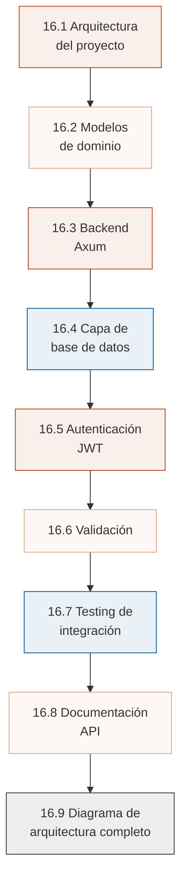
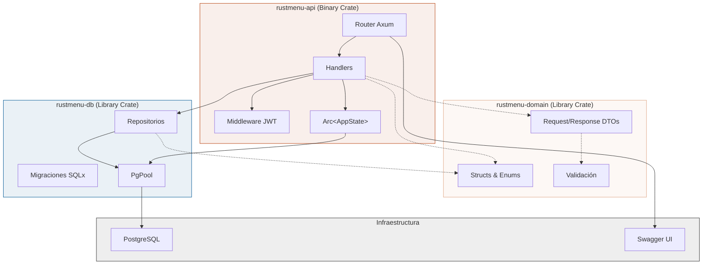
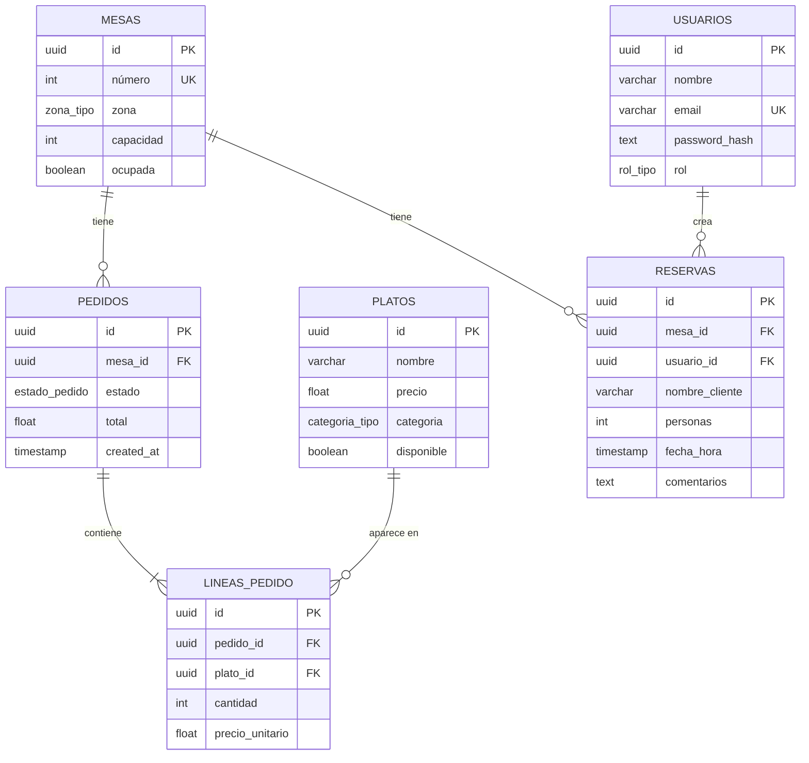
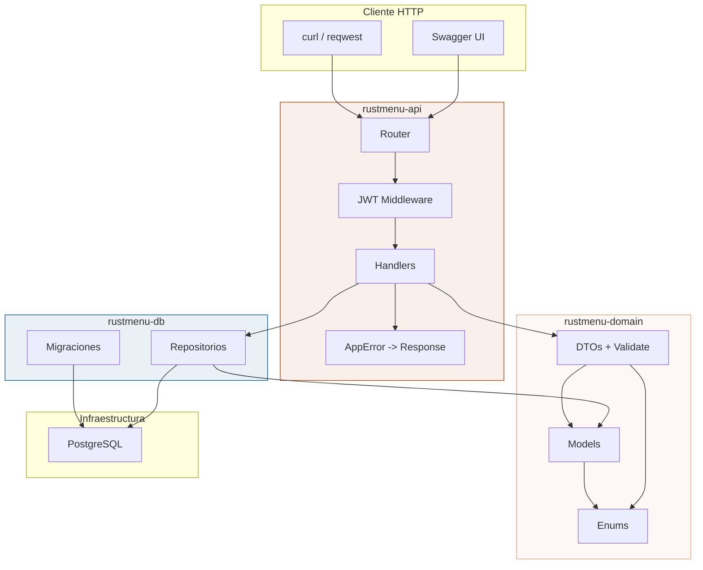

# :rocket: Cap 16 — Proyecto final: RustMenu

<div class="chapter-meta">
  <span class="meta-item">🕐 6-8 horas</span>
  <span class="meta-item">📊 Nivel: Avanzado-Experto</span>
  <span class="meta-item">🎯 Semana 8</span>
</div>

!!! quote "Contexto"
    Este capítulo final une todo lo que has aprendido en un proyecto completo: **RustMenu**, tu sistema de gestion de restaurantes. Backend Axum, base de datos PostgreSQL con SQLx, autenticación JWT, validación con `validator`, testing de integración y documentación con Swagger. Rust **end-to-end**, con seguridad de tipos garantizada por el compilador.

---

<div class="chapter-objective">
  <span class="objective-icon">📌</span>
  <span class="objective-text">Al terminar este capítulo, habras construido RustMenu de principio a fin: sabrás estructurar un Cargo workspace con tres crates, implementar una API REST completa con Axum, conectar PostgreSQL con queries verificadas en compilación (SQLx), proteger rutas con JWT, validar datos con el crate <code>validator</code>, y escribir tests de integración aislados con <code>#[sqlx::test]</code>.</span>
</div>

<div class="chapter-map" markdown>

### :world_map: Mapa del capítulo



</div>

---

## 16.1 Arquitectura del proyecto

RustMenu usa un **Cargo workspace** con tres crates que separan responsabilidades: dominio, base de datos y API HTTP.



### Estructura de directorios

```text
rustmenu/
├── Cargo.toml                          # Workspace raiz
├── .env                                # DATABASE_URL, JWT_SECRET
│
├── rustmenu-domain/                    # Crate de dominio
│   ├── Cargo.toml
│   └── src/
│       ├── lib.rs                      # Re-exporta modulos
│       ├── models.rs                   # Mesa, Plato, Pedido, Usuario, Reserva
│       ├── enums.rs                    # Zona, Categoria, EstadoPedido, Rol
│       ├── dto.rs                      # CreateMesa, UpdatePlato, LoginRequest...
│       └── validation.rs              # Reglas de validación personalizadas
│
├── rustmenu-db/                        # Crate de base de datos
│   ├── Cargo.toml
│   ├── migrations/                     # Migraciones SQLx
│   │   ├── 001_create_usuarios.sql
│   │   ├── 002_create_mesas.sql
│   │   ├── 003_create_platos.sql
│   │   ├── 004_create_pedidos.sql
│   │   └── 005_create_reservas.sql
│   └── src/
│       ├── lib.rs
│       ├── pool.rs                     # Conexion y pool PostgreSQL
│       ├── mesa_repo.rs               # CRUD mesas
│       ├── plato_repo.rs              # CRUD platos
│       ├── pedido_repo.rs             # CRUD pedidos
│       ├── usuario_repo.rs            # CRUD usuarios
│       └── reserva_repo.rs            # CRUD reservas
│
├── rustmenu-api/                       # Crate binario (el servidor)
│   ├── Cargo.toml
│   └── src/
│       ├── main.rs                     # Punto de entrada
│       ├── config.rs                   # Variables de entorno
│       ├── state.rs                    # AppState compartido
│       ├── error.rs                    # AppError y respuestas de error
│       ├── auth/
│       │   ├── mod.rs
│       │   ├── jwt.rs                  # Crear/verificar tokens
│       │   └── middleware.rs           # Middleware de autenticación
│       ├── handlers/
│       │   ├── mod.rs
│       │   ├── mesa_handler.rs
│       │   ├── plato_handler.rs
│       │   ├── pedido_handler.rs
│       │   ├── usuario_handler.rs
│       │   └── auth_handler.rs
│       └── routes.rs                   # Configuración del router
│
└── tests/                              # Tests de integración
    ├── common/mod.rs                   # Helpers de test
    ├── api_mesas_test.rs
    ├── api_pedidos_test.rs
    └── api_auth_test.rs
```

### Cargo workspace

```toml title="Cargo.toml (raiz)"
[workspace]
members = [
    "rustmenu-domain",
    "rustmenu-db",
    "rustmenu-api",
]
resolver = "2"

[workspace.dependencies]
serde = { version = "1", features = ["derive"] }
serde_json = "1"
chrono = { version = "0.4", features = ["serde"] }
sqlx = { version = "0.8", features = ["runtime-tokio", "postgres", "chrono", "uuid"] }
tokio = { version = "1", features = ["full"] }
uuid = { version = "1", features = ["v4", "serde"] }
```

```toml title="rustmenu-api/Cargo.toml"
[package]
name = "rustmenu-api"
version = "0.1.0"
edition = "2021"

[dependencies]
rustmenu-domain = { path = "../rustmenu-domain" }
rustmenu-db = { path = "../rustmenu-db" }
axum = { version = "0.8", features = ["macros"] }
tower = { version = "0.5", features = ["útil"] }
tower-http = { version = "0.6", features = ["cors", "trace"] }
tokio.workspace = true
serde.workspace = true
serde_json.workspace = true
sqlx.workspace = true
jsonwebtoken = "9"
bcrypt = "0.16"
validator = { version = "0.19", features = ["derive"] }
utoipa = { version = "5", features = ["axum_extras", "chrono", "uuid"] }
utoipa-swagger-ui = { version = "8", features = ["axum"] }
dotenvy = "0.15"
tracing = "0.1"
tracing-subscriber = "0.3"
```

<div class="concept-question">
<h4>🔍 Pregunta conceptual</h4>
<p>El proyecto RustMenu separa el código en tres crates: <code>rustmenu-domain</code>, <code>rustmenu-db</code> y <code>rustmenu-api</code>. En Django, normalmente todo vive dentro de una misma app (models, views, serializers). ¿Que ventajas crees que ofrece esta separación en crates independientes para un proyecto que crece? Piensa en términos de compilación, testing y reutilización.</p>
</div>

---

## 16.2 Modelos de dominio

Todos los modelos viven en `rustmenu-domain`. Cada struct usa `serde` para serialización, `sqlx::FromRow` para mapear desde PostgreSQL, y `utoipa::ToSchema` para documentación Swagger.

```rust title="rustmenu-domain/src/enums.rs"
use serde::{Deserialize, Serialize};
use sqlx::Type;
use utoipa::ToSchema;

#[derive(Debug, Clone, Serialize, Deserialize, Type, ToSchema, PartialEq)]
#[sqlx(type_name = "zona_tipo", rename_all = "snake_case")]
#[serde(rename_all = "snake_case")]
pub enum Zona {
    Interior,
    Terraza,
    Barra,
    Privado,
}

#[derive(Debug, Clone, Serialize, Deserialize, Type, ToSchema, PartialEq)]
#[sqlx(type_name = "categoria_tipo", rename_all = "snake_case")]
#[serde(rename_all = "snake_case")]
pub enum Categoria {
    Entrante,
    Principal,
    Postre,
    Bebida,
}

#[derive(Debug, Clone, Serialize, Deserialize, Type, ToSchema, PartialEq)]
#[sqlx(type_name = "estado_pedido", rename_all = "snake_case")]
#[serde(rename_all = "snake_case")]
pub enum EstadoPedido {
    Pendiente,
    Preparando,
    Listo,
    Entregado,
    Cancelado,
}

#[derive(Debug, Clone, Serialize, Deserialize, Type, ToSchema, PartialEq)]
#[sqlx(type_name = "rol_tipo", rename_all = "snake_case")]
#[serde(rename_all = "snake_case")]
pub enum Rol {
    Camarero,
    Cocinero,
    Admin,
}
```

```rust title="rustmenu-domain/src/models.rs"
use chrono::NaiveDateTime;
use serde::{Deserialize, Serialize};
use sqlx::FromRow;
use utoipa::ToSchema;
use uuid::Uuid;

use crate::enums::{Categoria, EstadoPedido, Rol, Zona};

// --- Mesa ---

#[derive(Debug, Clone, Serialize, Deserialize, FromRow, ToSchema)]
pub struct Mesa {
    pub id: Uuid,
    pub número: i32,
    pub zona: Zona,
    pub capacidad: i32,
    pub ocupada: bool,
}

// --- Plato ---

#[derive(Debug, Clone, Serialize, Deserialize, FromRow, ToSchema)]
pub struct Plato {
    pub id: Uuid,
    pub nombre: String,
    pub precio: f64,
    pub categoria: Categoria,
    pub disponible: bool,
}

// --- Pedido ---

#[derive(Debug, Clone, Serialize, Deserialize, FromRow, ToSchema)]
pub struct Pedido {
    pub id: Uuid,
    pub mesa_id: Uuid,
    pub estado: EstadoPedido,
    pub total: f64,
    pub created_at: NaiveDateTime,
}

#[derive(Debug, Clone, Serialize, Deserialize, FromRow, ToSchema)]
pub struct LineaPedido {
    pub id: Uuid,
    pub pedido_id: Uuid,
    pub plato_id: Uuid,
    pub cantidad: i32,
    pub precio_unitario: f64,
}

/// Pedido completo con sus lineas (para respuestas de la API)
#[derive(Debug, Clone, Serialize, Deserialize, ToSchema)]
pub struct PedidoCompleto {
    #[serde(flatten)]
    pub pedido: Pedido,
    pub items: Vec<LineaPedido>,
}

// --- Usuario ---

#[derive(Debug, Clone, Serialize, Deserialize, FromRow, ToSchema)]
pub struct Usuario {
    pub id: Uuid,
    pub nombre: String,
    pub email: String,
    #[serde(skip_serializing)] // Nunca incluir en respuestas JSON
    pub password_hash: String,
    pub rol: Rol,
}

// --- Reserva ---

#[derive(Debug, Clone, Serialize, Deserialize, FromRow, ToSchema)]
pub struct Reserva {
    pub id: Uuid,
    pub mesa_id: Uuid,
    pub usuario_id: Uuid,
    pub nombre_cliente: String,
    pub personas: i32,
    pub fecha_hora: NaiveDateTime,
    pub comentarios: Option<String>,
}
```

```rust title="rustmenu-domain/src/dto.rs"
use serde::{Deserialize, Serialize};
use utoipa::ToSchema;
use validator::Validate;

use crate::enums::{Categoria, EstadoPedido, Rol, Zona};

// --- Mesa DTOs ---

#[derive(Debug, Deserialize, Validate, ToSchema)]
pub struct CreateMesa {
    #[validate(range(min = 1, max = 200))]
    pub número: i32,
    pub zona: Zona,
    #[validate(range(min = 1, max = 20))]
    pub capacidad: i32,
}

#[derive(Debug, Deserialize, Validate, ToSchema)]
pub struct UpdateMesa {
    #[validate(range(min = 1, max = 200))]
    pub número: Option<i32>,
    pub zona: Option<Zona>,
    #[validate(range(min = 1, max = 20))]
    pub capacidad: Option<i32>,
    pub ocupada: Option<bool>,
}

// --- Plato DTOs ---

#[derive(Debug, Deserialize, Validate, ToSchema)]
pub struct CreatePlato {
    #[validate(length(min = 1, max = 100))]
    pub nombre: String,
    #[validate(range(min = 0.01))]
    pub precio: f64,
    pub categoria: Categoria,
}

#[derive(Debug, Deserialize, Validate, ToSchema)]
pub struct UpdatePlato {
    #[validate(length(min = 1, max = 100))]
    pub nombre: Option<String>,
    #[validate(range(min = 0.01))]
    pub precio: Option<f64>,
    pub categoria: Option<Categoria>,
    pub disponible: Option<bool>,
}

// --- Pedido DTOs ---

#[derive(Debug, Deserialize, Validate, ToSchema)]
pub struct CreatePedido {
    pub mesa_id: uuid::Uuid,
    #[validate(length(min = 1))]
    pub items: Vec<CreateLineaPedido>,
}

#[derive(Debug, Deserialize, Validate, ToSchema)]
pub struct CreateLineaPedido {
    pub plato_id: uuid::Uuid,
    #[validate(range(min = 1, max = 50))]
    pub cantidad: i32,
}

#[derive(Debug, Deserialize, ToSchema)]
pub struct UpdateEstadoPedido {
    pub estado: EstadoPedido,
}

// --- Usuario / Auth DTOs ---

#[derive(Debug, Deserialize, Validate, ToSchema)]
pub struct RegisterUsuario {
    #[validate(length(min = 2, max = 50))]
    pub nombre: String,
    #[validate(email)]
    pub email: String,
    #[validate(length(min = 8, max = 128))]
    pub password: String,
    pub rol: Rol,
}

#[derive(Debug, Deserialize, ToSchema)]
pub struct LoginRequest {
    pub email: String,
    pub password: String,
}

#[derive(Debug, Serialize, ToSchema)]
pub struct AuthResponse {
    pub token: String,
    pub usuario: crate::models::Usuario,
}

// --- Reserva DTOs ---

#[derive(Debug, Deserialize, Validate, ToSchema)]
pub struct CreateReserva {
    pub mesa_id: uuid::Uuid,
    #[validate(length(min = 1, max = 100))]
    pub nombre_cliente: String,
    #[validate(range(min = 1, max = 20))]
    pub personas: i32,
    pub fecha_hora: chrono::NaiveDateTime,
    #[validate(length(max = 500))]
    pub comentarios: Option<String>,
}

// --- Respuesta API genérica ---

#[derive(Debug, Serialize, ToSchema)]
pub struct ApiResponse<T: Serialize> {
    pub success: bool,
    pub data: T,
    #[serde(skip_serializing_if = "Option::is_none")]
    pub message: Option<String>,
}

impl<T: Serialize> ApiResponse<T> {
    pub fn ok(data: T) -> Self {
        Self {
            success: true,
            data,
            message: None,
        }
    }

    pub fn ok_with_message(data: T, message: impl Into<String>) -> Self {
        Self {
            success: true,
            data,
            message: Some(message.into()),
        }
    }
}
```

```rust title="rustmenu-domain/src/lib.rs"
pub mod dto;
pub mod enums;
pub mod models;
pub mod validation;
```

---

## 16.3 Backend Axum

### Punto de entrada y estado compartido

```rust title="rustmenu-api/src/config.rs"
use std::env;

pub struct Config {
    pub database_url: String,
    pub jwt_secret: String,
    pub jwt_expiration_hours: i64,
    pub host: String,
    pub port: u16,
}

impl Config {
    pub fn from_env() -> Self {
        dotenvy::dotenv().ok();

        Self {
            database_url: env::var("DATABASE_URL")
                .expect("DATABASE_URL debe estar definida"),
            jwt_secret: env::var("JWT_SECRET")
                .expect("JWT_SECRET debe estar definida"),
            jwt_expiration_hours: env::var("JWT_EXPIRATION_HOURS")
                .unwrap_or_else(|_| "24".to_string())
                .parse()
                .expect("JWT_EXPIRATION_HOURS debe ser un número"),
            host: env::var("HOST").unwrap_or_else(|_| "0.0.0.0".to_string()),
            port: env::var("PORT")
                .unwrap_or_else(|_| "3000".to_string())
                .parse()
                .expect("PORT debe ser un número"),
        }
    }

    pub fn addr(&self) -> String {
        format!("{}:{}", self.host, self.port)
    }
}
```

```rust title="rustmenu-api/src/state.rs"
use sqlx::PgPool;

use crate::config::Config;

/// Estado compartido de la aplicación, envuelto en Arc en main
pub struct AppState {
    pub db: PgPool,
    pub config: Config,
}
```

```rust title="rustmenu-api/src/main.rs"
use std::sync::Arc;

use axum::Router;
use sqlx::postgres::PgPoolOptions;
use tower_http::cors::{Any, CorsLayer};
use tower_http::trace::TraceLayer;
use tracing_subscriber;

mod auth;
mod config;
mod error;
mod handlers;
mod routes;
mod state;

use config::Config;
use state::AppState;

#[tokio::main]
async fn main() {
    // Inicializar logging
    tracing_subscriber::init();

    let config = Config::from_env();
    let addr = config.addr();

    // Crear pool de conexiones PostgreSQL
    let pool = PgPoolOptions::new()
        .max_connections(10)
        .connect(&config.database_url)
        .await
        .expect("No se pudo conectar a PostgreSQL");

    // Ejecutar migraciones pendientes
    sqlx::migrate!("../rustmenu-db/migrations")
        .run(&pool)
        .await
        .expect("Error ejecutando migraciones");

    // Estado compartido con Arc (inmutable, seguro entre hilos)
    let state = Arc::new(AppState { db: pool, config });

    // Construir router con todas las rutas
    let app = Router::new()
        .merge(routes::create_router(state.clone()))
        .layer(TraceLayer::new_for_http())
        .layer(
            CorsLayer::new()
                .allow_origin(Any)
                .allow_methods(Any)
                .allow_headers(Any),
        );

    tracing::info!("RustMenu API corriendo en http://{addr}");

    let listener = tokio::net::TcpListener::bind(&addr)
        .await
        .expect("No se pudo bindear al puerto");

    axum::serve(listener, app)
        .await
        .expect("Error del servidor");
}
```

### Error centralizado

```rust title="rustmenu-api/src/error.rs"
use axum::{
    http::StatusCode,
    response::{IntoResponse, Response},
    Json,
};
use serde_json::json;

#[derive(Debug)]
pub enum AppError {
    NotFound(String),
    BadRequest(String),
    Conflict(String),
    Unauthorized(String),
    Forbidden(String),
    Internal(String),
    Validation(validator::ValidationErrors),
    Database(sqlx::Error),
}

impl IntoResponse for AppError {
    fn into_response(self) -> Response {
        let (status, message) = match self {
            AppError::NotFound(msg) => (StatusCode::NOT_FOUND, msg),
            AppError::BadRequest(msg) => (StatusCode::BAD_REQUEST, msg),
            AppError::Conflict(msg) => (StatusCode::CONFLICT, msg),
            AppError::Unauthorized(msg) => (StatusCode::UNAUTHORIZED, msg),
            AppError::Forbidden(msg) => (StatusCode::FORBIDDEN, msg),
            AppError::Internal(msg) => {
                tracing::error!("Error interno: {msg}");
                (
                    StatusCode::INTERNAL_SERVER_ERROR,
                    "Error interno del servidor".to_string(),
                )
            }
            AppError::Validation(errors) => {
                let body = json!({
                    "success": false,
                    "message": "Error de validación",
                    "errors": errors.field_errors(),
                });
                return (StatusCode::BAD_REQUEST, Json(body)).into_response();
            }
            AppError::Database(err) => {
                tracing::error!("Error de base de datos: {err}");
                (
                    StatusCode::INTERNAL_SERVER_ERROR,
                    "Error de base de datos".to_string(),
                )
            }
        };

        let body = json!({
            "success": false,
            "message": message,
        });

        (status, Json(body)).into_response()
    }
}

// Conversiones automáticas con From
impl From<sqlx::Error> for AppError {
    fn from(err: sqlx::Error) -> Self {
        match err {
            sqlx::Error::RowNotFound => {
                AppError::NotFound("Recurso no encontrado".to_string())
            }
            _ => AppError::Database(err),
        }
    }
}

impl From<validator::ValidationErrors> for AppError {
    fn from(err: validator::ValidationErrors) -> Self {
        AppError::Validation(err)
    }
}

impl From<jsonwebtoken::errors::Error> for AppError {
    fn from(_err: jsonwebtoken::errors::Error) -> Self {
        AppError::Unauthorized("Token inválido o expirado".to_string())
    }
}
```

<div class="concept-question">
<h4>🔍 Pregunta conceptual</h4>
<p>Observa como <code>AppError</code> implementa <code>From&lt;sqlx::Error&gt;</code>, <code>From&lt;ValidationErrors&gt;</code> y <code>From&lt;jsonwebtoken::errors::Error&gt;</code>. Gracias a esto, el operador <code>?</code> convierte automaticamente cada tipo de error en un <code>AppError</code>. ¿Que pasaria si no implementaras estos traits <code>From</code>? ¿Como cambiaria el código de los handlers?</p>
</div>

### Router y handlers

```rust title="rustmenu-api/src/routes.rs"
use std::sync::Arc;

use axum::{
    middleware,
    routing::{delete, get, patch, post},
    Router,
};
use utoipa::OpenApi;
use utoipa_swagger_ui::SwaggerUi;

use crate::auth::middleware::require_auth;
use crate::handlers::{auth_handler, mesa_handler, pedido_handler, plato_handler};
use crate::state::AppState;

pub fn create_router(state: Arc<AppState>) -> Router {
    // Rutas publicas (sin autenticación)
    let public_routes = Router::new()
        .route("/api/auth/register", post(auth_handler::register))
        .route("/api/auth/login", post(auth_handler::login));

    // Rutas protegidas (requieren JWT)
    let protected_routes = Router::new()
        // Mesas
        .route("/api/mesas", get(mesa_handler::listar))
        .route("/api/mesas", post(mesa_handler::crear))
        .route("/api/mesas/{id}", get(mesa_handler::obtener))
        .route("/api/mesas/{id}", patch(mesa_handler::actualizar))
        .route("/api/mesas/{id}", delete(mesa_handler::eliminar))
        .route("/api/mesas/{id}/toggle", patch(mesa_handler::toggle_ocupada))
        // Platos
        .route("/api/platos", get(plato_handler::listar))
        .route("/api/platos", post(plato_handler::crear))
        .route("/api/platos/{id}", get(plato_handler::obtener))
        .route("/api/platos/{id}", patch(plato_handler::actualizar))
        .route("/api/platos/{id}", delete(plato_handler::eliminar))
        // Pedidos
        .route("/api/pedidos", get(pedido_handler::listar))
        .route("/api/pedidos", post(pedido_handler::crear))
        .route("/api/pedidos/{id}", get(pedido_handler::obtener))
        .route(
            "/api/pedidos/{id}/estado",
            patch(pedido_handler::cambiar_estado),
        )
        .route("/api/pedidos/{id}", delete(pedido_handler::eliminar))
        // Aplicar middleware JWT a todas las rutas protegidas
        .layer(middleware::from_fn_with_state(
            state.clone(),
            require_auth,
        ));

    // Swagger UI
    let swagger = SwaggerUi::new("/swagger-ui")
        .url("/api-docs/openapi.json", ApiDoc::openapi());

    public_routes
        .merge(protected_routes)
        .merge(swagger)
        .with_state(state)
}

#[derive(OpenApi)]
#[openapi(
    paths(
        mesa_handler::listar,
        mesa_handler::crear,
        mesa_handler::obtener,
        mesa_handler::actualizar,
        mesa_handler::eliminar,
    ),
    components(schemas(
        rustmenu_domain::models::Mesa,
        rustmenu_domain::models::Plato,
        rustmenu_domain::models::Pedido,
        rustmenu_domain::dto::CreateMesa,
        rustmenu_domain::dto::UpdateMesa,
        rustmenu_domain::dto::ApiResponse<rustmenu_domain::models::Mesa>,
    ))
)]
struct ApiDoc;
```

```rust title="rustmenu-api/src/handlers/mesa_handler.rs"
use std::sync::Arc;

use axum::{
    extract::{Path, State},
    http::StatusCode,
    Json,
};
use uuid::Uuid;
use validator::Validate;

use rustmenu_db::mesa_repo;
use rustmenu_domain::dto::{ApiResponse, CreateMesa, UpdateMesa};
use rustmenu_domain::models::Mesa;

use crate::error::AppError;
use crate::state::AppState;

/// Listar todas las mesas
#[utoipa::path(
    get,
    path = "/api/mesas",
    responses(
        (status = 200, description = "Lista de mesas", body = ApiResponse<Vec<Mesa>>)
    ),
    tag = "Mesas"
)]
pub async fn listar(
    State(state): State<Arc<AppState>>,
) -> Result<Json<ApiResponse<Vec<Mesa>>>, AppError> {
    let mesas = mesa_repo::obtener_todas(&state.db).await?;
    Ok(Json(ApiResponse::ok(mesas)))
}

/// Obtener una mesa por ID
#[utoipa::path(
    get,
    path = "/api/mesas/{id}",
    params(("id" = Uuid, Path, description = "ID de la mesa")),
    responses(
        (status = 200, description = "Mesa encontrada", body = ApiResponse<Mesa>),
        (status = 404, description = "Mesa no encontrada")
    ),
    tag = "Mesas"
)]
pub async fn obtener(
    State(state): State<Arc<AppState>>,
    Path(id): Path<Uuid>,
) -> Result<Json<ApiResponse<Mesa>>, AppError> {
    let mesa = mesa_repo::obtener_por_id(&state.db, id)
        .await?
        .ok_or_else(|| AppError::NotFound(format!("Mesa {id} no encontrada")))?;
    Ok(Json(ApiResponse::ok(mesa)))
}

/// Crear una nueva mesa
#[utoipa::path(
    post,
    path = "/api/mesas",
    request_body = CreateMesa,
    responses(
        (status = 201, description = "Mesa creada", body = ApiResponse<Mesa>),
        (status = 400, description = "Datos invalidos"),
        (status = 409, description = "Número de mesa duplicado")
    ),
    tag = "Mesas"
)]
pub async fn crear(
    State(state): State<Arc<AppState>>,
    Json(body): Json<CreateMesa>,
) -> Result<(StatusCode, Json<ApiResponse<Mesa>>), AppError> {
    // Validar con el crate validator
    body.validate()?; // (1)

    // Verificar que no exista mesa con el mismo número
    if mesa_repo::existe_por_numero(&state.db, body.número).await? {
        return Err(AppError::Conflict(format!(
            "Ya existe una mesa con el número {}",
            body.número
        )));
    }

    let mesa = mesa_repo::crear(&state.db, body).await?;
    Ok((StatusCode::CREATED, Json(ApiResponse::ok(mesa))))
}

// (1) body.validate()? usa la conversion From<ValidationErrors> -> AppError
//     definida en error.rs. Si la validación falla, se devuelve 400 automaticamente.

/// Actualizar una mesa existente
#[utoipa::path(
    patch,
    path = "/api/mesas/{id}",
    params(("id" = Uuid, Path, description = "ID de la mesa")),
    request_body = UpdateMesa,
    responses(
        (status = 200, description = "Mesa actualizada", body = ApiResponse<Mesa>),
        (status = 404, description = "Mesa no encontrada")
    ),
    tag = "Mesas"
)]
pub async fn actualizar(
    State(state): State<Arc<AppState>>,
    Path(id): Path<Uuid>,
    Json(body): Json<UpdateMesa>,
) -> Result<Json<ApiResponse<Mesa>>, AppError> {
    body.validate()?;

    let mesa = mesa_repo::actualizar(&state.db, id, body)
        .await?
        .ok_or_else(|| AppError::NotFound(format!("Mesa {id} no encontrada")))?;
    Ok(Json(ApiResponse::ok(mesa)))
}

/// Eliminar una mesa
#[utoipa::path(
    delete,
    path = "/api/mesas/{id}",
    params(("id" = Uuid, Path, description = "ID de la mesa")),
    responses(
        (status = 200, description = "Mesa eliminada"),
        (status = 404, description = "Mesa no encontrada")
    ),
    tag = "Mesas"
)]
pub async fn eliminar(
    State(state): State<Arc<AppState>>,
    Path(id): Path<Uuid>,
) -> Result<Json<ApiResponse<Mesa>>, AppError> {
    let mesa = mesa_repo::eliminar(&state.db, id)
        .await?
        .ok_or_else(|| AppError::NotFound(format!("Mesa {id} no encontrada")))?;
    Ok(Json(ApiResponse::ok_with_message(mesa, "Mesa eliminada")))
}

/// Toggle estado ocupada/libre
pub async fn toggle_ocupada(
    State(state): State<Arc<AppState>>,
    Path(id): Path<Uuid>,
) -> Result<Json<ApiResponse<Mesa>>, AppError> {
    let mesa = mesa_repo::obtener_por_id(&state.db, id)
        .await?
        .ok_or_else(|| AppError::NotFound(format!("Mesa {id} no encontrada")))?;

    let actualizada = mesa_repo::set_ocupada(&state.db, id, !mesa.ocupada).await?;
    Ok(Json(ApiResponse::ok(actualizada)))
}
```

```rust title="rustmenu-api/src/handlers/pedido_handler.rs"
use std::sync::Arc;

use axum::{
    extract::{Path, State},
    http::StatusCode,
    Json,
};
use uuid::Uuid;
use validator::Validate;

use rustmenu_db::{mesa_repo, pedido_repo, plato_repo};
use rustmenu_domain::dto::{ApiResponse, CreatePedido, UpdateEstadoPedido};
use rustmenu_domain::models::PedidoCompleto;

use crate::error::AppError;
use crate::state::AppState;

pub async fn listar(
    State(state): State<Arc<AppState>>,
) -> Result<Json<ApiResponse<Vec<PedidoCompleto>>>, AppError> {
    let pedidos = pedido_repo::obtener_todos(&state.db).await?;
    Ok(Json(ApiResponse::ok(pedidos)))
}

pub async fn obtener(
    State(state): State<Arc<AppState>>,
    Path(id): Path<Uuid>,
) -> Result<Json<ApiResponse<PedidoCompleto>>, AppError> {
    let pedido = pedido_repo::obtener_por_id(&state.db, id)
        .await?
        .ok_or_else(|| AppError::NotFound(format!("Pedido {id} no encontrado")))?;
    Ok(Json(ApiResponse::ok(pedido)))
}

pub async fn crear(
    State(state): State<Arc<AppState>>,
    Json(body): Json<CreatePedido>,
) -> Result<(StatusCode, Json<ApiResponse<PedidoCompleto>>), AppError> {
    body.validate()?;

    // Verificar que la mesa existe
    mesa_repo::obtener_por_id(&state.db, body.mesa_id)
        .await?
        .ok_or_else(|| {
            AppError::NotFound(format!("Mesa {} no encontrada", body.mesa_id))
        })?;

    // Calcular total: buscar precio de cada plato
    let mut total = 0.0;
    for item in &body.items {
        let plato = plato_repo::obtener_por_id(&state.db, item.plato_id)
            .await?
            .ok_or_else(|| {
                AppError::NotFound(format!("Plato {} no encontrado", item.plato_id))
            })?;

        if !plato.disponible {
            return Err(AppError::BadRequest(format!(
                "El plato '{}' no esta disponible",
                plato.nombre
            )));
        }

        total += plato.precio * item.cantidad as f64;
    }

    let pedido = pedido_repo::crear(&state.db, body, total).await?;
    Ok((StatusCode::CREATED, Json(ApiResponse::ok(pedido))))
}

pub async fn cambiar_estado(
    State(state): State<Arc<AppState>>,
    Path(id): Path<Uuid>,
    Json(body): Json<UpdateEstadoPedido>,
) -> Result<Json<ApiResponse<PedidoCompleto>>, AppError> {
    let pedido = pedido_repo::cambiar_estado(&state.db, id, body.estado)
        .await?
        .ok_or_else(|| AppError::NotFound(format!("Pedido {id} no encontrado")))?;
    Ok(Json(ApiResponse::ok(pedido)))
}

pub async fn eliminar(
    State(state): State<Arc<AppState>>,
    Path(id): Path<Uuid>,
) -> Result<Json<ApiResponse<()>>, AppError> {
    pedido_repo::eliminar(&state.db, id).await?;
    Ok(Json(ApiResponse::ok_with_message((), "Pedido eliminado")))
}
```

### Tabla de endpoints API

| Método   | Ruta                       | Descripción                | Auth  |
|----------|----------------------------|----------------------------|-------|
| `POST`   | `/api/auth/register`       | Registrar usuario          | No    |
| `POST`   | `/api/auth/login`          | Login, devuelve JWT        | No    |
| `GET`    | `/api/mesas`               | Listar todas las mesas     | Si    |
| `POST`   | `/api/mesas`               | Crear mesa                 | Si    |
| `GET`    | `/api/mesas/{id}`          | Obtener mesa por ID        | Si    |
| `PATCH`  | `/api/mesas/{id}`          | Actualizar mesa            | Si    |
| `DELETE` | `/api/mesas/{id}`          | Eliminar mesa              | Si    |
| `PATCH`  | `/api/mesas/{id}/toggle`   | Toggle ocupada/libre       | Si    |
| `GET`    | `/api/platos`              | Listar todos los platos    | Si    |
| `POST`   | `/api/platos`              | Crear plato                | Si    |
| `GET`    | `/api/platos/{id}`         | Obtener plato por ID       | Si    |
| `PATCH`  | `/api/platos/{id}`         | Actualizar plato           | Si    |
| `DELETE` | `/api/platos/{id}`         | Eliminar plato             | Si    |
| `GET`    | `/api/pedidos`             | Listar todos los pedidos   | Si    |
| `POST`   | `/api/pedidos`             | Crear pedido               | Si    |
| `GET`    | `/api/pedidos/{id}`        | Obtener pedido por ID      | Si    |
| `PATCH`  | `/api/pedidos/{id}/estado` | Cambiar estado del pedido  | Si    |
| `DELETE` | `/api/pedidos/{id}`        | Eliminar pedido            | Si    |

<div class="concept-question">
<h4>🔍 Pregunta conceptual</h4>
<p>Las rutas publicas (<code>/api/auth/register</code> y <code>/api/auth/login</code>) no requieren JWT, pero el resto si. El middleware <code>require_auth</code> se aplica con <code>.layer()</code> solo a las rutas protegidas. ¿Por que crees que Axum permite aplicar middleware a subconjuntos de rutas en lugar de a todo el router? ¿Que problemas evita este enfoque granular?</p>
</div>

---

## 16.4 Capa de base de datos

### Pool de conexiones

```rust title="rustmenu-db/src/pool.rs"
use sqlx::postgres::PgPoolOptions;
use sqlx::PgPool;

pub async fn create_pool(database_url: &str) -> PgPool {
    PgPoolOptions::new()
        .max_connections(10)
        .connect(database_url)
        .await
        .expect("No se pudo conectar a PostgreSQL")
}
```

### Migraciones

```sql title="rustmenu-db/migrations/001_create_usuarios.sql"
CREATE TYPE rol_tipo AS ENUM ('camarero', 'cocinero', 'admin');

CREATE TABLE usuarios (
    id         UUID PRIMARY KEY DEFAULT gen_random_uuid(),
    nombre     VARCHAR(50) NOT NULL,
    email      VARCHAR(100) UNIQUE NOT NULL,
    password_hash TEXT NOT NULL,
    rol        rol_tipo NOT NULL DEFAULT 'camarero'
);
```

```sql title="rustmenu-db/migrations/002_create_mesas.sql"
CREATE TYPE zona_tipo AS ENUM ('interior', 'terraza', 'barra', 'privado');

CREATE TABLE mesas (
    id        UUID PRIMARY KEY DEFAULT gen_random_uuid(),
    número    INT UNIQUE NOT NULL,
    zona      zona_tipo NOT NULL,
    capacidad INT NOT NULL CHECK (capacidad BETWEEN 1 AND 20),
    ocupada   BOOLEAN NOT NULL DEFAULT FALSE
);
```

```sql title="rustmenu-db/migrations/003_create_platos.sql"
CREATE TYPE categoria_tipo AS ENUM ('entrante', 'principal', 'postre', 'bebida');

CREATE TABLE platos (
    id         UUID PRIMARY KEY DEFAULT gen_random_uuid(),
    nombre     VARCHAR(100) NOT NULL,
    precio     DOUBLE PRECISION NOT NULL CHECK (precio > 0),
    categoria  categoria_tipo NOT NULL,
    disponible BOOLEAN NOT NULL DEFAULT TRUE
);
```

```sql title="rustmenu-db/migrations/004_create_pedidos.sql"
CREATE TYPE estado_pedido AS ENUM (
    'pendiente', 'preparando', 'listo', 'entregado', 'cancelado'
);

CREATE TABLE pedidos (
    id         UUID PRIMARY KEY DEFAULT gen_random_uuid(),
    mesa_id    UUID NOT NULL REFERENCES mesas(id),
    estado     estado_pedido NOT NULL DEFAULT 'pendiente',
    total      DOUBLE PRECISION NOT NULL DEFAULT 0.0,
    created_at TIMESTAMP NOT NULL DEFAULT NOW()
);

CREATE TABLE lineas_pedido (
    id              UUID PRIMARY KEY DEFAULT gen_random_uuid(),
    pedido_id       UUID NOT NULL REFERENCES pedidos(id) ON DELETE CASCADE,
    plato_id        UUID NOT NULL REFERENCES platos(id),
    cantidad        INT NOT NULL CHECK (cantidad >= 1),
    precio_unitario DOUBLE PRECISION NOT NULL
);
```

```sql title="rustmenu-db/migrations/005_create_reservas.sql"
CREATE TABLE reservas (
    id              UUID PRIMARY KEY DEFAULT gen_random_uuid(),
    mesa_id         UUID NOT NULL REFERENCES mesas(id),
    usuario_id      UUID NOT NULL REFERENCES usuarios(id),
    nombre_cliente  VARCHAR(100) NOT NULL,
    personas        INT NOT NULL CHECK (personas BETWEEN 1 AND 20),
    fecha_hora      TIMESTAMP NOT NULL,
    comentarios     TEXT
);
```

### Repositorio de mesas (queries compile-time checked)

```rust title="rustmenu-db/src/mesa_repo.rs"
use sqlx::PgPool;
use uuid::Uuid;

use rustmenu_domain::dto::{CreateMesa, UpdateMesa};
use rustmenu_domain::models::Mesa;

pub async fn obtener_todas(pool: &PgPool) -> Result<Vec<Mesa>, sqlx::Error> {
    // sqlx::query_as! verifica la query contra la BD en tiempo de compilación
    sqlx::query_as!(
        Mesa,
        r#"SELECT id, número, zona as "zona: _", capacidad, ocupada
           FROM mesas
           ORDER BY número ASC"#
    )
    .fetch_all(pool)
    .await
}

pub async fn obtener_por_id(
    pool: &PgPool,
    id: Uuid,
) -> Result<Option<Mesa>, sqlx::Error> {
    sqlx::query_as!(
        Mesa,
        r#"SELECT id, número, zona as "zona: _", capacidad, ocupada
           FROM mesas
           WHERE id = $1"#,
        id
    )
    .fetch_optional(pool)
    .await
}

pub async fn existe_por_numero(
    pool: &PgPool,
    número: i32,
) -> Result<bool, sqlx::Error> {
    let result = sqlx::query_scalar!(
        "SELECT EXISTS(SELECT 1 FROM mesas WHERE número = $1)",
        número
    )
    .fetch_one(pool)
    .await?;

    Ok(result.unwrap_or(false))
}

pub async fn crear(pool: &PgPool, data: CreateMesa) -> Result<Mesa, sqlx::Error> {
    sqlx::query_as!(
        Mesa,
        r#"INSERT INTO mesas (número, zona, capacidad)
           VALUES ($1, $2, $3)
           RETURNING id, número, zona as "zona: _", capacidad, ocupada"#,
        data.número,
        data.zona as _,   // "as _" para que sqlx acepte el enum personalizado
        data.capacidad
    )
    .fetch_one(pool)
    .await
}

pub async fn actualizar(
    pool: &PgPool,
    id: Uuid,
    data: UpdateMesa,
) -> Result<Option<Mesa>, sqlx::Error> {
    // Actualizar solo los campos que vienen en Some
    sqlx::query_as!(
        Mesa,
        r#"UPDATE mesas
           SET número    = COALESCE($2, número),
               zona      = COALESCE($3, zona),
               capacidad = COALESCE($4, capacidad),
               ocupada   = COALESCE($5, ocupada)
           WHERE id = $1
           RETURNING id, número, zona as "zona: _", capacidad, ocupada"#,
        id,
        data.número,
        data.zona as _,
        data.capacidad,
        data.ocupada
    )
    .fetch_optional(pool)
    .await
}

pub async fn eliminar(pool: &PgPool, id: Uuid) -> Result<Option<Mesa>, sqlx::Error> {
    sqlx::query_as!(
        Mesa,
        r#"DELETE FROM mesas WHERE id = $1
           RETURNING id, número, zona as "zona: _", capacidad, ocupada"#,
        id
    )
    .fetch_optional(pool)
    .await
}

pub async fn set_ocupada(
    pool: &PgPool,
    id: Uuid,
    ocupada: bool,
) -> Result<Mesa, sqlx::Error> {
    sqlx::query_as!(
        Mesa,
        r#"UPDATE mesas SET ocupada = $2 WHERE id = $1
           RETURNING id, número, zona as "zona: _", capacidad, ocupada"#,
        id,
        ocupada
    )
    .fetch_one(pool)
    .await
}
```

### Diagrama ER de la base de datos



<div class="misconception-box">
<h4>⚠️ Errores comunes</h4>
<ul>
<li><span class="wrong">❌ Mito:</span> "SQLx es un ORM como Django ORM o SQLAlchemy" → <span class="right">✅ Realidad:</span> SQLx NO es un ORM. Es un toolkit de queries SQL puras verificadas en compilación. Escribes SQL real, no un DSL abstracto. La ventaja es que tienes control total sobre las queries y el compilador verifica que sean correctas contra la BD real.</li>
<li><span class="wrong">❌ Mito:</span> "Axum necesita un framework de testing especial como pytest-django" → <span class="right">✅ Realidad:</span> Los tests en Axum usan el ecosistema estandar de Rust (<code>#[tokio::test]</code>, <code>#[sqlx::test]</code>) y un cliente HTTP como <code>reqwest</code>. No necesitas un TestClient especial: simplemente levantas el servidor en un puerto aleatorio y haces peticiones HTTP reales.</li>
<li><span class="wrong">❌ Mito:</span> "<code>Arc&lt;AppState&gt;</code> es como una variable global mutable" → <span class="right">✅ Realidad:</span> <code>Arc</code> solo permite acceso compartido inmutable. El <code>PgPool</code> dentro de <code>AppState</code> gestiona internamente su propia concurrencia con locks internos. No puedes modificar <code>AppState</code> arbitrariamente desde los handlers; el compilador lo impide.</li>
</ul>
</div>

---

## 16.5 Autenticación JWT

### Crear y verificar tokens

```rust title="rustmenu-api/src/auth/jwt.rs"
use chrono::{Duration, Utc};
use jsonwebtoken::{decode, encode, DecodingKey, EncodingKey, Header, Validation};
use serde::{Deserialize, Serialize};
use uuid::Uuid;

use rustmenu_domain::enums::Rol;

#[derive(Debug, Serialize, Deserialize, Clone)]
pub struct Claims {
    pub sub: Uuid,       // ID del usuario
    pub email: String,
    pub rol: Rol,
    pub exp: usize,      // Timestamp de expiración (requerido por JWT)
    pub iat: usize,      // Timestamp de creación
}

pub fn create_token(
    user_id: Uuid,
    email: &str,
    rol: &Rol,
    secret: &str,
    expiration_hours: i64,
) -> Result<String, jsonwebtoken::errors::Error> {
    let now = Utc::now();
    let expiration = now + Duration::hours(expiration_hours);

    let claims = Claims {
        sub: user_id,
        email: email.to_string(),
        rol: rol.clone(),
        exp: expiration.timestamp() as usize,
        iat: now.timestamp() as usize,
    };

    encode(
        &Header::default(),
        &claims,
        &EncodingKey::from_secret(secret.as_bytes()),
    )
}

pub fn verify_token(
    token: &str,
    secret: &str,
) -> Result<Claims, jsonwebtoken::errors::Error> {
    let token_data = decode::<Claims>(
        token,
        &DecodingKey::from_secret(secret.as_bytes()),
        &Validation::default(),
    )?;

    Ok(token_data.claims)
}
```

### Middleware de autenticación con Tower

```rust title="rustmenu-api/src/auth/middleware.rs"
use std::sync::Arc;

use axum::{
    body::Body,
    extract::State,
    http::{header, Request},
    middleware::Next,
    response::Response,
};

use crate::auth::jwt;
use crate::error::AppError;
use crate::state::AppState;

/// Middleware que extrae y válida el token JWT del header Authorization.
/// Inyecta los Claims como extension del request para que los handlers
/// puedan acceder al usuario autenticado.
pub async fn require_auth(
    State(state): State<Arc<AppState>>,
    mut request: Request<Body>,
    next: Next,
) -> Result<Response, AppError> {
    // Extraer el header "Authorization: Bearer <token>"
    let auth_header = request
        .headers()
        .get(header::AUTHORIZATION)
        .and_then(|value| value.to_str().ok())
        .ok_or_else(|| {
            AppError::Unauthorized("Header Authorization requerido".to_string())
        })?;

    // Verificar que empieza con "Bearer "
    let token = auth_header
        .strip_prefix("Bearer ")
        .ok_or_else(|| {
            AppError::Unauthorized("Formato inválido: usa 'Bearer <token>'".to_string())
        })?;

    // Verificar y decodificar el token
    let claims = jwt::verify_token(token, &state.config.jwt_secret)?;

    // Inyectar claims en las extensions del request
    request.extensions_mut().insert(claims);

    // Continuar con el siguiente handler
    Ok(next.run(request).await)
}
```

```rust title="rustmenu-api/src/handlers/auth_handler.rs"
use std::sync::Arc;

use axum::{extract::State, http::StatusCode, Json};
use bcrypt::{hash, verify, DEFAULT_COST};
use validator::Validate;

use rustmenu_db::usuario_repo;
use rustmenu_domain::dto::{ApiResponse, AuthResponse, LoginRequest, RegisterUsuario};

use crate::auth::jwt;
use crate::error::AppError;
use crate::state::AppState;

pub async fn register(
    State(state): State<Arc<AppState>>,
    Json(body): Json<RegisterUsuario>,
) -> Result<(StatusCode, Json<ApiResponse<AuthResponse>>), AppError> {
    body.validate()?;

    // Verificar que el email no exista
    if usuario_repo::existe_por_email(&state.db, &body.email).await? {
        return Err(AppError::Conflict(
            "Ya existe un usuario con ese email".to_string(),
        ));
    }

    // Hash de la contrasena con bcrypt
    let password_hash = hash(&body.password, DEFAULT_COST)
        .map_err(|e| AppError::Internal(format!("Error hashing password: {e}")))?;

    let usuario = usuario_repo::crear(&state.db, &body, &password_hash).await?;

    // Generar token JWT
    let token = jwt::create_token(
        usuario.id,
        &usuario.email,
        &usuario.rol,
        &state.config.jwt_secret,
        state.config.jwt_expiration_hours,
    )?;

    Ok((
        StatusCode::CREATED,
        Json(ApiResponse::ok(AuthResponse { token, usuario })),
    ))
}

pub async fn login(
    State(state): State<Arc<AppState>>,
    Json(body): Json<LoginRequest>,
) -> Result<Json<ApiResponse<AuthResponse>>, AppError> {
    // Buscar usuario por email
    let usuario = usuario_repo::obtener_por_email(&state.db, &body.email)
        .await?
        .ok_or_else(|| {
            AppError::Unauthorized("Credenciales invalidas".to_string())
        })?;

    // Verificar contrasena con bcrypt
    let password_valid = verify(&body.password, &usuario.password_hash)
        .map_err(|e| AppError::Internal(format!("Error verificando password: {e}")))?;

    if !password_valid {
        return Err(AppError::Unauthorized(
            "Credenciales invalidas".to_string(),
        ));
    }

    // Generar token JWT
    let token = jwt::create_token(
        usuario.id,
        &usuario.email,
        &usuario.rol,
        &state.config.jwt_secret,
        state.config.jwt_expiration_hours,
    )?;

    Ok(Json(ApiResponse::ok(AuthResponse { token, usuario })))
}
```

<div class="micro-exercise">
<h4>🧪 Micro-ejercicio (3 min)</h4>
<p>Sin mirar el código anterior, escribe de memoria la firma del middleware <code>require_auth</code>: ¿que extractores recibe? ¿que tipo devuelve? ¿como inyecta los <code>Claims</code> para que los handlers los lean? Compara tu respuesta con la implementación de la sección 16.5.</p>
</div>

---

## 16.6 Validación

El crate `validator` permite validar structs con atributos `#[derive(Validate)]` y anotaciones declarativas. Para reglas más complejas, puedes escribir funciones de validación personalizadas.

```rust title="rustmenu-domain/src/validation.rs"
use validator::ValidationError;

/// Validar que el precio tiene máximo 2 decimales
pub fn validar_precio_decimales(precio: f64) -> Result<(), ValidationError> {
    let redondeado = (precio * 100.0).round() / 100.0;
    if (precio - redondeado).abs() > f64::EPSILON {
        return Err(ValidationError::new("precio_decimales")
            .with_message("El precio debe tener máximo 2 decimales".into()));
    }
    Ok(())
}

/// Validar que la fecha de reserva es futura
pub fn validar_fecha_futura(
    fecha: &chrono::NaiveDateTime,
) -> Result<(), ValidationError> {
    let ahora = chrono::Utc::now().naive_utc();
    if *fecha <= ahora {
        return Err(ValidationError::new("fecha_futura")
            .with_message("La fecha de reserva debe ser futura".into()));
    }
    Ok(())
}
```

Uso en los DTOs con `#[validate(custom(...))]`:

```rust
use validator::Validate;
use crate::validation::{validar_fecha_futura, validar_precio_decimales};

#[derive(Debug, Deserialize, Validate, ToSchema)]
pub struct CreatePlato {
    #[validate(length(min = 1, max = 100))]
    pub nombre: String,
    #[validate(range(min = 0.01), custom(function = "validar_precio_decimales"))]
    pub precio: f64,
    pub categoria: Categoria,
}

#[derive(Debug, Deserialize, Validate, ToSchema)]
pub struct CreateReserva {
    pub mesa_id: uuid::Uuid,
    #[validate(length(min = 1, max = 100))]
    pub nombre_cliente: String,
    #[validate(range(min = 1, max = 20))]
    pub personas: i32,
    #[validate(custom(function = "validar_fecha_futura"))]
    pub fecha_hora: chrono::NaiveDateTime,
    #[validate(length(max = 500))]
    pub comentarios: Option<String>,
}
```

!!! tip "Validación en Rust vs Python"
    En Django, la validación vive en los serializers (DRF) separada de los modelos. En Rust con `validator`, la validación se declara directamente en los DTOs con `#[derive(Validate)]`. El compilador garantiza que nunca olvides llamar a `.validate()` si el tipo lo requiere, y los errores se convierten automaticamente en respuestas HTTP 400 gracias al `From<ValidationErrors>` en `AppError`.

<div class="micro-exercise">
<h4>🧪 Micro-ejercicio (3 min)</h4>
<p>Crea un DTO <code>UpdateReserva</code> con validación. Debe permitir actualizar opcionalmente: <code>nombre_cliente</code> (1-100 caracteres), <code>personas</code> (1-20) y <code>comentarios</code> (max 500 caracteres). Usa <code>Option&lt;T&gt;</code> para cada campo y aplica las anotaciones <code>#[validate(...)]</code> correspondientes. Recuerda derivar <code>Validate</code> y <code>ToSchema</code>.</p>
</div>

---

## 16.7 Testing de integración

### Tests de la API con reqwest

```rust title="tests/common/mod.rs"
use std::sync::Arc;

use axum::Router;
use sqlx::PgPool;
use tokio::net::TcpListener;

use rustmenu_api::config::Config;
use rustmenu_api::routes::create_router;
use rustmenu_api::state::AppState;

/// Levanta un servidor de test en un puerto aleatorio y devuelve la URL base
pub async fn spawn_test_server(pool: PgPool) -> String {
    let config = Config {
        database_url: String::new(), // Ya tenemos el pool
        jwt_secret: "test-secret-super-seguro-12345".to_string(),
        jwt_expiration_hours: 1,
        host: "127.0.0.1".to_string(),
        port: 0, // Puerto aleatorio
    };

    let state = Arc::new(AppState { db: pool, config });
    let app = create_router(state);

    let listener = TcpListener::bind("127.0.0.1:0").await.unwrap();
    let addr = listener.local_addr().unwrap();
    let base_url = format!("http://{addr}");

    tokio::spawn(async move {
        axum::serve(listener, app).await.unwrap();
    });

    base_url
}

/// Registrar un usuario de test y devolver el token JWT
pub async fn obtener_token_test(base_url: &str) -> String {
    let client = reqwest::Client::new();

    let res = client
        .post(format!("{base_url}/api/auth/register"))
        .json(&serde_json::json!({
            "nombre": "Test User",
            "email": format!("test-{}@example.com", uuid::Uuid::new_v4()),
            "password": "password123",
            "rol": "admin"
        }))
        .send()
        .await
        .unwrap();

    let body: serde_json::Value = res.json().await.unwrap();
    body["data"]["token"].as_str().unwrap().to_string()
}
```

```rust title="tests/api_mesas_test.rs"
mod common;

use reqwest::StatusCode;
use serde_json::json;

// #[sqlx::test] crea una BD temporal con migraciones aplicadas automaticamente.
// Al terminar el test, la BD se destruye. Cada test tiene su BD aislada.
#[sqlx::test(migrations = "rustmenu-db/migrations")]
async fn test_crear_mesa(pool: sqlx::PgPool) {
    let base_url = common::spawn_test_server(pool).await;
    let token = common::obtener_token_test(&base_url).await;
    let client = reqwest::Client::new();

    // Crear una mesa
    let res = client
        .post(format!("{base_url}/api/mesas"))
        .bearer_auth(&token)
        .json(&json!({
            "número": 1,
            "zona": "terraza",
            "capacidad": 4
        }))
        .send()
        .await
        .unwrap();

    assert_eq!(res.status(), StatusCode::CREATED);

    let body: serde_json::Value = res.json().await.unwrap();
    assert_eq!(body["success"], true);
    assert_eq!(body["data"]["número"], 1);
    assert_eq!(body["data"]["zona"], "terraza");
    assert_eq!(body["data"]["capacidad"], 4);
    assert_eq!(body["data"]["ocupada"], false);
}

#[sqlx::test(migrations = "rustmenu-db/migrations")]
async fn test_listar_mesas(pool: sqlx::PgPool) {
    let base_url = common::spawn_test_server(pool).await;
    let token = common::obtener_token_test(&base_url).await;
    let client = reqwest::Client::new();

    // Crear dos mesas
    for número in [1, 2] {
        client
            .post(format!("{base_url}/api/mesas"))
            .bearer_auth(&token)
            .json(&json!({
                "número": número,
                "zona": "interior",
                "capacidad": 4
            }))
            .send()
            .await
            .unwrap();
    }

    // Listar mesas
    let res = client
        .get(format!("{base_url}/api/mesas"))
        .bearer_auth(&token)
        .send()
        .await
        .unwrap();

    assert_eq!(res.status(), StatusCode::OK);

    let body: serde_json::Value = res.json().await.unwrap();
    assert_eq!(body["data"].as_array().unwrap().len(), 2);
}

#[sqlx::test(migrations = "rustmenu-db/migrations")]
async fn test_mesa_numero_duplicado(pool: sqlx::PgPool) {
    let base_url = common::spawn_test_server(pool).await;
    let token = common::obtener_token_test(&base_url).await;
    let client = reqwest::Client::new();

    let mesa_data = json!({
        "número": 1,
        "zona": "barra",
        "capacidad": 2
    });

    // Crear primera mesa (OK)
    let res1 = client
        .post(format!("{base_url}/api/mesas"))
        .bearer_auth(&token)
        .json(&mesa_data)
        .send()
        .await
        .unwrap();
    assert_eq!(res1.status(), StatusCode::CREATED);

    // Crear duplicada (Conflict)
    let res2 = client
        .post(format!("{base_url}/api/mesas"))
        .bearer_auth(&token)
        .json(&mesa_data)
        .send()
        .await
        .unwrap();
    assert_eq!(res2.status(), StatusCode::CONFLICT);
}

#[sqlx::test(migrations = "rustmenu-db/migrations")]
async fn test_validacion_mesa_invalida(pool: sqlx::PgPool) {
    let base_url = common::spawn_test_server(pool).await;
    let token = common::obtener_token_test(&base_url).await;
    let client = reqwest::Client::new();

    // Capacidad fuera de rango (max 20)
    let res = client
        .post(format!("{base_url}/api/mesas"))
        .bearer_auth(&token)
        .json(&json!({
            "número": 1,
            "zona": "interior",
            "capacidad": 999
        }))
        .send()
        .await
        .unwrap();

    assert_eq!(res.status(), StatusCode::BAD_REQUEST);
}

#[sqlx::test(migrations = "rustmenu-db/migrations")]
async fn test_requiere_autenticación(pool: sqlx::PgPool) {
    let base_url = common::spawn_test_server(pool).await;
    let client = reqwest::Client::new();

    // Intentar acceder sin token
    let res = client
        .get(format!("{base_url}/api/mesas"))
        .send()
        .await
        .unwrap();

    assert_eq!(res.status(), StatusCode::UNAUTHORIZED);
}
```

!!! tip "Ejecutar los tests"
    ```bash
    # Tests de integración (necesita PostgreSQL corriendo)
    cargo test --test api_mesas_test

    # Todos los tests del workspace
    cargo test --workspace

    # Con logs visibles
    RUST_LOG=debug cargo test --workspace -- --nocapture
    ```

<div class="pro-tip">
<h4>💡 Consejo Pro</h4>
<p>Cada <code>#[sqlx::test]</code> crea y destruye una base de datos PostgreSQL completa. Para acelerar la suite de tests, asegurate de que PostgreSQL tenga suficientes conexiones disponibles (<code>max_connections</code> en <code>postgresql.conf</code>). Si tienes 20 tests paralelos, necesitas al menos 20 conexiones. Alternativamente, ejecuta con <code>cargo test -- --test-threads=4</code> para limitar el paralelismo.</p>
</div>

---

## 16.8 Documentación API

El crate `utoipa` genera automaticamente la especificación OpenAPI 3.0 a partir de las anotaciones `#[utoipa::path]` en los handlers. `utoipa-swagger-ui` sirve la interfaz Swagger UI en `/swagger-ui`.

```rust title="Ejemplo de anotación utoipa en un handler"
/// Listar todas las mesas
#[utoipa::path(
    get,
    path = "/api/mesas",
    responses(
        (status = 200, description = "Lista de mesas", body = ApiResponse<Vec<Mesa>>),
        (status = 401, description = "No autenticado")
    ),
    security(("bearer_auth" = [])),
    tag = "Mesas"
)]
pub async fn listar(
    State(state): State<Arc<AppState>>,
) -> Result<Json<ApiResponse<Vec<Mesa>>>, AppError> {
    let mesas = mesa_repo::obtener_todas(&state.db).await?;
    Ok(Json(ApiResponse::ok(mesas)))
}
```

Los schemas se derivan automaticamente con `#[derive(ToSchema)]` en los modelos y DTOs. Swagger UI estará disponible en `http://localhost:3000/swagger-ui/`.

<div class="pro-tip">
<h4>💡 Consejo Pro</h4>
<p>Cuando tu API tenga autenticación JWT, anade el security scheme a la definición OpenAPI para que Swagger UI muestre el boton "Authorize". Asi podrás probar rutas protegidas directamente desde el navegador sin usar curl. Anade <code>#[openapi(security(("bearer_auth" = [])))]</code> y define el scheme con <code>SecurityAddon</code> de utoipa.</p>
</div>

---

## 16.9 Diagrama de arquitectura completo



<div class="code-evolution" markdown>
<div class="evolution-header">📈 Evolución del código</div>

<div class="evolution-step">
<span class="step-label novato">v1 — Handler monolitico</span>

```rust
// Todo mezclado: validación, lógica de negocio, acceso a BD
pub async fn crear_mesa(
    State(state): State<Arc<AppState>>,
    Json(body): Json<serde_json::Value>,
) -> Result<Json<serde_json::Value>, StatusCode> {
    let número = body["número"].as_i64().unwrap() as i32;
    if número < 1 || número > 200 {
        return Err(StatusCode::BAD_REQUEST);
    }
    let mesa = sqlx::query_as!(Mesa,
        "INSERT INTO mesas (número, zona, capacidad) VALUES ($1, $2, $3) RETURNING *",
        número, body["zona"].as_str().unwrap(), body["capacidad"].as_i64().unwrap() as i32
    ).fetch_one(&state.db).await.map_err(|_| StatusCode::INTERNAL_SERVER_ERROR)?;
    Ok(Json(serde_json::to_value(mesa).unwrap()))
}
```

</div>
<div class="evolution-step">
<span class="step-label intermedio">v2 — DTOs tipados + validación separada</span>

```rust
// DTOs con tipos fuertes y validación declarativa
pub async fn crear_mesa(
    State(state): State<Arc<AppState>>,
    Json(body): Json<CreateMesa>,  // Tipado fuerte, no serde_json::Value
) -> Result<(StatusCode, Json<Mesa>), AppError> {
    body.validate()?;  // Validación declarativa con #[validate(...)]
    let mesa = mesa_repo::crear(&state.db, body).await?;  // Repo separado
    Ok((StatusCode::CREATED, Json(mesa)))
}
```

</div>
<div class="evolution-step">
<span class="step-label experto">v3 — Respuesta estandarizada + manejo de conflictos</span>

```rust
// Version final: respuesta ApiResponse, verificación de duplicados, errores tipados
pub async fn crear(
    State(state): State<Arc<AppState>>,
    Json(body): Json<CreateMesa>,
) -> Result<(StatusCode, Json<ApiResponse<Mesa>>), AppError> {
    body.validate()?;
    if mesa_repo::existe_por_numero(&state.db, body.número).await? {
        return Err(AppError::Conflict(format!(
            "Ya existe una mesa con el número {}", body.número
        )));
    }
    let mesa = mesa_repo::crear(&state.db, body).await?;
    Ok((StatusCode::CREATED, Json(ApiResponse::ok(mesa))))
}
```

</div>
</div>

---

<div class="comparison" markdown>
<div class="lang-box python" markdown>

#### :snake: Proyecto Django REST Framework

```python
# Django: modelo = BD + serializer + viewset

# models.py
class Mesa(models.Model):
    número = models.IntegerField(unique=True)
    zona = models.CharField(
        max_length=20,
        choices=[("interior", "Interior"), ...]
    )
    capacidad = models.IntegerField()
    ocupada = models.BooleanField(default=False)

# serializers.py
class MesaSerializer(serializers.ModelSerializer):
    class Meta:
        model = Mesa
        fields = '__all__'

# views.py — CRUD automático
class MesaViewSet(viewsets.ModelViewSet):
    queryset = Mesa.objects.all()
    serializer_class = MesaSerializer
    permission_classes = [IsAuthenticated]
```

Django ofrece CRUD automático con `ModelViewSet`, admin panel incluido, y ORM integrado. La validación vive en serializers. Los tests usan `APIClient` con una BD SQLite temporal. La estructura es `apps/models/views/serializers`.

</div>
<div class="lang-box rust" markdown>

#### :crab: Proyecto Axum + SQLx

```rust
// Rust: struct + repo + handler (explícito)

// models.rs
#[derive(FromRow, Serialize, Deserialize)]
pub struct Mesa {
    pub id: Uuid,
    pub número: i32,
    pub zona: Zona,     // Enum fuerte
    pub capacidad: i32,
    pub ocupada: bool,
}

// mesa_repo.rs — queries SQL explicitas
pub async fn crear(pool: &PgPool, data: CreateMesa)
    -> Result<Mesa, sqlx::Error> {
    sqlx::query_as!(Mesa, "INSERT INTO...")
        .fetch_one(pool).await
}

// handler — cada ruta es explícita
pub async fn crear(
    State(state): State<Arc<AppState>>,
    Json(body): Json<CreateMesa>,
) -> Result<(StatusCode, Json<ApiResponse<Mesa>>),
            AppError> { ... }
```

Rust require más código explícito pero ofrece seguridad total en compilación: queries SQL verificadas, enums fuertes, ownership para el estado compartido (`Arc`), y zero-cost abstractions. Los tests usan `#[sqlx::test]` con BD PostgreSQL real aislada por test.

</div>
</div>

<div class="connection-box">
<span class="connection-icon">🔗</span>
<span>En el <a href="15-web-axum.md"><strong>Cap 15 — Web con Axum</strong></a> aprendiste los fundamentos de Axum: extractores, State, middleware y handlers individuales. Este capítulo aplica todo eso a un proyecto real con multiples recursos, autenticación y base de datos. Si alguna parte del router o los handlers te resulta confusa, repasa la sección 15.3 sobre extractores y la 15.5 sobre middleware.</span>
</div>

<div class="connection-box">
<span class="connection-icon">🔗</span>
<span>En el <a href="17-unsafe-ffi.md"><strong>Cap 17 — Unsafe y FFI</strong></a> verás como extender RustMenu con bibliotecas C/C++ a traves de FFI, por ejemplo para integrar procesamiento de imagenes nativo o algoritmos de cifrado optimizados. También aprenderas cuando <code>unsafe</code> es necesario y como encapsularlo en abstracciones seguras.</span>
</div>

---

## :link: Recursos

| Recurso | Enlace |
|---------|--------|
| Axum documentation | [docs.rs/axum](https://docs.rs/axum/latest/axum/) |
| SQLx documentation | [docs.rs/sqlx](https://docs.rs/sqlx/latest/sqlx/) |
| jsonwebtoken crate | [docs.rs/jsonwebtoken](https://docs.rs/jsonwebtoken/latest/jsonwebtoken/) |
| validator crate | [docs.rs/validator](https://docs.rs/validator/latest/validator/) |
| utoipa (OpenAPI) | [docs.rs/utoipa](https://docs.rs/utoipa/latest/utoipa/) |
| Cargo Workspaces | [doc.rust-lang.org/book/ch14-03-cargo-workspaces](https://doc.rust-lang.org/book/ch14-03-cargo-workspaces.html) |

---

## 🎯 Ejercicios

??? question "Ejercicio 1: CRUD completo de platos"
    Implementa el handler y repositorio completos para `Plato`. Debe incluir: listar todos, obtener por ID, crear (con validación), actualizar parcial, eliminar, y filtrar por categoria. Usa `sqlx::query_as!` con queries verificadas en compilación.

    ??? success "Solución"
        ```rust title="rustmenu-db/src/plato_repo.rs"
        use sqlx::PgPool;
        use uuid::Uuid;

        use rustmenu_domain::dto::{CreatePlato, UpdatePlato};
        use rustmenu_domain::enums::Categoria;
        use rustmenu_domain::models::Plato;

        pub async fn obtener_todos(pool: &PgPool) -> Result<Vec<Plato>, sqlx::Error> {
            sqlx::query_as!(
                Plato,
                r#"SELECT id, nombre, precio, categoria as "categoria: _", disponible
                   FROM platos ORDER BY nombre ASC"#
            )
            .fetch_all(pool)
            .await
        }

        pub async fn obtener_por_id(
            pool: &PgPool,
            id: Uuid,
        ) -> Result<Option<Plato>, sqlx::Error> {
            sqlx::query_as!(
                Plato,
                r#"SELECT id, nombre, precio, categoria as "categoria: _", disponible
                   FROM platos WHERE id = $1"#,
                id
            )
            .fetch_optional(pool)
            .await
        }

        pub async fn crear(pool: &PgPool, data: CreatePlato) -> Result<Plato, sqlx::Error> {
            sqlx::query_as!(
                Plato,
                r#"INSERT INTO platos (nombre, precio, categoria)
                   VALUES ($1, $2, $3)
                   RETURNING id, nombre, precio, categoria as "categoria: _", disponible"#,
                data.nombre,
                data.precio,
                data.categoria as _,
            )
            .fetch_one(pool)
            .await
        }

        pub async fn actualizar(
            pool: &PgPool,
            id: Uuid,
            data: UpdatePlato,
        ) -> Result<Option<Plato>, sqlx::Error> {
            sqlx::query_as!(
                Plato,
                r#"UPDATE platos
                   SET nombre     = COALESCE($2, nombre),
                       precio     = COALESCE($3, precio),
                       categoria  = COALESCE($4, categoria),
                       disponible = COALESCE($5, disponible)
                   WHERE id = $1
                   RETURNING id, nombre, precio, categoria as "categoria: _", disponible"#,
                id,
                data.nombre,
                data.precio,
                data.categoria as _,
                data.disponible
            )
            .fetch_optional(pool)
            .await
        }

        pub async fn eliminar(pool: &PgPool, id: Uuid) -> Result<Option<Plato>, sqlx::Error> {
            sqlx::query_as!(
                Plato,
                r#"DELETE FROM platos WHERE id = $1
                   RETURNING id, nombre, precio, categoria as "categoria: _", disponible"#,
                id
            )
            .fetch_optional(pool)
            .await
        }

        pub async fn obtener_por_categoria(
            pool: &PgPool,
            categoria: Categoria,
        ) -> Result<Vec<Plato>, sqlx::Error> {
            sqlx::query_as!(
                Plato,
                r#"SELECT id, nombre, precio, categoria as "categoria: _", disponible
                   FROM platos WHERE categoria = $1
                   ORDER BY nombre ASC"#,
                categoria as _
            )
            .fetch_all(pool)
            .await
        }
        ```

        ```rust title="rustmenu-api/src/handlers/plato_handler.rs"
        use std::sync::Arc;
        use axum::{extract::{Path, State}, http::StatusCode, Json};
        use uuid::Uuid;
        use validator::Validate;

        use rustmenu_db::plato_repo;
        use rustmenu_domain::dto::{ApiResponse, CreatePlato, UpdatePlato};
        use rustmenu_domain::models::Plato;
        use crate::error::AppError;
        use crate::state::AppState;

        pub async fn listar(
            State(state): State<Arc<AppState>>,
        ) -> Result<Json<ApiResponse<Vec<Plato>>>, AppError> {
            let platos = plato_repo::obtener_todos(&state.db).await?;
            Ok(Json(ApiResponse::ok(platos)))
        }

        pub async fn obtener(
            State(state): State<Arc<AppState>>,
            Path(id): Path<Uuid>,
        ) -> Result<Json<ApiResponse<Plato>>, AppError> {
            let plato = plato_repo::obtener_por_id(&state.db, id)
                .await?
                .ok_or_else(|| AppError::NotFound(format!("Plato {id} no encontrado")))?;
            Ok(Json(ApiResponse::ok(plato)))
        }

        pub async fn crear(
            State(state): State<Arc<AppState>>,
            Json(body): Json<CreatePlato>,
        ) -> Result<(StatusCode, Json<ApiResponse<Plato>>), AppError> {
            body.validate()?;
            let plato = plato_repo::crear(&state.db, body).await?;
            Ok((StatusCode::CREATED, Json(ApiResponse::ok(plato))))
        }

        pub async fn actualizar(
            State(state): State<Arc<AppState>>,
            Path(id): Path<Uuid>,
            Json(body): Json<UpdatePlato>,
        ) -> Result<Json<ApiResponse<Plato>>, AppError> {
            body.validate()?;
            let plato = plato_repo::actualizar(&state.db, id, body)
                .await?
                .ok_or_else(|| AppError::NotFound(format!("Plato {id} no encontrado")))?;
            Ok(Json(ApiResponse::ok(plato)))
        }

        pub async fn eliminar(
            State(state): State<Arc<AppState>>,
            Path(id): Path<Uuid>,
        ) -> Result<Json<ApiResponse<Plato>>, AppError> {
            let plato = plato_repo::eliminar(&state.db, id)
                .await?
                .ok_or_else(|| AppError::NotFound(format!("Plato {id} no encontrado")))?;
            Ok(Json(ApiResponse::ok_with_message(plato, "Plato eliminado")))
        }
        ```

??? question "Ejercicio 2: Middleware de autorización por rol"
    Crea un middleware `require_role` que, ademas de verificar el JWT, compruebe que el usuario tiene un rol específico (por ejemplo, solo `Admin` puede eliminar mesas). Debe ser reutilizable para diferentes roles.

    !!! tip "Pista"
        Extrae los `Claims` de las extensions del request (los inyecta `require_auth`) y compara `claims.rol` con el rol requerido.

    ??? success "Solución"
        ```rust title="rustmenu-api/src/auth/middleware.rs (anadir)"
        use rustmenu_domain::enums::Rol;

        /// Crea un middleware que requiere un rol específico.
        /// Debe usarse DESPUES de `require_auth` en la cadena de middleware.
        pub fn require_role(
            rol_requerido: Rol,
        ) -> impl Fn(Request<Body>, Next) -> futures::future::BoxFuture<'static, Result<Response, AppError>>
               + Clone
               + Send
        {
            move |request: Request<Body>, next: Next| {
                let rol = rol_requerido.clone();
                Box::pin(async move {
                    // Extraer claims inyectados por require_auth
                    let claims = request
                        .extensions()
                        .get::<Claims>()
                        .ok_or_else(|| {
                            AppError::Unauthorized(
                                "No autenticado".to_string()
                            )
                        })?
                        .clone();

                    // Verificar que el rol del usuario coincida
                    if claims.rol != rol {
                        return Err(AppError::Forbidden(format!(
                            "Se requiere rol {:?} para esta operación",
                            rol
                        )));
                    }

                    Ok(next.run(request).await)
                })
            }
        }

        // Uso en routes.rs:
        // .route("/api/mesas/{id}", delete(mesa_handler::eliminar))
        //     .layer(middleware::from_fn(require_role(Rol::Admin)))
        ```

??? question "Ejercicio 3: Paginación genérica"
    Implementa un sistema de paginación reutilizable. Crea un struct `PaginacionParams` que extraiga `page` y `per_page` de los query params, y un struct `PaginatedResponse<T>` que envuelva los resultados con metadatos (total, pagina actual, paginas totales).

    ??? success "Solución"
        ```rust title="rustmenu-domain/src/dto.rs (anadir)"
        #[derive(Debug, Deserialize, ToSchema)]
        pub struct PaginacionParams {
            #[serde(default = "default_page")]
            pub page: i64,
            #[serde(default = "default_per_page")]
            pub per_page: i64,
        }

        fn default_page() -> i64 { 1 }
        fn default_per_page() -> i64 { 10 }

        impl PaginacionParams {
            pub fn offset(&self) -> i64 {
                (self.page.max(1) - 1) * self.per_page.clamp(1, 100)
            }

            pub fn limit(&self) -> i64 {
                self.per_page.clamp(1, 100)
            }
        }

        #[derive(Debug, Serialize, ToSchema)]
        pub struct PaginatedResponse<T: Serialize> {
            pub success: bool,
            pub data: Vec<T>,
            pub total: i64,
            pub page: i64,
            pub per_page: i64,
            pub total_pages: i64,
        }

        impl<T: Serialize> PaginatedResponse<T> {
            pub fn new(data: Vec<T>, total: i64, params: &PaginacionParams) -> Self {
                let per_page = params.per_page.clamp(1, 100);
                let total_pages = (total as f64 / per_page as f64).ceil() as i64;
                Self {
                    success: true,
                    data,
                    total,
                    page: params.page.max(1),
                    per_page,
                    total_pages,
                }
            }
        }
        ```

        ```rust title="Uso en el handler"
        use axum::extract::Query;
        use rustmenu_domain::dto::{PaginacionParams, PaginatedResponse};

        pub async fn listar(
            State(state): State<Arc<AppState>>,
            Query(params): Query<PaginacionParams>,
        ) -> Result<Json<PaginatedResponse<Mesa>>, AppError> {
            let total = mesa_repo::contar(&state.db).await?;
            let mesas = mesa_repo::obtener_paginadas(
                &state.db,
                params.limit(),
                params.offset(),
            ).await?;

            Ok(Json(PaginatedResponse::new(mesas, total, &params)))
        }
        ```

??? question "Ejercicio 4: Tests de autenticación"
    Escribe tests de integración para el flujo de autenticación: registro exitoso, registro con email duplicado, login con credenciales correctas, login con credenciales incorrectas, y acceso a ruta protegida con token expirado.

    ??? success "Solución"
        ```rust title="tests/api_auth_test.rs"
        mod common;

        use reqwest::StatusCode;
        use serde_json::json;

        #[sqlx::test(migrations = "rustmenu-db/migrations")]
        async fn test_registro_exitoso(pool: sqlx::PgPool) {
            let base_url = common::spawn_test_server(pool).await;
            let client = reqwest::Client::new();

            let res = client
                .post(format!("{base_url}/api/auth/register"))
                .json(&json!({
                    "nombre": "Ana Lopez",
                    "email": "ana@example.com",
                    "password": "segura12345",
                    "rol": "camarero"
                }))
                .send()
                .await
                .unwrap();

            assert_eq!(res.status(), StatusCode::CREATED);
            let body: serde_json::Value = res.json().await.unwrap();
            assert_eq!(body["success"], true);
            assert!(body["data"]["token"].is_string());
            assert_eq!(body["data"]["usuario"]["email"], "ana@example.com");
            // El password_hash no debe estar en la respuesta
            assert!(body["data"]["usuario"]["password_hash"].is_null());
        }

        #[sqlx::test(migrations = "rustmenu-db/migrations")]
        async fn test_registro_email_duplicado(pool: sqlx::PgPool) {
            let base_url = common::spawn_test_server(pool).await;
            let client = reqwest::Client::new();

            let data = json!({
                "nombre": "Carlos",
                "email": "carlos@example.com",
                "password": "segura12345",
                "rol": "cocinero"
            });

            // Primer registro (OK)
            client.post(format!("{base_url}/api/auth/register"))
                .json(&data).send().await.unwrap();

            // Segundo registro con mismo email (Conflict)
            let res = client.post(format!("{base_url}/api/auth/register"))
                .json(&data).send().await.unwrap();

            assert_eq!(res.status(), StatusCode::CONFLICT);
        }

        #[sqlx::test(migrations = "rustmenu-db/migrations")]
        async fn test_login_exitoso(pool: sqlx::PgPool) {
            let base_url = common::spawn_test_server(pool).await;
            let client = reqwest::Client::new();

            // Registrar usuario
            client.post(format!("{base_url}/api/auth/register"))
                .json(&json!({
                    "nombre": "Maria",
                    "email": "maria@example.com",
                    "password": "segura12345",
                    "rol": "admin"
                }))
                .send().await.unwrap();

            // Login
            let res = client
                .post(format!("{base_url}/api/auth/login"))
                .json(&json!({
                    "email": "maria@example.com",
                    "password": "segura12345"
                }))
                .send().await.unwrap();

            assert_eq!(res.status(), StatusCode::OK);
            let body: serde_json::Value = res.json().await.unwrap();
            assert!(body["data"]["token"].is_string());
        }

        #[sqlx::test(migrations = "rustmenu-db/migrations")]
        async fn test_login_credenciales_incorrectas(pool: sqlx::PgPool) {
            let base_url = common::spawn_test_server(pool).await;
            let client = reqwest::Client::new();

            let res = client
                .post(format!("{base_url}/api/auth/login"))
                .json(&json!({
                    "email": "noexiste@example.com",
                    "password": "wrongpassword"
                }))
                .send().await.unwrap();

            assert_eq!(res.status(), StatusCode::UNAUTHORIZED);
        }

        #[sqlx::test(migrations = "rustmenu-db/migrations")]
        async fn test_token_invalido(pool: sqlx::PgPool) {
            let base_url = common::spawn_test_server(pool).await;
            let client = reqwest::Client::new();

            let res = client
                .get(format!("{base_url}/api/mesas"))
                .bearer_auth("token-completamente-falso")
                .send().await.unwrap();

            assert_eq!(res.status(), StatusCode::UNAUTHORIZED);
        }
        ```

??? question "Ejercicio 5: Sistema de reservas completo"
    Implementa el modulo completo de reservas: repositorio con SQLx, handler con Axum, validación de que la mesa existe y no esta reservada en ese horario (rango de 2 horas), y tests de integración. Usa transacciones SQLx para crear la reserva y marcar la mesa como ocupada atomicamente.

    !!! tip "Pista"
        Usa `sqlx::Acquire` para iniciar una transacción y ejecutar multiples queries dentro de ella. Verifica solapamiento de horarios con `fecha_hora BETWEEN $1 AND $1 + interval '2 hours'`.

    ??? success "Solución"
        ```rust title="rustmenu-db/src/reserva_repo.rs"
        use sqlx::PgPool;
        use uuid::Uuid;

        use rustmenu_domain::dto::CreateReserva;
        use rustmenu_domain::models::Reserva;

        pub async fn crear_con_transacción(
            pool: &PgPool,
            data: CreateReserva,
            usuario_id: Uuid,
        ) -> Result<Reserva, sqlx::Error> {
            let mut tx = pool.begin().await?;

            // Verificar que no hay reserva solapada (rango de 2 horas)
            let solapada = sqlx::query_scalar!(
                r#"SELECT EXISTS(
                    SELECT 1 FROM reservas
                    WHERE mesa_id = $1
                    AND fecha_hora BETWEEN $2 - interval '2 hours'
                                       AND $2 + interval '2 hours'
                )"#,
                data.mesa_id,
                data.fecha_hora
            )
            .fetch_one(&mut *tx)
            .await?;

            if solapada.unwrap_or(false) {
                return Err(sqlx::Error::Protocol(
                    "Ya existe una reserva en ese horario".to_string()
                ));
            }

            // Crear la reserva
            let reserva = sqlx::query_as!(
                Reserva,
                r#"INSERT INTO reservas
                   (mesa_id, usuario_id, nombre_cliente, personas,
                    fecha_hora, comentarios)
                   VALUES ($1, $2, $3, $4, $5, $6)
                   RETURNING id, mesa_id, usuario_id, nombre_cliente,
                             personas, fecha_hora, comentarios"#,
                data.mesa_id,
                usuario_id,
                data.nombre_cliente,
                data.personas,
                data.fecha_hora,
                data.comentarios,
            )
            .fetch_one(&mut *tx)
            .await?;

            // Marcar mesa como ocupada
            sqlx::query!(
                "UPDATE mesas SET ocupada = TRUE WHERE id = $1",
                data.mesa_id
            )
            .execute(&mut *tx)
            .await?;

            // Commit de la transacción
            tx.commit().await?;

            Ok(reserva)
        }

        pub async fn obtener_por_mesa(
            pool: &PgPool,
            mesa_id: Uuid,
        ) -> Result<Vec<Reserva>, sqlx::Error> {
            sqlx::query_as!(
                Reserva,
                r#"SELECT id, mesa_id, usuario_id, nombre_cliente,
                          personas, fecha_hora, comentarios
                   FROM reservas
                   WHERE mesa_id = $1
                   ORDER BY fecha_hora ASC"#,
                mesa_id
            )
            .fetch_all(pool)
            .await
        }

        pub async fn eliminar(
            pool: &PgPool,
            id: Uuid,
        ) -> Result<Option<Reserva>, sqlx::Error> {
            let mut tx = pool.begin().await?;

            let reserva = sqlx::query_as!(
                Reserva,
                r#"DELETE FROM reservas WHERE id = $1
                   RETURNING id, mesa_id, usuario_id, nombre_cliente,
                             personas, fecha_hora, comentarios"#,
                id
            )
            .fetch_optional(&mut *tx)
            .await?;

            // Si se elimino, liberar la mesa
            if let Some(ref r) = reserva {
                sqlx::query!(
                    "UPDATE mesas SET ocupada = FALSE WHERE id = $1",
                    r.mesa_id
                )
                .execute(&mut *tx)
                .await?;
            }

            tx.commit().await?;
            Ok(reserva)
        }
        ```

---

## :brain: Flashcards de repaso

<div class="flashcard">
<div class="front">¿Por que usamos <code>Arc&lt;AppState&gt;</code> para compartir estado entre handlers en Axum?</div>
<div class="back"><code>Arc</code> (Atomic Reference Counted) permite compartir datos inmutables entre multiples hilos de forma segura. Axum ejecuta handlers en diferentes hilos del runtime Tokio, asi que necesitamos <code>Arc</code> para que todos los handlers accedan al mismo pool de base de datos y configuración. <code>Arc</code> es clonación barata (solo incrementa un contador atomico) y es <code>Send + Sync</code>.</div>
</div>

<div class="flashcard">
<div class="front">¿Que ventaja tiene <code>sqlx::query_as!</code> sobre escribir queries SQL normales?</div>
<div class="back"><code>sqlx::query_as!</code> verifica las queries SQL contra la base de datos real en tiempo de compilación. Si escribes mal un nombre de columna, usas un tipo incompatible, o la tabla no existe, el compilador te lo impide. Ademas, mapea automaticamente las filas al struct especificado, eliminando la posibilidad de errores de conversion en runtime.</div>
</div>

<div class="flashcard">
<div class="front">¿Como funciona el patrón <code>From&lt;sqlx::Error&gt; for AppError</code> en el manejo de errores?</div>
<div class="back">Al implementar <code>From&lt;sqlx::Error&gt; for AppError</code>, el operador <code>?</code> convierte automaticamente cualquier error de SQLx en un <code>AppError</code>. Esto permite escribir <code>mesa_repo::crear(&pool, data).await?</code> sin manejo manual de errores: si la query falla, se convierte en la variante <code>AppError::Database</code> o <code>AppError::NotFound</code> (para <code>RowNotFound</code>), que luego se traduce en la respuesta HTTP correcta via <code>IntoResponse</code>.</div>
</div>

<div class="flashcard">
<div class="front">¿Que hace <code>#[sqlx::test]</code> en los tests de integración?</div>
<div class="back"><code>#[sqlx::test]</code> crea automaticamente una base de datos PostgreSQL temporal para cada test, aplica todas las migraciones, pasa el <code>PgPool</code> como parámetro al test, y al terminar destruye la base de datos. Esto garantiza aislamiento total: cada test empieza con una BD limpia y no hay interferencia entre tests paralelos.</div>
</div>

<div class="flashcard">
<div class="front">¿Cual es la diferencia entre un Cargo workspace y un monorepo con npm workspaces?</div>
<div class="back">Ambos permiten gestionar multiples paquetes en un solo repositorio. En Cargo, los miembros del workspace comparten el mismo <code>Cargo.lock</code> y directorio <code>target/</code>, y se referencian con <code>path = "../crate"</code>. En npm, los paquetes se resuelven via <code>node_modules</code> symlinks. La diferencia clave es que Cargo workspace tiene compilación unificada: cambios en un crate se recompilan automaticamente al compilar cualquier otro miembro, con todas las garantias del borrow checker aplicadas entre crates.</div>
</div>

---

## :video_game: Quiz interactivo

<div class="quiz" data-quiz-id="ch16-q1">
<h4>Pregunta 1: ¿Por que Axum requiere <code>Arc&lt;AppState&gt;</code> en lugar de pasar <code>AppState</code> directamente?</h4>
<button class="quiz-option" data-correct="false">Porque Axum solo acepta tipos envueltos en <code>Arc</code></button>
<button class="quiz-option" data-correct="true">Porque los handlers se ejecutan en multiples hilos y <code>Arc</code> permite compartir datos inmutables de forma segura entre hilos</button>
<button class="quiz-option" data-correct="false">Porque <code>Arc</code> hace que el estado sea mutable</button>
<button class="quiz-option" data-correct="false">Porque PostgreSQL requiere <code>Arc</code> para las conexiones</button>
<div class="quiz-feedback" data-correct="Correcto. Axum ejecuta handlers en el runtime async de Tokio, que distribuye tareas entre hilos. Arc (Atomic Reference Counted) permite que multiples hilos compartan una referencia al mismo AppState de forma segura, sin copiar los datos." data-incorrect="Incorrecto. La razon es que Axum ejecuta handlers en multiples hilos del runtime Tokio. Arc permite compartir datos inmutables entre hilos de forma segura, sin copiar el PgPool ni la configuración."></div>
</div>

<div class="quiz" data-quiz-id="ch16-q2">
<h4>Pregunta 2: ¿Que pasa si una query <code>sqlx::query_as!</code> referencia una columna que no existe en la tabla?</h4>
<button class="quiz-option" data-correct="false">Panic en runtime cuando se ejecuta la query</button>
<button class="quiz-option" data-correct="false">Devuelve <code>None</code> para esa columna</button>
<button class="quiz-option" data-correct="true">Error de compilación: SQLx verifica la query contra la base de datos en tiempo de compilación</button>
<button class="quiz-option" data-correct="false">Error de runtime con <code>sqlx::Error::ColumnNotFound</code></button>
<div class="quiz-feedback" data-correct="Correcto. La macro sqlx::query_as! se conecta a la base de datos durante la compilación (usando DATABASE_URL) y verifica que la query sea válida: columnas existentes, tipos compatibles, y sintaxis SQL correcta. Si algo falla, no compila." data-incorrect="Incorrecto. sqlx::query_as! verifica las queries en tiempo de compilación conectandose a la base de datos real. Si una columna no existe, el código no compila. Este es uno de los beneficios principales de SQLx sobre otros ORMs."></div>
</div>

---

## :bug: Ejercicio de depuración

Encuentra los **3 errores** en este código del backend Axum:

```rust
// 3 errores en este handler y middleware

use axum::{extract::State, Json, http::StatusCode};
use validator::Validate;

// Error 1: tipo de State incorrecto
pub async fn crear_mesa(
    State(state): State<AppState>,                    // tipo incorrecto
    Json(body): Json<CreateMesa>,
) -> Result<Json<ApiResponse<Mesa>>, AppError> {
    body.validate()?;
    let mesa = mesa_repo::crear(&state.db, body).await?;
    Ok(Json(ApiResponse::ok(mesa)))                    // falta StatusCode
}

// Error 2: middleware no extrae State correctamente
pub async fn require_auth(
    request: Request<Body>,
    next: Next,
) -> Result<Response, AppError> {
    let auth_header = request.headers()
        .get("Authorization")                          // falta extraer State
        .and_then(|v| v.to_str().ok())
        .ok_or(AppError::Unauthorized("Sin token".into()))?;

    let token = auth_header.strip_prefix("Bearer ").unwrap();  // Error 3
    let claims = jwt::verify_token(token, "hardcoded-secret")?;

    request.extensions_mut().insert(claims);
    Ok(next.run(request).await)
}
```

??? success "Solución"
    ```rust
    // Código corregido

    use std::sync::Arc;
    use axum::{extract::State, Json, http::StatusCode};
    use validator::Validate;

    // Fix 1: State debe ser Arc<AppState>, y retornar tupla con StatusCode::CREATED
    pub async fn crear_mesa(
        State(state): State<Arc<AppState>>,            // Arc<AppState>
        Json(body): Json<CreateMesa>,
    ) -> Result<(StatusCode, Json<ApiResponse<Mesa>>), AppError> {
        body.validate()?;
        let mesa = mesa_repo::crear(&state.db, body).await?;
        Ok((StatusCode::CREATED, Json(ApiResponse::ok(mesa))))  // 201 Created
    }

    // Fix 2: extraer State para acceder a jwt_secret desde config
    // Fix 3: strip_prefix puede fallar, usar ok_or en lugar de unwrap
    pub async fn require_auth(
        State(state): State<Arc<AppState>>,            // Extraer State
        mut request: Request<Body>,                     // mut para extensions_mut
        next: Next,
    ) -> Result<Response, AppError> {
        let auth_header = request.headers()
            .get("Authorization")
            .and_then(|v| v.to_str().ok())
            .ok_or(AppError::Unauthorized("Sin token".into()))?;

        let token = auth_header
            .strip_prefix("Bearer ")
            .ok_or(AppError::Unauthorized(                 // No unwrap
                "Formato inválido: usa 'Bearer <token>'".into()
            ))?;

        let claims = jwt::verify_token(
            token,
            &state.config.jwt_secret,                      // Desde config
        )?;

        request.extensions_mut().insert(claims);
        Ok(next.run(request).await)
    }
    ```

    **Explicación de errores:**

    1. **`State<AppState>` en lugar de `State<Arc<AppState>>`**: Axum requiere que el tipo de State coincida exactamente con lo que se paso en `.with_state()`. Al crear la mesa, se debe devolver `StatusCode::CREATED` (201), no 200 por defecto.
    2. **El middleware no extrae `State`**: Sin acceso al `AppState`, no se puede leer `jwt_secret` de la configuración. Ademas, se usa un secreto hardcodeado en lugar del valor de configuración.
    3. **`unwrap()` en `strip_prefix`**: Si el header no empieza con `"Bearer "`, el servidor hace panic. Debe usar `.ok_or()` para devolver un error controlado `AppError::Unauthorized`.

<div class="ejercicio-guiado">
<h4>🏋️ Ejercicio guiado</h4>

Vas a construir una versión simplificada de RustMenu como aplicación CLI que integra structs con validación, enums, traits, genéricos, manejo de errores con `thiserror`, y serialización con `serde`. El objetivo es demostrar que dominas todos los conceptos del curso en un programa cohesivo.

1. Define un enum `Categoria` con variantes `Entrante`, `Principal`, `Postre` y `Bebida`, derivando `Debug`, `Clone`, `Serialize` y `Deserialize`.
2. Crea un struct `Plato` con campos `id: u32`, `nombre: String`, `precio: f64`, `categoria: Categoria` y `disponible: bool`. Deriva los mismos traits más `PartialEq`.
3. Define un enum de errores `MenuError` con `thiserror::Error` que tenga variantes `PlatoNoEncontrado(u32)`, `PrecioInvalido(String)` y `NombreVacio`.
4. Implementa un struct `Carta` con un `Vec<Plato>` y métodos: `agregar(&mut self, plato: Plato) -> Result<(), MenuError>` (valida nombre no vacío y precio > 0), `buscar_por_categoria(&self, cat: &Categoria) -> Vec<&Plato>`, `total_pedido(&self, ids: &[u32]) -> Result<f64, MenuError>`, y `a_json(&self) -> String` (usa `serde_json::to_string_pretty`).
5. En `fn main()`, crea una `Carta`, agrega al menos 5 platos de distintas categorías, muestra los platos filtrados por `Principal`, calcula el total de un pedido con 3 IDs, e imprime la carta en JSON.
6. Compila con `cargo build`, ejecuta con `cargo run` y verifica que no hay warnings con `cargo clippy`.

??? success "Solución completa"
    ```rust
    use serde::{Deserialize, Serialize};
    use thiserror::Error;

    #[derive(Debug, Clone, Serialize, Deserialize, PartialEq)]
    enum Categoria {
        Entrante,
        Principal,
        Postre,
        Bebida,
    }

    impl std::fmt::Display for Categoria {
        fn fmt(&self, f: &mut std::fmt::Formatter<'_>) -> std::fmt::Result {
            match self {
                Categoria::Entrante => write!(f, "Entrante"),
                Categoria::Principal => write!(f, "Principal"),
                Categoria::Postre => write!(f, "Postre"),
                Categoria::Bebida => write!(f, "Bebida"),
            }
        }
    }

    #[derive(Debug, Clone, Serialize, Deserialize, PartialEq)]
    struct Plato {
        id: u32,
        nombre: String,
        precio: f64,
        categoria: Categoria,
        disponible: bool,
    }

    #[derive(Debug, Error)]
    enum MenuError {
        #[error("Plato con id {0} no encontrado")]
        PlatoNoEncontrado(u32),
        #[error("Precio inválido: {0}")]
        PrecioInvalido(String),
        #[error("El nombre del plato no puede estar vacío")]
        NombreVacio,
    }

    #[derive(Debug, Serialize)]
    struct Carta {
        platos: Vec<Plato>,
    }

    impl Carta {
        fn new() -> Self {
            Carta { platos: Vec::new() }
        }

        fn agregar(&mut self, plato: Plato) -> Result<(), MenuError> {
            if plato.nombre.trim().is_empty() {
                return Err(MenuError::NombreVacio);
            }
            if plato.precio <= 0.0 {
                return Err(MenuError::PrecioInvalido(
                    format!("{} tiene precio {:.2}", plato.nombre, plato.precio),
                ));
            }
            self.platos.push(plato);
            Ok(())
        }

        fn buscar_por_categoria(&self, cat: &Categoria) -> Vec<&Plato> {
            self.platos
                .iter()
                .filter(|p| &p.categoria == cat && p.disponible)
                .collect()
        }

        fn total_pedido(&self, ids: &[u32]) -> Result<f64, MenuError> {
            let mut total = 0.0;
            for &id in ids {
                let plato = self
                    .platos
                    .iter()
                    .find(|p| p.id == id)
                    .ok_or(MenuError::PlatoNoEncontrado(id))?;
                total += plato.precio;
            }
            Ok(total)
        }

        fn a_json(&self) -> String {
            serde_json::to_string_pretty(self).unwrap_or_else(|e| format!("Error: {e}"))
        }
    }

    fn main() {
        let mut carta = Carta::new();

        let platos = vec![
            Plato { id: 1, nombre: "Gazpacho Andaluz".into(), precio: 6.50, categoria: Categoria::Entrante, disponible: true },
            Plato { id: 2, nombre: "Paella Valenciana".into(), precio: 14.50, categoria: Categoria::Principal, disponible: true },
            Plato { id: 3, nombre: "Chuletón a la brasa".into(), precio: 22.00, categoria: Categoria::Principal, disponible: true },
            Plato { id: 4, nombre: "Crema Catalana".into(), precio: 5.50, categoria: Categoria::Postre, disponible: true },
            Plato { id: 5, nombre: "Sangría de la casa".into(), precio: 8.00, categoria: Categoria::Bebida, disponible: true },
        ];

        for plato in platos {
            if let Err(e) = carta.agregar(plato) {
                eprintln!("Error al agregar plato: {e}");
            }
        }

        println!("=== Platos Principales ===");
        for plato in carta.buscar_por_categoria(&Categoria::Principal) {
            println!("  {} — {:.2}€", plato.nombre, plato.precio);
        }

        let ids_pedido = [1, 2, 4]; // Gazpacho + Paella + Crema Catalana
        match carta.total_pedido(&ids_pedido) {
            Ok(total) => println!("\nTotal del pedido: {:.2}€", total),
            Err(e) => eprintln!("Error en pedido: {e}"),
        }

        println!("\n=== Carta en JSON ===");
        println!("{}", carta.a_json());
    }
    ```

</div>

---

## ✅ Autoevaluación del capítulo

<div class="self-check" markdown>
<h4>📋 Verifica tu comprensión</h4>
<label><input type="checkbox"> Puedo estructurar un proyecto Rust con Cargo workspace (domain, db, api)</label>
<label><input type="checkbox"> Se crear modelos de dominio con structs, enums y derives (<code>Serialize</code>, <code>FromRow</code>, <code>ToSchema</code>)</label>
<label><input type="checkbox"> Entiendo el flujo completo: request HTTP -> middleware JWT -> handler -> repositorio -> PostgreSQL</label>
<label><input type="checkbox"> Puedo escribir queries verificadas en compilación con <code>sqlx::query_as!</code></label>
<label><input type="checkbox"> Se implementar autenticación JWT con <code>jsonwebtoken</code> y middleware Tower en Axum</label>
<label><input type="checkbox"> Puedo escribir tests de integración con <code>#[sqlx::test]</code> y <code>reqwest</code> contra un servidor de test</label>
</div>

<div class="real-errors" markdown>

### 🚨 Errores reales del compilador

Estos son errores tipicos que encontraras al construir RustMenu. Aprender a leerlos te ahorrara horas de depuración.

---

**Error 1 — `E0277`: el trait `Handler` no se satisface**

```text
error[E0277]: the trait bound `fn(State<AppState>, Json<CreateMesa>) -> impl Future<Output = Result<..>>:
              Handler<_, _>` is not satisfied
  --> rustmenu-api/src/routes.rs:15:44
   |
15 |     .route("/api/mesas", post(crear_mesa))
   |                               ^^^^^^^^^^ the trait `Handler<_, _>` is not implemented
   |
   = help: the following other types implement trait `Handler<T, S>`:
```

Causa: el tipo del extractor `State<AppState>` no coincide con el tipo registrado en `.with_state(Arc<AppState>)`. Axum requiere que el tipo sea exactamente `State<Arc<AppState>>`. Cambia la firma del handler:

```rust
// Incorrecto
async fn crear_mesa(
    State(state): State<AppState>,  // No coincide con Arc<AppState>
    Json(data): Json<CreateMesa>,
) -> Result<impl IntoResponse, AppError> { ... }

// Correcto
async fn crear_mesa(
    State(state): State<Arc<AppState>>,  // Coincide con .with_state()
    Json(data): Json<CreateMesa>,
) -> Result<impl IntoResponse, AppError> { ... }
```

---

**Error 2 — `E0412`: tipo `PgPool` no encontrado en el scope**

```text
error[E0412]: cannot find type `PgPool` in this scope
  --> rustmenu-db/src/mesa_repo.rs:5:29
   |
5  | pub async fn obtener_todas(pool: &PgPool) -> Result<Vec<Mesa>, sqlx::Error> {
   |                                   ^^^^^^ not found in this scope
   |
help: consider importing this type alias
   |
1  + use sqlx::PgPool;
   |
```

Causa: falta el `use sqlx::PgPool;` en la parte superior del archivo. SQLx reexporta `PgPool` como un alias de tipo desde `sqlx::Pool<Postgres>`. Anade el import:

```rust
use sqlx::PgPool;
use rustmenu_domain::models::Mesa;
```

---

**Error 3 — `E0308`: tipo incompatible en `sqlx::query_as!`**

```text
error[E0308]: mismatched types
  --> rustmenu-db/src/mesa_repo.rs:12:5
   |
12 |     sqlx::query_as!(Mesa, "SELECT id, número, zona FROM mesas WHERE id = $1", id)
   |     ^^^^^^^^^^^^^^^^^^^^^^^^^^^^^^^^^^^^^^^^^^^^^^^^^^^^^^^^^^^^^^^^^^^^^^^^^^^^^^
   |     expected `Uuid`, found `i32`
   |
   = note: the column `id` in table `mesas` has type `uuid`,
           but the Rust field `Mesa::id` has type `i32`
```

Causa: el campo `id` en el struct `Mesa` esta declarado como `i32`, pero en la tabla PostgreSQL la columna es de tipo `UUID`. `sqlx::query_as!` verifica los tipos en compilación y detecta la incompatibilidad. Corrige el struct:

```rust
use uuid::Uuid;

pub struct Mesa {
    pub id: Uuid,        // Debe coincidir con UUID de PostgreSQL
    pub número: i32,
    pub zona: Zona,
    pub activa: bool,
}
```

---

**Error 4 — `E0599`: método `validate` no encontrado**

```text
error[E0599]: no method named `validate` found for struct `CreateMesa`
              in the current scope
  --> rustmenu-api/src/handlers/mesa_handler.rs:18:10
   |
18 |     data.validate()?;
   |          ^^^^^^^^ method not found in `CreateMesa`
   |
   = help: items from traits can only be used if the trait is in scope
help: the following trait is implemented but not in scope
   |
1  + use validator::Validate;
   |
```

Causa: el struct `CreateMesa` tiene `#[derive(Validate)]` pero no se importo el trait `validator::Validate` en el archivo del handler. Sin el trait en scope, Rust no puede resolver el método `.validate()`. Anade el import:

```rust
use validator::Validate;  // Trae el método .validate() al scope

async fn crear_mesa(
    State(state): State<Arc<AppState>>,
    Json(data): Json<CreateMesa>,
) -> Result<impl IntoResponse, AppError> {
    data.validate()?;  // Ahora funciona
    // ...
}
```

</div>

<div class="checkpoint">
<h4>🏁 Checkpoint</h4>
<p>Si puedes: (1) explicar por que RustMenu usa <code>Arc&lt;AppState&gt;</code> y no simplemente <code>AppState</code> para compartir el pool entre handlers, (2) describir el flujo completo de un request POST a <code>/api/mesas</code> desde que llega al router hasta que la respuesta JSON sale del servidor (pasando por middleware JWT, validación, repositorio y conversion de errores), y (3) escribir un test de integración con <code>#[sqlx::test]</code> que verifique tanto el caso exitoso como el de error — estas listo para los capítulos avanzados de unsafe, macros y rendimiento.</p>
</div>

<div class="mini-project" markdown>

### :hammer_and_wrench: Mini-proyecto: API de reservas para RustMenu

Extiende RustMenu con un sistema de **reservas de mesas**. Un cliente puede reservar una mesa para una fecha y hora específica, y el sistema debe validar que la mesa existe, esta activa y no tiene otra reserva en ese horario.

---

**Paso 1: Modelo y DTO de reserva**

Crea el struct `Reserva` en `rustmenu-domain/src/models.rs` y el DTO `CreateReserva` con validación en `rustmenu-domain/src/dto.rs`.

??? success "Solución Paso 1"

    ```rust title="rustmenu-domain/src/models.rs"
    use chrono::{DateTime, Utc};
    use serde::{Deserialize, Serialize};
    use sqlx::FromRow;
    use utoipa::ToSchema;
    use uuid::Uuid;

    #[derive(Debug, Clone, Serialize, Deserialize, FromRow, ToSchema)]
    pub struct Reserva {
        pub id: Uuid,
        pub mesa_id: Uuid,
        pub cliente_nombre: String,
        pub cliente_email: String,
        pub fecha_hora: DateTime<Utc>,
        pub num_personas: i32,
        pub notas: Option<String>,
        pub created_at: DateTime<Utc>,
    }
    ```

    ```rust title="rustmenu-domain/src/dto.rs"
    use chrono::{DateTime, Utc};
    use serde::Deserialize;
    use utoipa::ToSchema;
    use uuid::Uuid;
    use validator::Validate;

    #[derive(Debug, Deserialize, Validate, ToSchema)]
    pub struct CreateReserva {
        pub mesa_id: Uuid,

        #[validate(length(min = 2, max = 100, message = "El nombre debe tener entre 2 y 100 caracteres"))]
        pub cliente_nombre: String,

        #[validate(email(message = "Email inválido"))]
        pub cliente_email: String,

        pub fecha_hora: DateTime<Utc>,

        #[validate(range(min = 1, max = 20, message = "El número de personas debe estar entre 1 y 20"))]
        pub num_personas: i32,

        #[validate(length(max = 500, message = "Las notas no pueden superar 500 caracteres"))]
        pub notas: Option<String>,
    }
    ```

---

**Paso 2: Repositorio con verificación de disponibilidad**

Crea `rustmenu-db/src/reserva_repo.rs` con funciones para crear una reserva y verificar que no haya conflictos de horario en la misma mesa.

??? success "Solución Paso 2"

    ```rust title="rustmenu-db/src/reserva_repo.rs"
    use chrono::{DateTime, Duration, Utc};
    use sqlx::PgPool;
    use uuid::Uuid;

    use rustmenu_domain::dto::CreateReserva;
    use rustmenu_domain::models::Reserva;

    /// Verifica si la mesa esta disponible en el horario solicitado
    /// (ventana de 2 horas por reserva)
    pub async fn mesa_disponible(
        pool: &PgPool,
        mesa_id: Uuid,
        fecha_hora: DateTime<Utc>,
    ) -> Result<bool, sqlx::Error> {
        let inicio = fecha_hora - Duration::hours(2);
        let fin = fecha_hora + Duration::hours(2);

        let conflicto = sqlx::query_scalar!(
            r#"
            SELECT EXISTS(
                SELECT 1 FROM reservas
                WHERE mesa_id = $1
                  AND fecha_hora BETWEEN $2 AND $3
            ) as "existe!"
            "#,
            mesa_id,
            inicio,
            fin
        )
        .fetch_one(pool)
        .await?;

        Ok(!conflicto)
    }

    /// Crea una nueva reserva tras verificar disponibilidad
    pub async fn crear(
        pool: &PgPool,
        data: &CreateReserva,
    ) -> Result<Reserva, sqlx::Error> {
        sqlx::query_as!(
            Reserva,
            r#"
            INSERT INTO reservas (id, mesa_id, cliente_nombre, cliente_email,
                                  fecha_hora, num_personas, notas, created_at)
            VALUES ($1, $2, $3, $4, $5, $6, $7, NOW())
            RETURNING id, mesa_id, cliente_nombre, cliente_email,
                      fecha_hora, num_personas, notas, created_at
            "#,
            Uuid::new_v4(),
            data.mesa_id,
            data.cliente_nombre,
            data.cliente_email,
            data.fecha_hora,
            data.num_personas,
            data.notas,
        )
        .fetch_one(pool)
        .await
    }
    ```

---

**Paso 3: Handler con validación y respuesta de error**

Crea el handler `crear_reserva` en `rustmenu-api/src/handlers/reserva_handler.rs` que valide los datos, compruebe disponibilidad y devuelva la respuesta correcta (201 si se crea, 409 si hay conflicto).

??? success "Solución Paso 3"

    ```rust title="rustmenu-api/src/handlers/reserva_handler.rs"
    use std::sync::Arc;

    use axum::{
        extract::State,
        http::StatusCode,
        response::IntoResponse,
        Json,
    };
    use validator::Validate;

    use rustmenu_domain::dto::CreateReserva;
    use rustmenu_db::reserva_repo;

    use crate::error::AppError;
    use crate::state::AppState;

    pub async fn crear_reserva(
        State(state): State<Arc<AppState>>,
        Json(data): Json<CreateReserva>,
    ) -> Result<impl IntoResponse, AppError> {
        // 1. Validar datos de entrada
        data.validate()
            .map_err(|e| AppError::Validation(e.to_string()))?;

        // 2. Verificar que la mesa existe y esta activa
        let mesa = rustmenu_db::mesa_repo::obtener_por_id(
            &state.pool, data.mesa_id
        )
        .await?
        .ok_or(AppError::NotFound(
            format!("Mesa {} no encontrada", data.mesa_id)
        ))?;

        if !mesa.activa {
            return Err(AppError::BadRequest(
                "La mesa no esta activa".into()
            ));
        }

        // 3. Verificar disponibilidad horaria
        let disponible = reserva_repo::mesa_disponible(
            &state.pool,
            data.mesa_id,
            data.fecha_hora,
        )
        .await?;

        if !disponible {
            return Err(AppError::Conflict(
                "La mesa ya tiene una reserva en ese horario".into()
            ));
        }

        // 4. Crear la reserva
        let reserva = reserva_repo::crear(&state.pool, &data).await?;

        Ok((StatusCode::CREATED, Json(reserva)))
    }
    ```

    Registra la ruta en `routes.rs`:

    ```rust title="rustmenu-api/src/routes.rs (fragmento)"
    use crate::handlers::reserva_handler;

    // Dentro de la función crear_router():
    let reservas_routes = Router::new()
        .route("/", post(reserva_handler::crear_reserva))
        .route_layer(middleware::from_fn_with_state(
            state.clone(),
            auth_middleware,
        ));

    Router::new()
        // ... rutas existentes ...
        .nest("/api/reservas", reservas_routes)
        .with_state(state)
    ```

</div>

