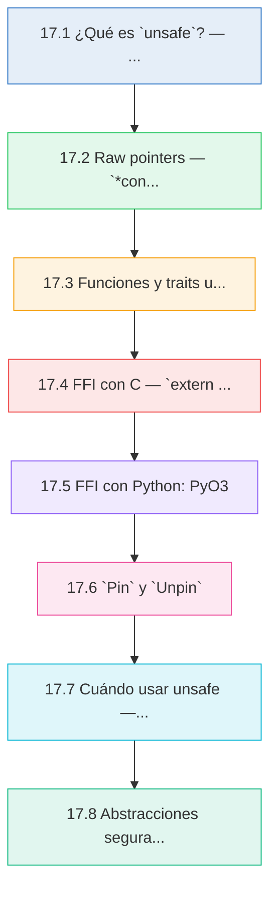
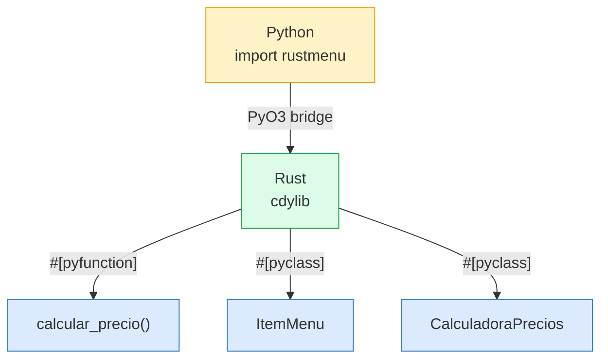
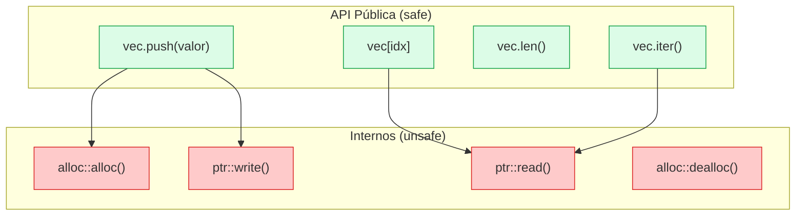
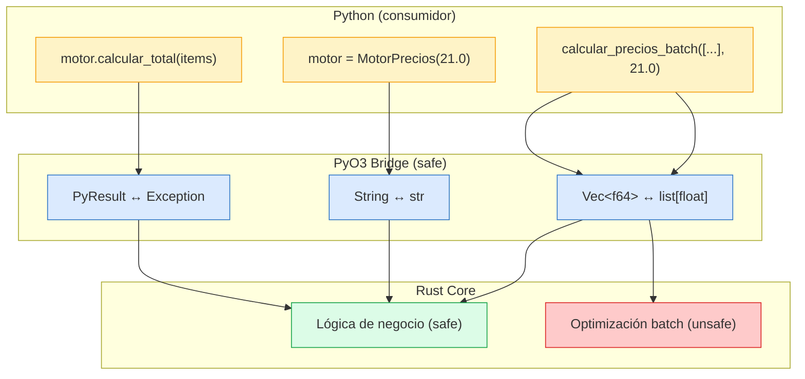

# :warning: Cap 17 — Unsafe y FFI

<div class="chapter-meta">
  <span class="meta-item">🕐 4-5 horas</span>
  <span class="meta-item">📊 Nivel: Experto</span>
  <span class="meta-item">🎯 Semana 9</span>
</div>

<div class="chapter-objective">
<h4>Objetivo del capítulo</h4>
<p>Al finalizar este capítulo seras capaz de usar <code>unsafe</code> de forma responsable para desreferenciar raw pointers, interactuar con código C y Python a traves de FFI y PyO3, aplicar <code>Pin&lt;T&gt;</code> en contextos asincrónicos, y construir abstracciones publicas seguras sobre internos inseguros, siguiendo los mismos patrones que utiliza la biblioteca estandar de Rust.</p>
</div>

<div class="chapter-map">



</div>


!!! quote "Contexto"
    Rust garantiza seguridad de memoria **en tiempo de compilación** — pero hay operaciones que el compilador no puede verificar. Para esos casos existe `unsafe`: un mecanismo que te da 5 superpoderes a cambio de asumir la responsabilidad manualmente. Este capítulo cubre cuándo y cómo usar `unsafe`, cómo interactuar con código C y Python a través de FFI, y cómo construir abstracciones seguras sobre internos inseguros. Si vienes de Python, piensa en `unsafe` como el equivalente a escribir extensiones en C — pero con herramientas mucho mejores.

<div class="connection-box" markdown>
<h4>Conexion con el capítulo anterior</h4>
<p>En el <a href="16-proyecto-final.md">Capítulo 16 — Proyecto Final</a> integraste todos los conceptos de Rust seguro en una aplicación completa. Ahora vas a cruzar la frontera: aprenderas a salir del sandbox seguro del compilador cuando sea necesario, manteniendo las garantias para el resto de tu código. Veras que las mismas habilidades de ownership, lifetimes y traits que dominaste en el proyecto final son la base para escribir <code>unsafe</code> correcto.</p>
</div>

---

## 17.1 ¿Qué es `unsafe`? — Los 5 superpoderes

`unsafe` en Rust **no desactiva** el borrow checker ni las reglas de ownership. Solo desbloquea 5 operaciones específicas que el compilador no puede verificar automáticamente:

| Superpoder | Descripción |
|---|---|
| Desreferenciar raw pointers | Acceder al valor detrás de `*const T` o `*mut T` |
| Llamar funciones unsafe | Funciones marcadas `unsafe fn` o funciones externas (FFI) |
| Acceder/modificar statics mutables | Variables `static mut` (posible data race) |
| Implementar traits unsafe | Traits como `Send` y `Sync` que el compilador no puede verificar |
| Acceder a campos de unions | Unions de C donde solo un campo es válido a la vez |

<div class="concept-question">
<h4>Pregunta para reflexionar</h4>
<p>Si <code>unsafe</code> no desactiva el borrow checker, ¿que reglas de Rust siguen aplicandose dentro de un bloque <code>unsafe</code>? ¿Por que crees que Rust eligio este disenyo en vez de desactivar todas las verificaciones como hace C?</p>
</div>

```rust
fn main() {
    let mut valor = 42;

    // Crear raw pointers es SEGURO — no necesita unsafe
    let ptr_const: *const i32 = &valor;
    let ptr_mut: *mut i32 = &mut valor;

    // Desreferenciar raw pointers SÍ necesita unsafe
    unsafe {
        println!("Valor via *const: {}", *ptr_const);  // Superpoder 1
        *ptr_mut = 100;                                  // Superpoder 1
        println!("Valor modificado: {}", *ptr_mut);
    }
}
```

<div class="comparison" markdown>
<div class="lang-box python" markdown>

#### :snake: Python — Sin concepto de unsafe

```python
# Python no tiene "unsafe" — todo código tiene
# los mismos permisos
import ctypes

# Acceso directo a memoria — siempre "permitido"
# pero puede causar segfault sin aviso
valor = ctypes.c_int(42)
ptr = ctypes.pointer(valor)
print(ptr.contents.value)  # 42

# Python confía en el programador — no hay red de seguridad
```

</div>
<div class="lang-box rust" markdown>

#### :crab: Rust — Unsafe explícito y acotado

```rust
fn main() {
    let mut valor: i32 = 42;
    let ptr: *mut i32 = &mut valor;

    // El compilador EXIGE que declares la zona de riesgo
    unsafe {
        *ptr = 100;
        println!("Valor: {}", *ptr);
    }
    // Fuera del bloque unsafe, las garantías normales aplican
}
```

</div>
</div>

!!! danger "Importante: unsafe NO significa inseguro"
    `unsafe` significa: **"yo, el programador, he verificado manualmente que este código cumple las invariantes de Rust"**. El bloque `unsafe` es una promesa, no un permiso para hacer cualquier cosa. Si rompes las invariantes, obtienes Undefined Behavior (UB), que es peor que un crash — puede corromper datos silenciosamente.

<div class="misconception-box">
<h4>Mitos comunes sobre unsafe</h4>
<ul>
<li><strong>Mito 1: "unsafe desactiva todas las verificaciones del compilador."</strong> — Falso. El borrow checker, el sistema de tipos, los lifetimes de las referencias y todas las demas reglas de Rust siguen activas dentro de <code>unsafe</code>. Solo se desbloquean 5 operaciones específicas que el compilador no puede verificar.</li>
<li><strong>Mito 2: "Si mi código compila con unsafe, es correcto."</strong> — Falso. El compilador confia en ti dentro de <code>unsafe</code>. Que compile no significa que sea correcto: puedes tener Undefined Behavior que corrompa datos silenciosamente sin ningun error ni warning.</li>
<li><strong>Mito 3: "Los programadores expertos de Rust escriben mucho unsafe."</strong> — Falso. Los programadores expertos escriben el mínimo <code>unsafe</code> posible y lo encapsulan detras de APIs seguras. El 99% del código Rust idiomatico no necesita <code>unsafe</code>. Proyectos grandes como Servo o ripgrep tienen porcentajes muy bajos de código unsafe.</li>
</ul>
</div>

---

## 17.2 Raw pointers — `*const T` y `*mut T`

Los raw pointers son el equivalente de los punteros de C. A diferencia de las referencias (`&T`, `&mut T`), los raw pointers:

- **Pueden ser nulos**
- **No tienen lifetime** — el compilador no verifica que apunten a datos válidos
- **No siguen reglas de aliasing** — puedes tener múltiples `*mut T` al mismo dato
- **No implementan auto-deref**

```rust
fn main() {
    let mut datos = vec![10, 20, 30, 40, 50];

    // Crear raw pointers desde referencias — seguro
    let ptr_primero: *const i32 = &datos[0];
    let ptr_tercero: *mut i32 = &mut datos[2];

    // Crear raw pointer desde dirección arbitraria — seguro (crear, no usar)
    let ptr_arbitrario = 0x012345usize as *const i32;

    println!("ptr_primero apunta a: {:?}", ptr_primero);
    println!("ptr_arbitrario: {:?}", ptr_arbitrario);

    // Desreferenciar — unsafe
    unsafe {
        println!("Primer elemento: {}", *ptr_primero);  // 10
        *ptr_tercero = 999;
        println!("Tercer elemento modificado: {}", *ptr_tercero);  // 999
    }

    // NUNCA desreferencies ptr_arbitrario — UB / segfault
    // unsafe { println!("{}", *ptr_arbitrario); }  // 💥
}
```

### Aritmética de punteros

```rust
fn main() {
    let valores = [100, 200, 300, 400, 500];
    let base: *const i32 = valores.as_ptr();

    unsafe {
        for i in 0..valores.len() {
            // .add(n) avanza n * size_of::<T>() bytes
            let ptr = base.add(i);
            println!("valores[{i}] = {}", *ptr);
        }
    }
}
```

### Convertir entre raw pointers y referencias

```rust
fn main() {
    let mut valor = 42;

    // Referencia → raw pointer (seguro)
    let ptr: *mut i32 = &mut valor;

    // Raw pointer → referencia (unsafe)
    unsafe {
        let referencia: &mut i32 = &mut *ptr;
        *referencia += 8;
    }

    println!("Valor: {valor}");  // 50
}
```

<div class="concept-question">
<h4>Pregunta para reflexionar</h4>
<p>Si crear un raw pointer es seguro pero desreferenciarlo es <code>unsafe</code>, ¿que podria salir mal entre la creación y el uso del puntero? Piensa en escenarios donde el dato original se libera, se mueve o cambia de tipo.</p>
</div>

!!! warning "Regla de oro"
    Crear un raw pointer es siempre seguro. **Desreferenciarlo** es siempre `unsafe`. Piensa en crear un pointer como anotar una dirección en un papel — leerla es seguro; ir a esa dirección y abrir la puerta es lo peligroso.

<div class="micro-exercise">
<h4>Micro-ejercicio 1: Raw pointers básicos</h4>
<p>Sin ejecutar el código, predice la salida de este programa. Luego verifica tu respuesta ejecutandolo:</p>

```rust
fn main() {
    let a = 10;
    let b = 20;
    let ptr_a: *const i32 = &a;
    let ptr_b: *const i32 = &b;

    unsafe {
        println!("a = {}, b = {}", *ptr_a, *ptr_b);
        println!("Son iguales? {}", ptr_a == ptr_b);
    }
}
```

<details>
<summary>Respuesta</summary>
<p>La salida es: <code>a = 10, b = 20</code> seguido de <code>Son iguales? false</code>. Los punteros apuntan a direcciones de memoria distintas (<code>a</code> y <code>b</code> son variables diferentes), por lo que la comparación de punteros da <code>false</code>. Nota: comparar raw pointers compara las <strong>direcciones</strong>, no los valores.</p>
</details>
</div>

---

## 17.3 Funciones y traits unsafe

### `unsafe fn`

Una función `unsafe fn` le dice al caller: "para usarme correctamente, debes cumplir estas precondiciones que el compilador no puede verificar".

```rust
/// Divide un slice en dos en el índice dado.
///
/// # Safety
/// `mid` debe ser <= `slice.len()`. Si no, es UB.
unsafe fn dividir_en(slice: &mut [i32], mid: usize) -> (&mut [i32], &mut [i32]) {
    let len = slice.len();
    let ptr = slice.as_mut_ptr();

    // Creamos dos slices que no se solapan
    unsafe {
        (
            std::slice::from_raw_parts_mut(ptr, mid),
            std::slice::from_raw_parts_mut(ptr.add(mid), len - mid),
        )
    }
}

fn main() {
    let mut datos = vec![1, 2, 3, 4, 5];

    // El caller DEBE garantizar que mid <= len
    unsafe {
        let (izq, der) = dividir_en(&mut datos, 3);
        println!("Izquierda: {:?}", izq);  // [1, 2, 3]
        println!("Derecha: {:?}", der);     // [4, 5]
    }
}
```

### `unsafe impl` — Traits unsafe

Algunos traits requieren que el implementador garantice invariantes que el compilador no puede verificar:

```rust
struct MiTipo {
    datos: Vec<i32>,
}

// Send: "este tipo se puede mover entre hilos de forma segura"
// Sync: "este tipo se puede compartir entre hilos de forma segura"
// El compilador los implementa automáticamente si todos los campos son Send/Sync.
// Solo necesitas unsafe impl si tienes raw pointers internos.

struct MiContenedor {
    ptr: *mut i32,
    len: usize,
}

// Nosotros garantizamos que MiContenedor es seguro de enviar entre hilos
// porque el ptr apunta a memoria que solo este contenedor posee.
unsafe impl Send for MiContenedor {}
unsafe impl Sync for MiContenedor {}
```

<div class="pro-tip">
<h4>Consejo profesional</h4>
<p>Usa <code>#[deny(unsafe_op_in_unsafe_fn)]</code> en tus modulos con código unsafe. Este atributo obliga a que incluso dentro de funciones <code>unsafe fn</code> debas usar bloques <code>unsafe { }</code> explicitos para cada operación insegura. Esto hace que cada punto de riesgo sea visible y auditable, en vez de tener toda la función como una "zona libre" implícita.</p>
</div>

!!! tip "Documentar precondiciones con `# Safety`"
    Toda función `unsafe fn` debe documentar sus precondiciones en una sección `# Safety` del doc comment. Es una convención del ecosistema Rust y `clippy` te lo recordará si lo olvidas.

---

## 17.4 FFI con C — `extern "C"`

FFI (Foreign Function Interface) permite llamar funciones de C desde Rust y viceversa. Las funciones externas son **siempre unsafe** porque el compilador no puede verificar qué hace el código C.

### Llamar a C desde Rust

```rust
// Declarar funciones externas de la libc
extern "C" {
    fn abs(input: i32) -> i32;
    fn strlen(s: *const std::os::raw::c_char) -> usize;
    fn printf(format: *const std::os::raw::c_char, ...) -> i32;
}

fn main() {
    unsafe {
        // Llamar a abs() de C
        println!("abs(-5) = {}", abs(-5));  // 5

        // Llamar a strlen() de C
        let saludo = b"Hola RustMenu\0";  // \0 terminado como en C
        let len = strlen(saludo.as_ptr() as *const _);
        println!("strlen = {}", len);  // 13
    }
}
```

### Exponer Rust a C con `#[no_mangle]`

```rust
// Esta función puede ser llamada desde C
#[no_mangle]
pub extern "C" fn calcular_total_pedido(precios: *const f64, cantidad: usize) -> f64 {
    if precios.is_null() || cantidad == 0 {
        return 0.0;
    }

    // Convertimos el raw pointer en un slice seguro
    let precios_slice = unsafe {
        std::slice::from_raw_parts(precios, cantidad)
    };

    precios_slice.iter().sum()
}

// Para compilar como biblioteca C:
// En Cargo.toml:
// [lib]
// crate-type = ["cdylib"]
```

### `bindgen` para generación automática

En lugar de escribir las declaraciones `extern "C"` manualmente, `bindgen` genera bindings automáticamente desde headers de C:

```toml
# Cargo.toml
[build-dependencies]
bindgen = "0.70"
```

```rust
// build.rs
fn main() {
    println!("cargo:rerun-if-changed=wrapper.h");

    let bindings = bindgen::Builder::default()
        .header("wrapper.h")
        .parse_callbacks(Box::new(bindgen::CargoCallbacks::new()))
        .generate()
        .expect("Error generando bindings");

    let out_path = std::path::PathBuf::from(std::env::var("OUT_DIR").unwrap());
    bindings
        .write_to_file(out_path.join("bindings.rs"))
        .expect("Error escribiendo bindings");
}
```

```rust
// src/lib.rs
include!(concat!(env!("OUT_DIR"), "/bindings.rs"));
```

<div class="comparison" markdown>
<div class="lang-box python" markdown>

#### :snake: Python — ctypes / cffi

```python
import ctypes

# Cargar biblioteca C
lib = ctypes.CDLL("./libmenu.so")

# Declarar firma de la función
lib.calcular_total_pedido.argtypes = [
    ctypes.POINTER(ctypes.c_double),
    ctypes.c_size_t,
]
lib.calcular_total_pedido.restype = ctypes.c_double

# Llamar
precios = (ctypes.c_double * 3)(12.5, 8.0, 15.0)
total = lib.calcular_total_pedido(precios, 3)
print(f"Total: {total}")  # 35.5
```

</div>
<div class="lang-box rust" markdown>

#### :crab: Rust — extern "C" nativo

```rust
extern "C" {
    fn calcular_total_pedido(
        precios: *const f64,
        cantidad: usize,
    ) -> f64;
}

fn main() {
    let precios = [12.5, 8.0, 15.0];
    unsafe {
        let total = calcular_total_pedido(
            precios.as_ptr(),
            precios.len(),
        );
        println!("Total: {total}");  // 35.5
    }
}
```

</div>
</div>

<div class="concept-question">
<h4>Pregunta para reflexionar</h4>
<p>Cuando expones una función Rust a C con <code>#[no_mangle] pub extern "C" fn</code>, ¿que garantias de Rust se pierden del lado del llamador en C? ¿Como podrias diseñar la API para que sea lo más segura posible para el consumidor en C (por ejemplo, validando punteros nulos)?</p>
</div>

---

## 17.5 FFI con Python: PyO3

PyO3 es el framework estándar para crear extensiones de Python escritas en Rust. Es el equivalente moderno de escribir extensiones en C, pero con las garantías de seguridad de Rust.

### Setup inicial

```toml
# Cargo.toml
[lib]
name = "rustmenu"
crate-type = ["cdylib"]

[dependencies]
pyo3 = { version = "0.22", features = ["extension-module"] }
```

### `#[pyfunction]` — Exponer funciones

```rust
use pyo3::prelude::*;

/// Calcula el precio total de un pedido con descuento.
#[pyfunction]
fn calcular_precio(precios: Vec<f64>, descuento_pct: f64) -> PyResult<f64> {
    if descuento_pct < 0.0 || descuento_pct > 100.0 {
        return Err(PyErr::new::<pyo3::exceptions::PyValueError, _>(
            format!("Descuento inválido: {descuento_pct}%"),
        ));
    }

    let subtotal: f64 = precios.iter().sum();
    let descuento = subtotal * (descuento_pct / 100.0);
    Ok(subtotal - descuento)
}

/// Aplica IVA a un precio base.
#[pyfunction]
fn aplicar_iva(precio: f64, iva_pct: Option<f64>) -> f64 {
    let iva = iva_pct.unwrap_or(21.0);  // IVA por defecto 21%
    precio * (1.0 + iva / 100.0)
}
```

### `#[pyclass]` — Exponer structs como clases de Python

```rust
use pyo3::prelude::*;

#[pyclass]
#[derive(Clone)]
struct ItemMenu {
    #[pyo3(get, set)]
    nombre: String,
    #[pyo3(get, set)]
    precio: f64,
    #[pyo3(get)]
    disponible: bool,
}

#[pymethods]
impl ItemMenu {
    #[new]
    fn new(nombre: String, precio: f64) -> PyResult<Self> {
        if precio < 0.0 {
            return Err(PyErr::new::<pyo3::exceptions::PyValueError, _>(
                "El precio no puede ser negativo",
            ));
        }
        Ok(ItemMenu { nombre, precio, disponible: true })
    }

    fn precio_con_iva(&self, iva_pct: Option<f64>) -> f64 {
        let iva = iva_pct.unwrap_or(21.0);
        self.precio * (1.0 + iva / 100.0)
    }

    fn marcar_agotado(&mut self) {
        self.disponible = false;
    }

    fn __repr__(&self) -> String {
        let estado = if self.disponible { "disponible" } else { "agotado" };
        format!("ItemMenu('{}', {:.2}€, {})", self.nombre, self.precio, estado)
    }
}

#[pyclass]
struct CalculadoraPrecios {
    iva_pct: f64,
    descuento_fidelidad: f64,
}

#[pymethods]
impl CalculadoraPrecios {
    #[new]
    fn new(iva_pct: Option<f64>, descuento_fidelidad: Option<f64>) -> Self {
        CalculadoraPrecios {
            iva_pct: iva_pct.unwrap_or(21.0),
            descuento_fidelidad: descuento_fidelidad.unwrap_or(0.0),
        }
    }

    fn total_pedido(&self, items: Vec<ItemMenu>) -> PyResult<f64> {
        if items.is_empty() {
            return Err(PyErr::new::<pyo3::exceptions::PyValueError, _>(
                "El pedido no puede estar vacío",
            ));
        }

        let subtotal: f64 = items.iter()
            .filter(|item| item.disponible)
            .map(|item| item.precio)
            .sum();

        let con_descuento = subtotal * (1.0 - self.descuento_fidelidad / 100.0);
        let con_iva = con_descuento * (1.0 + self.iva_pct / 100.0);
        Ok((con_iva * 100.0).round() / 100.0)
    }
}
```

### `#[pymodule]` — Registrar el módulo

```rust
#[pymodule]
fn rustmenu(m: &Bound<'_, PyModule>) -> PyResult<()> {
    m.add_function(wrap_pyfunction!(calcular_precio, m)?)?;
    m.add_function(wrap_pyfunction!(aplicar_iva, m)?)?;
    m.add_class::<ItemMenu>()?;
    m.add_class::<CalculadoraPrecios>()?;
    Ok(())
}
```

### Usar desde Python

```python
# pip install maturin && maturin develop
import rustmenu

# Funciones
total = rustmenu.calcular_precio([12.50, 8.00, 15.00], 10.0)
print(f"Total con 10% descuento: {total:.2f}€")  # 31.95€

con_iva = rustmenu.aplicar_iva(31.95)
print(f"Con IVA: {con_iva:.2f}€")  # 38.66€

# Clases
paella = rustmenu.ItemMenu("Paella Valenciana", 18.50)
print(paella)  # ItemMenu('Paella Valenciana', 18.50€, disponible)
print(f"Con IVA: {paella.precio_con_iva():.2f}€")  # 22.39€

# Calculadora
calc = rustmenu.CalculadoraPrecios(iva_pct=21.0, descuento_fidelidad=5.0)
items = [
    rustmenu.ItemMenu("Paella", 18.50),
    rustmenu.ItemMenu("Ensalada", 9.00),
    rustmenu.ItemMenu("Vino", 12.00),
]
total_final = calc.total_pedido(items)
print(f"Total final: {total_final:.2f}€")
```



<div class="pro-tip">
<h4>Consejo profesional</h4>
<p>Cuando diseñes modulos PyO3, evita pasar <code>Vec&lt;T&gt;</code> en funciones que se llaman millones de veces: cada llamada clona los datos de Python a Rust. Para hot paths, usa <code>PyReadonlyArray</code> del crate <code>numpy</code> (via <code>pyo3-numpy</code>) que permite acceso zero-copy a arrays de NumPy. Esto puede dar mejoras de rendimiento de 10x-100x en procesamiento numerico intensivo.</p>
</div>

---

## 17.6 `Pin<T>` y `Unpin`

`Pin` es un wrapper que **impide que un valor se mueva en memoria**. Es esencial para structs auto-referenciales y async/await.

### El problema: structs auto-referenciales

```rust
// ❌ Esto NO compila — Rust no permite auto-referencias directas
struct AutoRef {
    datos: String,
    // ptr: &str,  // ¿apuntando a datos? — ¡imposible expresar este lifetime!
}
```

Si un struct contiene un puntero a sí mismo y Rust lo mueve a otra dirección de memoria, el puntero apuntaría a la dirección antigua — **dangling pointer**.

```rust
use std::pin::Pin;
use std::marker::PhantomPinned;

struct AutoReferencial {
    datos: String,
    ptr_datos: *const String,  // raw pointer a self.datos
    _pin: PhantomPinned,       // marca el tipo como !Unpin
}

impl AutoReferencial {
    fn new(datos: String) -> Pin<Box<Self>> {
        let mut boxed = Box::new(AutoReferencial {
            datos,
            ptr_datos: std::ptr::null(),
            _pin: PhantomPinned,
        });

        // Ahora que está en el heap (Box), establecemos la auto-referencia
        let ptr = &boxed.datos as *const String;
        // Safety: no movemos el valor después de establecer el puntero
        unsafe {
            let mut_ref = Pin::as_mut(&mut boxed);
            Pin::get_unchecked_mut(mut_ref).ptr_datos = ptr;
        }

        boxed
    }

    fn datos(&self) -> &str {
        &self.datos
    }

    fn datos_via_ptr(&self) -> &str {
        unsafe { &*self.ptr_datos }
    }
}

fn main() {
    let pinned = AutoReferencial::new(String::from("RustMenu"));

    println!("Directo: {}", pinned.datos());
    println!("Via ptr: {}", pinned.datos_via_ptr());
    // Ambos imprimen "RustMenu"

    // No puedes mover pinned — Pin lo impide
    // let moved = *pinned;  // ❌ Error: cannot move out of Pin
}
```

### ¿Por qué async necesita Pin?

Los futures generados por `async fn` son structs auto-referenciales: las variables locales del async block pueden referenciarse entre sí. Si el runtime moviera el future, esas referencias internas serían inválidas.

```rust
use std::pin::Pin;
use std::future::Future;

// Un future que necesita estar pinned para ser polled
async fn obtener_menu(mesa: u32) -> String {
    let url = format!("/api/mesas/{mesa}/menu");  // (1)
    let respuesta = fetch(&url).await;             // (2)
    respuesta  // url y respuesta pueden referenciarse internamente
}

// El runtime hace esto internamente:
fn poll_example(future: Pin<&mut dyn Future<Output = String>>) {
    // Pin garantiza que el future no se mueve entre polls
    // Las auto-referencias internas siguen siendo válidas
}
```

1. `url` vive en el frame del future
2. Después del `.await`, el future se suspende. Cuando se reanuda, `url` debe seguir en la misma dirección de memoria.

### `Unpin` — Tipos que no necesitan Pin

La mayoría de tipos en Rust implementan `Unpin`, lo que significa que se pueden mover libremente incluso dentro de `Pin`. Solo los tipos con auto-referencias (como futures) son `!Unpin`.

```rust
use std::pin::Pin;

// i32 implementa Unpin — Pin no tiene efecto real
let mut valor = 42;
let pinned = Pin::new(&mut valor);
// Puedes obtener &mut porque i32: Unpin
let referencia = Pin::into_inner(pinned);
*referencia = 100;

// Vec también implementa Unpin
let mut v = vec![1, 2, 3];
let pinned_vec = Pin::new(&mut v);
```

| Concepto | Significado |
|---|---|
| `Pin<P>` | Wrapper que garantiza que el valor apuntado por `P` no se moverá |
| `Unpin` | Trait auto-implementado: "este tipo se puede mover incluso dentro de Pin" |
| `!Unpin` | El tipo NO se puede mover una vez pinned (ej: futures) |
| `PhantomPinned` | Marker que hace que un tipo sea `!Unpin` |
| `Pin::new()` | Crear Pin para tipos `Unpin` (seguro) |
| `Pin::new_unchecked()` | Crear Pin para tipos `!Unpin` (unsafe) |

---

## 17.7 Cuándo usar unsafe — Casos justificados

`unsafe` no es algo que debas evitar a toda costa — es una herramienta para los casos donde el compilador no puede verificar la corrección:

### Casos legítimos

```rust
// 1. Optimización de rendimiento en hot paths
unsafe fn copiar_rapido(src: *const u8, dst: *mut u8, len: usize) {
    std::ptr::copy_nonoverlapping(src, dst, len);
}

// 2. Interacción con hardware / OS
unsafe fn leer_registro(dirección: usize) -> u32 {
    let ptr = dirección as *const u32;
    std::ptr::read_volatile(ptr)
}

// 3. FFI con bibliotecas externas (siempre unsafe)
extern "C" {
    fn sqlite3_open(filename: *const i8, db: *mut *mut std::ffi::c_void) -> i32;
}

// 4. Implementar estructuras de datos con punteros internos
struct NodoLista<T> {
    valor: T,
    siguiente: *mut NodoLista<T>,  // raw pointer para listas enlazadas
}
```

### Casos donde NO usar unsafe

```rust
// ❌ NO uses unsafe para "saltarte" el borrow checker
fn malo(datos: &Vec<i32>) -> &mut Vec<i32> {
    // NUNCA hagas esto — es UB
    // unsafe { &mut *(datos as *const Vec<i32> as *mut Vec<i32>) }
    todo!("Rediseña tu código en vez de usar unsafe")
}

// ❌ NO uses unsafe para "rendimiento" sin medir primero
fn innecesario(slice: &[i32], idx: usize) -> i32 {
    // slice[idx] ya es rápido — el bounds check se elimina en release mode
    // en muchos casos gracias a optimizaciones del compilador
    slice[idx]
}
```

!!! danger "La regla de oro de unsafe"
    **Si no puedes explicar exactamente por qué es seguro, no uses unsafe.** Cada bloque `unsafe` debe tener un comentario `// Safety: ...` que explique por qué las invariantes se mantienen.

<div class="micro-exercise">
<h4>Micro-ejercicio 2: Identificar el error unsafe</h4>
<p>El siguiente código compila pero tiene Undefined Behavior. ¿Puedes identificar el problema sin ejecutarlo?</p>

```rust
fn main() {
    let ptr: *const i32;
    {
        let valor = 42;
        ptr = &valor as *const i32;
    } // valor se libera aqui

    unsafe {
        println!("Valor: {}", *ptr); // ¿Que pasa?
    }
}
```

<details>
<summary>Respuesta</summary>
<p><code>ptr</code> apunta a <code>valor</code>, pero <code>valor</code> se destruye al salir del bloque interno. Cuando desreferenciamos <code>ptr</code> en el <code>unsafe</code>, estamos accediendo a memoria ya liberada: es un <strong>dangling pointer</strong> clasico. Esto es Undefined Behavior incluso aunque el compilador no lo detecte. Con una referencia normal (<code>&amp;i32</code>), el borrow checker habria rechazado este código — esa es exactamente la protección que perdemos al usar raw pointers.</p>
</details>
</div>

---

## 17.8 Abstracciones seguras sobre unsafe

El patrón más importante de Rust: **internos unsafe, API pública segura**. La biblioteca estándar lo usa extensivamente — `Vec`, `String`, `HashMap` todos contienen `unsafe` internamente.

### Ejemplo: `SafeBuffer` — Buffer de bytes seguro

```rust
pub struct SafeBuffer {
    ptr: *mut u8,
    len: usize,
    capacidad: usize,
}

impl SafeBuffer {
    /// Crea un buffer vacío con la capacidad dada.
    pub fn new(capacidad: usize) -> Self {
        let layout = std::alloc::Layout::array::<u8>(capacidad).unwrap();
        let ptr = unsafe { std::alloc::alloc(layout) };

        if ptr.is_null() {
            std::alloc::handle_alloc_error(layout);
        }

        SafeBuffer { ptr, len: 0, capacidad }
    }

    /// Añade un byte al buffer. Retorna Err si está lleno.
    pub fn push(&mut self, byte: u8) -> Result<(), &'static str> {
        if self.len >= self.capacidad {
            return Err("Buffer lleno");
        }

        // Safety: len < capacidad, así que ptr.add(len) está dentro del bloque asignado
        unsafe {
            self.ptr.add(self.len).write(byte);
        }
        self.len += 1;
        Ok(())
    }

    /// Lee un byte por índice. Retorna None si está fuera de rango.
    pub fn get(&self, idx: usize) -> Option<u8> {
        if idx >= self.len {
            return None;
        }

        // Safety: idx < len, y todos los bytes hasta len están inicializados
        Some(unsafe { self.ptr.add(idx).read() })
    }

    /// Retorna el contenido como slice.
    pub fn as_slice(&self) -> &[u8] {
        // Safety: ptr apunta a len bytes inicializados contiguos
        unsafe { std::slice::from_raw_parts(self.ptr, self.len) }
    }

    pub fn len(&self) -> usize {
        self.len
    }

    pub fn is_empty(&self) -> bool {
        self.len == 0
    }
}

impl Drop for SafeBuffer {
    fn drop(&mut self) {
        let layout = std::alloc::Layout::array::<u8>(self.capacidad).unwrap();
        // Safety: ptr fue asignado con el mismo layout
        unsafe {
            std::alloc::dealloc(self.ptr, layout);
        }
    }
}

// Safety: SafeBuffer es dueño exclusivo de su memoria
unsafe impl Send for SafeBuffer {}
unsafe impl Sync for SafeBuffer {}
```

### Uso — completamente seguro para el usuario

```rust
fn main() {
    let mut buffer = SafeBuffer::new(1024);

    // API 100% segura — no se necesita unsafe para usar SafeBuffer
    buffer.push(b'R').unwrap();
    buffer.push(b'u').unwrap();
    buffer.push(b's').unwrap();
    buffer.push(b't').unwrap();

    println!("Contenido: {:?}", buffer.as_slice());  // [82, 117, 115, 116]
    println!("Byte 0: {:?}", buffer.get(0));          // Some(82) = 'R'
    println!("Byte 99: {:?}", buffer.get(99));        // None
    println!("Len: {}", buffer.len());                 // 4
}
```

<div class="code-evolution">
<h4>Evolución del código: De raw pointer directo a abstracción segura</h4>

<div class="evolution-step" data-step="1">
<h5>Paso 1: Uso directo de raw pointers (fragil y peligroso)</h5>

```rust
fn main() {
    let layout = std::alloc::Layout::array::<u8>(4).unwrap();
    let ptr = unsafe { std::alloc::alloc(layout) };

    // El usuario debe recordar cada detalle: offsets, limites, dealloc...
    unsafe {
        ptr.add(0).write(b'R');
        ptr.add(1).write(b'u');
        ptr.add(2).write(b's');
        ptr.add(3).write(b't');
        // Si olvidas dealloc: memory leak
        // Si escribes en ptr.add(4): buffer overflow / UB
        println!("{}", *ptr.add(0) as char);
        std::alloc::dealloc(ptr, layout);
    }
    // Si usas ptr despues de dealloc: use-after-free / UB
}
```
</div>

<div class="evolution-step" data-step="2">
<h5>Paso 2: Encapsular en struct con métodos unsafe</h5>

```rust
struct Buffer {
    ptr: *mut u8,
    len: usize,
    cap: usize,
}

impl Buffer {
    fn new(cap: usize) -> Self {
        let layout = std::alloc::Layout::array::<u8>(cap).unwrap();
        let ptr = unsafe { std::alloc::alloc(layout) };
        Buffer { ptr, len: 0, cap }
    }
    // Mejora: Drop automático, pero push sigue siendo unsafe
    unsafe fn push(&mut self, byte: u8) {
        self.ptr.add(self.len).write(byte);
        self.len += 1;
    }
}

impl Drop for Buffer {
    fn drop(&mut self) {
        let layout = std::alloc::Layout::array::<u8>(self.cap).unwrap();
        unsafe { std::alloc::dealloc(self.ptr, layout); }
    }
}
```
</div>

<div class="evolution-step" data-step="3">
<h5>Paso 3: API publica completamente segura (patrón idiomatico)</h5>

```rust
pub struct SafeBuffer {
    ptr: *mut u8,
    len: usize,
    capacidad: usize,
}

impl SafeBuffer {
    pub fn new(capacidad: usize) -> Self { /* alloc interno */ }

    // API segura: validación de limites ANTES del unsafe
    pub fn push(&mut self, byte: u8) -> Result<(), &'static str> {
        if self.len >= self.capacidad {
            return Err("Buffer lleno");
        }
        // Safety: len < capacidad, garantizado por el if anterior
        unsafe { self.ptr.add(self.len).write(byte); }
        self.len += 1;
        Ok(())
    }

    pub fn get(&self, idx: usize) -> Option<u8> {
        if idx >= self.len { return None; }
        Some(unsafe { self.ptr.add(idx).read() })
    }
    // El usuario NUNCA necesita escribir unsafe
}
```
</div>
</div>

### Cómo `Vec<T>` usa unsafe internamente



!!! tip "Patrón clave: la frontera unsafe"
    La biblioteca estándar de Rust demuestra el patrón: **toda la complejidad unsafe vive detrás de una API pública segura**. Los usuarios de `Vec`, `String`, `HashMap` nunca necesitan escribir `unsafe`. Tu código debería seguir el mismo principio.

---

## 🌐 RustMenu: PyO3 + optimización unsafe

Integremos todo: un módulo PyO3 que expone la lógica de precios de RustMenu a Python, con una optimización unsafe para el hot path.

```rust
use pyo3::prelude::*;

/// Calcula precios con optimización para vectores grandes.
/// Usa SIMD-like manual sum para hot paths.
#[pyfunction]
fn calcular_precios_batch(precios: Vec<f64>, iva_pct: f64) -> Vec<f64> {
    let factor = 1.0 + iva_pct / 100.0;

    if precios.len() < 1000 {
        // Camino seguro para vectores pequeños
        return precios.iter().map(|p| (p * factor * 100.0).round() / 100.0).collect();
    }

    // Optimización unsafe para vectores grandes (>1000 items)
    let mut resultado = Vec::with_capacity(precios.len());
    let src = precios.as_ptr();
    let dst = resultado.as_mut_ptr();

    unsafe {
        for i in 0..precios.len() {
            // Safety: i < precios.len(), ambos punteros son válidos,
            // y no hay solapamiento entre src y dst
            let precio = src.add(i).read();
            let con_iva = (precio * factor * 100.0).round() / 100.0;
            dst.add(i).write(con_iva);
        }
        // Safety: hemos escrito exactamente precios.len() elementos
        resultado.set_len(precios.len());
    }

    resultado
}

#[pyclass]
struct MotorPrecios {
    iva_pct: f64,
    descuentos: Vec<(String, f64)>,  // (categoria, porcentaje)
}

#[pymethods]
impl MotorPrecios {
    #[new]
    fn new(iva_pct: f64) -> Self {
        MotorPrecios {
            iva_pct,
            descuentos: Vec::new(),
        }
    }

    fn agregar_descuento(&mut self, categoria: String, porcentaje: f64) -> PyResult<()> {
        if porcentaje < 0.0 || porcentaje > 100.0 {
            return Err(PyErr::new::<pyo3::exceptions::PyValueError, _>(
                format!("Descuento fuera de rango: {porcentaje}%"),
            ));
        }
        self.descuentos.push((categoria, porcentaje));
        Ok(())
    }

    fn calcular_total(&self, items: Vec<(String, f64)>) -> f64 {
        let subtotal: f64 = items.iter().map(|(_, precio)| precio).sum();
        let con_iva = subtotal * (1.0 + self.iva_pct / 100.0);
        (con_iva * 100.0).round() / 100.0
    }
}

#[pymodule]
fn rustmenu_precios(m: &Bound<'_, PyModule>) -> PyResult<()> {
    m.add_function(wrap_pyfunction!(calcular_precios_batch, m)?)?;
    m.add_class::<MotorPrecios>()?;
    Ok(())
}
```

### Diagrama: frontera safe/unsafe en el módulo



<div class="connection-box" markdown>
<h4>Conexion con el siguiente capítulo</h4>
<p>Has aprendido a extender Rust más alla de lo que el compilador puede verificar. En el <a href="18-macros.md">Capítulo 18 — Macros</a> descubriras otra forma de extender Rust: generando código en tiempo de compilación. Las macros procedurales, en particular, se combinan frecuentemente con unsafe (por ejemplo, <code>#[pyclass]</code> de PyO3 es una macro procedural que genera código FFI por ti). Entender unsafe te dara la base para comprender que hace ese código generado bajo el capo.</p>
</div>

---

## :link: Recursos

| Recurso | Enlace |
|---------|--------|
| Unsafe Rust (The Book) | [doc.rust-lang.org/book/ch19-01-unsafe-rust](https://doc.rust-lang.org/book/ch19-01-unsafe-rust.html) |
| The Rustonomicon | [doc.rust-lang.org/nomicon](https://doc.rust-lang.org/nomicon/) |
| PyO3 User Guide | [pyo3.rs](https://pyo3.rs/) |
| `std::pin` Module | [doc.rust-lang.org/std/pin](https://doc.rust-lang.org/std/pin/index.html) |
| `bindgen` User Guide | [rust-lang.github.io/rust-bindgen](https://rust-lang.github.io/rust-bindgen/) |

---

## 🎯 Ejercicios

??? question "Ejercicio 17.1: Safe wrapper sobre raw pointer"
    <span class="bloom-badge apply">Aplicar</span>

    Crea un struct `SafePtr<T>` que encapsule un raw pointer `*mut T` y ofrezca una API segura con métodos `new(valor: T)`, `get(&self) -> &T`, `get_mut(&mut self) -> &mut T`, y un `Drop` correcto. El usuario nunca debe necesitar `unsafe`.

    ??? success "Solución"
        ```rust
        pub struct SafePtr<T> {
            ptr: *mut T,
        }

        impl<T> SafePtr<T> {
            pub fn new(valor: T) -> Self {
                let boxed = Box::new(valor);
                SafePtr {
                    ptr: Box::into_raw(boxed),
                }
            }

            pub fn get(&self) -> &T {
                // Safety: ptr fue creado con Box::into_raw, es válido y alineado.
                // &self garantiza que no hay &mut T activo.
                unsafe { &*self.ptr }
            }

            pub fn get_mut(&mut self) -> &mut T {
                // Safety: ptr fue creado con Box::into_raw, es válido y alineado.
                // &mut self garantiza acceso exclusivo.
                unsafe { &mut *self.ptr }
            }
        }

        impl<T> Drop for SafePtr<T> {
            fn drop(&mut self) {
                // Safety: ptr fue creado con Box::into_raw, lo reconstruimos para liberar.
                unsafe {
                    drop(Box::from_raw(self.ptr));
                }
            }
        }

        fn main() {
            let mut sp = SafePtr::new(String::from("Paella Valenciana"));
            println!("Plato: {}", sp.get());
            sp.get_mut().push_str(" (especial)");
            println!("Plato actualizado: {}", sp.get());
        }
        ```

??? question "Ejercicio 17.2: FFI con función de C"
    <span class="bloom-badge apply">Aplicar</span>

    Declara la función `qsort` de la libc con `extern "C"` y úsala para ordenar un array de `i32`. Escribe la función de comparación compatible con C.

    !!! tip "Pista"
        La firma de `qsort` es: `fn qsort(base: *mut c_void, nmemb: usize, size: usize, compar: extern "C" fn(*const c_void, *const c_void) -> i32)`.

    ??? success "Solución"
        ```rust
        use std::ffi::c_void;
        use std::mem;

        extern "C" {
            fn qsort(
                base: *mut c_void,
                nmemb: usize,
                size: usize,
                compar: extern "C" fn(*const c_void, *const c_void) -> i32,
            );
        }

        extern "C" fn comparar_i32(a: *const c_void, b: *const c_void) -> i32 {
            unsafe {
                let val_a = *(a as *const i32);
                let val_b = *(b as *const i32);
                val_a - val_b
            }
        }

        fn main() {
            let mut precios = [45, 12, 78, 3, 56, 23, 89, 1];
            println!("Antes: {:?}", precios);

            unsafe {
                qsort(
                    precios.as_mut_ptr() as *mut c_void,
                    precios.len(),
                    mem::size_of::<i32>(),
                    comparar_i32,
                );
            }

            println!("Después: {:?}", precios);
            // [1, 3, 12, 23, 45, 56, 78, 89]
        }
        ```

??? question "Ejercicio 17.3: PyO3 — Validador de pedido"
    <span class="bloom-badge create">Crear</span>

    Crea un `#[pyclass]` llamado `ValidadorPedido` que tenga un método `validar(items: Vec<(String, f64)>) -> PyResult<bool>`. Debe rechazar pedidos con precios negativos, más de 50 items, o total superior a 10000. Lanza excepciones Python descriptivas.

    ??? success "Solución"
        ```rust
        use pyo3::prelude::*;

        #[pyclass]
        struct ValidadorPedido {
            max_items: usize,
            max_total: f64,
        }

        #[pymethods]
        impl ValidadorPedido {
            #[new]
            fn new(max_items: Option<usize>, max_total: Option<f64>) -> Self {
                ValidadorPedido {
                    max_items: max_items.unwrap_or(50),
                    max_total: max_total.unwrap_or(10_000.0),
                }
            }

            fn validar(&self, items: Vec<(String, f64)>) -> PyResult<bool> {
                if items.is_empty() {
                    return Err(PyErr::new::<pyo3::exceptions::PyValueError, _>(
                        "El pedido no puede estar vacío",
                    ));
                }

                if items.len() > self.max_items {
                    return Err(PyErr::new::<pyo3::exceptions::PyValueError, _>(
                        format!("Demasiados items: {} (máx: {})", items.len(), self.max_items),
                    ));
                }

                for (nombre, precio) in &items {
                    if *precio < 0.0 {
                        return Err(PyErr::new::<pyo3::exceptions::PyValueError, _>(
                            format!("Precio negativo en '{}': {:.2}€", nombre, precio),
                        ));
                    }
                }

                let total: f64 = items.iter().map(|(_, p)| p).sum();
                if total > self.max_total {
                    return Err(PyErr::new::<pyo3::exceptions::PyValueError, _>(
                        format!("Total excede límite: {:.2}€ (máx: {:.2}€)", total, self.max_total),
                    ));
                }

                Ok(true)
            }
        }
        ```

??? question "Ejercicio 17.4: Pin con future simulado"
    <span class="bloom-badge analyze">Analizar</span>

    Explica por qué el siguiente código es incorrecto y corrígelo usando `Pin`:

    ```rust
    struct MiFuture {
        datos: String,
        ptr_datos: *const String,
    }

    fn crear_future() -> MiFuture {
        let mut f = MiFuture {
            datos: String::from("async data"),
            ptr_datos: std::ptr::null(),
        };
        f.ptr_datos = &f.datos;  // auto-referencia
        f  // ← problema: al retornar, f se mueve
    }
    ```

    ??? success "Solución"
        ```rust
        use std::pin::Pin;
        use std::marker::PhantomPinned;

        struct MiFuture {
            datos: String,
            ptr_datos: *const String,
            _pin: PhantomPinned,
        }

        fn crear_future() -> Pin<Box<MiFuture>> {
            let mut boxed = Box::new(MiFuture {
                datos: String::from("async data"),
                ptr_datos: std::ptr::null(),
                _pin: PhantomPinned,
            });

            // Establecer la auto-referencia después de que está en el heap
            let ptr = &boxed.datos as *const String;
            unsafe {
                let mut_ref = Pin::as_mut(&mut boxed);
                Pin::get_unchecked_mut(mut_ref).ptr_datos = ptr;
            }

            boxed
            // Box está en el heap y Pin impide que se mueva.
            // La auto-referencia es ahora estable.
        }

        fn main() {
            let pinned = crear_future();
            println!("Datos: {}", pinned.datos);
            // Acceder via ptr es seguro porque Pin garantiza que no se movió
            unsafe {
                println!("Via ptr: {}", &*pinned.ptr_datos);
            }
        }
        ```

        **Problema original:** Al retornar `f` por valor, el struct se mueve a otra dirección de memoria. `ptr_datos` sigue apuntando a la dirección antigua, creando un dangling pointer.

        **Solución:** Usar `Box` para alojar en el heap y `Pin` para impedir que se mueva. `PhantomPinned` marca el tipo como `!Unpin`, haciendo que `Pin` sea efectivo.

??? question "Ejercicio 17.5: Abstracción segura — RingBuffer"
    <span class="bloom-badge create">Crear</span>

    Implementa un `RingBuffer<T>` (buffer circular) que use raw pointers internamente pero ofrezca una API completamente segura con: `new(capacidad)`, `push(valor)` (sobreescribe el más antiguo si está lleno), `pop() -> Option<T>`, e `iter()`.

    ??? success "Solución"
        ```rust
        pub struct RingBuffer<T> {
            ptr: *mut T,
            capacidad: usize,
            head: usize,    // próxima posición de lectura
            tail: usize,    // próxima posición de escritura
            len: usize,
        }

        impl<T> RingBuffer<T> {
            pub fn new(capacidad: usize) -> Self {
                assert!(capacidad > 0, "Capacidad debe ser > 0");
                let layout = std::alloc::Layout::array::<T>(capacidad).unwrap();
                let ptr = unsafe { std::alloc::alloc(layout) as *mut T };
                if ptr.is_null() {
                    std::alloc::handle_alloc_error(layout);
                }
                RingBuffer { ptr, capacidad, head: 0, tail: 0, len: 0 }
            }

            pub fn push(&mut self, valor: T) {
                if self.len == self.capacidad {
                    // Sobreescribir: drop el valor antiguo
                    unsafe { self.ptr.add(self.tail).drop_in_place(); }
                    self.head = (self.head + 1) % self.capacidad;
                } else {
                    self.len += 1;
                }
                // Safety: tail < capacidad, ptr + tail está dentro del bloque
                unsafe { self.ptr.add(self.tail).write(valor); }
                self.tail = (self.tail + 1) % self.capacidad;
            }

            pub fn pop(&mut self) -> Option<T> {
                if self.len == 0 {
                    return None;
                }
                // Safety: head < capacidad, el elemento está inicializado
                let valor = unsafe { self.ptr.add(self.head).read() };
                self.head = (self.head + 1) % self.capacidad;
                self.len -= 1;
                Some(valor)
            }

            pub fn len(&self) -> usize { self.len }
            pub fn is_empty(&self) -> bool { self.len == 0 }
        }

        impl<T> Drop for RingBuffer<T> {
            fn drop(&mut self) {
                // Drop todos los elementos restantes
                while self.pop().is_some() {}
                let layout = std::alloc::Layout::array::<T>(self.capacidad).unwrap();
                unsafe { std::alloc::dealloc(self.ptr as *mut u8, layout); }
            }
        }

        fn main() {
            let mut rb = RingBuffer::new(3);
            rb.push("Paella");
            rb.push("Ensalada");
            rb.push("Tarta");
            rb.push("Vino");  // sobreescribe "Paella"

            while let Some(plato) = rb.pop() {
                println!("Plato: {plato}");
            }
            // Ensalada, Tarta, Vino
        }
        ```

---

## :brain: Flashcards de repaso

<div class="flashcard">
<div class="front">¿Cuáles son los 5 superpoderes de <code>unsafe</code> en Rust?</div>
<div class="back">1. Desreferenciar raw pointers (<code>*const T</code>, <code>*mut T</code>). 2. Llamar funciones <code>unsafe fn</code> o funciones externas (FFI). 3. Acceder/modificar variables <code>static mut</code>. 4. Implementar traits <code>unsafe</code> (<code>Send</code>, <code>Sync</code>). 5. Acceder a campos de <code>union</code>.</div>
</div>

<div class="flashcard">
<div class="front">¿Cuál es la diferencia entre <code>*const T</code> y <code>&T</code>?</div>
<div class="back"><code>&T</code> es una referencia segura: tiene lifetime, no puede ser nula, y el compilador garantiza su validez. <code>*const T</code> es un raw pointer: puede ser nulo, no tiene lifetime, y desreferenciarlo requiere <code>unsafe</code>. Crear un raw pointer es seguro; usarlo no lo es.</div>
</div>

<div class="flashcard">
<div class="front">¿Por qué las funciones de FFI (<code>extern "C"</code>) son siempre <code>unsafe</code>?</div>
<div class="back">Porque el compilador de Rust no puede verificar qué hace el código C/externo. Podría acceder a memoria inválida, causar data races, o romper cualquier invariante. El programador debe garantizar que la llamada es correcta.</div>
</div>

<div class="flashcard">
<div class="front">¿Qué hacen <code>#[pyfunction]</code> y <code>#[pymodule]</code> en PyO3?</div>
<div class="back"><code>#[pyfunction]</code> marca una función Rust para exponerla como función Python. <code>#[pymodule]</code> define el módulo Python que agrupa funciones y clases. PyO3 genera automáticamente el código de conversión entre tipos Rust y Python.</div>
</div>

<div class="flashcard">
<div class="front">¿Qué es <code>Pin&lt;T&gt;</code> y por qué lo necesita async?</div>
<div class="back"><code>Pin&lt;T&gt;</code> es un wrapper que impide que un valor se mueva en memoria. Los futures de async son structs auto-referenciales (contienen punteros internos a sí mismos). Si se movieran, esos punteros serían inválidos. <code>Pin</code> garantiza que permanecen en su dirección de memoria.</div>
</div>

<div class="flashcard">
<div class="front">¿Cuál es el patrón "abstracción segura sobre unsafe"?</div>
<div class="back">Encapsular todo el código <code>unsafe</code> dentro de un módulo/struct y exponer una API pública completamente segura. Ejemplo: <code>Vec&lt;T&gt;</code> usa <code>alloc</code>, <code>ptr::write</code> internamente, pero <code>push()</code>, <code>pop()</code>, <code>iter()</code> son 100% seguros. El usuario nunca necesita escribir <code>unsafe</code>.</div>
</div>

---

## :video_game: Quiz interactivo

<div class="quiz" data-quiz-id="ch17-q1">
<h4>Pregunta 1: ¿Cuál de estas operaciones NO requiere un bloque <code>unsafe</code>?</h4>
<button class="quiz-option" data-correct="false">Desreferenciar un <code>*mut T</code></button>
<button class="quiz-option" data-correct="false">Llamar a una función <code>extern "C"</code></button>
<button class="quiz-option" data-correct="true">Crear un raw pointer <code>*const T</code> desde una referencia <code>&T</code></button>
<button class="quiz-option" data-correct="false">Acceder a una variable <code>static mut</code></button>
<div class="quiz-feedback" data-correct="¡Correcto! Crear un raw pointer es siempre seguro — solo estás copiando una dirección de memoria. Lo que requiere unsafe es *usar* (desreferenciar) ese puntero." data-incorrect="Incorrecto. Crear raw pointers es seguro: `let ptr: *const i32 = &valor;` no necesita unsafe. Lo que requiere unsafe es desreferenciarlo, llamar funciones externas, o acceder a static mut."></div>
</div>

<div class="quiz" data-quiz-id="ch17-q2">
<h4>Pregunta 2: ¿Cuál es la ventaja principal de PyO3 frente a ctypes en Python?</h4>
<button class="quiz-option" data-correct="false">PyO3 es más rápido porque no usa FFI</button>
<button class="quiz-option" data-correct="true">PyO3 convierte tipos automáticamente y permite exponer structs como clases Python con <code>#[pyclass]</code></button>
<button class="quiz-option" data-correct="false">PyO3 no necesita compilar código Rust</button>
<button class="quiz-option" data-correct="false">ctypes no puede llamar a funciones Rust</button>
<div class="quiz-feedback" data-correct="¡Correcto! PyO3 genera automáticamente las conversiones entre tipos Rust y Python, permite exponer structs como clases Python con `#[pyclass]`, manejar errores con `PyResult`, y mucho más. Es una integración mucho más profunda que ctypes." data-incorrect="Incorrecto. PyO3 sí usa FFI internamente, pero su ventaja es la integración profunda: conversión automática de tipos, `#[pyclass]` para exponer structs como clases Python, manejo de errores con `PyResult`, y soporte para métodos, propiedades y más."></div>
</div>

---

## :bug: Ejercicio de depuración

Este código tiene **3 errores** relacionados con unsafe y FFI. Encuéntralos:

```rust
// ❌ 3 errores de unsafe/FFI

extern "C" {
    fn strlen(s: *const u8) -> usize;
}

static mut CONTADOR_GLOBAL: i32 = 0;

fn incrementar() {
    CONTADOR_GLOBAL += 1;                              // Error 1
}

fn longitud_segura(texto: &str) -> usize {
    let ptr = texto.as_ptr();
    strlen(ptr)                                        // Error 2
}

fn crear_desde_ptr(ptr: *const i32) -> i32 {
    *ptr                                               // Error 3
}
```

??? success "Solución"
    ```rust
    extern "C" {
        fn strlen(s: *const std::os::raw::c_char) -> usize;
    }

    static mut CONTADOR_GLOBAL: i32 = 0;

    fn incrementar() {
        // Fix 1: acceder a static mut requiere unsafe
        unsafe {
            CONTADOR_GLOBAL += 1;
        }
    }

    fn longitud_segura(texto: &str) -> usize {
        // Fix 2: strlen espera un string terminado en \0 (C string)
        // y llamar a extern "C" requiere unsafe
        let c_string = std::ffi::CString::new(texto).unwrap();
        unsafe {
            strlen(c_string.as_ptr())
        }
    }

    fn crear_desde_ptr(ptr: *const i32) -> i32 {
        // Fix 3: desreferenciar un raw pointer requiere unsafe
        unsafe { *ptr }
    }
    ```

    **Explicación de errores:**

    1. **`static mut` sin unsafe**: Acceder a variables `static mut` es uno de los 5 superpoderes que requieren `unsafe`, porque múltiples hilos podrían acceder simultáneamente (data race).
    2. **Llamada FFI sin unsafe + string sin null terminator**: Las funciones `extern "C"` son siempre `unsafe`. Además, `strlen` de C espera un string terminado en `\0`, pero `&str` de Rust no lo es — necesitas `CString`.
    3. **Desreferenciar raw pointer sin unsafe**: `*ptr` donde `ptr: *const i32` es desreferenciar un raw pointer, que requiere `unsafe`.


<div class="real-errors">
<h4>🚨 Errores que vas a encontrar</h4>

**Error 1: Tipo incompatible**

```rust
let x: i32 = "hola"; // ❌
```

```
error[E0308]: mismatched types
  expected `i32`, found `&str`
```

**¿Por qué?** Rust es estrictamente tipado — no hay conversión implícita entre tipos.

**Solución:** Usa el tipo correcto o convierte explícitamente.

---

**Error 2: Variable no mutable**

```rust
let precio = 10.0;
precio = 15.0; // ❌
```

```
error[E0384]: cannot assign twice to immutable variable `precio`
```

**Solución:** Declara con `let mut precio = 10.0;`

---

**Error 3: Valor movido**

```rust
let nombre = String::from("Paella");
let copia = nombre;
println!("{}", nombre); // ❌
```

```
error[E0382]: borrow of moved value: `nombre`
```

**Solución:** Usa `.clone()` o referencias `&nombre`.

</div>

---

<div class="checkpoint">
<h4>Checkpoint del capítulo</h4>
<p>Antes de continuar al siguiente capítulo, asegurate de que puedes responder estas preguntas con confianza:</p>
<ul>
<li>¿Cuales son los 5 superpoderes de <code>unsafe</code> y por que existen como un mecanismo explícito?</li>
<li>¿Cual es la diferencia entre crear un raw pointer y desreferenciarlo en términos de seguridad?</li>
<li>¿Por que toda llamada a funciones <code>extern "C"</code> requiere un bloque <code>unsafe</code>?</li>
<li>¿Como se expone una función Rust a Python usando PyO3 y que conversiones de tipos maneja automaticamente?</li>
<li>¿Que problema resuelve <code>Pin&lt;T&gt;</code> y por que es esencial para async/await?</li>
<li>¿Como se aplica el patrón "internos unsafe, API publica segura" y por que es el patrón más importante de este capítulo?</li>
</ul>
<p>Si alguna pregunta te genera dudas, revisa la sección correspondiente antes de avanzar. Estos conceptos son fundamentales para el trabajo con macros procedurales y código generado que verás en el Capítulo 18.</p>
</div>

<div class="mini-project">
<h4>🏗️ Mini-proyecto: Aplicación práctica</h4>

**Paso 1 — Define las estructuras base**

Crea las estructuras y tipos necesarios para modelar el dominio del capítulo.

??? success "Solución Paso 1"
    ```rust
    // Define tus structs y enums aquí
    #[derive(Debug)]
    struct Item {
        nombre: String,
        valor: f64,
    }

    impl Item {
        fn new(nombre: &str, valor: f64) -> Self {
            Self {
                nombre: nombre.to_string(),
                valor,
            }
        }
    }
    ```

**Paso 2 — Implementa la lógica principal**

Crea funciones que operen sobre las estructuras del paso 1.

??? success "Solución Paso 2"
    ```rust
    fn procesar(items: &[Item]) -> f64 {
        items.iter().map(|i| i.valor).sum()
    }

    fn mostrar(items: &[Item]) {
        for item in items {
            println!("  {} — {:.2}€", item.nombre, item.valor);
        }
    }
    ```

**Paso 3 — Integra todo en main**

Combina los pasos anteriores en un programa completo.

??? success "Solución Paso 3"
    ```rust
    fn main() {
        let items = vec![
            Item::new("Paella", 14.50),
            Item::new("Gazpacho", 8.00),
            Item::new("Flan", 5.50),
        ];

        println!("=== RustMenu ===");
        mostrar(&items);
        println!("Total: {:.2}€", procesar(&items));
    }
    ```

</div>

<div class="ejercicio-guiado">
<h4>🏋️ Ejercicio guiado</h4>

Vas a crear un módulo de conteo rápido de pedidos para RustMenu que usa un bloque `unsafe` para optimizar una operación de hot path: contar pedidos por categoría recorriendo un slice con raw pointers en lugar de iteradores, y encapsular esa lógica insegura detrás de una API pública segura.

1. Define un enum `Categoria` con variantes `Entrante`, `Principal`, `Postre` y `Bebida` (deriva `Debug`, `Clone`, `PartialEq`). Crea un struct `Pedido` con campos `id: u32`, `categoria: Categoria` y `cantidad: u32`.
2. Implementa una función segura `contar_por_categoria_safe(pedidos: &[Pedido], cat: &Categoria) -> u32` que use iteradores normales (`.iter().filter().map().sum()`) como línea base.
3. Implementa una función `contar_por_categoria_unsafe(pedidos: &[Pedido], cat: &Categoria) -> u32` que obtenga un raw pointer `*const Pedido` con `pedidos.as_ptr()`, y dentro de un bloque `unsafe` recorra el slice con aritmética de punteros (`ptr.add(i)` y `(*ptr).categoria`), acumulando las cantidades que coincidan.
4. Crea una función pública `contar_por_categoria(pedidos: &[Pedido], cat: &Categoria) -> u32` que internamente llame a la versión unsafe pero exponga una API completamente segura (el `unsafe` queda encapsulado).
5. En `fn main()`, crea un vector con al menos 6 pedidos de distintas categorías, llama a ambas versiones (safe y unsafe), e imprime los resultados verificando con `assert_eq!` que coinciden.
6. Añade un comentario `// SAFETY:` antes del bloque unsafe explicando por qué la operación es correcta (bounds checking manual, puntero válido mientras el slice existe).

??? success "Solución completa"
    ```rust
    #[derive(Debug, Clone, PartialEq)]
    enum Categoria {
        Entrante,
        Principal,
        Postre,
        Bebida,
    }

    #[derive(Debug, Clone)]
    struct Pedido {
        id: u32,
        categoria: Categoria,
        cantidad: u32,
    }

    /// Versión segura con iteradores (línea base)
    fn contar_por_categoria_safe(pedidos: &[Pedido], cat: &Categoria) -> u32 {
        pedidos
            .iter()
            .filter(|p| &p.categoria == cat)
            .map(|p| p.cantidad)
            .sum()
    }

    /// Versión con unsafe y raw pointers (hot path optimizado)
    fn contar_por_categoria_unsafe(pedidos: &[Pedido], cat: &Categoria) -> u32 {
        let len = pedidos.len();
        let ptr: *const Pedido = pedidos.as_ptr();
        let mut total: u32 = 0;

        // SAFETY: `ptr` apunta al inicio de un slice válido de longitud `len`.
        // Solo leemos dentro de los límites [0, len), y el slice no se modifica
        // ni se libera mientras estamos iterando (referencia compartida &[Pedido]).
        unsafe {
            for i in 0..len {
                let pedido = &*ptr.add(i);
                if &pedido.categoria == cat {
                    total += pedido.cantidad;
                }
            }
        }

        total
    }

    /// API pública segura que encapsula el unsafe interno
    pub fn contar_por_categoria(pedidos: &[Pedido], cat: &Categoria) -> u32 {
        contar_por_categoria_unsafe(pedidos, cat)
    }

    fn main() {
        let pedidos = vec![
            Pedido { id: 1, categoria: Categoria::Entrante, cantidad: 2 },
            Pedido { id: 2, categoria: Categoria::Principal, cantidad: 1 },
            Pedido { id: 3, categoria: Categoria::Principal, cantidad: 3 },
            Pedido { id: 4, categoria: Categoria::Postre, cantidad: 2 },
            Pedido { id: 5, categoria: Categoria::Bebida, cantidad: 4 },
            Pedido { id: 6, categoria: Categoria::Principal, cantidad: 2 },
        ];

        let cat = Categoria::Principal;

        let resultado_safe = contar_por_categoria_safe(&pedidos, &cat);
        let resultado_unsafe = contar_por_categoria(&pedidos, &cat);

        println!("Pedidos de {:?} (safe):   {}", cat, resultado_safe);
        println!("Pedidos de {:?} (unsafe): {}", cat, resultado_unsafe);

        assert_eq!(resultado_safe, resultado_unsafe);
        println!("\n✅ Ambas versiones coinciden: {} unidades", resultado_safe);

        // Verificar todas las categorías
        for cat in &[
            Categoria::Entrante,
            Categoria::Principal,
            Categoria::Postre,
            Categoria::Bebida,
        ] {
            let safe = contar_por_categoria_safe(&pedidos, cat);
            let unsf = contar_por_categoria(&pedidos, cat);
            assert_eq!(safe, unsf);
            println!("{:?}: {} unidades", cat, safe);
        }
    }
    ```

</div>

## ✅ Autoevaluación del capítulo

<div class="self-check" markdown>
<h4>📋 Verifica tu comprensión</h4>
<label><input type="checkbox"> Puedo enumerar los 5 superpoderes de <code>unsafe</code> y explicar cuándo se necesita cada uno</label>
<label><input type="checkbox"> Sé crear, manipular y desreferenciar raw pointers de forma correcta</label>
<label><input type="checkbox"> Puedo declarar funciones externas con <code>extern "C"</code> y llamarlas desde Rust</label>
<label><input type="checkbox"> Sé crear un módulo PyO3 con <code>#[pyfunction]</code>, <code>#[pyclass]</code> y <code>#[pymodule]</code></label>
<label><input type="checkbox"> Entiendo el rol de <code>Pin&lt;T&gt;</code> y por qué async lo necesita</label>
</div>
