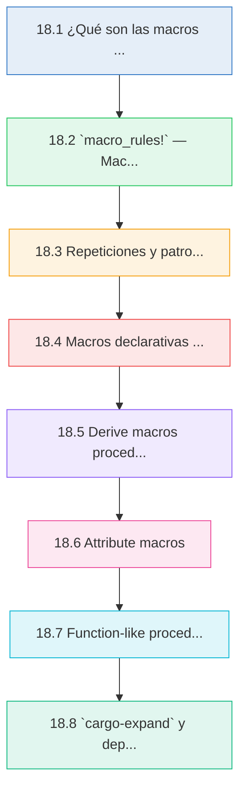
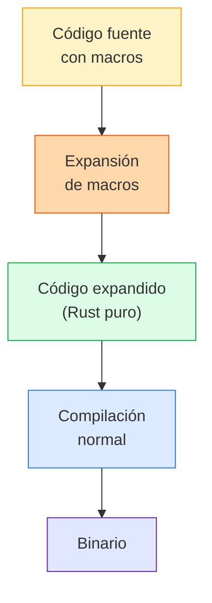
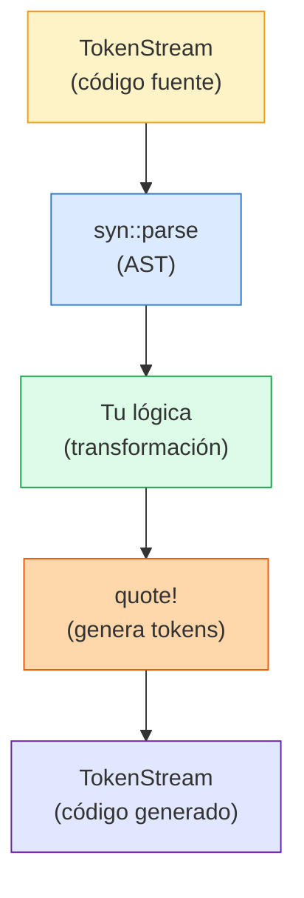
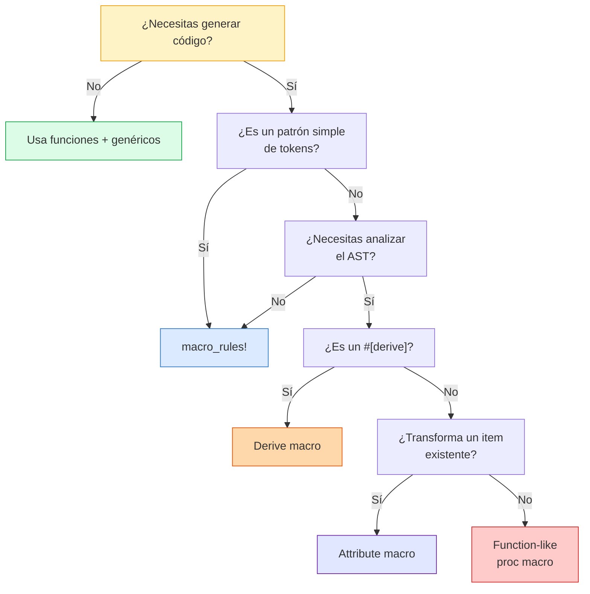

# :magic_wand: Cap 18 — Macros declarativas y procedurales

<div class="chapter-meta">
  <span class="meta-item">🕐 4-5 horas</span>
  <span class="meta-item">📊 Nivel: Experto</span>
  <span class="meta-item">🎯 Semana 9</span>
</div>

<div class="chapter-objective">
  <span class="objective-icon">📌</span>
  <span class="objective-text">Al terminar este capítulo, sabrás crear macros declarativas con <code>macro_rules!</code> (incluyendo repeticiones y patrones avanzados), diseñar macros procedurales (derive, attribute, function-like) usando <code>syn</code>/<code>quote</code>/<code>proc-macro2</code>, depurar macros con <code>cargo expand</code>, y decidir cuándo usar macros frente a genéricos o traits.</span>
</div>

<div class="chapter-map">



</div>


!!! quote "Contexto"
    En Python, cuando quieres generar código o transformar comportamiento, usas decoradores, metaclases o `__init_subclass__`. En Rust, la herramienta equivalente son las **macros**: código que genera código en tiempo de compilación. Desde el `println!` que usas desde el capítulo 1 hasta los `#[derive(Debug, Clone)]` que pones en cada struct — todo son macros. Este capítulo te enseña a crear las tuyas propias, tanto **declarativas** (`macro_rules!`) como **procedurales** (derive, attribute, function-like).

<div class="connection-box">
<span class="connection-icon">🔗</span>
<span>Recuerda del <a href='17-unsafe-ffi.md'>Capítulo 17 — Unsafe y FFI</a>: usaste bloques <code>unsafe</code> para cruzar las fronteras del sistema de tipos. Las macros son la otra cara de la moneda: en vez de saltarte las reglas, <strong>generas código seguro automáticamente</strong> en tiempo de compilación, eliminando boilerplate sin sacrificar seguridad.</span>
</div>

---

<div class="concept-question">
<h4>🔍 Pregunta conceptual</h4>
<p>En Python, los decoradores transforman funciones en <strong>runtime</strong> (cada llamada tiene overhead). Si Rust genera código con macros en <strong>compilación</strong>, ¿crees que el código generado por una macro es más lento, igual de rápido, o más rápido que el código escrito a mano?</p>
</div>

## 18.1 ¿Qué son las macros en Rust?

Las macros son **metaprogramación**: código que escribe código. A diferencia de las funciones, las macros operan sobre **tokens** (fragmentos de código fuente) y se expanden **antes de la compilación**.

### Dos familias de macros

| Tipo | Sintaxis | Complejidad | Cuándo usar |
|------|----------|-------------|-------------|
| **Declarativas** | `macro_rules! nombre { ... }` | Media | Patrones repetitivos, DSLs simples, reducir boilerplate |
| **Procedurales** | `#[proc_macro]`, `#[proc_macro_derive]`, `#[proc_macro_attribute]` | Alta | Derive personalizado, transformación de código, análisis de AST |

### Macros que ya usas

```rust
// Todas estas son macros — nota el ! al final
println!("Hola {}", nombre);        // macro declarativa
vec![1, 2, 3];                       // macro declarativa
format!("{:.2}", precio);            // macro declarativa
todo!("implementar luego");          // macro declarativa
assert_eq!(a, b);                    // macro declarativa

#[derive(Debug, Clone, Serialize)]   // macro procedural (derive)
struct Plato { /* ... */ }
```

### Pipeline de compilación con macros



<div class="comparison" markdown>
<div class="lang-box python" markdown>

#### :snake: Python — Decoradores y metaclases

```python
# Decorador: transforma funciones en runtime
def log_call(func):
    def wrapper(*args, **kwargs):
        print(f"Llamando a {func.__name__}")
        return func(*args, **kwargs)
    return wrapper

@log_call
def crear_plato(nombre): ...

# Metaclase: modifica clases al crearlas
class RegistroMeta(type):
    registry = []
    def __new__(mcs, name, bases, attrs):
        cls = super().__new__(mcs, name, bases, attrs)
        mcs.registry.append(cls)
        return cls
```

</div>
<div class="lang-box rust" markdown>

#### :crab: Rust — Macros en compilación

```rust
// Macro declarativa: genera código repetitivo
macro_rules! log_call {
    ($func:ident($($arg:expr),*)) => {
        println!("Llamando a {}", stringify!($func));
        $func($($arg),*)
    };
}

// Derive macro: genera implementaciones automáticas
#[derive(Debug, Registro)]  // Registro = derive personalizado
struct Plato {
    nombre: String,
    precio: f64,
}
// Todo se resuelve EN COMPILACIÓN — cero coste en runtime
```

</div>
</div>

!!! tip "Diferencia clave"
    Los decoradores de Python transforman código **en runtime** (cada llamada tiene overhead). Las macros de Rust generan código **en compilación** — el resultado es tan rápido como si lo hubieras escrito a mano.

---

## 18.2 `macro_rules!` — Macros declarativas

La forma más simple de macro en Rust. Funciona con **pattern matching sobre tokens**.

### Sintaxis básica

```rust
macro_rules! nombre_macro {
    // Cada rama: (patrón) => { expansión };
    ($patron1:tipo) => {
        // código generado
    };
    ($patron2:tipo, $patron3:tipo) => {
        // otra variante
    };
}
```

### Fragment specifiers

Los **fragment specifiers** indican qué tipo de token espera cada captura:

| Specifier | Qué captura | Ejemplo |
|-----------|-------------|---------|
| `$x:expr` | Expresión | `42`, `a + b`, `foo()` |
| `$x:ident` | Identificador | `mi_var`, `Plato`, `foo` |
| `$x:ty` | Tipo | `i32`, `String`, `Vec<u8>` |
| `$x:tt` | Token tree (cualquier token) | Cualquier cosa |
| `$x:stmt` | Sentencia | `let x = 5;` |
| `$x:block` | Bloque `{ ... }` | `{ println!("ok"); }` |
| `$x:path` | Ruta de módulo | `std::collections::HashMap` |
| `$x:literal` | Literal | `42`, `"hola"`, `true` |
| `$x:pat` | Patrón | `Some(x)`, `(a, b)` |
| `$x:item` | Item de nivel superior | `fn`, `struct`, `impl` |
| `$x:meta` | Meta item | `derive(Debug)`, `allow(unused)` |
| `$x:vis` | Visibilidad | `pub`, `pub(crate)`, (vacío) |
| `$x:lifetime` | Lifetime | `'a`, `'static` |

<div class="concept-question">
<h4>🔍 Pregunta conceptual</h4>
<p>Si <code>$x:expr</code> captura cualquier expresión y <code>$x:tt</code> captura cualquier token, ¿por qué no usar siempre <code>:tt</code> para todo? ¿Qué ventaja tiene ser específico con el fragment specifier?</p>
</div>

### Ejemplos básicos

```rust
// Macro que saluda
macro_rules! saluda {
    () => {
        println!("¡Hola desde RustMenu!");
    };
    ($nombre:expr) => {
        println!("¡Hola, {}!", $nombre);
    };
}

fn main() {
    saluda!();                    // ¡Hola desde RustMenu!
    saluda!("Chef Daniele");      // ¡Hola, Chef Daniele!
}
```

```rust
// Macro que crea una función
macro_rules! crear_getter {
    ($nombre:ident, $tipo:ty, $campo:ident) => {
        fn $nombre(&self) -> &$tipo {
            &self.$campo
        }
    };
}

struct Plato {
    nombre: String,
    precio: f64,
}

impl Plato {
    crear_getter!(get_nombre, String, nombre);
    // Expande a:
    // fn get_nombre(&self) -> &String { &self.nombre }
}
```

<div class="micro-exercise">
<h4>🧪 Micro-ejercicio (3 min)</h4>
<p>Escribe una macro <code>saluda_multiple!</code> que acepte una lista variable de nombres y salude a cada uno. Usa la repetición <code>$($nombre:expr),+</code>. Prueba con <code>saluda_multiple!("Ana", "Luis", "Marta")</code> y verifica que imprime tres saludos.</p>
</div>

---

## 18.3 Repeticiones y patrones avanzados

Las macros pueden aceptar un número variable de argumentos con repeticiones.

### Operadores de repetición

| Operador | Significado | Ejemplo |
|----------|-------------|---------|
| `$(...),*` | Cero o más (separados por coma) | `vec![1, 2, 3]` |
| `$(...),+` | Uno o más (separados por coma) | Al menos un argumento |
| `$(...)?` | Cero o uno (opcional) | Argumento opcional |

### Implementación de `vec!`

```rust
// Así funciona vec! internamente (simplificado)
macro_rules! mi_vec {
    // Caso vacío
    () => {
        Vec::new()
    };
    // Con elementos: mi_vec![1, 2, 3]
    ($($elem:expr),+ $(,)?) => {
        {
            let mut v = Vec::new();
            $(
                v.push($elem);  // Se repite por cada $elem
            )+
            v
        }
    };
    // Con valor repetido: mi_vec![0; 5]
    ($elem:expr; $n:expr) => {
        vec![$elem; $n]  // Delega al vec! de la stdlib
    };
}

fn main() {
    let platos = mi_vec!["Paella", "Tortilla", "Gazpacho"];
    println!("{:?}", platos);  // ["Paella", "Tortilla", "Gazpacho"]
}
```

### `hashmap!` — Macro útil

```rust
macro_rules! hashmap {
    ($($clave:expr => $valor:expr),* $(,)?) => {
        {
            let mut map = std::collections::HashMap::new();
            $(
                map.insert($clave, $valor);
            )*
            map
        }
    };
}

fn main() {
    let precios = hashmap! {
        "Paella" => 15.50,
        "Tortilla" => 8.00,
        "Gazpacho" => 6.50,
    };
    println!("{:?}", precios);
}
```

### `debug_vars!` — Imprimir variables con nombres

```rust
macro_rules! debug_vars {
    ($($var:ident),+ $(,)?) => {
        $(
            println!("{} = {:?}", stringify!($var), $var);
        )+
    };
}

fn main() {
    let nombre = "Paella";
    let precio = 15.50;
    let disponible = true;

    debug_vars!(nombre, precio, disponible);
    // nombre = "Paella"
    // precio = 15.5
    // disponible = true
}
```

<div class="pro-tip">
<h4>💡 Consejo Pro</h4>
<p>Siempre agrega <code>$(,)?</code> al final de las repeticiones separadas por coma (como en <code>hashmap!</code>). Esto permite una <strong>trailing comma</strong> opcional, que es idiomático en Rust y evita errores frustrantes al copiar y pegar elementos. Sin ella, <code>hashmap!{ "a" => 1, "b" => 2, }</code> (con coma final) no compilaría.</p>
</div>

---

## 18.4 Macros declarativas para RustMenu

### `validate!` — Validación de campos

```rust
macro_rules! validate {
    ($campo:expr, not_empty, $msg:expr) => {
        if $campo.is_empty() {
            return Err(AppError::Validation($msg.to_string()));
        }
    };
    ($campo:expr, positive, $msg:expr) => {
        if $campo <= 0.0 {
            return Err(AppError::Validation($msg.to_string()));
        }
    };
    ($campo:expr, range($min:expr, $max:expr), $msg:expr) => {
        if $campo < $min || $campo > $max {
            return Err(AppError::Validation($msg.to_string()));
        }
    };
}

fn crear_plato(nombre: &str, precio: f64, capacidad: i32) -> Result<Plato, AppError> {
    validate!(nombre, not_empty, "El nombre no puede estar vacío");
    validate!(precio, positive, "El precio debe ser positivo");
    validate!(capacidad, range(1, 100), "Capacidad debe estar entre 1 y 100");

    Ok(Plato { nombre: nombre.to_string(), precio, capacidad })
}
```

### `impl_display!` — Display para enums

```rust
macro_rules! impl_display {
    ($tipo:ty, { $($variante:pat => $texto:expr),+ $(,)? }) => {
        impl std::fmt::Display for $tipo {
            fn fmt(&self, f: &mut std::fmt::Formatter<'_>) -> std::fmt::Result {
                match self {
                    $(
                        $variante => write!(f, $texto),
                    )+
                }
            }
        }
    };
}

#[derive(Debug)]
enum Categoria {
    Entrante,
    Principal,
    Postre,
    Bebida,
}

impl_display!(Categoria, {
    Categoria::Entrante => "Entrante",
    Categoria::Principal => "Principal",
    Categoria::Postre => "Postre",
    Categoria::Bebida => "Bebida",
});
```

### `error_response!` — Respuestas de error consistentes

```rust
macro_rules! error_response {
    ($status:expr, $code:expr, $msg:expr) => {
        (
            $status,
            axum::Json(serde_json::json!({
                "error": $msg,
                "code": $code
            })),
        )
    };
    ($status:expr, $code:expr, $msg:expr, $($campo:expr => $valor:expr),+) => {
        (
            $status,
            axum::Json(serde_json::json!({
                "error": $msg,
                "code": $code,
                $(
                    $campo: $valor,
                )+
            })),
        )
    };
}

// Uso en handlers
async fn obtener_plato(Path(id): Path<i32>) -> impl IntoResponse {
    match repo.buscar(id).await {
        Ok(plato) => Ok(Json(plato)),
        Err(_) => Err(error_response!(
            StatusCode::NOT_FOUND,
            "NOT_FOUND",
            format!("Plato {} no encontrado", id)
        )),
    }
}
```

<div class="misconception-box">
<h4>⚠️ Errores comunes</h4>
<ul>
<li><span class="wrong">❌ Mito:</span> "Las macros son como funciones inline" → <span class="right">✅ Realidad:</span> Las macros operan sobre <strong>tokens</strong> (texto del código fuente), no sobre valores. Se expanden antes de que el compilador verifique tipos. Una función recibe valores tipados; una macro recibe fragmentos de sintaxis.</li>
<li><span class="wrong">❌ Mito:</span> "Necesito macros procedurales para todo lo no trivial" → <span class="right">✅ Realidad:</span> <code>macro_rules!</code> es sorprendentemente poderosa. Macros como <code>vec!</code>, <code>hashmap!</code> y <code>validate!</code> son declarativas y cubren la mayoría de casos. Reserva las procedurales solo cuando necesites analizar el AST (atributos de campos, tipos genéricos, etc.).</li>
<li><span class="wrong">❌ Mito:</span> "Las macros hacen el código más rápido" → <span class="right">✅ Realidad:</span> Las macros no aceleran nada por sí mismas. Generan el mismo código que escribirías a mano. Su ventaja es eliminar <strong>boilerplate</strong> y errores de copiar/pegar, no velocidad. El código expandido pasa por las mismas optimizaciones del compilador.</li>
</ul>
</div>

---

## 18.5 Derive macros procedurales

Las macros procedurales son **programas Rust** que transforman código. Son más poderosas que `macro_rules!` pero requieren un crate separado.

### Estructura del proyecto

```
mi_proyecto/
├── Cargo.toml
├── src/
│   └── lib.rs
└── mi_derive/          # ← crate separado para la macro
    ├── Cargo.toml
    └── src/
        └── lib.rs
```

```toml title="mi_derive/Cargo.toml"
[package]
name = "mi_derive"
version = "0.1.0"
edition = "2021"

[lib]
proc-macro = true       # ← OBLIGATORIO

[dependencies]
proc-macro2 = "1"       # Tipos de tokens testables
syn = { version = "2", features = ["full"] }   # Parser de Rust
quote = "1"             # Generador de código
```

### Pipeline de una derive macro



<div class="concept-question">
<h4>🔍 Pregunta conceptual</h4>
<p>Las derive macros deben vivir en un crate separado con <code>proc-macro = true</code>. ¿Por qué crees que Rust exige esta separación? Piensa en <em>cuándo</em> se ejecutan las macros procedurales en el pipeline de compilación.</p>
</div>

### Ejemplo: `#[derive(Builder)]`

```rust title="mi_derive/src/lib.rs"
use proc_macro::TokenStream;
use quote::quote;
use syn::{parse_macro_input, DeriveInput, Data, Fields};

#[proc_macro_derive(Builder)]
pub fn derive_builder(input: TokenStream) -> TokenStream {
    let input = parse_macro_input!(input as DeriveInput);
    let nombre = &input.ident;
    let builder_nombre = syn::Ident::new(
        &format!("{}Builder", nombre),
        nombre.span(),
    );

    // Extraer campos del struct
    let fields = match &input.data {
        Data::Struct(data) => match &data.fields {
            Fields::Named(fields) => &fields.named,
            _ => panic!("Builder solo soporta structs con campos nombrados"),
        },
        _ => panic!("Builder solo soporta structs"),
    };

    // Generar campos Option<T> para el builder
    let builder_fields = fields.iter().map(|f| {
        let nombre = &f.ident;
        let tipo = &f.ty;
        quote! { #nombre: Option<#tipo> }
    });

    // Generar métodos setter
    let setters = fields.iter().map(|f| {
        let nombre = &f.ident;
        let tipo = &f.ty;
        quote! {
            pub fn #nombre(mut self, valor: #tipo) -> Self {
                self.#nombre = Some(valor);
                self
            }
        }
    });

    // Generar método build()
    let build_fields = fields.iter().map(|f| {
        let nombre = &f.ident;
        let nombre_str = nombre.as_ref().unwrap().to_string();
        quote! {
            #nombre: self.#nombre.ok_or(
                format!("Campo '{}' no establecido", #nombre_str)
            )?
        }
    });

    // Generar inicializadores None
    let none_fields = fields.iter().map(|f| {
        let nombre = &f.ident;
        quote! { #nombre: None }
    });

    let expanded = quote! {
        pub struct #builder_nombre {
            #(#builder_fields,)*
        }

        impl #nombre {
            pub fn builder() -> #builder_nombre {
                #builder_nombre {
                    #(#none_fields,)*
                }
            }
        }

        impl #builder_nombre {
            #(#setters)*

            pub fn build(self) -> Result<#nombre, String> {
                Ok(#nombre {
                    #(#build_fields,)*
                })
            }
        }
    };

    TokenStream::from(expanded)
}
```

### Uso del derive

```rust
use mi_derive::Builder;

#[derive(Builder, Debug)]
struct Plato {
    nombre: String,
    precio: f64,
    categoria: String,
}

fn main() {
    let plato = Plato::builder()
        .nombre("Paella Valenciana".to_string())
        .precio(15.50)
        .categoria("Principal".to_string())
        .build()
        .unwrap();

    println!("{:?}", plato);
}
```

<div class="comparison" markdown>
<div class="lang-box python" markdown>

#### :snake: Python — Metaclases / `__init_subclass__`

```python
# Python genera métodos en runtime con metaclases
class BuilderMeta(type):
    def __new__(mcs, name, bases, attrs):
        cls = super().__new__(mcs, name, bases, attrs)
        # Generar setters dinámicamente
        for field in attrs.get('__annotations__', {}):
            def setter(self, value, f=field):
                setattr(self, f'_{f}', value)
                return self
            setattr(cls, f'set_{field}', setter)
        return cls
```

</div>
<div class="lang-box rust" markdown>

#### :crab: Rust — Derive macro (compilación)

```rust
// Rust genera código en compilación — cero overhead
#[derive(Builder)]
struct Plato {
    nombre: String,
    precio: f64,
}

// El compilador genera PlatoBuilder con setters
// tipados y un build() que válida campos.
// Todo verificado en compilación.
```

</div>
</div>

---

## 18.6 Attribute macros

Las attribute macros transforman **items completos** (funciones, structs, impls).

```rust title="mi_derive/src/lib.rs"
use proc_macro::TokenStream;
use quote::quote;
use syn::{parse_macro_input, ItemFn};

/// Attribute macro que envuelve una función con logging
#[proc_macro_attribute]
pub fn log_call(_attr: TokenStream, item: TokenStream) -> TokenStream {
    let func = parse_macro_input!(item as ItemFn);
    let nombre = &func.sig.ident;
    let nombre_str = nombre.to_string();
    let bloque = &func.block;
    let sig = &func.sig;
    let vis = &func.vis;
    let attrs = &func.attrs;

    let expanded = quote! {
        #(#attrs)*
        #vis #sig {
            let _inicio = std::time::Instant::now();
            println!("[LOG] → Entrando a {}", #nombre_str);

            let _resultado = (|| #bloque)();

            println!("[LOG] ← Saliendo de {} ({:?})", #nombre_str, _inicio.elapsed());
            _resultado
        }
    };

    TokenStream::from(expanded)
}
```

### Uso

```rust
use mi_derive::log_call;

#[log_call]
fn procesar_pedido(mesa_id: i32, items: Vec<String>) -> Result<(), String> {
    // Lógica del pedido...
    println!("Procesando {} items para mesa {}", items.len(), mesa_id);
    Ok(())
}

// Al llamar procesar_pedido(), imprime:
// [LOG] → Entrando a procesar_pedido
// Procesando 3 items para mesa 5
// [LOG] ← Saliendo de procesar_pedido (1.234ms)
```

### Attribute macro con parámetros

```rust
#[proc_macro_attribute]
pub fn route(attr: TokenStream, item: TokenStream) -> TokenStream {
    let args = attr.to_string();  // e.g., "GET, \"/platos\""
    let func = parse_macro_input!(item as ItemFn);
    let nombre = &func.sig.ident;

    // Parsear método y ruta de los argumentos
    // ... (lógica de parsing)

    let expanded = quote! {
        #func

        // Generar registro de ruta automático
        inventory::submit! {
            RouteInfo {
                method: #method_str,
                path: #path_str,
                handler: #nombre,
            }
        }
    };

    TokenStream::from(expanded)
}
```

<div class="micro-exercise">
<h4>🧪 Micro-ejercicio (5 min)</h4>
<p>Tienes esta macro declarativa incompleta que mide el tiempo de una expresión. Completa las partes marcadas con <code>???</code>:</p>

```rust
macro_rules! cronometrar {
    ($etiqueta:expr, $bloque:expr) => {
        {
            let inicio = std::time::Instant::now();
            let resultado = ???;       // ejecutar $bloque
            let duración = ???;        // obtener tiempo transcurrido
            println!("[{}] {:?}", $etiqueta, duración);
            ???                        // retornar resultado
        }
    };
}
// Respuesta: $bloque, inicio.elapsed(), resultado
```
</div>

---

## 18.7 Function-like procedural macros

Se invocan como `mi_macro!(...)` pero son procedurales (tienen acceso completo al AST).

```rust title="mi_derive/src/lib.rs"
use proc_macro::TokenStream;
use quote::quote;
use syn::{parse_macro_input, LitStr};

/// Macro que válida SQL en compilación (simplificado)
#[proc_macro]
pub fn sql_check(input: TokenStream) -> TokenStream {
    let query = parse_macro_input!(input as LitStr);
    let query_str = query.value();

    // Validación básica en compilación
    let query_upper = query_str.to_uppercase();
    if !query_upper.starts_with("SELECT")
        && !query_upper.starts_with("INSERT")
        && !query_upper.starts_with("UPDATE")
        && !query_upper.starts_with("DELETE")
    {
        return syn::Error::new(query.span(), "Query SQL debe empezar con SELECT, INSERT, UPDATE o DELETE")
            .to_compile_error()
            .into();
    }

    // Verificar que los placeholders sean consistentes ($1, $2, ...)
    let placeholders: Vec<_> = query_str.matches('$').collect();
    // ... más validaciones

    let expanded = quote! {
        #query_str
    };

    TokenStream::from(expanded)
}
```

### Uso

```rust
use mi_derive::sql_check;

fn main() {
    let query = sql_check!("SELECT id, nombre FROM platos WHERE id = $1");
    // ✅ Compila

    // let bad = sql_check!("BORRAR TODO");
    // ❌ Error de compilación: "Query SQL debe empezar con SELECT..."
}
```

---

## 18.8 `cargo-expand` y depuración

### Instalar cargo-expand

```bash
cargo install cargo-expand
# Requiere rustfmt y nightly (para expansión completa)
rustup install nightly
```

### Ver macros expandidas

```bash
# Expandir todo el crate
cargo expand

# Expandir un módulo específico
cargo expand domain::plato

# Expandir un test
cargo expand --test test_platos

# Usar nightly para expansión completa
cargo +nightly expand
```

### Ejemplo de expansión

```rust
// Código original
#[derive(Debug)]
struct Plato {
    nombre: String,
    precio: f64,
}
```

```rust
// Resultado de cargo expand (simplificado)
struct Plato {
    nombre: String,
    precio: f64,
}

impl ::core::fmt::Debug for Plato {
    fn fmt(&self, f: &mut ::core::fmt::Formatter) -> ::core::fmt::Result {
        ::core::fmt::Formatter::debug_struct_field2_finish(
            f, "Plato", "nombre", &self.nombre, "precio", &&self.precio,
        )
    }
}
```

### `compile_error!` para mensajes claros

```rust
macro_rules! only_structs {
    (struct $nombre:ident { $($campo:ident : $tipo:ty),* $(,)? }) => {
        struct $nombre { $($campo: $tipo),* }
    };
    ($($tt:tt)*) => {
        compile_error!("Esta macro solo acepta definiciones de struct");
    };
}

// only_structs!(enum Foo { A, B });
// ❌ Error: "Esta macro solo acepta definiciones de struct"
```

### Estrategias de depuración

1. **`cargo expand`** — Ver el código generado
2. **`stringify!`** — Convertir tokens a string para imprimir
3. **`compile_error!`** — Mensajes de error en compilación
4. **`eprintln!` en proc macros** — Imprimir durante compilación
5. **Tests unitarios de proc macros** — Testar con `trybuild`

<div class="pro-tip">
<h4>💡 Consejo Pro</h4>
<p>Cuando una macro no compila y el error es críptico, tu mejor amigo es <code>cargo expand</code>. Copia el código expandido en un archivo temporal y compílalo directamente: así verás los errores <strong>en el código generado real</strong>, no en la invocación de la macro. Para macros procedurales, agrega <code>eprintln!("{}", expanded)</code> justo antes de retornar el <code>TokenStream</code> para ver qué genera durante la compilación.</p>
</div>

---

## 18.9 Cuándo usar macros vs genéricos vs traits

### Tabla de decisión

| Necesidad | Herramienta | Ejemplo |
|-----------|-------------|---------|
| Misma lógica para varios tipos | **Genéricos** | `fn max<T: Ord>(a: T, b: T) -> T` |
| Polimorfismo runtime | **Trait objects** | `Vec<Box<dyn Widget>>` |
| Código repetitivo con variaciones | **`macro_rules!`** | `hashmap!`, `validate!` |
| Generar `impl` automáticamente | **Derive macro** | `#[derive(Builder)]` |
| Transformar funciones/structs | **Attribute macro** | `#[log_call]`, `#[route]` |
| DSL embebido | **Function-like proc macro** | `sql_check!("SELECT...")` |

### Diagrama de decisión



!!! warning "Regla de oro"
    **Prefiere funciones y genéricos. Usa macros solo cuando nada más funciona.** Las macros hacen el código más difícil de leer, depurar y mantener. Solo valen la pena cuando eliminan cantidades significativas de boilerplate o cuando necesitas operar sobre la sintaxis del lenguaje (no sobre valores).

<div class="code-evolution">
<div class="evolution-header">📈 Evolución del código: validación de un struct Plato</div>
<div class="evolution-step">
<span class="step-label novato">v1 — Novato</span>

```rust
// ❌ Validación manual repetitiva y propensa a errores
fn crear_plato(nombre: &str, precio: f64, cap: i32) -> Result<Plato, String> {
    if nombre.is_empty() {
        return Err("Nombre vacío".to_string());
    }
    if precio <= 0.0 {
        return Err("Precio no positivo".to_string());
    }
    if cap < 1 || cap > 100 {
        return Err("Capacidad fuera de rango".to_string());
    }
    Ok(Plato { nombre: nombre.to_string(), precio, capacidad: cap })
}
// Problema: cada nuevo campo = copiar/pegar bloques if/return
```
</div>
<div class="evolution-step">
<span class="step-label mejorado">v2 — Con macro declarativa</span>

```rust
// ✅ Macro que reduce boilerplate de validación
macro_rules! validate {
    ($campo:expr, not_empty, $msg:expr) => {
        if $campo.is_empty() { return Err($msg.into()); }
    };
    ($campo:expr, positive, $msg:expr) => {
        if $campo <= 0.0 { return Err($msg.into()); }
    };
    ($campo:expr, range($min:expr, $max:expr), $msg:expr) => {
        if $campo < $min || $campo > $max { return Err($msg.into()); }
    };
}

fn crear_plato(nombre: &str, precio: f64, cap: i32) -> Result<Plato, String> {
    validate!(nombre, not_empty, "Nombre vacío");
    validate!(precio, positive, "Precio no positivo");
    validate!(cap, range(1, 100), "Capacidad fuera de rango");
    Ok(Plato { nombre: nombre.to_string(), precio, capacidad: cap })
}
```
</div>
<div class="evolution-step">
<span class="step-label profesional">v3 — Profesional con derive macro</span>

```rust
// 🏆 Derive macro: validación declarada junto al struct
#[derive(Validable)]
struct Plato {
    #[validar(not_empty, msg = "Nombre requerido")]
    nombre: String,
    #[validar(positive, msg = "Precio debe ser positivo")]
    precio: f64,
    #[validar(range(1, 100), msg = "Capacidad inválida")]
    capacidad: i32,
}

// El derive genera automáticamente:
// impl Plato {
//     pub fn validar(&self) -> Result<(), Vec<String>> { ... }
// }
let plato = Plato { nombre: "Paella".into(), precio: 15.50, capacidad: 4 };
plato.validar()?;  // Las reglas viven junto a los campos, no dispersas
```
</div>
</div>

---

## 🌐 RustMenu: macros en acción

Resumen de las macros que usa RustMenu:

```rust
// 1. validate! — macro declarativa para validación
validate!(plato.nombre, not_empty, "Nombre requerido");
validate!(plato.precio, positive, "Precio debe ser positivo");

// 2. impl_display! — Display automático para enums
impl_display!(Categoria, {
    Categoria::Entrante => "Entrante",
    Categoria::Principal => "Principal",
});

// 3. error_response! — respuestas de error consistentes
Err(error_response!(StatusCode::NOT_FOUND, "NOT_FOUND", "Plato no encontrado"))

// 4. #[derive(Builder)] — constructores fluent
let plato = Plato::builder()
    .nombre("Paella".into())
    .precio(15.50)
    .build()?;

// 5. #[log_call] — logging automático de handlers
#[log_call]
async fn crear_plato(Json(body): Json<CreatePlato>) -> impl IntoResponse { ... }
```

<div class="connection-box">
<span class="connection-icon">🔗</span>
<span>En el <a href='19-rendimiento.md'>Capítulo 19 — Rendimiento</a> verás cómo las macros que creaste aquí impactan el tiempo de compilación. Aprenderás a medir el <strong>compile-time overhead</strong> de tus macros procedurales y técnicas para mantener las compilaciones rápidas, incluyendo la separación estratégica de crates de derive.</span>
</div>

---

## :link: Recursos

| Recurso | Enlace |
|---------|--------|
| The Little Book of Rust Macros | [danielkeep.github.io/tlborm](https://danielkeep.github.io/tlborm/) |
| Rust Reference: Macros | [doc.rust-lang.org/reference/macros](https://doc.rust-lang.org/reference/macros.html) |
| `proc-macro2` docs | [docs.rs/proc-macro2](https://docs.rs/proc-macro2/) |
| `syn` docs | [docs.rs/syn](https://docs.rs/syn/) |
| `quote` docs | [docs.rs/quote](https://docs.rs/quote/) |

---

## 🎯 Ejercicios

??? question "Ejercicio 18.1: Macro `enum_str!`"
    <span class="bloom-badge apply">Aplicar</span>

    Crea una macro declarativa `enum_str!` que genere un enum con un método `as_str()` y una implementación de `FromStr`. Uso esperado:

    ```rust
    enum_str! {
        Zona {
            Terraza => "terraza",
            Interior => "interior",
            Barra => "barra",
        }
    }
    ```

    ??? success "Solución"
        ```rust
        macro_rules! enum_str {
            ($nombre:ident { $($variante:ident => $texto:expr),+ $(,)? }) => {
                #[derive(Debug, Clone, PartialEq)]
                enum $nombre {
                    $($variante),+
                }

                impl $nombre {
                    fn as_str(&self) -> &'static str {
                        match self {
                            $($nombre::$variante => $texto),+
                        }
                    }
                }

                impl std::str::FromStr for $nombre {
                    type Err = String;

                    fn from_str(s: &str) -> Result<Self, Self::Err> {
                        match s {
                            $($texto => Ok($nombre::$variante),)+
                            _ => Err(format!("'{}' no es un {} válido", s, stringify!($nombre))),
                        }
                    }
                }

                impl std::fmt::Display for $nombre {
                    fn fmt(&self, f: &mut std::fmt::Formatter<'_>) -> std::fmt::Result {
                        write!(f, "{}", self.as_str())
                    }
                }
            };
        }

        enum_str! {
            Zona {
                Terraza => "terraza",
                Interior => "interior",
                Barra => "barra",
            }
        }

        fn main() {
            let z = Zona::Terraza;
            println!("{}", z.as_str());          // "terraza"
            println!("{}", z);                    // "terraza"

            let z2: Zona = "interior".parse().unwrap();
            assert_eq!(z2, Zona::Interior);
        }
        ```

??? question "Ejercicio 18.2: Macro `measure!`"
    <span class="bloom-badge apply">Aplicar</span>

    Crea una macro `measure!` que mida el tiempo de ejecución de una expresión y la imprima. Debe retornar el valor de la expresión.

    ```rust
    let resultado = measure!("calcular total", {
        platos.iter().map(|p| p.precio).sum::<f64>()
    });
    ```

    ??? success "Solución"
        ```rust
        macro_rules! measure {
            ($label:expr, $bloque:expr) => {
                {
                    let inicio = std::time::Instant::now();
                    let resultado = $bloque;
                    let duración = inicio.elapsed();
                    println!("[⏱ {}] {:?}", $label, duración);
                    resultado
                }
            };
        }

        fn main() {
            let precios = vec![15.50, 8.00, 6.50, 12.00, 22.00];

            let total = measure!("calcular total", {
                precios.iter().sum::<f64>()
            });

            println!("Total: {:.2}€", total);
            // [⏱ calcular total] 245ns
            // Total: 64.00€
        }
        ```

??? question "Ejercicio 18.3: Macro `crud_routes!`"
    <span class="bloom-badge create">Crear</span>

    Crea una macro `crud_routes!` que genere las 5 funciones handler para un recurso REST. La macro debe generar: `listar_X`, `obtener_X`, `crear_X`, `actualizar_X`, `eliminar_X`.

    ??? success "Solución"
        ```rust
        macro_rules! crud_routes {
            ($recurso:ident, $tipo:ty) => {
                paste::paste! {
                    async fn [<listar_ $recurso>]() -> impl IntoResponse {
                        // GET /recurso
                        Json(Vec::<$tipo>::new())
                    }

                    async fn [<obtener_ $recurso>](
                        Path(id): Path<i32>
                    ) -> impl IntoResponse {
                        // GET /recurso/{id}
                        Json(serde_json::json!({"id": id}))
                    }

                    async fn [<crear_ $recurso>](
                        Json(body): Json<$tipo>
                    ) -> impl IntoResponse {
                        // POST /recurso
                        (StatusCode::CREATED, Json(body))
                    }

                    async fn [<actualizar_ $recurso>](
                        Path(id): Path<i32>,
                        Json(body): Json<$tipo>,
                    ) -> impl IntoResponse {
                        // PUT /recurso/{id}
                        Json(body)
                    }

                    async fn [<eliminar_ $recurso>](
                        Path(id): Path<i32>,
                    ) -> impl IntoResponse {
                        // DELETE /recurso/{id}
                        StatusCode::NO_CONTENT
                    }
                }
            };
        }

        // Genera: listar_platos, obtener_platos, etc.
        crud_routes!(platos, Plato);
        ```

??? question "Ejercicio 18.4: Derive macro `Validable`"
    <span class="bloom-badge analyze">Analizar</span>

    Diseña (en pseudocódigo o código real) un derive macro `#[derive(Validable)]` que genere un método `validar(&self) -> Result<(), Vec<String>>` basándose en atributos helper como `#[validar(not_empty)]`, `#[validar(positive)]`.

    ??? success "Solución"
        ```rust
        // En mi_derive/src/lib.rs
        use proc_macro::TokenStream;
        use quote::quote;
        use syn::{parse_macro_input, DeriveInput, Data, Fields};

        #[proc_macro_derive(Validable, attributes(validar))]
        pub fn derive_validable(input: TokenStream) -> TokenStream {
            let input = parse_macro_input!(input as DeriveInput);
            let nombre = &input.ident;

            let fields = match &input.data {
                Data::Struct(data) => match &data.fields {
                    Fields::Named(f) => &f.named,
                    _ => panic!("Solo structs con campos nombrados"),
                },
                _ => panic!("Solo structs"),
            };

            let validaciones = fields.iter().filter_map(|f| {
                let nombre_campo = &f.ident;
                let nombre_str = nombre_campo.as_ref().unwrap().to_string();

                // Buscar atributo #[validar(...)]
                f.attrs.iter().find_map(|attr| {
                    if attr.path().is_ident("validar") {
                        let regla: syn::Ident = attr.parse_args().ok()?;
                        let regla_str = regla.to_string();

                        Some(match regla_str.as_str() {
                            "not_empty" => quote! {
                                if self.#nombre_campo.is_empty() {
                                    errores.push(
                                        format!("'{}' no puede estar vacío", #nombre_str)
                                    );
                                }
                            },
                            "positive" => quote! {
                                if self.#nombre_campo <= 0.0 {
                                    errores.push(
                                        format!("'{}' debe ser positivo", #nombre_str)
                                    );
                                }
                            },
                            _ => quote! {},
                        })
                    } else {
                        None
                    }
                })
            });

            let expanded = quote! {
                impl #nombre {
                    pub fn validar(&self) -> Result<(), Vec<String>> {
                        let mut errores = Vec::new();
                        #(#validaciones)*
                        if errores.is_empty() {
                            Ok(())
                        } else {
                            Err(errores)
                        }
                    }
                }
            };

            TokenStream::from(expanded)
        }

        // Uso:
        // #[derive(Validable)]
        // struct Plato {
        //     #[validar(not_empty)]
        //     nombre: String,
        //     #[validar(positive)]
        //     precio: f64,
        // }
        ```

??? question "Ejercicio 18.5: Macro recursiva `json!`"
    <span class="bloom-badge create">Crear</span>

    Implementa una macro `mi_json!` simplificada que genere un `serde_json::Value` desde una sintaxis similar a JSON.

    ??? success "Solución"
        ```rust
        macro_rules! mi_json {
            // Null
            (null) => {
                serde_json::Value::Null
            };
            // Bool
            (true) => {
                serde_json::Value::Bool(true)
            };
            (false) => {
                serde_json::Value::Bool(false)
            };
            // Number
            ($n:literal) => {
                serde_json::json!($n)
            };
            // Array
            ([$($elem:tt),* $(,)?]) => {
                serde_json::Value::Array(vec![$(mi_json!($elem)),*])
            };
            // Object
            ({ $($key:literal : $val:tt),* $(,)? }) => {
                {
                    let mut map = serde_json::Map::new();
                    $(
                        map.insert($key.to_string(), mi_json!($val));
                    )*
                    serde_json::Value::Object(map)
                }
            };
            // String
            ($s:literal) => {
                serde_json::Value::String($s.to_string())
            };
        }

        fn main() {
            let plato = mi_json!({
                "nombre": "Paella",
                "precio": 15.50,
                "disponible": true,
                "ingredientes": ["arroz", "marisco", "azafrán"]
            });
            println!("{}", serde_json::to_string_pretty(&plato).unwrap());
        }
        ```

---

## :brain: Flashcards de repaso

<div class="flashcard">
<div class="front">¿Cuáles son los dos tipos de macros en Rust?</div>
<div class="back"><strong>Declarativas</strong> (<code>macro_rules!</code>): pattern matching sobre tokens, definidas en el mismo crate. <strong>Procedurales</strong>: programas Rust que transforman <code>TokenStream</code>, requieren crate separado con <code>proc-macro = true</code>. Los 3 subtipos: derive, attribute y function-like.</div>
</div>

<div class="flashcard">
<div class="front">¿Qué es un fragment specifier en <code>macro_rules!</code>?</div>
<div class="back">Indica qué tipo de token captura una variable. Ejemplos: <code>$x:expr</code> (expresión), <code>$x:ident</code> (identificador), <code>$x:ty</code> (tipo), <code>$x:tt</code> (cualquier token). Se usan en el patrón y se expanden con <code>$x</code> en la salida.</div>
</div>

<div class="flashcard">
<div class="front">¿Qué hace <code>$($x:expr),*</code> en una macro?</div>
<div class="back">Captura <strong>cero o más</strong> expresiones separadas por comas. <code>*</code> = cero o más, <code>+</code> = una o más, <code>?</code> = opcional. En la expansión, <code>$($x)*</code> repite el código para cada captura.</div>
</div>

<div class="flashcard">
<div class="front">¿Por qué las derive macros necesitan un crate separado?</div>
<div class="back">Porque las macros procedurales son <strong>plugins del compilador</strong> que se ejecutan durante la compilación. Deben compilarse primero como una biblioteca dinámica que el compilador carga. Por eso necesitan <code>[lib] proc-macro = true</code> en un crate independiente.</div>
</div>

<div class="flashcard">
<div class="front">¿Qué hacen <code>syn</code>, <code>quote</code> y <code>proc-macro2</code>?</div>
<div class="back"><code>syn</code>: parsea <code>TokenStream</code> a un AST de Rust (structs, funciones, etc.). <code>quote</code>: genera <code>TokenStream</code> desde quasi-quotation (<code>quote! { ... }</code>). <code>proc-macro2</code>: tipos de tokens testables fuera del compilador. Juntos forman el stack estándar para proc macros.</div>
</div>

<div class="flashcard">
<div class="front">¿Cómo depuras macros en Rust?</div>
<div class="back">1. <code>cargo expand</code> muestra el código expandido. 2. <code>stringify!(tokens)</code> convierte tokens a string. 3. <code>compile_error!("msg")</code> genera errores claros. 4. <code>eprintln!</code> en proc macros imprime durante compilación. 5. <code>trybuild</code> testea errores de compilación.</div>
</div>

---

## :video_game: Quiz interactivo

<div class="quiz" data-quiz-id="ch18-q1">
<h4>Pregunta 1: ¿Cuál es la diferencia principal entre <code>macro_rules!</code> y una derive macro?</h4>
<button class="quiz-option" data-correct="false"><code>macro_rules!</code> es más rápida en compilación</button>
<button class="quiz-option" data-correct="true"><code>macro_rules!</code> hace pattern matching sobre tokens; una derive macro analiza el AST completo con <code>syn</code></button>
<button class="quiz-option" data-correct="false">Las derive macros no pueden generar código nuevo</button>
<button class="quiz-option" data-correct="false">No hay diferencia práctica — son equivalentes</button>
<div class="quiz-feedback" data-correct="¡Correcto! macro_rules! opera con pattern matching simple sobre tokens. Las derive macros son programas Rust completos que pueden parsear el AST con syn, analizar tipos, atributos y generar código arbitrario con quote." data-incorrect="Incorrecto. La diferencia clave es el nivel de acceso: macro_rules! hace pattern matching sobre tokens (fragmentos de código), mientras que las derive macros analizan el AST completo del struct/enum con syn y pueden generar código arbitrario."></div>
</div>

<div class="quiz" data-quiz-id="ch18-q2">
<h4>Pregunta 2: ¿Qué fragment specifier usarías para capturar un nombre de variable en <code>macro_rules!</code>?</h4>
<button class="quiz-option" data-correct="false"><code>$x:expr</code></button>
<button class="quiz-option" data-correct="true"><code>$x:ident</code></button>
<button class="quiz-option" data-correct="false"><code>$x:ty</code></button>
<button class="quiz-option" data-correct="false"><code>$x:literal</code></button>
<div class="quiz-feedback" data-correct="¡Correcto! `ident` (identificador) captura nombres de variables, funciones, tipos, etc. `expr` capturaría una expresión completa, `ty` un tipo, y `literal` un valor literal como 42 o \"hola\"." data-incorrect="Incorrecto. Para capturar un nombre (identificador) como `mi_variable`, `Plato`, o `foo`, usas `$x:ident`. Los otros specifiers capturan cosas diferentes: expr = expresión, ty = tipo, literal = valor literal."></div>
</div>

---

## :bug: Ejercicio de depuración

Este código tiene **3 errores** en macros. Encuéntralos:

```rust
// ❌ 3 errores en macros

macro_rules! crear_struct {
    ($nombre:ident, $($campo:ident: $tipo:ty),*) => {
        struct $nombre {
            $($campo: $tipo)*          // Error 1
        }
    };
}

macro_rules! sumar_todos {
    ($($x:expr),+) => {
        $($x) + +                      // Error 2
    };
}

macro_rules! repetir {
    ($msg:expr, $n:literal) => {
        for i in 0..$n {
            println!($msg);            // Error 3
        }
    };
}
```

??? success "Solución"
    ```rust
    macro_rules! crear_struct {
        ($nombre:ident, $($campo:ident: $tipo:ty),*) => {
            struct $nombre {
                $($campo: $tipo,)*    // Fix 1: falta la coma entre campos
            }
        };
    }

    macro_rules! sumar_todos {
        ($($x:expr),+) => {
            $($x)+*                   // Fix 2: el operador va DENTRO de la repetición
                                      // correcto: $($x)+* (cada $x separado por +)
        };
    }

    macro_rules! repetir {
        ($msg:expr, $n:literal) => {
            for _i in 0..$n {
                println!("{}", $msg); // Fix 3: println! necesita format string
            }
        };
    }
    ```

    **Explicación de errores:**

    1. **Falta coma separadora en la repetición**: `$($campo: $tipo)*` necesita una coma: `$($campo: $tipo,)*`. Sin ella, los campos del struct se pegan sin separador.
    2. **Operador fuera de la repetición**: `$($x) + +` intenta usar `+` fuera del bloque de repetición. La sintaxis correcta es `$($x)+*` donde `+` es el separador entre repeticiones.
    3. **`println!` sin format string**: Pasar una expresión directamente a `println!` sin `"{}"` causa error. Debe ser `println!("{}", $msg)`.


<div class="real-errors">
<h4>🚨 Errores que vas a encontrar</h4>

**Error 1: Tipo incompatible**

```rust
let x: i32 = "hola"; // ❌
```

```
error[E0308]: mismatched types
  expected `i32`, found `&str`
```

**¿Por qué?** Rust es estrictamente tipado — no hay conversión implícita entre tipos.

**Solución:** Usa el tipo correcto o convierte explícitamente.

---

**Error 2: Variable no mutable**

```rust
let precio = 10.0;
precio = 15.0; // ❌
```

```
error[E0384]: cannot assign twice to immutable variable `precio`
```

**Solución:** Declara con `let mut precio = 10.0;`

---

**Error 3: Valor movido**

```rust
let nombre = String::from("Paella");
let copia = nombre;
println!("{}", nombre); // ❌
```

```
error[E0382]: borrow of moved value: `nombre`
```

**Solución:** Usa `.clone()` o referencias `&nombre`.

</div>

---

<div class="checkpoint">
<h4>🏁 Checkpoint</h4>
<p>Si puedes: (1) crear macros declarativas con <code>macro_rules!</code> usando fragment specifiers y repeticiones, (2) explicar la diferencia entre macros declarativas y procedurales y cuándo usar cada una, (3) diseñar una derive macro con <code>syn</code>/<code>quote</code> en un crate separado, y (4) depurar macros con <code>cargo expand</code> y <code>compile_error!</code> -- dominas la metaprogramación en Rust y estás listo para el <strong>Capítulo 19: Rendimiento</strong>.</p>
</div>

<div class="mini-project">
<h4>🏗️ Mini-proyecto: Aplicación práctica</h4>

**Paso 1 — Define las estructuras base**

Crea las estructuras y tipos necesarios para modelar el dominio del capítulo.

??? success "Solución Paso 1"
    ```rust
    // Define tus structs y enums aquí
    #[derive(Debug)]
    struct Item {
        nombre: String,
        valor: f64,
    }

    impl Item {
        fn new(nombre: &str, valor: f64) -> Self {
            Self {
                nombre: nombre.to_string(),
                valor,
            }
        }
    }
    ```

**Paso 2 — Implementa la lógica principal**

Crea funciones que operen sobre las estructuras del paso 1.

??? success "Solución Paso 2"
    ```rust
    fn procesar(items: &[Item]) -> f64 {
        items.iter().map(|i| i.valor).sum()
    }

    fn mostrar(items: &[Item]) {
        for item in items {
            println!("  {} — {:.2}€", item.nombre, item.valor);
        }
    }
    ```

**Paso 3 — Integra todo en main**

Combina los pasos anteriores en un programa completo.

??? success "Solución Paso 3"
    ```rust
    fn main() {
        let items = vec![
            Item::new("Paella", 14.50),
            Item::new("Gazpacho", 8.00),
            Item::new("Flan", 5.50),
        ];

        println!("=== RustMenu ===");
        mostrar(&items);
        println!("Total: {:.2}€", procesar(&items));
    }
    ```

</div>

<div class="ejercicio-guiado">
<h4>🏋️ Ejercicio guiado</h4>

Vas a crear una macro declarativa `plato!` para RustMenu que genere constructores de platos de forma concisa, eliminando el boilerplate de crear structs manualmente. La macro soportará tanto la forma completa (con todos los campos) como una forma abreviada (solo nombre y precio, con categoría por defecto).

1. Define un enum `Categoria` con variantes `Entrante`, `Principal`, `Postre` y `Bebida` (deriva `Debug`, `Clone`). Crea un struct `Plato` con campos `nombre: String`, `precio: f64`, `categoria: Categoria` y `disponible: bool` (deriva `Debug`, `Clone`).
2. Crea la macro `plato!` con `macro_rules!` que tenga dos brazos: uno completo `plato!(nombre, precio, categoria)` y uno abreviado `plato!(nombre, precio)` que use `Categoria::Principal` y `disponible: true` por defecto.
3. Crea una segunda macro `carta!` que acepte una lista variádica de invocaciones `plato!` separadas por comas usando repeticiones `$(...),*`, y devuelva un `Vec<Plato>`.
4. Crea una tercera macro `mostrar_carta!` que reciba una expresión de tipo `&[Plato]` e imprima cada plato con formato `"  {nombre} ({categoria:?}) — {precio:.2}€"`, más el total al final.
5. En `fn main()`, usa `carta!` para crear un vector con al menos 5 platos (mezclando la forma completa y la abreviada), y usa `mostrar_carta!` para imprimirlo.
6. Compila y verifica que `cargo expand` (si lo tienes instalado) muestra el código generado por las macros correctamente.

??? success "Solución completa"
    ```rust
    #[derive(Debug, Clone)]
    enum Categoria {
        Entrante,
        Principal,
        Postre,
        Bebida,
    }

    #[derive(Debug, Clone)]
    struct Plato {
        nombre: String,
        precio: f64,
        categoria: Categoria,
        disponible: bool,
    }

    /// Macro para crear un Plato de forma concisa.
    /// Forma completa: plato!("Paella", 14.50, Principal)
    /// Forma abreviada: plato!("Paella", 14.50) → usa Categoria::Principal
    macro_rules! plato {
        // Forma completa: nombre, precio, categoría
        ($nombre:expr, $precio:expr, $cat:ident) => {
            Plato {
                nombre: String::from($nombre),
                precio: $precio,
                categoria: Categoria::$cat,
                disponible: true,
            }
        };
        // Forma abreviada: nombre, precio (categoría = Principal)
        ($nombre:expr, $precio:expr) => {
            plato!($nombre, $precio, Principal)
        };
    }

    /// Macro para crear un Vec<Plato> a partir de múltiples plato!()
    macro_rules! carta {
        ( $( $plato:expr ),* $(,)? ) => {
            vec![ $( $plato ),* ]
        };
    }

    /// Macro para imprimir la carta con formato
    macro_rules! mostrar_carta {
        ($platos:expr) => {{
            let mut total = 0.0_f64;
            println!("╔══════════════════════════════════╗");
            println!("║       🦀 RustMenu — Carta       ║");
            println!("╠══════════════════════════════════╣");
            for plato in $platos.iter() {
                println!(
                    "  {} ({:?}) — {:.2}€{}",
                    plato.nombre,
                    plato.categoria,
                    plato.precio,
                    if !plato.disponible { " [AGOTADO]" } else { "" }
                );
                total += plato.precio;
            }
            println!("╚══════════════════════════════════╝");
            println!("  Total carta: {:.2}€ ({} platos)", total, $platos.len());
        }};
    }

    fn main() {
        let menu = carta![
            plato!("Gazpacho Andaluz", 6.50, Entrante),
            plato!("Croquetas de Jamón", 8.00, Entrante),
            plato!("Paella Valenciana", 14.50),              // forma abreviada → Principal
            plato!("Chuletón a la brasa", 22.00),            // forma abreviada → Principal
            plato!("Crema Catalana", 5.50, Postre),
            plato!("Sangría de la casa", 8.00, Bebida),
        ];

        mostrar_carta!(&menu);

        // Filtrar solo principales usando la macro para crear y luego filtrar
        println!("\n=== Solo Principales ===");
        let principales: Vec<&Plato> = menu
            .iter()
            .filter(|p| matches!(p.categoria, Categoria::Principal))
            .collect();

        for p in &principales {
            println!("  {} — {:.2}€", p.nombre, p.precio);
        }
    }
    ```

</div>

---

## ✅ Autoevaluación del capítulo

<div class="self-check" markdown>
<h4>📋 Verifica tu comprensión</h4>
<label><input type="checkbox"> Puedo crear macros declarativas con <code>macro_rules!</code> usando fragment specifiers y repeticiones</label>
<label><input type="checkbox"> Entiendo la diferencia entre macros declarativas y procedurales</label>
<label><input type="checkbox"> Sé configurar un crate de proc macros con <code>proc-macro2</code>, <code>syn</code> y <code>quote</code></label>
<label><input type="checkbox"> Puedo usar <code>cargo expand</code> para depurar macros</label>
<label><input type="checkbox"> Sé cuándo usar macros vs genéricos vs traits (diagrama de decisión)</label>
</div>
