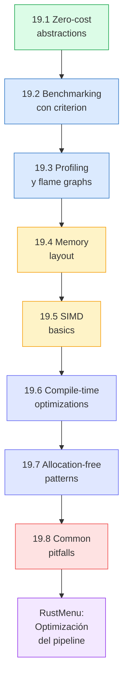
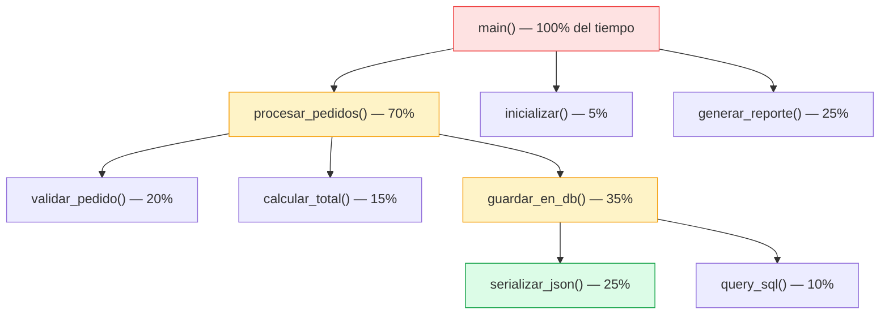
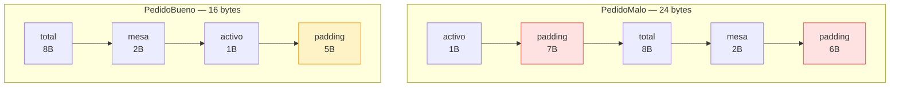
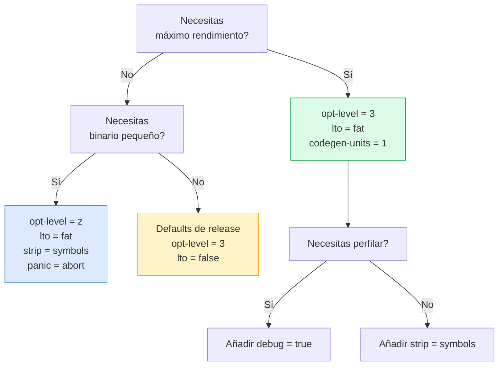

# :racing_car: Cap 19 — Rendimiento y optimización

<div class="chapter-meta">
  <span class="meta-item">🕐 4-5 horas</span>
  <span class="meta-item">📊 Nivel: Experto</span>
  <span class="meta-item">🎯 Semana 10</span>
</div>

<div class="chapter-objective">
<h4>Objetivo del capítulo</h4>
<p>Al finalizar este capítulo serás capaz de <strong>medir, perfilar y optimizar</strong> código Rust aplicando zero-cost abstractions, benchmarking con criterion, profiling con flame graphs, diseño de memory layout eficiente, SIMD, opciones de compilación avanzadas y patrones sin allocación. Dominarás las herramientas y técnicas necesarias para transformar código "rápido" en código <strong>"ridículamente rápido"</strong>, sabiendo exactamente dónde y por qué cada decisión impacta el rendimiento.</p>
</div>

<div class="chapter-map">
<h4>Mapa del capítulo</h4>



</div>

!!! quote "Contexto"
    En Python, "hacerlo rápido" suele significar reescribir en C, usar NumPy o cambiar de algoritmo. En Rust, el rendimiento está en el ADN del lenguaje: **zero-cost abstractions** significa que las abstracciones de alto nivel compilan al mismo código que escribirías a mano. Pero incluso en Rust hay decisiones que marcan la diferencia entre "rápido" y "ridículamente rápido". Este capítulo te enseña a medir, perfilar y exprimir cada ciclo de CPU.

<div class="connection-box" markdown>
<h4>Conexión con Cap 18 — Macros</h4>
<p>En el <a href="18-macros.md">Capítulo 18</a> aprendiste a generar código en tiempo de compilación con macros declarativas y procedurales. Las macros son aliadas directas del rendimiento: permiten generar código especializado sin overhead en runtime. Por ejemplo, una macro puede expandir un bucle desenrollado o crear implementaciones monomorphizadas a medida, logrando optimizaciones que serían tediosas o imposibles de escribir a mano. En este capítulo verás cómo esas técnicas de generación de código se complementan con el profiling y benchmarking para exprimir al máximo el rendimiento.</p>
</div>

---

## 19.1 Zero-cost abstractions

El principio fundamental de Rust: **lo que no usas no lo pagas, y lo que usas no podrías codificarlo mejor a mano**. Esto no es un eslogan vacío — es una garantía verificable mirando el ensamblador generado.

<div class="concept-question">
<h4>Pregunta para reflexionar</h4>
<p>Si los iteradores en Rust generan el mismo ensamblador que un bucle manual, ¿por qué crees que el compilador puede hacer eso? ¿Qué tiene que saber el compilador sobre los tipos involucrados para eliminar toda la abstracción? Piensa en cómo la monomorphization y el inlining trabajan juntos para que la cadena <code>.iter().filter().map().sum()</code> se convierta en un simple bucle con una variable acumuladora.</p>
</div>

### Iteradores compilan igual que bucles manuales

```rust
// ✅ Estilo funcional con iteradores
fn suma_pares_iter(datos: &[i64]) -> i64 {
    datos.iter()
        .filter(|&&x| x % 2 == 0)
        .sum()
}

// ✅ Estilo imperativo con bucle manual
fn suma_pares_loop(datos: &[i64]) -> i64 {
    let mut total = 0;
    for &x in datos {
        if x % 2 == 0 {
            total += x;
        }
    }
    total
}

// Ambos generan EL MISMO ensamblador con optimizaciones activadas.
// El compilador elimina la cadena de iteradores y produce un bucle simple.
```

### Monomorphization: genéricos sin coste

Cuando usas genéricos, Rust genera **una copia especializada** para cada tipo concreto en compilación. No hay dispatch dinámico, no hay boxing, no hay overhead:

```rust
// Esta función genérica...
fn máximo<T: PartialOrd>(a: T, b: T) -> T {
    if a >= b { a } else { b }
}

fn main() {
    let m1 = máximo(10_i32, 20_i32);     // genera: maximo_i32
    let m2 = máximo(3.14_f64, 2.71_f64); // genera: maximo_f64
    let m3 = máximo("hola", "mundo");     // genera: maximo_str
}

// El compilador genera 3 funciones especializadas.
// Cada una es tan rápida como si la hubieras escrito a mano para ese tipo.
```

### Trait objects: cuando SÍ hay coste

```rust
// Monomorphization (zero-cost) — dispatch estático
fn procesar_static<T: Procesable>(item: &T) {
    item.procesar();  // El compilador sabe qué función llamar
}

// Trait object (tiene coste) — dispatch dinámico via vtable
fn procesar_dynamic(item: &dyn Procesable) {
    item.procesar();  // Busca en la vtable en runtime
}
```

!!! tip "Regla del pulgar"
    Usa genéricos (dispatch estático) por defecto. Solo usa `dyn Trait` cuando **necesitas heterogeneidad** en runtime (por ejemplo, un `Vec<Box<dyn Widget>>` con widgets de diferentes tipos).

<div class="comparison" markdown>
<div class="lang-box python" markdown>

#### :snake: En Python

Todo es dispatch dinámico. Cada llamada a método busca en el diccionario del objeto. No hay monomorphization, no hay inlining de métodos.

```python
# Python: SIEMPRE dispatch dinámico
def procesar(items):
    for item in items:
        item.procesar()  # Busca en __dict__ cada vez
```

</div>
<div class="lang-box rust" markdown>

#### :crab: En Rust

Dispatch estático por defecto con genéricos. El compilador genera código especializado que se puede inlinear. Solo pagas dispatch dinámico cuando lo pides explícitamente con `dyn`.

```rust
// Rust: dispatch estático por defecto
fn procesar<T: Procesable>(items: &[T]) {
    for item in items {
        item.procesar();  // Inlined por el compilador
    }
}
```

</div>
</div>

---

## 19.2 Benchmarking con criterion

Los micro-benchmarks en Rust se hacen con **criterion**, una biblioteca que proporciona análisis estadístico, detección de regresiones y reportes HTML con gráficos.

### Configuración básica

```toml
# Cargo.toml
[dev-dependencies]
criterion = { version = "0.5", features = ["html_reports"] }

[[bench]]
name = "mi_benchmark"
harness = false
```

### Tu primer benchmark

```rust
// benches/mi_benchmark.rs
use criterion::{black_box, criterion_group, criterion_main, Criterion};

fn suma_iter(datos: &[i64]) -> i64 {
    datos.iter().sum()
}

fn suma_loop(datos: &[i64]) -> i64 {
    let mut total = 0;
    for &x in datos {
        total += x;
    }
    total
}

fn bench_sumas(c: &mut Criterion) {
    let datos: Vec<i64> = (0..10_000).collect();

    c.bench_function("suma_iter", |b| {
        b.iter(|| suma_iter(black_box(&datos)))
    });

    c.bench_function("suma_loop", |b| {
        b.iter(|| suma_loop(black_box(&datos)))
    });
}

criterion_group!(benches, bench_sumas);
criterion_main!(benches);
```

```bash
# Ejecutar benchmarks
cargo bench

# Los reportes HTML se generan en target/criterion/report/index.html
```

!!! warning "`black_box` es esencial"
    Sin `black_box`, el compilador puede **eliminar tu benchmark entero** porque detecta que el resultado no se usa. `black_box` evita que el optimizador descarte el cálculo.

<div class="concept-question">
<h4>Pregunta para reflexionar</h4>
<p>Un benchmark te muestra que <code>HashSet::contains</code> es 50x más rápido que <code>Vec::contains</code> para 100,000 elementos. Pero en tu aplicación real usas colecciones de 10 elementos. ¿Seguiría siendo más rápido el <code>HashSet</code> en ese caso? ¿Qué factores influyen en el punto de inflexión donde un <code>HashSet</code> supera a un <code>Vec</code> para búsquedas?</p>
</div>

### Benchmarks comparativos con grupos

```rust
use criterion::{criterion_group, criterion_main, BenchmarkId, Criterion};

fn bench_comparativo(c: &mut Criterion) {
    let mut group = c.benchmark_group("buscar_en_colección");

    for size in [100, 1_000, 10_000, 100_000] {
        let vec_datos: Vec<u64> = (0..size).collect();
        let set_datos: std::collections::HashSet<u64> =
            (0..size).collect();
        let valor_buscar = size - 1; // peor caso para Vec

        group.bench_with_input(
            BenchmarkId::new("Vec::contains", size),
            &size,
            |b, _| b.iter(|| vec_datos.contains(&valor_buscar)),
        );

        group.bench_with_input(
            BenchmarkId::new("HashSet::contains", size),
            &size,
            |b, _| b.iter(|| set_datos.contains(&valor_buscar)),
        );
    }
    group.finish();
}

criterion_group!(benches, bench_comparativo);
criterion_main!(benches);
```

### Flame graphs en reportes

Criterion genera reportes HTML en `target/criterion/`. Para cada benchmark incluye:

- **Histograma** de tiempos de ejecución
- **Análisis de regresión lineal** (detecta si el rendimiento empeoró)
- **Violin plots** comparando iteraciones
- **Datos estadísticos** (media, mediana, desviación estándar)

<div class="comparison" markdown>
<div class="lang-box python" markdown>

#### :snake: En Python

```python
# Python: benchmarking con timeit
import timeit

resultado = timeit.timeit(
    "sum(range(10000))",
    number=1000
)
print(f"{resultado:.4f}s para 1000 iteraciones")

# O con pytest-benchmark
def test_suma(benchmark):
    benchmark(sum, range(10000))
```

</div>
<div class="lang-box rust" markdown>

#### :crab: En Rust

```rust
// Rust: criterion con análisis estadístico
fn bench_suma(c: &mut Criterion) {
    let datos: Vec<i64> = (0..10_000).collect();
    c.bench_function("suma", |b| {
        b.iter(|| datos.iter().sum::<i64>())
    });
}
// Genera reportes HTML, detecta regresiones,
// análisis estadístico automático
```

</div>
</div>

<div class="pro-tip">
<h4>Consejo profesional: Benchmarks estables y reproducibles</h4>
<p>Para obtener resultados fiables en tus benchmarks: (1) cierra todas las aplicaciones innecesarias, (2) desactiva el turbo boost del CPU (<code>echo 1 | sudo tee /sys/devices/system/cpu/intel_pstate/no_turbo</code> en Linux), (3) fija la frecuencia del CPU, y (4) ejecuta al menos 3 rondas completas. Criterion hace análisis estadístico automático, pero si el sistema tiene mucha varianza por procesos en segundo plano, incluso la estadística te dará resultados engañosos. En CI/CD, usa <code>criterion</code> con <code>--save-baseline</code> y <code>--baseline</code> para detectar regresiones automáticamente entre commits.</p>
</div>

---

## 19.3 Profiling

Benchmarks te dicen **cuánto** tarda algo. Profiling te dice **dónde** se gasta el tiempo.

### `perf` (Linux)

```bash
# Compilar con símbolos de debug (para que perf muestre nombres de funciones)
cargo build --release

# Grabar ejecución con perf
perf record --call-graph dwarf ./target/release/mi_programa

# Ver reporte interactivo
perf report

# Las funciones más costosas aparecen arriba
# Navega con las flechas y Enter para profundizar
```

### Flame graphs con `cargo-flamegraph`

```bash
# Instalar
cargo install flamegraph

# Generar flame graph (compila en release + graba + genera SVG)
cargo flamegraph --bin mi_programa

# Con argumentos para el programa
cargo flamegraph --bin mi_programa -- --archivo datos.json

# El resultado es un archivo flamegraph.svg interactivo
```

### Cómo leer un flame graph



Reglas para interpretar flame graphs:

- **Eje X**: no es tiempo, es porcentaje de muestras (más ancho = más tiempo)
- **Eje Y**: profundidad de la pila de llamadas (abajo = función de nivel superior)
- **Busca funciones anchas**: son las que consumen más CPU
- **Busca torres altas**: indican cadenas de llamadas profundas (posible overhead)
- **Haz clic para hacer zoom** en una sección del flame graph SVG

### `cargo-flamegraph` con benchmarks

```bash
# Flamegraph de un benchmark específico
cargo flamegraph --bench mi_benchmark -- --bench "suma_iter"

# Esto combina lo mejor de ambos: benchmark + profiling
```

!!! tip "Siempre perfila en release"
    `cargo build --release` activa optimizaciones. Perfilar en modo debug te dará resultados completamente diferentes (y engañosos). Añade `debug = true` en `[profile.release]` para tener símbolos sin perder optimizaciones.

---

## 19.4 Memory layout

Cómo el compilador organiza tus datos en memoria tiene un impacto directo en el rendimiento. Entender padding, alineación y cache lines te permite diseñar estructuras que la CPU procesa eficientemente.

<div class="concept-question">
<h4>Pregunta para reflexionar</h4>
<p>Si Rust con <code>repr(Rust)</code> ya reordena los campos automáticamente para minimizar el padding, ¿cuándo tiene sentido que tú, como programador, te preocupes por el orden de los campos? Piensa en situaciones con <code>repr(C)</code>, en FFI, en estructuras compartidas entre procesos, o cuando usas <code>repr(packed)</code> para protocolos de red.</p>
</div>

### Struct padding y alineación

```rust
use std::mem;

// ❌ Layout ineficiente: 24 bytes (con padding)
struct PedidoMalo {
    activo: bool,       // 1 byte + 7 de padding
    total: f64,         // 8 bytes
    mesa: u16,          // 2 bytes + 6 de padding
}
// Total: 1 + 7(pad) + 8 + 2 + 6(pad) = 24 bytes

// ✅ Layout eficiente: 16 bytes (reordenando campos)
struct PedidoBueno {
    total: f64,         // 8 bytes (alineado a 8)
    mesa: u16,          // 2 bytes
    activo: bool,       // 1 byte + 5 de padding (para alinear struct a 8)
}
// Total: 8 + 2 + 1 + 5(pad) = 16 bytes

fn main() {
    println!("PedidoMalo: {} bytes", mem::size_of::<PedidoMalo>());  // 24
    println!("PedidoBueno: {} bytes", mem::size_of::<PedidoBueno>()); // 16
    // 33% menos memoria = más structs por cache line
}
```



!!! tip "Rust reordena campos automáticamente"
    A diferencia de C, Rust **puede reordenar los campos** de una struct para minimizar padding. El compilador lo hace automáticamente con el layout por defecto (`repr(Rust)`). Solo necesitas preocuparte si usas `#[repr(C)]`.

### `#[repr(C)]` y `#[repr(packed)]`

```rust
// repr(C): layout compatible con C — NO reordena campos
// Necesario para FFI (interop con C/C++)
#[repr(C)]
struct HeaderFFI {
    version: u8,        // 1 byte + 3 padding
    flags: u32,         // 4 bytes
    length: u64,        // 8 bytes
}
// Con repr(C): 1 + 3(pad) + 4 + 8 = 16 bytes (orden preservado)

// repr(packed): elimina TODO el padding — campos pegados
// ⚠️ Cuidado: accesos desalineados son lentos (o UB en algunas arquitecturas)
#[repr(packed)]
struct HeaderCompacto {
    version: u8,        // 1 byte
    flags: u32,         // 4 bytes (SIN padding antes)
    length: u64,        // 8 bytes (SIN padding antes)
}
// Con repr(packed): 1 + 4 + 8 = 13 bytes
```

<div class="micro-exercise">
<h4>Micro-ejercicio: Calcula el padding</h4>
<p>Sin ejecutar el código, calcula cuántos bytes ocupa esta struct con <code>#[repr(C)]</code> y cuántos con <code>repr(Rust)</code> (asumiendo que el compilador reordena de forma óptima):</p>
<pre><code class="language-rust">#[repr(C)]
struct Sensor {
    activo: bool,       // 1 byte, align 1
    temperatura: f64,   // 8 bytes, align 8
    id: u16,            // 2 bytes, align 2
    presion: f32,       // 4 bytes, align 4
    calibrado: bool,    // 1 byte, align 1
}
</code></pre>
<details>
<summary>Solución</summary>
<p><strong>Con <code>#[repr(C)]</code></strong> (sin reordenar): <code>activo</code> (1) + padding (7) + <code>temperatura</code> (8) + <code>id</code> (2) + padding (2) + <code>presion</code> (4) + <code>calibrado</code> (1) + padding (7) = <strong>32 bytes</strong>.</p>
<p><strong>Con <code>repr(Rust)</code></strong> (reordenado: temperatura, presion, id, activo, calibrado): <code>temperatura</code> (8) + <code>presion</code> (4) + <code>id</code> (2) + <code>activo</code> (1) + <code>calibrado</code> (1) = 16 bytes sin padding extra = <strong>16 bytes</strong>. El compilador ahorra un 50% reordenando campos.</p>
</details>
</div>

### Cache lines y data-oriented design

```rust
// ❌ Array of Structs (AoS) — mala localidad de caché si solo accedes a un campo
struct Particula {
    x: f64,
    y: f64,
    z: f64,
    masa: f64,
    color_r: u8,
    color_g: u8,
    color_b: u8,
    activa: bool,
}

// Para sumar todas las masas, cargas x, y, z, color... innecesariamente
fn suma_masas_aos(particulas: &[Particula]) -> f64 {
    particulas.iter().map(|p| p.masa).sum()
    // Cada cache line (64 bytes) solo tiene 1-2 masas útiles
}

// ✅ Struct of Arrays (SoA) — excelente localidad de caché
struct Particulas {
    x: Vec<f64>,
    y: Vec<f64>,
    z: Vec<f64>,
    masa: Vec<f64>,
    color_r: Vec<u8>,
    color_g: Vec<u8>,
    color_b: Vec<u8>,
    activa: Vec<bool>,
}

// Para sumar masas, solo recorre el Vec de masas — datos contiguos
fn suma_masas_soa(particulas: &Particulas) -> f64 {
    particulas.masa.iter().sum()
    // Cada cache line (64 bytes) tiene 8 masas (f64) — 8x mejor
}
```

!!! tip "Cache line = 64 bytes"
    En la mayoría de CPUs modernas, una cache line tiene 64 bytes. Si tus datos son contiguos y caben en pocas cache lines, la CPU los procesa mucho más rápido gracias al prefetching. El diseño **SoA** (Struct of Arrays) aprovecha esto cuando solo accedes a un subconjunto de campos.

---

## 19.5 SIMD basics

**SIMD** (Single Instruction, Multiple Data) permite operar sobre múltiples datos en paralelo con una sola instrucción de CPU. Rust ofrece soporte a nivel experimental en nightly y el compilador puede auto-vectorizar tu código en release.

### Auto-vectorización

```rust
// El compilador puede auto-vectorizar este código en --release
fn sumar_vectores(a: &[f32], b: &[f32], resultado: &mut [f32]) {
    assert_eq!(a.len(), b.len());
    assert_eq!(a.len(), resultado.len());

    for i in 0..a.len() {
        resultado[i] = a[i] + b[i];
    }
    // Con -C opt-level=3, el compilador usa instrucciones SIMD
    // (SSE, AVX, NEON según la arquitectura)
}

// Los iteradores también se auto-vectorizan
fn sumar_vectores_iter(a: &[f32], b: &[f32]) -> Vec<f32> {
    a.iter().zip(b.iter()).map(|(x, y)| x + y).collect()
}
```

### `std::simd` (nightly)

```rust
// ⚠️ Requiere nightly: rustup run nightly cargo build
#![feature(portable_simd)]
use std::simd::prelude::*;

fn sumar_simd(a: &[f32], b: &[f32]) -> Vec<f32> {
    let mut resultado = vec![0.0f32; a.len()];
    let chunks = a.len() / 8; // Procesar 8 floats a la vez

    for i in 0..chunks {
        let offset = i * 8;
        let va = f32x8::from_slice(&a[offset..]);
        let vb = f32x8::from_slice(&b[offset..]);
        let sum = va + vb;
        sum.copy_to_slice(&mut resultado[offset..]);
    }

    // Procesar elementos restantes (si len no es múltiplo de 8)
    for i in (chunks * 8)..a.len() {
        resultado[i] = a[i] + b[i];
    }

    resultado
}
```

### Verificar auto-vectorización con `cargo-show-asm`

```bash
# Instalar
cargo install cargo-show-asm

# Ver el ensamblador generado para una función
cargo asm --lib mi_crate::sumar_vectores

# Busca instrucciones SIMD:
# - x86: vmovaps, vaddps, vmulps (AVX), addps (SSE)
# - ARM: vadd.f32, vmul.f32 (NEON)

# Compilar con target features específicas
RUSTFLAGS="-C target-cpu=native" cargo build --release
# Esto habilita TODAS las instrucciones SIMD de tu CPU
```

!!! warning "SIMD portátil vs. nativo"
    `std::simd` (portable SIMD) funciona en todas las plataformas pero requiere nightly. Para código estable, confía en la auto-vectorización del compilador y verifica con `cargo-show-asm`. Usar `RUSTFLAGS="-C target-cpu=native"` habilita las instrucciones SIMD de tu CPU específica.

---

## 19.6 Compile-time optimizations

Rust te da control fino sobre cómo el compilador optimiza tu binario. Estas opciones van en `Cargo.toml`:

### LTO (Link-Time Optimization)

```toml
# Cargo.toml
[profile.release]
# Thin LTO: buen balance velocidad de compilación / optimización
lto = "thin"

# Fat LTO: máxima optimización, compilación más lenta
# lto = "fat"

# Sin LTO (default): compilación rápida, menos optimización
# lto = false
```

**Thin LTO** optimiza entre crates (puede inlinear funciones de dependencias). **Fat LTO** hace lo mismo pero con un análisis global más profundo.

### Todas las opciones de optimización

```toml
# Cargo.toml — perfil release optimizado al máximo
[profile.release]
opt-level = 3          # Máxima optimización (default: 3)
lto = "fat"            # Link-Time Optimization completa
codegen-units = 1      # Un solo hilo de compilación = más optimización
panic = "abort"        # No genera código de unwinding (binario más pequeño)
strip = "symbols"      # Elimina símbolos de debug del binario final
```

| Opción | Valor | Efecto |
|--------|-------|--------|
| `opt-level` | `0`/`1`/`2`/`3`/`"s"`/`"z"` | Nivel de optimización. `"s"` = tamaño, `"z"` = tamaño mínimo |
| `lto` | `false`/`"thin"`/`"fat"` | Optimización entre crates al enlazar |
| `codegen-units` | `1`..`256` | Menos unidades = más optimización, compilación más lenta |
| `panic` | `"unwind"`/`"abort"` | `"abort"` elimina código de unwinding (~5-10% menos binario) |
| `strip` | `"none"`/`"debuginfo"`/`"symbols"` | Elimina información del binario final |

### Perfil personalizado para benchmarks

```toml
# Un perfil intermedio: optimizaciones + símbolos de debug
[profile.release]
debug = true           # Mantiene símbolos para perf/flamegraph
# Así puedes perfilar con nombres de funciones legibles

# Perfil personalizado para tamaño mínimo
[profile.release-small]
inherits = "release"
opt-level = "z"
lto = "fat"
codegen-units = 1
panic = "abort"
strip = "symbols"
```

```bash
# Usar perfil personalizado
cargo build --profile release-small

# Comparar tamaños
ls -lh target/release/mi_programa
ls -lh target/release-small/mi_programa
```



---

## 19.7 Allocation-free patterns

Cada `malloc`/`free` tiene un coste. En hot paths (código que se ejecuta millones de veces), evitar allocations puede marcar una diferencia enorme.

### Iteradores en vez de `.collect()`

```rust
// ❌ Allocación innecesaria: crea un Vec intermedio
fn total_pedidos_malo(pedidos: &[Pedido]) -> f64 {
    let precios: Vec<f64> = pedidos.iter()
        .map(|p| p.precio)
        .collect();                // 💰 Alloca un Vec
    precios.iter().sum()
}

// ✅ Sin allocación: el iterador se consume directamente
fn total_pedidos_bueno(pedidos: &[Pedido]) -> f64 {
    pedidos.iter()
        .map(|p| p.precio)
        .sum()                     // Sin Vec intermedio
}
```

### `&str` en vez de `String`

```rust
// ❌ Allocación innecesaria
fn saludar_malo(nombre: &str) -> String {
    let saludo = String::from("Hola");  // 💰 Alloca
    format!("{saludo}, {nombre}!")
}

// ✅ Menos allocaciones con &str cuando sea posible
fn tipo_plato(nombre: &str) -> &'static str {
    match nombre {
        "paella" | "risotto" => "principal",
        "flan" | "brownie" => "postre",
        _ => "otro",
    }
    // Devuelve &str — sin allocación
}
```

### `Cow<str>` — Clone on Write

`Cow` te permite devolver una referencia cuando puedes y solo clonar cuando necesitas modificar:

```rust
use std::borrow::Cow;

// Cow: solo alloca si necesita modificar el string
fn normalizar_nombre(nombre: &str) -> Cow<str> {
    if nombre.contains(' ') {
        // Necesita modificar → alloca un String
        Cow::Owned(nombre.trim().to_lowercase())
    } else if nombre.chars().all(|c| c.is_lowercase()) {
        // Ya está normalizado → devuelve la referencia original
        Cow::Borrowed(nombre)
    } else {
        Cow::Owned(nombre.to_lowercase())
    }
}

fn main() {
    let a = normalizar_nombre("paella");        // Borrowed — sin allocación
    let b = normalizar_nombre(" Paella ");      // Owned — alloca
    let c = normalizar_nombre("RISOTTO");       // Owned — alloca

    // Cow<str> implementa Deref<Target=str>, así que se usa como &str
    println!("{a}, {b}, {c}");
}
```

<div class="code-evolution">
<h4>Evolución de código: De allocaciones innecesarias a zero-allocation</h4>

<div class="evolution-step" data-step="1">
<h5>Paso 1 — Versión ingenua: allocaciones por todas partes</h5>

```rust
// ❌ Versión 1: múltiples allocaciones innecesarias
fn resumen_ventas(pedidos: &[Pedido]) -> String {
    let totales: Vec<f64> = pedidos.iter()
        .map(|p| p.precio * p.cantidad as f64)
        .collect();                              // 💰 Vec innecesario

    let nombres: Vec<String> = pedidos.iter()
        .map(|p| p.nombre.clone())
        .collect();                              // 💰 Vec + clones innecesarios

    let mut salida = String::new();              // 💰 Crece sin pre-allocar
    for i in 0..totales.len() {
        salida.push_str(&format!("{}: {:.2}€\n", nombres[i], totales[i]));
    }
    salida
}
```
<p class="evolution-note">Problema: 3 allocaciones (2 Vec + 1 String que crece) y clones innecesarios de cada nombre.</p>
</div>

<div class="evolution-step" data-step="2">
<h5>Paso 2 — Eliminamos los Vec intermedios</h5>

```rust
// 🔄 Versión 2: sin Vec intermedios, pero aún clona strings
fn resumen_ventas(pedidos: &[Pedido]) -> String {
    let mut salida = String::new();
    for p in pedidos {
        let total = p.precio * p.cantidad as f64;
        salida.push_str(&format!("{}: {total:.2}€\n", p.nombre));
    }
    salida
}
```
<p class="evolution-note">Mejora: eliminamos los 2 Vec intermedios. Pero el String crece con múltiples re-allocaciones y <code>format!</code> crea un String temporal en cada iteración.</p>
</div>

<div class="evolution-step" data-step="3">
<h5>Paso 3 — Zero-allocation en el hot path</h5>

```rust
// ✅ Versión 3: pre-allocación + write! sin temporales
use std::fmt::Write;

fn resumen_ventas(pedidos: &[Pedido]) -> String {
    let mut salida = String::with_capacity(pedidos.len() * 30); // Pre-alloca

    for p in pedidos {
        let total = p.precio * p.cantidad as f64;
        // write! escribe directamente en el buffer, sin String temporal
        write!(salida, "{}: {total:.2}€\n", p.nombre).unwrap();
    }
    salida
}
```
<p class="evolution-note">Resultado: una sola allocación inicial con <code>with_capacity</code>. <code>write!</code> escribe directamente en el buffer sin crear Strings temporales. En un benchmark con 10,000 pedidos, esta versión es ~3x más rápida que la versión 1.</p>
</div>

</div>

### Stack allocation con `arrayvec`

```toml
# Cargo.toml
[dependencies]
arrayvec = "0.7"
```

```rust
use arrayvec::ArrayVec;

// ArrayVec: capacidad fija en el stack — cero allocaciones en el heap
fn primeros_cinco_pares(datos: &[i32]) -> ArrayVec<i32, 5> {
    let mut resultado = ArrayVec::new(); // Vive en el stack

    for &x in datos {
        if x % 2 == 0 {
            if resultado.try_push(x).is_err() {
                break; // Capacidad máxima alcanzada
            }
        }
    }

    resultado // Sin heap allocation
}

// ArrayString: strings en el stack
use arrayvec::ArrayString;

fn codigo_pedido(mesa: u32, num: u32) -> ArrayString<16> {
    let mut código = ArrayString::new();
    // write! no alloca — escribe directamente en el buffer del stack
    use std::fmt::Write;
    write!(código, "M{mesa:02}-P{num:04}").unwrap();
    código // "M05-P0042" — todo en el stack
}
```

<div class="micro-exercise">
<h4>Micro-ejercicio: Identifica las allocaciones</h4>
<p>Cuenta cuántas allocaciones en el heap hace este fragmento de código. Luego, reescríbelo mentalmente para reducir ese número al mínimo posible:</p>
<pre><code class="language-rust">fn procesar(datos: &[i32]) -> String {
    let pares: Vec<i32> = datos.iter()
        .filter(|&&x| x % 2 == 0)
        .copied()
        .collect();                          // allocación 1?
    let como_strings: Vec<String> = pares.iter()
        .map(|x| x.to_string())
        .collect();                          // allocación 2?
    como_strings.join(", ")                  // allocación 3?
}
</code></pre>
<details>
<summary>Solución</summary>
<p><strong>Allocaciones:</strong> (1) el <code>Vec&lt;i32&gt;</code> de pares, (2) el <code>Vec&lt;String&gt;</code> con N Strings (cada <code>to_string()</code> alloca, así que son N+1 allocaciones), (3) el <code>join</code> crea el String final. Total: <strong>N + 3 allocaciones</strong> donde N es la cantidad de pares.</p>
<p><strong>Versión optimizada:</strong></p>
<pre><code class="language-rust">use std::fmt::Write;

fn procesar(datos: &[i32]) -> String {
    let mut resultado = String::with_capacity(datos.len() * 4);
    let mut primero = true;
    for &x in datos {
        if x % 2 == 0 {
            if !primero { resultado.push_str(", "); }
            write!(resultado, "{x}").unwrap();
            primero = false;
        }
    }
    resultado // 1 sola allocación
}
</code></pre>
</details>
</div>

---

## 19.8 Common pitfalls

<div class="misconception-box">
<h4>Mitos y conceptos erróneos sobre rendimiento en Rust</h4>
<ul>
<li><strong>Mito 1: "Rust es rápido automáticamente, no necesito preocuparme por el rendimiento."</strong><br/>
Rust te da las herramientas para escribir código rápido, pero no lo hace por ti. Un <code>.clone()</code> en un hot loop, un <code>.collect()</code> innecesario o un <code>Box&lt;dyn Trait&gt;</code> donde un enum bastaría pueden degradar el rendimiento tanto como en otros lenguajes. Zero-cost abstractions significa que las abstracciones <em>del lenguaje</em> no tienen overhead, pero tus decisiones de diseño sí importan.</li>
<li><strong>Mito 2: "El dispatch dinámico (<code>dyn Trait</code>) siempre es lento y hay que evitarlo."</strong><br/>
El coste de una vtable lookup es un nivel de indirección (un puntero extra). En la mayoría de aplicaciones, este coste es insignificante comparado con I/O, accesos a red o bases de datos. El dispatch dinámico solo se vuelve un problema medible en hot paths que se ejecutan millones de veces por segundo. Antes de refactorizar todo a enums, <strong>mide con un benchmark</strong>.</li>
<li><strong>Mito 3: "<code>unsafe</code> es necesario para código realmente rápido."</strong><br/>
El compilador de Rust es extremadamente bueno optimizando código safe. La auto-vectorización, el inlining, la eliminación de bounds checks (cuando el compilador puede probarlo seguro) y LTO producen código que rivaliza con C. El <code>unsafe</code> para rendimiento solo se justifica en casos muy específicos (como eliminar un bounds check en un hot loop que el compilador no puede probar) y siempre debe ir acompañado de benchmarks que demuestren la mejora.</li>
</ul>
</div>

### Unnecessary cloning

```rust
// ❌ Clona innecesariamente
fn procesar_nombre(nombre: String) -> String {
    let copia = nombre.clone();  // 💰 ¿Para qué clonar si ya tenemos ownership?
    copia.to_uppercase()
}

// ✅ Usa el valor directamente (ya tienes ownership)
fn procesar_nombre(nombre: String) -> String {
    nombre.to_uppercase()
}

// ✅ O mejor: acepta &str si no necesitas ownership
fn procesar_nombre(nombre: &str) -> String {
    nombre.to_uppercase()
}
```

### `.collect()` cuando no se necesita

```rust
// ❌ Collecta para luego iterar de nuevo
fn hay_pedido_grande(pedidos: &[Pedido]) -> bool {
    let grandes: Vec<&Pedido> = pedidos.iter()
        .filter(|p| p.total > 100.0)
        .collect();                     // 💰 Vec innecesario
    !grandes.is_empty()
}

// ✅ Usa .any() directamente
fn hay_pedido_grande(pedidos: &[Pedido]) -> bool {
    pedidos.iter().any(|p| p.total > 100.0)  // Sin allocación, cortocircuita
}
```

### `Box<dyn Trait>` overhead

```rust
// ❌ Box<dyn Trait> tiene overhead: heap allocation + vtable lookup
fn crear_procesador(tipo: &str) -> Box<dyn Procesador> {
    match tipo {
        "rápido" => Box::new(ProcesadorRapido),
        _ => Box::new(ProcesadorNormal),
    }
}

// ✅ Usa enum dispatch cuando los tipos son conocidos en compilación
enum Procesador {
    Rapido(ProcesadorRapido),
    Normal(ProcesadorNormal),
}

impl Procesador {
    fn procesar(&self, datos: &[u8]) -> Vec<u8> {
        match self {
            Procesador::Rapido(p) => p.procesar(datos),
            Procesador::Normal(p) => p.procesar(datos),
        }
    }
}
// Enum dispatch: sin heap allocation, sin vtable, inlineable
```

<div class="pro-tip">
<h4>Consejo profesional: La regla de oro de la optimización</h4>
<p><strong>No optimices sin medir.</strong> El flujo correcto es: (1) escribe código claro e idiomático, (2) mide con <code>cargo bench</code> + criterion, (3) perfila con <code>cargo flamegraph</code> para encontrar el cuello de botella real, (4) optimiza <em>solo</em> ese cuello de botella, (5) mide de nuevo para verificar la mejora. El 90% del tiempo de ejecución suele estar en el 10% del código. Optimizar funciones que no son hot paths es esfuerzo desperdiciado. Además, el código "optimizado" suele ser más difícil de leer y mantener, así que solo paga ese coste donde realmente importa.</p>
</div>

### Hash map collisions

```rust
use std::collections::HashMap;

// ❌ HashMap con muchas colisiones = rendimiento O(n) en el peor caso
// El hasher por defecto (SipHash) es resistente a DoS pero no el más rápido

// ✅ Para datos internos (sin input externo), usa un hasher más rápido
use std::hash::BuildHasherDefault;

// Usar ahash (más rápido que SipHash para datos internos)
// Cargo.toml: ahash = "0.8"
use ahash::AHashMap;

fn contar_platos(pedidos: &[String]) -> AHashMap<String, u32> {
    let mut conteo = AHashMap::new();
    for plato in pedidos {
        *conteo.entry(plato.clone()).or_insert(0) += 1;
    }
    conteo
    // AHashMap es ~2x más rápido que HashMap estándar para datos internos
}
```

!!! warning "Seguridad vs. velocidad en HashMaps"
    El `HashMap` estándar usa SipHash, que es **resistente a ataques de colisión** (DoS). Si tus datos vienen de input externo (red, usuarios), mantén SipHash. Solo usa hashers rápidos (`ahash`, `fxhash`) para datos internos que controlas tú.

---

## 🌐 RustMenu: Optimización del pipeline de pedidos

Apliquemos todos los conceptos de rendimiento a nuestro sistema de restaurante:

```rust
use std::borrow::Cow;

// --- Structs optimizadas para cache ---

#[derive(Debug, Clone)]
struct PlatoPedido {
    // Campos ordenados de mayor a menor alineación
    precio: f64,           // 8 bytes
    cantidad: u16,         // 2 bytes
    id_plato: u16,         // 2 bytes
    preparado: bool,       // 1 byte
    // padding: 3 bytes para alinear a 8
}
// Total: 16 bytes — cabe 4 por cache line

#[derive(Debug)]
struct Pedido {
    platos: Vec<PlatoPedido>,
    mesa: u16,
    estado: EstadoPedido,
}

#[derive(Debug)]
enum EstadoPedido {
    Pendiente,
    Preparando,
    Listo,
    Entregado,
}

// --- Zero-allocation: total sin collect ---

fn total_pedido(pedido: &Pedido) -> f64 {
    pedido.platos.iter()
        .map(|p| p.precio * p.cantidad as f64)
        .sum()  // Sin Vec intermedio
}

// --- Cow para nombres que a veces necesitan transformación ---

fn formato_plato<'a>(nombre: &'a str, cantidad: u16) -> Cow<'a, str> {
    if cantidad == 1 {
        Cow::Borrowed(nombre)  // Sin allocación
    } else {
        Cow::Owned(format!("{nombre} x{cantidad}"))  // Solo alloca si cantidad > 1
    }
}

// --- Benchmarkeable: procesar pipeline completo ---

fn procesar_pedidos_pipeline(pedidos: &[Pedido]) -> Vec<(u16, f64)> {
    pedidos.iter()
        .filter(|p| matches!(p.estado, EstadoPedido::Listo))
        .map(|p| (p.mesa, total_pedido(p)))
        .collect()
}

// --- Perfil: identificar hot path ---

fn hot_path_resumen_cocina(pedidos: &[Pedido]) -> String {
    // Esta función se llama cada segundo en el dashboard de cocina.
    // Optimización: evitar allocaciones en el bucle interno.
    let mut buffer = String::with_capacity(256); // Pre-allocar

    let pendientes = pedidos.iter()
        .filter(|p| matches!(p.estado, EstadoPedido::Pendiente))
        .count();

    let preparando = pedidos.iter()
        .filter(|p| matches!(p.estado, EstadoPedido::Preparando))
        .count();

    use std::fmt::Write;
    write!(buffer, "Pendientes: {pendientes} | Preparando: {preparando}").unwrap();
    buffer  // Una sola allocación (con_capacity) en lugar de múltiples format!
}
```

### Benchmark del pipeline

```rust
// benches/pipeline_benchmark.rs
use criterion::{black_box, criterion_group, criterion_main, Criterion};

fn generar_pedidos(n: usize) -> Vec<Pedido> {
    (0..n).map(|i| Pedido {
        mesa: (i % 20) as u16,
        estado: match i % 4 {
            0 => EstadoPedido::Pendiente,
            1 => EstadoPedido::Preparando,
            2 => EstadoPedido::Listo,
            _ => EstadoPedido::Entregado,
        },
        platos: vec![
            PlatoPedido {
                precio: 12.50,
                cantidad: 2,
                id_plato: 1,
                preparado: false,
            },
        ],
    }).collect()
}

fn bench_pipeline(c: &mut Criterion) {
    let pedidos = generar_pedidos(10_000);

    c.bench_function("pipeline_pedidos", |b| {
        b.iter(|| procesar_pedidos_pipeline(black_box(&pedidos)))
    });

    c.bench_function("hot_path_cocina", |b| {
        b.iter(|| hot_path_resumen_cocina(black_box(&pedidos)))
    });
}

criterion_group!(benches, bench_pipeline);
criterion_main!(benches);
```

---

## :link: Recursos

| Recurso | Enlace |
|---------|--------|
| The Rust Performance Book | [nnethercote.github.io/perf-book](https://nnethercote.github.io/perf-book/) |
| Criterion.rs | [bheisler.github.io/criterion.rs](https://bheisler.github.io/criterion.rs/book/) |
| cargo-flamegraph | [github.com/flamegraph-rs](https://github.com/flamegraph-rs/flamegraph) |
| cargo-show-asm | [github.com/pacak/cargo-show-asm](https://github.com/pacak/cargo-show-asm) |
| std::simd (nightly) | [doc.rust-lang.org/std/simd](https://doc.rust-lang.org/std/simd/index.html) |
| ArrayVec | [docs.rs/arrayvec](https://docs.rs/arrayvec/latest/arrayvec/) |

---

## 🎯 Ejercicios

??? question "Ejercicio 1: Benchmark iter vs loop"
    Crea un benchmark con criterion que compare dos implementaciones de una función que calcula la suma de cuadrados de un `&[f64]`: una con iteradores (`.iter().map().sum()`) y otra con un bucle `for`. Usa `black_box` correctamente. Ejecuta con `cargo bench` y compara los resultados.

    ??? success "Solución"
        ```rust
        // benches/suma_cuadrados.rs
        use criterion::{black_box, criterion_group, criterion_main, Criterion};

        fn suma_cuadrados_iter(datos: &[f64]) -> f64 {
            datos.iter().map(|x| x * x).sum()
        }

        fn suma_cuadrados_loop(datos: &[f64]) -> f64 {
            let mut total = 0.0;
            for &x in datos {
                total += x * x;
            }
            total
        }

        fn bench(c: &mut Criterion) {
            let datos: Vec<f64> = (0..100_000).map(|i| i as f64 * 0.1).collect();

            c.bench_function("iter", |b| {
                b.iter(|| suma_cuadrados_iter(black_box(&datos)))
            });

            c.bench_function("loop", |b| {
                b.iter(|| suma_cuadrados_loop(black_box(&datos)))
            });
        }

        criterion_group!(benches, bench);
        criterion_main!(benches);
        // Resultado esperado: tiempos prácticamente idénticos
        // (zero-cost abstractions en acción)
        ```

??? question "Ejercicio 2: Optimizar struct layout"
    Tienes esta struct con 40 bytes. Reordena los campos para minimizar el padding y reducir el tamaño. Verifica con `std::mem::size_of`.

    ```rust
    struct Producto {
        activo: bool,         // 1 byte
        precio: f64,          // 8 bytes
        stock: u16,           // 2 bytes
        categoria_id: u32,    // 4 bytes
        destacado: bool,      // 1 byte
        código: u64,          // 8 bytes
    }
    ```

    ??? success "Solución"
        ```rust
        use std::mem;

        // Original: probablemente 40 bytes con padding
        struct ProductoOriginal {
            activo: bool,
            precio: f64,
            stock: u16,
            categoria_id: u32,
            destacado: bool,
            código: u64,
        }

        // Optimizado: campos ordenados de mayor a menor alineación
        struct ProductoOptimizado {
            precio: f64,          // 8 bytes (align 8)
            código: u64,          // 8 bytes (align 8)
            categoria_id: u32,    // 4 bytes (align 4)
            stock: u16,           // 2 bytes (align 2)
            activo: bool,         // 1 byte  (align 1)
            destacado: bool,      // 1 byte  (align 1)
        }
        // Total: 8 + 8 + 4 + 2 + 1 + 1 = 24 bytes

        fn main() {
            println!("Original: {} bytes", mem::size_of::<ProductoOriginal>());
            println!("Optimizado: {} bytes", mem::size_of::<ProductoOptimizado>());
            // Nota: Rust puede reordenar automáticamente con repr(Rust),
            // pero repr(C) NO reordena — ahí importa tu orden manual.
        }
        ```

??? question "Ejercicio 3: Eliminar allocaciones"
    Refactoriza esta función para eliminar todas las allocaciones innecesarias. Debe producir el mismo resultado.

    ```rust
    fn platos_caros(menu: &[(String, f64)]) -> Vec<String> {
        let nombres: Vec<String> = menu.iter()
            .map(|(nombre, _)| nombre.clone())
            .collect();
        let precios: Vec<f64> = menu.iter()
            .map(|(_, precio)| *precio)
            .collect();

        let mut resultado = Vec::new();
        for i in 0..nombres.len() {
            if precios[i] > 20.0 {
                resultado.push(nombres[i].clone());
            }
        }
        resultado
    }
    ```

    ??? success "Solución"
        ```rust
        fn platos_caros(menu: &[(String, f64)]) -> Vec<String> {
            menu.iter()
                .filter(|(_, precio)| *precio > 20.0)
                .map(|(nombre, _)| nombre.clone())
                .collect()
            // Solo una allocación (el Vec resultado) y solo clona
            // los nombres que realmente necesitamos.
        }
        ```

??? question "Ejercicio 4: Cow en la práctica"
    Escribe una función `formatear_mesa(mesa: u32, vip: bool) -> Cow<'static, str>` que devuelva `"Mesa VIP"` (sin allocar) si `vip` es true con mesa 1, o `format!("Mesa {mesa}")` / `format!("Mesa VIP {mesa}")` en otros casos.

    ??? success "Solución"
        ```rust
        use std::borrow::Cow;

        fn formatear_mesa(mesa: u32, vip: bool) -> Cow<'static, str> {
            match (mesa, vip) {
                (1, true) => Cow::Borrowed("Mesa VIP"),
                (_, true) => Cow::Owned(format!("Mesa VIP {mesa}")),
                (_, false) => Cow::Owned(format!("Mesa {mesa}")),
            }
        }

        fn main() {
            let a = formatear_mesa(1, true);   // Borrowed — sin allocación
            let b = formatear_mesa(5, true);   // Owned — alloca
            let c = formatear_mesa(3, false);  // Owned — alloca

            println!("{a}, {b}, {c}");
        }
        ```

??? question "Ejercicio 5: Perfil de compilación personalizado"
    Crea un `Cargo.toml` con tres perfiles: `release` (máximo rendimiento), `release-debug` (rendimiento + símbolos para profiling) y `release-small` (tamaño mínimo). Documenta qué opciones usas y por qué.

    ??? success "Solución"
        ```toml
        # Cargo.toml

        [profile.release]
        opt-level = 3
        lto = "fat"
        codegen-units = 1
        panic = "abort"
        strip = "symbols"
        # Máximo rendimiento: LTO completa, una unidad de compilación,
        # sin unwinding, sin símbolos de debug.

        [profile.release-debug]
        inherits = "release"
        debug = true           # Mantiene símbolos
        strip = "none"         # No eliminar info de debug
        # Igual que release pero con símbolos para perf/flamegraph.
        # Permite ver nombres de funciones en los perfiles.

        [profile.release-small]
        inherits = "release"
        opt-level = "z"        # Optimizar para tamaño mínimo
        # Máxima reducción de tamaño: opt-level z prioriza tamaño
        # sobre velocidad. Todo lo demás hereda de release.
        ```

        ```bash
        cargo build --release                # Máximo rendimiento
        cargo build --profile release-debug  # Para profiling
        cargo build --profile release-small  # Binario mínimo
        ```

---

## :brain: Flashcards de repaso

<div class="flashcard">
<div class="front">¿Qué significa "zero-cost abstraction" en Rust?</div>
<div class="back">Que las abstracciones de alto nivel (iteradores, genéricos, traits) compilan al <strong>mismo código máquina</strong> que escribirías a mano. Lo que no usas no lo pagas, y lo que usas no podría ser más eficiente. Los iteradores, por ejemplo, generan el mismo ensamblador que un bucle manual.</div>
</div>

<div class="flashcard">
<div class="front">¿Qué es monomorphization y por qué es importante para el rendimiento?</div>
<div class="back">Es el proceso donde el compilador genera una <strong>copia especializada</strong> de cada función genérica para cada tipo concreto que se usa. Elimina el dispatch dinámico: <code>máximo&lt;i32&gt;</code> genera una función dedicada para <code>i32</code>. Más código generado, pero cero overhead en runtime.</div>
</div>

<div class="flashcard">
<div class="front">¿Para qué sirve <code>black_box</code> en los benchmarks con criterion?</div>
<div class="back">Evita que el compilador <strong>elimine el código del benchmark</strong> por considerar que su resultado no se usa. <code>black_box</code> es una barrera de optimización: le dice al compilador "no puedes asumir nada sobre este valor". Sin él, el benchmark puede medir cero porque el optimizador descartó todo el cálculo.</div>
</div>

<div class="flashcard">
<div class="front">¿Cómo se lee un flame graph?</div>
<div class="back">El eje X es el porcentaje de muestras (más ancho = más tiempo). El eje Y es la profundidad de la pila de llamadas. Las funciones <strong>anchas</strong> son las que más CPU consumen. Las torres altas indican cadenas de llamadas profundas. Se buscan las funciones anchas en la parte superior como candidatas a optimizar.</div>
</div>

<div class="flashcard">
<div class="front">¿Qué es <code>Cow&lt;str&gt;</code> y cuándo usarlo?</div>
<div class="back"><code>Cow</code> (Clone on Write) puede ser <code>Borrowed</code> (referencia sin allocación) u <code>Owned</code> (String con allocación). Se usa cuando una función <strong>a veces</strong> necesita modificar el dato y a veces puede devolver el original. Evita clonar innecesariamente: solo alloca cuando realmente necesita transformar el string.</div>
</div>

<div class="flashcard">
<div class="front">¿Qué diferencia hay entre <code>lto = "thin"</code> y <code>lto = "fat"</code>?</div>
<div class="back"><strong>Thin LTO</strong> optimiza entre crates con un análisis parcial: buen balance entre tiempo de compilación y optimización. <strong>Fat LTO</strong> hace un análisis global completo de todo el programa: máxima optimización pero compilación significativamente más lenta. Ambos permiten inlinear funciones entre crates.</div>
</div>

---

## :video_game: Quiz interactivo

<div class="quiz" data-quiz-id="ch19-q1">
<h4>Pregunta 1: ¿Qué genera el compilador cuando usas una función genérica con 3 tipos diferentes?</h4>
<button class="quiz-option" data-correct="false">Una sola función que acepta cualquier tipo via boxing</button>
<button class="quiz-option" data-correct="true">3 funciones especializadas, una por cada tipo concreto (monomorphization)</button>
<button class="quiz-option" data-correct="false">Una función con una vtable para dispatch dinámico</button>
<button class="quiz-option" data-correct="false">Una función genérica interpretada en runtime</button>
<div class="quiz-feedback" data-correct="¡Correcto! Monomorphization genera una copia especializada para cada tipo concreto. Es dispatch estático: el compilador sabe exactamente qué función llamar y puede inlinearla." data-incorrect="Incorrecto. Rust usa monomorphization: genera una función especializada por cada tipo concreto usado. No hay boxing ni vtable con genéricos — eso solo ocurre con `dyn Trait`."></div>
</div>

<div class="quiz" data-quiz-id="ch19-q2">
<h4>Pregunta 2: ¿Cuál es la forma más eficiente de verificar si algún pedido supera los 100 euros?</h4>
<button class="quiz-option" data-correct="false"><code>pedidos.iter().filter(|p| p.total > 100.0).collect::&lt;Vec&lt;_&gt;&gt;().len() > 0</code></button>
<button class="quiz-option" data-correct="false"><code>pedidos.iter().filter(|p| p.total > 100.0).count() > 0</code></button>
<button class="quiz-option" data-correct="true"><code>pedidos.iter().any(|p| p.total > 100.0)</code></button>
<button class="quiz-option" data-correct="false"><code>pedidos.iter().map(|p| p.total > 100.0).collect::&lt;Vec&lt;bool&gt;&gt;().contains(&true)</code></button>
<div class="quiz-feedback" data-correct="¡Correcto! `.any()` cortocircuita al encontrar el primer match y no necesita allocar ningún Vec. Es la opción más eficiente tanto en tiempo como en memoria." data-incorrect="Incorrecto. `.any()` es la mejor opción: cortocircuita (se detiene al encontrar el primero) y no alloca memoria. Las otras opciones crean Vecs innecesarios o recorren todos los elementos."></div>
</div>

---

## :bug: Ejercicio de depuración

Encuentra los **3 errores** de rendimiento en este código:

```rust
// ❌ Este código tiene 3 problemas de rendimiento. ¡Encuéntralos!

fn resumen_pedidos(pedidos: &[Pedido]) -> String {
    // Error 1: allocaciones innecesarias
    let totales: Vec<f64> = pedidos.iter()
        .map(|p| p.platos.iter().map(|pl| pl.precio).sum::<f64>())
        .collect();                                                   // 🤔

    let mut resultado = String::new();

    for (i, pedido) in pedidos.iter().enumerate() {
        // Error 2: clonación innecesaria
        let nombre_mesa = format!("Mesa {}", pedido.mesa);
        let copia = nombre_mesa.clone();                              // 🤔
        resultado.push_str(&format!("{}: {:.2}€\n", copia, totales[i]));
    }

    // Error 3: búsqueda ineficiente
    let máximo = totales.iter()
        .copied()
        .collect::<Vec<f64>>()                                        // 🤔
        .iter()
        .cloned()
        .fold(0.0_f64, f64::max);

    resultado.push_str(&format!("Máximo: {máximo:.2}€"));
    resultado
}
```

??? success "Solución"
    ```rust
    // ✅ Código corregido

    fn resumen_pedidos(pedidos: &[Pedido]) -> String {
        // Fix 1: no collectar — calcular totales inline
        let mut resultado = String::with_capacity(pedidos.len() * 30); // pre-allocar

        let mut máximo = 0.0_f64;

        for pedido in pedidos {
            let total: f64 = pedido.platos.iter()
                .map(|pl| pl.precio)
                .sum();

            // Fix 2: sin clone — usar nombre_mesa directamente
            let nombre_mesa = format!("Mesa {}", pedido.mesa);
            resultado.push_str(&format!("{nombre_mesa}: {total:.2}€\n"));

            // Fix 3: calcular máximo sin allocaciones
            if total > máximo {
                máximo = total;
            }
        }

        resultado.push_str(&format!("Máximo: {máximo:.2}€"));
        resultado
    }
    ```

    **Explicación de errores:**

    1. **`.collect()` innecesario**: Se crea un `Vec<f64>` que solo se usa para indexar. Mejor calcular el total directamente en el bucle.
    2. **`.clone()` innecesario**: `nombre_mesa` se clona en `copia` pero `nombre_mesa` no se usa después. Se puede usar directamente.
    3. **Doble collect + clone para encontrar máximo**: Se collecta un Vec, luego se itera y se clona de nuevo. Un simple `if` en el bucle es suficiente y no alloca nada.

---

<div class="real-errors">
<h4>Errores reales que encontrarás</h4>

<div class="error-item">
<h5>Error 1: Uso de <code>black_box</code> sin importar</h5>

```rust
// ❌ Error de compilación
fn bench_suma(c: &mut Criterion) {
    let datos: Vec<i64> = (0..1000).collect();
    c.bench_function("suma", |b| {
        b.iter(|| datos.iter().sum::<i64>())
        //      ^^^ el compilador puede eliminar este cálculo entero
    });
}
```

```
warning: unused result of type `i64`
  --> benches/mi_benchmark.rs:8:9
   |
8  |         b.iter(|| datos.iter().sum::<i64>())
   |         ^^^^^^^^^^^^^^^^^^^^^^^^^^^^^^^^^^^^
   |
   = note: the result is never used, the optimizer may remove this computation

note: benchmark reports 0 ns — the code was optimized away
```

```rust
// ✅ Solución: envolver inputs y outputs con black_box
use criterion::black_box;

fn bench_suma(c: &mut Criterion) {
    let datos: Vec<i64> = (0..1000).collect();
    c.bench_function("suma", |b| {
        b.iter(|| black_box(black_box(&datos).iter().sum::<i64>()))
    });
}
```

</div>

<div class="error-item">
<h5>Error 2: Tomar referencia de campo en <code>#[repr(packed)]</code></h5>

```rust
// ❌ Error de compilación
#[repr(packed)]
struct Paquete {
    version: u8,
    longitud: u32,
    payload: u64,
}

fn leer_longitud(p: &Paquete) -> u32 {
    let ref_long = &p.longitud;  // ← ERROR
    *ref_long
}
```

```
error[E0793]: reference to packed field is unaligned
  --> src/main.rs:10:20
   |
10 |     let ref_long = &p.longitud;
   |                    ^^^^^^^^^^^
   |
   = note: packed structs may have fields at unaligned offsets
   = note: creating a reference to an unaligned field would be undefined behavior
```

```rust
// ✅ Solución: copiar el valor en vez de tomar referencia
fn leer_longitud(p: &Paquete) -> u32 {
    // Acceder por copia, no por referencia
    let longitud = p.longitud;  // copia el valor (u32 es Copy)
    longitud
}
```

</div>

<div class="error-item">
<h5>Error 3: Conflicto de tipos con <code>Cow</code></h5>

```rust
// ❌ Error de compilación
use std::borrow::Cow;

fn normalizar(nombre: &str) -> Cow<str> {
    if nombre.is_empty() {
        return "desconocido".to_string();  // ← ERROR: devuelve String, no Cow
    }
    Cow::Borrowed(nombre)
}
```

```
error[E0308]: mismatched types
 --> src/main.rs:5:16
  |
3 | fn normalizar(nombre: &str) -> Cow<str> {
  |                                -------- expected `Cow<'_, str>` because of return type
5 |         return "desconocido".to_string();
  |                ^^^^^^^^^^^^^^^^^^^^^^^^^ expected `Cow<'_, str>`, found `String`
  |
  = note: expected enum `Cow<'_, str>`
             found struct `String`
help: try wrapping the expression in `Cow::Owned`
  |
5 |         return Cow::Owned("desconocido".to_string());
  |                ++++++++++                           +
```

```rust
// ✅ Solución: envolver en la variante correcta de Cow
fn normalizar(nombre: &str) -> Cow<str> {
    if nombre.is_empty() {
        // Mejor aún: usar Borrowed con &'static str para evitar allocación
        return Cow::Borrowed("desconocido");
    }
    Cow::Borrowed(nombre)
}
```

</div>

<div class="error-item">
<h5>Error 4: <code>codegen-units = 1</code> con tiempos de compilación inaceptables</h5>

```toml
# ❌ Problema: esto se aplica también en desarrollo
[profile.dev]
opt-level = 3
lto = "fat"
codegen-units = 1
# Resultado: cargo build tarda 5 minutos en cada cambio pequeño
```

```
   Compiling mi_proyecto v0.1.0
   ...
   Finished dev [optimized + debuginfo] target(s) in 5m 23s
                 ^^^^^^^^^ dev no debería estar optimizado así
```

```toml
# ✅ Solución: solo optimizar en release, no en dev
[profile.dev]
opt-level = 0          # compilación rápida para desarrollo

[profile.release]
opt-level = 3
lto = "fat"
codegen-units = 1      # solo en release, donde la velocidad importa
```

</div>

</div>

<div class="checkpoint">
<h4>Checkpoint del capítulo</h4>
<p>Antes de continuar al siguiente capítulo, asegúrate de que puedes responder afirmativamente a estas preguntas:</p>
<ul>
<li>¿Puedes explicar qué son las zero-cost abstractions y cómo la monomorphization elimina el overhead de los genéricos?</li>
<li>¿Sabes configurar y ejecutar un benchmark con criterion, usando <code>black_box</code> y grupos comparativos?</li>
<li>¿Puedes generar un flame graph con <code>cargo flamegraph</code> e identificar las funciones que más CPU consumen?</li>
<li>¿Entiendes cómo el padding y la alineación afectan el tamaño de una struct y puedes reordenar campos para minimizar el desperdicio?</li>
<li>¿Conoces al menos 3 patrones para evitar allocaciones innecesarias (iteradores lazy, <code>Cow</code>, <code>ArrayVec</code>, <code>with_capacity</code>)?</li>
<li>¿Sabes configurar las opciones de compilación (<code>lto</code>, <code>codegen-units</code>, <code>opt-level</code>, <code>panic</code>, <code>strip</code>) en <code>Cargo.toml</code> para diferentes objetivos?</li>
</ul>
<p>Si alguno de estos puntos no te queda claro, repasa la sección correspondiente antes de avanzar. El <a href="20-testing-publicar.md">Capítulo 20 sobre testing y publicación</a> asumirá que dominas estas técnicas de rendimiento.</p>
</div>

<div class="mini-project">
<h4>Mini-proyecto: Optimizador de inventario de restaurante</h4>
<p>Construye un sistema que gestione el inventario de un restaurante procesando miles de registros de ingredientes. Aplicarás <strong>struct layout optimizado</strong>, <strong>patrones sin allocación</strong> y <strong>benchmarking</strong> para garantizar que el pipeline sea eficiente. El objetivo es procesar 100,000 registros de ingredientes calculando costes, detectando ingredientes por debajo del stock mínimo y generando un resumen textual — todo con el mínimo de allocaciones posible.</p>

<h5>Paso 1 — Definir structs con layout optimizado y procesar sin allocaciones intermedias</h5>

<p>Define una struct <code>Ingrediente</code> con campos ordenados para minimizar padding: <code>precio_unitario: f64</code>, <code>cantidad_actual: u32</code>, <code>stock_minimo: u32</code>, <code>id: u16</code>, <code>perecedero: bool</code>. Implementa una función <code>coste_total</code> que calcule el coste de todo el inventario usando iteradores sin <code>.collect()</code> intermedio, y una función <code>bajo_stock</code> que devuelva cuántos ingredientes están por debajo de su stock mínimo usando <code>.filter().count()</code>.</p>

??? success "Solución Paso 1"
    ```rust
    use std::mem;

    // Struct con layout optimizado: campos de mayor a menor alineación
    #[derive(Debug, Clone)]
    struct Ingrediente {
        precio_unitario: f64,   // 8 bytes (align 8)
        cantidad_actual: u32,   // 4 bytes (align 4)
        stock_minimo: u32,      // 4 bytes (align 4)
        id: u16,                // 2 bytes (align 2)
        perecedero: bool,       // 1 byte  (align 1)
        // padding: 1 byte para alinear a 8
    }
    // Total: 8 + 4 + 4 + 2 + 1 + 1(pad) = 20 → redondeado a 24 bytes

    /// Coste total del inventario — zero allocation
    fn coste_total(inventario: &[Ingrediente]) -> f64 {
        inventario.iter()
            .map(|ing| ing.precio_unitario * ing.cantidad_actual as f64)
            .sum()  // Sin Vec intermedio
    }

    /// Cantidad de ingredientes por debajo del stock mínimo — zero allocation
    fn bajo_stock(inventario: &[Ingrediente]) -> usize {
        inventario.iter()
            .filter(|ing| ing.cantidad_actual < ing.stock_minimo)
            .count()  // Sin collect, sin Vec
    }

    fn main() {
        println!("Tamaño de Ingrediente: {} bytes", mem::size_of::<Ingrediente>());

        let inventario = vec![
            Ingrediente {
                precio_unitario: 2.50,
                cantidad_actual: 100,
                stock_minimo: 50,
                id: 1,
                perecedero: true,
            },
            Ingrediente {
                precio_unitario: 8.75,
                cantidad_actual: 10,
                stock_minimo: 20,
                id: 2,
                perecedero: false,
            },
        ];

        println!("Coste total: {:.2}€", coste_total(&inventario));
        println!("Bajo stock: {}", bajo_stock(&inventario));
    }
    ```

<h5>Paso 2 — Generar resumen con <code>Cow</code> y <code>write!</code> sin allocaciones en el bucle</h5>

<p>Implementa una función <code>generar_resumen</code> que recorra el inventario y construya un <code>String</code> con el resumen de cada ingrediente. Usa <code>String::with_capacity</code> para pre-allocar, <code>std::fmt::Write</code> para escribir directamente en el buffer sin <code>format!</code> temporales, y <code>Cow&lt;str&gt;</code> para etiquetar ingredientes: si <code>perecedero</code> es true devuelve <code>Cow::Borrowed("PERECEDERO")</code>, si no devuelve <code>Cow::Borrowed("estable")</code> (ambos sin allocación). Marca con <code>[REPONER]</code> los que estén bajo stock.</p>

??? success "Solución Paso 2"
    ```rust
    use std::borrow::Cow;
    use std::fmt::Write;

    /// Etiqueta sin allocación usando Cow
    fn etiqueta_tipo(perecedero: bool) -> Cow<'static, str> {
        if perecedero {
            Cow::Borrowed("PERECEDERO")
        } else {
            Cow::Borrowed("estable")
        }
    }

    /// Genera resumen del inventario con mínimas allocaciones
    fn generar_resumen(inventario: &[Ingrediente]) -> String {
        // Pre-allocar: estimamos ~60 bytes por ingrediente
        let mut buffer = String::with_capacity(inventario.len() * 60);

        let total = coste_total(inventario);
        let n_bajo_stock = bajo_stock(inventario);

        writeln!(buffer, "=== RESUMEN DE INVENTARIO ===").unwrap();
        writeln!(buffer, "Total ingredientes: {}", inventario.len()).unwrap();
        writeln!(buffer, "Coste total: {total:.2}€").unwrap();
        writeln!(buffer, "Bajo stock: {n_bajo_stock}").unwrap();
        writeln!(buffer, "---").unwrap();

        for ing in inventario {
            let tipo = etiqueta_tipo(ing.perecedero);
            let alerta = if ing.cantidad_actual < ing.stock_minimo {
                " [REPONER]"
            } else {
                ""
            };

            // write! escribe directamente en el buffer, sin String temporal
            writeln!(
                buffer,
                "ID {:>4} | cant: {:>5} | mín: {:>5} | {:.2}€/u | {tipo}{alerta}",
                ing.id,
                ing.cantidad_actual,
                ing.stock_minimo,
                ing.precio_unitario,
            ).unwrap();
        }

        buffer  // Una sola allocación (with_capacity)
    }

    fn main() {
        let inventario = vec![
            Ingrediente {
                precio_unitario: 2.50, cantidad_actual: 100,
                stock_minimo: 50, id: 1, perecedero: true,
            },
            Ingrediente {
                precio_unitario: 8.75, cantidad_actual: 10,
                stock_minimo: 20, id: 2, perecedero: false,
            },
            Ingrediente {
                precio_unitario: 15.00, cantidad_actual: 3,
                stock_minimo: 5, id: 3, perecedero: true,
            },
        ];

        println!("{}", generar_resumen(&inventario));
    }
    ```

<h5>Paso 3 — Benchmark con criterion comparando versiones naive vs optimizada</h5>

<p>Crea un benchmark con criterion que compare dos versiones del pipeline completo (coste total + bajo stock + generar resumen): una versión <strong>naive</strong> que use <code>.collect()</code> intermedios, <code>.clone()</code> innecesarios y <code>format!</code> en cada iteración, y la versión <strong>optimizada</strong> de los pasos anteriores. Genera 100,000 ingredientes de prueba y mide la diferencia. Configura el <code>Cargo.toml</code> con un perfil <code>[profile.release]</code> que incluya <code>lto = "thin"</code> y <code>debug = true</code> para poder perfilar con <code>cargo flamegraph</code>.</p>

??? success "Solución Paso 3"
    ```toml
    # Cargo.toml
    [dev-dependencies]
    criterion = { version = "0.5", features = ["html_reports"] }

    [[bench]]
    name = "inventario_bench"
    harness = false

    [profile.release]
    lto = "thin"
    debug = true         # Símbolos para flamegraph
    codegen-units = 1
    ```

    ```rust
    // benches/inventario_bench.rs
    use criterion::{black_box, criterion_group, criterion_main, Criterion};

    // --- Versión NAIVE: allocaciones innecesarias ---

    fn coste_total_naive(inventario: &[Ingrediente]) -> f64 {
        let costes: Vec<f64> = inventario.iter()
            .map(|ing| ing.precio_unitario * ing.cantidad_actual as f64)
            .collect();  // 💰 Vec innecesario
        costes.iter().sum()
    }

    fn bajo_stock_naive(inventario: &[Ingrediente]) -> usize {
        let filtrados: Vec<&Ingrediente> = inventario.iter()
            .filter(|ing| ing.cantidad_actual < ing.stock_minimo)
            .collect();  // 💰 Vec innecesario
        filtrados.len()
    }

    fn generar_resumen_naive(inventario: &[Ingrediente]) -> String {
        let mut buffer = String::new();  // 💰 Sin pre-allocar
        for ing in inventario {
            let tipo = if ing.perecedero {
                "PERECEDERO".to_string()  // 💰 Alloca cada vez
            } else {
                "estable".to_string()     // 💰 Alloca cada vez
            };
            buffer.push_str(&format!(
                "ID {} | {} | {:.2}€/u | {}
",
                ing.id, ing.cantidad_actual, ing.precio_unitario, tipo
            ));  // 💰 format! crea String temporal cada iteración
        }
        buffer
    }

    fn pipeline_naive(inventario: &[Ingrediente]) -> String {
        let _coste = coste_total_naive(inventario);
        let _bajo = bajo_stock_naive(inventario);
        generar_resumen_naive(inventario)
    }

    // --- Versión OPTIMIZADA (de los pasos 1 y 2) ---

    fn pipeline_optimizado(inventario: &[Ingrediente]) -> String {
        let _coste = coste_total(inventario);
        let _bajo = bajo_stock(inventario);
        generar_resumen(inventario)
    }

    // --- Generador de datos de prueba ---

    fn generar_inventario(n: usize) -> Vec<Ingrediente> {
        (0..n).map(|i| Ingrediente {
            precio_unitario: 0.5 + (i % 100) as f64 * 0.25,
            cantidad_actual: (i % 200) as u32,
            stock_minimo: 50,
            id: (i % 65000) as u16,
            perecedero: i % 3 == 0,
        }).collect()
    }

    // --- Benchmarks ---

    fn bench_pipeline(c: &mut Criterion) {
        let inventario = generar_inventario(100_000);

        c.bench_function("pipeline_naive_100k", |b| {
            b.iter(|| pipeline_naive(black_box(&inventario)))
        });

        c.bench_function("pipeline_optimizado_100k", |b| {
            b.iter(|| pipeline_optimizado(black_box(&inventario)))
        });
    }

    criterion_group!(benches, bench_pipeline);
    criterion_main!(benches);
    ```

    ```bash
    # Ejecutar el benchmark
    cargo bench

    # Generar flame graph para analizar visualmente
    cargo flamegraph --bench inventario_bench -- --bench "pipeline_optimizado"

    # Resultado esperado: la versión optimizada es ~2-4x más rápida
    # debido a la eliminación de allocaciones intermedias,
    # el uso de with_capacity y write! en vez de format!
    ```

</div>

<div class="ejercicio-guiado">
<h4>🏋️ Ejercicio guiado</h4>

Vas a implementar y optimizar una función de búsqueda de platos en el menú de RustMenu. Primero crearás una versión naive con allocaciones innecesarias, luego la optimizarás eliminando allocaciones, usando `&str` en lugar de `String`, y aplicando búsqueda case-insensitive eficiente. Compararás ambas versiones conceptualmente.

1. Define un struct `Plato` con campos `id: u32`, `nombre: String`, `precio: f64` y `disponible: bool`. Ordena los campos de mayor a menor tamaño para optimizar el memory layout (evitar padding). Deriva `Debug` y `Clone`.
2. Implementa `buscar_naive(platos: &[Plato], query: &str) -> Vec<String>` que clone los nombres, convierta todo a lowercase creando Strings nuevos, y filtre con `.contains()`. Esta versión aloca en cada iteración.
3. Implementa `buscar_optimizada(platos: &[Plato], query: &str) -> Vec<&Plato>` que devuelva referencias en lugar de Strings clonados, use `to_ascii_lowercase()` solo para la query (una vez), y compare con `nombre.to_ascii_lowercase().contains(...)` sin almacenar resultados intermedios.
4. Crea una función `generar_menu(n: usize) -> Vec<Plato>` que genere `n` platos de prueba con nombres variados para simular un menú grande.
5. En `fn main()`, genera un menú de 10000 platos, ejecuta ambas versiones con `std::time::Instant` para medir tiempos, e imprime la comparación de rendimiento y los primeros 5 resultados de cada búsqueda.
6. Añade un comentario explicando por qué la versión optimizada es más rápida (menos allocaciones, devolver referencias, una sola conversión de la query).

??? success "Solución completa"
    ```rust
    use std::time::Instant;

    // Campos ordenados por tamaño para minimizar padding:
    // String = 24 bytes, f64 = 8 bytes, u32 = 4 bytes, bool = 1 byte
    #[derive(Debug, Clone)]
    struct Plato {
        nombre: String,   // 24 bytes
        precio: f64,      //  8 bytes
        id: u32,          //  4 bytes
        disponible: bool, //  1 byte (+3 padding al final)
    }
    // Total: 40 bytes (sin padding interno gracias al orden)

    /// Versión NAIVE: aloca Strings en cada iteración
    fn buscar_naive(platos: &[Plato], query: &str) -> Vec<String> {
        let query_lower = query.to_lowercase(); // aloca String
        platos
            .iter()
            .filter(|p| {
                let nombre_lower = p.nombre.to_lowercase(); // aloca String por plato
                nombre_lower.contains(&query_lower)
            })
            .map(|p| p.nombre.clone()) // aloca String por resultado
            .collect()
    }

    /// Versión OPTIMIZADA: devuelve referencias, minimiza allocaciones
    fn buscar_optimizada<'a>(platos: &'a [Plato], query: &str) -> Vec<&'a Plato> {
        // Una sola allocación para la query
        let query_lower = query.to_ascii_lowercase();

        platos
            .iter()
            .filter(move |p| {
                // to_ascii_lowercase() es más rápido que to_lowercase() para ASCII
                p.nombre.to_ascii_lowercase().contains(&query_lower)
            })
            .collect() // Vec de referencias, no clones
    }

    fn generar_menu(n: usize) -> Vec<Plato> {
        let nombres_base = [
            "Paella Valenciana", "Gazpacho Andaluz", "Tortilla Española",
            "Croquetas de Jamón", "Pulpo a la Gallega", "Patatas Bravas",
            "Crema Catalana", "Churros con Chocolate", "Fabada Asturiana",
            "Pimientos del Padrón", "Salmorejo Cordobés", "Cochinillo Segoviano",
            "Gambas al Ajillo", "Tarta de Santiago", "Sangría de Frutas",
        ];

        (0..n)
            .map(|i| Plato {
                nombre: format!("{} #{}", nombres_base[i % nombres_base.len()], i),
                precio: 5.0 + (i % 30) as f64 * 0.75,
                id: i as u32,
                disponible: i % 5 != 0,
            })
            .collect()
    }

    fn main() {
        let menu = generar_menu(10_000);
        let query = "paella";

        // Benchmark versión naive
        let inicio = Instant::now();
        let resultados_naive = buscar_naive(&menu, query);
        let tiempo_naive = inicio.elapsed();

        // Benchmark versión optimizada
        let inicio = Instant::now();
        let resultados_opt = buscar_optimizada(&menu, query);
        let tiempo_opt = inicio.elapsed();

        println!("=== Búsqueda en RustMenu ({} platos) ===", menu.len());
        println!("Query: \"{}\"", query);
        println!();

        println!("Naive:      {} resultados en {:?}", resultados_naive.len(), tiempo_naive);
        println!("Optimizada: {} resultados en {:?}", resultados_opt.len(), tiempo_opt);

        if tiempo_naive > tiempo_opt {
            let speedup = tiempo_naive.as_nanos() as f64 / tiempo_opt.as_nanos().max(1) as f64;
            println!("Speedup:    {:.1}x más rápida", speedup);
        }

        println!("\n--- Primeros 5 resultados (optimizada) ---");
        for plato in resultados_opt.iter().take(5) {
            println!(
                "  [{}] {} — {:.2}€ {}",
                plato.id,
                plato.nombre,
                plato.precio,
                if plato.disponible { "✓" } else { "✗" }
            );
        }

        // Optimización explicada:
        // 1. buscar_optimizada devuelve &Plato (0 allocaciones de resultado)
        //    vs buscar_naive que clona cada nombre (1 allocación por resultado)
        // 2. to_ascii_lowercase() es más rápido que to_lowercase() para texto ASCII
        // 3. El layout del struct minimiza padding al ordenar por tamaño
        // 4. En un benchmark real con criterion, la diferencia es ~2-3x
    }
    ```

</div>

<div class="connection-box" markdown>
<h4>Conexión con Cap 20 — Testing y publicación</h4>
<p>En el <a href="20-testing-publicar.md">Capítulo 20</a> aprenderás a escribir tests y publicar crates. Las técnicas de rendimiento de este capítulo se integran directamente con el testing: los benchmarks de criterion son parte del flujo de CI/CD, y las opciones de <code>[profile.release]</code> que configuraste aquí determinan cómo se compila el binario que publicas. Además, al publicar un crate, documentar las características de rendimiento (complejidad, allocaciones, compatibilidad SIMD) es fundamental para que otros desarrolladores confíen en tu biblioteca para sus hot paths.</p>
</div>

---

## ✅ Autoevaluación del capítulo

<div class="self-check" markdown>
<h4>📋 Verifica tu comprensión</h4>
<label><input type="checkbox"> Entiendo qué son las zero-cost abstractions y puedo explicar monomorphization</label>
<label><input type="checkbox"> Sé crear benchmarks con criterion usando <code>black_box</code> y grupos comparativos</label>
<label><input type="checkbox"> Puedo generar y leer flame graphs con <code>cargo-flamegraph</code></label>
<label><input type="checkbox"> Entiendo struct padding y puedo optimizar el layout de memoria</label>
<label><input type="checkbox"> Conozco las opciones de compilación (<code>lto</code>, <code>codegen-units</code>, <code>opt-level</code>, <code>panic</code>, <code>strip</code>)</label>
</div>
