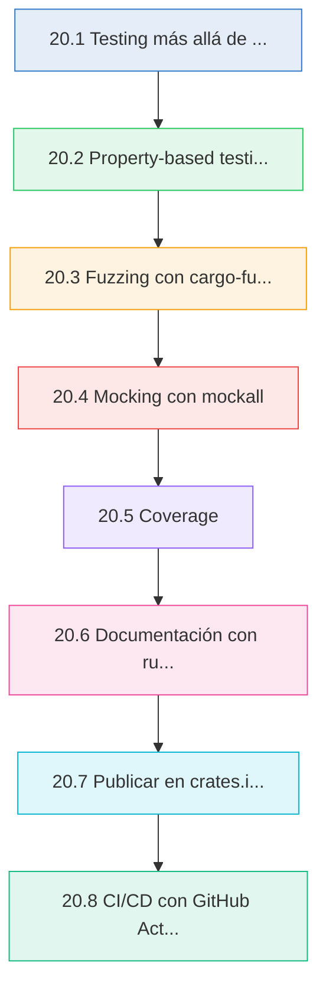
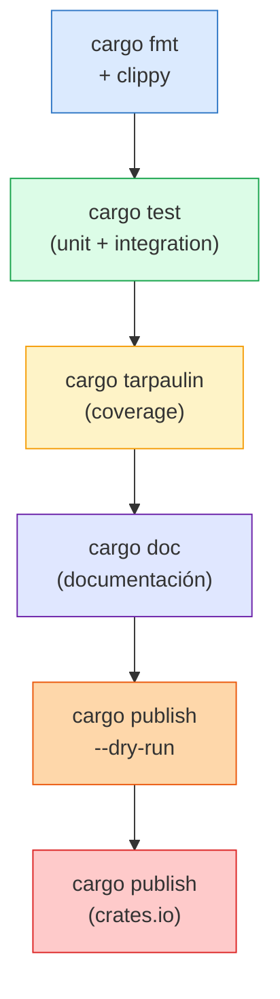
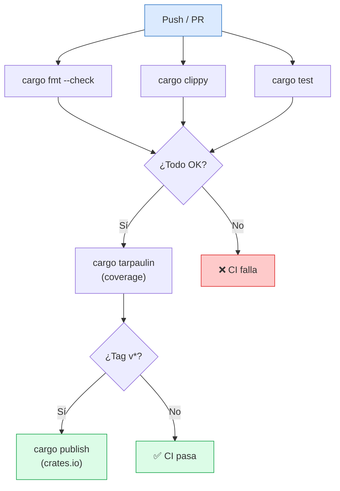

# :package: Cap 20 — Testing avanzado y publicar tu crate

<div class="chapter-meta">
  <span class="meta-item">🕐 4-5 horas</span>
  <span class="meta-item">📊 Nivel: Experto</span>
  <span class="meta-item">🎯 Semana 10</span>
</div>

<div class="chapter-objective">
  <span class="objective-icon">📌</span>
  <span class="objective-text">Al terminar este capítulo, dominarás property-based testing con proptest, fuzzing con cargo-fuzz, mocking con mockall, cobertura con tarpaulin, documentación ejecutable con rustdoc, y el flujo completo de publicación en crates.io con semver y CI/CD — llevando tu código de "funciona en mi máquina" a "publicado y listo para producción".</span>
</div>

<div class="chapter-map">



</div>


!!! quote "Contexto"
    En Python, `pytest` y `PyPI` son tus herramientas de testing y distribución. En Rust, el ecosistema va más allá: **property-based testing** con proptest, **fuzzing** con cargo-fuzz, **mocking** con mockall, **cobertura** con tarpaulin, **documentación ejecutable** con rustdoc, y **publicación** en crates.io. Este capítulo cierra el ciclo: llevar tu código de "funciona en mi máquina" a "publicado, testeado y listo para producción". ¡Es el último capítulo — felicidades por llegar hasta aquí!

<div class="connection-box">
<span class="connection-icon">🔗</span>
<span>En el <a href='19-rendimiento.md'>Capítulo 19</a> optimizaste tu código a nivel de rendimiento con benchmarks, profiling y zero-cost abstractions. Ahora completas el ciclo de calidad: testing exhaustivo para garantizar que esas optimizaciones no introdujeron bugs, y publicación para que el mundo pueda usar tu crate.</span>
</div>

---

<div class="concept-question">
<h4>🔍 Pregunta conceptual</h4>
<p>Si escribes 10 tests manuales para una función, ¿estás cubriendo todos los casos posibles? ¿Qué pasa con los inputs que nunca imaginaste? ¿Puede una máquina encontrar bugs que tú no pensarías probar?</p>
</div>

## 20.1 Testing más allá de `#[test]`

### Repaso rápido

```rust
#[cfg(test)]
mod tests {
    use super::*;

    #[test]
    fn test_basico() {
        assert_eq!(2 + 2, 4);
    }

    #[test]
    #[should_panic(expected = "vacío")]
    fn test_panic() {
        crear_plato("").unwrap();  // Debería hacer panic con "vacío"
    }

    #[test]
    #[ignore]  // Saltar en `cargo test`, ejecutar con `cargo test -- --ignored`
    fn test_lento_integración() {
        // Test que tarda 30 segundos...
    }
}
```

### Tests de integración

```
mi_proyecto/
├── src/
│   └── lib.rs          # Código de la biblioteca
├── tests/              # Tests de integración (crate separado)
│   ├── api_test.rs     # Cada archivo es un crate independiente
│   ├── db_test.rs
│   └── common/         # Módulo compartido
│       └── mod.rs
```

```rust title="tests/api_test.rs"
// Tests de integración importan tu crate como dependencia externa
use mi_proyecto::PlatoService;

#[test]
fn test_crear_plato_completo() {
    let service = PlatoService::new(/* ... */);
    let plato = service.crear("Paella", 15.50, Categoria::Principal).unwrap();
    assert_eq!(plato.nombre, "Paella");
    assert!(plato.precio > 0.0);
}
```

### Organización recomendada

| Tipo | Ubicación | Alcance | Cuándo usar |
|------|-----------|---------|-------------|
| **Unit tests** | `src/*.rs` en `#[cfg(test)]` | Funciones privadas | Lógica interna |
| **Integration tests** | `tests/*.rs` | API pública | Flujos completos |
| **Doc tests** | `///` comments | Ejemplos de uso | Documentación |

<div class="micro-exercise">
<h4>🧪 Micro-ejercicio (5 min)</h4>
<p>Crea un módulo <code>#[cfg(test)]</code> dentro de cualquier archivo <code>.rs</code> que tenga al menos: un test básico con <code>assert_eq!</code>, un test con <code>#[should_panic(expected = "...")]</code>, y un test marcado con <code>#[ignore]</code>. Ejecuta <code>cargo test</code> y luego <code>cargo test -- --ignored</code> para verificar la diferencia.</p>
</div>

---

## 20.2 Property-based testing con proptest

En vez de escribir casos específicos, defines **propiedades** que deben cumplirse para **cualquier input**.

```toml title="Cargo.toml"
[dev-dependencies]
proptest = "1"
```

```rust
use proptest::prelude::*;

// Propiedad: el precio con IVA siempre es mayor que sin IVA
proptest! {
    #[test]
    fn precio_con_iva_mayor(precio in 0.01f64..10000.0) {
        let con_iva = precio * 1.21;
        prop_assert!(con_iva > precio, "Con IVA ({}) debería ser > sin IVA ({})", con_iva, precio);
    }
}

// Propiedad: serializar → deserializar = identidad
proptest! {
    #[test]
    fn roundtrip_json(
        nombre in "[a-zA-Z ]{1,50}",
        precio in 0.01f64..1000.0,
    ) {
        let plato = Plato { nombre, precio: (precio * 100.0).round() / 100.0 };
        let json = serde_json::to_string(&plato).unwrap();
        let recuperado: Plato = serde_json::from_str(&json).unwrap();
        prop_assert_eq!(plato, recuperado);
    }
}
```

<div class="concept-question">
<h4>🔍 Pregunta conceptual</h4>
<p>En un test manual escribes <code>assert_eq!(calcular_iva(100.0), 121.0)</code>. Eso cubre UN caso. ¿Qué propiedad matemática podrías expresar que sea verdadera para CUALQUIER precio positivo? Piensa en invariantes, no en valores concretos.</p>
</div>

### Strategies personalizadas

```rust
use proptest::prelude::*;

// Strategy para generar platos válidos
fn plato_strategy() -> impl Strategy<Value = Plato> {
    (
        "[A-Z][a-z]{2,20}",                    // nombre
        0.50f64..500.0,                          // precio
        prop_oneof![
            Just(Categoria::Entrante),
            Just(Categoria::Principal),
            Just(Categoria::Postre),
            Just(Categoria::Bebida),
        ],
    )
        .prop_map(|(nombre, precio, categoria)| Plato {
            nombre,
            precio: (precio * 100.0).round() / 100.0,
            categoria,
            disponible: true,
        })
}

proptest! {
    #[test]
    fn plato_siempre_valido(plato in plato_strategy()) {
        prop_assert!(!plato.nombre.is_empty());
        prop_assert!(plato.precio > 0.0);
    }
}
```

### Shrinking automático

Cuando proptest encuentra un fallo, **reduce automáticamente** el input al caso más simple que falla:

```
// proptest encontró fallo con: nombre = "Kqwxyz", precio = 847.32
// Después de shrinking: nombre = "A", precio = 0.01
// → Caso mínimo que reproduce el bug
```

<div class="comparison" markdown>
<div class="lang-box python" markdown>

#### :snake: Python — Hypothesis

```python
from hypothesis import given
from hypothesis import strategies as st

@given(
    nombre=st.text(min_size=1, max_size=50),
    precio=st.floats(min_value=0.01, max_value=1000),
)
def test_plato_valido(nombre, precio):
    plato = Plato(nombre=nombre, precio=precio)
    assert plato.nombre == nombre
    # Hypothesis también hace shrinking
```

</div>
<div class="lang-box rust" markdown>

#### :crab: Rust — proptest

```rust
use proptest::prelude::*;

proptest! {
    #[test]
    fn plato_valido(
        nombre in "[a-zA-Z]{1,50}",
        precio in 0.01f64..1000.0,
    ) {
        let plato = Plato::new(nombre, precio);
        prop_assert!(!plato.nombre.is_empty());
        // proptest también hace shrinking
    }
}
```

</div>
</div>

<div class="pro-tip">
<h4>💡 Consejo Pro</h4>
<p>Cuando proptest encuentra un fallo, guarda el caso mínimo en un archivo <code>proptest-regressions/</code> dentro de tu proyecto. Estos archivos actúan como tests de regresión permanentes: la próxima vez que ejecutes <code>cargo test</code>, se ejecutará primero el caso que falló. Incluye estos archivos en tu repositorio Git para que todo el equipo se beneficie.</p>
</div>

---

## 20.3 Fuzzing con cargo-fuzz

El fuzzing genera inputs **aleatorios y mutados** para encontrar crashes, panics y bugs que nunca imaginarías.

```bash
# Instalar
cargo install cargo-fuzz

# Inicializar fuzzing en el proyecto
cargo fuzz init

# Crear un target
cargo fuzz add parsear_json
```

```rust title="fuzz/fuzz_targets/parsear_json.rs"
#![no_main]
use libfuzzer_sys::fuzz_target;
use mi_proyecto::parsear_pedido;

fuzz_target!(|data: &[u8]| {
    // El fuzzer genera bytes aleatorios
    if let Ok(texto) = std::str::from_utf8(data) {
        // Intentamos parsear — no debería hacer panic NUNCA
        let _ = parsear_pedido(texto);
    }
});
```

```bash
# Ejecutar fuzzing (corre hasta que lo detengas con Ctrl+C)
cargo +nightly fuzz run parsear_json

# Ejecutar por tiempo limitado
cargo +nightly fuzz run parsear_json -- -max_total_time=60

# Tras encontrar un crash, minimizar el input
cargo +nightly fuzz tmin parsear_json fuzz/artifacts/parsear_json/crash-xxx
```

### Fuzzing con tipos estructurados

```rust
use libfuzzer_sys::fuzz_target;
use arbitrary::Arbitrary;

#[derive(Arbitrary, Debug)]
struct PedidoFuzz {
    mesa_id: u32,
    items: Vec<(String, f64)>,
}

fuzz_target!(|pedido: PedidoFuzz| {
    let _ = procesar_pedido(pedido.mesa_id, &pedido.items);
});
```

<div class="concept-question">
<h4>🔍 Pregunta conceptual</h4>
<p>¿Cuál es la diferencia fundamental entre proptest y cargo-fuzz? Ambos generan inputs aleatorios, pero uno verifica <em>propiedades</em> y el otro busca <em>crashes</em>. ¿Cuándo usarías cada uno? ¿Pueden complementarse?</p>
</div>

---

## 20.4 Mocking con mockall

```toml title="Cargo.toml"
[dev-dependencies]
mockall = "0.13"
```

### `#[automock]` para traits

```rust
use mockall::automock;

#[automock]
trait PlatoRepository {
    fn buscar_por_id(&self, id: i32) -> Result<Plato, AppError>;
    fn listar(&self) -> Result<Vec<Plato>, AppError>;
    fn crear(&self, plato: &Plato) -> Result<i32, AppError>;
}

#[cfg(test)]
mod tests {
    use super::*;
    use mockall::predicate::*;

    #[test]
    fn test_servicio_buscar_plato() {
        let mut mock_repo = MockPlatoRepository::new();

        // Configurar expectativa
        mock_repo
            .expect_buscar_por_id()
            .with(eq(1))                    // Solo para id == 1
            .times(1)                       // Exactamente 1 vez
            .returning(|_| Ok(Plato {
                id: 1,
                nombre: "Paella".to_string(),
                precio: 15.50,
                categoria: Categoria::Principal,
                disponible: true,
            }));

        let service = PlatoService::new(Box::new(mock_repo));
        let plato = service.obtener(1).unwrap();

        assert_eq!(plato.nombre, "Paella");
        assert_eq!(plato.precio, 15.50);
    }

    #[test]
    fn test_servicio_plato_no_encontrado() {
        let mut mock_repo = MockPlatoRepository::new();

        mock_repo
            .expect_buscar_por_id()
            .with(eq(999))
            .times(1)
            .returning(|id| Err(AppError::NotFound(
                format!("Plato {} no encontrado", id)
            )));

        let service = PlatoService::new(Box::new(mock_repo));
        let resultado = service.obtener(999);

        assert!(matches!(resultado, Err(AppError::NotFound(_))));
    }
}
```

### Secuencias con `in_sequence`

```rust
#[test]
fn test_flujo_crear_y_buscar() {
    let mut mock_repo = MockPlatoRepository::new();
    let mut seq = mockall::Sequence::new();

    mock_repo
        .expect_crear()
        .times(1)
        .in_sequence(&mut seq)
        .returning(|_| Ok(42));

    mock_repo
        .expect_buscar_por_id()
        .with(eq(42))
        .times(1)
        .in_sequence(&mut seq)
        .returning(|_| Ok(Plato { id: 42, nombre: "Nuevo".into(), /* ... */ }));

    // El mock verifica que crear() se llama ANTES que buscar_por_id()
}
```

<div class="comparison" markdown>
<div class="lang-box python" markdown>

#### :snake: Python — unittest.mock

```python
from unittest.mock import Mock, patch

def test_servicio():
    mock_repo = Mock(spec=PlatoRepository)
    mock_repo.buscar_por_id.return_value = Plato(
        id=1, nombre="Paella", precio=15.50
    )

    service = PlatoService(repo=mock_repo)
    plato = service.obtener(1)

    assert plato.nombre == "Paella"
    mock_repo.buscar_por_id.assert_called_once_with(1)
```

</div>
<div class="lang-box rust" markdown>

#### :crab: Rust — mockall

```rust
#[test]
fn test_servicio() {
    let mut mock = MockPlatoRepository::new();
    mock.expect_buscar_por_id()
        .with(eq(1))
        .times(1)
        .returning(|_| Ok(Plato {
            id: 1, nombre: "Paella".into(),
            precio: 15.50, /* ... */
        }));

    let service = PlatoService::new(Box::new(mock));
    let plato = service.obtener(1).unwrap();
    assert_eq!(plato.nombre, "Paella");
}
```

</div>
</div>

---

## 20.5 Coverage

### cargo-tarpaulin

```bash
# Instalar
cargo install cargo-tarpaulin

# Ejecutar con reporte en terminal
cargo tarpaulin

# Generar HTML
cargo tarpaulin --out Html

# Generar para CI (Codecov/Coveralls)
cargo tarpaulin --out Xml
```

### cargo-llvm-cov (alternativa más precisa)

```bash
# Instalar
cargo install cargo-llvm-cov

# Ejecutar
cargo llvm-cov

# HTML report
cargo llvm-cov --html
open target/llvm-cov/html/index.html

# Para CI
cargo llvm-cov --lcov --output-path lcov.info
```

### Ignorar funciones del coverage

```rust
// Excluir de tarpaulin
#[cfg(not(tarpaulin_include))]
fn debug_only() {
    // Esta función no cuenta para coverage
}

// Excluir de llvm-cov
#[cfg_attr(coverage_nightly, no_coverage)]
fn helper_interno() {
    // ...
}
```

<div class="pro-tip">
<h4>💡 Consejo Pro</h4>
<p>No persigas el 100% de cobertura ciegamente. Un 80% de cobertura con tests significativos (property tests + integration tests) es mucho mejor que un 100% con tests triviales que solo verifican getters. Enfoca tu esfuerzo en testear lógica de negocio, parsing de inputs externos y manejo de errores. Usa <code>#[cfg(not(tarpaulin_include))]</code> para excluir código de debugging o logging que no aporta valor testear.</p>
</div>

---

## 20.6 Documentación con rustdoc

### Doc comments

```rust
/// Un plato del menú de RustMenu.
///
/// Cada plato tiene un nombre, precio y categoría.
/// Los precios incluyen IVA.
///
/// # Ejemplos
///
/// ```
/// use rustmenu::Plato;
///
/// let plato = Plato::new("Paella", 15.50, Categoria::Principal);
/// assert_eq!(plato.nombre(), "Paella");
/// assert!(plato.precio() > 0.0);
/// ```
///
/// # Errores
///
/// Retorna `AppError::Validation` si:
/// - El nombre está vacío
/// - El precio es negativo o cero
pub struct Plato {
    nombre: String,
    precio: f64,
    categoria: Categoria,
}

/// Crea un plato con validación.
///
/// # Argumentos
///
/// * `nombre` - Nombre del plato (no vacío)
/// * `precio` - Precio en euros (> 0)
/// * `categoria` - Categoría del menú
///
/// # Ejemplos
///
/// ```
/// # use rustmenu::{Plato, Categoria, AppError};
/// let plato = Plato::new("Gazpacho", 6.50, Categoria::Entrante)?;
/// assert_eq!(plato.nombre(), "Gazpacho");
/// # Ok::<(), AppError>(())
/// ```
impl Plato {
    pub fn new(nombre: &str, precio: f64, cat: Categoria) -> Result<Self, AppError> {
        // ...
    }
}
```

### Doc tests = tests reales

Los bloques de código en `///` se **compilan y ejecutan** con `cargo test`:

```bash
# Ejecutar solo doc tests
cargo test --doc

# Ejecutar todos los tests (incluyendo doc tests)
cargo test
```

### Líneas ocultas con `#`

```rust
/// ```
/// # // Líneas con # no aparecen en la documentación pero sí se compilan
/// # use rustmenu::{Plato, Categoria};
/// let p = Plato::new("Paella", 15.50, Categoria::Principal).unwrap();
/// assert_eq!(p.nombre(), "Paella");
/// ```
```

### Generar y abrir documentación

```bash
cargo doc --open                    # Genera y abre en navegador
cargo doc --no-deps                 # Solo tu crate (no dependencias)
cargo doc --document-private-items  # Incluir items privados
```

<div class="micro-exercise">
<h4>🧪 Micro-ejercicio (5 min)</h4>
<p>Toma cualquier función pública de tu proyecto y escribe un doc comment completo con las secciones <code># Ejemplos</code>, <code># Errores</code> y <code># Panics</code> (si aplica). Incluye un bloque de código ejecutable. Ejecuta <code>cargo test --doc</code> para verificar que tu ejemplo compila y pasa. Luego ejecuta <code>cargo doc --open</code> para ver el resultado en el navegador.</p>
</div>

---

## 20.7 Publicar en crates.io

### Preparar `Cargo.toml`

```toml title="Cargo.toml"
[package]
name = "rustmenu"
version = "0.1.0"
edition = "2021"
authors = ["Tu Nombre <tu@email.com>"]
description = "API de gestión de restaurante construida con Axum"
license = "MIT OR Apache-2.0"
repository = "https://github.com/dettriva/rustmenu"
homepage = "https://github.com/dettriva/rustmenu"
documentation = "https://docs.rs/rustmenu"
readme = "README.md"
keywords = ["restaurant", "api", "axum", "menu"]
categories = ["web-programming", "database"]
```

### Semver: versionado semántico

| Cambio | Versión | Cuándo |
|--------|---------|--------|
| **Patch** | `0.1.0` → `0.1.1` | Bug fix, sin cambios de API |
| **Minor** | `0.1.0` → `0.2.0` | Nueva funcionalidad, compatible hacia atrás |
| **Major** | `0.1.0` → `1.0.0` | Cambios que rompen la API existente |

!!! warning "Antes de 1.0"
    Mientras la versión sea `0.x.y`, un cambio minor (0.1 → 0.2) se considera breaking. Solo `0.x.y` → `0.x.z` (patch) garantiza compatibilidad.

### Publicar

```bash
# 1. Crear cuenta en crates.io (usa tu cuenta de GitHub)
# 2. Obtener token en https://crates.io/settings/tokens
cargo login <tu-token>

# 3. Verificar qué se incluye en el paquete
cargo package --list

# 4. Dry run (no publica de verdad)
cargo publish --dry-run

# 5. Publicar
cargo publish

# 6. Si necesitas retirar una versión
cargo yank --version 0.1.0
cargo yank --undo --version 0.1.0  # Deshacer yank
```

### Diagrama: pipeline de publicación



<div class="comparison" markdown>
<div class="lang-box python" markdown>

#### :snake: Python — PyPI

```bash
# Python: publicar en PyPI
pip install build twine
python -m build
twine upload dist/*

# pyproject.toml para metadata
# setup.py legacy
# __init__.py para versión
```

</div>
<div class="lang-box rust" markdown>

#### :crab: Rust — crates.io

```bash
# Rust: publicar en crates.io
cargo login <token>
cargo publish --dry-run
cargo publish

# Todo en Cargo.toml
# Versión en un solo lugar
# Docs generadas automáticamente en docs.rs
```

</div>
</div>

<div class="misconception-box">
<h4>⚠️ Errores comunes</h4>
<ul>
<li><span class="wrong">❌ Mito:</span> "Con unos cuantos tests manuales basta" → <span class="right">✅ Realidad:</span> Los tests manuales solo cubren los casos que imaginas. Property-based testing con proptest genera miles de inputs aleatorios y encuentra bugs en edge cases que nunca habrías pensado probar. Los bugs más peligrosos viven en los inputs que no imaginaste.</li>
<li><span class="wrong">❌ Mito:</span> "El fuzzing es solo para proyectos de seguridad" → <span class="right">✅ Realidad:</span> Cualquier función que procese input externo (parsers, deserializadores, validadores) se beneficia del fuzzing. Un <code>cargo fuzz</code> de 60 segundos puede encontrar panics que meses de tests manuales no detectarían.</li>
<li><span class="wrong">❌ Mito:</span> "Publicar en crates.io es irreversible y peligroso" → <span class="right">✅ Realidad:</span> <code>cargo publish --dry-run</code> te permite verificar todo antes de publicar. Y si publicas una versión con bugs, <code>cargo yank</code> la marca como retirada sin borrarla. El flujo es seguro si sigues el pipeline: fmt, clippy, test, dry-run, publish.</li>
</ul>
</div>

---

## 20.8 CI/CD con GitHub Actions

### Workflow completo

```yaml title=".github/workflows/ci.yml"
name: CI

on:
  push:
    branches: [main]
  pull_request:
    branches: [main]

env:
  CARGO_TERM_COLOR: always

jobs:
  test:
    name: Test
    runs-on: ubuntu-latest
    steps:
      - uses: actions/checkout@v4
      - uses: dtolnay/rust-toolchain@stable
      - uses: Swatinem/rust-cache@v2

      - name: Run tests
        run: cargo test --all-features

  clippy:
    name: Clippy
    runs-on: ubuntu-latest
    steps:
      - uses: actions/checkout@v4
      - uses: dtolnay/rust-toolchain@stable
        with:
          components: clippy
      - uses: Swatinem/rust-cache@v2

      - name: Run clippy
        run: cargo clippy --all-targets --all-features -- -D warnings

  fmt:
    name: Format
    runs-on: ubuntu-latest
    steps:
      - uses: actions/checkout@v4
      - uses: dtolnay/rust-toolchain@stable
        with:
          components: rustfmt

      - name: Check formatting
        run: cargo fmt --all -- --check

  coverage:
    name: Coverage
    runs-on: ubuntu-latest
    steps:
      - uses: actions/checkout@v4
      - uses: dtolnay/rust-toolchain@stable
      - uses: Swatinem/rust-cache@v2

      - name: Install tarpaulin
        run: cargo install cargo-tarpaulin

      - name: Run coverage
        run: cargo tarpaulin --out Xml

      - name: Upload to Codecov
        uses: codecov/codecov-action@v3
        with:
          file: cobertura.xml

  publish:
    name: Publish
    needs: [test, clippy, fmt]
    runs-on: ubuntu-latest
    if: startsWith(github.ref, 'refs/tags/v')
    steps:
      - uses: actions/checkout@v4
      - uses: dtolnay/rust-toolchain@stable

      - name: Publish to crates.io
        run: cargo publish
        env:
          CARGO_REGISTRY_TOKEN: ${{ secrets.CARGO_REGISTRY_TOKEN }}
```

### Pipeline CI/CD completo



---

## 20.9 RustMenu: preparar para producción

### Checklist de producción

```rust title="tests/api_integration.rs"
use axum::http::StatusCode;
use axum_test::TestServer;

#[tokio::test]
async fn test_flujo_completo() {
    let app = crear_app_test().await;
    let server = TestServer::new(app).unwrap();

    // 1. Registrar usuario
    let res = server.post("/api/auth/register")
        .json(&serde_json::json!({
            "nombre": "Chef Test",
            "email": "chef@test.com",
            "password": "segura123"
        }))
        .await;
    assert_eq!(res.status_code(), StatusCode::CREATED);

    // 2. Login
    let res = server.post("/api/auth/login")
        .json(&serde_json::json!({
            "email": "chef@test.com",
            "password": "segura123"
        }))
        .await;
    assert_eq!(res.status_code(), StatusCode::OK);
    let token: serde_json::Value = res.json();
    let jwt = token["token"].as_str().unwrap();

    // 3. Crear plato (autenticado)
    let res = server.post("/api/platos")
        .add_header("Authorization".parse().unwrap(), format!("Bearer {}", jwt).parse().unwrap())
        .json(&serde_json::json!({
            "nombre": "Paella Valenciana",
            "precio": 15.50,
            "categoria": "principal"
        }))
        .await;
    assert_eq!(res.status_code(), StatusCode::CREATED);

    // 4. Listar platos
    let res = server.get("/api/platos").await;
    assert_eq!(res.status_code(), StatusCode::OK);
    let platos: Vec<serde_json::Value> = res.json();
    assert_eq!(platos.len(), 1);
    assert_eq!(platos[0]["nombre"], "Paella Valenciana");
}
```

### Property-based tests para RustMenu

```rust
use proptest::prelude::*;

proptest! {
    #[test]
    fn precio_total_pedido_correcto(
        cantidades in prop::collection::vec(1u32..10, 1..5),
        precios in prop::collection::vec(0.50f64..100.0, 1..5),
    ) {
        let items: Vec<_> = cantidades.iter().zip(precios.iter())
            .map(|(&cant, &precio)| LineaPedido {
                cantidad: cant,
                precio_unitario: (precio * 100.0).round() / 100.0,
            })
            .collect();

        let total = calcular_total(&items);
        let esperado: f64 = items.iter()
            .map(|i| i.cantidad as f64 * i.precio_unitario)
            .sum();

        prop_assert!((total - esperado).abs() < 0.01);
    }
}
```

### Pre-publish checklist

| Paso | Comando | Verificación |
|------|---------|-------------|
| Formatear | `cargo fmt` | Sin cambios pendientes |
| Linter | `cargo clippy -- -D warnings` | Sin warnings |
| Tests | `cargo test --all-features` | Todo verde |
| Doc tests | `cargo test --doc` | Ejemplos funcionan |
| Coverage | `cargo tarpaulin` | > 70% ideal |
| Documentación | `cargo doc --no-deps` | Sin warnings |
| Paquete | `cargo package --list` | Sin archivos sensibles |
| Dry run | `cargo publish --dry-run` | Sin errores |

---

<div class="code-evolution">
<h4>📈 Evolución de código: de tests manuales a pipeline profesional</h4>

<div class="evolution-step" markdown>
<span class="step-label novato">v1 Novato — solo tests manuales con valores hardcoded</span>

```rust
#[test]
fn test_precio() {
    assert_eq!(calcular_iva(100.0), 121.0);
    assert_eq!(calcular_iva(50.0), 60.5);
    // Solo 2 casos... ¿y si falla con 0.0? ¿Con f64::MAX?
    // Sin mocks, sin coverage, sin CI, sin docs
}

// Para publicar: "cargo publish" y rezar 🙏
```

</div>

<div class="evolution-step" markdown>
<span class="step-label mejorado">v2 Mejorado — proptest + mocks + doc tests</span>

```rust
proptest! {
    #[test]
    fn iva_siempre_mayor(precio in 0.01f64..100_000.0) {
        let con_iva = calcular_iva(precio);
        prop_assert!(con_iva > precio);
        prop_assert!((con_iva - precio * 1.21).abs() < 0.01);
    }
}

/// Calcula el precio con IVA (21%).
/// ```
/// assert!((calcular_iva(100.0) - 121.0).abs() < 0.01);
/// ```
pub fn calcular_iva(precio: f64) -> f64 { precio * 1.21 }

// Mock para testear el servicio sin base de datos real
```

</div>

<div class="evolution-step" markdown>
<span class="step-label profesional">v3 Profesional — pipeline completo con CI/CD</span>

```rust
// Property tests + fuzzing + mocks + doc tests
// cargo tarpaulin → 85% coverage
// GitHub Actions: fmt → clippy → test → coverage → publish
// Cargo.toml con semver, license, keywords
// cargo publish --dry-run ✅ → cargo publish ✅
// docs.rs genera documentación automáticamente
// Cada PR pasa por el pipeline completo antes de merge
```

</div>
</div>

---

## :link: Recursos

| Recurso | Enlace |
|---------|--------|
| proptest book | [proptest-rs.github.io/proptest](https://proptest-rs.github.io/proptest/) |
| cargo-fuzz | [rust-fuzz.github.io/book](https://rust-fuzz.github.io/book/) |
| mockall docs | [docs.rs/mockall](https://docs.rs/mockall/) |
| The Cargo Book: Publishing | [doc.rust-lang.org/cargo/reference/publishing](https://doc.rust-lang.org/cargo/reference/publishing.html) |
| Rustdoc Book | [doc.rust-lang.org/rustdoc](https://doc.rust-lang.org/rustdoc/) |

---

## 🎯 Ejercicios

??? question "Ejercicio 20.1: Property test para validación"
    <span class="bloom-badge apply">Aplicar</span>

    Escribe un property test con proptest que verifique: cualquier `Plato` creado con nombre no vacío y precio positivo pasa la validación, y cualquiera con nombre vacío o precio negativo falla.

    ??? success "Solución"
        ```rust
        use proptest::prelude::*;

        proptest! {
            #[test]
            fn plato_valido_siempre_pasa(
                nombre in "[a-zA-Z]{1,50}",
                precio in 0.01f64..10000.0,
            ) {
                let resultado = Plato::new(&nombre, precio, Categoria::Principal);
                prop_assert!(resultado.is_ok(),
                    "Plato con nombre='{}', precio={} debería ser válido", nombre, precio);
            }

            #[test]
            fn nombre_vacio_siempre_falla(
                precio in 0.01f64..10000.0,
            ) {
                let resultado = Plato::new("", precio, Categoria::Principal);
                prop_assert!(resultado.is_err(),
                    "Plato con nombre vacío debería fallar");
            }

            #[test]
            fn precio_negativo_siempre_falla(
                nombre in "[a-zA-Z]{1,50}",
                precio in -10000.0f64..0.0,
            ) {
                let resultado = Plato::new(&nombre, precio, Categoria::Principal);
                prop_assert!(resultado.is_err(),
                    "Plato con precio {} debería fallar", precio);
            }
        }
        ```

??? question "Ejercicio 20.2: Mock de repositorio"
    <span class="bloom-badge apply">Aplicar</span>

    Crea un test con mockall que verifique que `PedidoService::crear_pedido()` llama a `PlatoRepository::buscar_por_id()` una vez por cada item del pedido.

    ??? success "Solución"
        ```rust
        #[automock]
        trait PlatoRepository {
            fn buscar_por_id(&self, id: i32) -> Result<Plato, AppError>;
        }

        #[automock]
        trait PedidoRepository {
            fn crear(&self, pedido: &Pedido) -> Result<i32, AppError>;
        }

        struct PedidoService {
            plato_repo: Box<dyn PlatoRepository>,
            pedido_repo: Box<dyn PedidoRepository>,
        }

        #[test]
        fn test_crear_pedido_busca_cada_plato() {
            let mut mock_platos = MockPlatoRepository::new();
            let mut mock_pedidos = MockPedidoRepository::new();

            // 3 items → 3 llamadas a buscar_por_id
            mock_platos
                .expect_buscar_por_id()
                .times(3)
                .returning(|id| Ok(Plato {
                    id,
                    nombre: format!("Plato {}", id),
                    precio: 10.0,
                    categoria: Categoria::Principal,
                    disponible: true,
                }));

            mock_pedidos
                .expect_crear()
                .times(1)
                .returning(|_| Ok(1));

            let service = PedidoService {
                plato_repo: Box::new(mock_platos),
                pedido_repo: Box::new(mock_pedidos),
            };

            let items = vec![
                LineaPedido { plato_id: 1, cantidad: 2 },
                LineaPedido { plato_id: 2, cantidad: 1 },
                LineaPedido { plato_id: 3, cantidad: 3 },
            ];

            let resultado = service.crear_pedido(1, items);
            assert!(resultado.is_ok());
        }
        ```

??? question "Ejercicio 20.3: Doc test completo"
    <span class="bloom-badge apply">Aplicar</span>

    Escribe documentación con doc tests para una función `calcular_total` que calcule el total de un pedido con IVA.

    ??? success "Solución"
        ```rust
        /// Calcula el total de un pedido aplicando IVA.
        ///
        /// # Argumentos
        ///
        /// * `items` - Lista de (precio_unitario, cantidad)
        /// * `iva_pct` - Porcentaje de IVA (ej: 21.0 para 21%)
        ///
        /// # Ejemplos
        ///
        /// ```
        /// use rustmenu::calcular_total;
        ///
        /// let items = vec![(15.50, 2), (8.00, 1)];
        /// let total = calcular_total(&items, 21.0);
        /// assert!((total - 47.19).abs() < 0.01);
        /// ```
        ///
        /// Con lista vacía retorna 0:
        ///
        /// ```
        /// # use rustmenu::calcular_total;
        /// assert_eq!(calcular_total(&[], 21.0), 0.0);
        /// ```
        ///
        /// # Panics
        ///
        /// Hace panic si `iva_pct` es negativo:
        ///
        /// ```should_panic
        /// # use rustmenu::calcular_total;
        /// calcular_total(&[(10.0, 1)], -5.0); // panic!
        /// ```
        pub fn calcular_total(items: &[(f64, u32)], iva_pct: f64) -> f64 {
            assert!(iva_pct >= 0.0, "IVA no puede ser negativo");
            let subtotal: f64 = items.iter()
                .map(|(precio, cantidad)| precio * *cantidad as f64)
                .sum();
            let total = subtotal * (1.0 + iva_pct / 100.0);
            (total * 100.0).round() / 100.0
        }
        ```

??? question "Ejercicio 20.4: Workflow de GitHub Actions"
    <span class="bloom-badge create">Crear</span>

    Escribe un workflow de GitHub Actions que ejecute tests en una matrix con Rust stable y nightly, y publique automáticamente cuando se crea un tag `v*`.

    ??? success "Solución"
        ```yaml
        name: CI/CD

        on:
          push:
            branches: [main]
            tags: ['v*']
          pull_request:

        jobs:
          test:
            name: Test (${{ matrix.rust }})
            runs-on: ubuntu-latest
            strategy:
              matrix:
                rust: [stable, nightly]
            steps:
              - uses: actions/checkout@v4
              - uses: dtolnay/rust-toolchain@master
                with:
                  toolchain: ${{ matrix.rust }}
                  components: clippy, rustfmt
              - uses: Swatinem/rust-cache@v2
              - run: cargo fmt -- --check
              - run: cargo clippy -- -D warnings
              - run: cargo test --all-features
              - run: cargo doc --no-deps

          publish:
            name: Publish
            needs: test
            runs-on: ubuntu-latest
            if: startsWith(github.ref, 'refs/tags/v')
            steps:
              - uses: actions/checkout@v4
              - uses: dtolnay/rust-toolchain@stable
              - run: cargo publish
                env:
                  CARGO_REGISTRY_TOKEN: ${{ secrets.CARGO_REGISTRY_TOKEN }}
        ```

??? question "Ejercicio 20.5: Semver — ¿Qué versión?"
    <span class="bloom-badge evaluate">Evaluar</span>

    Para cada cambio, indica si es patch, minor o major y la nueva versión (actual: `1.2.3`):

    1. Fix: `calcular_total` retornaba NaN con lista vacía
    2. Nuevo: añadir método `Plato::con_descuento(pct: f64) -> Plato`
    3. Cambio: renombrar `Plato::precio` a `Plato::precio_base`
    4. Nuevo: añadir `#[derive(Serialize)]` a `Plato` (antes no lo tenía)

    ??? success "Solución"
        1. **Patch** → `1.2.4` — Bug fix, no cambia la API pública.
        2. **Minor** → `1.3.0` — Nueva funcionalidad, compatible hacia atrás.
        3. **Major** → `2.0.0` — Renombrar un campo público rompe código existente.
        4. **Minor** → `1.3.0` — Añadir un derive es nueva funcionalidad pero no rompe nada. (A menos que cambie la representación de serialización de algo público, lo cual podría ser major en ciertos contextos.)

---

## :brain: Flashcards de repaso

<div class="flashcard">
<div class="front">¿Cuál es la diferencia entre unit tests e integration tests en Rust?</div>
<div class="back"><strong>Unit tests</strong>: dentro de <code>src/</code> en módulos <code>#[cfg(test)]</code>, pueden acceder a funciones privadas. <strong>Integration tests</strong>: en <code>tests/</code>, cada archivo es un crate independiente que importa tu biblioteca como dependencia externa — solo pueden acceder a la API pública.</div>
</div>

<div class="flashcard">
<div class="front">¿Qué es property-based testing y cómo lo implementa proptest?</div>
<div class="back">En vez de probar casos específicos, defines <strong>propiedades</strong> que deben cumplirse para cualquier input válido. <code>proptest</code> genera inputs aleatorios y, si encuentra un fallo, <strong>shrinks</strong> automáticamente al caso mínimo que reproduce el bug.</div>
</div>

<div class="flashcard">
<div class="front">¿Qué es fuzzing y para qué sirve <code>cargo-fuzz</code>?</div>
<div class="back">Fuzzing genera inputs <strong>aleatorios y mutados</strong> masivamente para encontrar crashes y panics inesperados. <code>cargo-fuzz</code> usa LibFuzzer para explorar caminos de ejecución y encontrar bugs en parsers, deserializadores y cualquier código que procese input externo.</div>
</div>

<div class="flashcard">
<div class="front">¿Cómo funciona <code>#[automock]</code> de mockall?</div>
<div class="back"><code>#[automock]</code> genera automáticamente un struct <code>MockNombreTrait</code> que implementa el trait. Configuras expectativas con <code>.expect_metodo()</code>, defines qué retornar con <code>.returning()</code>, y verificas llamadas con <code>.times(n)</code> y <code>.with(predicado)</code>.</div>
</div>

<div class="flashcard">
<div class="front">¿Qué son los doc tests en Rust?</div>
<div class="back">Los bloques de código <code>```rust</code> dentro de comentarios <code>///</code> se <strong>compilan y ejecutan</strong> con <code>cargo test</code>. Son tests reales que además sirven como documentación. Si el ejemplo deja de funcionar, el test falla. Líneas con <code>#</code> se compilan pero no aparecen en la documentación.</div>
</div>

<div class="flashcard">
<div class="front">¿Qué reglas sigue semver (versionado semántico)?</div>
<div class="back"><strong>Major</strong> (X.0.0): cambios que rompen la API. <strong>Minor</strong> (0.X.0): nueva funcionalidad compatible. <strong>Patch</strong> (0.0.X): bug fixes. Antes de 1.0, minor = breaking. <code>cargo yank</code> retira una versión sin borrarla.</div>
</div>

---

## :video_game: Quiz interactivo

<div class="quiz" data-quiz-id="ch20-q1">
<h4>Pregunta 1: ¿Qué hace proptest cuando encuentra un test que falla?</h4>
<button class="quiz-option" data-correct="false">Reporta el error inmediatamente con el input original</button>
<button class="quiz-option" data-correct="true">Hace <em>shrinking</em>: reduce automáticamente el input al caso mínimo que reproduce el fallo</button>
<button class="quiz-option" data-correct="false">Ejecuta el test 1000 veces más para confirmar</button>
<button class="quiz-option" data-correct="false">Genera un reporte HTML con todos los fallos</button>
<div class="quiz-feedback" data-correct="¡Correcto! El shrinking es una de las ventajas clave de proptest. Cuando encuentra un fallo con un input complejo, reduce automáticamente al caso más simple que reproduce el bug, facilitando enormemente la depuración." data-incorrect="Incorrecto. proptest hace shrinking: reduce el input al caso mínimo que reproduce el fallo. Si el test falla con un string de 50 caracteres, proptest intentará reducirlo a 1-2 caracteres si es posible."></div>
</div>

<div class="quiz" data-quiz-id="ch20-q2">
<h4>Pregunta 2: ¿Cuál es la forma correcta de publicar una nueva versión de tu crate?</h4>
<button class="quiz-option" data-correct="false">Subir directamente el código fuente a crates.io</button>
<button class="quiz-option" data-correct="true">Actualizar la versión en <code>Cargo.toml</code>, ejecutar <code>cargo publish --dry-run</code> para verificar, y luego <code>cargo publish</code></button>
<button class="quiz-option" data-correct="false">Crear un release en GitHub y se sincroniza automáticamente</button>
<button class="quiz-option" data-correct="false">Enviar un email a los maintainers de crates.io</button>
<div class="quiz-feedback" data-correct="¡Correcto! El flujo es: actualizar versión en Cargo.toml → cargo publish --dry-run → cargo publish. Antes deberías pasar fmt, clippy, tests y coverage. En CI/CD, se automatiza con un tag de Git." data-incorrect="Incorrecto. El flujo correcto es: actualizar versión → dry-run → publish. GitHub releases no se sincronizan automáticamente, aunque puedes configurar CI/CD para publicar cuando creas un tag."></div>
</div>

---

## :bug: Ejercicio de depuración

Este código tiene **3 errores** en tests y publicación. Encuéntralos:

```rust
// ❌ 3 errores

#[cfg(test)]
mod tests {
    #[test]
    fn test_crear_plato() {
        let plato = super::Plato::new("Paella", 15.50);
        assert_eq!(plato.nombre, "Paella");           // Error 1
    }

    #[test]
    fn test_no_panic() {
        let resultado = super::Plato::new("", -5.0);
        assert!(resultado.is_err());                   // Correcto
    }

    #[test]
    #[should_panic]
    fn test_unwrap_falla() {
        super::Plato::new("", -5.0).unwrap();          // Error 2
    }
}

// Cargo.toml:
// [package]
// name = "mi-crate"
// version = "0.1.0"
// edition = "2021"
// description = "Un crate útil"                       // Error 3
```

??? success "Solución"
    ```rust
    #[cfg(test)]
    mod tests {
        use super::*;  // ← Importar todo del módulo padre

        #[test]
        fn test_crear_plato() {
            let plato = Plato::new("Paella", 15.50).unwrap();
            // Fix 1: new() retorna Result, necesitas .unwrap()
            // y si nombre es privado, usar getter: plato.nombre()
            assert_eq!(plato.nombre(), "Paella");
        }

        #[test]
        fn test_no_panic() {
            let resultado = Plato::new("", -5.0);
            assert!(resultado.is_err());
        }

        #[test]
        #[should_panic(expected = "vacío")]
        // Fix 2: #[should_panic] debería tener expected
        // para verificar el mensaje correcto
        fn test_unwrap_falla() {
            Plato::new("", -5.0).unwrap();
        }
    }

    // Fix 3: Cargo.toml necesita license para publicar
    // [package]
    // name = "mi-crate"
    // version = "0.1.0"
    // edition = "2021"
    // description = "Un crate útil"
    // license = "MIT OR Apache-2.0"  ← OBLIGATORIO para cargo publish
    ```

    **Explicación de errores:**

    1. **`new()` retorna `Result` pero no se hace `unwrap()`**: Si `Plato::new` retorna `Result<Plato, AppError>`, necesitas `.unwrap()` o pattern matching. Además, si `nombre` es privado, acceder con `.nombre` falla — usa el getter `.nombre()`.
    2. **`#[should_panic]` sin `expected`**: Funciona pero es frágil — cualquier panic pasa el test. Con `expected = "mensaje"`, verificas que sea el panic correcto.
    3. **Falta `license` en `Cargo.toml`**: `cargo publish` requiere el campo `license` (o `license-file`). Sin él, la publicación falla.


<div class="real-errors">
<h4>🚨 Errores que vas a encontrar</h4>

**Error 1: Tipo incompatible**

```rust
let x: i32 = "hola"; // ❌
```

```
error[E0308]: mismatched types
  expected `i32`, found `&str`
```

**¿Por qué?** Rust es estrictamente tipado — no hay conversión implícita entre tipos.

**Solución:** Usa el tipo correcto o convierte explícitamente.

---

**Error 2: Variable no mutable**

```rust
let precio = 10.0;
precio = 15.0; // ❌
```

```
error[E0384]: cannot assign twice to immutable variable `precio`
```

**Solución:** Declara con `let mut precio = 10.0;`

---

**Error 3: Valor movido**

```rust
let nombre = String::from("Paella");
let copia = nombre;
println!("{}", nombre); // ❌
```

```
error[E0382]: borrow of moved value: `nombre`
```

**Solución:** Usa `.clone()` o referencias `&nombre`.

</div>

---

<div class="checkpoint">
<h4>🏁 Checkpoint final</h4>
<p>Si puedes: (1) escribir property tests con proptest y explicar shrinking, (2) configurar mocks con mockall y verificar expectativas, (3) generar cobertura y documentación ejecutable, y (4) publicar un crate con semver correcto y CI/CD — <strong>has completado el capítulo 20 y todo el libro Aprende Rust</strong>. 🎉</p>
</div>

<div class="mini-project">
<h4>🏗️ Mini-proyecto: Aplicación práctica</h4>

**Paso 1 — Define las estructuras base**

Crea las estructuras y tipos necesarios para modelar el dominio del capítulo.

??? success "Solución Paso 1"
    ```rust
    // Define tus structs y enums aquí
    #[derive(Debug)]
    struct Item {
        nombre: String,
        valor: f64,
    }

    impl Item {
        fn new(nombre: &str, valor: f64) -> Self {
            Self {
                nombre: nombre.to_string(),
                valor,
            }
        }
    }
    ```

**Paso 2 — Implementa la lógica principal**

Crea funciones que operen sobre las estructuras del paso 1.

??? success "Solución Paso 2"
    ```rust
    fn procesar(items: &[Item]) -> f64 {
        items.iter().map(|i| i.valor).sum()
    }

    fn mostrar(items: &[Item]) {
        for item in items {
            println!("  {} — {:.2}€", item.nombre, item.valor);
        }
    }
    ```

**Paso 3 — Integra todo en main**

Combina los pasos anteriores en un programa completo.

??? success "Solución Paso 3"
    ```rust
    fn main() {
        let items = vec![
            Item::new("Paella", 14.50),
            Item::new("Gazpacho", 8.00),
            Item::new("Flan", 5.50),
        ];

        println!("=== RustMenu ===");
        mostrar(&items);
        println!("Total: {:.2}€", procesar(&items));
    }
    ```

</div>

<div class="ejercicio-guiado">
<h4>🏋️ Ejercicio guiado</h4>

Vas a escribir un módulo de procesamiento de pedidos para RustMenu con tests unitarios exhaustivos y un test de integración. Cubrirás casos de éxito, errores, y edge cases usando `#[test]`, `#[should_panic]`, `assert_eq!`, y un módulo de tests de integración separado.

1. Define un enum `EstadoPedido` con variantes `Pendiente`, `EnPreparacion`, `Listo` y `Entregado` (deriva `Debug`, `Clone`, `PartialEq`). Crea un struct `LineaPedido` con `plato: String`, `cantidad: u32` y `precio_unitario: f64`. Crea un struct `Pedido` con `id: u32`, `mesa: u32`, `lineas: Vec<LineaPedido>` y `estado: EstadoPedido`.
2. Implementa métodos en `Pedido`: `nuevo(id: u32, mesa: u32) -> Self` (crea pedido vacío en estado `Pendiente`), `agregar(& mut self, plato: &str, cantidad: u32, precio: f64) -> Result<(), String>` (valida cantidad > 0 y precio > 0), `total(&self) -> f64`, y `avanzar_estado(&mut self) -> Result<EstadoPedido, String>` (transiciona de Pendiente a EnPreparacion a Listo a Entregado, error si ya está entregado).
3. Crea un módulo `#[cfg(test)] mod tests` con al menos 6 tests unitarios: test de crear pedido vacío, test de agregar líneas válidas, test de error con cantidad 0, test de error con precio negativo, test de cálculo de total con múltiples líneas, y test de la máquina de estados completa (Pendiente -> EnPreparacion -> Listo -> Entregado).
4. Añade un test con `#[should_panic(expected = ...)]` que verifique que avanzar el estado de un pedido ya entregado produce error (o usa `assert!(result.is_err())`).
5. Crea una función pública `resumen_pedido(pedido: &Pedido) -> String` que devuelva un string formateado con la info del pedido, y escribe un test que verifique que el resumen contiene el número de mesa y el total.
6. En `fn main()`, crea un pedido completo, avanza su estado paso a paso imprimiendo cada transición, y muestra el resumen final.

??? success "Solución completa"
    ```rust
    #[derive(Debug, Clone, PartialEq)]
    enum EstadoPedido {
        Pendiente,
        EnPreparacion,
        Listo,
        Entregado,
    }

    impl std::fmt::Display for EstadoPedido {
        fn fmt(&self, f: &mut std::fmt::Formatter<'_>) -> std::fmt::Result {
            match self {
                EstadoPedido::Pendiente => write!(f, "Pendiente"),
                EstadoPedido::EnPreparacion => write!(f, "En preparación"),
                EstadoPedido::Listo => write!(f, "Listo"),
                EstadoPedido::Entregado => write!(f, "Entregado"),
            }
        }
    }

    #[derive(Debug, Clone)]
    struct LineaPedido {
        plato: String,
        cantidad: u32,
        precio_unitario: f64,
    }

    impl LineaPedido {
        fn subtotal(&self) -> f64 {
            self.cantidad as f64 * self.precio_unitario
        }
    }

    #[derive(Debug, Clone)]
    struct Pedido {
        id: u32,
        mesa: u32,
        lineas: Vec<LineaPedido>,
        estado: EstadoPedido,
    }

    impl Pedido {
        fn nuevo(id: u32, mesa: u32) -> Self {
            Pedido {
                id,
                mesa,
                lineas: Vec::new(),
                estado: EstadoPedido::Pendiente,
            }
        }

        fn agregar(
            &mut self,
            plato: &str,
            cantidad: u32,
            precio: f64,
        ) -> Result<(), String> {
            if cantidad == 0 {
                return Err("La cantidad debe ser mayor que 0".to_string());
            }
            if precio <= 0.0 {
                return Err(format!("Precio inválido para '{}': {:.2}", plato, precio));
            }
            self.lineas.push(LineaPedido {
                plato: plato.to_string(),
                cantidad,
                precio_unitario: precio,
            });
            Ok(())
        }

        fn total(&self) -> f64 {
            self.lineas.iter().map(|l| l.subtotal()).sum()
        }

        fn avanzar_estado(&mut self) -> Result<EstadoPedido, String> {
            self.estado = match &self.estado {
                EstadoPedido::Pendiente => EstadoPedido::EnPreparacion,
                EstadoPedido::EnPreparacion => EstadoPedido::Listo,
                EstadoPedido::Listo => EstadoPedido::Entregado,
                EstadoPedido::Entregado => {
                    return Err("El pedido ya fue entregado".to_string());
                }
            };
            Ok(self.estado.clone())
        }
    }

    fn resumen_pedido(pedido: &Pedido) -> String {
        let mut resumen = format!(
            "Pedido #{} — Mesa {} — Estado: {}\n",
            pedido.id, pedido.mesa, pedido.estado
        );
        for linea in &pedido.lineas {
            resumen.push_str(&format!(
                "  {}x {} @ {:.2}€ = {:.2}€\n",
                linea.cantidad, linea.plato, linea.precio_unitario, linea.subtotal()
            ));
        }
        resumen.push_str(&format!("  TOTAL: {:.2}€", pedido.total()));
        resumen
    }

    fn main() {
        let mut pedido = Pedido::nuevo(1, 5);

        pedido.agregar("Paella Valenciana", 2, 14.50).unwrap();
        pedido.agregar("Gazpacho Andaluz", 1, 6.50).unwrap();
        pedido.agregar("Crema Catalana", 2, 5.50).unwrap();

        println!("=== Procesando pedido ===\n");

        // Avanzar por todos los estados
        loop {
            match pedido.avanzar_estado() {
                Ok(nuevo_estado) => {
                    println!("  → Estado: {}", nuevo_estado);
                    if nuevo_estado == EstadoPedido::Entregado {
                        break;
                    }
                }
                Err(e) => {
                    println!("  ✗ Error: {}", e);
                    break;
                }
            }
        }

        println!("\n{}", resumen_pedido(&pedido));
    }

    #[cfg(test)]
    mod tests {
        use super::*;

        #[test]
        fn test_pedido_nuevo_esta_vacio_y_pendiente() {
            let pedido = Pedido::nuevo(1, 3);
            assert_eq!(pedido.id, 1);
            assert_eq!(pedido.mesa, 3);
            assert!(pedido.lineas.is_empty());
            assert_eq!(pedido.estado, EstadoPedido::Pendiente);
            assert_eq!(pedido.total(), 0.0);
        }

        #[test]
        fn test_agregar_lineas_validas() {
            let mut pedido = Pedido::nuevo(1, 1);
            assert!(pedido.agregar("Paella", 2, 14.50).is_ok());
            assert!(pedido.agregar("Gazpacho", 1, 6.50).is_ok());
            assert_eq!(pedido.lineas.len(), 2);
        }

        #[test]
        fn test_error_cantidad_cero() {
            let mut pedido = Pedido::nuevo(1, 1);
            let resultado = pedido.agregar("Paella", 0, 14.50);
            assert!(resultado.is_err());
            assert_eq!(
                resultado.unwrap_err(),
                "La cantidad debe ser mayor que 0"
            );
        }

        #[test]
        fn test_error_precio_negativo() {
            let mut pedido = Pedido::nuevo(1, 1);
            let resultado = pedido.agregar("Paella", 1, -5.0);
            assert!(resultado.is_err());
            assert!(resultado.unwrap_err().contains("Precio inválido"));
        }

        #[test]
        fn test_total_multiples_lineas() {
            let mut pedido = Pedido::nuevo(1, 1);
            pedido.agregar("Paella", 2, 14.50).unwrap();   // 29.00
            pedido.agregar("Gazpacho", 1, 6.50).unwrap();  //  6.50
            pedido.agregar("Flan", 3, 5.00).unwrap();      // 15.00
            let total = pedido.total();
            assert!((total - 50.50).abs() < f64::EPSILON);
        }

        #[test]
        fn test_maquina_de_estados_completa() {
            let mut pedido = Pedido::nuevo(1, 1);
            assert_eq!(pedido.estado, EstadoPedido::Pendiente);

            assert_eq!(pedido.avanzar_estado().unwrap(), EstadoPedido::EnPreparacion);
            assert_eq!(pedido.avanzar_estado().unwrap(), EstadoPedido::Listo);
            assert_eq!(pedido.avanzar_estado().unwrap(), EstadoPedido::Entregado);

            // Intentar avanzar desde Entregado debe dar error
            let resultado = pedido.avanzar_estado();
            assert!(resultado.is_err());
            assert_eq!(resultado.unwrap_err(), "El pedido ya fue entregado");
        }

        #[test]
        fn test_resumen_contiene_info_clave() {
            let mut pedido = Pedido::nuevo(42, 7);
            pedido.agregar("Paella", 1, 14.50).unwrap();
            let resumen = resumen_pedido(&pedido);

            assert!(resumen.contains("Mesa 7"));
            assert!(resumen.contains("14.50"));
            assert!(resumen.contains("Paella"));
        }
    }
    ```

</div>

<div class="connection-box">
<span class="connection-icon">🔗</span>
<span>Este es el capítulo final. Has recorrido el camino completo: desde <a href='01-bienvenido.md'>tu primer <code>Hello World</code> en el Capítulo 1</a> — donde instalaste Rust y escribiste tu primer programa — hasta publicar un crate profesional con testing exhaustivo y CI/CD. Todo lo que aprendiste en 20 capítulos — ownership, borrowing, lifetimes, traits, generics, async, macros, rendimiento — converge aquí en un proyecto listo para producción. Felicidades, ya eres un desarrollador Rust.</span>
</div>

---

## ✅ Autoevaluación del capítulo

<div class="self-check" markdown>
<h4>📋 Verifica tu comprensión</h4>
<label><input type="checkbox"> Puedo escribir property tests con proptest y entiendo el concepto de shrinking</label>
<label><input type="checkbox"> Sé configurar mocks con mockall usando <code>#[automock]</code> y verificar expectativas</label>
<label><input type="checkbox"> Puedo generar reportes de cobertura con cargo-tarpaulin o cargo-llvm-cov</label>
<label><input type="checkbox"> Sé escribir documentación con doc tests que se ejecutan con <code>cargo test</code></label>
<label><input type="checkbox"> Puedo publicar un crate en crates.io con metadata completa y semver correcto</label>
</div>

!!! success ":tada: ¡Felicidades! Has completado Aprende Rust"
    Has recorrido el camino completo: desde ownership y borrowing hasta macros procedurales, testing avanzado y publicación. Ya tienes las herramientas para construir software de producción en Rust. ¡Ahora ve y construye algo increíble con RustMenu como base! :crab:
