# :crab: Pensamiento de sistemas

<div class="chapter-meta">
  <span class="meta-item">🕐 2-3 horas</span>
  <span class="meta-item">📊 Nivel: Principiante</span>
  <span class="meta-item">🎯 Semana 0</span>
</div>

<div class="chapter-map">

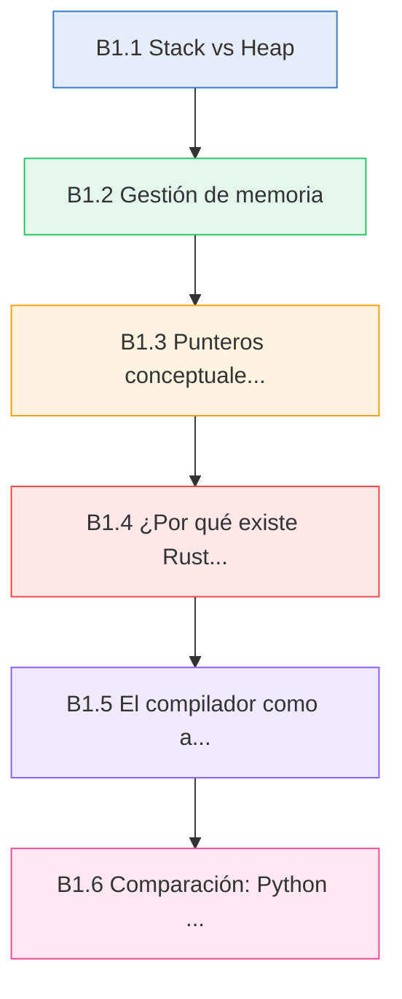

</div>


!!! quote "Contexto"
    Cuando programas en Python, el lenguaje abstrae completamente cómo se almacenan los datos en memoria, cómo se liberan y qué ocurre por debajo. Es una elección de diseño brillante para la productividad, pero cuando pasas a Rust necesitas entender esos mecanismos. Este capítulo construye los **modelos mentales** que necesitas antes de escribir tu primera línea de Rust.

---

<div class="chapter-objective">
  <span class="objective-icon">📌</span>
  <span class="objective-text">Al terminar este capítulo, entenderás los conceptos de programación de sistemas que Python abstrae: stack vs heap, gestión de memoria, y por qué Rust ofrece seguridad sin sacrificar rendimiento.</span>
</div>

---

## B1.1 Stack vs Heap

Cuando un programa se ejecuta, el sistema operativo le asigna memoria. Esa memoria se organiza en dos regiones fundamentales: el **stack** (pila) y el **heap** (montículo). Python te oculta esta distinción por completo. Rust te la hace explícita.

### El Stack (la pila)

El stack es una región de memoria **rápida**, **ordenada** y de **tamaño fijo**. Funciona como una pila de platos: el último en entrar es el primero en salir (LIFO — *Last In, First Out*).

Características del stack:

- **Velocidad**: asignar y liberar memoria es extremadamente rápido (solo mover un puntero)
- **Tamaño conocido**: solo pueden vivir aquí datos cuyo tamaño se conoce en tiempo de compilación
- **Alcance automático**: cuando una función termina, sus datos en el stack se liberan automáticamente
- **Tamaño limitado**: típicamente entre 1 MB y 8 MB por hilo

### El Heap (el montículo)

El heap es una región de memoria **grande**, **flexible** y **más lenta**. Es como un almacén donde puedes reservar espacio de cualquier tamaño en cualquier momento.

Características del heap:

- **Flexibilidad**: puede almacenar datos de tamaño desconocido en compilación
- **Más lento**: requiere buscar espacio libre, gestionar fragmentación
- **Manual o gestionado**: alguien debe decidir cuándo liberar esa memoria
- **Tamaño grande**: limitado solo por la memoria disponible del sistema

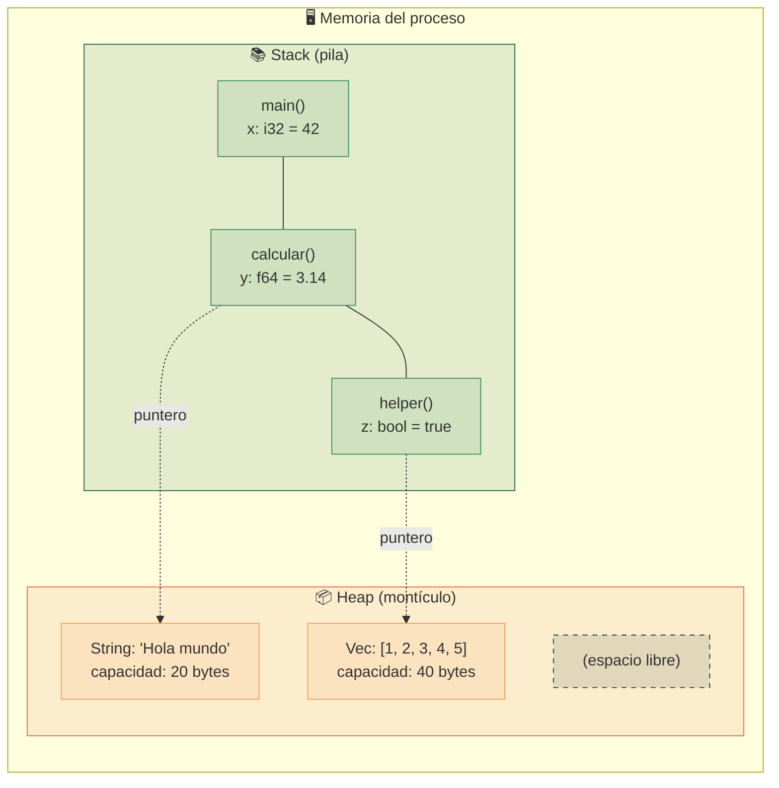

### Qué va en cada sitio

| Dato | Stack | Heap | Razón |
|---|:---:|:---:|---|
| `i32`, `f64`, `bool` | ✅ | | Tamaño fijo conocido en compilación |
| Tuplas de tamaños fijos | ✅ | | Tamaño fijo conocido en compilación |
| `String` (texto dinámico) | metadatos | contenido | El texto puede crecer o encogerse |
| `Vec<T>` (vector) | metadatos | elementos | La cantidad de elementos es variable |
| Datos de un `Box<T>` | puntero | dato | Forzado explícitamente al heap |

<div class="concept-question">
<h4>🔍 Pregunta conceptual</h4>
<p>En Python, cuando haces <code>nombre = "Hola"</code>, el string se almacena en el heap y <code>nombre</code> es una referencia a él, pero nunca lo ves. ¿Qué ventaja crees que tiene saber <em>dónde</em> vive cada dato en tu programa?</p>
</div>

<div class="comparison" markdown>
<div class="lang-box python" markdown>

#### :snake: En Python

```python
def saludar():
    nombre = "Rust"      # heap (str es objeto)
    edad = 9             # heap (int es objeto)
    datos = [1, 2, 3]    # heap (list es objeto)
    return f"Hola {nombre}, tienes {edad} años"

# En Python TODO vive en el heap.
# Las variables son siempre referencias a objetos.
# El garbage collector decide cuándo liberar.
```

Python coloca **todos** los valores en el heap. Incluso un simple entero como `42` es un objeto completo con recuento de referencias, tipo y valor.

</div>
<div class="lang-box rust" markdown>

#### :crab: En Rust

```rust
fn saludar() -> String {
    let nombre = String::from("Rust");  // heap (tamaño variable)
    let edad: i32 = 9;                  // stack (tamaño fijo: 4 bytes)
    let datos = vec![1, 2, 3];          // heap (tamaño variable)
    format!("Hola {}, tienes {} años", nombre, edad)
}

// Rust distingue claramente:
// - Stack: tipos de tamaño fijo (i32, f64, bool, &str)
// - Heap: tipos de tamaño dinámico (String, Vec, Box)
```

Rust te hace consciente de dónde vive cada dato. Los tipos de tamaño fijo van al stack (rápido), los dinámicos al heap (flexible).

</div>
</div>

<div class="pro-tip">
<h4>💡 Consejo Pro</h4>
<p>Cuando veas un tipo en Rust, piensa: ¿su tamaño se conoce en compilación? Si sí (<code>i32</code>, <code>bool</code>, <code>[i32; 5]</code>), probablemente vive en el stack. Si no (<code>String</code>, <code>Vec&lt;T&gt;</code>), sus datos viven en el heap con metadatos (puntero, longitud, capacidad) en el stack.</p>
</div>

---

## B1.2 Gestión de memoria

El problema central de la programación de sistemas es: **¿quién libera la memoria del heap y cuándo?** A lo largo de la historia, han surgido tres estrategias fundamentales.

### Estrategia 1: Gestión manual (C/C++)

El programador reserva y libera memoria explícitamente.

```c
// C — gestión manual
#include <stdlib.h>
#include <string.h>

void ejemplo() {
    // Reservar memoria en el heap
    char *nombre = (char *)malloc(20 * sizeof(char));
    strcpy(nombre, "Rust");

    // ... usar nombre ...

    // ⚠️ El programador DEBE liberar la memoria
    free(nombre);

    // ❌ Peligro: usar nombre después de free = use-after-free
    // printf("%s", nombre);  // COMPORTAMIENTO INDEFINIDO
}
```

**Ventajas**: control total, rendimiento máximo, sin pausas.
**Desventajas**: fuente de bugs catastróficos (use-after-free, double-free, memory leaks, buffer overflows).

### Estrategia 2: Garbage collector (Python, Java, Go)

Un recolector de basura automático libera la memoria cuando detecta que ya no hay referencias a un objeto.

```python
# Python — garbage collector
def ejemplo():
    nombre = "Rust"       # ref_count = 1
    alias = nombre        # ref_count = 2
    del alias             # ref_count = 1

    # Cuando la función termina:
    # ref_count de nombre -> 0
    # El GC libera la memoria automáticamente
    return "listo"

# Nunca llamas a free(). El GC se encarga.
```

**Ventajas**: seguro, ergonómico, sin bugs de memoria manuales.
**Desventajas**: pausas impredecibles del GC, mayor uso de memoria, overhead de runtime.

### Estrategia 3: Ownership (Rust)

El compilador verifica en tiempo de compilación quién "posee" cada dato y cuándo se libera, sin necesidad de GC.

```rust
fn ejemplo() {
    let nombre = String::from("Rust");  // nombre es el dueño
    let longitud = nombre.len();         // prestamos nombre (borrow)

    // Cuando nombre sale de scope, Rust llama drop() automáticamente.
    // No hay GC, no hay free() manual.
    // El compilador GARANTIZA que nadie usa nombre después.
}
// <- aquí se libera la memoria de nombre. Determinista. Sin pausa.
```

**Ventajas**: seguro, sin GC, rendimiento predecible, sin pausas.
**Desventajas**: curva de aprendizaje (el borrow checker).

### Comparación visual de las tres estrategias

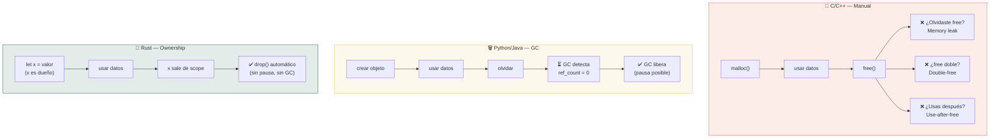

<div class="code-evolution" markdown>
<div class="evolution-header">📈 Evolución del código</div>

<div class="evolution-step">
<span class="step-label novato">v1 — C (manual)</span>

```c
#include <stdlib.h>
#include <string.h>

int main() {
    char *msg = (char *)malloc(50);
    strcpy(msg, "Hola desde C");
    printf("%s\n", msg);
    free(msg);       // ⚠️ Obligatorio. Si lo olvidas: memory leak
    // msg = NULL;   // Buena práctica, pero no obligatoria
    return 0;
}
```

</div>

<div class="evolution-step">
<span class="step-label mejorado">v2 — Python (GC)</span>

```python
def main():
    msg = "Hola desde Python"
    print(msg)
    # No hay que liberar nada.
    # El GC se encarga cuando msg ya no se usa.

main()
```

</div>

<div class="evolution-step">
<span class="step-label profesional">v3 — Rust (ownership)</span>

```rust
fn main() {
    let msg = String::from("Hola desde Rust");
    println!("{}", msg);
    // msg sale de scope aquí -> drop() automático
    // Sin GC, sin free manual, sin pausa
    // El compilador GARANTIZA que nadie usa msg después
}
```

</div>
</div>

<div class="micro-exercise">
<h4>🧪 Micro-ejercicio (2 min)</h4>
<p>Imagina que en C reservas memoria con <code>malloc()</code> para almacenar un nombre, lo usas en tres funciones distintas y luego llamas a <code>free()</code> al final. ¿Qué ocurre si una de esas funciones guarda el puntero en una variable global y después otra parte del programa lo usa tras el <code>free()</code>? Piensa en qué haría Python con ese mismo escenario (nada malo, el GC mantiene vivo el objeto) y qué haría Rust (no compilaría si detecta un uso después de que el dueño libere).</p>
</div>

---

## B1.3 Punteros conceptuales

Un **puntero** es simplemente una variable que almacena la **dirección de memoria** donde vive un dato, en lugar del dato mismo. Es como tener un post-it con la dirección de un restaurante en vez del restaurante.

### Qué es un puntero

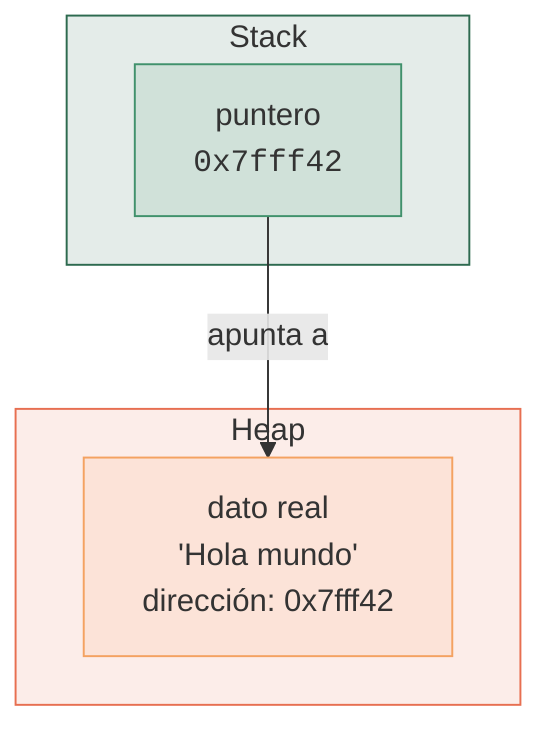

En C, trabajas con punteros crudos (*raw pointers*). Son poderosos pero peligrosos: puedes apuntar a memoria ya liberada, a memoria que no te pertenece o a `NULL`.

En Rust, existen las **referencias** (`&T` y `&mut T`), que son punteros seguros verificados por el compilador. No pueden ser nulas, no pueden apuntar a memoria liberada, y el borrow checker garantiza que se usen correctamente.

### Cómo funcionan las referencias en Python (bajo el capó)

En Python, **todas las variables son referencias**. Cuando escribes `x = [1, 2, 3]`, `x` no contiene la lista, contiene un puntero al objeto lista en el heap. Python esconde esto completamente.

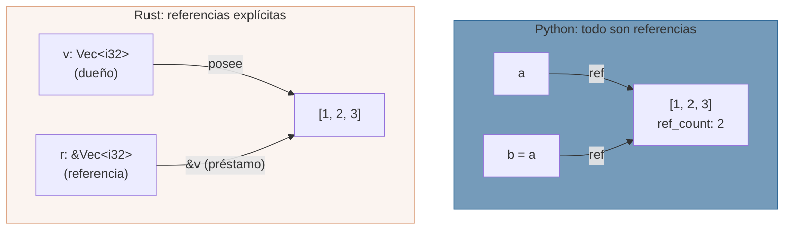

<div class="comparison" markdown>
<div class="lang-box python" markdown>

#### :snake: En Python

```python
# Python: todas las variables son referencias
a = [1, 2, 3]
b = a             # b apunta al MISMO objeto que a
b.append(4)
print(a)          # [1, 2, 3, 4] — ¡a también cambió!

# Esto sorprende a muchos principiantes.
# a y b son dos nombres para el mismo objeto.
# No hay concepto de "dueño".
```

Python no distingue entre "poseer" un dato y "apuntar" a él. Todos los nombres son referencias y el GC se encarga de la vida del objeto.

</div>
<div class="lang-box rust" markdown>

#### :crab: En Rust

```rust
fn main() {
    let mut a = vec![1, 2, 3];
    let b = &mut a;       // b toma prestado a (mutable)
    b.push(4);
    // println!("{:?}", a); // ❌ no puedes usar a mientras
                            //    b lo tiene prestado (mut)
    println!("{:?}", b);   // [1, 2, 3, 4]
    // Ahora b ya no se usa, a vuelve a estar disponible
    println!("{:?}", a);   // [1, 2, 3, 4] ✅
}
```

Rust hace explícito quién posee el dato y quién lo toma prestado. El compilador garantiza que no haya referencias colgantes ni mutación concurrente.

</div>
</div>

### Tipos de punteros en Rust

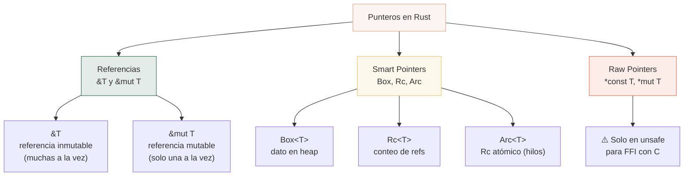

<div class="concept-question">
<h4>🔍 Pregunta conceptual</h4>
<p>En Python, <code>a = [1, 2, 3]</code> y <code>b = a</code> hacen que ambas variables apunten al mismo objeto. Si modificas mediante <code>b</code>, <code>a</code> también cambia. ¿Cómo crees que Rust evita este tipo de "sorpresas" con su sistema de ownership y borrowing?</p>
</div>

---

## B1.4 ¿Por qué existe Rust?

### El problema

Durante décadas, la programación de sistemas estuvo dominada por C y C++. Estos lenguajes ofrecen rendimiento excepcional, pero a un coste enorme en seguridad de memoria. Según estudios de Microsoft y Google, aproximadamente el **70% de las vulnerabilidades de seguridad** en software de sistemas se deben a errores de memoria: use-after-free, buffer overflows, null pointer dereferences, data races.

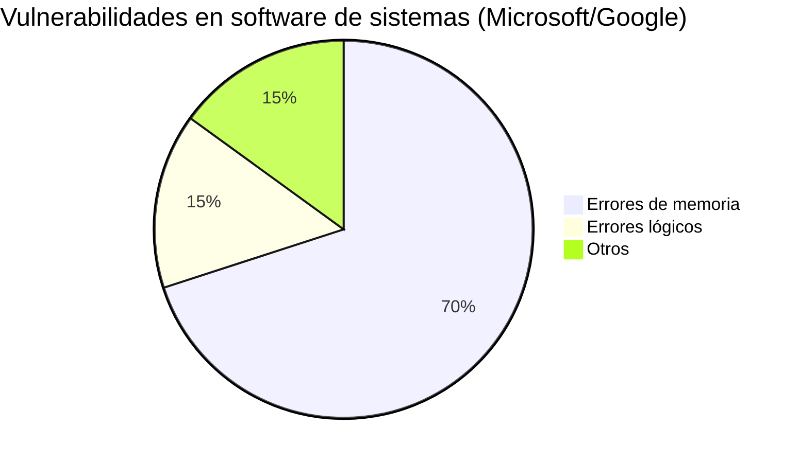

### La historia de Rust

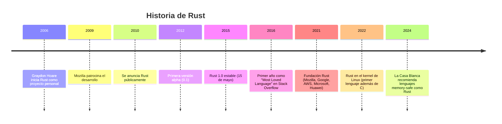

### Lo que Rust resuelve

Rust nació para resolver un dilema que parecía imposible: obtener la velocidad y el control de C/C++ **sin** sus errores de memoria, y **sin** el coste de un garbage collector.

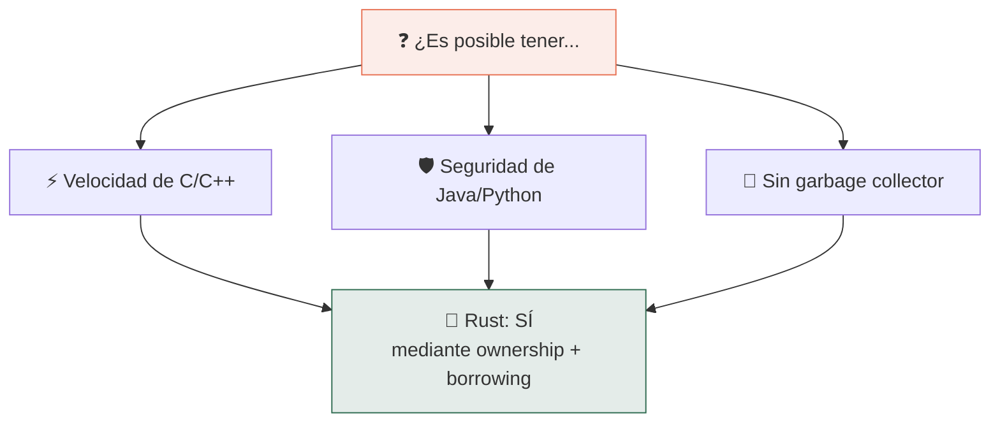

### Conceptos clave que lo hacen posible

1. **Ownership** (propiedad): cada valor tiene exactamente un dueño. Cuando el dueño sale de scope, el valor se libera.
2. **Borrowing** (préstamo): puedes prestar una referencia a un valor sin transferir la propiedad.
3. **Lifetimes** (tiempos de vida): el compilador verifica que ninguna referencia sobreviva al dato al que apunta.
4. **Zero-cost abstractions** (abstracciones de coste cero): las abstracciones de alto nivel se compilan a código tan eficiente como si las hubieras escrito a mano.

<div class="pro-tip">
<h4>💡 Consejo Pro</h4>
<p>"Zero-cost abstractions" no significa que las abstracciones no tienen coste de rendimiento — significa que usarlas no cuesta más que la alternativa manual equivalente. Un iterador <code>.iter().map().filter().collect()</code> en Rust compila al mismo código máquina que un bucle <code>for</code> escrito a mano en C.</p>
</div>

<div class="connection-box">
<span class="connection-icon">🔗</span>
<span>En el <strong>Cap 1 — Bienvenido a Rust</strong> instalarás Rust y escribirás tu primer programa. En el <strong>Cap 2 — Variables, tipos y propiedad</strong> verás el sistema de ownership en acción con código real.</span>
</div>

---

## B1.5 El compilador como aliado

Si vienes de Python, estás acostumbrado a descubrir errores **cuando ejecutas** el programa. Un `TypeError`, un `AttributeError`, un `IndexError` — todos aparecen en runtime, a veces en producción. En Rust, el compilador (`rustc`) es extraordinariamente estricto: si tu código compila, tienes garantías de que no ocurrirán categorías enteras de errores.

### Errores que Python detecta en runtime y Rust en compilación

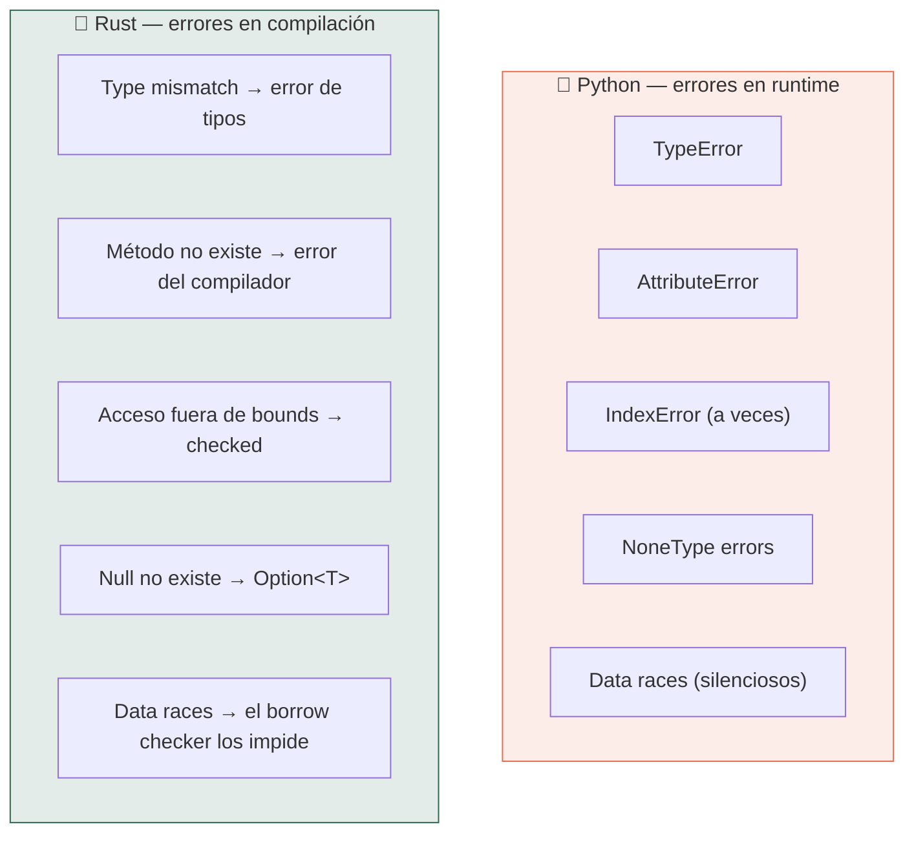

### El borrow checker como maestro

El **borrow checker** es la parte del compilador de Rust que verifica las reglas de ownership y borrowing. Al principio puede parecer un obstáculo frustrante. Pero con el tiempo, te das cuenta de que es un **maestro**: te enseña a pensar en la propiedad y el ciclo de vida de los datos.

Las reglas que el borrow checker verifica:

1. Cada valor tiene exactamente **un dueño**
2. Puedes tener **muchas referencias inmutables** (`&T`) O **una sola referencia mutable** (`&mut T`), pero no ambas a la vez
3. Las referencias nunca pueden **sobrevivir al dato** al que apuntan

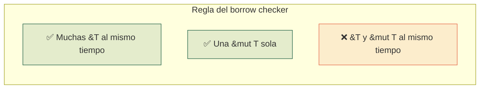

### "If it compiles, it works"

Este es un dicho popular en la comunidad de Rust. No es literalmente cierto (puedes tener errores de lógica), pero expresa algo real: el compilador de Rust elimina **tantas categorías de bugs** en tiempo de compilación que cuando tu programa finalmente compila, suele funcionar correctamente. El ciclo de desarrollo en Rust es:

1. Escribir código
2. Luchar con el compilador
3. El código compila
4. Suele funcionar a la primera

Esto contrasta con Python, donde el ciclo es:

1. Escribir código
2. Ejecutar
3. Encontrar errores en runtime
4. Depurar
5. Repetir

<div class="concept-question">
<h4>🔍 Pregunta conceptual</h4>
<p>¿Has tenido alguna vez un bug en Python que solo apareció en producción porque el código nunca pasó por ese camino durante las pruebas? ¿Cómo crees que un compilador que verifica tipos, ownership y lifetimes podría haber evitado ese error?</p>
</div>

<div class="micro-exercise">
<h4>🧪 Micro-ejercicio (2 min)</h4>
<p>Piensa en un programa Python que hayas escrito recientemente. Identifica al menos dos errores que Python solo detectaría en runtime: por ejemplo, pasar un <code>None</code> donde se espera un <code>str</code>, o acceder a una clave inexistente en un diccionario. Anótalos. Cuando lleguemos al Cap 2, veremos cómo Rust los convierte en errores de compilación.</p>
</div>

---

## B1.6 Comparación: Python vs C vs Rust

Esta tabla resume las diferencias fundamentales entre los tres paradigmas de gestión de memoria que hemos explorado.

### Tabla comparativa

| Característica | C :wrench: | Python :snake: | Rust :crab: |
|---|---|---|---|
| **Gestión de memoria** | Manual (`malloc`/`free`) | Garbage Collector (ref counting + ciclos) | Ownership + Borrowing (compile-time) |
| **Seguridad de memoria** | :x: Ninguna garantía | ✅ GC previene la mayoría | ✅ Garantizada por el compilador |
| **Null / None** | `NULL` (causa crashes) | `None` (causa excepciones en runtime) | No existe (`Option<T>` en su lugar) |
| **Rendimiento** | :zap: Máximo | :turtle: 10-100x más lento | :zap: Comparable a C |
| **Concurrencia** | :x: Data races silenciosos | :warning: GIL limita paralelismo | ✅ Fearless concurrency |
| **Ergonomía** | :x: Baja (manual, verboso) | ✅ Alta (dinámico, conciso) | :warning: Media (estricto pero expresivo) |
| **Curva de aprendizaje** | Media | Baja | Media-alta |
| **Errores típicos** | Segfault, buffer overflow, use-after-free | TypeError, None errors (en runtime) | Errores del compilador (en desarrollo) |
| **¿Cuándo falla?** | En producción (crashes, vulnerabilidades) | En runtime (excepciones) | En compilación (antes de ejecutar) |
| **Ideal para** | Sistemas embebidos, kernels, drivers | Scripts, ML, prototipos, web | Sistemas, CLI, backend, WASM, alta seguridad |

### El espectro de trade-offs

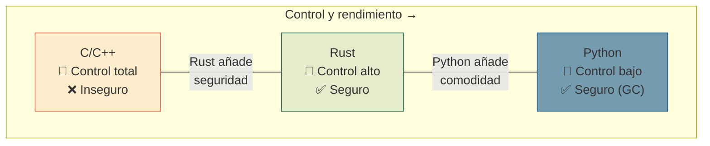


<div class="misconception-box">
<h4>⚠️ Errores comunes</h4>
<ul>
<li><span class="wrong">❌ Mito:</span> "Rust es como C pero con más reglas" → <span class="right">✅ Realidad:</span> Rust es un lenguaje moderno con pattern matching, genéricos, traits, iteradores funcionales y un ecosistema de paquetes comparable a npm. Se parece más a una mezcla de C++ moderno con Haskell que a C con restricciones.</li>
<li><span class="wrong">❌ Mito:</span> "Si uso Python, no necesito saber cómo funciona la memoria" → <span class="right">✅ Realidad:</span> Entender stack, heap y gestión de memoria te hace mejor programador en CUALQUIER lenguaje. En Python te ayuda a evitar memory leaks por referencias circulares, optimizar uso de memoria y entender por qué <code>copy.deepcopy()</code> existe.</li>
<li><span class="wrong">❌ Mito:</span> "El borrow checker solo te pone trabas" → <span class="right">✅ Realidad:</span> El borrow checker te obliga a diseñar mejor tu código. Los patrones que el borrow checker rechaza son los mismos que causan bugs sutiles en C++ y comportamientos sorprendentes en Python (como la mutación compartida).</li>
</ul>
</div>

<div class="connection-box">
<span class="connection-icon">🔗</span>
<span>En <strong>Bases 2 — Compilado vs interpretado</strong> profundizaremos en cómo el proceso de compilación de Rust permite todas estas garantías de seguridad sin coste en runtime, y compararemos el pipeline de ejecución de Python y Rust paso a paso.</span>
</div>

---

## :brain: Flashcards

Repasa los conceptos clave de este capítulo:

| # | Pregunta | Respuesta |
|---|---|---|
| 1 | ¿Qué es el stack? | Una región de memoria rápida, LIFO, para datos de tamaño fijo conocido en compilación. Se libera automáticamente cuando la función termina. |
| 2 | ¿Qué es el heap? | Una región de memoria grande y flexible para datos de tamaño dinámico. Más lenta que el stack y requiere gestión explícita o automática de liberación. |
| 3 | ¿Cuáles son las tres estrategias de gestión de memoria? | Manual (C: `malloc`/`free`), Garbage Collector (Python: automático con overhead) y Ownership (Rust: verificado en compilación sin GC). |
| 4 | ¿Qué es un puntero? | Una variable que almacena la dirección de memoria donde vive un dato, en lugar del dato mismo. |
| 5 | ¿Qué problema resuelve Rust? | Ofrecer la velocidad y control de C/C++ con seguridad de memoria garantizada en compilación, sin necesidad de garbage collector. |
| 6 | ¿Qué es una "zero-cost abstraction"? | Una abstracción de alto nivel que se compila a código tan eficiente como la alternativa manual. Usarla no cuesta más que no usarla. |
| 7 | ¿Qué verifica el borrow checker? | Que cada valor tenga un solo dueño, que las referencias no sobrevivan al dato, y que no existan referencias mutables e inmutables simultáneas al mismo dato. |

---

## :pencil: Quiz

### Pregunta 1

¿Dónde almacena Rust un `Vec<i32>` con 1000 elementos?

- [ ] A) Todo en el stack
- [ ] B) Todo en el heap
- [x] C) Metadatos (puntero, longitud, capacidad) en el stack, elementos en el heap
- [ ] D) Depende del compilador

??? success "Respuesta"
    **C)** El `Vec<i32>` almacena tres valores en el stack: un puntero al inicio de los datos, la longitud actual y la capacidad total. Los 1000 enteros (4000 bytes) viven en el heap. Esto permite que el vector crezca dinámicamente sin que la estructura en el stack cambie de tamaño.

### Pregunta 2

¿Cuál de estos problemas NO puede ocurrir en Rust (en código safe)?

- [ ] A) Un error lógico en un algoritmo
- [x] B) Un use-after-free
- [ ] C) Un bucle infinito
- [ ] D) Un panic en runtime por indexar fuera de rango

??? success "Respuesta"
    **B)** Use-after-free es imposible en Rust safe porque el sistema de ownership garantiza que cuando un valor se libera (drop), ninguna referencia viva puede apuntar a él. El compilador rechaza cualquier código que intente usar un valor después de que su dueño lo haya liberado o movido. Los otros tres errores sí son posibles: los errores lógicos, los bucles infinitos y los panic por bounds checking son cosas que el compilador no puede prevenir.

### Pregunta 3

¿Por qué Python no tiene problemas de use-after-free como C?

- [ ] A) Porque Python no usa punteros
- [ ] B) Porque Python copia todo
- [x] C) Porque el garbage collector mantiene vivo un objeto mientras haya al menos una referencia a él
- [ ] D) Porque Python no usa heap

??? success "Respuesta"
    **C)** El garbage collector de Python (basado en recuento de referencias + detección de ciclos) mantiene un objeto vivo en el heap mientras al menos una variable apunte a él. Cuando `ref_count` llega a 0, el GC lo libera. Es imposible tener una referencia a un objeto ya liberado porque el GC no lo liberará mientras exista la referencia. El coste es el overhead del GC y las pausas potenciales.

---

## :brain: Flashcards interactivas

<div class="flashcard" data-card-id="bases1-1">
<div class="flashcard-front">
<strong>¿Cuál es la diferencia principal entre el stack y el heap?</strong>
</div>
<div class="flashcard-back">
El <strong>stack</strong> es rápido, LIFO, para datos de tamaño fijo conocido en compilación (se libera automáticamente). El <strong>heap</strong> es más lento, flexible, para datos de tamaño dinámico (requiere gestión de liberación manual, por GC o por ownership).
</div>
</div>

<div class="flashcard" data-card-id="bases1-2">
<div class="flashcard-front">
<strong>¿Qué es el ownership en Rust?</strong>
</div>
<div class="flashcard-back">
Un sistema donde cada valor tiene exactamente un <strong>dueño</strong>. Cuando el dueño sale de scope, el valor se libera automáticamente con <code>drop()</code>. No requiere garbage collector ni liberación manual. El compilador verifica las reglas de ownership en tiempo de compilación.
</div>
</div>

<div class="flashcard" data-card-id="bases1-3">
<div class="flashcard-front">
<strong>¿Cómo funciona el garbage collector de Python?</strong>
</div>
<div class="flashcard-back">
Python usa <strong>recuento de referencias</strong> (ref counting) como mecanismo principal: cada objeto lleva un contador de cuántas variables apuntan a él. Cuando el contador llega a 0, se libera. Además, tiene un <strong>detector de ciclos</strong> para referencias circulares. Es seguro pero tiene overhead de memoria y pausas impredecibles.
</div>
</div>

<div class="flashcard" data-card-id="bases1-4">
<div class="flashcard-front">
<strong>¿Qué son las zero-cost abstractions?</strong>
</div>
<div class="flashcard-back">
Son abstracciones de alto nivel que se compilan a código <strong>tan eficiente como la alternativa manual</strong>. Usarlas no cuesta más que no usarlas. Por ejemplo, un iterador <code>.iter().map().filter().collect()</code> en Rust compila al mismo código máquina que un bucle <code>for</code> escrito a mano en C.
</div>
</div>

<div class="flashcard" data-card-id="bases1-5">
<div class="flashcard-front">
<strong>¿Por qué Rust es más seguro que C/C++ sin necesitar un garbage collector?</strong>
</div>
<div class="flashcard-back">
Rust usa el sistema de <strong>ownership + borrowing + lifetimes</strong>, verificado en tiempo de compilación por el borrow checker. Esto elimina errores como use-after-free, double-free y data races <strong>antes de ejecutar el programa</strong>, sin el overhead de un GC en runtime.
</div>
</div>

<div class="flashcard" data-card-id="bases1-6">
<div class="flashcard-front">
<strong>¿Qué garantiza la seguridad de memoria (memory safety) en Rust?</strong>
</div>
<div class="flashcard-back">
El <strong>borrow checker</strong> del compilador verifica tres reglas: (1) cada valor tiene exactamente un dueño, (2) puedes tener muchas referencias inmutables <code>&T</code> O una sola referencia mutable <code>&mut T</code> (pero no ambas a la vez), y (3) las referencias nunca pueden sobrevivir al dato al que apuntan.
</div>
</div>

---

## :video_game: Quiz interactivo

<div class="quiz" data-quiz-id="bases1-q1">
<h4>🧠 Quiz — Stack vs Heap</h4>
<div class="quiz-question">
<p><strong>En Rust, ¿dónde se almacenan los datos de un <code>String</code>?</strong></p>
<div class="quiz-options">
<label class="quiz-option" data-correct="false"><input type="radio" name="bases1-q1"> Todo en el stack, porque Rust optimiza strings cortos</label>
<label class="quiz-option" data-correct="true"><input type="radio" name="bases1-q1"> Los metadatos (puntero, longitud, capacidad) en el stack y el contenido del texto en el heap</label>
<label class="quiz-option" data-correct="false"><input type="radio" name="bases1-q1"> Todo en el heap, igual que en Python</label>
<label class="quiz-option" data-correct="false"><input type="radio" name="bases1-q1"> En una región especial llamada static memory</label>
</div>
<div class="quiz-feedback"></div>
</div>
</div>

<div class="quiz" data-quiz-id="bases1-q2">
<h4>🧠 Quiz — Modelos de gestión de memoria</h4>
<div class="quiz-question">
<p><strong>¿Cuál es la principal desventaja de la gestión manual de memoria (como en C)?</strong></p>
<div class="quiz-options">
<label class="quiz-option" data-correct="false"><input type="radio" name="bases1-q2"> Es más lenta que el garbage collector</label>
<label class="quiz-option" data-correct="false"><input type="radio" name="bases1-q2"> No permite usar el heap</label>
<label class="quiz-option" data-correct="true"><input type="radio" name="bases1-q2"> Provoca bugs catastróficos como use-after-free, double-free y memory leaks</label>
<label class="quiz-option" data-correct="false"><input type="radio" name="bases1-q2"> Requiere un runtime especial para funcionar</label>
</div>
<div class="quiz-feedback"></div>
</div>
</div>

---

## :rocket: Ejercicios

### Ejercicio 1: Mapa mental de memoria

**Objetivo**: Construir un modelo mental sólido de stack vs heap.

Dibuja (en papel o herramienta digital) un diagrama de cómo se vería la memoria para este código Rust:

```rust
fn main() {
    let x: i32 = 42;
    let nombre = String::from("Ada");
    let puntos = vec![10, 20, 30];
    let activo: bool = true;
}
```

Indica para cada variable:

1. ¿Qué vive en el stack?
2. ¿Qué vive en el heap?
3. ¿Qué ocurre con la memoria cuando `main()` termina?

??? example "Solución"
    **Stack:**

    | Variable | Contenido en stack | Tamaño en stack |
    |---|---|---|
    | `x` | `42` (valor directo) | 4 bytes |
    | `nombre` | `{ ptr, len: 3, cap: 3 }` (metadatos) | 24 bytes |
    | `puntos` | `{ ptr, len: 3, cap: 3 }` (metadatos) | 24 bytes |
    | `activo` | `true` (valor directo) | 1 byte |

    **Heap:**

    | Dato | Contenido en heap |
    |---|---|
    | Texto de `nombre` | `['A', 'd', 'a']` (3 bytes UTF-8) |
    | Elementos de `puntos` | `[10, 20, 30]` (12 bytes: 3 x i32) |

    **Al terminar `main()`:** Rust llama `drop()` en orden inverso (LIFO). Primero libera los datos del heap de `puntos`, luego los de `nombre`. `x` y `activo` simplemente desaparecen al desapilarse el stack frame. Todo es determinista, sin GC.

### Ejercicio 2: Cazador de bugs de memoria

**Objetivo**: Identificar errores de memoria que el borrow checker de Rust previene.

Lee cada fragmento de código C e identifica el error de memoria. Luego explica por qué ese error sería imposible en Rust.

**Fragmento A:**

```c
char *crear_saludo() {
    char saludo[50];
    strcpy(saludo, "Hola mundo");
    return saludo;  // ❌ ¿Qué está mal?
}
```

**Fragmento B:**

```c
int *ptr = (int *)malloc(sizeof(int));
*ptr = 42;
free(ptr);
free(ptr);  // ❌ ¿Qué está mal?
```

**Fragmento C:**

```c
int *ptr = (int *)malloc(sizeof(int));
*ptr = 42;
free(ptr);
printf("%d", *ptr);  // ❌ ¿Qué está mal?
```

??? example "Solución"
    **Fragmento A — Dangling pointer (puntero colgante):**
    `saludo` vive en el stack de `crear_saludo()`. Cuando la función retorna, ese stack frame se destruye. El puntero retornado apunta a memoria inválida. En Rust, el compilador impediría retornar una referencia a datos locales porque el **lifetime** del dato es menor que el de la referencia.

    **Fragmento B — Double free:**
    Se llama a `free()` dos veces sobre el mismo puntero. Esto es comportamiento indefinido y puede causar crashes o corrupción de memoria. En Rust, el sistema de ownership garantiza que solo el dueño puede liberar (`drop`) un valor, y solo ocurre una vez (cuando sale de scope).

    **Fragmento C — Use-after-free:**
    Se accede al valor a través del puntero después de haber liberado la memoria con `free()`. Comportamiento indefinido. En Rust, después de un `drop()` o `move`, el compilador marca el valor como inaccesible y cualquier intento de usarlo genera un error de compilación.

### Ejercicio 3: Predictor de GC vs Ownership

**Objetivo**: Entender las diferencias prácticas entre garbage collection y ownership.

Dado el siguiente código Python, predice: (a) cuándo el GC libera cada objeto, y (b) cómo Rust manejaría la misma situación con ownership.

```python
def procesar():
    datos = [1, 2, 3, 4, 5]   # Línea 1
    resultado = datos          # Línea 2: alias
    datos = None               # Línea 3: datos ya no apunta a la lista
    resultado.append(6)        # Línea 4: la lista sigue viva
    return resultado           # Línea 5

valor = procesar()             # Línea 6
print(valor)                   # Línea 7
valor = None                   # Línea 8
# ¿Cuándo se libera la lista [1, 2, 3, 4, 5, 6]?
```

??? example "Solución"
    **Python (GC):**

    - Línea 1: se crea `[1, 2, 3, 4, 5]` en el heap. `ref_count = 1`
    - Línea 2: `resultado` apunta al mismo objeto. `ref_count = 2`
    - Línea 3: `datos = None` reduce `ref_count = 1`. La lista sigue viva porque `resultado` la referencia
    - Línea 5: `resultado` se retorna. La referencia pasa a `valor`. `ref_count = 1`
    - Línea 8: `valor = None`. `ref_count = 0`. **Ahora** el GC libera la lista

    **Rust (ownership):**

    En Rust, `let resultado = datos;` sería un **move** (transferencia de propiedad), no un alias. Después del move, `datos` ya no sería usable. Rust no permite dos dueños del mismo valor. El equivalente sería:

    ```rust
    fn procesar() -> Vec<i32> {
        let datos = vec![1, 2, 3, 4, 5];
        let mut resultado = datos;   // move: datos ya no es válido
        // datos.push(0);            // ❌ error: use of moved value
        resultado.push(6);
        resultado                     // move: ownership pasa al caller
    }

    fn main() {
        let valor = procesar();
        println!("{:?}", valor);
    } // <- valor sale de scope, drop() libera la memoria. Determinista.
    ```

    La diferencia clave: en Python la lista se libera cuando el GC detecta `ref_count = 0` (potencialmente con retraso). En Rust se libera exactamente en la llave de cierre `}` donde el dueño sale de scope. Sin GC, sin retraso, determinista.


<div class="real-errors">
<h4>🚨 Errores que vas a encontrar</h4>

**Error 1: Tipo incompatible**

```rust
let x: i32 = "hola"; // ❌
```

```
error[E0308]: mismatched types
  expected `i32`, found `&str`
```

**¿Por qué?** Rust es estrictamente tipado — no hay conversión implícita entre tipos.

**Solución:** Usa el tipo correcto o convierte explícitamente.

---

**Error 2: Variable no mutable**

```rust
let precio = 10.0;
precio = 15.0; // ❌
```

```
error[E0384]: cannot assign twice to immutable variable `precio`
```

**Solución:** Declara con `let mut precio = 10.0;`

---

**Error 3: Valor movido**

```rust
let nombre = String::from("Paella");
let copia = nombre;
println!("{}", nombre); // ❌
```

```
error[E0382]: borrow of moved value: `nombre`
```

**Solución:** Usa `.clone()` o referencias `&nombre`.

</div>

---

<div class="checkpoint">
<h4>🏁 Checkpoint</h4>
<p>Si puedes: (1) explicar la diferencia entre stack y heap y qué tipo de datos va en cada uno, (2) describir las tres estrategias de gestión de memoria (manual, GC, ownership) con sus trade-offs, y (3) argumentar por qué el compilador de Rust detecta errores que en Python solo aparecen en runtime — estás listo para el siguiente capítulo.</p>
</div>

<div class="mini-project">
<h4>🏗️ Mini-proyecto: Aplicación práctica</h4>

**Paso 1 — Define las estructuras base**

Crea las estructuras y tipos necesarios para modelar el dominio del capítulo.

??? success "Solución Paso 1"
    ```rust
    // Define tus structs y enums aquí
    #[derive(Debug)]
    struct Item {
        nombre: String,
        valor: f64,
    }

    impl Item {
        fn new(nombre: &str, valor: f64) -> Self {
            Self {
                nombre: nombre.to_string(),
                valor,
            }
        }
    }
    ```

**Paso 2 — Implementa la lógica principal**

Crea funciones que operen sobre las estructuras del paso 1.

??? success "Solución Paso 2"
    ```rust
    fn procesar(items: &[Item]) -> f64 {
        items.iter().map(|i| i.valor).sum()
    }

    fn mostrar(items: &[Item]) {
        for item in items {
            println!("  {} — {:.2}€", item.nombre, item.valor);
        }
    }
    ```

**Paso 3 — Integra todo en main**

Combina los pasos anteriores en un programa completo.

??? success "Solución Paso 3"
    ```rust
    fn main() {
        let items = vec![
            Item::new("Paella", 14.50),
            Item::new("Gazpacho", 8.00),
            Item::new("Flan", 5.50),
        ];

        println!("=== RustMenu ===");
        mostrar(&items);
        println!("Total: {:.2}€", procesar(&items));
    }
    ```

</div>


---

<div class="ejercicio-guiado">
<h4>🏋️ Ejercicio guiado</h4>

Vas a escribir un programa que modele datos del restaurante RustMenu para demostrar la diferencia entre stack y heap. Crearás variables de tamaño fijo (stack) y dinámico (heap), imprimirás sus tamaños en memoria y observarás cómo Rust gestiona cada tipo.

1. Crea un programa con `fn main()` que declare variables de tipo `i32`, `f64` y `bool` representando datos del restaurante (numero de mesa, precio de un plato, si la mesa esta ocupada). Estas viven en el stack.
2. Declara variables de tipo `String` y `Vec<f64>` para el nombre del restaurante y una lista de precios. Estas almacenan sus datos en el heap.
3. Usa `std::mem::size_of_val` para imprimir el tamano en bytes que ocupa cada variable en el stack (incluidos los metadatos de los tipos heap).
4. Crea una funcion `mostrar_info_mesa` que reciba los datos de la mesa por referencia (`&i32`, `&bool`, `&str`) y los imprima formateados.
5. Demuestra el ownership creando una variable `String` llamada `plato_especial`, moviéndola a otra variable, e intentando comentar una linea que usaria la original (para ver conceptualmente que el compilador la rechazaria).
6. Imprime un resumen final mostrando que los datos de tamano fijo viven en el stack y los dinamicos en el heap.

??? success "Solución completa"
    ```rust
    use std::mem;

    fn mostrar_info_mesa(numero: &i32, ocupada: &bool, nombre_restaurante: &str) {
        let estado = if *ocupada { "ocupada" } else { "libre" };
        println!(
            "  Mesa {} en {} — {}",
            numero, nombre_restaurante, estado
        );
    }

    fn main() {
        println!("=== RustMenu: Stack vs Heap ===\n");

        // --- Datos en el STACK (tamaño fijo) ---
        let numero_mesa: i32 = 5;
        let precio_paella: f64 = 14.50;
        let mesa_ocupada: bool = true;

        println!("📚 Datos en el STACK:");
        println!(
            "  numero_mesa (i32):      {} bytes — valor: {}",
            mem::size_of_val(&numero_mesa),
            numero_mesa
        );
        println!(
            "  precio_paella (f64):    {} bytes — valor: {:.2}€",
            mem::size_of_val(&precio_paella),
            precio_paella
        );
        println!(
            "  mesa_ocupada (bool):    {} byte  — valor: {}",
            mem::size_of_val(&mesa_ocupada),
            mesa_ocupada
        );

        // --- Datos en el HEAP (tamaño dinámico) ---
        let nombre_restaurante = String::from("RustMenu");
        let precios: Vec<f64> = vec![14.50, 8.00, 5.50, 22.00, 9.00];

        println!("\n📦 Datos en el HEAP (metadatos en stack):");
        println!(
            "  nombre_restaurante (String): {} bytes en stack (ptr + len + cap), contenido '{}' en heap",
            mem::size_of_val(&nombre_restaurante),
            nombre_restaurante
        );
        println!(
            "  precios (Vec<f64>):          {} bytes en stack (ptr + len + cap), {} elementos en heap",
            mem::size_of_val(&precios),
            precios.len()
        );

        // --- Función con referencias ---
        println!("\n🍽️ Info de mesa:");
        mostrar_info_mesa(&numero_mesa, &mesa_ocupada, &nombre_restaurante);

        // --- Ownership: mover un valor ---
        let plato_especial = String::from("Paella Valenciana");
        let plato_destacado = plato_especial; // move: plato_especial ya no es válido
        // println!("{}", plato_especial); // ❌ error: value borrowed after move
        println!("\n🔀 Ownership:");
        println!("  plato_destacado (tras move): {}", plato_destacado);

        // --- Resumen ---
        println!("\n📊 Resumen:");
        println!("  Stack: i32 ({}B), f64 ({}B), bool ({}B) — tamaño fijo, liberación automática",
            mem::size_of::<i32>(), mem::size_of::<f64>(), mem::size_of::<bool>());
        println!("  Heap: String ({}B metadatos), Vec<f64> ({}B metadatos) — tamaño dinámico, drop al salir de scope",
            mem::size_of::<String>(), mem::size_of::<Vec<f64>>());
    }
    ```

</div>

---

## ✅ Autoevaluación del capítulo

<div class="self-check" markdown>
<h4>📋 Verifica tu comprensión</h4>
<label><input type="checkbox"> Puedo explicar la diferencia entre stack y heap y qué tipo de datos va en cada uno</label>
<label><input type="checkbox"> Entiendo las tres estrategias de gestión de memoria (manual, GC, ownership) y sus trade-offs</label>
<label><input type="checkbox"> Sé qué es un puntero y cómo las referencias de Rust (<code>&T</code>, <code>&mut T</code>) difieren de los punteros crudos de C</label>
<label><input type="checkbox"> Puedo argumentar por qué Rust es más seguro que C sin necesitar un garbage collector</label>
<label><input type="checkbox"> Entiendo las tres reglas del borrow checker: un solo dueño, muchos <code>&T</code> o un <code>&mut T</code>, y referencias que no sobreviven al dato</label>
<label><input type="checkbox"> Puedo explicar qué son las zero-cost abstractions y por qué importan</label>
<label><input type="checkbox"> Comprendo por qué el compilador de Rust detecta en compilación errores que en Python solo aparecen en runtime</label>
</div>

---

!!! quote "Para reflexionar"
    Entender cómo funciona la memoria no es un requisito solo de Rust. Es una habilidad que te hace mejor programador en cualquier lenguaje. El stack, el heap, los punteros y la gestión de memoria existen en Python exactamente igual que en C y Rust. La diferencia es que Python los esconde, C te obliga a gestionarlos sin red de seguridad, y Rust te da herramientas para gestionarlos con la ayuda del compilador.
