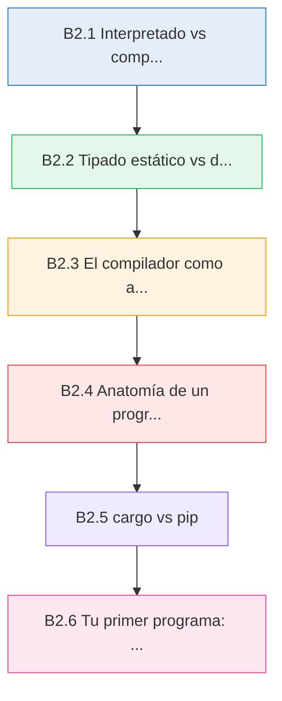
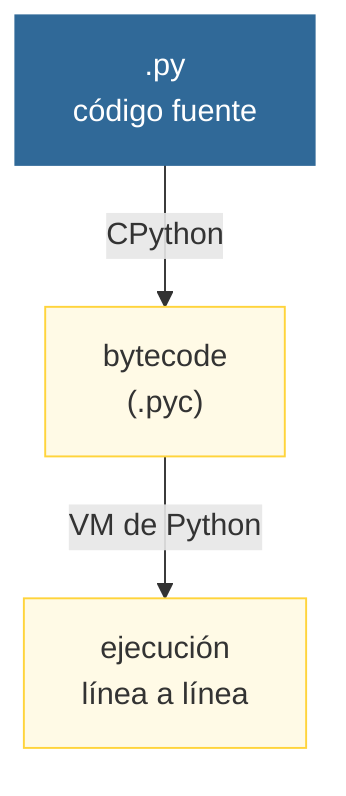
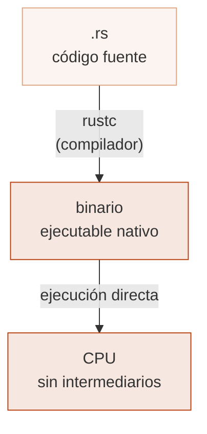

# :crab: De Python a compilado

<div class="chapter-meta">
  <span class="meta-item">🕐 2-3 horas</span>
  <span class="meta-item">📊 Nivel: Principiante</span>
  <span class="meta-item">🎯 Semana 0</span>
</div>

<div class="chapter-objective">
  <span class="objective-icon">📌</span>
  <span class="objective-text">Al terminar este capítulo, entenderás la diferencia entre lenguajes compilados e interpretados, sabrás leer la anatomía de un programa Rust, y podrás crear y ejecutar proyectos con cargo.</span>
</div>

<div class="chapter-map">



</div>


!!! quote "Contexto"
    Vienes de Python, donde escribes un archivo `.py` y lo ejecutas directamente con `python mi_script.py`. No hay paso intermedio visible: Python lee tu código, lo convierte a bytecode internamente y lo ejecuta línea a línea. Rust funciona de forma radicalmente diferente: primero **compila** todo tu código a un binario nativo, y solo entonces lo puedes ejecutar. Ese paso extra — la compilación — es donde ocurre la magia: el compilador verifica tipos, detecta errores y optimiza tu programa **antes** de que se ejecute una sola línea.

---

## B2.1 Interpretado vs compilado

El modelo de ejecución es la diferencia más fundamental entre Python y Rust. Entenderlo te ayudará a comprender por qué Rust se comporta como lo hace.

### Python: interpretado (con bytecode)

Cuando ejecutas `python mi_script.py`, sucede esto internamente:



1. **CPython** (el intérprete estándar) lee tu código fuente `.py`
2. Lo convierte a **bytecode** — un formato intermedio almacenado en archivos `.pyc`
3. La **máquina virtual de Python** ejecuta ese bytecode instrucción por instrucción

El bytecode no es código máquina nativo: es un formato intermedio que la VM de Python interpreta. Por eso Python necesita el intérprete instalado para ejecutar cualquier programa.

### Rust: compilado a binario nativo

Cuando ejecutas `cargo run` en Rust:



1. El **compilador** (`rustc`) analiza todo tu código, verifica tipos, detecta errores y optimiza
2. Genera un **binario nativo** — código máquina real para tu plataforma (Linux, macOS, Windows)
3. Ese binario se ejecuta **directamente** en la CPU, sin ningún intérprete ni VM

El binario resultante es autocontenido: puedes copiarlo a otra máquina (con el mismo SO y arquitectura) y ejecutarlo sin instalar Rust.

### Implicaciones en rendimiento

La diferencia en rendimiento es significativa. Para una tarea computacionalmente intensiva como calcular números de Fibonacci:

| Aspecto | Python :snake: | Rust :crab: |
|---|---|---|
| Modelo | Interpretado (bytecode + VM) | Compilado (binario nativo) |
| Velocidad típica | Referencia (1x) | 20x a 100x más rápido |
| Tiempo de inicio | Rápido (sin compilación) | Instantáneo (binario ya compilado) |
| Distribución | Requiere intérprete Python | Binario autocontenido |
| Uso de memoria | Alto (overhead de la VM + GC) | Bajo (sin VM, sin GC) |
| Optimización | Limitada (JIT parcial en PyPy) | Agresiva (LLVM, inlining, vectorización) |

```python title="fibonacci.py — Python"
def fib(n):
    if n <= 1:
        return n
    return fib(n - 1) + fib(n - 2)

print(fib(40))  # ~25 segundos en CPython
```

```rust title="src/main.rs — Rust"
fn fib(n: u64) -> u64 {
    if n <= 1 {
        return n;
    }
    fib(n - 1) + fib(n - 2)
}

fn main() {
    println!("{}", fib(40));  // ~0.3 segundos con cargo run --release
}
```

!!! info "Benchmarks reales"
    En la prueba de Fibonacci recursivo sin memoización, `fib(40)` tarda unos **25 segundos** en CPython y unos **0.3 segundos** en Rust compilado con `--release`. Eso es aproximadamente **80x más rápido**. Con memoización ambos serían instantáneos, pero la prueba sin ella mide el rendimiento bruto del lenguaje.

<div class="concept-question">
<h4>🔍 Pregunta conceptual</h4>
<p>Si Rust compila a binario nativo y Python interpreta bytecode, ¿significa que Python es siempre peor? ¿En qué situaciones la compilación sería una desventaja?</p>
</div>

---

## B2.2 Tipado estático vs dinámico

El sistema de tipos es la segunda gran diferencia. Define cómo el lenguaje maneja y verifica los tipos de datos.

### Python: tipado dinámico

En Python, las variables no tienen tipo fijo. Una variable puede ser un entero, después un string, y luego una lista. El tipo se determina en **tiempo de ejecución**:

```python
x = 42            # x es int
x = "hola"        # ahora x es str — Python no protesta
x = [1, 2, 3]    # ahora x es list — sigue sin problema

def sumar(a, b):
    return a + b

sumar(3, 4)          # 7 — funciona
sumar("hola", " mundo")  # "hola mundo" — también funciona
sumar(3, "hola")    # TypeError... pero solo en RUNTIME
```

El error solo aparece **cuando ejecutas** esa línea. Si la línea problemática está en un `if` que raramente se ejecuta, el bug puede sobrevivir meses en producción.

### Rust: tipado estático con inferencia

En Rust, cada variable tiene un tipo fijo conocido en **tiempo de compilación**. No puedes cambiar el tipo de una variable después de declararla:

```rust
fn main() {
    let x: i32 = 42;       // x es i32, para siempre
    // x = "hola";          // ❌ expected `i32`, found `&str`

    let y = 42;             // (1)!
    let z = 3.14;           // Rust infiere f64

    let nombre = "Rust";    // Rust infiere &str
}
```

1. No escribiste el tipo, pero Rust **infiere** que `y` es `i32`. Inferencia no es tipado dinámico: el tipo se fija en compilación, solo que el compilador lo deduce por ti.

### Inferencia de tipos: lo mejor de ambos mundos

Rust tiene un potente sistema de **inferencia de tipos**. No necesitas anotar cada variable — el compilador deduce el tipo por contexto:

```rust
fn main() {
    // Rust infiere todos estos tipos sin que los escribas
    let precio = 12.50;                    // f64
    let nombre = String::from("Paella");   // String
    let activo = true;                     // bool
    let números = vec![1, 2, 3];           // Vec<i32>

    // Pero los parámetros de funciones SIEMPRE necesitan tipo explícito
    // fn calcular(precio, cantidad) { }  // ❌ no compila
}

fn calcular(precio: f64, cantidad: u32) -> f64 {  // ✅ tipos explícitos
    precio * cantidad as f64
}
```

<div class="comparison" markdown>
<div class="lang-box python" markdown>

#### :snake: En Python

```python
# El tipo se conoce en RUNTIME
x = 42
type(x)    # <class 'int'>
x = "hola"
type(x)    # <class 'str'> — cambió

# Type hints opcionales (no se verifican)
def sumar(a: int, b: int) -> int:
    return a + b

sumar("hola", "mundo")  # No hay error (los hints son decorativos)
```

Los type hints de Python (PEP 484) son **opcionales** y **no se verifican** en runtime. Necesitas herramientas externas como `mypy` para verificarlos.

</div>
<div class="lang-box rust" markdown>

#### :crab: En Rust

```rust
// El tipo se fija en COMPILACIÓN
let x: i32 = 42;
// x = "hola";    // ❌ NO compila

// Los tipos se verifican SIEMPRE
fn sumar(a: i32, b: i32) -> i32 {
    a + b
}

// sumar("hola", "mundo");  // ❌ NO compila
```

En Rust los tipos no son opcionales ni decorativos. El compilador los **verifica siempre** y rechaza el programa si no cuadran. No existe equivalente a `Any` de Python.

</div>
</div>

<div class="concept-question">
<h4>🔍 Pregunta conceptual</h4>
<p>Python tiene type hints opcionales y herramientas como <code>mypy</code> que verifican tipos estáticamente. ¿En qué se diferencia esto del tipado estático nativo de Rust? ¿Por qué no es suficiente?</p>
</div>

<div class="micro-exercise">
<h4>🧪 Micro-ejercicio (2 min)</h4>
<p>Abre el <a href="https://play.rust-lang.org/">Rust Playground</a> y escribe <code>let x = 42; x = "hola";</code> dentro de <code>fn main()</code>. Lee el error del compilador. ¿Qué tipo infirió para <code>x</code>? ¿Qué te dice el mensaje?</p>
</div>

---

## B2.3 El compilador como aliado

Si vienes de Python, estás acostumbrado a que los errores aparezcan **mientras tu programa se ejecuta** (errores de runtime). En Rust, la mayoría de los errores aparecen **antes de ejecutar**, durante la compilación. El compilador de Rust (`rustc`) es famoso por tener los mejores mensajes de error de cualquier lenguaje de programación.

### Python: errores en runtime

```python
def procesar_pedido(pedido):
    total = pedido["total"]
    descuento = pedido["descuento"]  # KeyError si no existe
    return total * (1 - descuento)

# Este error solo aparece cuando ejecutas la función con datos sin "descuento"
procesar_pedido({"total": 50.0})
# KeyError: 'descuento'  ← descubierto en PRODUCCIÓN a las 3am 💀
```

### Rust: errores en compilación

```rust
fn procesar_pedido(total: f64, descuento: f64) -> f64 {
    total * (1.0 - descuento)
}

fn main() {
    // procesar_pedido(50.0);
    // ❌ error[E0061]: this function takes 2 arguments but 1 argument was supplied
    //   --> src/main.rs:6:5
    //   |
    // 6 |     procesar_pedido(50.0);
    //   |     ^^^^^^^^^^^^^^^ ---- an argument of type `f64` is missing
    //   |
    // help: provide the argument
    //   |
    // 6 |     procesar_pedido(50.0, /* f64 */);
    //   |                         ++++++++++++

    let resultado = procesar_pedido(50.0, 0.1);  // ✅ compila y funciona
    println!("Total: {:.2}", resultado);
}
```

Observa cómo el compilador de Rust:

1. **Señala exactamente la línea y columna** del error
2. **Explica el problema** con lenguaje claro
3. **Sugiere la solución** con `help:` y código concreto
4. Tiene un **código de error** (`E0061`) que puedes buscar con `rustc --explain E0061`

### Comparación de errores

| Aspecto | Python (runtime) :snake: | Rust (compilación) :crab: |
|---|---|---|
| **Cuándo aparece** | Al ejecutar la línea con error | Al compilar, antes de ejecutar |
| **Cobertura** | Solo líneas que se ejecutan | Todo el código, siempre |
| **Mensaje** | Traceback con stack | Error con ubicación, explicación y sugerencia |
| **Búsqueda** | Necesitas tests exhaustivos | El compilador encuentra los errores por ti |
| **Coste de fix** | Alto (bug en producción) | Bajo (no llega a ejecutarse) |

<div class="pro-tip">
<h4>💡 Consejo Pro</h4>
<p>Cuando el compilador de Rust te dé un error, <strong>lee el mensaje completo</strong>. No te frustres: los errores de <code>rustc</code> están diseñados para enseñarte. La sección <code>help:</code> frecuentemente contiene la solución exacta. También puedes ejecutar <code>rustc --explain EXXXX</code> para obtener una explicación detallada con ejemplos.</p>
</div>

<div class="connection-box">
<span class="connection-icon">🔗</span>
<span>Si completaste <strong>Bases 1</strong>, ya instalaste Rust y probaste el Playground. Ahora usaremos ese entorno para entender los errores del compilador en profundidad.</span>
</div>

<div class="concept-question">
<h4>🔍 Pregunta conceptual</h4>
<p>Si el compilador de Rust atrapa tantos errores, ¿significa que un programa que compila no puede tener bugs? ¿Qué tipos de errores NO puede detectar el compilador?</p>
</div>

---

## B2.4 Anatomía de un programa Rust

Cada programa Rust tiene una estructura definida. Vamos a desmontar pieza por pieza un programa simple.

### `fn main()` — El punto de entrada

Todo programa ejecutable en Rust comienza por la función `main`:

```rust
fn main() {
    println!("Hola desde Rust!");
}
```

- `fn` — palabra clave para declarar una función (como `def` en Python)
- `main` — nombre especial: es el punto de entrada del programa
- `()` — sin parámetros (main no recibe argumentos directamente)
- `{ }` — el cuerpo de la función delimitado por llaves (no por indentación)

### `println!` — Una macro, no una función

`println!` lleva un `!` al final porque es una **macro**, no una función normal. Las macros en Rust generan código en tiempo de compilación.

```rust
fn main() {
    // Interpolación con {}
    let nombre = "Rust";
    println!("Hola, {}!", nombre);             // Hola, Rust!

    // Múltiples valores
    let version = 2024;
    println!("{} edición {}", nombre, version); // Rust edición 2024

    // Formato con nombre (como f-strings de Python)
    println!("{nombre} edición {version}");     // Rust edición 2024

    // Formato numérico
    let precio = 12.5;
    println!("Precio: {:.2}€", precio);         // Precio: 12.50€
    println!("Hex: {:x}", 255);                  // Hex: ff
    println!("Binario: {:b}", 10);               // Binario: 1010
    println!("Debug: {:?}", (1, "hola", true));   // Debug: (1, "hola", true)
}
```

<div class="comparison" markdown>
<div class="lang-box python" markdown>

#### :snake: En Python

```python
nombre = "Python"
version = 3.12
print(f"{nombre} versión {version}")
print(f"Precio: {12.5:.2f}€")
print(f"Hex: {255:x}")
```

Python usa f-strings (Python 3.6+) o `.format()`. `print()` es una **función** normal.

</div>
<div class="lang-box rust" markdown>

#### :crab: En Rust

```rust
let nombre = "Rust";
let version = 2024;
println!("{nombre} edición {version}");
println!("Precio: {:.2}€", 12.5);
println!("Hex: {:x}", 255);
```

Rust usa `println!` que es una **macro**. La sintaxis de formato es similar a Python pero con `{}` en lugar de `{variable:format}`.

</div>
</div>

### Expresiones vs sentencias

Esta distinción es crucial en Rust y no existe en Python de la misma forma:

- **Sentencia** (*statement*): ejecuta algo pero **no devuelve valor**. Termina con `;`
- **Expresión** (*expression*): evalúa y **devuelve un valor**. NO termina con `;`

```rust
fn main() {
    // Sentencias (terminan con ;)
    let x = 5;                  // sentencia: declara variable, no devuelve valor
    println!("x = {}", x);     // sentencia: imprime, no devuelve valor

    // Expresiones (devuelven valor)
    let y = {
        let a = 3;
        let b = 4;
        a + b           // (1)!
    };
    println!("y = {}", y);     // y = 7

    // El if es una expresión en Rust
    let mayor = if x > 3 { "sí" } else { "no" };
    println!("¿Mayor que 3? {}", mayor);
}
```

1. :warning: Sin punto y coma. Esta línea es una **expresión** que se convierte en el valor de retorno del bloque. Si añades `;`, el bloque devuelve `()` (la unidad vacía, similar a `None`).

### El punto y coma: `;`

El punto y coma en Rust no es decorativo — tiene significado semántico:

```rust
fn cinco() -> i32 {
    5           // ✅ expresión: devuelve 5
}

fn nada() -> () {
    5;          // sentencia: devuelve () porque el ; "descarta" el valor
}

fn main() {
    println!("{}", cinco());   // 5
    // cinco() devuelve i32
    // nada() devuelve () — la unidad vacía
}
```

!!! warning "Cuidado con el `;` al final de funciones"
    Si tu función debe retornar un valor, la última línea debe ser una **expresión sin `;`**. Añadir `;` la convierte en sentencia y la función retorna `()`. Este es uno de los errores más comunes para principiantes.

<div class="micro-exercise">
<h4>🧪 Micro-ejercicio (3 min)</h4>
<p>Escribe una función <code>fn doble(n: i32) -> i32</code> que devuelva el doble de <code>n</code> usando una expresión (sin <code>return</code> ni <code>;</code>). Luego prueba a añadir <code>;</code> al final y lee el error del compilador.</p>
</div>

---

## B2.5 cargo vs pip

`cargo` es el gestor de paquetes, sistema de build y herramienta multiuso de Rust. Es el equivalente de `pip` + `venv` + `setuptools` + `pytest` + `black` + `flake8` todo en uno.

### Comparación de comandos

| Tarea | Python :snake: | Rust :crab: |
|---|---|---|
| Crear proyecto | `mkdir proj && cd proj && python -m venv .venv` | `cargo new proj` |
| Instalar dependencia | `pip install flask` | `cargo add axum` |
| Ejecutar | `python main.py` | `cargo run` |
| Tests | `pytest` | `cargo test` |
| Linter | `flake8` / `pylint` | `cargo clippy` |
| Formateador | `black` | `cargo fmt` |
| Verificar tipos | `mypy` | `cargo check` (integrado) |
| Documentación | `sphinx` | `cargo doc` |
| Publicar paquete | `twine upload` | `cargo publish` |

### Archivos de configuración

<div class="comparison" markdown>
<div class="lang-box python" markdown>

#### :snake: Python: `pyproject.toml` / `requirements.txt`

```toml title="pyproject.toml"
[project]
name = "mi-app"
version = "0.1.0"
requires-python = ">=3.10"
dependencies = [
    "flask>=3.0",
    "requests>=2.31",
]

[project.optional-dependencies]
dev = ["pytest", "black", "mypy"]
```

Python tiene **múltiples archivos** posibles: `requirements.txt`, `setup.py`, `setup.cfg`, `pyproject.toml`, `Pipfile`. No hay un estándar único universalmente adoptado.

</div>
<div class="lang-box rust" markdown>

#### :crab: Rust: `Cargo.toml`

```toml title="Cargo.toml"
[package]
name = "mi-app"
version = "0.1.0"
edition = "2024"

[dependencies]
axum = "0.8"
reqwest = "0.12"

[dev-dependencies]
tokio-test = "0.4"
```

Rust tiene **un solo archivo** de configuración: `Cargo.toml`. Todo el ecosistema lo usa. No hay ambigüedad.

</div>
</div>

### Registro de paquetes

| Aspecto | PyPI (Python) | crates.io (Rust) |
|---|---|---|
| URL | pypi.org | crates.io |
| Paquetes | ~500,000+ | ~150,000+ |
| Nombre del paquete | "package" | "crate" |
| Versionado | flexible, a veces caótico | semver estricto |
| Verificación | mínima | compilación obligatoria |
| Lock file | `requirements.txt` (manual) | `Cargo.lock` (automático) |

<div class="pro-tip">
<h4>💡 Consejo Pro</h4>
<p>Usa <code>cargo add nombre_crate</code> en lugar de editar <code>Cargo.toml</code> a mano. Es más rápido y selecciona automáticamente la última versión compatible. Equivale a <code>pip install</code> pero queda registrado en el manifiesto del proyecto.</p>
</div>

---

## B2.6 Tu primer programa: paso a paso

Vamos a crear un programa desde cero, paso a paso.

### Paso 1: Crear el proyecto

```bash
cargo new hola-rust
cd hola-rust
```

Esto genera:

```
hola-rust/
├── Cargo.toml
└── src/
    └── main.rs
```

### Paso 2: El "Hola Mundo"

```rust title="src/main.rs"
fn main() {
    println!("¡Hola desde Rust!");
}
```

```bash
cargo run
```

Salida:

```
   Compiling hola-rust v0.1.0 (/ruta/a/hola-rust)
    Finished `dev` profile [unoptimized + debuginfo] target(s)
     Running `target/debug/hola-rust`
¡Hola desde Rust!
```

### Paso 3: Una función simple

```rust title="src/main.rs"
fn saludar(nombre: &str) -> String {
    format!("¡Hola, {}! Bienvenido a Rust.", nombre)
}

fn main() {
    let mensaje = saludar("pythonista");
    println!("{}", mensaje);
}
```

Observa:

- `nombre: &str` — el parámetro tiene tipo explícito (una referencia a string)
- `-> String` — el tipo de retorno es explícito
- `format!` — como `println!` pero devuelve un `String` en vez de imprimir
- Sin `return` ni `;` en la última línea de `saludar` — es una expresión que se retorna

### Paso 4: Entrada del usuario

```rust title="src/main.rs"
use std::io;    // (1)!

fn main() {
    println!("¿Cómo te llamas?");

    let mut nombre = String::new();    // (2)!
    io::stdin()
        .read_line(&mut nombre)        // (3)!
        .expect("Error al leer línea");

    let nombre = nombre.trim();        // (4)!
    println!("¡Hola, {}! Bienvenido a Rust.", nombre);
}
```

1. `use std::io` importa el módulo de entrada/salida de la librería estándar.
2. `String::new()` crea un string vacío y mutable donde se almacenará la entrada.
3. `&mut nombre` pasa una referencia mutable — `read_line` necesita poder modificar el string.
4. `.trim()` elimina el salto de línea (`\n`) que `read_line` incluye al final.

<div class="comparison" markdown>
<div class="lang-box python" markdown>

#### :snake: En Python

```python
nombre = input("¿Cómo te llamas? ")
print(f"¡Hola, {nombre}! Bienvenido a Python.")
```

Una línea para leer, una para imprimir. `input()` devuelve un `str` limpio directamente.

</div>
<div class="lang-box rust" markdown>

#### :crab: En Rust

```rust
use std::io;

fn main() {
    println!("¿Cómo te llamas?");
    let mut nombre = String::new();
    io::stdin().read_line(&mut nombre)
        .expect("Error al leer");
    let nombre = nombre.trim();
    println!("¡Hola, {nombre}! Bienvenido a Rust.");
}
```

Más verboso, pero explícito: ves exactamente dónde se almacena el dato, que es mutable, y cómo se maneja el error.

</div>
</div>

### Paso 5: Programa completo con función y entrada

```rust title="src/main.rs"
use std::io;

fn calcular_precio(base: f64, cantidad: u32, descuento: f64) -> f64 {
    let subtotal = base * cantidad as f64;
    subtotal * (1.0 - descuento)
}

fn leer_input(mensaje: &str) -> String {
    println!("{}", mensaje);
    let mut buffer = String::new();
    io::stdin()
        .read_line(&mut buffer)
        .expect("Error al leer entrada");
    buffer.trim().to_string()
}

fn main() {
    println!("=== Calculadora de precios ===");

    let nombre = leer_input("Nombre del producto:");
    let precio: f64 = leer_input("Precio unitario:")
        .parse()
        .expect("Introduce un número válido");
    let cantidad: u32 = leer_input("Cantidad:")
        .parse()
        .expect("Introduce un número entero");

    let total = calcular_precio(precio, cantidad, 0.1);

    println!();
    println!("Producto: {}", nombre);
    println!("Precio unitario: {:.2}€", precio);
    println!("Cantidad: {}", cantidad);
    println!("Descuento: 10%");
    println!("Total: {:.2}€", total);
}
```

```bash
cargo run
```

<div class="connection-box">
<span class="connection-icon">🔗</span>
<span>En <strong>Bases 3</strong> profundizaremos en variables, tipos de datos, ownership y el sistema de préstamos — los conceptos que hacen a Rust único. Todo lo que has aprendido aquí sobre tipos estáticos y el compilador sienta las bases para entender el ownership.</span>
</div>

---

## Evolución: de script Python a programa Rust idiomático

<div class="code-evolution">
<div class="evolution-header">📈 Evolución del código</div>
<div class="evolution-step">
<span class="step-label novato">v1 — Script Python</span>

```python
# Python: script rápido sin tipos
nombre = input("Tu nombre: ")
edad = int(input("Tu edad: "))
if edad >= 18:
    print(f"Bienvenido, {nombre}")
else:
    print(f"Lo siento, {nombre}, debes ser mayor de edad")
```

</div>
<div class="evolution-step">
<span class="step-label mejorado">v2 — Rust básico (traducción directa)</span>

```rust
use std::io;

fn main() {
    println!("Tu nombre:");
    let mut nombre = String::new();
    io::stdin().read_line(&mut nombre).expect("Error");
    let nombre = nombre.trim();

    println!("Tu edad:");
    let mut edad_str = String::new();
    io::stdin().read_line(&mut edad_str).expect("Error");
    let edad: u32 = edad_str.trim().parse().expect("No es un número");

    if edad >= 18 {
        println!("Bienvenido, {}", nombre);
    } else {
        println!("Lo siento, {}, debes ser mayor de edad", nombre);
    }
}
```

</div>
<div class="evolution-step">
<span class="step-label profesional">v3 — Rust idiomático (con funciones y manejo de errores)</span>

```rust
use std::io::{self, Write};

fn leer_linea(prompt: &str) -> String {
    print!("{prompt}");
    io::stdout().flush().unwrap();
    let mut buf = String::new();
    io::stdin().read_line(&mut buf).expect("Error de lectura");
    buf.trim().to_string()
}

fn verificar_edad(nombre: &str, edad: u32) -> &'static str {
    if edad >= 18 {
        "Bienvenido"
    } else {
        "Lo siento, debes ser mayor de edad"
    }
}

fn main() {
    let nombre = leer_linea("Tu nombre: ");
    let edad: u32 = leer_linea("Tu edad: ")
        .parse()
        .expect("Introduce un número válido");

    let mensaje = verificar_edad(&nombre, edad);
    println!("{mensaje}, {nombre}");
}
```

</div>
</div>

---

<div class="misconception-box">
<h4>⚠️ Errores comunes</h4>
<ul>
<li><span class="wrong">❌ Mito:</span> "Compilado = lento de desarrollar porque hay que esperar la compilación" → <span class="right">✅ Realidad:</span> <code>cargo check</code> es casi instantáneo y detecta errores sin generar binario. El tiempo de compilación completa solo importa para builds de release.</li>
<li><span class="wrong">❌ Mito:</span> "El tipado estático significa escribir tipos en todas partes" → <span class="right">✅ Realidad:</span> La inferencia de tipos de Rust es potente. Solo necesitas anotar tipos en firmas de funciones y cuando el compilador no puede inferir. El código diario tiene pocas anotaciones explícitas.</li>
<li><span class="wrong">❌ Mito:</span> "Los errores del compilador de Rust significan que el lenguaje es difícil" → <span class="right">✅ Realidad:</span> Los errores son tu aliado. Cada error de <code>rustc</code> viene con explicación y sugerencia de solución. Un error en compilación es infinitamente mejor que un crash en producción.</li>
</ul>
</div>


<div class="real-errors">
<h4>🚨 Errores que vas a encontrar</h4>

**Error 1: Tipo incompatible**

```rust
let x: i32 = "hola"; // ❌
```

```
error[E0308]: mismatched types
  expected `i32`, found `&str`
```

**¿Por qué?** Rust es estrictamente tipado — no hay conversión implícita entre tipos.

**Solución:** Usa el tipo correcto o convierte explícitamente.

---

**Error 2: Variable no mutable**

```rust
let precio = 10.0;
precio = 15.0; // ❌
```

```
error[E0384]: cannot assign twice to immutable variable `precio`
```

**Solución:** Declara con `let mut precio = 10.0;`

---

**Error 3: Valor movido**

```rust
let nombre = String::from("Paella");
let copia = nombre;
println!("{}", nombre); // ❌
```

```
error[E0382]: borrow of moved value: `nombre`
```

**Solución:** Usa `.clone()` o referencias `&nombre`.

</div>

---

<div class="checkpoint">
<h4>🏁 Checkpoint</h4>
<p>Si puedes: (1) explicar la diferencia entre lenguaje interpretado y compilado, (2) entender por qué el <code>;</code> importa en Rust, (3) crear un proyecto con <code>cargo new</code> y ejecutarlo con <code>cargo run</code>, y (4) leer un error del compilador sin entrar en pánico — estás listo para <strong>Bases 3</strong>.</p>
</div>

<div class="mini-project">
<h4>🏗️ Mini-proyecto: Aplicación práctica</h4>

**Paso 1 — Define las estructuras base**

Crea las estructuras y tipos necesarios para modelar el dominio del capítulo.

??? success "Solución Paso 1"
    ```rust
    // Define tus structs y enums aquí
    #[derive(Debug)]
    struct Item {
        nombre: String,
        valor: f64,
    }

    impl Item {
        fn new(nombre: &str, valor: f64) -> Self {
            Self {
                nombre: nombre.to_string(),
                valor,
            }
        }
    }
    ```

**Paso 2 — Implementa la lógica principal**

Crea funciones que operen sobre las estructuras del paso 1.

??? success "Solución Paso 2"
    ```rust
    fn procesar(items: &[Item]) -> f64 {
        items.iter().map(|i| i.valor).sum()
    }

    fn mostrar(items: &[Item]) {
        for item in items {
            println!("  {} — {:.2}€", item.nombre, item.valor);
        }
    }
    ```

**Paso 3 — Integra todo en main**

Combina los pasos anteriores en un programa completo.

??? success "Solución Paso 3"
    ```rust
    fn main() {
        let items = vec![
            Item::new("Paella", 14.50),
            Item::new("Gazpacho", 8.00),
            Item::new("Flan", 5.50),
        ];

        println!("=== RustMenu ===");
        mostrar(&items);
        println!("Total: {:.2}€", procesar(&items));
    }
    ```

</div>


---

<div class="ejercicio-guiado">
<h4>🏋️ Ejercicio guiado</h4>

Vas a crear un programa compilado que procese pedidos del restaurante RustMenu, demostrando las ventajas de la compilacion: tipos verificados, errores detectados antes de ejecutar y un binario autocontenido que calcula totales con descuentos.

1. Crea un nuevo proyecto con `cargo new rustmenu-pedidos` y abre `src/main.rs`.
2. Define una funcion `calcular_subtotal(precios: &[f64]) -> f64` que sume todos los precios del pedido usando iteradores (`.iter().sum()`).
3. Define una funcion `aplicar_descuento(total: f64, porcentaje: f64) -> f64` que retorne el total con descuento aplicado. Usa una expresion sin `;` como valor de retorno.
4. Define una funcion `formatear_ticket(mesa: u32, platos: &[&str], precios: &[f64], descuento: f64) -> String` que construya un ticket formateado con el nombre de cada plato, su precio, el subtotal, descuento y total final.
5. En `fn main()`, crea los datos de un pedido de ejemplo (mesa 3 con Paella, Gazpacho y Flan) y llama a las funciones para imprimir el ticket completo.
6. Compila con `cargo build --release` y ejecuta el binario resultante directamente desde `target/release/` para verificar que funciona sin necesidad del compilador.

??? success "Solución completa"
    ```rust
    fn calcular_subtotal(precios: &[f64]) -> f64 {
        precios.iter().sum()
    }

    fn aplicar_descuento(total: f64, porcentaje: f64) -> f64 {
        total * (1.0 - porcentaje / 100.0)
    }

    fn formatear_ticket(
        mesa: u32,
        platos: &[&str],
        precios: &[f64],
        descuento: f64,
    ) -> String {
        let mut ticket = String::new();
        ticket.push_str(&format!("╔══════════════════════════════╗\n"));
        ticket.push_str(&format!("║     🦀 RustMenu — Mesa {}     ║\n", mesa));
        ticket.push_str(&format!("╠══════════════════════════════╣\n"));

        for (plato, precio) in platos.iter().zip(precios.iter()) {
            ticket.push_str(&format!("║ {:<20} {:>6.2}€ ║\n", plato, precio));
        }

        let subtotal = calcular_subtotal(precios);
        let total_final = aplicar_descuento(subtotal, descuento);

        ticket.push_str(&format!("╠══════════════════════════════╣\n"));
        ticket.push_str(&format!("║ Subtotal:            {:>6.2}€ ║\n", subtotal));

        if descuento > 0.0 {
            ticket.push_str(&format!(
                "║ Descuento ({:>4.1}%):   -{:>5.2}€ ║\n",
                descuento,
                subtotal - total_final
            ));
        }

        ticket.push_str(&format!("║ TOTAL:               {:>6.2}€ ║\n", total_final));
        ticket.push_str(&format!("╚══════════════════════════════╝"));

        ticket
    }

    fn main() {
        let mesa: u32 = 3;
        let platos = ["Paella", "Gazpacho", "Flan"];
        let precios = [14.50, 8.00, 5.50];
        let descuento = 10.0;

        let ticket = formatear_ticket(mesa, &platos, &precios, descuento);
        println!("{}", ticket);

        println!("\n✅ Programa compilado a binario nativo.");
        println!("   Ejecuta ./target/release/rustmenu-pedidos");
        println!("   sin necesidad de tener Rust instalado.");
    }
    ```

</div>

## :link: Recursos

| Recurso | Enlace |
|---------|--------|
| Rust Playground | [play.rust-lang.org](https://play.rust-lang.org/) |
| The Rust Programming Language (Cap. 1-2) | [doc.rust-lang.org/book/ch01-00-getting-started](https://doc.rust-lang.org/book/ch01-00-getting-started.html) |
| Cargo Book | [doc.rust-lang.org/cargo](https://doc.rust-lang.org/cargo/) |
| Rust Error Index | [doc.rust-lang.org/error_codes](https://doc.rust-lang.org/error_codes/) |

---

## 🎯 Ejercicios

??? question "Ejercicio 1: Compilado vs interpretado"
    Escribe el mismo programa en Python y Rust: una función que reciba un nombre y devuelva un saludo. Compila y ejecuta el de Rust. Compara el proceso en ambos lenguajes.

    ??? success "Solución"
        **Python:**
        ```python title="saludo.py"
        def saludar(nombre):
            return f"¡Hola, {nombre}!"

        print(saludar("mundo"))
        ```

        ```bash
        python saludo.py
        # ¡Hola, mundo!
        ```

        **Rust:**
        ```rust title="src/main.rs"
        fn saludar(nombre: &str) -> String {
            format!("¡Hola, {}!", nombre)
        }

        fn main() {
            println!("{}", saludar("mundo"));
        }
        ```

        ```bash
        cargo run
        #    Compiling hola-rust v0.1.0
        #     Finished `dev` profile [unoptimized + debuginfo] target(s)
        #      Running `target/debug/hola-rust`
        # ¡Hola, mundo!
        ```

        **Diferencias clave:** En Rust necesitas `fn main()`, tipo de parámetro (`&str`), tipo de retorno (`String`), y el programa se compila antes de ejecutarse.

??? question "Ejercicio 2: Expresiones y punto y coma"
    Escribe una función `fn clasificar(edad: u32) -> &'static str` que devuelva `"menor"`, `"adulto"` o `"senior"` usando `if/else` como expresión (sin `return`). Prueba a añadir `;` a la última expresión y lee el error del compilador.

    ??? success "Solución"
        ```rust title="src/main.rs"
        fn clasificar(edad: u32) -> &'static str {
            if edad < 18 {
                "menor"
            } else if edad < 65 {
                "adulto"
            } else {
                "senior"
            }
        }

        fn main() {
            println!("10 años: {}", clasificar(10));    // menor
            println!("30 años: {}", clasificar(30));    // adulto
            println!("70 años: {}", clasificar(70));    // senior
        }
        ```

        Si añades `;` después de `"senior"`:
        ```
        error[E0308]: mismatched types
          --> src/main.rs:2:38
           |
        2  | fn clasificar(edad: u32) -> &'static str {
           |                             ------------ expected `&str` because of return type
        ...
        7  |         "senior";
           |                 ^ expected `&str`, found `()`
        ```

        El compilador te dice que esperaba `&str` pero encontró `()` — porque el `;` descartó el valor.

??? question "Ejercicio 3: Mini calculadora con cargo"
    Crea un proyecto `calculadora` con `cargo new`. Implementa funciones `sumar`, `restar`, `multiplicar` y `dividir` que reciban dos `f64` y devuelvan `f64`. La función `dividir` debe devolver `0.0` si el divisor es cero. Usa las funciones desde `main` e imprime los resultados formateados con 2 decimales.

    ??? success "Solución"
        ```bash
        cargo new calculadora
        cd calculadora
        ```

        ```rust title="src/main.rs"
        fn sumar(a: f64, b: f64) -> f64 {
            a + b
        }

        fn restar(a: f64, b: f64) -> f64 {
            a - b
        }

        fn multiplicar(a: f64, b: f64) -> f64 {
            a * b
        }

        fn dividir(a: f64, b: f64) -> f64 {
            if b == 0.0 {
                0.0
            } else {
                a / b
            }
        }

        fn main() {
            let x = 10.0;
            let y = 3.0;

            println!("{:.2} + {:.2} = {:.2}", x, y, sumar(x, y));
            println!("{:.2} - {:.2} = {:.2}", x, y, restar(x, y));
            println!("{:.2} * {:.2} = {:.2}", x, y, multiplicar(x, y));
            println!("{:.2} / {:.2} = {:.2}", x, y, dividir(x, y));
            println!("{:.2} / {:.2} = {:.2}", x, 0.0, dividir(x, 0.0));
        }
        ```

        ```bash
        cargo run
        # 10.00 + 3.00 = 13.00
        # 10.00 - 3.00 = 7.00
        # 10.00 * 3.00 = 30.00
        # 10.00 / 3.00 = 3.33
        # 10.00 / 0.00 = 0.00
        ```

---

## :brain: Flashcards

<div class="flashcard">
<div class="front">¿Cuál es la diferencia fundamental entre Python y Rust en cuanto a ejecución?</div>
<div class="back">Python es <strong>interpretado</strong>: CPython convierte el código a bytecode y lo ejecuta en una VM. Rust es <strong>compilado</strong>: <code>rustc</code> genera un binario nativo que se ejecuta directamente en la CPU, sin intermediarios.</div>
</div>

<div class="flashcard">
<div class="front">¿Qué es la inferencia de tipos en Rust?</div>
<div class="back">El compilador <strong>deduce automáticamente</strong> el tipo de una variable por contexto, sin que tengas que anotarlo. Ejemplo: <code>let x = 42;</code> infiere <code>i32</code>. No es tipado dinámico: el tipo se fija en compilación.</div>
</div>

<div class="flashcard">
<div class="front">¿Cuál es la diferencia entre una expresión y una sentencia en Rust?</div>
<div class="back">Una <strong>expresión</strong> evalúa y devuelve un valor (sin <code>;</code>). Una <strong>sentencia</strong> ejecuta una acción pero no devuelve valor (termina con <code>;</code>). El <code>;</code> al final de una expresión "descarta" su valor.</div>
</div>

<div class="flashcard">
<div class="front">¿Por qué <code>println!</code> tiene un <code>!</code> al final?</div>
<div class="back">Porque es una <strong>macro</strong>, no una función. Las macros se identifican con <code>!</code> en Rust. Las macros pueden aceptar número variable de argumentos y generan código en tiempo de compilación.</div>
</div>

<div class="flashcard">
<div class="front">¿Qué es <code>cargo</code> y a qué equivale en Python?</div>
<div class="back"><code>cargo</code> es el gestor de paquetes, sistema de build y herramienta todo-en-uno de Rust. Equivale a <code>pip</code> + <code>venv</code> + <code>setuptools</code> + <code>pytest</code> + <code>black</code> + <code>mypy</code> combinados.</div>
</div>

<div class="flashcard">
<div class="front">¿Qué diferencia hay entre <code>cargo check</code> y <code>cargo build</code>?</div>
<div class="back"><code>cargo check</code> solo verifica que el código compila <strong>sin generar el binario</strong>, por lo que es mucho más rápido. <code>cargo build</code> genera el ejecutable en <code>target/debug/</code>. Usa <code>check</code> durante el desarrollo.</div>
</div>

<div class="flashcard">
<div class="front">¿Cuándo necesitas anotar tipos explícitamente en Rust?</div>
<div class="back">En <strong>firmas de funciones</strong> (parámetros y retorno siempre), cuando el compilador <strong>no puede inferir</strong> el tipo (ej: <code>.parse()</code>), y en <strong>constantes</strong> (<code>const</code>). En variables locales, la inferencia cubre la mayoría de casos.</div>
</div>

---

## :video_game: Quiz interactivo

<div class="quiz" data-quiz-id="bases2-q1">
<h4>Pregunta 1: ¿Qué sucede cuando escribes <code>cargo run</code>?</h4>
<button class="quiz-option" data-correct="false">Ejecuta el código fuente directamente como Python</button>
<button class="quiz-option" data-correct="true">Compila el código a un binario nativo y luego lo ejecuta</button>
<button class="quiz-option" data-correct="false">Convierte el código a bytecode y lo ejecuta en una VM</button>
<button class="quiz-option" data-correct="false">Envía el código a un servidor remoto para compilarlo</button>
<div class="quiz-feedback" data-correct="¡Correcto! `cargo run` primero compila tu código con `rustc` generando un binario nativo, y luego ejecuta ese binario directamente." data-incorrect="Incorrecto. `cargo run` compila el código a un binario nativo (como un .exe) y luego lo ejecuta. No hay intérprete ni VM involucrada."></div>
</div>

<div class="quiz" data-quiz-id="bases2-q2">
<h4>Pregunta 2: ¿Qué devuelve este bloque en Rust?</h4>

```rust
let resultado = {
    let x = 5;
    let y = 10;
    x + y;
};
```

<button class="quiz-option" data-correct="false"><code>15</code> como <code>i32</code></button>
<button class="quiz-option" data-correct="true"><code>()</code> — la unidad vacía</button>
<button class="quiz-option" data-correct="false">Un error de compilación</button>
<button class="quiz-option" data-correct="false"><code>None</code></button>
<div class="quiz-feedback" data-correct="¡Correcto! El `;` después de `x + y` convierte la expresión en sentencia, descartando el valor. El bloque devuelve `()`. Sin el `;`, devolvería `15`." data-incorrect="Incorrecto. El punto y coma en `x + y;` descarta el valor de la expresión. El bloque devuelve `()` (la unidad vacía). Si quitaras el `;`, entonces sí devolvería `15`."></div>
</div>

<div class="quiz" data-quiz-id="bases2-q3">
<h4>Pregunta 3: ¿Cuál es el equivalente de <code>Cargo.toml</code> en el ecosistema Python?</h4>
<button class="quiz-option" data-correct="false"><code>requirements.txt</code> solamente</button>
<button class="quiz-option" data-correct="false"><code>setup.py</code> solamente</button>
<button class="quiz-option" data-correct="true"><code>pyproject.toml</code> — pero Cargo.toml también cubre funciones de <code>setup.cfg</code>, <code>pytest.ini</code> y más</button>
<button class="quiz-option" data-correct="false">No tiene equivalente en Python</button>
<div class="quiz-feedback" data-correct="¡Correcto! `pyproject.toml` es lo más cercano, pero `Cargo.toml` cubre más funciones: dependencias, configuración de build, tests, benchmarks y documentación, todo en un solo archivo estandarizado." data-incorrect="Incorrecto. `pyproject.toml` es el equivalente más cercano, pero `Cargo.toml` abarca más funcionalidad que cualquier archivo individual de Python."></div>
</div>

---

## :bug: Ejercicio de depuración

Encuentra los **4 errores** en este código:

```rust
// ❌ Este código tiene 4 errores. ¡Encuéntralos!

fn calcular_total(precio: f64, cantidad: u32) -> f64 {
    let subtotal = precio * cantidad;     // 🤔 Error 1
    subtotal
}

fn main() {
    let total = calcular_total(12.50, 3)  // 🤔 Error 2
    println!("Total: {}", total)          // 🤔 Error 3

    let nombre = "Rust";
    println!(nombre);                      // 🤔 Error 4
}
```

??? success "Solución"
    ```rust
    // ✅ Código corregido

    fn calcular_total(precio: f64, cantidad: u32) -> f64 {
        let subtotal = precio * cantidad as f64;   // ✅ Fix 1: cast u32 → f64 con `as f64`
        subtotal
    }

    fn main() {
        let total = calcular_total(12.50, 3);      // ✅ Fix 2: faltaba `;`
        println!("Total: {}", total);               // ✅ Fix 3: faltaba `;`

        let nombre = "Rust";
        println!("{}", nombre);                      // ✅ Fix 4: println! necesita format string
    }
    ```

    **Explicación de cada error:**

    1. **No se puede multiplicar `f64 * u32`** — Rust no convierte tipos automáticamente. Necesitas `cantidad as f64` para convertir explícitamente.
    2. **Falta `;`** — La sentencia `let total = ...` necesita punto y coma al final.
    3. **Falta `;`** — `println!` es una sentencia y necesita punto y coma.
    4. **`println!` necesita format string** — No puedes pasar una variable directamente. Usa `println!("{}", nombre)` o `println!("{nombre}")`.

---

## ✅ Autoevaluación del capítulo

<div class="self-check" markdown>
<h4>¿Has comprendido todo? Marca lo que puedes hacer:</h4>
<label><input type="checkbox"> Puedo explicar la diferencia entre lenguaje interpretado y compilado</label>
<label><input type="checkbox"> Entiendo por qué el tipado estático detecta errores antes que el dinámico</label>
<label><input type="checkbox"> Sé leer un error del compilador de Rust y encontrar la sugerencia de solución</label>
<label><input type="checkbox"> Conozco la diferencia entre expresión y sentencia (y el papel del `;`)</label>
<label><input type="checkbox"> Puedo crear un proyecto con `cargo new` y ejecutarlo con `cargo run`</label>
<label><input type="checkbox"> Sé comparar `Cargo.toml` con `pyproject.toml` / `requirements.txt`</label>
</div>
