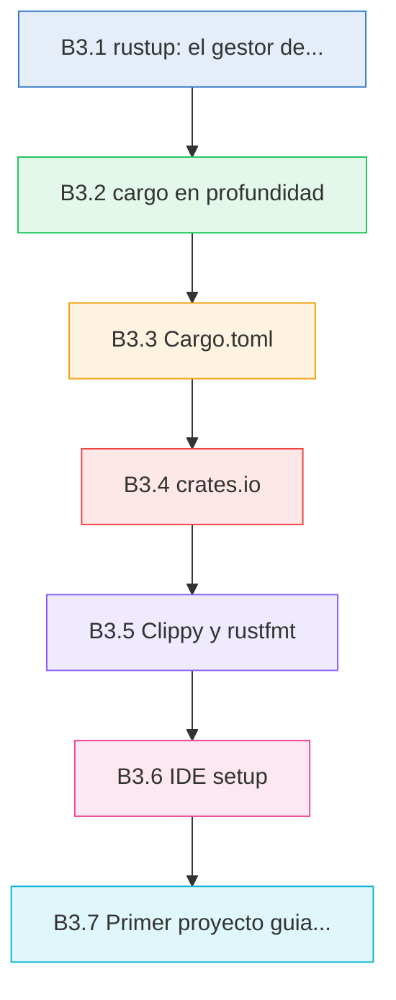

# :crab: Herramientas y ecosistema

<div class="chapter-meta">
  <span class="meta-item">🕐 2-3 horas</span>
  <span class="meta-item">📊 Nivel: Principiante</span>
  <span class="meta-item">🎯 Semana 0</span>
</div>

<div class="chapter-objective">
  <span class="objective-icon">📌</span>
  <span class="objective-text">Al terminar este capítulo, tendrás un entorno Rust completo configurado, dominarás cargo y sus comandos esenciales, y habrás construido tu primer proyecto Rust funcional.</span>
</div>

<div class="chapter-map">



</div>


!!! quote "Contexto"
    En Python, las herramientas de desarrollo están fragmentadas: pip para paquetes, venv para entornos, setuptools para build, black para formateo, pylint para linting... cada una se instala y configura por separado. Rust unifica **todo** en un solo ecosistema cohesivo alrededor de `cargo`. Si alguna vez has sufrido conflictos entre pip y conda, o has perdido tiempo configurando linters, vas a disfrutar la experiencia Rust.

---

## B3.1 rustup: el gestor de toolchains

**rustup** es el punto de entrada al ecosistema Rust. Es el equivalente a `pyenv` o `conda`, pero oficial y con esteroides: gestiona versiones del compilador, componentes adicionales y targets de compilación cruzada.

### Instalación

```bash
curl --proto '=https' --tlsv1.2 -sSf https://sh.rustup.rs | sh
```

Después de instalar, recarga tu shell:

```bash
source $HOME/.cargo/env
```

Verifica que todo funciona:

```bash
rustc --version    # rustc 1.84.0 (hash fecha)
cargo --version    # cargo 1.84.0 (hash fecha)
rustup --version   # rustup 1.27.1 (hash fecha)
```

### Canales: stable, beta y nightly

rustup gestiona tres **canales** del compilador, cada uno con un propósito diferente:

| Canal | Ciclo | Uso recomendado |
|-------|-------|-----------------|
| `stable` | Cada 6 semanas | Producción — siempre usar por defecto |
| `beta` | Cada 6 semanas | Probar la próxima release antes de que sea estable |
| `nightly` | Cada noche | Features experimentales, macros procedurales avanzadas |

```bash
# Instalar y usar canales
rustup default stable          # Canal por defecto
rustup install nightly         # Instalar nightly además
rustup run nightly rustc --version  # Ejecutar un comando con nightly

# Usar nightly solo en un proyecto específico
cd mi-proyecto-experimental
rustup override set nightly    # Solo afecta a este directorio
```

### Actualizar Rust

```bash
rustup update                  # Actualiza TODOS los canales instalados
rustup self update             # Actualiza rustup mismo
```

### Componentes

rustup instala componentes adicionales según los necesites:

```bash
rustup component list              # Ver disponibles
rustup component add clippy        # Linter (normalmente ya incluido)
rustup component add rustfmt       # Formateador (normalmente ya incluido)
rustup component add rust-src      # Código fuente de la stdlib (para rust-analyzer)
rustup component add rust-analyzer # LSP server
```

<div class="concept-question">
<h4>🔍 Pregunta conceptual</h4>
<p>En Python, ¿cuántas herramientas separadas necesitas para gestionar versiones (pyenv), entornos (venv/conda), paquetes (pip) y compilación (setuptools)? ¿Qué ventajas ves en que Rust unifique todo esto en rustup + cargo?</p>
</div>

<div class="comparison" markdown>
<div class="lang-box python" markdown>

#### :snake: En Python

```bash
# Gestionar versiones de Python
pyenv install 3.12.0
pyenv global 3.12.0

# Crear entorno virtual
python -m venv .venv
source .venv/bin/activate

# Instalar herramientas por separado
pip install black ruff mypy pytest
```

Necesitas combinar **pyenv** (versiones) + **venv/conda** (entornos) + **pip** (paquetes) + herramientas de terceros para linting y formateo.

</div>
<div class="lang-box rust" markdown>

#### :crab: En Rust

```bash
# Todo con rustup y cargo
rustup default stable    # Versión del compilador
cargo new mi-proyecto    # Crear proyecto (incluye entorno)
cargo clippy             # Linting (incluido)
cargo fmt                # Formateo (incluido)
cargo test               # Tests (incluido)
```

**rustup** gestiona el compilador y **cargo** gestiona absolutamente todo lo demás. Sin entornos virtuales — cada proyecto tiene su propio `Cargo.toml`.

</div>
</div>

---

## B3.2 cargo en profundidad

`cargo` es el corazón del desarrollo en Rust. Es gestor de paquetes, sistema de build, runner de tests, generador de documentación y mucho más — todo en un solo binario.

### Comandos esenciales

| Comando | Qué hace | Equivalente Python |
|---------|----------|--------------------|
| `cargo new nombre` | Crea un proyecto nuevo con estructura estándar | `mkdir` + `python -m venv` + `pyproject.toml` |
| `cargo init` | Inicializa un proyecto en el directorio actual | `pip init` (no existe realmente) |
| `cargo build` | Compila el proyecto (modo debug) | — |
| `cargo build --release` | Compila optimizado para producción | — |
| `cargo run` | Compila y ejecuta | `python main.py` |
| `cargo check` | Verifica que compila sin generar binario | `mypy` (verificación de tipos) |
| `cargo test` | Ejecuta los tests | `pytest` |
| `cargo doc --open` | Genera y abre la documentación HTML | `sphinx-build` |
| `cargo fmt` | Formatea todo el código automáticamente | `black .` |
| `cargo clippy` | Linter con sugerencias idiomáticas | `ruff check .` / `pylint` |
| `cargo add nombre` | Añade una dependencia al proyecto | `pip install nombre` |
| `cargo update` | Actualiza dependencias según Cargo.toml | `pip install --upgrade` |
| `cargo publish` | Publica tu crate en crates.io | `twine upload` / `pip publish` |
| `cargo clean` | Limpia artefactos de compilación | `rm -rf __pycache__` / `rm -rf dist` |

### Crear un proyecto

```bash
# Proyecto binario (ejecutable)
cargo new mi-app
# Crea:
# mi-app/
# ├── Cargo.toml
# └── src/
#     └── main.rs

# Proyecto de librería
cargo new mi-lib --lib
# Crea:
# mi-lib/
# ├── Cargo.toml
# └── src/
#     └── lib.rs
```

### Build: debug vs release

```bash
cargo build             # Debug: compilación rápida, binario lento
cargo build --release   # Release: compilación lenta, binario rápido
```

| Aspecto | `dev` (debug) | `release` |
|---------|---------------|-----------|
| Optimización | Ninguna (`opt-level = 0`) | Máxima (`opt-level = 3`) |
| Tiempo de compilación | Rápido | Lento |
| Tamaño del binario | Grande (con debug info) | Pequeño |
| Rendimiento | Para desarrollo | Para producción |
| Directorio | `target/debug/` | `target/release/` |

!!! warning "Cuidado con benchmarks"
    No midas el rendimiento de tu programa Rust con `cargo run`. Siempre usa `cargo run --release`. La diferencia puede ser de **10x o más** entre debug y release.

### cargo check: tu mejor amigo

```bash
cargo check   # Solo verifica que compila — NO genera binario
```

`cargo check` es **significativamente más rápido** que `cargo build` porque omite la fase de generación de código (codegen). Úsalo constantemente mientras desarrollas.

<div class="micro-exercise">
<h4>🧪 Micro-ejercicio (3 min)</h4>
<p>Crea un proyecto con <code>cargo new hola-rust</code>, entra en el directorio, y ejecuta estos comandos en orden: <code>cargo check</code>, <code>cargo build</code>, <code>cargo run</code>. Observa la diferencia de velocidad entre <code>check</code> y <code>build</code>. Luego ejecuta <code>cargo build --release</code> y compara los tamaños de <code>target/debug/hola-rust</code> y <code>target/release/hola-rust</code>.</p>
</div>

### cargo add: gestionar dependencias

```bash
cargo add serde                      # Última versión
cargo add serde --features derive    # Con features específicas
cargo add tokio@1.36                 # Versión específica
cargo add --dev assert_cmd           # Solo para tests (dev-dependency)
cargo remove serde                   # Eliminar una dependencia
```

### cargo test: ejecutar tests

```bash
cargo test                     # Todos los tests
cargo test nombre_test         # Tests que contienen "nombre_test"
cargo test -- --nocapture      # Mostrar println! durante tests
cargo test --doc               # Solo los tests de documentación
```

<div class="pro-tip">
<h4>💡 Consejo Pro</h4>
<p>Instala <code>cargo-watch</code> para recompilar automáticamente cada vez que guardas un archivo: <code>cargo install cargo-watch</code> y luego <code>cargo watch -x check</code>. Es como tener un compilador en tiempo real. Combínalo con <code>cargo watch -x clippy</code> para linting continuo.</p>
</div>

---

## B3.3 Cargo.toml

El archivo `Cargo.toml` es el **manifiesto** de tu proyecto — el equivalente a `pyproject.toml` en Python. Define metadatos, dependencias, features y configuración de compilación.

### Estructura básica

```toml title="Cargo.toml"
[package]
name = "rustmenu"              # Nombre del crate
version = "0.1.0"              # Versión semántica
edition = "2024"               # (1)!
authors = ["Tu Nombre <tu@email.com>"]
description = "Un gestor de menús de restaurante"
license = "MIT"
repository = "https://github.com/dettriva/rustmenu"
rust-version = "1.85"          # Versión mínima de Rust requerida

[dependencies]
serde = { version = "1.0", features = ["derive"] }
clap = { version = "4.5", features = ["derive"] }

[dev-dependencies]
assert_cmd = "2.0"             # Solo para tests

[build-dependencies]
cc = "1.0"                     # Solo para build scripts

[[bin]]
name = "rustmenu"              # Nombre del ejecutable
path = "src/main.rs"           # Punto de entrada
```

1. La **edición** de Rust (2015, 2018, 2021, 2024) activa nuevas características del lenguaje. Son **retrocompatibles**: un crate de edición 2021 puede depender de uno de 2024 sin problemas. Siempre usa la edición más reciente para proyectos nuevos.

### Ediciones de Rust

Las ediciones permiten evolucionar el lenguaje sin romper código existente:

| Edición | Año | Cambios clave |
|---------|-----|---------------|
| 2015 | 2015 | Primera versión estable |
| 2018 | 2018 | Módulos simplificados, `async`/`await`, NLL |
| 2021 | 2021 | Closures mejores, `IntoIterator` para arrays |
| 2024 | 2024 | `gen` blocks, lifetime elision mejorada, `unsafe_op_in_unsafe_fn` |

```bash
# Migrar un proyecto a la edición más reciente
cargo fix --edition          # Aplica cambios automáticos
# Luego actualiza edition = "2024" en Cargo.toml
```

### Especificación de versiones

```toml
[dependencies]
# Formas de especificar versiones
serde = "1.0"                  # ^1.0 — compatible con 1.x (lo más común)
exact = "=1.0.5"               # Versión exacta
range = ">=1.0, <2.0"          # Rango explícito
tokio = { version = "1", features = ["full"] }  # Con features

# Dependencia desde git
mi-lib = { git = "https://github.com/user/repo", branch = "main" }

# Dependencia local (para desarrollo)
mi-lib = { path = "../mi-lib" }
```

### Cargo.lock

`Cargo.lock` almacena las versiones **exactas** de todas las dependencias (incluyendo transitivas). Es el equivalente a `pip freeze > requirements.txt`, pero gestionado automáticamente.

| | `Cargo.toml` | `Cargo.lock` |
|---|---|---|
| Propósito | Declarar dependencias | Fijar versiones exactas |
| ¿Editar manualmente? | Sí | No — lo gestiona cargo |
| ¿Subir a git? | Siempre | Binarios: sí / Librerías: no |
| Equivalente Python | `pyproject.toml` | `requirements.txt` (pip freeze) |

<div class="concept-question">
<h4>🔍 Pregunta conceptual</h4>
<p>En Python, <code>pip install requests</code> puede instalar diferentes versiones según cuándo lo ejecutes. ¿Cómo resuelve <code>Cargo.lock</code> este problema? ¿Por qué se recomienda subirlo a git para binarios pero no para librerías?</p>
</div>

<div class="comparison" markdown>
<div class="lang-box python" markdown>

#### :snake: En Python

```toml title="pyproject.toml"
[project]
name = "rustmenu"
version = "0.1.0"
requires-python = ">=3.10"
dependencies = [
    "flask>=3.0",
    "click>=8.0",
]

[project.optional-dependencies]
dev = ["pytest", "ruff", "mypy"]
```

</div>
<div class="lang-box rust" markdown>

#### :crab: En Rust

```toml title="Cargo.toml"
[package]
name = "rustmenu"
version = "0.1.0"
edition = "2024"

[dependencies]
axum = "0.8"
clap = { version = "4.5", features = ["derive"] }

[dev-dependencies]
assert_cmd = "2.0"
```

</div>
</div>

<div class="code-evolution">
<div class="evolution-header">📈 Evolución del código</div>
<div class="evolution-step">
<span class="step-label novato">v1 — Mínimo</span>

```toml
[package]
name = "mi-app"
version = "0.1.0"
edition = "2024"
```

</div>
<div class="evolution-step">
<span class="step-label mejorado">v2 — Con dependencias</span>

```toml
[package]
name = "mi-app"
version = "0.1.0"
edition = "2024"
description = "Mi primera app en Rust"

[dependencies]
serde = { version = "1.0", features = ["derive"] }
serde_json = "1.0"
clap = { version = "4.5", features = ["derive"] }

[dev-dependencies]
assert_cmd = "2.0"
```

</div>
<div class="evolution-step">
<span class="step-label profesional">v3 — Profesional con workspace</span>

```toml
# Cargo.toml raíz (workspace)
[workspace]
members = ["crates/core", "crates/cli", "crates/api"]
resolver = "2"

[workspace.package]
version = "1.2.0"
edition = "2024"
authors = ["Equipo <team@empresa.com>"]
license = "MIT"

[workspace.dependencies]
serde = { version = "1.0", features = ["derive"] }
tokio = { version = "1", features = ["full"] }
tracing = "0.1"

# Perfiles optimizados
[profile.release]
lto = true            # Link-Time Optimization
strip = true          # Eliminar símbolos de debug
codegen-units = 1     # Máxima optimización
panic = "abort"       # Binarios más pequeños
```

</div>
</div>

---

## B3.4 crates.io

[crates.io](https://crates.io) es el **registro oficial de paquetes** de Rust — el equivalente a [PyPI](https://pypi.org) para Python. Aquí se publican y distribuyen los crates (el nombre que Rust da a los paquetes).

### Buscar crates

```bash
cargo search serde              # Buscar desde la terminal
```

También puedes buscar en [crates.io](https://crates.io) o en [lib.rs](https://lib.rs) (interfaz alternativa con mejor navegación por categorías).

### Crates esenciales que todo rustacean debe conocer

| Crate | Propósito | Equivalente Python |
|-------|-----------|-------------------|
| **serde** + **serde_json** | Serialización/deserialización | `json` / `pydantic` |
| **tokio** | Runtime asíncrono | `asyncio` |
| **axum** | Framework web | `flask` / `fastapi` |
| **clap** | Parsing de argumentos CLI | `argparse` / `click` |
| **reqwest** | Cliente HTTP | `requests` / `httpx` |
| **tracing** | Logging estructurado | `logging` |
| **anyhow** | Manejo de errores simplificado | — (Python usa excepciones) |
| **thiserror** | Definir errores custom | Crear clases `Exception` |
| **regex** | Expresiones regulares | `re` |
| **chrono** | Fechas y horas | `datetime` |
| **rayon** | Paralelismo de datos | `multiprocessing` |
| **rand** | Números aleatorios | `random` |

### Evaluar la calidad de un crate

Antes de añadir una dependencia, revisa:

- **Downloads** — ¿Se usa activamente?
- **Última actualización** — ¿Está mantenido?
- **Documentación** — ¿Tiene docs en [docs.rs](https://docs.rs)?
- **Dependencias** — ¿Trae muchas dependencias transitivas?
- **Issues abiertas** — ¿Responde el mantenedor?

!!! tip "docs.rs: documentación automática"
    Cada crate publicado en crates.io tiene documentación generada automáticamente en **docs.rs**. Por ejemplo, [docs.rs/serde](https://docs.rs/serde) muestra toda la API de serde con ejemplos ejecutables.

<div class="concept-question">
<h4>🔍 Pregunta conceptual</h4>
<p>En PyPI hay miles de paquetes para lo mismo (por ejemplo, varios clientes HTTP). En crates.io, la comunidad tiende a converger en <strong>un crate dominante</strong> por categoría. ¿Por qué crees que esto ocurre? ¿Qué ventajas y desventajas tiene?</p>
</div>

---

## B3.5 Clippy y rustfmt

### rustfmt: formato consistente

**rustfmt** formatea tu código Rust automáticamente siguiendo las convenciones oficiales del lenguaje. No hay debate sobre estilos — el formato es uno solo.

```bash
cargo fmt              # Formatea todo el proyecto
cargo fmt -- --check   # Verifica sin modificar (útil en CI)
```

Puedes personalizar algunas opciones creando un archivo `rustfmt.toml`:

```toml title="rustfmt.toml"
max_width = 100                # Ancho máximo de línea (default: 100)
tab_spaces = 4                 # Espacios por tab (default: 4)
edition = "2024"               # Edición del parser
use_small_heuristics = "Max"   # Más agresivo formateando
```

### Clippy: tu mentor de Rust

**Clippy** es un linter con más de **700 reglas** que no solo detecta errores, sino que te enseña Rust idiomático. Es como tener un experto en Rust revisando tu código.

```bash
cargo clippy                        # Ejecutar clippy
cargo clippy -- -W clippy::pedantic # Modo estricto (más sugerencias)
cargo clippy --fix                  # Aplicar correcciones automáticas
```

Ejemplo de lo que Clippy detecta:

```rust
fn main() {
    // Clippy detecta: "manual implementation of an assign operation"
    let mut x = 10;
    x = x + 5;    // ⚠️ clippy sugiere: x += 5;

    // Clippy detecta: "this expression borrows a reference that is immediately dereferenced"
    let v = vec![1, 2, 3];
    let _len = (&v).len();  // ⚠️ clippy sugiere: v.len()

    // Clippy detecta: "redundant clone"
    let s = String::from("hola");
    let _s2 = s.clone();   // ⚠️ si s no se usa después, el clone es innecesario
}
```

### Configurar Clippy

Puedes configurar Clippy a nivel de proyecto con `clippy.toml` o con atributos en el código:

```rust
// Permitir un lint específico en todo el archivo
#![allow(clippy::needless_return)]

// Denegar un lint específico (convertirlo en error)
#![deny(clippy::unwrap_used)]

fn main() {
    // Permitir un lint en una línea específica
    #[allow(clippy::manual_range_contains)]
    let en_rango = x >= 0 && x <= 100;
}
```

<div class="pro-tip">
<h4>💡 Consejo Pro</h4>
<p>Configura tu CI/CD para ejecutar <code>cargo fmt -- --check</code> y <code>cargo clippy -- -D warnings</code> en cada pull request. El flag <code>-D warnings</code> convierte todos los warnings en errores, forzando que el código pase clippy antes de hacer merge. Es la forma más efectiva de mantener calidad de código en un equipo.</p>
</div>

<div class="comparison" markdown>
<div class="lang-box python" markdown>

#### :snake: En Python

```bash
# Herramientas separadas (hay que instalar cada una)
pip install ruff black mypy pylint

# Formateo
black .

# Linting
ruff check .
pylint mi_modulo/

# Type checking
mypy mi_modulo/
```

Múltiples herramientas con configuración dispersa entre `pyproject.toml`, `setup.cfg`, `.flake8`, `.pylintrc`...

</div>
<div class="lang-box rust" markdown>

#### :crab: En Rust

```bash
# Ya incluidos con rustup — nada que instalar

# Formateo
cargo fmt

# Linting + código idiomático
cargo clippy

# Type checking → lo hace el compilador siempre
cargo check
```

Todo integrado. Cero configuración inicial. Un estándar universal.

</div>
</div>

<div class="misconception-box">
<h4>⚠️ Errores comunes</h4>
<ul>
<li><span class="wrong">❌ Mito:</span> "Clippy solo sirve para encontrar bugs" → <span class="right">✅ Realidad:</span> Clippy es también un <strong>mentor</strong>. Sus sugerencias te enseñan patrones idiomáticos de Rust. Leer y entender cada warning de Clippy es una de las mejores formas de aprender.</li>
<li><span class="wrong">❌ Mito:</span> "Puedo ignorar los warnings del compilador si el programa funciona" → <span class="right">✅ Realidad:</span> Los warnings de Rust casi siempre señalan problemas reales o código que será problemático en el futuro. Trata los warnings como errores con <code>#![deny(warnings)]</code>.</li>
<li><span class="wrong">❌ Mito:</span> "Necesito instalar herramientas externas para tener un buen flujo de desarrollo" → <span class="right">✅ Realidad:</span> <code>rustup</code> incluye compilador, linter (clippy), formateador (rustfmt) y documentador (rustdoc). El toolchain estándar cubre el 95% de las necesidades.</li>
</ul>
</div>

---

## B3.6 IDE setup

Un buen entorno de desarrollo marca la diferencia en tu experiencia con Rust. El compilador ya es estricto; un buen editor te muestra los errores **antes** de compilar.

### VS Code + rust-analyzer (recomendado)

**rust-analyzer** es el servidor de lenguaje (LSP) oficial de Rust. Proporciona:

- **Autocompletado inteligente** con información de tipos
- **Errores en tiempo real** mientras escribes
- **Hover** para ver tipos inferidos y documentación
- **Go to definition**, **find references**, **rename**
- **Inlay hints** que muestran tipos inferidos inline
- **Code actions** para imports automáticos y refactoring
- **Macro expansion** para ver qué generan las macros

#### Extensiones recomendadas para VS Code

| Extensión | Propósito |
|-----------|-----------|
| **rust-analyzer** | Soporte completo del lenguaje (imprescindible) |
| **Even Better TOML** | Syntax highlighting para `Cargo.toml` |
| **Error Lens** | Muestra errores inline al lado del código |
| **CodeLLDB** | Debugger para Rust (breakpoints, step-through) |
| **crates** | Muestra versiones de dependencias en Cargo.toml |
| **Dependi** | Alerta de dependencias desactualizadas |

#### Configuración recomendada

Añade esto a tu `settings.json` de VS Code:

```json
{
  "rust-analyzer.check.command": "clippy",
  "rust-analyzer.cargo.features": "all",
  "rust-analyzer.inlayHints.typeHints.enable": true,
  "rust-analyzer.inlayHints.parameterHints.enable": true,
  "editor.formatOnSave": true,
  "[rust]": {
    "editor.defaultFormatter": "rust-lang.rust-analyzer",
    "editor.tabSize": 4
  }
}
```

!!! tip "Configurar clippy como check command"
    Al configurar `"rust-analyzer.check.command": "clippy"`, cada vez que guardas un archivo, rust-analyzer ejecuta clippy en lugar de `cargo check`. Así ves las sugerencias idiomáticas en tiempo real, directamente en el editor.

### IntelliJ IDEA / RustRover

JetBrains ofrece **RustRover**, un IDE dedicado para Rust (gratis para uso no comercial). También existe el plugin **Rust** para IntelliJ IDEA.

Ventajas de RustRover:

- Debugger integrado más potente
- Refactoring avanzado
- Profiler integrado
- Soporte nativo para Cargo y tests

### Debugging

=== "VS Code (CodeLLDB)"

    1. Instala la extensión **CodeLLDB**
    2. Crea `.vscode/launch.json`:

    ```json
    {
      "version": "0.2.0",
      "configurations": [
        {
          "type": "lldb",
          "request": "launch",
          "name": "Debug ejecutable",
          "cargo": {
            "args": ["build", "--bin=rustmenu", "--package=rustmenu"],
            "filter": {
              "name": "rustmenu",
              "kind": "bin"
            }
          },
          "args": [],
          "cwd": "${workspaceFolder}"
        },
        {
          "type": "lldb",
          "request": "launch",
          "name": "Debug tests",
          "cargo": {
            "args": ["test", "--no-run", "--package=rustmenu"],
            "filter": {
              "kind": "test"
            }
          },
          "args": [],
          "cwd": "${workspaceFolder}"
        }
      ]
    }
    ```

    3. Pon breakpoints haciendo clic en el margen izquierdo
    4. Pulsa `F5` para iniciar el debugger

=== "Terminal (rust-gdb / rust-lldb)"

    ```bash
    # Con GDB
    rust-gdb target/debug/rustmenu
    (gdb) break main
    (gdb) run
    (gdb) next
    (gdb) print variable

    # Con LLDB
    rust-lldb target/debug/rustmenu
    (lldb) breakpoint set --name main
    (lldb) run
    ```

<div class="micro-exercise">
<h4>🧪 Micro-ejercicio (5 min)</h4>
<p>Instala rust-analyzer en VS Code. Abre un proyecto Rust y escribe <code>let x: Vec&lt;_&gt; = vec![1, 2, 3];</code>. Pasa el cursor sobre <code>x</code> y verifica que rust-analyzer te muestra el tipo inferido <code>Vec&lt;i32&gt;</code>. Luego escribe <code>x.</code> y observa las sugerencias de autocompletado.</p>
</div>

---

## B3.7 Primer proyecto guiado

Vamos a construir una herramienta CLI real paso a paso: **rust-saludar**, un programa que saluda al usuario con diferentes formatos y colores.

### Paso 1: Crear el proyecto

```bash
cargo new rust-saludar
cd rust-saludar
```

### Paso 2: Añadir dependencias

Necesitamos `clap` para parsing de argumentos CLI y `colored` para colores en la terminal:

```bash
cargo add clap --features derive
cargo add colored
```

Verifica que tu `Cargo.toml` se actualizó:

```toml title="Cargo.toml"
[package]
name = "rust-saludar"
version = "0.1.0"
edition = "2024"

[dependencies]
clap = { version = "4.5", features = ["derive"] }
colored = "2.1"
```

### Paso 3: Escribir el código

```rust title="src/main.rs"
use clap::Parser;
use colored::*;

/// Una herramienta CLI que saluda con estilo
#[derive(Parser)]
#[command(name = "rust-saludar")]
#[command(about = "Saluda al usuario con diferentes estilos")]
struct Args {
    /// Nombre de la persona a saludar
    nombre: String,

    /// Número de veces que repetir el saludo
    #[arg(short, long, default_value_t = 1)]
    veces: u32,

    /// Usar formato formal
    #[arg(short, long)]
    formal: bool,
}

fn generar_saludo(nombre: &str, formal: bool) -> String {    // (1)!
    if formal {
        format!("Estimado/a {}, es un placer saludarle.", nombre)
    } else {
        format!("¡Hola, {}! 🦀", nombre)
    }
}

fn main() {
    let args = Args::parse();

    let saludo = generar_saludo(&args.nombre, args.formal);

    for i in 1..=args.veces {
        if args.formal {
            println!("{}", saludo.blue().bold());
        } else {
            // Alternar colores para hacerlo divertido
            match i % 3 {
                0 => println!("{}", saludo.green().bold()),
                1 => println!("{}", saludo.cyan().bold()),
                _ => println!("{}", saludo.yellow().bold()),
            }
        }
    }

    println!(
        "\n{}",
        format!("(Generados {} saludo(s) para {})", args.veces, args.nombre)
            .dimmed()
    );
}
```

1. `&str` es una referencia a un string. Por ahora, piensa en `&` como "prestar sin tomar posesión". Lo aprenderás en detalle en la Parte I.

### Paso 4: Probar el programa

```bash
# Uso básico
cargo run -- Daniele
# ¡Hola, Daniele! 🦀

# Con repeticiones
cargo run -- Daniele --veces 3
# ¡Hola, Daniele! 🦀
# ¡Hola, Daniele! 🦀
# ¡Hola, Daniele! 🦀

# Modo formal
cargo run -- Daniele --formal
# Estimado/a Daniele, es un placer saludarle.

# Ver la ayuda autogenerada
cargo run -- --help
```

### Paso 5: Añadir tests

```rust title="src/main.rs (añadir al final del archivo)"
#[cfg(test)]
mod tests {
    use super::*;

    #[test]
    fn test_saludo_informal() {
        let saludo = generar_saludo("Rust", false);
        assert!(saludo.contains("Hola"));
        assert!(saludo.contains("Rust"));
    }

    #[test]
    fn test_saludo_formal() {
        let saludo = generar_saludo("Rust", true);
        assert!(saludo.contains("Estimado"));
        assert!(saludo.contains("Rust"));
    }
}
```

```bash
cargo test
```

```
running 2 tests
test tests::test_saludo_informal ... ok
test tests::test_saludo_formal ... ok

test result: ok. 2 passed; 0 filtered out; finished in 0.00s
```

### Paso 6: Verificar con Clippy y formatear

```bash
cargo clippy    # Verificar código idiomático
cargo fmt       # Formatear código
```

### Paso 7: Build de release

```bash
cargo build --release
ls -lh target/release/rust-saludar
# El binario optimizado — puedes copiarlo a cualquier máquina Linux
```

!!! info "Binario independiente"
    El binario generado por `cargo build --release` es **completamente independiente**. No necesita Rust instalado, ni dependencias del sistema, ni runtime. Puedes copiarlo a otra máquina y ejecutarlo directamente. Esto contrasta con Python, donde necesitas el intérprete y las dependencias instaladas.

<div class="connection-box">
<span class="connection-icon">🔗</span>
<span>En el capítulo anterior (<a href='bases-2-compilado.md'>De Python a compilado</a>) viste cómo funciona el proceso de compilación. Ahora has experimentado ese proceso en la práctica: <code>cargo build</code> invoca <code>rustc</code>, que transforma tu <code>.rs</code> en un binario nativo.</span>
</div>

<div class="connection-box">
<span class="connection-icon">🔗</span>
<span>En el <a href='01-bienvenido.md'>Capítulo 1 de la Parte I</a> expandirás estos conocimientos para construir <strong>RustMenu</strong>, el proyecto guía del curso completo. Todo lo que has configurado aquí será tu base de trabajo.</span>
</div>


<div class="real-errors">
<h4>🚨 Errores que vas a encontrar</h4>

**Error 1: Tipo incompatible**

```rust
let x: i32 = "hola"; // ❌
```

```
error[E0308]: mismatched types
  expected `i32`, found `&str`
```

**¿Por qué?** Rust es estrictamente tipado — no hay conversión implícita entre tipos.

**Solución:** Usa el tipo correcto o convierte explícitamente.

---

**Error 2: Variable no mutable**

```rust
let precio = 10.0;
precio = 15.0; // ❌
```

```
error[E0384]: cannot assign twice to immutable variable `precio`
```

**Solución:** Declara con `let mut precio = 10.0;`

---

**Error 3: Valor movido**

```rust
let nombre = String::from("Paella");
let copia = nombre;
println!("{}", nombre); // ❌
```

```
error[E0382]: borrow of moved value: `nombre`
```

**Solución:** Usa `.clone()` o referencias `&nombre`.

</div>

---

<div class="checkpoint">
<h4>🏁 Checkpoint</h4>
<p>Si puedes: (1) instalar y actualizar Rust con <code>rustup</code>, (2) crear proyectos y gestionar dependencias con <code>cargo</code>, (3) usar <code>cargo clippy</code> y <code>cargo fmt</code> en tu flujo de trabajo, y (4) has construido y ejecutado el proyecto guiado — estás listo para la <a href="01-bienvenido.md">Parte I: Bienvenido a Rust</a>.</p>
</div>

<div class="mini-project">
<h4>🏗️ Mini-proyecto: Aplicación práctica</h4>

**Paso 1 — Define las estructuras base**

Crea las estructuras y tipos necesarios para modelar el dominio del capítulo.

??? success "Solución Paso 1"
    ```rust
    // Define tus structs y enums aquí
    #[derive(Debug)]
    struct Item {
        nombre: String,
        valor: f64,
    }

    impl Item {
        fn new(nombre: &str, valor: f64) -> Self {
            Self {
                nombre: nombre.to_string(),
                valor,
            }
        }
    }
    ```

**Paso 2 — Implementa la lógica principal**

Crea funciones que operen sobre las estructuras del paso 1.

??? success "Solución Paso 2"
    ```rust
    fn procesar(items: &[Item]) -> f64 {
        items.iter().map(|i| i.valor).sum()
    }

    fn mostrar(items: &[Item]) {
        for item in items {
            println!("  {} — {:.2}€", item.nombre, item.valor);
        }
    }
    ```

**Paso 3 — Integra todo en main**

Combina los pasos anteriores en un programa completo.

??? success "Solución Paso 3"
    ```rust
    fn main() {
        let items = vec![
            Item::new("Paella", 14.50),
            Item::new("Gazpacho", 8.00),
            Item::new("Flan", 5.50),
        ];

        println!("=== RustMenu ===");
        mostrar(&items);
        println!("Total: {:.2}€", procesar(&items));
    }
    ```

</div>


---

<div class="ejercicio-guiado">
<h4>🏋️ Ejercicio guiado</h4>

Vas a configurar el proyecto RustMenu desde cero usando las herramientas del ecosistema Rust: crear el proyecto con cargo, configurar clippy y rustfmt, anadir una dependencia, escribir un programa basico y verificar que todo pasa las comprobaciones de calidad.

1. Ejecuta `cargo new rustmenu` para crear el proyecto. Entra en el directorio y examina la estructura generada (`Cargo.toml` y `src/main.rs`).
2. Crea un archivo `rustfmt.toml` en la raiz del proyecto con la configuracion `max_width = 100` y `edition = "2024"`.
3. Edita `Cargo.toml` para anadir la descripcion `"Sistema de gestion para restaurante RustMenu"` y la dependencia `rand = "0.8"` bajo `[dependencies]`.
4. Reemplaza el contenido de `src/main.rs` con un programa que genere un numero aleatorio entre 1 y 10 para simular el numero de mesa, defina un vector de platos con precios, y muestre el menu formateado.
5. Ejecuta `cargo fmt` para formatear el codigo, luego `cargo clippy` para verificar que no hay advertencias. Corrige cualquier sugerencia de clippy.
6. Ejecuta `cargo run` para verificar que el programa funciona, luego `cargo test` para ejecutar un test basico que verifique la logica.

??? success "Solución completa"
    ```rust
    use rand::Rng;

    fn mostrar_menu(platos: &[(&str, f64)]) {
        println!("╔══════════════════════════════╗");
        println!("║      🦀 Menú RustMenu        ║");
        println!("╠══════════════════════════════╣");
        for (i, (nombre, precio)) in platos.iter().enumerate() {
            println!("║ {}. {:<20} {:>5.2}€ ║", i + 1, nombre, precio);
        }
        println!("╚══════════════════════════════╝");
    }

    fn calcular_total(platos: &[(&str, f64)]) -> f64 {
        platos.iter().map(|(_, precio)| precio).sum()
    }

    fn main() {
        let mut rng = rand::thread_rng();
        let mesa: u32 = rng.gen_range(1..=10);

        let menu = vec![
            ("Paella Valenciana", 14.50),
            ("Gazpacho Andaluz", 8.00),
            ("Croquetas Caseras", 9.00),
            ("Flan de Huevo", 5.50),
            ("Tinto de Verano", 3.50),
        ];

        println!("🍽️  Bienvenido a RustMenu — Mesa {}\n", mesa);
        mostrar_menu(&menu);

        let total = calcular_total(&menu);
        println!("\n  Total del menú completo: {:.2}€", total);

        println!("\n✅ Proyecto configurado con cargo, clippy y rustfmt.");
    }

    #[cfg(test)]
    mod tests {
        use super::*;

        #[test]
        fn test_calcular_total() {
            let platos = vec![
                ("Paella", 14.50),
                ("Gazpacho", 8.00),
                ("Flan", 5.50),
            ];
            let total = calcular_total(&platos);
            assert!((total - 28.00).abs() < f64::EPSILON);
        }

        #[test]
        fn test_total_vacio() {
            let platos: Vec<(&str, f64)> = vec![];
            let total = calcular_total(&platos);
            assert!((total - 0.0).abs() < f64::EPSILON);
        }
    }
    ```

</div>

## :link: Recursos

| Recurso | Enlace |
|---------|--------|
| The Cargo Book | [doc.rust-lang.org/cargo](https://doc.rust-lang.org/cargo/) |
| rustup Documentation | [rust-lang.github.io/rustup](https://rust-lang.github.io/rustup/) |
| crates.io | [crates.io](https://crates.io/) |
| lib.rs (explorar crates) | [lib.rs](https://lib.rs/) |
| docs.rs (documentación) | [docs.rs](https://docs.rs/) |
| Clippy Lints | [rust-lang.github.io/rust-clippy](https://rust-lang.github.io/rust-clippy/master/index.html) |
| rust-analyzer Manual | [rust-analyzer.github.io](https://rust-analyzer.github.io/) |

---

## 🎯 Ejercicios

??? question "Ejercicio 1: Configura tu entorno completo"
    Instala Rust con rustup, configura tu editor con rust-analyzer, y verifica que todos los componentes funcionan ejecutando `rustc --version`, `cargo --version`, `cargo clippy --version` y `cargo fmt --version`.

    ??? success "Solución"
        ```bash
        # Instalar Rust
        curl --proto '=https' --tlsv1.2 -sSf https://sh.rustup.rs | sh
        source $HOME/.cargo/env

        # Verificar componentes
        rustc --version
        # rustc 1.84.0 (...)

        cargo --version
        # cargo 1.84.0 (...)

        cargo clippy --version
        # clippy 0.1.84 (...)

        cargo fmt --version
        # rustfmt 1.8.0-stable (...)

        # Instalar herramientas extra recomendadas
        cargo install cargo-watch
        cargo install cargo-expand
        ```

        En VS Code, instala las extensiones:

        1. rust-analyzer
        2. Even Better TOML
        3. Error Lens
        4. CodeLLDB

??? question "Ejercicio 2: Explora los comandos de cargo"
    Crea un proyecto llamado `cargo-explorar`. Ejecuta cada uno de estos comandos y describe qué hace cada uno: `cargo check`, `cargo build`, `cargo build --release`, `cargo run`, `cargo fmt`, `cargo clippy`, `cargo doc --open`, `cargo test`. Compara el tamaño de los binarios en `target/debug/` y `target/release/`.

    ??? success "Solución"
        ```bash
        cargo new cargo-explorar
        cd cargo-explorar

        # Verificar que compila (rápido, sin generar binario)
        cargo check

        # Compilar en modo debug
        cargo build
        ls -lh target/debug/cargo-explorar
        # ~4-5 MB (con debug info)

        # Compilar en modo release
        cargo build --release
        ls -lh target/release/cargo-explorar
        # ~300-400 KB (optimizado, sin debug info)

        # Compilar y ejecutar
        cargo run
        # "Hello, world!"

        # Formatear código
        cargo fmt

        # Linting
        cargo clippy
        # Sin warnings en código nuevo — ¡bien!

        # Generar y abrir documentación
        cargo doc --open
        # Se abre en el navegador con la doc de tu crate y sus dependencias

        # Ejecutar tests
        cargo test
        # running 0 tests (aún no hay tests)
        ```

        **Observación clave:** El binario release es **10-15x más pequeño** que el debug. Esto se debe a que el modo debug incluye símbolos de depuración y no aplica optimizaciones.

??? question "Ejercicio 3: Extiende el proyecto guiado"
    Toma el proyecto `rust-saludar` de la sección B3.7 y añade las siguientes funcionalidades:

    1. Un flag `--mayusculas` que imprima el saludo en mayúsculas
    2. Un flag `--contar-letras` que muestre cuántas letras tiene el nombre
    3. Un test para cada nueva funcionalidad

    ??? success "Solución"
        ```rust title="src/main.rs"
        use clap::Parser;
        use colored::*;

        /// Una herramienta CLI que saluda con estilo
        #[derive(Parser)]
        #[command(name = "rust-saludar")]
        #[command(about = "Saluda al usuario con diferentes estilos")]
        struct Args {
            /// Nombre de la persona a saludar
            nombre: String,

            /// Número de veces que repetir el saludo
            #[arg(short, long, default_value_t = 1)]
            veces: u32,

            /// Usar formato formal
            #[arg(short, long)]
            formal: bool,

            /// Imprimir en mayúsculas
            #[arg(short, long)]
            mayusculas: bool,

            /// Mostrar el número de letras del nombre
            #[arg(short, long)]
            contar_letras: bool,
        }

        fn generar_saludo(nombre: &str, formal: bool) -> String {
            if formal {
                format!("Estimado/a {}, es un placer saludarle.", nombre)
            } else {
                format!("¡Hola, {}! 🦀", nombre)
            }
        }

        fn main() {
            let args = Args::parse();

            let mut saludo = generar_saludo(&args.nombre, args.formal);

            if args.mayusculas {
                saludo = saludo.to_uppercase();
            }

            for i in 1..=args.veces {
                if args.formal {
                    println!("{}", saludo.blue().bold());
                } else {
                    match i % 3 {
                        0 => println!("{}", saludo.green().bold()),
                        1 => println!("{}", saludo.cyan().bold()),
                        _ => println!("{}", saludo.yellow().bold()),
                    }
                }
            }

            if args.contar_letras {
                let letras: usize = args.nombre.chars().count();
                println!(
                    "{}",
                    format!("📏 El nombre '{}' tiene {} letras", args.nombre, letras)
                        .dimmed()
                );
            }

            println!(
                "\n{}",
                format!("(Generados {} saludo(s) para {})", args.veces, args.nombre)
                    .dimmed()
            );
        }

        #[cfg(test)]
        mod tests {
            use super::*;

            #[test]
            fn test_saludo_informal() {
                let saludo = generar_saludo("Rust", false);
                assert!(saludo.contains("Hola"));
                assert!(saludo.contains("Rust"));
            }

            #[test]
            fn test_saludo_formal() {
                let saludo = generar_saludo("Rust", true);
                assert!(saludo.contains("Estimado"));
                assert!(saludo.contains("Rust"));
            }

            #[test]
            fn test_saludo_mayusculas() {
                let saludo = generar_saludo("Rust", false).to_uppercase();
                assert!(saludo.contains("HOLA"));
                assert!(saludo.contains("RUST"));
            }

            #[test]
            fn test_contar_letras() {
                let nombre = "Daniele";
                let letras: usize = nombre.chars().count();
                assert_eq!(letras, 7);
            }
        }
        ```

        ```bash
        cargo test
        # running 4 tests
        # test tests::test_saludo_informal ... ok
        # test tests::test_saludo_formal ... ok
        # test tests::test_saludo_mayusculas ... ok
        # test tests::test_contar_letras ... ok

        cargo run -- Daniele --mayusculas --contar-letras --veces 2
        ```

---

## :brain: Flashcards

<div class="flashcard">
<div class="front">¿Qué es <code>rustup</code> y qué gestiona?</div>
<div class="back"><code>rustup</code> es el gestor oficial de toolchains de Rust. Gestiona versiones del compilador (stable/beta/nightly), componentes (clippy, rustfmt, rust-analyzer) y targets de compilación cruzada. Es el equivalente a pyenv + conda en Python.</div>
</div>

<div class="flashcard">
<div class="front">¿Cuál es la diferencia entre <code>cargo check</code> y <code>cargo build</code>?</div>
<div class="back"><code>cargo check</code> solo verifica que el código compila sin generar el binario final, por lo que es mucho más rápido. <code>cargo build</code> genera el ejecutable en <code>target/debug/</code>. Usa <code>check</code> constantemente durante el desarrollo.</div>
</div>

<div class="flashcard">
<div class="front">¿Qué es <code>Cargo.lock</code> y cuándo se sube a git?</div>
<div class="back"><code>Cargo.lock</code> fija las versiones exactas de todas las dependencias (incluidas transitivas). Se sube a git para <strong>binarios</strong> (reproducibilidad exacta) pero no para <strong>librerías</strong> (para permitir flexibilidad a los consumidores).</div>
</div>

<div class="flashcard">
<div class="front">¿Qué hace <code>cargo clippy</code> y por qué es importante?</div>
<div class="back">Clippy es un linter con más de 700 reglas que detecta código no idiomático, posibles bugs y oportunidades de optimización. No solo encuentra errores: te <strong>enseña</strong> a escribir Rust idiomático. Es equivalente a ruff + pylint en Python.</div>
</div>

<div class="flashcard">
<div class="front">¿Qué son las ediciones de Rust (2015, 2018, 2021, 2024)?</div>
<div class="back">Las ediciones permiten evolucionar el lenguaje sin romper código existente. Cada edición activa nuevas características del lenguaje. Son <strong>retrocompatibles</strong>: un crate de edición 2021 puede depender de uno de 2024 y viceversa sin problemas.</div>
</div>

<div class="flashcard">
<div class="front">¿Cuál es la diferencia entre <code>cargo build</code> y <code>cargo build --release</code>?</div>
<div class="back"><code>cargo build</code> compila en modo debug (rápido de compilar, binario lento y grande). <code>cargo build --release</code> compila con optimizaciones máximas (lento de compilar, binario rápido y pequeño). La diferencia de rendimiento puede ser de <strong>10x o más</strong>.</div>
</div>

<div class="flashcard">
<div class="front">Nombra 5 crates esenciales del ecosistema Rust y sus equivalentes en Python.</div>
<div class="back"><code>serde</code> (json/pydantic), <code>tokio</code> (asyncio), <code>axum</code> (flask/fastapi), <code>clap</code> (argparse/click), <code>reqwest</code> (requests/httpx). Todos se instalan con <code>cargo add</code> y se publican en crates.io.</div>
</div>

---

## :video_game: Quiz interactivo

<div class="quiz" data-quiz-id="bases3-q1">
<h4>Pregunta 1: ¿Qué comando usarías para compilar tu proyecto con optimizaciones máximas para producción?</h4>
<button class="quiz-option" data-correct="false"><code>cargo build</code></button>
<button class="quiz-option" data-correct="true"><code>cargo build --release</code></button>
<button class="quiz-option" data-correct="false"><code>cargo run --fast</code></button>
<button class="quiz-option" data-correct="false"><code>cargo compile --optimize</code></button>
<div class="quiz-feedback" data-correct="¡Correcto! `cargo build --release` compila con optimizaciones máximas (opt-level = 3) y genera el binario en `target/release/`. Siempre usa este modo para benchmarks y distribución." data-incorrect="Incorrecto. El comando correcto es `cargo build --release`. El flag `--release` activa el perfil de compilación optimizado. `cargo build` sin flag compila en modo debug (más rápido de compilar, pero el binario es lento)."></div>
</div>

<div class="quiz" data-quiz-id="bases3-q2">
<h4>Pregunta 2: ¿Cuál es el equivalente de <code>pip install flask</code> en el ecosistema Rust?</h4>
<button class="quiz-option" data-correct="false"><code>rustup install axum</code></button>
<button class="quiz-option" data-correct="true"><code>cargo add axum</code></button>
<button class="quiz-option" data-correct="false"><code>cargo install axum</code></button>
<button class="quiz-option" data-correct="false"><code>crates install axum</code></button>
<div class="quiz-feedback" data-correct="¡Correcto! `cargo add` añade una dependencia a tu `Cargo.toml`. Nota: `cargo install` es diferente — instala binarios ejecutables globalmente, como `pip install --user` para herramientas CLI." data-incorrect="Incorrecto. `cargo add axum` es el equivalente a `pip install flask`. Añade la dependencia a `Cargo.toml`. Cuidado: `cargo install` instala binarios globales (herramientas), no dependencias de proyecto."></div>
</div>

<div class="quiz" data-quiz-id="bases3-q3">
<h4>Pregunta 3: ¿Qué archivo en un proyecto Rust es equivalente a <code>pyproject.toml</code> de Python?</h4>
<button class="quiz-option" data-correct="false"><code>rustup.toml</code></button>
<button class="quiz-option" data-correct="false"><code>rust-project.toml</code></button>
<button class="quiz-option" data-correct="true"><code>Cargo.toml</code></button>
<button class="quiz-option" data-correct="false"><code>config.toml</code></button>
<div class="quiz-feedback" data-correct="¡Correcto! `Cargo.toml` es el manifiesto del proyecto: define nombre, versión, dependencias, features y configuración de compilación. Es el centro de todo proyecto Rust." data-incorrect="Incorrecto. `Cargo.toml` es el equivalente a `pyproject.toml`. Es el archivo de manifiesto que define toda la configuración del proyecto Rust."></div>
</div>

---

## :bug: Ejercicio de depuración

Encuentra los **3 errores** en este `Cargo.toml`:

```toml
[package]
name = "mi app genial"
version = "1.0"
edition = "2023"

[dependencias]
serde = "1.0"
```

??? success "Solución"
    ```toml
    [package]
    name = "mi-app-genial"         # ✅ Fix 1: sin espacios (usar guiones)
    version = "1.0.0"              # ✅ Fix 2: semver requiere 3 componentes (MAJOR.MINOR.PATCH)
    edition = "2024"               # ✅ Fix 3: las ediciones válidas son 2015, 2018, 2021, 2024

    [dependencies]                 # ✅ Fix bonus: la sección se llama "dependencies", no "dependencias"
    serde = "1.0"
    ```

    **Explicación de cada error:**

    | # | Error | Causa | Solución |
    |---|-------|-------|----------|
    | 1 | Espacios en el nombre | Los nombres de crate solo permiten alfanuméricos y guiones | Usar `mi-app-genial` |
    | 2 | Versión `"1.0"` | Cargo requiere semver con 3 componentes | Usar `"1.0.0"` |
    | 3 | Edición `"2023"` | No existe esa edición — las válidas son 2015, 2018, 2021, 2024 | Usar `"2024"` |
    | Bonus | `[dependencias]` | La sección se llama `[dependencies]` en inglés | Usar `[dependencies]` |

---

## ✅ Autoevaluación del capítulo

<div class="self-check" markdown>
<h4>¿Has comprendido todo? Marca lo que puedes hacer:</h4>
<label><input type="checkbox"> He instalado Rust con rustup y verificado la versión</label>
<label><input type="checkbox"> Conozco los canales stable/beta/nightly y sé cuál usar</label>
<label><input type="checkbox"> Puedo crear proyectos con <code>cargo new</code> y gestionar dependencias con <code>cargo add</code></label>
<label><input type="checkbox"> Conozco la diferencia entre <code>cargo check</code>, <code>cargo build</code> y <code>cargo build --release</code></label>
<label><input type="checkbox"> Uso <code>cargo clippy</code> y <code>cargo fmt</code> en mi flujo de trabajo</label>
<label><input type="checkbox"> He configurado rust-analyzer en mi editor</label>
<label><input type="checkbox"> He construido y ejecutado el proyecto guiado con tests</label>
</div>
