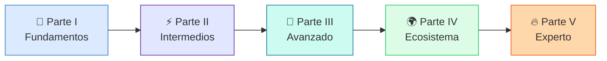

<div class="hero" markdown>

# :material-language-rust:{ .lg } Aprende Rust

<p class="subtitle">De Python a Rust — Guía completa para desarrolladores de sistemas</p>

<div class="badges">
  <span class="badge rust">Rust 2024+</span>
  <span class="badge axum">Axum</span>
  <span class="badge tokio">Tokio</span>
  <span class="badge py">Desde Python</span>
</div>

</div>

<div class="stats-grid" markdown>

<div class="stat-card" markdown>
<div class="number">20</div>
<div class="label">Capítulos</div>
</div>

<div class="stat-card" markdown>
<div class="number">10</div>
<div class="label">Semanas</div>
</div>

<div class="stat-card" markdown>
<div class="number">100+</div>
<div class="label">Ejercicios</div>
</div>

<div class="stat-card" markdown>
<div class="number">120+</div>
<div class="label">Flashcards</div>
</div>

<div class="stat-card" markdown>
<div class="number">20</div>
<div class="label">Quizzes</div>
</div>

<div class="stat-card" markdown>
<div class="number">1</div>
<div class="label">Proyecto real</div>
</div>

</div>

---

## 🎯 ¿Para quién es este libro?

Este libro está diseñado para **desarrolladores que ya saben programar** (especialmente en Python/Django) y quieren dominar Rust a nivel profesional. No es un libro de programación básica: asume que entiendes variables, funciones, bucles, clases y conceptos de web.

!!! tip "Tu perfil ideal"
    - :mortar_board: Estudiante de ingeniería o desarrollador junior/mid
    - :snake: Conocimiento medio-avanzado en Python/Django
    - 🌐 Quieres hacer backend de alto rendimiento (Axum) y/o sistemas
    - :rocket: Necesitas Rust para un proyecto real (como RustMenu)

---

## :world_map: Ruta de aprendizaje

<div class="roadmap-path" markdown>

<div class="roadmap-step" markdown>
<div class="roadmap-dot part-i">I</div>
<div class="roadmap-content" markdown>

#### :blue_book: Parte I — Fundamentos (Semanas 1-2)

Capítulos 1-4 · Ownership, borrowing, tipos, funciones, closures

</div>
</div>

<div class="roadmap-step" markdown>
<div class="roadmap-dot part-ii">II</div>
<div class="roadmap-content" markdown>

#### :purple_circle: Parte II — Tipos intermedios (Semanas 3-4)

Capítulos 5-8 · Structs, enums, traits, genéricos, manejo de errores

</div>
</div>

<div class="roadmap-step" markdown>
<div class="roadmap-dot part-iii">III</div>
<div class="roadmap-content" markdown>

#### :large_blue_diamond: Parte III — Avanzado (Semanas 5-7)

Capítulos 9-13 · Colecciones, iteradores, lifetimes, smart pointers, concurrencia

</div>
</div>

<div class="roadmap-step" markdown>
<div class="roadmap-dot part-iv">IV</div>
<div class="roadmap-content" markdown>

#### :green_book: Parte IV — Ecosistema (Semana 8)

Capítulos 14-16 · Async/Tokio, Axum, proyecto final RustMenu fullstack

</div>
</div>

<div class="roadmap-step" markdown>
<div class="roadmap-dot part-v">V</div>
<div class="roadmap-content" markdown>

#### :fire: Parte V — Nivel Experto (Semanas 9-10)

Capítulos 17-20 · Unsafe, FFI, macros, rendimiento, testing avanzado, publicar tu crate

</div>
</div>

</div>



---

## :sparkles: ¿Qué hace diferente a este libro?

### :brain: Sistema de aprendizaje basado en evidencia

Este libro integra técnicas de aprendizaje probadas por la investigación en ciencias cognitivas:

| Técnica | Implementación | Base científica |
|---------|---------------|-----------------|
| **Repetición espaciada** | 120+ flashcards interactivas por capítulo | Ebbinghaus, Leitner System |
| **Recuerdo activo** | Ejercicios que te obligan a escribir antes de ver la solución | Roediger & Karpicke (2006) |
| **Interrogación elaborativa** | Comparaciones Python ↔ Rust que te hacen preguntar "¿por qué?" | Pressley et al. (1987) |
| **Entrelazado** | Ejercicios que mezclan conceptos de capítulos anteriores | Rohrer & Taylor (2007) |
| **Ejemplos concretos** | Todo se aplica a RustMenu, un proyecto de API real | Chi et al. (1989) |
| **Doble codificación** | Diagramas Mermaid + código + texto explicativo | Paivio (1971) |

### 📊 Taxonomía de Bloom — Niveles de aprendizaje

Cada ejercicio está etiquetado con su nivel cognitivo:

<div class="stats-grid" markdown>

<div class="stat-card" markdown>
<span class="bloom-badge remember">Recordar</span>
<div class="label" style="margin-top: 0.5rem;">Definir, identificar, nombrar</div>
</div>

<div class="stat-card" markdown>
<span class="bloom-badge understand">Comprender</span>
<div class="label" style="margin-top: 0.5rem;">Explicar, comparar, interpretar</div>
</div>

<div class="stat-card" markdown>
<span class="bloom-badge apply">Aplicar</span>
<div class="label" style="margin-top: 0.5rem;">Implementar, usar, resolver</div>
</div>

<div class="stat-card" markdown>
<span class="bloom-badge analyze">Analizar</span>
<div class="label" style="margin-top: 0.5rem;">Depurar, refactorizar, optimizar</div>
</div>

<div class="stat-card" markdown>
<span class="bloom-badge evaluate">Evaluar</span>
<div class="label" style="margin-top: 0.5rem;">Criticar, comparar enfoques, elegir</div>
</div>

<div class="stat-card" markdown>
<span class="bloom-badge create">Crear</span>
<div class="label" style="margin-top: 0.5rem;">Diseñar, construir, inventar</div>
</div>

</div>

### :snake: Comparaciones Python ↔ Rust

Cada concepto nuevo incluye su equivalente en Python para que ancles el conocimiento:

<div class="comparison" markdown>
<div class="lang-box python" markdown>

#### :snake: En Python

```python
class Mesa:
    def __init__(self, numero: int, zona: str, capacidad: int):
        self.numero = numero
        self.zona = zona
        self.capacidad = capacidad
```

</div>
<div class="lang-box rust" markdown>

#### :crab: En Rust

```rust
struct Mesa {
    numero: i32,
    zona: Zona,
    capacidad: i32,
}
```

</div>
</div>

### :video_game: Ejercicios variados

No solo "escribe una función". Este libro incluye:

- :pencil: **Implementación** — Escribe código desde cero
- :bug: **Depuración** — Encuentra y corrige errores del compilador
- :recycle: **Refactorización** — Convierte Python a Rust idiomático
- :jigsaw: **Retos de ownership** — Puzzles de ownership y lifetimes
- :building_construction: **Mini-proyectos** — Construye features completas para RustMenu
- :brain: **Quizzes interactivos** — Autoevaluación con feedback inmediato

---

## :link: Recursos curados

Links reales y verificados a:

- [The Rust Programming Language](https://doc.rust-lang.org/book/) — El libro oficial
- [Rust by Example](https://doc.rust-lang.org/rust-by-example/) — Aprende con ejemplos
- [Rustlings](https://github.com/rust-lang/rustlings) — Ejercicios interactivos oficiales
- [Exercism Rust Track](https://exercism.org/tracks/rust) — Práctica con mentorías

---

## :compass: Cómo usar este libro

!!! info "Ruta recomendada"
    1. **Lee el [plan de estudio](plan.md)** para tener una visión global
    2. **Sigue los capítulos en orden** — cada uno construye sobre el anterior
    3. **Haz los ejercicios** — no los saltes, el aprendizaje activo es clave
    4. **Usa las flashcards** — revisa a los 1, 3, 7 y 14 días (spaced repetition)
    5. **Responde los quizzes** — son tu termómetro de comprensión
    6. **Aplica a RustMenu** — cada concepto debería acabar en código real
    7. **Consulta la [referencia rápida](referencia-rapida.md)** — tu cheat sheet siempre a mano

!!! warning "No hagas esto"
    - No saltes a Axum/Tokio sin dominar las Partes I y II
    - No copies y pegues los ejercicios — escríbelos tú
    - No ignores los errores del compilador — son tu mejor profesor
    - No uses `.unwrap()` en código de producción — es como quitarte el cinturón de seguridad

!!! keyboard "Atajos de teclado"
    - ++alt+f++ — Siguiente flashcard
    - ++alt+r++ — Revelar/ocultar todas las flashcards

---

<div class="site-footer" markdown>

*Creado con :crab: para desarrolladores que vienen de Python.*

*Inspirado en [aprendepython.es](https://aprendepython.es/) · 2026*

</div>
