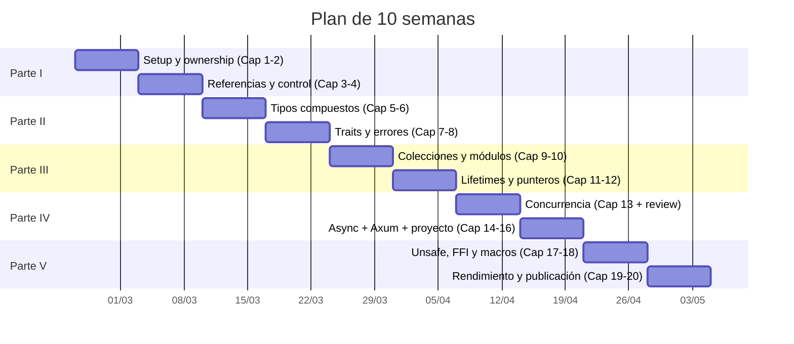
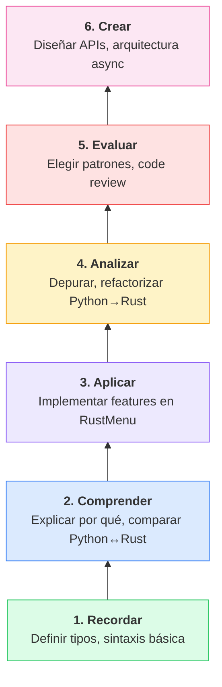
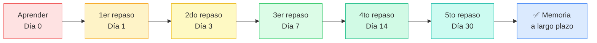

# :calendar: Plan de estudio: 10 semanas

!!! abstract "Objetivo"
    Llevar tu Rust de **cero a nivel experto** en 10 semanas, dedicando **1-2 horas diarias**. Cada semana tiene objetivos claros, capítulos asociados, un **reto de mitad de semana** y un checkpoint de verificación.

#### 🎯 Lo que conseguirás al completar este plan

- Dominar ownership, borrowing y lifetimes a nivel profesional
- Construir un proyecto REST API (RustMenu) con Axum y tipado seguro
- Entender y aplicar traits, genéricos y trait bounds en código real
- Programar con async/await usando Tokio de forma idiomática
- Manejar errores con `Result`, `?`, `thiserror` y `anyhow`
- Usar smart pointers (Box, Rc, Arc, RefCell) y concurrencia segura
- Escribir macros declarativas y procedurales
- Crear, testear y publicar tu propio crate en crates.io

---

## :brain: Taxonomía de Bloom — Tu progresión cognitiva

Cada semana te lleva a un nivel más alto de pensamiento. Los ejercicios están clasificados según la [Taxonomía de Bloom](https://es.wikipedia.org/wiki/Taxonom%C3%ADa_de_Bloom):

| Semana | Nivel Bloom dominante | Tipo de ejercicios |
|--------|:---------------------:|---------------------|
| 1-2 | Recordar Comprender | Definir ownership, explicar diferencias Python vs Rust |
| 3-4 | Comprender Aplicar | Implementar structs con traits, manejar errores |
| 5-6 | Aplicar Analizar | Diseñar módulos, analizar lifetimes |
| 7 | Analizar Evaluar | Elegir patrones de concurrencia, comparar enfoques |
| 8 | Evaluar Crear | Diseñar arquitectura REST, crear proyecto completo |
| 9 | Crear Evaluar | Diseñar macros, interoperar con Python (PyO3) |
| 10 | Crear Evaluar | Optimizar rendimiento, publicar crate |

---

## Semana 1: Setup y ownership — Capítulos 1-2

### :blue_book: Parte I — Semana 1 de 2

| Día | Contenido | Nivel Bloom | Tiempo |
|-----|-----------|:-----------:|--------|
| **Lun** | Instalar Rust, `rustup`, `cargo new`, estructura de proyecto | Recordar | 1.5h |
| **Mar** | Variables, mutabilidad, shadowing, tipos escalares (`i32`, `f64`, `bool`, `char`) | Recordar | 1.5h |
| **Mié** | Tipos compuestos básicos: tuplas, arrays, `String` vs `&str` | Comprender | 1.5h |
| **Jue** | Ownership, moves, `Copy` vs `Clone`, stack vs heap | Comprender | 1.5h |
| **Vie** | :zap: **RETO MITAD DE SEMANA**: Escribir un programa que modele un `Plato` de RustMenu con ownership correcto — sin mirar docs | Aplicar | 1h |
| **Sáb** | 5 ejercicios de los capítulos 1-2 | Aplicar | 2h |
| **Dom** | Revisar flashcards + explicar ownership en voz alta (Feynman) | Comprender | 1h |

!!! success "Checkpoint semanal"
    Has completado la semana. Verifica tu progreso:

<h4>✅ Autoevaluación</h4>
<label><input type="checkbox"> Puedo crear un proyecto con `cargo new` y compilarlo sin errores</label>
<label><input type="checkbox"> Sé la diferencia entre `String` y `&str`</label>
<label><input type="checkbox"> Puedo explicar ownership y moves a un compañero</label>
<label><input type="checkbox"> Entiendo cuándo un tipo implementa `Copy` vs cuándo necesita `Clone`</label>

## Semana 2: Referencias y control de flujo — Capítulos 3-4

### :blue_book: Parte I — Semana 2 de 2

| Día | Contenido | Nivel Bloom | Tiempo |
|-----|-----------|:-----------:|--------|
| **Lun** | Referencias `&T` y `&mut T`, reglas de borrowing | Recordar | 1.5h |
| **Mar** | Slices: `&[T]`, `&str`, iteración sobre slices | Comprender | 1.5h |
| **Mié** | Funciones, closures `|x| x + 1`, `Fn`/`FnMut`/`FnOnce` | Aplicar | 1.5h |
| **Jue** | `match`, `if let`, `while let`, `loop`, `for` | Aplicar | 1.5h |
| **Vie** | :zap: **RETO**: Modelar el menú de RustMenu con funciones que filtran platos por categoría usando closures y slices | Crear | 1.5h |
| **Sáb** | [Rustlings](https://github.com/rust-lang/rustlings) — completar secciones `variables`, `move_semantics`, `primitive_types` | Comprender | 3h |
| **Dom** | Revisar flashcards semanas 1-2 + quiz de autoevaluación | Evaluar | 1h |

!!! success "Checkpoint semanal"
    Has completado la semana. Verifica tu progreso:

<h4>✅ Autoevaluación</h4>
<label><input type="checkbox"> Puedo explicar las reglas de borrowing sin dudar</label>
<label><input type="checkbox"> Sé escribir closures y entiendo `Fn` vs `FnMut` vs `FnOnce`</label>
<label><input type="checkbox"> Puedo usar `match` con pattern matching exhaustivo</label>
<label><input type="checkbox"> He completado las secciones de Rustlings correspondientes</label>

## Semana 3: Tipos compuestos — Capítulos 5-6

### :purple_circle: Parte II — Semana 1 de 2

| Día | Contenido | Nivel Bloom | Tiempo |
|-----|-----------|:-----------:|--------|
| **Lun** | Structs: definición, métodos `impl`, `self` vs `&self` vs `&mut self` | Comprender | 1.5h |
| **Mar** | Enums con datos, `Option<T>`, `Result<T, E>` | Comprender | 1.5h |
| **Mié** | Pattern matching avanzado: guards, `@` bindings, nested patterns | Aplicar | 1.5h |
| **Jue** | `if let`, destructuring de structs y enums, `let-else` | Aplicar | 1.5h |
| **Vie** | :zap: **RETO**: Implementar `Pedido` de RustMenu con enum de estados (`Pendiente`, `EnPreparacion`, `Listo`, `Entregado`) y transiciones válidas | Crear | 1.5h |
| **Sáb** | Rustlings — completar secciones `structs`, `enums`, `options` | Analizar | 2h |
| **Dom** | Revisar flashcards semanas 1-3 (spaced repetition día 7) | Recordar | 1h |

!!! success "Checkpoint semanal"
    Has completado la semana. Verifica tu progreso:

<h4>✅ Autoevaluación</h4>
<label><input type="checkbox"> He implementado el enum `EstadoPedido` con transiciones en RustMenu</label>
<label><input type="checkbox"> Sé usar `Option<T>` y `Result<T, E>` idiomáticamente</label>
<label><input type="checkbox"> Puedo hacer pattern matching con guards y bindings</label>
<label><input type="checkbox"> He completado las secciones de Rustlings correspondientes</label>

## Semana 4: Traits y manejo de errores — Capítulos 7-8

### :purple_circle: Parte II — Semana 2 de 2

| Día | Contenido | Nivel Bloom | Tiempo |
|-----|-----------|:-----------:|--------|
| **Lun** | Traits: definición, implementación, traits estándar (`Display`, `Debug`, `Clone`) | Comprender | 1.5h |
| **Mar** | Genéricos `<T>`, trait bounds `T: Display + Clone`, `where` clauses | Aplicar | 1.5h |
| **Mié** | Manejo de errores: `Result`, operador `?`, propagación | Aplicar | 1.5h |
| **Jue** | `thiserror` para errores de librería, `anyhow` para aplicaciones | Analizar | 1.5h |
| **Vie** | :zap: **RETO**: Crear trait `Validable` para RustMenu y errores personalizados con `thiserror` para cada entidad | Analizar | 1.5h |
| **Sáb** | Rustlings — completar secciones `traits`, `generics`, `error_handling` | Analizar | 2.5h |
| **Dom** | Revisar flashcards semanas 1-4 (día 14 para sem 1) + quiz Parte II | Evaluar | 1h |

!!! success "Checkpoint semanal"
    Has completado la semana. Verifica tu progreso:

<h4>✅ Autoevaluación</h4>
<label><input type="checkbox"> Todo el código de RustMenu usa errores personalizados con `thiserror`</label>
<label><input type="checkbox"> He implementado traits genéricos con bounds</label>
<label><input type="checkbox"> Sé cuándo usar `thiserror` vs `anyhow`</label>
<label><input type="checkbox"> He completado las secciones de Rustlings correspondientes</label>

---

!!! example "Punto de control: Mitad del camino"
    Si has llegado aquí, ya tienes un nivel **intermedio sólido** de Rust. Tómate un día para:

    1. :recycle: Revisar todo el código de RustMenu escrito hasta ahora
    2. :brain: Hacer una sesión de flashcards completa (semanas 1-4)
    3. :writing_hand: Escribir un resumen de 1 página de todo lo aprendido (Teach-Back)

---

## Semana 5: Colecciones e iteradores — Capítulos 9-10

### :large_blue_diamond: Parte III — Semana 1 de 2

| Día | Contenido | Nivel Bloom | Tiempo |
|-----|-----------|:-----------:|--------|
| **Lun** | `Vec<T>`, `HashMap<K, V>`, `HashSet<T>`, `BTreeMap` | Comprender | 1.5h |
| **Mar** | Iteradores: `iter()`, `into_iter()`, `iter_mut()`, adaptadores `map`/`filter`/`fold` | Aplicar | 1.5h |
| **Mié** | Módulos: `mod`, `pub`, `use`, visibilidad, `pub(crate)` | Aplicar | 1.5h |
| **Jue** | Crates, workspaces, `Cargo.toml`, dependencias, features | Aplicar | 1.5h |
| **Vie** | :zap: **RETO**: Reorganizar RustMenu como workspace con crates `core`, `api` y `cli` + iteradores para estadísticas del menú | Crear | 1.5h |
| **Sáb** | Leer código fuente de un crate popular (e.g., `serde` o `clap`) | Analizar | 2h |
| **Dom** | Flashcards semanas 3-5 + explicar iteradores a un compañero | Evaluar | 1h |

!!! success "Checkpoint semanal"
    Has completado la semana. Verifica tu progreso:

<h4>✅ Autoevaluación</h4>
<label><input type="checkbox"> RustMenu es un workspace con múltiples crates</label>
<label><input type="checkbox"> Puedo encadenar iteradores con `map`, `filter`, `fold`</label>
<label><input type="checkbox"> Sé la diferencia entre `iter()`, `into_iter()` e `iter_mut()`</label>
<label><input type="checkbox"> He leído y entendido código de un crate de crates.io</label>

## Semana 6: Lifetimes y smart pointers — Capítulos 11-12

### :large_blue_diamond: Parte III — Semana 2 de 2

| Día | Contenido | Nivel Bloom | Tiempo |
|-----|-----------|:-----------:|--------|
| **Lun** | Lifetimes explícitos `'a`, lifetime elision rules, `'static` | Comprender | 1.5h |
| **Mar** | Lifetimes en structs, bounds de lifetime, lifetime subtyping | Analizar | 1.5h |
| **Mié** | `Box<T>`: heap allocation, trait objects `Box<dyn Trait>` | Aplicar | 1.5h |
| **Jue** | `Rc<T>`, `Arc<T>`, `RefCell<T>`, interior mutability | Aplicar | 1.5h |
| **Vie** | :zap: **RETO**: Implementar un sistema de caché compartido para RustMenu usando `Arc<Mutex<HashMap>>` | Crear | 1.5h |
| **Sáb** | Rustlings — completar secciones `lifetimes`, `smart_pointers` | Analizar | 3h |
| **Dom** | Flashcards + quiz de autoevaluación Parte III | Evaluar | 1h |

!!! success "Checkpoint semanal"
    Has completado la semana. Verifica tu progreso:

<h4>✅ Autoevaluación</h4>
<label><input type="checkbox"> Puedo anotar lifetimes correctamente en funciones y structs</label>
<label><input type="checkbox"> Entiendo las 3 reglas de lifetime elision</label>
<label><input type="checkbox"> Sé cuándo usar `Box`, `Rc`, `Arc` y `RefCell`</label>
<label><input type="checkbox"> He implementado el caché compartido con `Arc<Mutex<_>>`</label>

## Semana 7: Concurrencia — Capítulo 13 + revisión

### :green_book: Parte IV — Semana 1 de 2

| Día | Contenido | Nivel Bloom | Tiempo |
|-----|-----------|:-----------:|--------|
| **Lun** | Threads: `std::thread::spawn`, `JoinHandle`, `move` closures | Comprender | 1.5h |
| **Mar** | Channels: `mpsc::channel`, `mpsc::sync_channel`, comunicación entre hilos | Aplicar | 1.5h |
| **Mié** | `Mutex<T>`, `RwLock<T>`, deadlocks, patrones de sincronización | Aplicar | 1.5h |
| **Jue** | `Send` y `Sync` traits, `Rayon` para paralelismo de datos | Analizar | 1.5h |
| **Vie** | :zap: **RETO**: Implementar procesamiento paralelo de pedidos en RustMenu con `Rayon` y channels para notificaciones | Crear | 2h |
| **Sáb** | Revisión completa de Parte I-III + refactorización de RustMenu | Evaluar | 3h |
| **Dom** | Flashcards completas (todas las semanas) | Recordar | 1h |

!!! success "Checkpoint semanal"
    Has completado la semana. Verifica tu progreso:

<h4>✅ Autoevaluación</h4>
<label><input type="checkbox"> Puedo crear threads y comunicarlos con channels</label>
<label><input type="checkbox"> Sé usar `Mutex` y `RwLock` sin deadlocks</label>
<label><input type="checkbox"> Entiendo por qué `Send` y `Sync` son importantes</label>
<label><input type="checkbox"> He paralelizado operaciones de RustMenu con Rayon</label>

## Semana 8: Async, Axum y proyecto final — Capítulos 14-16

### :green_book: Parte IV — Semana 2 de 2

| Día | Contenido | Nivel Bloom | Tiempo |
|-----|-----------|:-----------:|--------|
| **Lun** | Async/await, `Future` trait, runtime Tokio, `#[tokio::main]` | Aplicar | 1.5h |
| **Mar** | Axum: router, handlers, extractors, `State`, `Json` | Aplicar | 1.5h |
| **Mié** | Middleware, capas, `tower::Service`, manejo de errores en Axum | Crear | 2h |
| **Jue** | Conectar RustMenu: rutas CRUD, SQLx/SeaORM, migraciones | Crear | 1.5h |
| **Vie** | :zap: **RETO FINAL**: Deploy completo de RustMenu REST API + documentar arquitectura | Crear | 2h |
| **Sáb** | Revisión final del proyecto + code review personal + testing con `cargo test` | Evaluar | 3h |
| **Dom** | 🏆 Retrospectiva: escribir qué aprendiste y qué repetirías diferente | Evaluar | 1h |

!!! success "Checkpoint semanal"
    Has completado la semana. Verifica tu progreso:

<h4>✅ Autoevaluación</h4>
<label><input type="checkbox"> RustMenu API REST completa con Axum + base de datos</label>
<label><input type="checkbox"> Tests pasando con `cargo test`</label>
<label><input type="checkbox"> Proyecto documentado y deployable</label>
<label><input type="checkbox"> Puedo escribir handlers async con Axum idiomáticamente</label>
<label><input type="checkbox"> Puedo explicar async/await en Rust a un compañero</label>

---

!!! example "Punto de control: Proyecto completo"
    Si has llegado aquí, tu proyecto **RustMenu** está funcionando como REST API. Ahora vamos a llevarte al **nivel experto**:

    1. :brain: Revisa todo el código que has escrito — ¿dónde podrías mejorar el diseño?
    2. :fire: Prepárate para pensar como un **systems programmer**, no solo un desarrollador de aplicaciones
    3. 🏆 Las próximas 2 semanas te separan de un nivel junior/mid a un nivel **senior/staff**

---

## Semana 9: Unsafe, FFI y macros — Capítulos 17-18

### :fire: Parte V — Semana 1 de 2

| Día | Contenido | Nivel Bloom | Tiempo |
|-----|-----------|:-----------:|--------|
| **Lun** | `unsafe` Rust: raw pointers, `unsafe fn`, `unsafe impl`, cuándo usarlo | Analizar | 1.5h |
| **Mar** | FFI: `extern "C"`, `#[no_mangle]`, llamar C desde Rust y viceversa | Aplicar | 1.5h |
| **Mié** | PyO3: escribir extensiones de Python en Rust, `#[pyfunction]`, `#[pyclass]` | Crear | 1.5h |
| **Jue** | Macros declarativas: `macro_rules!`, repeticiones, patterns | Crear | 2h |
| **Vie** | :zap: **RETO**: Crear macro `rustmenu_route!` que genere handlers CRUD + exponer funciones de RustMenu a Python con PyO3 | Crear | 2h |
| **Sáb** | Macros procedurales: derive macros, attribute macros, `syn`/`quote` | Evaluar | 3h |
| **Dom** | Flashcards semanas 7-9 + ejercicios de macros | Evaluar | 1.5h |

!!! success "Checkpoint semanal"
    Has completado la semana. Verifica tu progreso:

<h4>✅ Autoevaluación</h4>
<label><input type="checkbox"> Puedo explicar cuándo `unsafe` es necesario y cuándo evitarlo</label>
<label><input type="checkbox"> He creado una extensión Python funcional con PyO3</label>
<label><input type="checkbox"> Sé escribir macros declarativas con `macro_rules!`</label>
<label><input type="checkbox"> Puedo crear derive macros básicas con `syn` y `quote`</label>

## Semana 10: Rendimiento, testing avanzado y publicación — Capítulos 19-20

### :fire: Parte V — Semana 2 de 2

| Día | Contenido | Nivel Bloom | Tiempo |
|-----|-----------|:-----------:|--------|
| **Lun** | Benchmarking con `criterion`, perfilado con `flamegraph`, `cargo bench` | Analizar | 1.5h |
| **Mar** | Optimizaciones: `#[inline]`, SIMD, allocator-aware, zero-copy patterns | Analizar | 1.5h |
| **Mié** | Testing avanzado: `proptest`, `cargo-mutants`, integration tests, doc tests | Evaluar | 1.5h |
| **Jue** | `cargo publish`: `Cargo.toml` metadata, docs.rs, semver, CI/CD con GitHub Actions | Aplicar | 2h |
| **Vie** | :zap: **RETO FINAL**: Crear crate `rustmenu-core` — extraer lógica reutilizable con benchmarks y tests completos | Crear | 2.5h |
| **Sáb** | Publicación: documentación con `///`, examples, README, checklist de crate | Crear | 3h |
| **Dom** | 🏆 Retrospectiva final: portfolio, logros, plan de crecimiento continuo | Evaluar | 1h |

!!! success "Checkpoint final"
    Has completado el plan. Verifica tu progreso final:

<h4>🏆 Autoevaluación final</h4>
<label><input type="checkbox"> He creado `rustmenu-core` con API pública bien documentada</label>
<label><input type="checkbox"> Los benchmarks con `criterion` muestran rendimiento aceptable</label>
<label><input type="checkbox"> Sé optimizar Rust con flamegraphs y profiling</label>
<label><input type="checkbox"> Puedo publicar un crate con `cargo publish` y metadata correcto</label>
<label><input type="checkbox"> Tests avanzados con `proptest` y doc tests completos</label>
<label><input type="checkbox"> Me siento preparado para un rol senior en Rust</label>

---

## 🎯 Dificultad por capítulo

| Capítulo | Dificultad | Ejercicios | Flashcards | Bloom máximo | Concepto clave |
|----------|:----------:|:----------:|:----------:|:------------:|----------------|
| 01 Bienvenido a Rust | Fácil | 5 | 5 | Comprender | Setup, cargo, variables |
| 02 Ownership y moves | Fácil | 5 | 5 | Aplicar | Ownership, Copy, Clone |
| 03 Referencias y borrowing | Fácil | 5 | 5 | Aplicar | &T, &mut T, slices |
| 04 Control de flujo | Medio | 5 | 5 | Aplicar | Closures, match, loops |
| 05 Structs y métodos | Medio | 5 | 5 | Analizar | Structs, impl, self |
| 06 Enums y pattern matching | Medio | 5 | 5 | Analizar | Option, Result, if let |
| 07 Traits y genéricos | Medio | 5 | 5 | Analizar | Traits, bounds, where |
| 08 Manejo de errores | Medio | 5 | 5 | Analizar | ?, thiserror, anyhow |
| 09 Colecciones e iteradores | Avanzado | 5 | 5 | Evaluar | Vec, HashMap, map/filter |
| 10 Módulos y crates | Avanzado | 5 | 5 | Evaluar | mod, pub, workspaces |
| 11 Lifetimes | Avanzado | 5 | 7 | Evaluar | 'a, elision, 'static |
| 12 Smart pointers | Avanzado | 5 | 7 | Evaluar | Box, Rc, Arc, RefCell |
| 13 Concurrencia | Experto | 5 | 7 | Crear | Threads, Mutex, Send/Sync |
| 14 Async y Tokio | Experto | 5 | 7 | Crear | async/await, Future, Tokio |
| 15 Axum web | Avanzado | 5 | 5 | Crear | Router, handlers, middleware |
| 16 Proyecto RustMenu | Experto | 5 | 5 | Crear | REST API end-to-end |
| 17 Unsafe y FFI | Experto | 5 | 7 | Crear | Raw pointers, extern, PyO3 |
| 18 Macros | Experto | 5 | 7 | Crear | macro_rules!, derive, syn |
| 19 Rendimiento | Experto | 5 | 7 | Crear | criterion, flamegraph, SIMD |
| 20 Testing y publicación | Experto | 5 | 6 | Crear | proptest, cargo publish |
| **TOTAL** | | **100** | **121** | | |

---

## :brain: Técnicas de aprendizaje basadas en evidencia

### 1. Spaced Repetition (Repetición espaciada)

!!! info "La ciencia"
    La curva del olvido de Ebbinghaus muestra que olvidamos ~70% en 24h sin repaso. La repetición espaciada combate esto revisando en intervalos crecientes.

**Cómo implementarlo con este libro:**

1. Cada capítulo tiene **5-7 flashcards interactivas** al final
2. Usa las flashcards del libro (haz click para revelar la respuesta)
3. También puedes exportarlas a [Anki](https://apps.ankiweb.net/) con este formato:

| Frente | Reverso |
|--------|---------|
| ¿Qué es ownership en Rust? | Cada valor tiene un único dueño; cuando el dueño sale del scope, el valor se libera |
| ¿Diferencia entre `&T` y `&mut T`? | `&T` es referencia compartida (muchas a la vez). `&mut T` es referencia exclusiva (solo una) |
| ¿Qué hace el operador `?`? | Propaga el error: si `Result` es `Err`, retorna el error; si es `Ok`, extrae el valor |

### 2. Active Recall (Recuerdo activo)

!!! info "La ciencia"
    Roediger & Karpicke (2006) demostraron que el esfuerzo de *recordar* fortalece la memoria mucho más que *releer*. Por eso los ejercicios te piden escribir antes de ver la solución.

**Protocolo de cada sesión de estudio:**

1. :clock1: **5 min** — Escribe de memoria los conceptos clave de la sesión anterior
2. :book: **40 min** — Lee el contenido nuevo del capítulo
3. :pencil: **30 min** — Haz los ejercicios SIN mirar el capítulo
4. :mag: **10 min** — Compara tus respuestas con las soluciones
5. :brain: **5 min** — Flashcards de repaso

### 3. Elaborative Interrogation (Interrogación elaborativa)

!!! info "La ciencia"
    Pressley et al. (1987) demostraron que preguntarse *"¿por qué funciona así?"* mejora la comprensión profunda.

**Cómo usar las comparaciones Python → Rust:**

Cada vez que veas una comparación Python → Rust en el libro, hazte estas preguntas:

- ¿Por qué Rust necesita ownership y Python no?
- ¿Qué garantía de seguridad da esto en tiempo de compilación?
- ¿Qué bugs previene que Python solo detectaría en runtime?

### 4. Interleaving (Entrelazado)

!!! info "La ciencia"
    Rohrer & Taylor (2007) demostraron que mezclar tipos de problemas mejora la transferencia de conocimiento.

Los ejercicios de cada capítulo incluyen deliberadamente problemas que requieren conceptos de capítulos anteriores. Esto no es un error — es diseño intencional.

### 5. Proyecto-Driven Learning

**No aprendas en abstracto.** Cada capítulo debe resultar en código real para RustMenu. La regla es:

> Si aprendes un concepto, lo aplicas al proyecto **ese mismo día**.

### 6. Teach-Back Method (Método Feynman)

Explica cada concepto en voz alta como si enseñaras a alguien. Si no puedes explicarlo de forma sencilla, no lo has entendido.

!!! quote "Richard Feynman"
    *"Si no puedes explicarlo de forma sencilla, no lo entiendes lo suficiente."*

**Ejercicio semanal**: Cada domingo, elige 3 conceptos de la semana y explícalos en voz alta durante 2 minutos cada uno, sin mirar notas.

---

## ⌨️ Atajos de teclado

| Atajo | Acción |
|-------|--------|
| ++alt+f++ | Saltar a la siguiente flashcard |
| ++alt+r++ | Revelar/ocultar todas las flashcards |

---

## 🏆 Sistema de logros

Marca tus logros a medida que avanzas:

<h4>🏅 Logros desbloqueados</h4>
<label><input type="checkbox"> **Primer compile** — Has compilado tu primer programa Rust sin errores</label>
<label><input type="checkbox"> **Ownership master** — Puedes explicar ownership, moves y borrowing sin dudar</label>
<label><input type="checkbox"> **Pattern matcher** — Has implementado máquinas de estado con enums en RustMenu</label>
<label><input type="checkbox"> **Trait designer** — Has creado traits genéricos con bounds complejos</label>
<label><input type="checkbox"> **Error wrangler** — Errores personalizados con `thiserror` en todo RustMenu</label>
<label><input type="checkbox"> **Iterator ninja** — Puedes encadenar 5+ adaptadores de iteradores sin pestañear</label>
<label><input type="checkbox"> **Lifetime whisperer** — Anotas lifetimes correctamente a la primera</label>
<label><input type="checkbox"> **Concurrency hero** — Has paralelizado código con threads, channels y Rayon</label>
<label><input type="checkbox"> **Async architect** — RustMenu REST API completa con Axum y Tokio</label>
<label><input type="checkbox"> **Unsafe surgeon** — Sabes cuándo usar `unsafe` y lo haces con precisión quirúrgica</label>
<label><input type="checkbox"> **Macro wizard** — Has creado macros declarativas y procedurales funcionales</label>
<label><input type="checkbox"> **Performance guru** — Has optimizado con `criterion` y `flamegraph`</label>
<label><input type="checkbox"> **Crate author** — Has publicado `rustmenu-core` en crates.io</label>

